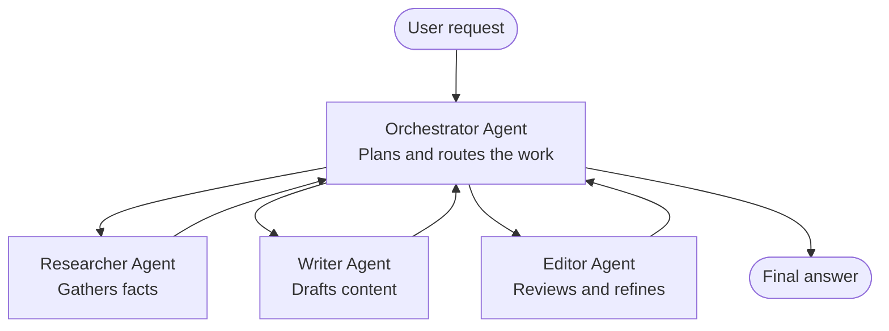

# Основи багаток агентних систем — Розгортайте вашу першу скоординовану систему ШІ

**Навігація по розділу:**
- **📚 Головна сторінка курсу**: [AZD для початківців](../../README.md)
- **📖 Поточний розділ**: Розділ 5 — Багаток агентні AI рішення
- **⬅️ Попередній**: [Розділ 4: Інфраструктура](../chapter-04-infrastructure/README.md)
- **➡️ Наступний**: [Шаблони координації](../chapter-06-pre-deployment/coordination-patterns.md)

> Керівництво по командам перевірено за допомогою випущеного `azd 1.37.2` довідника. Хмарні розгортання не виконувалися.

## Вступ

У попередніх розділах ви розгорнули одну програму — а в Розділі 2 ви розгорнули одного AI агента. Це завдання робить наступний крок: розгортання **багаток агентної системи**, де кілька спеціалізованих агентів працюють разом, щоб розв’язати завдання, з яким один агент не зміг би впоратися ефективно.

Гарна новина для початківців: **вам не потрібні нові команди.** Багаток агентне рішення все ще є проєктом azd. Ви будете `azd init`, `azd up`, тестувати та `azd down` — саме таким робочим процесом, який ви вже знаєте. Змінюється лише *форма* додатку всередині.

## Цілі навчання

Наприкінці цього заняття ви:
- Зрозумієте, що означає «багаток агентна» система і коли варта додаткова складність
- Визначите типові ролі в багаток агентній системі (оркестратор + спеціалісти)
- Розгорнете реальний, робочий багаток агентний шаблон з `azd up`
- Зрозумієте Azure ресурси, які підтримують багаток агентний додаток
- Дізнаєтесь, як перевірити, налаштувати та безпечно демонтувати рішення

## Результати навчання

Після завершення цього заняття ви зможете:
- Пояснити різницю між одним агентом і багаток агентною системою
- Обрати між одним агентом із інструментами і справжнім багаток агентним дизайном
- Розгорнути та протестувати багаток агентний шаблон повністю за допомогою azd
- Визначити, де кожен агент запускається та як вони спілкуються
- Очистити всі ресурси, щоб уникнути подальших витрат

---

## Що таке багаток агентна система?

Один AI агент — це одна модель із набором інструкцій і (опціонально) кількома інструментами. Це добре працює для сфокусованих завдань. Але коли завдання ускладнюється — дослідження, потім написання, потім редагування, потім перевірка фактів — усе в одну підказку робить агента повільнішим, менш надійним і складнішим для налагодження.

**Багаток агентна система** ділить роботу між спеціалістами, кожен з яких виконує свою задачу добре, а координацію здійснює оркестратор:



### Дві ролі, які ви завжди побачите

| Роль | Завдання | Приклад |
|------|----------|---------|
| **Оркестратор** | Визначає *що буде далі* та маршрутизує роботу між агентами | «Спершу дослідження, потім написання, потім редагування» |
| **Спеціаліст** | Виконує одне сфокусоване завдання і повертає результат | «Дослідник», який тільки збирає факти |

### Чи справді вам потрібні кілька агентів?

Починайте з простого. Застосовуйте багаток агентну систему **тільки** коли виконується одна з цих умов:

- ✅ Завдання має **чіткі етапи**, що виграють від різних інструкцій (дослідження vs. написання vs. перевірка)
- ✅ Ви хочете, щоб спеціалісти працювали **паралельно**, щоб заощадити час
- ✅ Для різних кроків потрібні **різні інструменти або джерела даних**
- ✅ Кожен крок повинен бути **незалежно перевірним і налагоджуваним**

Якщо ваше завдання — проста відповідь на питання або виклик інструменту, то **один агент з інструментами** (Розділ 2) простіший, дешевший і легший у використанні.

> **Порада для початківців:** «Більше агентів» не означає «краще». Кожен агент додає затримку, витрати та новий об’єкт для моніторингу. Додавайте агентів лише тоді, коли завдання явно поділяється на частини.

---

## Два способи створення багаток агентних систем в Azure

| Підхід | Що це | Найкраще для |
|----------|-----------|----------|
| **Один агент + інструменти** | Один Foundry агент, який викликає функції/інструменти | Прості робочі процеси, початок роботи |
| **Кілька скоординованих агентів** | Кілька агентів з оркестратором | Чіткі етапи, паралельна робота, спеціалізація |

Цей урок фокусується на другому підході з використанням **готового шаблону**, щоб ви побачили справжню багаток агентну систему в дії перед створенням власної.

---

## Практика: Розгорніть робочий багаток агентний додаток

Ми розгорнемо **Contoso Creative Writer**, офіційний зразок Azure, який координує агенти з дослідження, продукту, написання і редагування для створення статті. Перед початком перевірте [передумови та витрати прикладу](https://github.com/Azure-Samples/contoso-creative-writer#azure-account-requirements): він потребує квоти моделей, Azure AI Search, доступу до Bing Grounding, Python, Docker та Bash-сумісних хуків. Наявність моделей і регіонів залежить від вашої підписки; розгортання не гарантується вибором певного регіону.

### Крок 1: Ініціалізуйте шаблон

```bash
# Create a working folder
mkdir creative-writer && cd creative-writer

# Initialize from the official multi-agent template
azd init --template Azure-Samples/contoso-creative-writer .
```

> Перегляньте більше багаток агентних шаблонів у будь-який час у [галереї Awesome AZD AI](https://azure.github.io/awesome-azd/?tags=ai). Інші дружні для початківців варіанти включають `get-started-with-ai-agents` і `azure-ai-travel-agents`.

### Крок 2: Аутентифікація

```bash
# Required for azd workflows
azd auth login

# Also required by this sample's Azure CLI hooks
az login
```

### Крок 3: Перевірте оточення

```bash
# init normally creates/selects an environment; confirm it before proceeding
azd env list
# Only if you need an additional environment:
# azd env new dev
```

### Крок 4: Попередній перегляд, потім розгортання

```bash
# See what will be created before spending anything (recommended)
azd provision --preview

# Provision infrastructure and deploy all agents in one step
azd up
```

`azd up` запропонує ввести відсутні налаштування підписки та регіону, потім створить ресурси і розгорне додаток. Попередній перегляд не резервує квоту і не гарантує успіху; хуки шаблону можуть працювати під час попереднього перегляду створення, тому спочатку перевірте їх. Щоб збільшити час очікування azd для кожного **розгортання служби** (не створення моделі):

```bash
azd deploy --timeout 1800
```

Таймаут зупиняє очікування azd; але не скасовує розгортання в Azure. Перед повторною спробою перевірте стан ресурсу.

> **Зауваження щодо витрат і потужності:** Багаток агентні додатки розгортають AI моделі, які споживають квоти і спричиняють витрати. Якщо `azd up` не вдається через квоти моделей, дивіться [Позбавлення від проблем зі ШІ](../chapter-07-troubleshooting/ai-troubleshooting.md) для виправлень регіону та квот, а також Розділ 6 [Планування потужності](../chapter-06-pre-deployment/capacity-planning.md).

---

## Розуміння того, що ви розгорнули

Типовий багаток агентний додаток такого типу створює набір Azure ресурсів, які прямо відповідають за функції за схемою вище:

| Ресурс | Чому він потрібен |
|----------|----------------|
| **Microsoft Foundry / Моделі** | Хостить мовні моделі, які використовує кожен агент |
| **Azure AI Search** | Дає агенту-досліднику доступ до обґрунтованих даних для пошуку |
| **Container Apps** (або App Service) | Хостить код оркестратора та агентів |
| **Cosmos DB** (у деяких прикладах) | Зберігає спільний стан/пам’ять, яку передають між агентами |
| **Application Insights** | Відстежує запити *між* агентами для налагодження потоку |

### Як агенти спілкуються між собою

У більшості багаток агентних прикладів azd, **оркестратор працює у коді вашого додатку** (наприклад, з використанням фреймворків як Semantic Kernel або Microsoft Agent Framework). Оркестратор по черзі викликає кожного спеціаліста, передає результати та формує остаточну відповідь. Агенти ділять контекст через:

- **Виклики функцій/інструментів** — оркестратор викликає спеціаліста і отримує результат назад
- **Спільна пам’ять** — база даних (часто Cosmos DB) зберігає стан, який можуть читати обидва агенти
- **Повідомлення/події** — для слабшого зв’язку агенти комунікують через чергу або Service Bus

> **Чому це важливо для налагодження:** оскільки кожен крок окремий, Application Insights показує, *який* агент працював повільно або зазнав збою. Це основна причина розділяти роботу між агентами.

---

## Перевірте розгортання

Переконайтеся, що система дійсно працює перед тим, як рухатися далі:

```bash
# Show the deployed endpoints
azd show

# Open the app's monitoring dashboard
azd monitor

# Open Application Insights Logs (not a terminal log stream)
azd monitor --logs
```

Потім відкрийте URL додатку з `azd show` і запитайте коротку статтю. Використайте режим налагодження прикладу для перегляду робочого процесу агентів. Пошук транзакцій Application Insights покаже окремі кроки, лише якщо приклад інструментально відстежує та корелює їх; azd не додає агенти-спени автоматично.

**Критерії успіху:**
- ✅ `azd show` перераховує доступну кінцеву точку
- ✅ Запит генерує результат, що явно пройшов кілька етапів
- ✅ В режимі налагодження показані кілька кроків агентів; якщо трасування увімкнено, перевірте відповідну телеметрію після обробки

---

## Налаштування: Додайте або відкоригуйте агента

Оскільки кожен агент — це лише інструкції з інструментами, налаштування досить просте:

1. **Знайдіть визначення агента** у шаблоні (часто це набір файлів `prompts/`, `agents/` або `*.prompty`).
2. **Налаштуйте інструкції агента** — наприклад, скажіть редакторському агенту підтримувати певний тон або ліміт слова.
3. **Перерозгорніть лише код** (інфраструктура не змінюється):

   ```bash
   azd deploy
   ```

Щоб просунутися далі зі своїм власним проєктом Foundry агента, використовуйте GA пакет з AZD 1.37.0+ в окремій порожній теці:

```bash
azd ext install microsoft.foundry
azd ai agent init
azd up
azd ai agent invoke      # test, with response timing
```

Дивіться [детальний посібник GA hosted-agent](../chapter-02-ai-development/microsoft-foundry-integration.md#hosted-agent-walkthrough-ga) для локального тестування Agent Inspector, віддаленого розгортання коду і управління очищенням. Посібник [AZD AI CLI reference](../chapter-08-production/production-ai-practices.md#azd-ai-cli-commands-and-extensions) також покриває розширення для окремих оцінок, оптимізацію та видалення агентів.

---

## Прибирання

Багаток агентні додатки запускають кілька платних служб. Видаліть усе, коли закінчите:

```bash
# Review the resources and confirm deletion interactively
azd down
```

Видалення є руйнівним. Для тимчасових лабораторій `azd down --force --purge` пропускає підтвердження видалення та підтримуване підтвердження очищення; очищення є незворотним там, де воно підтримується, і може бути заблоковане захистом від очищення. М’яке видалення більше стосується відновлення/повторного використання імені, а не доказу наявності постійних витрат. Перевірте наявність утримуваних ресурсів і білінг після очищення.

Якщо ви також ініціалізували hosted агент для існуючого проєкту Foundry, `azd down` залишає агента проєкту і інші ресурси на місці. Видаляйте лише ті ресурси, яких ви хочете позбутися і які належать вам окремо. Для нового проєкту Foundry, створеного AZD оточенням, `azd down` видаляє групу ресурсів і все всередині.

---

## Примітка про багаток агентні системи в продуктиві

Рішення [Retail Multi-Agent Solution](../../examples/retail-scenario.md) у цьому репозиторії є **архітектурним планом**, а не шаблоном для одноразового запуску — воно документує, як *був би* побудований виробничий роздрібний додаток (і чітко вказує, що повна збірка — це значне зусилля). Використовуйте його як орієнтир дизайну *після* того, як ви розгорнете тут робочий зразок. Для виробничих питань (надійність, вартість, моніторинг, управління), звертайтеся до [Розділу 8: Практики виробничого ШІ](../chapter-08-production/production-ai-practices.md).

---

## Коротко

- Система з кількома агентами розподіляє завдання між фахівцями, координованими одним оркестратором.
- Використовуйте її лише коли задача має чіткі етапи, паралелізм або різні інструменти на кожному кроці — інакше переважніше один агент.
- Робочий процес azd незмінний: `azd init` → `azd up` → тестування → `azd down`.
- Розумний шаблон, як `contoso-creative-writer`, дозволяє вам сьогодні побачити та налаштувати робочий мультиагентний додаток.
- Відстеження через Application Insights між агентами — одна з найбільших практичних переваг мультиагентної архітектури.

---

## 🔗 Навігація

| Напрям | Урок |
|-----------|--------|
| **Попередній** | [Розділ 4: Інфраструктура](../chapter-04-infrastructure/README.md) |
| **Наступний** | [Шаблони координації](../chapter-06-pre-deployment/coordination-patterns.md) |

## 📖 Пов’язані ресурси

- [Посібник з AI-агентів](../chapter-02-ai-development/agents.md)
- [Шаблони координації](../chapter-06-pre-deployment/coordination-patterns.md)
- [Практики виробництва AI](../chapter-08-production/production-ai-practices.md)
- [Виявлення помилок AI](../chapter-07-troubleshooting/ai-troubleshooting.md)

---

<!-- CO-OP TRANSLATOR DISCLAIMER START -->
**Відмова від відповідальності**:
Цей документ було перекладено за допомогою сервісу штучного інтелекту для перекладу [Co-op Translator](https://github.com/Azure/co-op-translator). Хоча ми прагнемо до точності, будь ласка, майте на увазі, що автоматичні переклади можуть містити помилки або неточності. Оригінальний документ рідною мовою слід вважати авторитетним джерелом. Для критично важливої інформації рекомендується професійний людський переклад. Ми не несемо відповідальності за будь-які непорозуміння або неправильні тлумачення, що виникли внаслідок використання цього перекладу.
<!-- CO-OP TRANSLATOR DISCLAIMER END -->