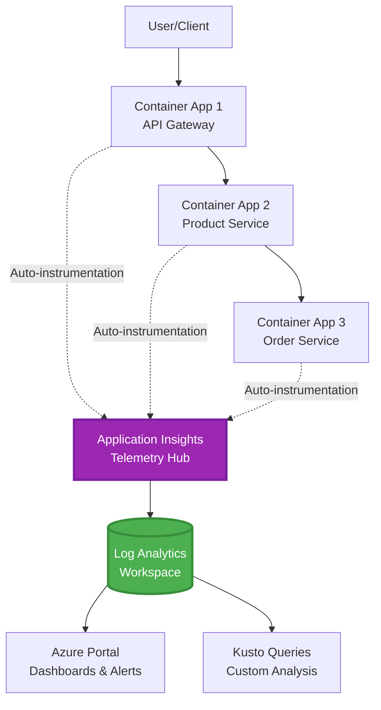
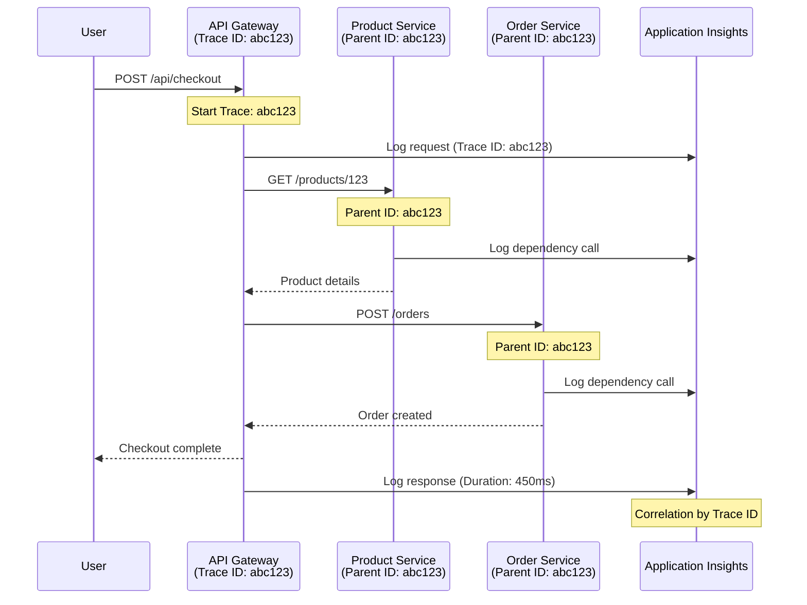

# Інтеграція Application Insights з AZD

⏱️ **Орієнтовний час**: 40-50 хвилин | 💰 **Вплив на вартість**: ~$5-15/місяць | ⭐ **Складність**: Середній рівень

**📚 Навчальний шлях:**
- ← Попередній: [Перевірки перед запуском](preflight-checks.md) - Перевірка перед розгортанням
- 🎯 **Ви тут**: Інтеграція Application Insights (Моніторинг, телеметрія, налагодження)
- → Наступний: [Посібник з розгортання](../chapter-04-infrastructure/deployment-guide.md) - Розгортання в Azure
- 🏠 [Головна сторінка курсу](../../README.md)

---

## Чого ви навчитеся

Завершивши цей урок, ви:
- Оголосите **Application Insights** у інфраструктурі AZD та налаштуєте інструментування SDK
- Налаштуєте **розподілене трасування** для мікросервісів
- Реалізуєте **користувацьку телеметрію** (метрики, події, залежності)
- Налаштуєте **live metrics** для моніторингу в реальному часі
- Створите **сповіщення та інформаційні панелі** для розгортань AZD
- Налагоджуватимете виробничі проблеми за допомогою **запитів телеметрії**
- Оптимізуєте **витрати та стратегії вибірки**
- Контролюватимете **AI/LLM додатки** (токени, затримки, витрати)

## Чому Application Insights з AZD важливий

### Виклик: Виробнича спостережливість

**Без Application Insights:**
```
❌ No visibility into production behavior
❌ Manual log aggregation across services
❌ Reactive debugging (wait for customer complaints)
❌ No performance metrics
❌ Cannot trace requests across services
❌ Unknown failure rates and bottlenecks
```

**З Application Insights + AZD:**
```
✅ Automatic telemetry collection
✅ Centralized logs from all services
✅ Proactive issue detection
✅ End-to-end request tracing
✅ Performance metrics and insights
✅ Real-time dashboards
✅ AZD provisions the monitoring declared in your templates
```

**Аналогія**: Application Insights – це як «чорна скринька» для вашого додатка + панель приладів у кабіні пілота. Ви бачите все, що відбувається в режимі реального часу, і можете відтворити будь-який інцидент.

---

## Огляд архітектури

### Application Insights у архітектурі AZD



### Що моніториться автоматично

Підтримуване автоінструментування фіксує запити/залежності для інструментованих бібліотек. Користувацькі події та метрики потребують коду додатка; тести доступності налаштовуються окремо. Не збирає всі рядки нижче просто тому, що ресурс існує.

| Тип телеметрії | Що фіксує | Сценарій використання |
|----------------|------------------|----------|
| **Запити** | HTTP-запити, коди статусу, тривалість | Моніторинг продуктивності API |
| **Залежності** | Зовнішні виклики (БД, API, сховище) | Виявлення вузьких місць |
| **Виключення** | Необроблені помилки з трасуванням стека | Налагодження збоїв |
| **Користувацькі події** | Бізнес-події (реєстрація, покупка) | Аналітика та конверсії |
| **Метрики** | Лічильники продуктивності, власні метрики | Планування потужностей |
| **Трасування** | Лог-повідомлення з рівнями важливості | Налагодження та аудит |
| **Доступність** | Тести uptime і часу відповіді | Моніторинг SLA |

---

## Необхідні умови

### Необхідні інструменти

```bash
# Verify Azure Developer CLI
azd version
# Command reference baseline: azd 1.37.2

# Verify Azure CLI
az --version
# ✅ Expected: azure-cli 2.50.0 or higher
```

### Вимоги Azure

- Активна підписка Azure
- Дозволи на створення:
  - Ресурсів Application Insights
  - Робочих просторів Log Analytics
  - Container Apps
  - Груп ресурсів

### Передумови знань

Ви маєте виконати:
- [AZD Basics](../chapter-01-foundation/azd-basics.md) - Основні концепції AZD
- [Configuration](../chapter-03-configuration/configuration.md) - Налаштування середовища
- [First Project](../chapter-01-foundation/first-project.md) - Базове розгортання

---

## Урок 1: Автоматичний Application Insights з AZD

### Як AZD розгортає Application Insights

AZD розгортає Application Insights **тільки коли інфраструктура проєкту його оголошує**. `azure.yaml` сам по собі не створює моніторинг або не інструментує код додатка.

> **Приклад області:** Цей урок містить фрагменти інтеграції, а не повний `monitored-app` проект у цьому репозиторії. Перед розгортанням надайте основний шаблон і параметри, середовище Container Apps, реєстр/образ і налаштування ідентичності, Dockerfile та теги сервісу. Наступні уроки демонструють альтернативні/додаткові фрагменти, а не файли, які можна вставити без змін. Почніть з робочого [прикладу мікросервісів](../../../../examples/microservices), якщо потрібна робоча основа.

### Структура проєкту

```
monitored-app/
├── azure.yaml                     # AZD configuration
├── infra/
│   ├── main.bicep                # Main infrastructure
│   ├── core/
│   │   └── monitoring.bicep      # Application Insights + Log Analytics
│   └── app/
│       └── api.bicep             # Container App with monitoring
└── src/
    ├── app.py                    # Application with telemetry
    ├── requirements.txt
    └── Dockerfile
```

---

### Крок 1: Налаштування AZD (azure.yaml)

**Файл: `azure.yaml`**

```yaml
name: monitored-app
metadata:
  template: monitored-app@1.0.0

services:
  api:
    project: ./src
    language: python
    host: containerapp

# Monitoring must be declared in infra/ and enabled in application code.
```

Це оголошує розгортаний сервіс. Наступні конфігурації Bicep і SDK забезпечують моніторинг; azd не додає їх автоматично.

---

### Крок 2: Інфраструктура моніторингу (Bicep)

**Файл: `infra/core/monitoring.bicep`**

```bicep
param logAnalyticsName string
param applicationInsightsName string
param location string = resourceGroup().location
param tags object = {}

// Log Analytics Workspace (required for Application Insights)
resource logAnalytics 'Microsoft.OperationalInsights/workspaces@2022-10-01' = {
  name: logAnalyticsName
  location: location
  tags: tags
  properties: {
    sku: {
      name: 'PerGB2018'  // Pay-as-you-go pricing
    }
    retentionInDays: 30  // Keep logs for 30 days
    features: {
      enableLogAccessUsingOnlyResourcePermissions: true
    }
  }
}

// Application Insights
resource applicationInsights 'Microsoft.Insights/components@2020-02-02' = {
  name: applicationInsightsName
  location: location
  tags: tags
  kind: 'web'
  properties: {
    Application_Type: 'web'
    WorkspaceResourceId: logAnalytics.id
    IngestionMode: 'LogAnalytics'
    publicNetworkAccessForIngestion: 'Enabled'
    publicNetworkAccessForQuery: 'Enabled'
  }
}

// Outputs for Container Apps
output logAnalyticsWorkspaceId string = logAnalytics.id
output logAnalyticsWorkspaceName string = logAnalytics.name
output applicationInsightsConnectionString string = applicationInsights.properties.ConnectionString
output applicationInsightsInstrumentationKey string = applicationInsights.properties.InstrumentationKey
output applicationInsightsName string = applicationInsights.name
output applicationInsightsId string = applicationInsights.id
```

---

### Крок 3: Підключення Container App до Application Insights

**Файл: `infra/app/api.bicep`**

```bicep
param name string
param location string
param tags object = {}
param containerAppsEnvironmentId string
param containerImage string
param applicationInsightsConnectionString string

resource containerApp 'Microsoft.App/containerApps@2023-05-01' = {
  name: name
  location: location
  tags: tags
  properties: {
    managedEnvironmentId: containerAppsEnvironmentId
    configuration: {
      ingress: {
        external: true
        targetPort: 8000
      }
      secrets: [
        {
          name: 'appinsights-connection-string'
          value: applicationInsightsConnectionString
        }
      ]
    }
    template: {
      containers: [
        {
          name: 'api'
          image: containerImage // Supply an accessible image and registry authentication
          resources: {
            cpu: json('0.5')
            memory: '1Gi'
          }
          env: [
            {
              name: 'APPLICATIONINSIGHTS_CONNECTION_STRING'
              secretRef: 'appinsights-connection-string'
            }
            {
              name: 'APPLICATIONINSIGHTS_ENABLED'
              value: 'true'
            }
          ]
        }
      ]
    }
  }
}

output uri string = 'https://${containerApp.properties.configuration.ingress.fqdn}'
```

---

### Крок 4: Код додатка з телеметрією

**Файл: `src/app.py`**

```python
from flask import Flask, request, jsonify
from azure.monitor.opentelemetry import configure_azure_monitor
import logging
import os

app = Flask(__name__)

# Get Application Insights connection string
connection_string = os.environ.get('APPLICATIONINSIGHTS_CONNECTION_STRING')

if connection_string:
    # Azure Monitor OpenTelemetry instruments supported libraries, including Flask.
    configure_azure_monitor(
        connection_string=connection_string,
        logger_name=__name__,
        enable_live_metrics=True
    )
    logger = logging.getLogger(__name__)
    logger.setLevel(logging.INFO)
    
    print("✅ Application Insights enabled")
else:
    logger = logging.getLogger(__name__)
    logger.setLevel(logging.INFO)
    print("⚠️ Application Insights not configured")

@app.route('/health')
def health():
    logger.info('Health check endpoint called')
    return jsonify({'status': 'healthy', 'monitoring': 'enabled' if connection_string else 'disabled'})

@app.route('/api/products')
def get_products():
    logger.info('Fetching products')
    
    # In-memory fixture: this is not a database dependency call.
    products = [
        {'id': 1, 'name': 'Laptop', 'price': 999.99},
        {'id': 2, 'name': 'Mouse', 'price': 29.99},
        {'id': 3, 'name': 'Keyboard', 'price': 79.99}
    ]
    
    logger.info(f'Returned {len(products)} products')
    return jsonify(products)

@app.route('/api/error-test')
def error_test():
    """Test error tracking"""
    logger.error('Testing error tracking')
    try:
        raise ValueError('This is a test exception')
    except Exception as e:
        logger.exception('Exception occurred in error-test endpoint')
        return jsonify({'error': str(e)}), 500

@app.route('/api/slow')
def slow_endpoint():
    """Test performance tracking"""
    import time
    logger.info('Slow endpoint called')
    time.sleep(3)  # Simulate slow operation
    logger.warning('Endpoint took 3 seconds to respond')
    return jsonify({'message': 'Slow operation completed'})

if __name__ == '__main__':
    app.run(host='0.0.0.0', port=8000)
```

**Файл: `src/requirements.txt`**

```txt
Flask
azure-monitor-opentelemetry
gunicorn
requests
openai
```

Вирішіть залежності у проєкті, протестуйте їх разом і закріпіть версії. Нові проєкти мають використовувати Azure Monitor OpenTelemetry, а не застарілі експортні засоби OpenCensus Python.

---

### Крок 5: Розгортання і перевірка

```bash
# Deploy only after completing and wiring the infrastructure fragments above
azd up

# Get app URL
APP_URL=$(azd env get-value API_URL) # Requires this output in main.bicep

# Generate telemetry
curl $APP_URL/health
curl $APP_URL/api/products
curl $APP_URL/api/error-test
curl $APP_URL/api/slow
```

**✅ Очікуваний результат:**
```json
{
  "status": "healthy",
  "monitoring": "enabled"
}
```

---

### Крок 6: Перегляд телеметрії в Azure Portal

```bash
# Get Application Insights details
azd env get-values | grep APPLICATIONINSIGHTS

# Open in Azure Portal
az monitor app-insights component show \
  --app $(azd env get-values | grep APPLICATIONINSIGHTS_NAME | cut -d '=' -f2 | tr -d '"') \
  --resource-group $(azd env get-values | grep AZURE_RESOURCE_GROUP | cut -d '=' -f2 | tr -d '"') \
  --query "appId" -o tsv
```

**Перейдіть у Azure Portal → Application Insights → Transaction Search**

Ви повинні побачити:
- ✅ HTTP-запити з кодами статусу
- ✅ Тривалість запиту (3+ секунди для `/api/slow`)
- ✅ Деталі виключень з `/api/error-test`
- ✅ Користувацькі лог-повідомлення

---

## Урок 2: Користувацька телеметрія і події

### Відстеження бізнес-подій

Додамо користувацьку телеметрію для критичних бізнес-подій.

**Файл: `src/telemetry.py`**

```python
from contextlib import contextmanager
from azure.monitor.opentelemetry import configure_azure_monitor
from opentelemetry import metrics, trace
from opentelemetry.trace import SpanKind
import logging
import os

class TelemetryClient:
    """Custom telemetry client for Application Insights"""
    
    def __init__(self, connection_string=None):
        self.connection_string = connection_string or os.environ.get('APPLICATIONINSIGHTS_CONNECTION_STRING')
        
        # Configure once per process. If app.py already calls this, keep only
        # one configure_azure_monitor call and use logger_name='telemetry'.
        if self.connection_string:
            configure_azure_monitor(
                connection_string=self.connection_string,
                logger_name=__name__,
                enable_live_metrics=True
            )
        self.logger = logging.getLogger(__name__)
        self.logger.setLevel(logging.INFO)
        self.tracer = trace.get_tracer(__name__)
        self.meter = metrics.get_meter(__name__)
        self.instruments = {}
    
    def track_event(self, event_name: str, properties: dict = None):
        """Track custom business event"""
        properties = properties or {}
        self.logger.info(
            f"CustomEvent: {event_name}",
            extra={
                # OTel log attributes become customDimensions in App Insights.
                    'event_name': event_name,
                    **properties
            }
        )
    
    def track_metric(self, metric_name: str, value: float, properties: dict = None):
        """Track custom metric"""
        properties = properties or {}
        if metric_name not in self.instruments:
            self.instruments[metric_name] = self.meter.create_histogram(metric_name)
        self.instruments[metric_name].record(value, attributes=properties)
    
    @contextmanager
    def track_dependency(self, name: str):
        """Time the real operation inside a client span; exceptions mark failure."""
        with self.tracer.start_as_current_span(name, kind=SpanKind.CLIENT) as span:
            yield span

# Global telemetry client
telemetry = TelemetryClient()
```

### Оновлення додатка з користувацькими подіями

**Файл: `src/app.py` (розширений)**

Додайте ці маршрути до існуючого Flask-додатка; збережіть попередні маршрути здоров’я/тестів. Скорочений блок нижче показує окремий додаток для ясності. Ініціалізація телеметрії тепер у `telemetry.py` — не ініціалізуйте експортери двічі.

```python
from flask import Flask, request, jsonify
from telemetry import telemetry
import time
import random
import os

app = Flask(__name__)

@app.route('/api/purchase', methods=['POST'])
def purchase():
    """Track purchase event with custom telemetry"""
    data = request.get_json(silent=True) or {}
    product_id = data.get('product_id')
    quantity = data.get('quantity', 1)
    price = data.get('price', 0)
    if not isinstance(quantity, int) or quantity < 1 or \
       not isinstance(price, (int, float)) or price < 0:
        return jsonify({'error': 'quantity and price must be non-negative numbers; quantity >= 1'}), 400
    
    # Track business event
    telemetry.track_event('Purchase', {
        'product_id': product_id,
        'quantity': quantity,
        'total_amount': price * quantity,
        'user_id': request.headers.get('X-User-Id', 'anonymous')
    })
    
    # Track revenue metric
    telemetry.track_metric('Revenue', price * quantity, {
        'product_id': product_id,
        'currency': 'USD'
    })
    
    return jsonify({
        'order_id': f'ORD-{random.randint(1000, 9999)}',
        'status': 'confirmed',
        'total': price * quantity
    })

@app.route('/api/search')
def search():
    """Track search queries"""
    query = request.args.get('q', '')
    
    start_time = time.time()
    
    # Simulate search (would be real database query)
    results = [{'id': 1, 'name': f'Result for {query}'}]
    
    duration = (time.time() - start_time) * 1000  # Convert to ms
    
    # Track search event
    telemetry.track_event('Search', {
        'query': query,
        'results_count': len(results),
        'duration_ms': duration
    })
    
    # Track search performance metric
    telemetry.track_metric('SearchDuration', duration, {
        'query_length': len(query)
    })
    
    return jsonify({'results': results, 'count': len(results)})

@app.route('/api/external-call')
def external_call():
    """Track external API dependency"""
    import requests
    
    try:
        # Set an actual test endpoint; api.example.com is not a working API.
        with telemetry.track_dependency('ExternalAPI'):
            response = requests.get(os.environ['EXTERNAL_API_URL'], timeout=5)
            response.raise_for_status()
            result = response.json()
    except Exception as e:
        return jsonify({'error': 'External dependency failed'}), 502
    
    return jsonify(result)

if __name__ == '__main__':
    app.run(host='0.0.0.0', port=8000)
```

### Тестування користувацької телеметрії

```bash
# Track purchase event
curl -X POST $APP_URL/api/purchase \
  -H "Content-Type: application/json" \
  -H "X-User-Id: user123" \
  -d '{"product_id": 1, "quantity": 2, "price": 29.99}'

# Track search event
curl "$APP_URL/api/search?q=laptop"

# Track external dependency
curl $APP_URL/api/external-call
```

**Перегляд у Azure Portal:**

Перейдіть у Application Insights → Logs, потім виконайте:

```kusto
// View purchase events
traces
| where customDimensions.event_name == "Purchase"
| project 
    timestamp,
    product_id = tostring(customDimensions.product_id),
    total_amount = todouble(customDimensions.total_amount),
    user_id = tostring(customDimensions.user_id)
| order by timestamp desc

// Revenue recorded in Purchase events (not a billing ledger)
traces
| where customDimensions.event_name == "Purchase"
| summarize TotalRevenue = sum(todouble(customDimensions.total_amount)) by bin(timestamp, 1h)
| render timechart

// View search performance
traces
| where customDimensions.event_name == "Search"
| summarize 
    AvgDuration = avg(todouble(customDimensions.duration_ms)),
    SearchCount = count()
  by bin(timestamp, 5m)
| render timechart
```

---

## Урок 3: Розподілене трасування для мікросервісів

### Увімкнення трасування між сервісами

За допомогою сумісного інструментування та поширення контексту трасування W3C Application Insights корелює запити між сервісами. Спільне використання рядка підключення само по собі не створює батьківські-дитячі спани. Наступний фрагмент архітектури посилається на модулі, які ви маєте реалізувати.

**Файл: `infra/main.bicep`**

```bicep
targetScope = 'subscription'

param environmentName string
param location string = 'eastus'

var tags = { 'azd-env-name': environmentName }

resource rg 'Microsoft.Resources/resourceGroups@2021-04-01' = {
  name: 'rg-${environmentName}'
  location: location
  tags: tags
}

// Monitoring (shared by all services)
module monitoring './core/monitoring.bicep' = {
  name: 'monitoring'
  scope: rg
  params: {
    logAnalyticsName: 'log-${environmentName}'
    applicationInsightsName: 'appi-${environmentName}'
    location: location
    tags: tags
  }
}

// API Gateway
module apiGateway './app/api-gateway.bicep' = {
  name: 'api-gateway'
  scope: rg
  params: {
    name: 'ca-gateway-${environmentName}'
    location: location
    tags: union(tags, { 'azd-service-name': 'gateway' })
    applicationInsightsConnectionString: monitoring.outputs.applicationInsightsConnectionString
  }
}

// Product Service
module productService './app/product-service.bicep' = {
  name: 'product-service'
  scope: rg
  params: {
    name: 'ca-products-${environmentName}'
    location: location
    tags: union(tags, { 'azd-service-name': 'products' })
    applicationInsightsConnectionString: monitoring.outputs.applicationInsightsConnectionString
  }
}

// Order Service
module orderService './app/order-service.bicep' = {
  name: 'order-service'
  scope: rg
  params: {
    name: 'ca-orders-${environmentName}'
    location: location
    tags: union(tags, { 'azd-service-name': 'orders' })
    applicationInsightsConnectionString: monitoring.outputs.applicationInsightsConnectionString
  }
}

output APPLICATIONINSIGHTS_CONNECTION_STRING string = monitoring.outputs.applicationInsightsConnectionString
output GATEWAY_URL string = apiGateway.outputs.uri
```

### Перегляд наскрізної транзакції



**Запит наскрізного трасування:**

```kusto
// Find complete request flow
let traceId = "abc123...";  // Copy operation_Id from a request in Application Insights
dependencies
| union requests
| where operation_Id == traceId
| project 
    timestamp,
    type = itemType,
    name,
    duration,
    success,
    cloud_RoleName
| order by timestamp asc
```

---

## Урок 4: Live Metrics і моніторинг у реальному часі

### Увімкнення потоку Live Metrics

Live Metrics надає телеметрію майже в реальному часі за підтримки і увімкнення SDK. Це не SLA по затримці. Налаштування Python OpenTelemetry вище подає згоду через `enable_live_metrics=True`.

**Доступ до Live Metrics:**

```bash
# Get Application Insights resource
APPI_NAME=$(azd env get-values | grep APPLICATIONINSIGHTS_NAME | cut -d '=' -f2 | tr -d '"')

# Get resource group
RG_NAME=$(azd env get-values | grep AZURE_RESOURCE_GROUP | cut -d '=' -f2 | tr -d '"')

echo "Navigate to: Azure Portal → Resource Groups → $RG_NAME → $APPI_NAME → Live Metrics"
```

**Що ви побачите у реальному часі:**
- ✅ Частота вхідних запитів (запитів/сек)
- ✅ Вихідні виклики залежностей
- ✅ Кількість виключень
- ✅ Використання CPU та пам’яті
- ✅ Кількість активних серверів
- ✅ Приклади телеметрії

### Генерація навантаження для тестування

```bash
# Generate load to see live metrics
for i in {1..100}; do
  curl --silent --max-time 10 "$APP_URL/api/products"
  curl --silent --max-time 10 "$APP_URL/api/search?q=test$i"
done

# Watch live metrics in Azure Portal
# You should see request rate spike
```

---

## Практичні вправи

### Вправа 1: Налаштування сповіщень ⭐⭐ (Середній рівень)

**Мета**: Створити сповіщення для високої частоти помилок і повільних відповідей.

**Кроки:**

1. **Створити сповіщення на рівень помилок:**

```bash
# Get Application Insights resource ID
APPI_ID=$(az monitor app-insights component show \
  --app $APPI_NAME \
  --resource-group $RG_NAME \
  --query "id" -o tsv)

# Create metric alert for failed requests
az monitor metrics alert create \
  --name "High-Error-Rate" \
  --resource-group $RG_NAME \
  --scopes $APPI_ID \
  --condition "count requests/failed > 10" \
  --window-size 5m \
  --evaluation-frequency 1m \
  --description "Alert when failed request count exceeds 10 per 5 minutes"
```

2. **Створити сповіщення на повільні відповіді:**

```bash
az monitor metrics alert create \
  --name "Slow-Responses" \
  --resource-group $RG_NAME \
  --scopes $APPI_ID \
  --condition "avg requests/duration > 3000" \
  --window-size 5m \
  --evaluation-frequency 1m \
  --description "Alert when average response time exceeds 3 seconds"
```

3. **Створити сповіщення через Bicep (рекомендується для AZD):**

**Файл: `infra/core/alerts.bicep`**

```bicep
param applicationInsightsId string
param actionGroupId string = ''
param location string = resourceGroup().location

// High error rate alert
resource errorRateAlert 'Microsoft.Insights/metricAlerts@2018-03-01' = {
  name: 'high-error-rate'
  location: 'global'
  properties: {
    description: 'Alert when error rate exceeds threshold'
    severity: 2
    enabled: true
    scopes: [
      applicationInsightsId
    ]
    evaluationFrequency: 'PT1M'
    windowSize: 'PT5M'
    criteria: {
      'odata.type': 'Microsoft.Azure.Monitor.SingleResourceMultipleMetricCriteria'
      allOf: [
        {
          name: 'Error rate'
          metricName: 'requests/failed'
          operator: 'GreaterThan'
          threshold: 10
          timeAggregation: 'Count'
        }
      ]
    }
    actions: actionGroupId != '' ? [
      {
        actionGroupId: actionGroupId
      }
    ] : []
  }
}

// Slow response alert
resource slowResponseAlert 'Microsoft.Insights/metricAlerts@2018-03-01' = {
  name: 'slow-responses'
  location: 'global'
  properties: {
    description: 'Alert when response time is too high'
    severity: 3
    enabled: true
    scopes: [
      applicationInsightsId
    ]
    evaluationFrequency: 'PT1M'
    windowSize: 'PT5M'
    criteria: {
      'odata.type': 'Microsoft.Azure.Monitor.SingleResourceMultipleMetricCriteria'
      allOf: [
        {
          name: 'Response duration'
          metricName: 'requests/duration'
          operator: 'GreaterThan'
          threshold: 3000
          timeAggregation: 'Average'
        }
      ]
    }
  }
}

output errorAlertId string = errorRateAlert.id
output slowResponseAlertId string = slowResponseAlert.id
```

4. **Перевірити сповіщення:**

```bash
# Generate errors
for i in {1..20}; do
  curl $APP_URL/api/error-test
done

# Generate slow responses
for i in {1..10}; do
  curl $APP_URL/api/slow
done

# Check rule configuration (not fired/resolved alert-instance history)
az monitor metrics alert list \
  --resource-group $RG_NAME \
  --query "[].{Name:name, Enabled:enabled}" \
  --output table
```

**✅ Критерії успіху:**
- ✅ Сповіщення успішно створені
- ✅ Сповіщення спрацьовують при перевищенні порогів
- ✅ Історія сповіщень доступна в Azure Portal
- ✅ Інтеграція з розгортанням AZD

**Час**: 20-25 хвилин

---

### Вправа 2: Створення користувацької інформаційної панелі ⭐⭐ (Середній рівень)

**Мета**: Побудувати панель із ключовими метриками додатка.

**Кроки:**

1. **Створити панель через Azure Portal:**

Перейдіть у: Azure Portal → Панелі → Нова панель

2. **Додати віджети для ключових метрик:**

- Кількість запитів (за останні 24 години)
- Середній час відповіді
- Рівень помилок
- Топ 5 найповільніших операцій
- Географічний розподіл користувачів

3. **Створити панель через Bicep:**

**Файл: `infra/core/dashboard.bicep`**

```bicep
param dashboardName string
param applicationInsightsId string
param location string = resourceGroup().location

resource dashboard 'Microsoft.Portal/dashboards@2020-09-01-preview' = {
  name: dashboardName
  location: location
  properties: {
    lenses: [
      {
        order: 0
        parts: [
          // Request count
          {
            position: {
              x: 0
              y: 0
              rowSpan: 4
              colSpan: 6
            }
            metadata: {
              type: 'Extension/Microsoft_OperationsManagementSuite_Workspace/PartType/LogsDashboardPart'
              inputs: [
                {
                  name: 'resourceId'
                  value: applicationInsightsId
                }
                {
                  name: 'query'
                  value: '''
                    requests
                    | summarize RequestCount = count() by bin(timestamp, 1h)
                    | render timechart
                  '''
                }
              ]
            }
          }
          // Error rate
          {
            position: {
              x: 6
              y: 0
              rowSpan: 4
              colSpan: 6
            }
            metadata: {
              type: 'Extension/Microsoft_OperationsManagementSuite_Workspace/PartType/LogsDashboardPart'
              inputs: [
                {
                  name: 'resourceId'
                  value: applicationInsightsId
                }
                {
                  name: 'query'
                  value: '''
                    requests
                    | summarize 
                        Total = count(),
                        Failed = countif(success == false)
                    | extend ErrorRate = (Failed * 100.0) / Total
                    | project ErrorRate
                  '''
                }
              ]
            }
          }
        ]
      }
    ]
  }
}

output dashboardId string = dashboard.id
```

4. **Розгорнути панель:**

```bicep
// Add to a subscription-scoped main.bicep with rg and monitoring declared
module dashboard './core/dashboard.bicep' = {
  name: 'dashboard'
  scope: rg
  params: {
    dashboardName: 'dashboard-${environmentName}'
    applicationInsightsId: monitoring.outputs.applicationInsightsId
    location: location
  }
}
```

```bash
# Deploy
azd up
```

**✅ Критерії успіху:**
- ✅ Панель відображає ключові метрики
- ✅ Можна закріпити на головній сторінці Azure Portal
- ✅ Оновлення в реальному часі
- ✅ Можна розгортати через AZD

**Час**: 25-30 хвилин

---

### Вправа 3: Моніторинг AI/LLM додатка ⭐⭐⭐ (Високий рівень)

**Мета**: Відстеження використання моделей Microsoft Foundry (токени, витрати, затримки).

**Кроки:**

1. **Створити обгортку моніторингу AI:**

**Файл: `src/ai_telemetry.py`**

```python
from telemetry import telemetry
from openai import AzureOpenAI
import time

class MonitoredAzureOpenAI:
    """Microsoft Foundry Models client with automatic telemetry"""
    
    def __init__(self, api_key, endpoint, input_usd_per_million,
                 output_usd_per_million, api_version="2024-10-21"):
        self.client = AzureOpenAI(
            api_key=api_key,
            api_version=api_version,
            azure_endpoint=endpoint
        )
        self.input_rate = input_usd_per_million
        self.output_rate = output_usd_per_million
    
    def chat_completion(self, model: str, messages: list, **kwargs):
        """Track chat completion with telemetry"""
        start_time = time.time()
        
        try:
            # Call Microsoft Foundry Models
            response = self.client.chat.completions.create(
                model=model,
                messages=messages,
                **kwargs
            )
            
            duration = (time.time() - start_time) * 1000  # ms
            
            # Extract usage
            usage = response.usage
            prompt_tokens = usage.prompt_tokens
            completion_tokens = usage.completion_tokens
            total_tokens = usage.total_tokens
            
            # Approximation: supply actual deployment/region/contract rates.
            # Cached input, batch, provisioned and other charges need separate accounting.
            prompt_cost = (prompt_tokens / 1_000_000) * self.input_rate
            completion_cost = (completion_tokens / 1_000_000) * self.output_rate
            total_cost = prompt_cost + completion_cost
            
            # Track custom event
            telemetry.track_event('OpenAI_Request', {
                'model': model,
                'prompt_tokens': prompt_tokens,
                'completion_tokens': completion_tokens,
                'total_tokens': total_tokens,
                'duration_ms': duration,
                'cost_usd': total_cost,
                'success': True
            })
            
            # Track metrics
            telemetry.track_metric('OpenAI_Tokens', total_tokens, {
                'model': model,
                'type': 'total'
            })
            
            telemetry.track_metric('OpenAI_Cost', total_cost, {
                'model': model,
                'currency': 'USD'
            })
            
            telemetry.track_metric('OpenAI_Duration', duration, {
                'model': model
            })
            
            return response
            
        except Exception as e:
            duration = (time.time() - start_time) * 1000
            
            telemetry.track_event('OpenAI_Request', {
                'model': model,
                'duration_ms': duration,
                'success': False,
                'error': str(e)
            })
            
            raise
```

2. **Використати моніторинговий клієнт:**

```python
from flask import Flask, request, jsonify
from ai_telemetry import MonitoredAzureOpenAI
import os

app = Flask(__name__)

# Initialize monitored OpenAI client
openai_client = MonitoredAzureOpenAI(
    api_key=os.environ['AZURE_OPENAI_API_KEY'],
    endpoint=os.environ['AZURE_OPENAI_ENDPOINT'],
    input_usd_per_million=float(os.environ['INPUT_USD_PER_MILLION']),
    output_usd_per_million=float(os.environ['OUTPUT_USD_PER_MILLION'])
)

@app.route('/api/chat', methods=['POST'])
def chat():
    data = request.json
    user_message = data.get('message')
    
    # Call with automatic monitoring
    response = openai_client.chat_completion(
        model=os.environ['AZURE_OPENAI_DEPLOYMENT'], # Deployment name, not catalog ID
        messages=[
            {'role': 'user', 'content': user_message}
        ]
    )
    
    return jsonify({
        'response': response.choices[0].message.content,
        'tokens': response.usage.total_tokens
    })
```

3. **Запитати метрики AI:**

```kusto
// Total AI spend over time
traces
| where customDimensions.event_name == "OpenAI_Request"
| where tobool(customDimensions.success) == true
| summarize TotalCost = sum(todouble(customDimensions.cost_usd)) by bin(timestamp, 1h)
| render timechart

// Token usage by model
traces
| where customDimensions.event_name == "OpenAI_Request"
| summarize 
    TotalTokens = sum(toint(customDimensions.total_tokens)),
    RequestCount = count()
  by Model = tostring(customDimensions.model)

// Average latency
traces
| where customDimensions.event_name == "OpenAI_Request"
| summarize AvgDuration = avg(todouble(customDimensions.duration_ms))
| project AvgDurationSeconds = AvgDuration / 1000

// Cost per request
traces
| where customDimensions.event_name == "OpenAI_Request"
| extend Cost = todouble(customDimensions.cost_usd)
| summarize 
    TotalCost = sum(Cost),
    RequestCount = count(),
    AvgCostPerRequest = avg(Cost)
```

**✅ Критерії успіху:**
- ✅ Кожен виклик OpenAI відстежується автоматично
- ✅ Відображення використання токенів і витрат
- ✅ Моніторинг затримки
- ✅ Можливість налаштування бюджетних сповіщень

**Час**: 35-45 хвилин

---

## Оптимізація витрат

### Стратегії вибірки

Контролюйте витрати шляхом вибірки телеметрії:

```python
import os

# Configure before the one configure_azure_monitor() call in your process.
os.environ["OTEL_TRACES_SAMPLER"] = "microsoft.fixed_percentage"
os.environ["OTEL_TRACES_SAMPLER_ARG"] = "0.1" # 10% trace sampling
```

Вибірка трасувань не знижує обсяг усіх категорій телеметрії на 90%. Метрики та самостійно створені логи потребують власного контролю обсягу. Обирайте рівень за потребами спостереження, а не за загальною забороною для продакшена.

Явно налаштуйте вибірку в SDK; властивість компонента `SamplingPercentage` не замінює налаштування зразкового пристрою Python OpenTelemetry.

### Зберігання даних

```bicep
resource logAnalytics 'Microsoft.OperationalInsights/workspaces@2022-10-01' = {
  name: logAnalyticsName
  properties: {
    retentionInDays: 30  // Minimum (cheapest)
    // Options: 30, 31, 60, 90, 120, 180, 270, 365, 550, 730
  }
}
```

### Орієнтовні щомісячні витрати

| Обсяг даних | Термін зберігання | Щомісячна вартість |
|-------------|--------------|----------------|
| 1 ГБ/місяць | 30 днів | ~$2-5 |
| 5 ГБ/місяць | 30 днів | ~$10-15 |
| 10 ГБ/місяць | 90 днів | ~$25-40 |
| 50 ГБ/місяць | 90 днів | ~$100-150 |

Ці цифри ілюстративні, не є пропозиціями. Перевірте ціни за поглинання, зберігання, сповіщення та тестування у своєму регіоні та угоді; безкоштовні квоти спільні/обмежені згідно з цінами Azure Monitor, а не гарантовані безкоштовні SKU для ресурсу Application Insights.

---

## Перевірка знань

### 1. Базова інтеграція ✓

Перевірте свої знання:

- [ ] **П1**: Як AZD розгортає Application Insights?
  - **Відповідь**: Він розгортає ресурси моніторингу, явно оголошені у шаблонах Bicep/Terraform проєкту.

- [ ] **П2**: Яка змінна середовища активує Application Insights?
  - **Відповідь**: `APPLICATIONINSIGHTS_CONNECTION_STRING`

- [ ] **П3**: Які три основні типи телеметрії?
  - **Відповідь**: Запити (HTTP-виклики), Залежності (зовнішні виклики), Виключення (помилки)

**Практична перевірка:**
```bash
# Check if Application Insights is configured
azd env get-values | grep APPLICATIONINSIGHTS

# Verify telemetry is flowing
az monitor app-insights metrics show \
  --app $APPI_NAME \
  --resource-group $RG_NAME \
  --metric "requests/count"
```

---

### 2. Користувацька телеметрія ✓

Перевірте свої знання:

- [ ] **П1**: Як відстежувати користувацькі бізнес-події?
  - **Відповідь**: Урокова обгортка записує структуровані OTel логи з атрибутами `event_name`, які можна запитувати у `traces`; вони не є автоматично `customEvents`.

- [ ] **П2**: У чому різниця між подіями і метриками?
  - **Відповідь**: Події — це окремі випадки, метрики — числові виміри

- [ ] **П3**: Як корелювати телеметрію між сервісами?
  - **Відповідь**: Application Insights автоматично використовує `operation_Id` для кореляції

**Практична перевірка:**
```kusto
// Verify custom events
traces
| where customDimensions.event_name != ""
| summarize count() by tostring(customDimensions.event_name)
```

---

### 3. Моніторинг виробництва ✓

Перевірте свої знання:

- [ ] **П1**: Що таке вибірка і чому її використовують?
  - **Відповідь**: Вибірка зменшує обсяг даних (і витрати), захоплюючи лише частину телеметрії

- [ ] **П2**: Як налаштувати сповіщення?
  - **Відповідь**: Використовувати сповіщення на метрики через Bicep або Azure Portal, базовані на метриках Application Insights

- [ ] **П3**: У чому різниця між Log Analytics і Application Insights?
  - **Відповідь**: Application Insights зберігає дані у робочому просторі Log Analytics; App Insights надає специфічні для додатка подання

**Практична перевірка:**
```bash
# Check the sampler configured for the running application, not only the ARM component.
az containerapp show --name "$APP_NAME" --resource-group "$RG_NAME" \
  --query "properties.template.containers[].env[?starts_with(name, 'OTEL_TRACES_SAMPLER')]"
```

---

## Найкращі практики

### ✅ СЛІД:

1. **Використовуйте correlation IDs**
   ```python
   logger.info('Processing order', extra={
           'order_id': order_id,
           'user_id': user_id
   })
   ```

2. **Налаштовуйте сповіщення по критичних метриках**
   ```bicep
   // Error rate, slow responses, availability
   ```

3. **Використовуйте структуровані логи**
   ```python
   # ✅ GOOD: Structured
   logger.info('User signup', extra={'user_id': 'pseudonymous-id'})
   
   # ❌ BAD: Unstructured
   logger.info(f'User 123 signed up')
   ```

4. **Моніторьте залежності**
   ```python
   # Automatically track database calls, HTTP requests, etc.
   ```

5. **Використовуйте Live Metrics під час розгортань**

### ❌ НЕ СЛІД:

1. **Не реєструйте конфіденційні дані**
   ```python
   # ❌ BAD
   logger.info(f'Login: {username}:{password}')
   
   # ✅ GOOD
   logger.info('Login attempt', extra={'result': 'failed'})
   ```

2. **Не вибирайте вибірку без вимірювання обсягу та діагностичних потреб**
   ```python
   # ❌ Expensive
   # 100% traces may be appropriate for a small workload or investigation.
   
   # ✅ Cost-effective
   # A lower trace rate reduces visibility; validate coverage before enabling.
   ```

3. **Не ігноруйте черги відмовлених повідомлень**

4. **Не забудьте встановити обмеження зберігання даних**

---

## Усунення несправностей

### Проблема: Відсутність телеметрії

**Діагностика:**
```bash
# Check connection string is set
azd env get-values | grep APPLICATIONINSIGHTS

# Check application logs via Azure Monitor
azd monitor --logs

# Or use Azure CLI for Container Apps:
az containerapp logs show --name $APP_NAME --resource-group $RG_NAME --tail 50
```

**Рішення:**
```bash
# Verify connection string in Container App
az containerapp show \
  --name $APP_NAME \
  --resource-group $RG_NAME \
  --query "properties.template.containers[0].env" \
  | grep -i applicationinsights
```

---

### Проблема: Високі витрати

**Діагностика:**
```bash
# Query ingestion volume in the linked Log Analytics workspace.
# WORKSPACE_ID is the workspace customer ID (GUID), not its ARM resource ID.
az monitor log-analytics query --workspace "$WORKSPACE_ID" \
  --analytics-query "Usage | where TimeGenerated > ago(30d) | where IsBillable == true | summarize IngestedMB=sum(Quantity) by DataType"
```

**Рішення:**
- Зменшити частоту вибірки
- Скоротити період зберігання
- Видалити деталізоване журналювання

---

## Дізнатися більше

### Офіційна документація
- [Огляд Application Insights](https://learn.microsoft.com/azure/azure-monitor/app/app-insights-overview)
- [Налаштування Azure Monitor OpenTelemetry](https://learn.microsoft.com/azure/azure-monitor/app/opentelemetry-enable?tabs=python)
- [Мова запитів Kusto](https://learn.microsoft.com/azure/data-explorer/kusto/query/)
- [AZD Monitoring](https://learn.microsoft.com/azure/developer/azure-developer-cli/monitor-your-app)

### Наступні кроки в цьому курсі
- ← Попередній: [Перевірки перед польотом](preflight-checks.md)
- → Наступний: [Посібник з розгортання](../chapter-04-infrastructure/deployment-guide.md)
- 🏠 [Головна сторінка курсу](../../README.md)

### Пов'язані приклади
- [Приклад Microsoft Foundry Models](../../../../examples/azure-openai-chat) - телеметрія ШІ
- [Приклад мікросервісів](../../../../examples/microservices) - розподілене трасування

---

## Підсумок

**Ви навчилися:**
- ✅ Автоматичне надання Application Insights за допомогою AZD
- ✅ Користувацька телеметрія (події, метрики, залежності)
- ✅ Розподілене трасування в мікросервісах
- ✅ Живі метрики та моніторинг у реальному часі
- ✅ Сповіщення та інформаційні панелі
- ✅ Моніторинг додатків AI/LLM
- ✅ Стратегії оптимізації витрат

**Ключові висновки:**
1. **Явно оголошуйте моніторинг** - AZD розгортає ваші шаблони; інструментування SDK відправляє телеметрію
2. **Використовуйте структуроване журналювання** - полегшує запити
3. **Відстежуйте бізнес-події** - не лише технічні метрики
4. **Моніторте витрати на AI** - відстежуйте токени та витрати
5. **Налаштуйте сповіщення** - Будьте проактивними, а не реактивними
6. **Оптимізуйте витрати** - використовуйте вибірку та обмеження зберігання

**Наступні кроки:**
1. Виконайте практичні вправи
2. Додайте Application Insights до своїх проєктів AZD
3. Створіть користувацькі інформаційні панелі для своєї команди
4. Вивчіть [Посібник з розгортання](../chapter-04-infrastructure/deployment-guide.md)

---

<!-- CO-OP TRANSLATOR DISCLAIMER START -->
**Відмова від відповідальності**:
Цей документ було перекладено за допомогою сервісу штучного інтелекту для перекладу [Co-op Translator](https://github.com/Azure/co-op-translator). Хоча ми прагнемо до точності, будь ласка, майте на увазі, що автоматичні переклади можуть містити помилки або неточності. Оригінальний документ рідною мовою слід вважати авторитетним джерелом. Для критично важливої інформації рекомендується професійний людський переклад. Ми не несемо відповідальності за будь-які непорозуміння або неправильні тлумачення, що виникли внаслідок використання цього перекладу.
<!-- CO-OP TRANSLATOR DISCLAIMER END -->