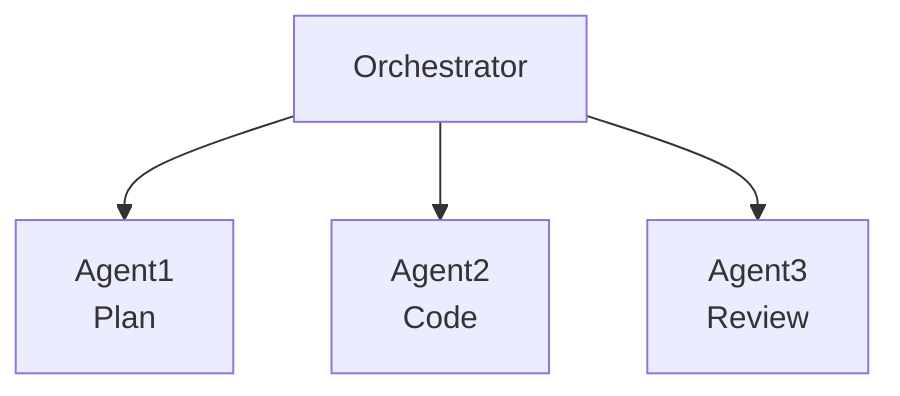
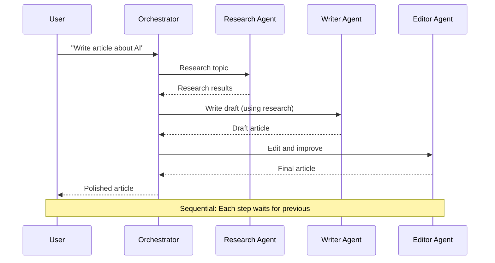
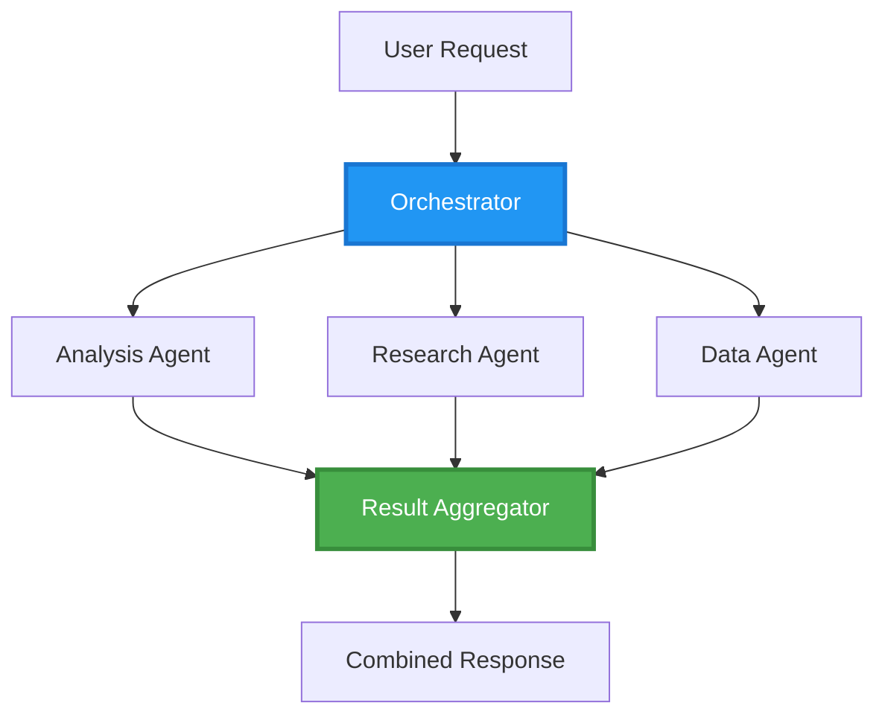
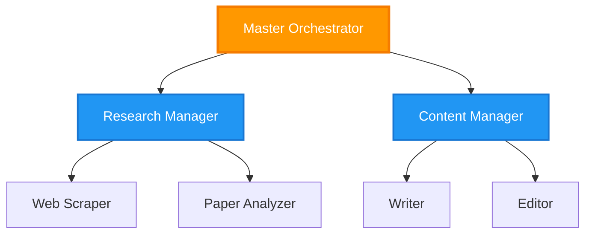
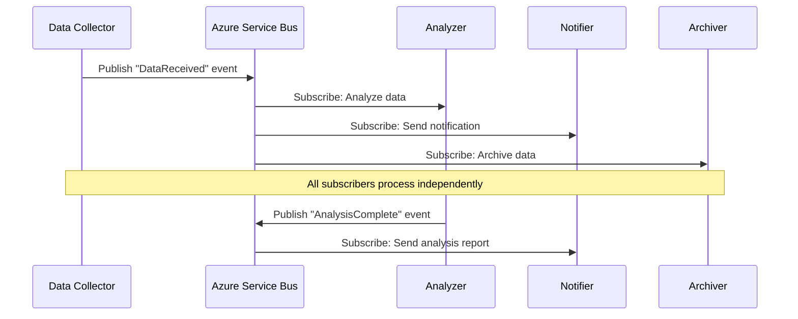
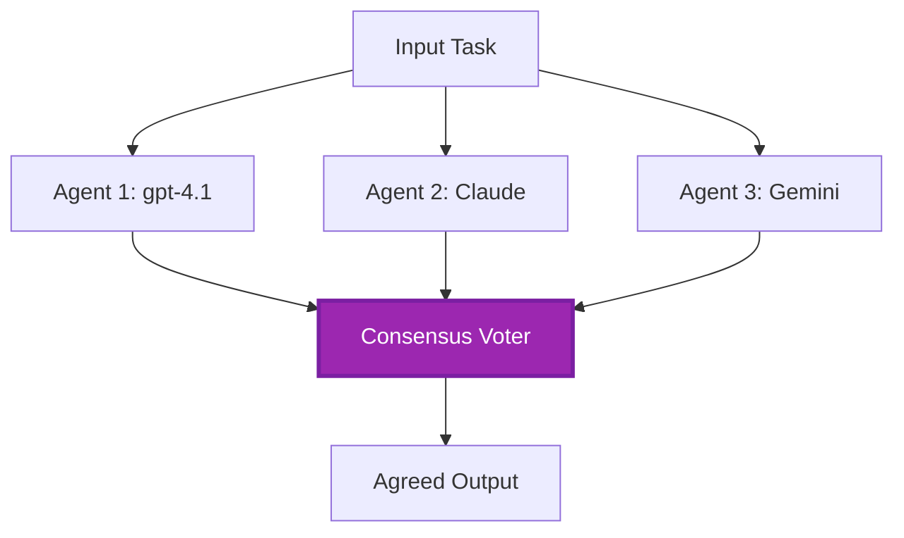
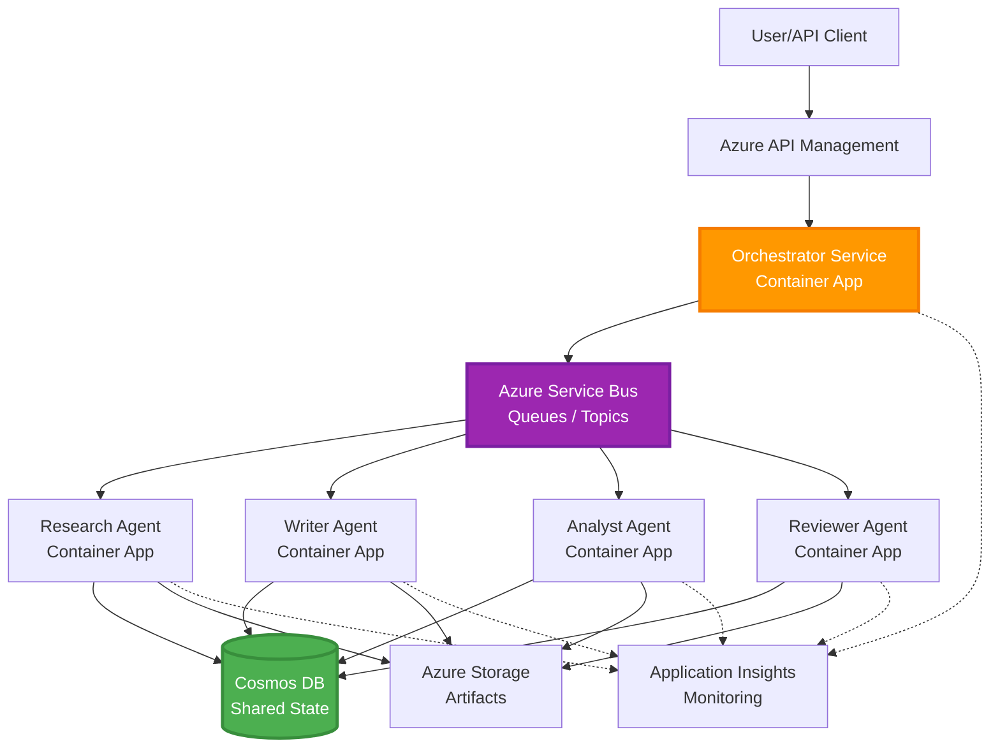

# Шаблони координації багатофакторних агентів

⏱️ **Очікуваний час**: 60-75 хвилин читання; кілька годин на впровадження | 💰 **Оцінена вартість**: залежить від навантаження | ⭐ **Складність**: Просунутий рівень

**📚 Навчальний шлях:**
- ← Попередній: [Планування потужностей](capacity-planning.md) - Стратегії визначення розміру ресурсів та масштабування
- 🎯 **Ви тут**: Шаблони координації багатофакторних агентів (Оркестрація, комунікації, управління станом)
- → Наступний: [Вибір SKU](sku-selection.md) - Вибір правильних служб Azure
- 🏠 [Домашня сторінка курсу](../../README.md)

---

## Чого ви навчитесь

Пройшовши цей урок, ви:
- Зрозумієте шаблони **архітектури багатофакторних агентів** та коли їх використовувати
- Впровадите **шаблони оркестрації** (централізовані, децентралізовані, ієрархічні)
- Спроектуєте стратегії **комунікації агентів** (синхронні, асинхронні, керовані подіями)
- Керуватимете **спільним станом** між розподіленими агентами
- Розгортатимете **системи багатофакторних агентів** в Azure за допомогою AZD
- Застосуєте **шаблони координації** для реальних AI сценаріїв
- Моніторитимете і налагоджуватимете розподілені системи агентів

## Чому координація багатофакторних агентів важлива

### Еволюція: від одного агента до багатьох

**Один агент (просто):**
```
User → Agent → Response
```
- ✅ Легко зрозуміти та реалізувати
- ✅ Швидко для простих завдань
- ❌ Обмежений можливостями одного моделі
- ❌ Немає паралелізму складних завдань
- ❌ Відсутність спеціалізації

**Система багатофакторних агентів (просунуто):**

- ✅ Спеціалізовані агенти для конкретних завдань
- ✅ Паралельне виконання для швидкості
- ✅ Модульна та підтримувана архітектура
- ✅ Краща для складних робочих процесів
- ⚠️ Потрібна логіка координації

**Аналогія**: Один агент — як одна людина, яка виконує всі завдання. Багатоагентна система — це команда, де кожен учасник має спеціалізовані навички (дослідник, програміст, рецензент, письменник), які працюють разом.

---

## Основні шаблони координації

### Шаблон 1: Послідовна координація (Ланцюг відповідальності)

**Коли використовувати**: Завдання мають виконуватися у визначеному порядку, кожен агент базується на результатах попереднього.



**Переваги:**
- ✅ Чіткий потік даних
- ✅ Легко налагоджувати
- ✅ Передбачуваний порядок виконання

**Обмеження:**
- ❌ Повільніше (немає паралелізму)
- ❌ Одна помилка блокує весь ланцюг
- ❌ Не може обробляти взаємозалежні завдання

**Приклади використання:**
- Конвеєр створення контенту (дослідження → написання → редагування → публікація)
- Генерація коду (план → реалізація → тест → розгортання)
- Генерація звіту (збір даних → аналіз → візуалізація → підсумок)

---

### Шаблон 2: Паралельна координація (Розгалуження/Злиття)

**Коли використовувати**: Незалежні завдання можуть виконуватись одночасно, результати об'єднуються наприкінці.



**Переваги:**
- ✅ Швидко (паралельне виконання)
- ✅ Відмовостійкість (прийнятні часткові результати)
- ✅ Горизонтальне масштабування

**Обмеження:**
- ⚠️ Результати можуть приходити не у порядку
- ⚠️ Потрібна логіка агрегації
- ⚠️ Складне управління станом

**Приклади використання:**
- Збір даних з кількох джерел (API + бази даних + веб-скрапінг)
- Конкурентний аналіз (кілька моделей генерують рішення, вибирається найкраще)
- Послуги перекладу (одночасний переклад на кілька мов)

---

### Шаблон 3: Ієрархічна координація (Менеджер-Працівник)

**Коли використовувати**: Складні робочі процеси з підзавданнями, потрібна делегація.



**Переваги:**
- ✅ Обробляє складні робочі процеси
- ✅ Модульна та підтримувана
- ✅ Чіткі межі відповідальності

**Обмеження:**
- ⚠️ Складніша архітектура
- ⚠️ Вища затримка (багаторівнева координація)
- ⚠️ Потрібна складна оркестрація

**Приклади використання:**
- Обробка підприємницьких документів (класифікація → маршрутизація → обробка → архівування)
- Багатостадійні конвеєри даних (збір → очищення → трансформація → аналіз → звіт)
- Складні автоматизаційні робочі процеси (планування → розподіл ресурсів → виконання → моніторинг)

---

### Шаблон 4: Координація, керована подіями (Публікація-Підписка)

**Коли використовувати**: Агенти мають реагувати на події, потрібне слабке зв’язування.



**Переваги:**
- ✅ Слабке зв’язування між агентами
- ✅ Легко додавати нових агентів (просто підписатись)
- ✅ Асинхронна обробка
- ✅ Відновлювана система (збереження повідомлень)

**Обмеження:**
- ⚠️ Виявлена узгодженість у часі
- ⚠️ Складність налагодження
- ⚠️ Проблеми з порядком доставки повідомлень

**Приклади використання:**
- Системи моніторингу в реальному часі (оповіщення, панелі, логи)
- Багатоканальні сповіщення (електронна пошта, SMS, push, Slack)
- Конвеєри обробки даних (кілька споживачів одного потоку даних)

---

### Шаблон 5: Координація на основі консенсусу (Голосування/Кворум)

**Коли використовувати**: Потрібна згода кількох агентів перед продовженням.



**Переваги:**
- ✅ Вища точність (багато думок)
- ✅ Відмовостійкість (допустимі поодинокі збої)
- ✅ Вбудована гарантія якості

**Обмеження:**
- ❌ Витратно (багато викликів моделей)
- ❌ Повільніше (очікування всіх агентів)
- ⚠️ Необхідність вирішення конфліктів

**Приклади використання:**
- Модерація контенту (кілька моделей переглядають контент)
- Рев’ю коду (кілька лінтерів/аналізаторів)
- Медична діагностика (кілька AI-моделей, експертна валідація)

---

## Огляд архітектури

### Повна система багатофакторних агентів в Azure



**Ключові компоненти:**

| Компонент | Призначення | Служба Azure |
|-----------|---------|---------------|
| **API Gateway** | Точка входу, обмеження швидкості, автентифікація | API Management |
| **Оркестратор** | Координує робочі процеси агентів | Container Apps |
| **Черга повідомлень** | Асинхронна комунікація | Service Bus / Event Hubs |
| **Агенти** | Спеціалізовані AI працівники | Container Apps / Functions |
| **Сховище стану** | Спільний стан, відстеження завдань | Cosmos DB |
| **Сховище артефактів** | Документи, результати, логи | Blob Storage |
| **Моніторинг** | Розподілене трасування, логи | Application Insights |

Service Bus черги/теми та Event Hubs — це різні служби з різними моделями доставки/споживання; Event Hubs не є прямою заміною для коду Service Bus worker нижче. Паралелізм, збережені повідомлення і голосування моделей самі по собі не гарантують відмовостійкість або вищу точність.

---

## Передумови

### Необхідні інструменти

```bash
# Verify Azure Developer CLI
azd version
# Command reference baseline: azd 1.37.2

# Verify Azure CLI
az --version
# ✅ Expected: azure-cli 2.50.0 or higher

# Verify Docker (for local testing)
docker --version
# ✅ Expected: Docker version 20.10 or higher
```

### Вимоги до Azure

- Активна підписка Azure
- Дозволи на створення:
  - Container Apps
  - Service Bus namespaces
  - Cosmos DB accounts
  - Storage accounts
  - Application Insights

### Знання-передумови

Ви маєте завершити:
- [Управління конфігураціями](../chapter-03-configuration/configuration.md)
- [Аутентифікація та безпека](../chapter-03-configuration/authsecurity.md)
- [Приклад мікросервісів](../../../../examples/microservices)

---

## Посібник з впровадження

> **Фрагменти дизайну, а не готова лабораторія:** Дерево проекту та позначки `File:` нижче описують файли, які потрібно створити у власному проєкті; цей репозиторій не містить повноцінного додатку `multi-agent-system`. Відсутні головні/параметричні шаблони, середовище/реєстр Container Apps, Docker файли та затвердження залежностей, налаштування бази даних Cosmos, розгортання моделей, конфігурація ідентичностей/ролей, правила масштабування та паралельні працівники/черги. Не очікуйте, що `azd init` згенерує ці файли або `azd up` розгорне фрагменти без змін. Для виконавчої відправної точки завершіть [Основи багатофакторних агентів](../chapter-05-multi-agent/multi-agent-basics.md).

**Передумови виконання:** Python 3.10+, `azure-servicebus`, `azure-cosmos`, `openai`, Flask та (для моніторингу) `azure-monitor-opentelemetry`; покладіть `shared` у шлях імпорту Python у кожному образі служби. Контейнер Cosmos `agent-state/tasks` повинен уже існувати з ключем розбиття `/id`. Підключення на основі ключа спрощують ці фрагменти, але не є рекомендацією для виробництва: надавайте перевагу керованим ідентичностям з обмеженими ролями Service Bus/Cosmos/OpenAI у рівні даних. Не виставляйте ключі у вихідних даних або логах.

Доставка Service Bus — **принаймні один раз**. Персистуйте ідемпотентність на кожне завдання **і крок**, використовуйте оптимістичну конкуренцію (ETags) для читання/модифікації/запису стану і оновлюйте блокування повідомлень під час тривалої обробки. Простий менеджер стану нижче підтримує лише послідовне виконання і не реалізує ці гарантії для виробничого середовища.

### Структура проекту

```
multi-agent-system/
├── azure.yaml                    # AZD configuration
├── infra/
│   ├── main.bicep               # Main infrastructure
│   ├── core/
│   │   ├── servicebus.bicep     # Message queue
│   │   ├── cosmos.bicep         # State store
│   │   ├── storage.bicep        # Artifact storage
│   │   └── monitoring.bicep     # Application Insights
│   └── app/
│       ├── orchestrator.bicep   # Orchestrator service
│       └── agent.bicep          # Agent template
└── src/
    ├── orchestrator/            # Orchestration logic
    │   ├── app.py
    │   ├── workflows.py
    │   └── Dockerfile
    ├── agents/
    │   ├── research/            # Research agent
    │   ├── writer/              # Writer agent
    │   ├── analyst/             # Analyst agent
    │   └── reviewer/            # Reviewer agent
    └── shared/
        ├── state_manager.py     # Shared state logic
        └── message_handler.py   # Message handling
```

---

## Урок 1: Послідовний шаблон координації

### Впровадження: Конвеєр створення контенту

Давайте спроектуємо послідовний конвеєр: Дослідження → Написання → Редагування. Публікація поза межами цього прикладу.

### 1. Конфігурація AZD

**Файл: `azure.yaml`**

```yaml
name: content-pipeline
metadata:
  template: multi-agent-sequential@1.0.0

services:
  orchestrator:
    project: ./src/orchestrator
    language: python
    host: containerapp
  
  research-agent:
    project: ./src/agents/research
    language: python
    host: containerapp
  
  writer-agent:
    project: ./src/agents/writer
    language: python
    host: containerapp
  
  editor-agent:
    project: ./src/agents/editor
    language: python
    host: containerapp
```

### 2. Інфраструктура: Service Bus для координації

**Файл: `infra/core/servicebus.bicep`**

```bicep
param name string
param location string
param tags object = {}

resource serviceBusNamespace 'Microsoft.ServiceBus/namespaces@2022-10-01-preview' = {
  name: name
  location: location
  tags: tags
  sku: {
    name: 'Standard'
    tier: 'Standard'
  }
  properties: {
    minimumTlsVersion: '1.2'
  }
}

// Queue for orchestrator → research agent
resource researchQueue 'Microsoft.ServiceBus/namespaces/queues@2022-10-01-preview' = {
  parent: serviceBusNamespace
  name: 'research-tasks'
  properties: {
    maxDeliveryCount: 3
    lockDuration: 'PT5M'
    deadLetteringOnMessageExpiration: true
  }
}

// Queue for research agent → writer agent
resource writerQueue 'Microsoft.ServiceBus/namespaces/queues@2022-10-01-preview' = {
  parent: serviceBusNamespace
  name: 'writer-tasks'
  properties: {
    maxDeliveryCount: 3
    lockDuration: 'PT5M'
  }
}

// Queue for writer agent → editor agent
resource editorQueue 'Microsoft.ServiceBus/namespaces/queues@2022-10-01-preview' = {
  parent: serviceBusNamespace
  name: 'editor-tasks'
  properties: {
    maxDeliveryCount: 3
    lockDuration: 'PT5M'
  }
}

output namespace string = serviceBusNamespace.name
// Do not output RootManageSharedAccessKey. Resolve scoped credentials
// securely or use managed identity in the application and scale rules.
```

### 3. Менеджер спільного стану

**Файл: `src/shared/state_manager.py`**

```python
from azure.cosmos import CosmosClient, PartitionKey
from datetime import datetime, timezone
import os

class StateManager:
    """Manages shared state across agents using Cosmos DB"""
    
    def __init__(self):
        endpoint = os.environ['COSMOS_ENDPOINT']
        key = os.environ['COSMOS_KEY']
        
        self.client = CosmosClient(endpoint, key)
        self.database = self.client.get_database_client('agent-state')
        self.container = self.database.get_container_client('tasks')
    
    def create_task(self, task_id: str, task_type: str, input_data: dict):
        """Create a new task"""
        task = {
            'id': task_id,
            'type': task_type,
            'status': 'pending',
            'input': input_data,
            'created_at': datetime.now(timezone.utc).isoformat(),
            'steps': []
        }
        self.container.create_item(task)
        return task
    
    def update_task_step(self, task_id: str, step_name: str, result: dict):
        """Update task with completed step"""
        task = self.container.read_item(task_id, partition_key=task_id)
        
        task['steps'].append({
            'name': step_name,
            'completed_at': datetime.now(timezone.utc).isoformat(),
            'result': result
        })
        
        self.container.replace_item(task_id, task)
        return task
    
    def complete_task(self, task_id: str, final_result: dict):
        """Mark task as complete"""
        task = self.container.read_item(task_id, partition_key=task_id)
        task['status'] = 'completed'
        task['result'] = final_result
        task['completed_at'] = datetime.now(timezone.utc).isoformat()
        self.container.replace_item(task_id, task)
        return task
    
    def get_task(self, task_id: str):
        """Retrieve task state"""
        return self.container.read_item(task_id, partition_key=task_id)
```

### 4. Служба Оркестратора

**Файл: `src/orchestrator/app.py`**

```python
from flask import Flask, request, jsonify
from azure.servicebus import ServiceBusClient, ServiceBusMessage
import json
import uuid
import os
from shared.state_manager import StateManager

app = Flask(__name__)
state_manager = StateManager()

# Service Bus connection
servicebus_connection_str = os.environ['SERVICEBUS_CONNECTION_STRING']
servicebus_client = ServiceBusClient.from_connection_string(servicebus_connection_str)

@app.route('/health', methods=['GET'])
def health():
    return jsonify({'status': 'healthy', 'service': 'orchestrator'})

@app.route('/create-content', methods=['POST'])
def create_content():
    """
    Sequential workflow: Research → Write → Edit (returns a draft; no publishing)
    """
    data = request.get_json(silent=True) or {}
    topic = data.get('topic')
    
    if not topic:
        return jsonify({'error': 'Topic required'}), 400
    
    # Create task in state store
    task_id = str(uuid.uuid4())
    task = state_manager.create_task(
        task_id=task_id,
        task_type='content_creation',
        input_data={'topic': topic}
    )
    
    # Send message to research agent (first step)
    sender = servicebus_client.get_queue_sender('research-tasks')
    message = ServiceBusMessage(
        body=json.dumps({
            'task_id': task_id,
            'topic': topic,
            'next_queue': 'writer-tasks'  # Where to send results
        }),
        content_type='application/json'
    )
    
    with sender:
        sender.send_messages(message)
    
    return jsonify({
        'task_id': task_id,
        'status': 'started',
        'workflow': 'sequential',
        'steps': ['research', 'write', 'edit'],
        'message': 'Content creation pipeline initiated'
    }), 202

@app.route('/task/<task_id>', methods=['GET'])
def get_task_status(task_id):
    """Check task status"""
    try:
        task = state_manager.get_task(task_id)
        return jsonify(task)
    except Exception as e:
        return jsonify({'error': str(e)}), 404

if __name__ == '__main__':
    app.run(host='0.0.0.0', port=8080)
```

### 5. Агент досліджень

**Файл: `src/agents/research/app.py`**

```python
from azure.servicebus import ServiceBusClient, ServiceBusMessage
from openai import AzureOpenAI
import json
import os
import time
from shared.state_manager import StateManager

# Initialize clients
state_manager = StateManager()
servicebus_client = ServiceBusClient.from_connection_string(
    os.environ['SERVICEBUS_CONNECTION_STRING']
)

openai_client = AzureOpenAI(
    api_key=os.environ['AZURE_OPENAI_API_KEY'],
    api_version="2024-10-21",
    azure_endpoint=os.environ['AZURE_OPENAI_ENDPOINT']
)

def process_research_task(message_data):
    """Process research request and pass to writer"""
    task_id = message_data['task_id']
    topic = message_data['topic']
    next_queue = message_data['next_queue']
    
    print(f"🔬 Researching: {topic}")
    
    # Call Microsoft Foundry Models for research
    response = openai_client.chat.completions.create(
        model=os.environ['AZURE_OPENAI_DEPLOYMENT'],
        messages=[
            {"role": "system", "content": "You are a research assistant. Provide comprehensive research on the given topic."},
            {"role": "user", "content": f"Research this topic thoroughly: {topic}"}
        ],
        max_tokens=1500
    )
    
    research_results = response.choices[0].message.content
    
    # Update state
    state_manager.update_task_step(
        task_id=task_id,
        step_name='research',
        result={'research': research_results}
    )
    
    # Send to next agent (writer)
    sender = servicebus_client.get_queue_sender(next_queue)
    message = ServiceBusMessage(
        body=json.dumps({
            'task_id': task_id,
            'topic': topic,
            'research': research_results,
            'next_queue': 'editor-tasks'
        }),
        content_type='application/json'
    )
    
    with sender:
        sender.send_messages(message)
    
    print(f"✅ Research complete for task {task_id}")

def main():
    """Listen to research queue"""
    receiver = servicebus_client.get_queue_receiver('research-tasks')
    
    print("🔬 Research Agent started, listening for tasks...")
    
    with receiver:
        while True:
            messages = receiver.receive_messages(max_wait_time=5)
            for message in messages:
                try:
                    message_data = json.loads(str(message))
                    process_research_task(message_data)
                    receiver.complete_message(message)
                except Exception as e:
                    print(f"❌ Error processing message: {e}")
                    receiver.abandon_message(message)

if __name__ == '__main__':
    main()
```

### 6. Агент письменника

**Файл: `src/agents/writer/app.py`**

```python
from azure.servicebus import ServiceBusClient, ServiceBusMessage
from openai import AzureOpenAI
import json
import os
from shared.state_manager import StateManager

state_manager = StateManager()
servicebus_client = ServiceBusClient.from_connection_string(
    os.environ['SERVICEBUS_CONNECTION_STRING']
)

openai_client = AzureOpenAI(
    api_key=os.environ['AZURE_OPENAI_API_KEY'],
    api_version="2024-10-21",
    azure_endpoint=os.environ['AZURE_OPENAI_ENDPOINT']
)

def process_writing_task(message_data):
    """Write article based on research"""
    task_id = message_data['task_id']
    topic = message_data['topic']
    research = message_data['research']
    next_queue = message_data['next_queue']
    
    print(f"✍️ Writing article: {topic}")
    
    # Call Microsoft Foundry Models to write article
    response = openai_client.chat.completions.create(
        model=os.environ['AZURE_OPENAI_DEPLOYMENT'],
        messages=[
            {"role": "system", "content": "You are a professional writer. Write engaging, well-structured articles."},
            {"role": "user", "content": f"Based on this research:\n\n{research}\n\nWrite a comprehensive article about: {topic}"}
        ],
        max_tokens=2000
    )
    
    article_draft = response.choices[0].message.content
    
    # Update state
    state_manager.update_task_step(
        task_id=task_id,
        step_name='writing',
        result={'draft': article_draft}
    )
    
    # Send to editor
    sender = servicebus_client.get_queue_sender(next_queue)
    message = ServiceBusMessage(
        body=json.dumps({
            'task_id': task_id,
            'topic': topic,
            'draft': article_draft
        }),
        content_type='application/json'
    )
    
    with sender:
        sender.send_messages(message)
    
    print(f"✅ Article draft complete for task {task_id}")

def main():
    """Listen to writer queue"""
    receiver = servicebus_client.get_queue_receiver('writer-tasks')
    
    print("✍️ Writer Agent started, listening for tasks...")
    
    with receiver:
        while True:
            messages = receiver.receive_messages(max_wait_time=5)
            for message in messages:
                try:
                    message_data = json.loads(str(message))
                    process_writing_task(message_data)
                    receiver.complete_message(message)
                except Exception as e:
                    print(f"❌ Error: {e}")
                    receiver.abandon_message(message)

if __name__ == '__main__':
    main()
```

### 7. Агент редактора

**Файл: `src/agents/editor/app.py`**

```python
from azure.servicebus import ServiceBusClient
from openai import AzureOpenAI
import json
import os
from shared.state_manager import StateManager

state_manager = StateManager()
servicebus_client = ServiceBusClient.from_connection_string(
    os.environ['SERVICEBUS_CONNECTION_STRING']
)

openai_client = AzureOpenAI(
    api_key=os.environ['AZURE_OPENAI_API_KEY'],
    api_version="2024-10-21",
    azure_endpoint=os.environ['AZURE_OPENAI_ENDPOINT']
)

def process_editing_task(message_data):
    """Edit and finalize article"""
    task_id = message_data['task_id']
    topic = message_data['topic']
    draft = message_data['draft']
    
    print(f"📝 Editing article: {topic}")
    
    # Call Microsoft Foundry Models to edit
    response = openai_client.chat.completions.create(
        model=os.environ['AZURE_OPENAI_DEPLOYMENT'],
        messages=[
            {"role": "system", "content": "You are an expert editor. Improve grammar, clarity, and structure."},
            {"role": "user", "content": f"Edit and improve this article:\n\n{draft}"}
        ],
        max_tokens=2000
    )
    
    final_article = response.choices[0].message.content
    
    # Mark task as complete
    state_manager.complete_task(
        task_id=task_id,
        final_result={
            'topic': topic,
            'final_article': final_article,
            'word_count': len(final_article.split())
        }
    )
    
    print(f"✅ Article finalized for task {task_id}")

def main():
    """Listen to editor queue"""
    receiver = servicebus_client.get_queue_receiver('editor-tasks')
    
    print("📝 Editor Agent started, listening for tasks...")
    
    with receiver:
        while True:
            messages = receiver.receive_messages(max_wait_time=5)
            for message in messages:
                try:
                    message_data = json.loads(str(message))
                    process_editing_task(message_data)
                    receiver.complete_message(message)
                except Exception as e:
                    print(f"❌ Error: {e}")
                    receiver.abandon_message(message)

if __name__ == '__main__':
    main()
```

### 8. Розгортання та тестування

Ці команди застосовуються **тільки після того, як ви створите всі відсутні файли проекту**. Ініціалізація агента інтерактивної лабораторії — це окремий робочий процес; він не генерує цей дизайн Service Bus.

```bash
# In your completed custom project
azd up

# Alternative in a SEPARATE empty folder (agents beta.23 requires azd >= 1.37)
azd extension install azure.ai.agents
azd ai agent init
azd up
```

> Дивіться [Команди AZD AI CLI](../chapter-08-production/production-ai-practices.md#azd-ai-cli-commands-and-extensions) для всіх прапорів і опцій `azd ai`.

```bash
# Get orchestrator URL
ORCHESTRATOR_URL=$(azd env get-values | grep ORCHESTRATOR_URL | cut -d '=' -f2 | tr -d '"')

# Create content
curl -X POST $ORCHESTRATOR_URL/create-content \
  -H "Content-Type: application/json" \
  -d '{"topic": "The Future of AI in Healthcare"}'
```

**✅ Очікуваний результат:**
```json
{
  "task_id": "a1b2c3d4-e5f6-7890-abcd-ef1234567890",
  "status": "started",
  "workflow": "sequential",
  "steps": ["research", "write", "edit"],
  "message": "Content creation pipeline initiated"
}
```

**Перевірка прогресу завдання:**
```bash
TASK_ID="a1b2c3d4-e5f6-7890-abcd-ef1234567890"
curl $ORCHESTRATOR_URL/task/$TASK_ID
```

**✅ Очікуваний результат (завершено):**
```json
{
  "id": "a1b2c3d4-e5f6-7890-abcd-ef1234567890",
  "type": "content_creation",
  "status": "completed",
  "steps": [
    {
      "name": "research",
      "completed_at": "2025-11-19T10:30:00Z",
      "result": {"research": "..."}
    },
    {
      "name": "writing",
      "completed_at": "2025-11-19T10:32:00Z",
      "result": {"draft": "..."}
    }
  ],
  "result": {
    "topic": "The Future of AI in Healthcare",
    "final_article": "...",
    "word_count": 1500
  }
}
```

---

## Урок 2: Паралельний шаблон координації

### Впровадження: Агрегатор досліджень з кількох джерел

Побудуємо паралельну систему, що збирає інформацію з кількох джерел одночасно.

### Паралельний Оркестратор

**Файл: `src/orchestrator/parallel_workflow.py`**

```python
from flask import Flask, request, jsonify
from azure.servicebus import ServiceBusClient, ServiceBusMessage
import json
import uuid
import os
from shared.state_manager import StateManager

app = Flask(__name__)
state_manager = StateManager()

servicebus_client = ServiceBusClient.from_connection_string(
    os.environ['SERVICEBUS_CONNECTION_STRING']
)

@app.route('/research-parallel', methods=['POST'])
def research_parallel():
    """
    Parallel workflow: Multiple agents work simultaneously
    """
    data = request.json
    query = data.get('query')
    
    task_id = str(uuid.uuid4())
    task = state_manager.create_task(
        task_id=task_id,
        task_type='parallel_research',
        input_data={
            'query': query,
            'agents': ['web', 'academic', 'news', 'social']
        }
    )
    
    # Fan-out: publish sequentially; workers may process concurrently.
    agents = [
        ('web-research-queue', 'web'),
        ('academic-research-queue', 'academic'),
        ('news-research-queue', 'news'),
        ('social-research-queue', 'social')
    ]
    
    for queue_name, agent_type in agents:
        sender = servicebus_client.get_queue_sender(queue_name)
        message = ServiceBusMessage(
            body=json.dumps({
                'task_id': task_id,
                'query': query,
                'agent_type': agent_type,
                'result_queue': 'aggregation-queue'
            }),
            content_type='application/json'
        )
        
        with sender:
            sender.send_messages(message)
    
    return jsonify({
        'task_id': task_id,
        'status': 'started',
        'workflow': 'parallel',
        'agents_dispatched': 4,
        'message': 'Parallel research initiated'
    }), 202

if __name__ == '__main__':
    app.run(host='0.0.0.0', port=8080)
```

### Логіка агрегації

**Файл: `src/agents/aggregator/app.py`**

```python
from azure.servicebus import ServiceBusClient
import json
import os
from collections import defaultdict
from shared.state_manager import StateManager

state_manager = StateManager()
servicebus_client = ServiceBusClient.from_connection_string(
    os.environ['SERVICEBUS_CONNECTION_STRING']
)

# Single-process demo only: not durable or shared across replicas.
# Production: use durable unique (task_id, agent_type) result records.
task_results = defaultdict(dict)
expected_agents = 4  # web, academic, news, social

def process_result(message_data):
    """Aggregate results from parallel agents"""
    task_id = message_data['task_id']
    agent_type = message_data['agent_type']
    result = message_data['result']
    
    # Store result
    task_results[task_id][agent_type] = {
        'agent': agent_type,
        'data': result
    }
    
    print(f"📊 Received result from {agent_type} agent ({len(task_results[task_id])}/{expected_agents})")
    
    # Check if all agents completed (fan-in)
    if len(task_results[task_id]) == expected_agents:
        print(f"✅ All agents completed for task {task_id}. Aggregating...")
        
        # Combine results
        aggregated = {
            'query': message_data['query'],
            'sources': list(task_results[task_id].values()),
            'summary': generate_summary(list(task_results[task_id].values()))
        }
        
        # Mark complete
        state_manager.complete_task(task_id, aggregated)
        
        # Clean up
        del task_results[task_id]
        
        print(f"✅ Aggregation complete for task {task_id}")

def generate_summary(results):
    """Generate summary from all sources"""
    summaries = [r['data'].get('summary', '') for r in results]
    return '\n\n'.join(summaries)

def main():
    """Listen to aggregation queue"""
    receiver = servicebus_client.get_queue_receiver('aggregation-queue')
    
    print("📊 Aggregator started, listening for results...")
    
    with receiver:
        while True:
            messages = receiver.receive_messages(max_wait_time=5)
            for message in messages:
                try:
                    message_data = json.loads(str(message))
                    process_result(message_data)
                    receiver.complete_message(message)
                except Exception as e:
                    print(f"❌ Error: {e}")
                    receiver.abandon_message(message)

if __name__ == '__main__':
    main()
```

**Переваги паралельного шаблону:**
- ⚡ **Можливо нижча затримка** (обмежена найповільнішим працівником та накладними витратами координації)
- 🔄 **Підтримує часткові результати** з явними дедлайнами та політикою відмов (не реалізовано базовим агрегатором)
- 📈 **Масштабованість** (легко додати більше агентів)

---

## Практичні вправи

### Вправа 1: Додати обробку тайм-аутів ⭐⭐ (Середній рівень)

**Мета**: Впровадити логіку тайм-аутів, щоб агрегатор не чекав вічно повільних агентів.

**Початкова точка:** Запустіть цю симуляцію локального дедлайну перед інтеграцією її у працівника черги. Тайм-аут перевіряється лише при надходженні іншого повідомлення і ніколи не спрацьовує, якщо відсутній працівник нічого не відправляє.

**Кроки**:

1. **Додайте відстеження тайм-аутів до агрегатора:**

```python
import asyncio

async def simulated_agent(name, delay):
    await asyncio.sleep(delay)
    return {'agent': name, 'result': 'done'}

async def main():
    tasks = [asyncio.create_task(simulated_agent(name, delay))
             for name, delay in [('web', 0.1), ('academic', 0.2),
                                 ('news', 0.3), ('social', 3)]]
    done, pending = await asyncio.wait(tasks, timeout=1)
    results = [task.result() for task in done]
    for task in pending:
        task.cancel()
    await asyncio.gather(*pending, return_exceptions=True)
    print({'completed_agents': len(results), 'timed_out': bool(pending)})
    assert len(results) == 3 and pending

asyncio.run(main())
```

2. **Очікуваний результат:**

```text
{'completed_agents': 3, 'timed_out': True}
```

3. **Інтеграція з системою черги (дизайн завдання):** Персистуйте дедлайн відправлення та очікуваних агентів при створенні завдання, виконуйте періодичне сканування дедлайнів незалежно від надходження результатів, атомарно завершуйте часткові результати, і ігноруйте пізні/дубльовані повідомлення для завершених завдань. Локальний тайм-аут не скасовує віддалених працівників.

Для вашого реалізованого проекту:

```bash
azd deploy aggregator

# Submit task
curl -X POST $ORCHESTRATOR_URL/research-parallel \
  -H "Content-Type: application/json" \
  -d '{"query": "AI safety research"}'

# Check results after 30 seconds
curl $ORCHESTRATOR_URL/task/$TASK_ID
```

**✅ Критерії успіху:**
- ✅ Локальний тест повертається після свого односекундного дедлайну, навіть якщо агент не завершений
- ✅ Відповідь вказує на часткові результати (`"timed_out": true`)
- ✅ Повертаються наявні результати (3 з 4 агентів)

**Час**: 20-25 хвилин

---

### Вправа 2: Впровадити логіку повторних спроб ⭐⭐⭐ (Просунутий рівень)

**Мета**: Автоматично повторювати невдалі завдання агентів перед відмовою.

**Кроки**:

1. **Використовуйте лічильники доставки Service Bus замість ручного повторного додавання власних лічильників:**

```python
import json
import time
# Integration fragment: use a live peek-lock ServiceBusReceiver.
# Set queue maxDeliveryCount to 4 for one attempt + up to three retries.
```

2. **Додайте обробник повторних спроб до агентів:**

```python
def process_with_retry(message, receiver, process_func):
    """Process message with automatic retry on failure"""
    try:
        message_data = json.loads(str(message))
        
        # Process the message
        process_func(message_data)
        
        # Success - complete
        receiver.complete_message(message)
        
    except Exception as e:
        if message.delivery_count < 4:
            # Bounded exponential delay: 5s, 10s, 20s.
            # Renew the lock if processing + waiting can exceed its duration.
            time.sleep(5 * 2 ** (message.delivery_count - 1))
            receiver.abandon_message(message)
        else:
            # Max retries exceeded - move to dead letter queue
            print(f"❌ Max attempts exceeded for message {message.message_id}")
            receiver.dead_letter_message(
                message,
                reason="MaxRetriesExceeded",
                error_description=str(e)
            )
```

3. **Моніторинг черги «мертвих листів»:**

```python
def monitor_dead_letters():
    """Check dead letter queue for failed messages"""
    receiver = servicebus_client.get_queue_receiver(
        'research-tasks',
        sub_queue='deadletter'
    )
    
    with receiver:
        messages = receiver.receive_messages(max_wait_time=5)
        for message in messages:
            print(f"☠️ Dead letter: {message.message_id}")
            print(f"Reason: {message.dead_letter_reason}")
            print(f"Description: {message.dead_letter_error_description}")
```

**✅ Критерії успіху:**
- ✅ Невдалі завдання повторюються автоматично (до 3 разів)
- ✅ Експоненційне збільшення інтервалів між повторними спробами (5с, 10с, 20с) з оновленням блокування повідомлень за потреби
- ✅ Після максимальних спроб повідомлення переходять у чергу «мертвих листів»
- ✅ Повідомлення з черги «мертвих листів» можна інспектувати; повторне відтворення вимагає окремого ідемпотентного робочого процесу відновлення

**Час**: 30-40 хвилин

---

### Вправа 3: Впровадити Circuit Breaker ⭐⭐⭐ (Просунутий рівень)

**Мета**: Запобігти каскадним відмовам, припиняючи запити до агентів, які відмовляють.

**Кроки**:

1. **Створіть клас Circuit Breaker:**

```python
from enum import Enum
from datetime import datetime, timedelta, timezone

class CircuitState(Enum):
    CLOSED = "closed"      # Normal operation
    OPEN = "open"          # Failing, reject requests
    HALF_OPEN = "half_open"  # Testing if recovered

class CircuitBreaker:
    def __init__(self, failure_threshold=5, timeout_seconds=60):
        self.failure_threshold = failure_threshold
        self.timeout_seconds = timeout_seconds
        self.failure_count = 0
        self.last_failure_time = None
        self.state = CircuitState.CLOSED
    
    def call(self, func):
        """Execute function with circuit breaker protection"""
        if self.state == CircuitState.OPEN:
            # Check if timeout expired
            if datetime.now(timezone.utc) - self.last_failure_time > timedelta(seconds=self.timeout_seconds):
                self.state = CircuitState.HALF_OPEN
                print("🔄 Circuit breaker: HALF_OPEN (testing)")
            else:
                raise Exception(f"Circuit breaker OPEN for agent. Try again in {self.timeout_seconds}s")
        
        try:
            result = func()
            
            # Success
            self.failure_count = 0 # Count consecutive failures only
            if self.state == CircuitState.HALF_OPEN:
                self.state = CircuitState.CLOSED
                self.failure_count = 0
                print("✅ Circuit breaker: CLOSED (recovered)")
            
            return result
            
        except Exception as e:
            self.failure_count += 1
            self.last_failure_time = datetime.now(timezone.utc)
            
            if self.failure_count >= self.failure_threshold:
                self.state = CircuitState.OPEN
                print(f"🔴 Circuit breaker: OPEN (too many failures)")
            
            raise
```

2. **Застосуйте до викликів агентів:**

```python
# In orchestrator
agent_circuits = {
    'web': CircuitBreaker(failure_threshold=5, timeout_seconds=60),
    'academic': CircuitBreaker(failure_threshold=5, timeout_seconds=60),
    'news': CircuitBreaker(failure_threshold=5, timeout_seconds=60),
    'social': CircuitBreaker(failure_threshold=5, timeout_seconds=60)
}

def send_to_agent(agent_type, message_data):
    """Send with circuit breaker protection"""
    circuit = agent_circuits[agent_type]
    
    try:
        circuit.call(lambda: send_message(agent_type, message_data))
    except Exception as e:
        print(f"⚠️ Skipping {agent_type} agent: {e}")
        # Continue with other agents
```

Ця схема захищає **операцію надсилання**, а не завершення віддаленим виконавцем: успішне додавання повідомлення в чергу нічого не говорить про те, чи живий агент. `send_message` — це функція відправника вашого додатка. Для схем виконання подавайте спостережувані помилки/таймаути задач у стійкий координатор. Цей клас у пам’яті — демонстрація однопоточного режиму, а не розподіленого обмежувача схеми.

3. **Тестування обмежувача схеми локально:**

```python
# Run after the class definition; no Azure changes required.
circuit = CircuitBreaker(failure_threshold=5, timeout_seconds=0)
def fail():
    raise RuntimeError("simulated failure")
for _ in range(5):
    try:
        circuit.call(fail)
    except RuntimeError:
        pass
assert circuit.state == CircuitState.OPEN
assert circuit.call(lambda: "recovered") == "recovered"
assert circuit.state == CircuitState.CLOSED
print("Circuit breaker recovery verified")
```

**✅ Критерії успіху:**
- ✅ Після 5 невдач схема відкривається (відхиляє запити)
- ✅ Після 60 секунд схема переходить у напіввідкритий стан (перевіряє відновлення)
- ✅ Інші агенти продовжують працювати нормально
- ✅ Схема автоматично закривається, коли агент відновлюється

**Час:** 40-50 хвилин

---

## Моніторинг і налагодження

### Розподілене трасування за допомогою Application Insights

**Файл: `src/shared/tracing.py`**

```python
from azure.monitor.opentelemetry import configure_azure_monitor
from opentelemetry import trace
from opentelemetry.trace import SpanKind
import logging
import os

connection_string = os.environ.get('APPLICATIONINSIGHTS_CONNECTION_STRING')

# Configure once per process. Message send/receive trace-context propagation
# and agent attributes on exceptions need explicit instrumentation.
if connection_string:
    configure_azure_monitor(connection_string=connection_string, logger_name=__name__)
tracer = trace.get_tracer(__name__)

# Configure logging
logger = logging.getLogger(__name__)
logger.setLevel(logging.INFO)

def trace_agent_call(agent_name, task_id, operation_name, operation):
    """Trace agent operations"""
    with tracer.start_as_current_span(f'agent.{agent_name}.{operation_name}', kind=SpanKind.CLIENT) as span:
        span.set_attribute('agent', agent_name)
        span.set_attribute('task_id', task_id)
        span.set_attribute('operation', operation_name)
        
        try:
            result = operation()
            span.set_attribute('status', 'success')
            logger.info('Agent operation completed', extra={
                'agent': agent_name, 'task_id': task_id, 'operation': operation_name
            })
            return result
        except Exception as e:
            span.set_attribute('status', 'error')
            logger.exception('Agent operation failed', extra={
                'agent': agent_name, 'task_id': task_id, 'operation': operation_name
            })
            raise
```

### Запити Application Insights

**Відстеження багатокористувацьких робочих процесів:**

```kusto
// Trace complete workflow for a task
traces
| where customDimensions.task_id == "a1b2c3d4-..."
| project timestamp, message, customDimensions.agent, customDimensions.operation
| order by timestamp asc
```

**Порівняння продуктивності агентів:**

```kusto
// Compare agent execution times
dependencies
| where name contains "agent"
| summarize 
    avg_duration = avg(duration),
    p95_duration = percentile(duration, 95),
    count = count()
  by agent = tostring(customDimensions.agent)
| order by avg_duration desc
```

**Аналіз помилок:**

```kusto
// Find which agents fail most
exceptions
| where customDimensions.agent != ""
| summarize 
    failure_count = count(),
    unique_errors = dcount(outerMessage)
  by agent = tostring(customDimensions.agent)
| order by failure_count desc
```

---

## Аналіз витрат

### Витрати багатокористувацької системи (щомісячні оцінки)

Ілюстративні планові цифри, а не офіційні котирування: приведена сума — **240-565 доларів на місяць**. Перевіряйте поточні регіональні тарифи, години активних/неактивних реплік, співвідношення вхідних/вихідних токенів, сховища та телеметрію. Serverless не має мінімуму забезпеченої пропускної здатності, але все одно стягує плату за запити та сховище.

| Компонент | Конфігурація | Вартість |
|-----------|--------------|------|
| **Оркестратор** | 1 Container App (1 vCPU, 2GB) | 30-50 дол. |
| **4 агенти** | 4 Container Apps (0.5 vCPU, 1GB кожен) | 60-120 дол. |
| **Service Bus** | Стандартний рівень, 10 млн повідомлень | 10-20 дол. |
| **Cosmos DB** | Serverless, 5GB сховища, 1 млн RUs | 25-50 дол. |
| **Blob Storage** | 10GB сховища, 100 тисяч операцій | 5-10 дол. |
| **Application Insights** | 5GB прийому даних | 10-15 дол. |
| **Microsoft Foundry Models** | gpt-4.1, 10 млн токенів | 100-300 дол. |
| **Всього** | | **240-565 дол./місяць** |

### Стратегії оптимізації витрат

1. **Використовуйте serverless там, де можливо:**
   ```bicep
   // Cosmos DB serverless (no minimum cost)
   properties: {
     databaseAccountOfferType: 'Standard'
     capabilities: [{ name: 'EnableServerless' }]
   }
   ```

2. **Масштабуйте агентів до нуля в режимі бездіяльності:**
   ```bicep
   scale: {
     minReplicas: 0  // Requires a Service Bus/KEDA scale rule to wake workers
     maxReplicas: 10
   }
   ```

3. **Використовуйте пакетну обробку для Service Bus:**
   ```python
   # Send messages in batches (cheaper)
   sender.send_messages([message1, message2, message3])
   ```

4. **Кешуйте часто використовувані результати:**
   ```python
   # Use Azure Cache for Redis
   if cache.exists(query_hash):
       return cache.get(query_hash)
   ```

---

## Кращі практики

### ✅ РОБІТЬ:

1. **Використовуйте ідемпотентні операції**
   ```python
   # Pseudocode: implement a durable, atomic per-step deduplication claim.
   def process_task(task_id):
       raise NotImplementedError("Claim (task_id, step) atomically, execute, persist outcome")
   ```

2. **Реалізуйте комплексне логування**
   ```python
   logger.info(f"Agent: {agent_name}, Task: {task_id}, Action: {action}")
   ```

3. **Використовуйте кореляційні ідентифікатори**
   ```python
   # Pass task_id through entire workflow
   message_data = {
       'task_id': task_id,  # Correlation ID
       'timestamp': datetime.utcnow().isoformat()
   }
   ```

4. **Встановлюйте TTL (час життя) повідомлень**
   ```bicep
   properties: {
     defaultMessageTimeToLive: 'PT1H'  // 1 hour max
   }
   ```

5. **Моніторьте черги мертвих листів**
   ```python
   # Regular monitoring of failed messages
   monitor_dead_letters()
   ```

### ❌ НЕ РОБІТЬ:

1. **Не створюйте циклічних залежностей**
   ```python
   # ❌ BAD: Agent A → Agent B → Agent A (infinite loop)
   # ✅ GOOD: Define clear directed acyclic graph (DAG)
   ```

2. **Не блокувати потоки агентів**
   ```python
   # ❌ BAD: Synchronous wait
   while not task_complete:
       time.sleep(1)
   
   # ✅ GOOD: Use message queue callbacks
   ```

3. **Не ігноруйте часткові помилки**
   ```python
   # ❌ BAD: Fail entire workflow if one agent fails
   # ✅ GOOD: Return partial results with error indicators
   ```

4. **Не використовуйте нескінченні повторні спроби**
   ```python
   # ❌ BAD: retry forever
   # ✅ GOOD: max_retries = 3, then dead letter
   ```

---

## Керівництво з усунення несправностей

### Проблема: Повідомлення зависли в черзі

**Симптоми:**
- Повідомлення накопичуються в черзі
- Агенти не обробляють повідомлення
- Статус завдання застряг у "очікуванні"

**Діагностика:**
```bash
# Check queue depth
az servicebus queue show \
  --resource-group "$RG_NAME" \
  --namespace-name mybus \
  --name research-tasks \
  --query "countDetails"

# Check agent logs using Azure CLI
az containerapp logs show --name research-agent --resource-group $RG_NAME --tail 50
```

**Рішення:**

1. **Збільшіть кількість реплік агента:**
   ```bash
   az containerapp update \
     --resource-group "$RG_NAME" \
     --name research-agent \
     --min-replicas 3 \
     --max-replicas 10
   ```

2. **Перевірте чергу мертвих листів:**
   ```bash
   az servicebus queue show \
     --resource-group "$RG_NAME" \
     --namespace-name mybus \
     --name research-tasks \
     --query "countDetails.deadLetterMessageCount"
   ```

---

### Проблема: Завдання вичерпало час очікування/ніколи не завершується

**Симптоми:**
- Статус завдання залишається "в процесі"
- Деякі агенти завершують, інші — ні
- Відсутні повідомлення про помилки

**Діагностика:**
```bash
# Check task state
curl $ORCHESTRATOR_URL/task/$TASK_ID

# Check Application Insights
# Run query: traces | where customDimensions.task_id == "..."
```

**Рішення:**

1. **Реалізуйте таймаут у агрегаторі (Вправа 1)**

2. **Перевірте помилки агентів за допомогою Azure Monitor:**
   ```bash
   # View logs via azd monitor
   azd monitor --logs
   
   # Or use Azure CLI to check specific container app logs
   az containerapp logs show --name <agent-name> --resource-group $RG_NAME --follow | grep "ERROR\|FAIL"
   ```

3. **Переконайтеся, що всі агенти працюють:**
   ```bash
   az containerapp list \
     --resource-group rg-agents \
     --query "[].{name:name, status:properties.runningStatus}"
   ```

---

## Дізнатись більше

### Офіційна документація
- [Azure Service Bus](https://learn.microsoft.com/azure/service-bus-messaging/service-bus-messaging-overview)
- [Cosmos DB](https://learn.microsoft.com/azure/cosmos-db/introduction)
- [Container Apps DAPR](https://learn.microsoft.com/azure/container-apps/dapr-overview)
- [AI Agent Orchestration Patterns](https://learn.microsoft.com/azure/architecture/ai-ml/guide/ai-agent-design-patterns)

### Наступні кроки в цьому курсі
- ← Попередній: [Планування потужностей](capacity-planning.md)
- → Наступний: [Вибір SKU](sku-selection.md)
- 🏠 [Головна сторінка курсу](../../README.md)

### Пов’язані приклади
- [Приклад мікросервісів](../../../../examples/microservices) — патерни сервісної комунікації
- [Приклад Microsoft Foundry Models](../../../../examples/azure-openai-chat) — інтеграція ШІ

---

## Підсумок

**Ви дізналися:**
- ✅ П’ять патернів координації (послідовний, паралельний, ієрархічний, подієцентричний, консенсус)
- ✅ Багатокористувацька архітектура в Azure (Service Bus, Cosmos DB, Container Apps)
- ✅ Управління станом між розподіленими агентами
- ✅ Обробка таймаутів, під retries і обмежувачі схем
- ✅ Моніторинг і налагодження розподілених систем
- ✅ Стратегії оптимізації витрат

**Ключові висновки:**
1. **Вибирайте правильний патерн** — послідовний для впорядкованих робочих процесів, паралельний для швидкості, подієцентричний для гнучкості
2. **Уважно керуйте станом** — використовуйте Cosmos DB або подібне для спільного стану
3. **Грамотно обробляйте збої** — таймаути, повтори, обмежувачі схем, черги мертвих листів
4. **Моніторьте все** — розподілене трасування необхідне для налагодження
5. **Оптимізуйте витрати** — масштабування до нуля, serverless, кешування

**Наступні кроки:**
1. Виконайте практичні вправи
2. Побудуйте багатокористувацьку систему під ваш випадок використання
3. Вивчіть [Вибір SKU](sku-selection.md) для оптимізації продуктивності і вартості

---

<!-- CO-OP TRANSLATOR DISCLAIMER START -->
**Відмова від відповідальності**:
Цей документ було перекладено за допомогою сервісу штучного інтелекту для перекладу [Co-op Translator](https://github.com/Azure/co-op-translator). Хоча ми прагнемо до точності, будь ласка, майте на увазі, що автоматичні переклади можуть містити помилки або неточності. Оригінальний документ рідною мовою слід вважати авторитетним джерелом. Для критично важливої інформації рекомендується професійний людський переклад. Ми не несемо відповідальності за будь-які непорозуміння або неправильні тлумачення, що виникли внаслідок використання цього перекладу.
<!-- CO-OP TRANSLATOR DISCLAIMER END -->