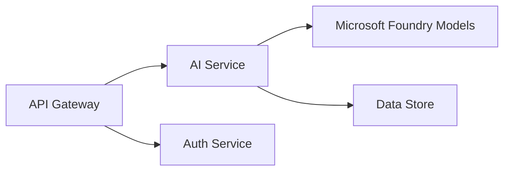
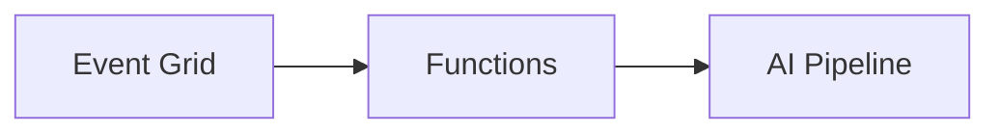

# Розділ 8: Продакшн та корпоративні патерни

**📚 Курс**: [AZD для початківців](../../README.md) | **⏱️ Тривалість**: 2-3 години | **⭐ Складність**: Високий рівень

---

## Огляд

У цьому розділі розглядаються корпоративні патерни розгортання, посилення безпеки, моніторинг та оптимізація витрат для продакшн навантажень штучного інтелекту.

Це архітектурне посилання, а не повний шаблон для розгортання в продакшн. Приклади опускають деталі інтеграції, які потрібно надати та протестувати у власному застосунку; читання чекліста не гарантує готовність до продакшн.

> **Огляд релізу (2026-11-04):** Інструкції AI CLI були перевірені відповідно до документації/джерела `azd 1.37.2`, агентів `1.0.0-beta.23` та eval-ів `1.0.0-beta.2`. Деталі сумісності та міграції дивіться у [змінах та виправленнях релізу](production-ai-practices.md#recent-release-changes-and-fixes); це не валідація живого розгортання.

## Цілі навчання

Після проходження цього розділу ви зможете:
- Розгортати стійкі багаторегіональні застосунки
- Впроваджувати корпоративні патерни безпеки
- Налаштовувати комплексний моніторинг
- Оптимізувати витрати на масштабі
- Налаштовувати CI/CD з AZD

---

## 📚 Уроки

| # | Урок | Опис | Час |
|---|--------|-------------|------|
| 1 | [Практики продакшн ШІ](production-ai-practices.md) | Корпоративні патерни розгортання | 90 хв |

---

## 🚀 Чекліст для продакшн

- [ ] Багаторегіональне розгортання для стійкості
- [ ] Керована ідентичність для автентифікації (без ключів)
- [ ] Application Insights для моніторингу
- [ ] Налаштовані бюджети та сповіщення по витратах
- [ ] Включене сканування безпеки
- [ ] Інтеграція CI/CD пайплайнів
- [ ] План аварійного відновлення

---

## 🏗️ Архітектурні патерни

### Шаблон 1: Штучний інтелект на основі мікросервісів



### Шаблон 2: Подієво-орієнтований штучний інтелект



---

## 🔐 Кращі практики безпеки

```bicep
// Illustrative properties from different resources, NOT a standalone Bicep file.
// Attach identity to the application host:
identity: {
  type: 'SystemAssigned'
}

// AI account properties (also require private endpoints, DNS and app connectivity):
properties: {
  publicNetworkAccess: 'Disabled'
  networkAcls: {
    defaultAction: 'Deny'
  }
}
```

---

## 💰 Оптимізація витрат

| Стратегія | Головне обмеження |
|----------|---------|
| Масштабування до нуля (Container Apps) | Потрібен відповідний тригер; інші сервіси все ще генерують витрати |
| Використання споживчих рівнів для розробки | Порівняння ціноутворення обраного сервісу та робочого навантаження |
| Заплановане масштабування | Масштабування через підтримувану інфраструктуру/автоматизацію |
| Резервування/провізійована потужність | Лише якщо підтримується; зобов’язання можуть збільшувати витрати на незавантажені ресурси |

Використовуйте [повний шаблон ресурсу бюджету](production-ai-practices.md#2-cost-monitoring-and-budgets) з дійсною датою початку, зоною білінгу, отримувачами та дозволами. Бюджет надсилає сповіщення; він не обмежує витрати. Економія залежить від виміряного використання і не гарантується у відсотках.

---

## 📊 Налаштування моніторингу

```bash
# Open the Application Insights logs view (requires configured monitoring)
azd monitor --logs

# Check Application Insights
azd monitor --overview

# View metrics
az monitor metrics list --resource <resource-id>
```

---

## 🔗 Навігація

| Напрям | Розділ |
|-----------|---------|
| **Попередній** | [Розділ 7: Усунення несправностей](../chapter-07-troubleshooting/README.md) |
| **Курс завершено** | [Головна сторінка курсу](../../README.md) |

---

## 📖 Пов’язані ресурси

- [Посібник з AI агентів](../chapter-02-ai-development/agents.md)
- [Application Insights](../chapter-06-pre-deployment/application-insights.md)
- [Розв’язки з кількома агентами](../chapter-05-multi-agent/README.md)
- [Приклад мікросервісів](../../examples/microservices/README.md)

---

<!-- CO-OP TRANSLATOR DISCLAIMER START -->
**Відмова від відповідальності**:
Цей документ було перекладено за допомогою сервісу штучного інтелекту для перекладу [Co-op Translator](https://github.com/Azure/co-op-translator). Хоча ми прагнемо до точності, будь ласка, майте на увазі, що автоматичні переклади можуть містити помилки або неточності. Оригінальний документ рідною мовою слід вважати авторитетним джерелом. Для критично важливої інформації рекомендується професійний людський переклад. Ми не несемо відповідальності за будь-які непорозуміння або неправильні тлумачення, що виникли внаслідок використання цього перекладу.
<!-- CO-OP TRANSLATOR DISCLAIMER END -->