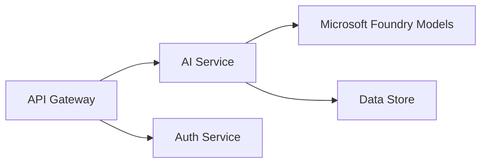
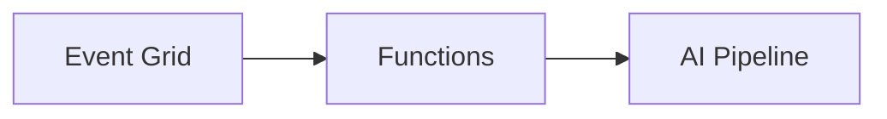

# Розділ 8: Виробничі та корпоративні шаблони

**📚 Курс**: [AZD для початківців](../../README.md) | **⏱️ Тривалість**: 2-3 години | **⭐ Складність**: Поглиблений

---

## Огляд

У цьому розділі розглядаються готові до підприємства шаблони розгортання, посилення безпеки, моніторинг і оптимізація витрат для виробничих навантажень штучного інтелекту.

Це архітектурний довідник, а не повний шаблон для розгортання у виробництві. Приклади опускають деталі інтеграції, які повинні бути надані та протестовані у вашому власному додатку; прочитання контрольного списку не гарантує готовність до виробництва.

> **Оновлення Foundry GA (2026-11-09):** Використовуйте `azd >= 1.37.0` і загальнодоступний пакет `microsoft.foundry` 1.0 для робочого процесу Foundry; оцінки встановлюються окремо. Деталі див. у [обсязі релізу та міграції](production-ai-practices.md#recent-release-changes-and-fixes) та [прикладі аутентифікованого конвеєра](production-ai-practices.md#cicd-pipeline-configuration). Це огляд документації, а не валідація живого розгортання чи загальний статус GA для необов’язкових функцій попереднього перегляду.

## Навчальні цілі

Завершуючи цей розділ, ви зможете:
- Розгортати мультирегіональні стійкі додатки
- Впроваджувати корпоративні шаблони безпеки
- Налаштовувати комплексний моніторинг
- Оптимізувати витрати в масштабі
- Налаштувати CI/CD конвеєри з AZD

---

## 📚 Уроки

| # | Урок | Опис | Час |
|---|--------|-------------|------|
| 1 | [Виробничі практики ШІ](production-ai-practices.md) | Корпоративні шаблони розгортання | 90 хв |

---

## 🚀 Контрольний список для виробництва

- [ ] Мультирегіональне розгортання для стійкості
- [ ] Керована ідентичність для аутентифікації (без ключів)
- [ ] Application Insights для моніторингу
- [ ] Налаштовано бюджети витрат і сповіщення
- [ ] Увімкнено сканування безпеки
- [ ] Інтеграція конвеєра CI/CD
- [ ] План аварійного відновлення

---

## 🏗️ Шаблони архітектури

### Шаблон 1: Мікросервісний ШІ



### Шаблон 2: Подієво-керований ШІ



---

## 🔐 Найкращі практики безпеки

```bicep
// Illustrative properties from different resources, NOT a standalone Bicep file.
// Attach identity to the application host:
identity: {
  type: 'SystemAssigned'
}

// AI account properties (also require private endpoints, DNS and app connectivity):
properties: {
  publicNetworkAccess: 'Disabled'
  networkAcls: {
    defaultAction: 'Deny'
  }
}
```

---

## 💰 Оптимізація витрат

| Стратегія | Основне обмеження |
|----------|---------|
| Масштабування до нуля (Container Apps) | Потребує відповідного тригера; інші сервіси все ще мають витрати |
| Використання рівнів споживання для розробки | Порівняння цін обраної служби та навантаження |
| Планове масштабування | Масштабування через підтримувану інфраструктуру/автоматизацію |
| Резервування/виділена ємність | Тільки якщо підтримується; зобов’язання можуть збільшити холосту вартість |

Використовуйте [повний шаблон ресурсу бюджету](production-ai-practices.md#2-cost-monitoring-and-budgets) з дійсною датою початку, областю виставлення рахунків, отримувачами та дозволами. Бюджет надсилає сповіщення; він не обмежує витрати. Економія залежить від виміряного використання і не гарантується у відсотках.

---

## 📊 Налаштування моніторингу

```bash
# Open the Application Insights logs view (requires configured monitoring)
azd monitor --logs

# Check Application Insights
azd monitor --overview

# View metrics
az monitor metrics list --resource <resource-id>
```

---

## 🔗 Навігація

| Напрямок | Розділ |
|-----------|---------|
| **Попередній** | [Розділ 7: Усунення неполадок](../chapter-07-troubleshooting/README.md) |
| **Курс завершено** | [Домашня сторінка курсу](../../README.md) |

---

## 📖 Пов’язані ресурси

- [Посібник із агентів ШІ](../chapter-02-ai-development/agents.md)
- [Application Insights](../chapter-06-pre-deployment/application-insights.md)
- [Рішення з мультиагентами](../chapter-05-multi-agent/README.md)
- [Приклад мікросервісів](../../examples/microservices/README.md)

---

<!-- CO-OP TRANSLATOR DISCLAIMER START -->
**Відмова від відповідальності**:
Цей документ було перекладено за допомогою сервісу штучного інтелекту для перекладу [Co-op Translator](https://github.com/Azure/co-op-translator). Хоча ми прагнемо до точності, будь ласка, майте на увазі, що автоматичні переклади можуть містити помилки або неточності. Оригінальний документ рідною мовою слід вважати авторитетним джерелом. Для критично важливої інформації рекомендується професійний людський переклад. Ми не несемо відповідальності за будь-які непорозуміння або неправильні тлумачення, що виникли внаслідок використання цього перекладу.
<!-- CO-OP TRANSLATOR DISCLAIMER END -->