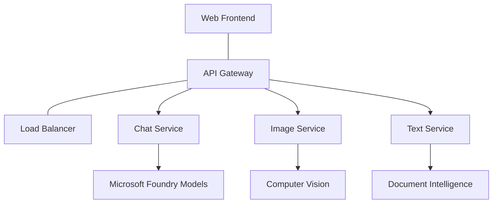

# Найкращі практики для виробничих AI-навантажень з AZD

**Навігація розділом:**
- **📚 Головна сторінка курсу**: [AZD для початківців](../../README.md)
- **📖 Поточний розділ**: Розділ 8 - Виробничі та корпоративні шаблони
- **⬅️ Попередній розділ**: [Розділ 7: Вирішення проблем](../chapter-07-troubleshooting/debugging.md)
- **⬅️ Також пов’язано**: [Лабораторія AI Workshop](../chapter-02-ai-development/ai-workshop-lab.md)
- **🎯 Курс завершено**: [AZD для початківців](../../README.md)

## Огляд

Цей посібник пояснює шаблони проєктування виробничого AI з використанням Azure Developer CLI (AZD). Це довідник дизайну, а не розгортальний додаток або сертифікація для продакшену.

**Прикладні межі:** Якщо не описано явно, фрагменти Bicep передбачають параметри та ресурси з шаблону-контейнера. Вони опускають хостові образи/плани, ідентичності, призначення ролей, DNS, виходи та іншу необхідну інтеграцію. Шляхи YAML-сервісів та скрипти хуків/тестів є ілюстративними файлами для створення у **вашому власному додатку**; вони не надаються цим курсом. Використовуйте працюючий приклад AZD як базу, компілюйте всю інфраструктуру та тестуйте в ізольованому середовищі перед виробництвом.

## Основні вирішувані виклики

Загальні проблеми виробництва включають розгортання кількох сервісів, управління ідентичностями та секретами, масштабування, контроль витрат і моніторинг. Тут не претендується на виміряну поширеність.

## Архітектурні шаблони для виробничого AI

### Шаблон 1: Архітектура мікросервісного AI

**Коли використовувати**: Складні AI-додатки з багатьма можливостями



**Реалізація в AZD**:

```yaml
# azure.yaml
name: enterprise-ai-platform
services:
  web:
    project: ./web
    host: staticwebapp
  api-gateway:
    project: ./api-gateway
    host: containerapp
  chat-service:
    project: ./services/chat
    host: containerapp
  vision-service:
    project: ./services/vision
    host: containerapp
  text-service:
    project: ./services/text
    host: containerapp
```

### Шаблон 2: Подійно-орієнтована обробка AI

**Коли використовувати**: Обробка пакетів, аналіз документів, асинхронні робочі процеси

```bicep
// Event Hub for AI processing pipeline
resource eventHub 'Microsoft.EventHub/namespaces@2024-01-01' = {
  name: eventHubNamespaceName
  location: location
  sku: {
    name: 'Standard'
    tier: 'Standard'
    capacity: 1
  }
}

// Service Bus for reliable message processing
resource serviceBus 'Microsoft.ServiceBus/namespaces@2024-01-01' = {
  name: serviceBusNamespaceName
  location: location
  sku: {
    name: 'Premium'
    tier: 'Premium'
    capacity: 1
  }
}

// Function App for processing
resource functionApp 'Microsoft.Web/sites@2023-01-01' = {
  name: functionAppName
  location: location
  kind: 'functionapp,linux'
  properties: {
    siteConfig: {
      appSettings: [
        {
          name: 'FUNCTIONS_EXTENSION_VERSION'
          value: '~4'
        }
        {
          name: 'AZURE_OPENAI_ENDPOINT'
          value: '@Microsoft.KeyVault(VaultName=${keyVault.name};SecretName=openai-endpoint)'
        }
      ]
    }
  }
}
```

Це створює фрагменти простору імен, а не хаби, черги, підписки чи тригери Function. Для запуску Function потрібен план хостингу, конфігурація рантайму/зберігання, прикріплена ідентичність, RBAC і доступ у мережу. Посилання на Key Vault потребує дозволу на читання секрету; URL кінцевої точки сам по собі не є обліковим даними.

## Роздуми про здоров’я AI-агента

Коли традиційний веб-додаток ламається, симптоми знайомі: сторінка не завантажується, API повертає помилку або розгортання не вдається. AI-додатки можуть ламатись усіма цими способами — але також можуть некоректно функціонувати більш тонко, без явних повідомлень про помилки.

Цей розділ допоможе вам побудувати ментальну модель моніторингу AI-навантажень, щоб знати, куди дивитись, коли щось іде не так.

### Чим здоров’я агента відрізняється від здоров’я традиційного додатку

Традиційні додатки також можуть мати тонкі помилки коректності. AI-агент додає нестабільну якість відповідей до звичних питань доступності та коректності. Розглянемо здоров’я агента у двох шарах:

| Шар | Що контролювати | Де дивитись |
|-------|--------------|---------------|
| **Здоров’я інфраструктури** | Чи запущено сервіс? Чи виділені ресурси? Чи доступні кінцеві точки? | `azd monitor`, здоров’я ресурсів в Azure Portal, логи контейнера/додатку |
| **Здоров’я поведінки** | Чи реагує агент коректно? Чи вчасні відповіді? Чи коректно викликається модель? | Application Insights трасування, метрики затримки виклику моделі, логи якості відповідей |

Здоров’я інфраструктури знайоме — воно однакове для будь-якого azd-додатку. Здоров’я поведінки — це новий шар, який вводять AI-навантаження.

### Куди дивитись, коли AI-додатки поводяться неочікувано

Якщо ваш AI-додаток не дає очікуваних результатів, ось концептуальний чеклист:

1. **Почніть з базового.** Чи працює додаток? Чи має він доступ до залежностей? Перевірте `azd monitor` і здоров’я ресурсів, як і для будь-якого додатку.
2. **Перевірте підключення до моделі.** Чи вдається вашому додатку викликати AI-модель? Помилки або таймаути виклику моделі — найпоширеніша причина проблем AI-додатків і з’являться у логах додатку.
3. **Обережно перевірте вхідні дані та базове знання.** Неправильні відповіді можуть бути через витягнення, інструкції, обмеження моделі чи виконання інструментів. Використовуйте контрольований доступом, редаговані діагностичні дані; не вмикайте безрозбірливе логування промптів/відповідей у продакшені.
4. **Перегляньте затримки відповіді.** Виклики AI-моделі повільніші за типові API. Якщо додаток повільний, перевірте, чи збільшився час відповіді моделі — це може свідчити про обмеження пропускної здатності, ліміти ресурсів або завантаженість регіону.
5. **Слідкуйте за сигналами вартості.** Неочікуване зростання споживання токенів чи викликів API може вказувати на цикл, неправильно налаштований промпт або надмірну повторну спробу.

Не потрібно відразу освоювати інструменти спостереження. Ключовий висновок — AI-додатки мають додатковий шар поведінки для моніторингу, і вбудований моніторинг azd (`azd monitor`) дає вам стартову точку для дослідження обох шарів.

---

## Найкращі практики безпеки

### 1. Модель безпеки Zero-Trust

**Стратегія впровадження**:
- Жодної сервіс-сервісної комунікації без аутентифікації
- Всі API-виклики використовують керовані ідентичності
- Ізоляція мережі з приватними кінцевими точками
- Контроль доступу за принципом мінімальних привілеїв

```bicep
// Managed Identity for each service
resource chatServiceIdentity 'Microsoft.ManagedIdentity/userAssignedIdentities@2023-01-31' = {
  name: 'chat-service-identity'
  location: location
}

// Role assignments with minimal permissions
resource openAIUserRole 'Microsoft.Authorization/roleAssignments@2022-04-01' = {
  scope: openAIAccount
  name: guid(openAIAccount.id, chatServiceIdentity.id, '5e0bd9bd-7b93-4f28-af87-19fc36ad61bd')
  properties: {
    roleDefinitionId: subscriptionResourceId('Microsoft.Authorization/roleDefinitions', '5e0bd9bd-7b93-4f28-af87-19fc36ad61bd')
    principalId: chatServiceIdentity.properties.principalId
    principalType: 'ServicePrincipal'
  }
}
```

### 2. Безпечне управління секретами

**Шаблон інтеграції Key Vault**:

```bicep
// Key Vault with proper access policies
resource keyVault 'Microsoft.KeyVault/vaults@2023-02-01' = {
  name: keyVaultName
  location: location
  properties: {
    tenantId: tenant().tenantId
    sku: {
      family: 'A'
      name: 'standard' // Premium is needed for HSM-backed keys, not ordinary secrets
    }
    enableRbacAuthorization: true  // Use RBAC instead of access policies
    enablePurgeProtection: true    // Prevent accidental deletion
    enableSoftDelete: true
    softDeleteRetentionInDays: 90
  }
}

// Optional legacy key-auth alternative; omit when using Entra ID.
resource openAIKeySecret 'Microsoft.KeyVault/vaults/secrets@2023-02-01' = {
  parent: keyVault
  name: 'openai-api-key'
  properties: {
    value: openAIAccount.listKeys().key1
    attributes: {
      enabled: true
    }
  }
}
```

Призначте ідентичність рантайму `Key Vault Secrets User` на відповідному рівні і прикріпіть її до хоста; сам `enableRbacAuthorization` доступу не дає. Віддавайте перевагу аутентифікації за допомогою керованої ідентичності OpenAI з `disableLocalAuth: true`. Опційний ключ секрету має сенс лише для навмисно увімкненого облікового запису, а принципал надавач також повинен мати право записувати секрети.

### 3. Безпека мережі

**Конфігурація приватних кінцевих точок**:

```bicep
// Virtual Network for AI services
resource virtualNetwork 'Microsoft.Network/virtualNetworks@2023-04-01' = {
  name: vnetName
  location: location
  properties: {
    addressSpace: {
      addressPrefixes: ['10.0.0.0/16']
    }
    subnets: [
      {
        name: 'ai-services-subnet'
        properties: {
          addressPrefix: '10.0.1.0/24'
          privateEndpointNetworkPolicies: 'Disabled'
        }
      }
      {
        name: 'app-services-subnet'
        properties: {
          addressPrefix: '10.0.2.0/24'
          delegations: [
            {
              name: 'Microsoft.Web/serverFarms'
              properties: {
                serviceName: 'Microsoft.Web/serverFarms'
              }
            }
          ]
        }
      }
    ]
  }
}

// Private endpoints for all AI services
resource openAIPrivateEndpoint 'Microsoft.Network/privateEndpoints@2023-04-01' = {
  name: '${openAIAccountName}-pe'
  location: location
  properties: {
    subnet: {
      id: virtualNetwork.properties.subnets[0].id
    }
    privateLinkServiceConnections: [
      {
        name: 'openai-connection'
        properties: {
          privateLinkServiceId: openAIAccount.id
          groupIds: ['account']
        }
      }
    ]
  }
}
```

Приватні кінцеві точки також вимагають приватних груп зон DNS/зв’язків VNet та інтеграції додатків з VNet. Вони не блокують публічний доступ автоматично: після підтвердження приватного підключення та доступу до розгортання вимкніть публічний мережевий доступ облікового запису AI.

## Продуктивність і масштабування

### 1. Стратегії автоскейлінгу

**Автоматичне масштабування контейнерних додатків**:

```bicep
resource containerApp 'Microsoft.App/containerApps@2023-05-01' = {
  name: containerAppName
  location: location
  properties: {
    configuration: {
      ingress: {
        external: true
        targetPort: 8000
        transport: 'http'
      }
    }
    template: {
      scale: {
        minReplicas: 2  // Always have 2 instances minimum
        maxReplicas: 50 // Scale up to 50 for high load
        rules: [
          {
            name: 'http-scaling'
            http: {
              metadata: {
                concurrentRequests: '20'  // Scale when >20 concurrent requests
              }
            }
          }
          {
            name: 'cpu-scaling'
            custom: {
              type: 'cpu'
              metadata: {
                type: 'Utilization'
                value: '70'  // Scale when CPU >70%
              }
            }
          }
        ]
      }
    }
  }
}
```

### 2. Стратегії кешування

**Кеш Redis для відповідей AI**:

```bicep
// Legacy Azure Cache for Redis example (not recommended for new deployments)
resource redisCache 'Microsoft.Cache/redis@2023-04-01' = {
  name: redisCacheName
  location: location
  properties: {
    sku: {
      name: 'Premium'
      family: 'P'
      capacity: 1
    }
    enableNonSslPort: false
    minimumTlsVersion: '1.2'
    redisConfiguration: {
      'maxmemory-policy': 'allkeys-lru'
    }
    // Sharding distributes data; replication/failover provides availability.
    shardCount: 2
  }
}

// Cache configuration in application
var cacheConnectionString = '${redisCache.properties.hostName}:6380,password=${redisCache.listKeys().primaryKey},ssl=True,abortConnect=False'
```

Azure Cache for Redis Basic/Standard/Premium знаходиться на [шляху зняття з експлуатації](https://learn.microsoft.com/azure/azure-cache-for-redis/retirement-faq). Використовуйте Azure Managed Redis для нових проєктів і його задокументовані SKU, ідентичність та конфігурацію TLS замість копіювання цього застарілого ресурсу у нову виробничу систему. Рядок рядка підключення — нефункціональний заповнювач, а не облікові дані. Розподіляйте ключі кешу за авторизацією, моделлю/інструкціями та версією витягу з терміном дії; спільний кеш тільки для запитів може розкрити дані іншого користувача.

### 3. Балансування навантаження та управління трафіком

**Application Gateway з WAF**:

```bicep
// Application Gateway with Web Application Firewall
resource applicationGateway 'Microsoft.Network/applicationGateways@2023-04-01' = {
  name: appGatewayName
  location: location
  properties: {
    sku: {
      name: 'WAF_v2'
      tier: 'WAF_v2'
      capacity: 2
    }
    webApplicationFirewallConfiguration: {
      enabled: true
      firewallMode: 'Prevention'
      ruleSetType: 'OWASP'
      ruleSetVersion: '3.2'
    }
    // Backend pools for AI services
    backendAddressPools: [
      {
        name: 'ai-services-pool'
        properties: {
          backendAddresses: [
            {
              fqdn: '${containerApp.properties.configuration.ingress.fqdn}'
            }
          ]
        }
      }
    ]
  }
}
```

Це частковий ресурс шлюзу: реальне розгортання також потребує підмережі шлюзу/конфігурації IP, передніх IP і портів, TLS-слухачів/сертифікатів, налаштувань HTTP/проб backend, правил маршрутизації та пріоритетів, а також переглянутої політики WAF. Ім’я хоста TLS/SNI та аутентифікація повинні відповідати бекенду Container App.

## 💰 Оптимізація витрат

### 1. Правильний розмір ресурсів

**Конфігурації для конкретного середовища**:

Ці імена — **ілюстративні вхідні параметри користувацького шаблону**, а не автоматичні налаштування AZD. Спочатку зіставте кожне у `infra/main.parameters.json`/Bicep і налаштування хоста. Наприклад, RAG-приклад використовує `AZURE_SEARCH_SERVICE_SKU` і `AZURE_OPENAI_CHATGPT_DEPLOYMENT_CAPACITY`, а не загальні назви нижче. Для пам’яті Container Apps задайте підтримувану одиницю, таку як `1Gi` у фактичному ресурсі. Застосовуйте зміни інфраструктури за допомогою `azd up` або `azd provision`; один лише `azd deploy` не застосовує зміни Bicep.

```bash
# Development environment
azd env new development
azd env set AZURE_OPENAI_SKU "S0"
azd env set AZURE_OPENAI_CAPACITY 10
azd env set AZURE_SEARCH_SKU "basic"
azd env set CONTAINER_CPU 0.5
azd env set CONTAINER_MEMORY 1.0

# Production environment  
azd env new production
azd env set AZURE_OPENAI_SKU "S0"
azd env set AZURE_OPENAI_CAPACITY 100
azd env set AZURE_SEARCH_SKU "standard"
azd env set CONTAINER_CPU 2.0
azd env set CONTAINER_MEMORY 4.0
```

### 2. Моніторинг витрат і бюджети

```bicep
// Supply the first day of the current UTC month, e.g. 2026-11-01T00:00:00Z.
param budgetStartDate string

// Cost management and budgets
resource budget 'Microsoft.Consumption/budgets@2024-08-01' = {
  name: 'ai-workload-budget'
  properties: {
    timePeriod: {
      startDate: budgetStartDate
    }
    timeGrain: 'Monthly'
    amount: 2000  // In the billing currency, not necessarily USD
    category: 'Cost'
    notifications: {
      warning: {
        enabled: true
        operator: 'GreaterThan'
        threshold: 80
        contactEmails: [
          'finance@company.com'
          'engineering@company.com'
        ]
        contactRoles: [
          'Owner'
          'Contributor'
        ]
      }
      critical: {
        enabled: true
        operator: 'GreaterThan'
        threshold: 95
        contactEmails: [
          'cto@company.com'
        ]
      }
    }
  }
}
```

Замініть приклади отримувачів і перевірте область/дозволи. Оповіщення бюджету використовують затримані дані оплати і не накладають ліміт витрат.

### 3. Оптимізація використання токенів

**Управління витратами OpenAI**:

Це лише евристика на основі символів для попереднього перегляду UI, **не** валідатор обмежень токенів моделі. Продукційний код має використовувати токенізатор, відповідний розгорнутій моделі, і враховувати системні інструкції, схеми інструментів, історію та бюджет виводу. Відхиляйте надмірно великий користувацький запит, а не тихо обрізайте його.

```typescript
// Application-level token optimization
class TokenOptimizer {
  private readonly maxTokens = 4000;
  private readonly reserveTokens = 500;
  
  optimizePrompt(userInput: string, context: string): string {
    const availableTokens = this.maxTokens - this.reserveTokens;
    if (this.estimateTokens(userInput) + 8 >= availableTokens) {
      throw new Error("User input exceeds the illustrative prompt budget");
    }
    const estimatedTokens = this.estimateTokens(userInput + context) + 8;
    
    if (estimatedTokens > availableTokens) {
      // Truncate context, not user input
      context = this.truncateContext(context, Math.max(0, availableTokens - this.estimateTokens(userInput) - 8));
    }
    
    return `${context}\n\nUser: ${userInput}`;
  }
  
  private estimateTokens(text: string): number {
    // Rough estimation: 1 token ≈ 4 characters
    return Math.ceil(text.length / 4);
  }

  private truncateContext(text: string, estimatedBudget: number): string {
    return text.slice(0, Math.max(0, estimatedBudget) * 4);
  }
}
```

## Моніторинг і спостережуваність

### 1. Всебічний Application Insights

```bicep
// Application Insights with advanced features
resource applicationInsights 'Microsoft.Insights/components@2020-02-02' = {
  name: applicationInsightsName
  location: location
  kind: 'web'
  properties: {
    Application_Type: 'web'
    WorkspaceResourceId: logAnalyticsWorkspace.id
    SamplingPercentage: 100  // Ingestion setting; review cost and SDK sampling separately
    DisableIpMasking: false  // Retain IP masking
  }
}

// Custom metrics for AI operations
resource aiMetricAlerts 'Microsoft.Insights/metricAlerts@2018-03-01' = {
  name: 'ai-high-error-rate'
  location: 'global'
  properties: {
    description: 'Alert when failed request count exceeds 10 in five minutes'
    severity: 2
    enabled: true
    scopes: [
      applicationInsights.id
    ]
    evaluationFrequency: 'PT1M'
    windowSize: 'PT5M'
    criteria: {
      'odata.type': 'Microsoft.Azure.Monitor.SingleResourceMultipleMetricCriteria'
      allOf: [
        {
          name: 'high-error-rate'
          metricName: 'requests/failed'
          operator: 'GreaterThan'
          threshold: 10
          timeAggregation: 'Count'
        }
      ]
    }
  }
}
```

### 2. Моніторинг, специфічний для AI

**Користувацькі інформаційні панелі для метрик AI**:

```json
{
  "dashboard": {
    "name": "AI Application Monitoring",
    "tiles": [
      {
        "name": "OpenAI Request Volume",
        "query": "dependencies | where target contains 'openai' | summarize count() by bin(timestamp, 5m)"
      },
      {
        "name": "AI Response Latency",
        "query": "dependencies | where target contains 'openai' | summarize avg(duration) by bin(timestamp, 5m)"
      },
      {
        "name": "Token Usage",
        "query": "customMetrics | where name == 'openai_tokens_used' | summarize sum(value) by bin(timestamp, 1h)"
      },
      {
        "name": "Cost per Hour",
        "query": "customMetrics | where name == 'openai_cost' | summarize sum(value) by bin(timestamp, 1h)"
      }
    ]
  }
}
```

Цей JSON — ескіз, визначений додатком, а не імпортована схема інформаційної панелі Azure portal. Запити по токенах/витратах вимагають, щоб ваш додаток випускав ці саме кастомні метрики; вони не створені AZD. Адаптуйте фільтри залежностей для реальних імен кінцевих точок/спанів моделі.

### 3. Перевірки здоров’я та моніторинг часу роботи

```bicep
// Application Insights availability tests
resource availabilityTest 'Microsoft.Insights/webtests@2022-06-15' = {
  name: 'ai-app-availability-test'
  location: location
  tags: {
    'hidden-link:${applicationInsights.id}': 'Resource'
  }
  properties: {
    SyntheticMonitorId: 'ai-app-availability-test'
    Name: 'AI Application Availability Test'
    Description: 'Tests AI application endpoints'
    Enabled: true
    Frequency: 300  // 5 minutes
    Timeout: 120    // 2 minutes
    Kind: 'standard'
    Locations: [
      {
        Id: 'us-east-2-azr'
      }
      {
        Id: 'us-west-2-azr'
      }
    ]
    Request: {
      RequestUrl: 'https://${webApp.properties.defaultHostName}/health'
      HttpVerb: 'GET'
      FollowRedirects: true
      ParseDependentRequests: false
    }
    ValidationRules: {
      ExpectedHttpStatusCode: 200
      SSLCheck: true
      SSLCertRemainingLifetimeCheck: 7
    }
  }
}
```

## Відновлення після аварій і висока доступність

Попередній тест передбачає наявний App Service `webApp` і ресурс Application Insights. Стандартні тести доступності є платними і потребують доступної кінцевої точки; додатки тільки з приватним доступом потребують відповідного приватного моніторингу. Тести пінгування URL застаріли; використовуйте [стандартні тести доступності](https://learn.microsoft.com/azure/azure-monitor/app/availability).

### 1. Розгортання в кількох регіонах

```yaml
# azure.yaml - Multi-region configuration
name: ai-app-multiregion
services:
  api-primary:
    project: ./api
    host: containerapp
    env:
      AZURE_REGION: eastus
  api-secondary:
    project: ./api
    host: containerapp
    env:
      AZURE_REGION: westus2
```

```bicep
// Separate App Service topology, not the Container Apps declarations above
resource trafficManager 'Microsoft.Network/trafficManagerProfiles@2022-04-01' = {
  name: trafficManagerProfileName
  location: 'global'
  properties: {
    profileStatus: 'Enabled'
    trafficRoutingMethod: 'Priority'
    dnsConfig: {
      relativeName: trafficManagerProfileName
      ttl: 30
    }
    monitorConfig: {
      protocol: 'HTTPS'
      port: 443
      path: '/health'
      intervalInSeconds: 30
      toleratedNumberOfFailures: 3
      timeoutInSeconds: 10
    }
    endpoints: [
      {
        name: 'primary-endpoint'
        type: 'Microsoft.Network/trafficManagerProfiles/azureEndpoints'
        properties: {
          targetResourceId: primaryAppService.id
          endpointStatus: 'Enabled'
          priority: 1
        }
      }
      {
        name: 'secondary-endpoint'
        type: 'Microsoft.Network/trafficManagerProfiles/azureEndpoints'
        properties: {
          targetResourceId: secondaryAppService.id
          endpointStatus: 'Enabled'
          priority: 2
        }
      }
    ]
  }
}
```

Змінні середовища не вибирають розташування ресурсів. IaC має розгортати окремі регіональні хости і зв’язувати кожен сервіс тегами `resourceName` або `azd-service-name`. Приклад Traffic Manager — це **окрема топологія App Service** (`primaryAppService`/`secondaryAppService`), а не маршрутизація для Container Apps. Container Apps потребує налаштованих зовнішніх кінцевих точок/Front Door, TLS/індивідуальної маршрутизації домену і проб здоров’я.

### 2. Резервне копіювання та відновлення даних

```bicep
// Backup configuration for critical data
resource backupVault 'Microsoft.DataProtection/backupVaults@2023-05-01' = {
  name: backupVaultName
  location: location
  identity: {
    type: 'SystemAssigned'
  }
  properties: {
    storageSettings: [
      {
        datastoreType: 'VaultStore'
        type: 'LocallyRedundant'
      }
    ]
  }
}

```

Сам сховище нічого не резервує. Налаштуйте **політику з підтримкою для конкретного навантаження та інстанцію резервування**, дозволи джерела, зберігання та тести відновлення за допомогою [матриць підтримки Azure Backup](https://learn.microsoft.com/azure/backup/backup-support-matrix). Немає загальних політик Azure Backup для розгортань моделей Azure OpenAI. Тримайте визначення інфраструктури/розгортання моделей у системі контролю версій; захищайте завантажені документи, дані додатку та артефакти тонкого налаштування за допомогою підтримуваних послуг резервного копіювання/експорту. Визначте і протестуйте RPO/RTO явно.

## Інтеграція DevOps і CI/CD

### 1. Робочий процес GitHub Actions

```yaml
# .github/workflows/deploy-ai-app.yml
name: Deploy AI Application

on:
  push:
    branches: [main]
  pull_request:
    branches: [main]

jobs:
  test:
    runs-on: ubuntu-latest
    steps:
      - uses: actions/checkout@v4
      
      - name: Setup Python
        uses: actions/setup-python@v4
        with:
          python-version: '3.11'
          
      - name: Install dependencies
        run: |
          pip install -r requirements.txt
          pip install pytest
          
      - name: Run tests
        run: pytest tests/
        
      - name: AI Safety Tests
        run: |
          python scripts/test_ai_safety.py
          python scripts/validate_prompts.py

```

Це **тільки тестова частина** робочого процесу і припускає, що ви створили `requirements.txt`, `tests/` та два скрипти безпеки. Додайте автентифіковані завдання OIDC для провізування/розгортання з [Конфігурації CI/CD Pipeline](#cicd-pipeline-configuration), з `needs: test`, довіреним тригером push/manual і захищеними GitHub-середовищами. Не розгортаєте недовірений код pull-request з хмарними обліковими даними. Свіжий runner не має вибраного локального середовища AZD; подайте параметри середовища/підписки/локації і використовуйте `azd auth login`, а не тільки `azure/login`.

### 2. Перевірка інфраструктури

```bash
# scripts/validate_infrastructure.sh
#!/bin/bash
set -euo pipefail

echo "Validating AI infrastructure deployment..."

# Requires Azure CLI login and the resource group selected explicitly.
: "${AZURE_RESOURCE_GROUP:?Set AZURE_RESOURCE_GROUP}"
: "${AZURE_OPENAI_NAME:?Set AZURE_OPENAI_NAME}"
: "${AZURE_OPENAI_CHAT_DEPLOYMENT:?Set the actual deployment name}"

# A successful empty list is not proof that resources exist.
types=("Microsoft.CognitiveServices/accounts" "Microsoft.Search/searchServices"
       "Microsoft.Storage/storageAccounts" "Microsoft.KeyVault/vaults")
for resource_type in "${types[@]}"; do
    count=$(az resource list --resource-group "$AZURE_RESOURCE_GROUP" \
        --resource-type "$resource_type" --query "length(@)" -o tsv)
    if [[ "$count" -lt 1 ]]; then
        echo "ERROR: No $resource_type found in $AZURE_RESOURCE_GROUP"
        exit 1
    fi
done

# Validate OpenAI model deployments
echo "Validating OpenAI model deployments..."
state=$(az cognitiveservices account deployment show \
  --name "$AZURE_OPENAI_NAME" --resource-group "$AZURE_RESOURCE_GROUP" \
  --deployment-name "$AZURE_OPENAI_CHAT_DEPLOYMENT" \
  --query "properties.provisioningState" -o tsv)
if [[ "$state" != "Succeeded" ]]; then
    echo "ERROR: Required model deployment is not provisioned successfully"
    exit 1
fi

echo "Infrastructure validation completed successfully!"
```

Очікувано: нульовий код виходу і повідомлення про завершення лише, коли всі очікувані типи існують і іменоване розгортання моделі наявне. Це перевіряє стан інвентаризації/провізування, **не** здоров’я ресурсів, точну топологію, RBAC, доступність у мережі чи поведінку моделі. Адаптуйте очікувані типи під вашу архітектуру, а потім виконайте окремий автентифікований тест готовності додатка.

## Чеклист готовності до виробництва

### Безпека ✅
- [ ] Всі сервіси використовують керовані ідентичності
- [ ] Секрети зберігаються в Key Vault
- [ ] Налаштовані приватні кінцеві точки
- [ ] Впроваджені мережеві групи безпеки
- [ ] RBAC з мінімальними привілеями
- [ ] WAF увімкнено на публічних кінцевих точках

### Продуктивність ✅
- [ ] Налаштовано автоскейлінг
- [ ] Впроваджено кешування
- [ ] Налаштовано балансування навантаження
- [ ] CDN для статичного контенту
- [ ] Пулінг підключень до бази даних
- [ ] Оптимізація використання токенів

### Моніторинг ✅
- [ ] Налаштовано Application Insights
- [ ] Визначено користувацькі метрики
- [ ] Налаштовано правила сповіщень
- [ ] Створено інформаційні панелі
- [ ] Впроваджено перевірки здоров’я
- [ ] Політики зберігання логів

### Надійність ✅
- [ ] Розгортання в кількох регіонах
- [ ] План резервного копіювання й відновлення
- [ ] Впроваджені автоматичні вимикачі (circuit breakers)
- [ ] Налаштовані політики повторних спроб
- [ ] Плавне деградування
- [ ] Кінцеві точки перевірки здоров’я

### Управління витратами ✅
- [ ] Налаштовані оповіщення про бюджет
- [ ] Правильний розмір ресурсів
- [ ] Застосовані знижки для розробки/тестування
- [ ] Придбані резервовані інстанції
- [ ] Інформаційна панель моніторингу витрат
- [ ] Регулярний перегляд витрат

### Відповідність ✅
- [ ] Вимоги щодо розміщення даних виконано
- [ ] Увімкнено ведення аудиторських журналів
- [ ] Застосовані політики відповідності
- [ ] Впроваджені базові стандарти безпеки
- [ ] Регулярні оцінки безпеки
- [ ] План реагування на інциденти

## Бенчмарки продуктивності

### Ілюстративні цілі виробництва

Це приклади SLO для узгодження і навантажувального тестування, а не виміряні параметри чи гарантії. Затримка відповіді залежить від довжини моделі/виводу; щомісячні витрати на токени залежать від трафіку і цін, а не лише від кількості токенів.

| Метрика | Ціль | Моніторинг |
|--------|--------|------------|
| **Час відповіді** | < 2 секунд | Application Insights |
| **Доступність** | 99,9% | Моніторинг часу роботи |
| **Рівень помилок** | < 0,1% | Логи додатку |
| **Витрати на модель** | < $500/місяць (приклад бюджету) | Управління витратами |
| **Кількість одночасних користувачів** | 1000+ | Навантажувальне тестування |
| **Час відновлення** | < 1 години | Тести відновлення після аварії |

### Тестування навантаження

Нижче наведено схему інтерфейсу для скрипта тестування навантаження, **який ви повинні реалізувати**; цей репозиторій не містить `scripts/load_test.py`. Визначте навантаження запитів, автентифікацію, репрезентативні навантаження, твердження про затримки/помилки на перцентилях і ліміт витрат у вибраному інструменті для тестування навантаження перед його запуском:

```bash
# Load testing script for AI applications
python scripts/load_test.py \
  --endpoint https://your-ai-app.azurewebsites.net \
  --concurrent-users 100 \
  --duration 300 \
  --ramp-up 60
```

## 🤝 Кращі практики спільноти

Відповідно до відгуків спільноти Microsoft Foundry Discord:

### Основні рекомендації спільноти:

1. **Починайте з малого, масштабуйтесь поступово**: Починайте з базових SKU і масштабуйтесь відповідно до реального використання
2. **Моніторте все**: Налаштуйте комплексний моніторинг з першого дня
3. **Автоматизуйте безпеку**: Використовуйте інфраструктуру як код для послідовної безпеки
4. **Ретельно тестуйте**: Включайте специфічні для ІІ тести у ваш конвеєр
5. **Плануйте витрати**: Моніторте використання токенів і встановлюйте ранні сповіщення про бюджет

### Поширені помилки, яких слід уникати:

- ❌ Жорстко прописувати API-ключі у коді
- ❌ Не налаштовувати належний моніторинг
- ❌ Ігнорувати оптимізацію витрат
- ❌ Не тестувати сценарії збоїв
- ❌ Розгортати без перевірок стану

## Команди та розширення AZD AI CLI

AZD включає зростаючий набір команд та розширень, специфічних для ІІ, які оптимізують виробничі робочі процеси ІІ. Ці інструменти створюють міст між локальною розробкою та виробничим розгортанням для робочих навантажень ІІ.

> **Оновлення Foundry GA (2026-11-09):** Пакет `microsoft.foundry` досяг **1.0 / загальної доступності** на [5 листопада 2026 року](https://devblogs.microsoft.com/azure-sdk/microsoft-foundry-azure-developer-cli-ga/). Використовуйте **`azd >= 1.37.0`** для цього робочого процесу. Попередній огляд `azd 1.37.2`, агентів beta.23 і оцінок beta.2 збережено нижче як історію міграції, а не поточну версію пакету. Це огляд документації/джерела, а не перевірка у живій розгортці або твердження, що кожне необов’язкове розширення, API чи прев’юфункція є GA.

### Розширення AZD для AI

AZD використовує систему розширень для додавання специфічних можливостей для AI. Встановлюйте та керуйте розширеннями за допомогою:

```bash
# List all available extensions (including AI)
azd extension list

# Inspect installed versions
azd version
azd ext list --installed

# Install the GA Foundry bundle
azd ext install microsoft.foundry

# Install the separate Foundry evaluations extension
azd extension install azure.ai.evaluations

# Install the fine-tuning extension
azd extension install azure.ai.finetune

# Install the custom models extension
azd extension install azure.ai.models

# Upgrade the Foundry bundle
azd ext upgrade microsoft.foundry
```

**Доступні розширення для AI:**

| Розширення | Призначення | Статус |
|-----------|------------|--------|
| `microsoft.foundry` | Мета-пакет, що встановлює сім основних розширень нижче; власної групи команд не має | GA пакет 1.0 |
| `azure.ai.agents` | `azd ai agent`: налаштування агента, локальне виконання та операції | Включено; версію контролюють окремо |
| `azure.ai.connections` | `azd ai connection`: з’єднання проектів | Включено; версію контролюють окремо |
| `azure.ai.inspector` | `azd ai inspector`: локальний інспектор агента UI | Включено; версію контролюють окремо |
| `azure.ai.projects` | `azd ai project`: ресурси проекту та розгортання моделей | Включено; версію контролюють окремо |
| `azure.ai.routines` | `azd ai routine`: розклади та тригери | Включено; версію контролюють окремо |
| `azure.ai.skills` | `azd ai skill`: повторно використовувані поведінкові керівництва | Включено; версію контролюють окремо |
| `azure.ai.toolboxes` | `azd ai toolbox`: колекції інструментів з контролем версій | Включено; версію контролюють окремо |
| `azure.ai.evaluations` | Набори даних для оцінок, оцінювачі, групи оцінок і запусків | Окреме встановлення/реліз |
| `azure.ai.dataset` | Реєстрація наборів даних і контроль версій | Окреме встановлення/реліз |
| `azure.ai.finetune` | Тонке налаштування моделей Foundry | Окреме встановлення/реліз |
| `azure.ai.models` | Користувацькі моделі Foundry | Окреме встановлення/реліз |

Встановлення `azure.ai.agents` окремо підтримується та встановлює залежності; пакет є стандартним для робочого процесу GA. GA пакету не є гарантією статусу всіх необов’язкових функцій його компонентів. Див. [упакування та перевірку розширень](https://learn.microsoft.com/azure/foundry/agents/how-to/install-cli-foundry-extensions) та перегляньте довідку команд після встановлення перед використанням.

> Спочатку оновіть основний CLI за допомогою `azd update` або відповідного [методу встановлення/оновлення](https://learn.microsoft.com/azure/developer/azure-developer-cli/install-azd), потім виконайте `azd ext upgrade microsoft.foundry`. Оновлюйте окремо встановлені оцінки за потребою через `azd ext upgrade azure.ai.evaluations`. Основної команди `azd upgrade` немає. Записуйте та переглядайте окремо керовані розширення в автоматизації продукції; оновлення не мігрує старі конфігурації автоматично.

### Останні зміни та виправлення релізів

| Реліз | Що змінюється для цього курсу |
|---------|----------------------------|
| `microsoft.foundry` 1.0 GA (2026-11-05) | За замовчуванням сім розширень у пакеті, збереження налаштувань агента/розгортання в `azure.yaml`, локальне тестування через Agent Inspector і завантаження коду для віддаленого збірки Foundry. Оцінки встановлюються окремо; повторно встановлюйте потрібні розширення на CI. |
| `azd 1.37.0` | Додає стабільні API попереднього розгортання та виправляє редагування розширень, що перезаписують несуміжні налаштування `azure.yaml`. |
| `azd 1.37.1` | Виправляє поширення Ctrl+C через розширення та розрізняє скасування/таймаути від загальних збоїв. |
| `azd 1.37.2` | Покращує валідацію провізування: критичні попередження за замовчуванням **Ні**, помилки без підтвердження в безконтрольних запусках, скасування пропускає хук після забезпечення. Також виправляє невизначені значення окруження у заборонних списках Deployment Stacks, якщо ця альфа-функція активна. |
| Агенти `beta.22` | Міграція оцінок на `azd ai eval`, зміна оптимізації на GA v1 API, вимагає множинних `toolboxes`, окреме включення managed-harness, voice і тривалих прев’ю. Виправлення вибору моделі залежно від середовища та аутентифікації toolbox. |
| Агенти `beta.23` | Відкриття `init --harness`; виправляє вивід відповіді A2A 0.3, недійсні шляхи/модулі prompt-agent на різних рівнях інфраструктури, діагностику таймаутів активації та збережені попередження RBAC розробника. |
| Оцінки `beta.2` | Вимагає camelCase для конфігурації оцінки, додає статичне/симульоване створення розмов і явні локальні джерела, виправляє обробку ідентичності/версій наборів даних, підрахунок quality-gate і діагностику невдалих запусків. |

Таймаут активації агента **не** свідчить про помилку розгортання: спочатку перевірте спробувану версію та її стан перед повторною спробою. Попередження RBAC розробника можуть залишатися навіть при успішному провізуванні; усуньте відсутній доступ перед викликом як цей розробник.

Рядки beta вище описують попередні виправлення та межі міграції, а не вимогу фіксувати нові проєкти на цих версіях.

Джерела: [Анонс Foundry GA](https://devblogs.microsoft.com/azure-sdk/microsoft-foundry-azure-developer-cli-ga/), [релізи AZD](https://github.com/Azure/azure-dev/releases), [реліз агентів beta.23](https://github.com/Azure/azure-dev/releases/tag/azd-ext-azure-ai-agents_1.0.0-beta.23), [міграція агентів beta.22](https://github.com/Azure/azure-dev/releases/tag/azd-ext-azure-ai-agents_1.0.0-beta.22), та [реліз оцінок beta.2](https://github.com/Azure/azure-dev/releases/tag/azd-ext-azure-ai-evaluations_1.0.0-beta.2).

**Що таке згруповані розширення `skills` та `connections`?**

Вони встановлюються з основним пакетом, але служать різним цілям:

- **`azure.ai.skills`** — **навык**, що містить повторно використовувані поведінкові керівництва для агентів. Використовуйте перевірені інструкції між агентами замість копіювання. Навик сам по собі не реалізує інструмент чи доступ до даних; для виконання інструментів використовуйте toolbox та код застосунку.
- **`azure.ai.connections`** — **підключення**, керований зв’язок проєкту Foundry з зовнішнім ресурсом, який потрібен вашим агентам — джерело даних (наприклад Azure AI Search), точка доступу до інструменту або інша служба. Підключення централізують *де* і *як* агенти отримують доступ до даних, тож облікові дані та кінцеві точки зберігаються в одному контролюваному місці, а не розкидані в коді.

Вам не потрібно налаштовувати кожну вбудовану можливість, щоб розгорнути вашого першого агента. Використовуйте навыки, коли агенти діляться керівництвами поведінки, і підключення, коли вони діляться зовнішніми ресурсами.

### Ініціалізація проєктів агентів за допомогою `azd ai agent init`

Команда `azd ai agent init` створює каркас агента Microsoft Foundry. Для прикладу виконуваної розгортки з Python 3.13+ та актуальним uv дивіться [инструкцію з GA hosted-agent](../chapter-02-ai-development/microsoft-foundry-integration.md#hosted-agent-walkthrough-ga). Наведені нижче команди ілюструють прийняття **вашого власного** поточного шаблону `azure.yaml`; названий локальний шаблон не надається в цьому курсі:

```bash
# Initialize a new agent project from a local project template
azd ai agent init --template ./templates/support-agent/azure.yaml

# Initialize and target a specific Foundry project
azd ai agent init --template ./templates/support-agent/azure.yaml --project-id <foundry-project-id>

# Adopt the template into a different directory
azd ai agent init --template ./templates/support-agent/azure.yaml --src ./agents/my-agent
```

**Ключові прапорці:**

| Прапорець | Опис |
|---------|------------|
| `-t, --template` | Шлях або підтримуваний URI GitHub до проектного документу `azure.yaml` |
| `-p, --project-id` | Існуючий ID Microsoft Foundry Project для вашого середовища azd |
| `-s, --src` | Директорія вихідного коду для згенерованих агентів або цільова директорія при прийнятті проекту |
| `--deploy-mode code` | Завантажити код для віддаленого збірки Foundry замість локального контейнера |
| `--model-deployment` | Повторно використовувати іменоване існуюче розгортання моделі під час ініціалізації |
| `--kind` | Ініціалізувати агента `hosted`, `prompt` або прев’ю `prompt-voice` |
| `--harness` | Опціональний виконуваний каркас для `--kind prompt`; потребує включення прев’ю |
| `-e, --environment` | Середовище azd для використання |

`--manifest`/`-m` — застарілий псевдонім для `--template`/`-t`; перейменування прапорця не конвертує старий маніфест у поточний проектний документ. `--host containerapp` не є поточним прапорцем agent-init. Для звичайного додатку Container Apps використовуйте `azd init --template` із шаблоном, що оголошує `host: containerapp`.

Для існуючого проекту з рівно одним сервісом `azure.ai.project`, `azd ai agent add support-agent --file ./agents/support-agent.yaml` додає або оновлює пряме визначення агента без провізування чи розгортання. Команди під час виконання відхиляють спадкові неявні визначення `agent.yaml`/AgentManifest та вкладені визначення сервісів `config:`; мігруйте їх на поточний сервіс `azure.ai.agent`. Коли init виводить наступний крок `cd`, виконайте його перед `azd up`: init не змінює директорію оболонки.

**Порада для продукції**: Використовуйте `--project-id`, щоб підключитися безпосередньо до існуючого проєкту Foundry, зберігаючи зв’язок коду агента та хмарних ресурсів від самого початку.

#### Опціональні функції прев’ю

Managed harness, voice і тривале викликання за замовчуванням вимкнені окремо. Встановіть лише перемикач функції, яку вам потрібно, в **середовищі shell/CI процесу**, а не через `azd env set`:

| Функція | Змінна середовища процесу |
|---------|-------------------------|
| Managed harness (`init --kind prompt --harness ...`) | `AZD_ALPHA_ENABLE_AGENTS_MANAGED_HARNESS=true` |
| Voice (`init --kind prompt-voice`) | `AZD_ALPHA_ENABLE_AGENTS_VOICE=true` |
| Тривале викликання | `AZD_ALPHA_ENABLE_AGENTS_LONG_RUNNING=true` |

Наприклад, використовуйте `export AZD_ALPHA_ENABLE_AGENTS_MANAGED_HARNESS=true` у Bash або `$env:AZD_ALPHA_ENABLE_AGENTS_MANAGED_HARNESS = "true"` у PowerShell перед запуском відповідної команди. Один перемикач не включає інші. Детальніше дивіться у [релізному README по агентах](https://github.com/Azure/azure-dev/blob/azd-ext-azure-ai-agents_1.0.0-beta.23/cli/azd/extensions/azure.ai.agents/README.md) про всі перемикачі прев’ю та обмеження.

### Керування життєвим циклом агента

Розширення `azure.ai.agents` пакету підтримує локальні тести та операції розгорнутих агентів. Встановіть `azure.ai.evaluations` окремо для оцінки якості:

```bash
# Start the local agent and Agent Inspector (leave running)
azd ai agent run

# From a second terminal in the project directory
azd ai agent invoke --local "Explain how this agent is deployed."

# Invoke a deployed agent and view server response timing
# (total latency and time to first byte)
azd ai agent invoke

# Show the live endpoint configuration before changing it
azd ai agent endpoint show

# Download the deployed source of a code-based hosted agent
# (with SHA-256 verification)
azd ai agent code download

# Delete a hosted agent and all of its versions
# (--force terminates active sessions)
azd ai agent delete --force
```

**Життєвий цикл на швидкий огляд:**

| Етап | Команда | Використання в продукції |
|------|---------|------------------------|
| Локальний тест | `azd ai agent run`, потім `azd ai agent invoke --local "Test prompt"` | Перевірка запитів і відповідей перед розгортанням; виклики моделей Azure все ще тарифікуються |
| Розгортання | `azd deploy` | У режимі коду виконуйте віддалену збірку завантаженого коду в Foundry |
| Тестування | `azd ai agent invoke` | Перевірка відповідей і вимірювання затримок перед релізом |
| Діагностика | `azd ai agent doctor`, `azd ai agent monitor --follow` | Перевірка налаштувань/дозволів та трансляція логів агента |
| Інспекція | `azd ai agent endpoint show` | Оглянути аутентифікацію/налаштування кінцевих точок; виявити критичні зміни заздалегідь |
| Вимірювання | `azd ai eval init`, `generate`, `run start` | Визначення, розгортання та виконання повторюваних оцінок |
| Покращення | `azd ai agent optimize --eval <evaluation-name> --optimize-model <optimizer-deployment>` | Повторно використовуйте сумісні оцінки для оптимізації агента |
| Відновлення | `azd ai agent code download` | Отримуйте точний розгорнутий код для аудиту/відкату |
| Виведення з експлуатації | `azd ai agent delete --force` | Чисте видалення агента та його версій |

> Виконайте `azd ai agent --help`, щоб оглянути команди в вашій встановленій версії. Пакет є GA; окремо керовані функції прев’ю залишаються опціональними. Перед очищенням відрізняйте видалення агента від видалення проєкту: `azd down` видаляє ресурсну групу новоствореного проєкту, але залишає ресурси повторно використовуваних проєктів. Дотримуйтеся [інструкцій з очищення](../chapter-02-ai-development/microsoft-foundry-integration.md#7-clean-up-deliberately).

`endpoint show` підтримує hosted, prompt та voice агенти, але оновлення кінцевих точок можливе лише в hosted; workflow агенти не підтримуються. Завантаження коду і приклад виведення hosted-agent вищезгадані не є універсальними операціями для кожного виду агента.

#### Міграція оцінок та перевірки якості

Починаючи з агентів **1.0.0-beta.22 (2026-10-23)**, застарілі команди `azd ai agent eval` забезпечують керівництво міграцією замість попереднього робочого процесу оцінок. Не копіюйте старі приклади `eval generate --dataset ...`: відтепер оцінки живуть під **`azd ai eval`**.

У ініціалізованому проекті агента аутентифікуйтесь за допомогою `azd auth login`, підтвердіть вибране середовище/проект Foundry та встановіть `azure.ai.evaluations`. Для оцінювання на основі моделі потрібне розгортання суддівської моделі; генерація та симуляція розмови можуть вимагати власного вибору моделей і призводити до додаткових витрат.

```bash
# Generate a draft rubric and dataset from the deployed agent
azd ai eval generate

# After reviewing the assets, configure a named evaluation
azd ai eval init --name quality

# Review generated files, then register datasets, evaluators, and eval groups
azd up

# Start an evaluation and wait for its results
azd ai eval run start --eval quality --wait

# Inspect runs and available test-case output
azd ai eval run list
azd ai eval run show <run-id>
azd ai eval run output list <run-id>
```

Для прикладу оголошення GA оберіть **Dataset and evaluator** та **Turn** під час генерації, а потім виберіть переглянуті об’єкти та суддівську модель під час ініціалізації. Керуйтеся надрукованими подальшими кроками, а не припускайте, що згенеровані ресурси вже зареєстровані. Ви також можете ініціалізувати проти існуючого переглянутого набору даних/рубрики без генерації нових даних. Конфігурація оцінювання зазвичай знаходиться в `evals/azure.eval.yaml`, яку посилає служба `azure.ai.eval` у `azure.yaml`. Ключі — **camelCase** (`evaluationLevel`, `maxSamples`, `initializationParameters`, `dataMapping`); старі ключі конфігурації в snake_case відхиляються. Шляхи всередині посиланої конфігурації розв’язуються відносно цього файлу, а не кореня репозиторію.

Для оцінювання розмов оберіть **static** для оцінювання завершених транскриптів без виклику агента або **simulation** для генерації розмов з початкових сценаріїв. Для симуляції потрібен цільовий агент, модель симулятора та окремий вибір суддівської моделі. Для бездоглядних команд надайте вхідні дані, перелічені `azd ai eval init --help` і `azd ai eval generate --help`; не припускайте, що модель генерації є також суддею чи симулятором.

Для CI налаштуйте явну політику якості за допомогою `azd ai eval run start --help` (`--fail-on`) і розглядайте код завершення хоста, що не дорівнює нулю, як помилку. Завершений запуск не означає автоматично проходження за якістю. Переглядайте рядки з помилками/збоєм і діагностику; відсутність чи невідповідність кількості результатів не є доказом успіху. Зареєстровані набори даних зберігають свою ідентичність/версію служб; `--max-samples` не може увузити зареєстрований набір. Використовуйте менший набір цілеспрямовано або підтримуване локальне джерело файлів.

```bash
# Example CI policy: at least 90% of all test cases must pass
azd ai eval run start --eval quality --wait --no-prompt --fail-on "pass-rate=0.9"
```

Прохідний поріг базується на співвідношенні пройдених тестових випадків до загальної кількості; провалені, з помилками, пропущені та інші непрохідні рядки шкодять проходженню. Не поєднуйте поріг з `--no-wait`, який повертає результат раніше, ніж рішення доступне.

#### Міграція конфігурації оптимізації

Оптимізація тепер використовує API GA v1. Щоб повторно використати сумісне **рівня ходу, базоване на наборі даних** оцінювання з нового робочого процесу:

```bash
# Replace placeholders with the evaluation name and optimizer model deployment
azd ai agent optimize --eval-config ./evals/azure.eval.yaml --eval <evaluation-name> --optimize-model <optimizer-deployment>
```

`--eval` обирає оцінювання; `--eval-config` — його конфігураційний файл (включно з визначеннями на основі файлу). `--config` натомість приймає **окремий запит на оптимізацію API** у форматі YAML або JSON. Не передавайте старий `eval.yaml` агента або новий `azure.eval.yaml` до `--config` і не поєднуйте `--config` з `--eval`/`--eval-config`. Оцінювання розмов, на основі трасування або симуляції не сумісні з оптимізаційним скороченням на основі набору даних; для цих сценаріїв використовуйте підтримуваний формат запиту оптимізації. Перед застосуванням або розгортанням перегляньте кандидатів.

Див. [референс оцінювання для переглянутого випуску](https://github.com/Azure/azure-dev/blob/azd-ext-azure-ai-evaluations_1.0.0-beta.2/cli/azd/extensions/azure.ai.evaluations/README.md) і [джерело команди оптимізації для переглянутого випуску](https://github.com/Azure/azure-dev/blob/azd-ext-azure-ai-agents_1.0.0-beta.23/cli/azd/extensions/azure.ai.agents/internal/cmd/optimize.go) для точних параметрів.

#### Перегляд розгортання hosted-агента тільки для читання

Для існуючого середовища, прив’язаного до Foundry із уніфікованою службою `azure.ai.agent` типу `kind: hosted`, порівняйте підтримувані конфігурації перед розгортанням:

```bash
azd deploy <service-name> --preview --no-prompt
```

Цей перегляд не розгортає агента. Це не повний диференціал інфраструктури/безпеки: агенти prompt/voice/workflow, старі макети конфігурації та деякі параметри hosted поза його обсягом. Результат `unknown` не є дозволом на розгортання. Немає автономної команди `azd ai agent deploy` або агента `--dry-run`; використовуйте основний робочий процес розгортання.

### Протокол контексту моделі (MCP) з `azd mcp`

AZD включає вбудовану підтримку серверу MCP (Alpha), що дозволяє AI-агентам і інструментам взаємодіяти з вашими ресурсами Azure через стандартизований протокол:

```bash
# Start the MCP server for your project
azd mcp start

# Review current Copilot consent rules for tool execution
azd copilot consent list
```

Сервер MCP відкриває контекст вашого проекту azd — середовища, служби та ресурси Azure — для інструментів розробки з підтримкою AI. Це дає змогу:

- **AI-супровідне розгортання**: Давайте кодинг-агентам запитувати стан проекту і запускати розгортання
- **Відкриття ресурсів**: AI-інструменти можуть виявляти, які ресурси Azure використовує ваш проект
- **Керування середовищами**: Агенти можуть перемикатися між середовищами dev/staging/production

### Генерація інфраструктури з `azd infra generate`

Для робочих навантажень AI у виробництві ви можете генерувати та налаштовувати Інфраструктуру як Код замість покладання на автоматичне забезпечення:

```bash
# Generate supported infrastructure for this project type
azd infra generate
```

Підтримка залежить від проекту/хоста та встановлених провайдерів; це не команда загального реверс-інжинірингу довільних ресурсів Azure і не обіцянка згенерувати і Bicep, і Terraform. Запустіть `azd infra generate --help` та перегляньте згенерований формат. Де підтримується, запис IaC на диск дає змогу:
- Переглядати і аудиту інфраструктуру перед розгортанням
- Додавати користувацькі політики безпеки (мережеві правила, приватні кінцеві точки)
- Інтегруватися з існуючими процесами перегляду IaC
- Окремо відслідковувати версії змін інфраструктури та коду застосунку

### Хуки життєвого циклу виробництва

Хуки AZD дають змогу впроваджувати користувацьку логіку на кожному етапі життєвого циклу розгортання — критично для робочих навантажень AI у виробництві:

```yaml
# azure.yaml - Production hooks example
name: ai-production-app
hooks:
  preprovision:
    shell: sh
    run: scripts/validate-quotas.sh    # Check AI model quota before provisioning
  postprovision:
    shell: sh
    run: scripts/verify-networking.sh  # Verify IaC-provisioned private connectivity
  predeploy:
    shell: sh
    run: scripts/run-ai-safety-tests.sh  # Run prompt safety checks
  postdeploy:
    shell: sh
    run: scripts/smoke-test.sh           # Verify agent responses post-deploy
services:
  agent-api:
    project: ./src/agent
    host: containerapp
    hooks:
      predeploy:
        shell: sh
        run: scripts/validate-model-access.sh  # Per-service hook
```

```bash
# Run a specific hook manually during development
azd hooks run predeploy
```

**Рекомендовані хуки виробництва для робочих навантажень AI:**

| Хук | Випадок використання |
|------|----------|
| `preprovision` | Перевірка квот підписки для ємності AI-моделей |
| `postprovision` | Верифікація приватної зв’язності та необхідних ресурсних виводів |
| `predeploy` | Запуск тестів безпеки AI, перевірка шаблонів промптів |
| `postdeploy` | Пробний запуск відповідей агента, перевірка підключення моделі |

### Конфігурація CI/CD Pipeline

Спочатку локально перевірте проект і виконайте успішний `azd up`. Потім використайте `azd pipeline config` для підключення до GitHub Actions або Azure Pipelines із безпечною автентифікацією Azure:

```bash
# Configure CI/CD pipeline (interactive)
azd pipeline config

# Configure with a specific provider
azd pipeline config --provider github
```

Ця команда:
- Створює або конфігурує особу пайплайна; перегляньте згенерований діапазон ролей/дозволів, а не припускайте мінімальні привілеї
- Налаштовує федеративні облікові дані (без збережених секретів)
- Генерує або оновлює файл визначення пайплайна
- Встановлює необхідні змінні середовища у вашій системі CI/CD

#### Покроково: ваш перший пайплайн GitHub Actions

Ось повний крок за кроком шлях від робочого проекту azd до автоматичних розгортань при кожному пуші.

**1. Переконайтесь, що ваш проект на GitHub**

```bash
git init
git add .
git commit -m "Initial azd project"
gh repo create my-ai-app --private --source=. --push
```

**2. Запустіть конфігурацію пайплайна**

```bash
azd pipeline config --provider github
```

azd інтерактивно:
- Запитає, яку підписку Azure і середовище націлювати
- Створить реєстрацію додатка Entra і службовий обліковий запис для пайплайна
- Налаштує **федеративні облікові дані (OIDC)** — щоб GitHub аутентифікувався в Azure за допомогою короткочасних токенів і **без збережених секретів**
- Запише потрібні **змінні** у ваш репозиторій GitHub (`AZURE_CLIENT_ID`, `AZURE_TENANT_ID`, `AZURE_SUBSCRIPTION_ID`, `AZURE_ENV_NAME`, `AZURE_LOCATION`)

**3. Зрозумійте згенерований робочий процес**

Для підтримуваного шаблону налаштуйте/перегляньте `.github/workflows/azure-dev.yml`. Наведений приклад Foundry зберігає налаштування перевірки коду, вхід OIDC і цільового середовища і встановлює пакет GA плюс оцінювання на раннері. Додайте набір інструментів вашого додатка і вимоги провайдера інфраструктури; для Terraform зберігайте його згенеровані налаштування, віддалений стан і кроки автентифікації. Оберіть і зафіксуйте переглянуту версію AZD 1.37.0 або вище; цей уривок використовує мінімум оголошення.

```yaml
# .github/workflows/azure-dev.yml
on:
  push:
    branches: [ main ]
  workflow_dispatch:        # lets you run it manually too

permissions:
  id-token: write           # required for OIDC federated login
  contents: read

concurrency:
  group: foundry-production-deployment
  cancel-in-progress: false

jobs:
  build:
    runs-on: ubuntu-latest
    env:
      AZURE_CLIENT_ID: ${{ vars.AZURE_CLIENT_ID }}
      AZURE_TENANT_ID: ${{ vars.AZURE_TENANT_ID }}
      AZURE_SUBSCRIPTION_ID: ${{ vars.AZURE_SUBSCRIPTION_ID }}
      AZURE_ENV_NAME: ${{ vars.AZURE_ENV_NAME }}
      AZURE_LOCATION: ${{ vars.AZURE_LOCATION }}
    steps:
      - uses: actions/checkout@v4
      - name: Install azd
        uses: Azure/setup-azd@v2
        with:
          version: 1.37.0
      - name: Install Foundry extensions
        run: azd ext install microsoft.foundry azure.ai.evaluations
      - name: Log in with OIDC
        run: azd auth login --client-id "$AZURE_CLIENT_ID" --federated-credential-provider "github" --tenant-id "$AZURE_TENANT_ID"
      - name: Provision infrastructure
        run: azd provision --no-prompt
      - name: Deploy application
        run: azd deploy --no-prompt
      - name: Evaluate deployed agent
        run: azd ai eval run start --eval quality --wait --no-prompt --fail-on "pass-rate=0.9"
```

Крок оцінювання вимагає закоміченого `evals/azure.eval.yaml`, посилання на службу в `azure.yaml`, переглянутих несекретних тестових ресурсів і доступу пайплайна до посилань на набори даних, оцінювачі і розгортання моделей. Налаштуйте оцінювання `quality` перед увімкненням цього кроку; пропустіть і цей крок, і встановлення оцінювачів, якщо ваш проект його не використовує. Лише завершений запуск не є якісним порогом: цей приклад вимагає проходження як мінімум 90% усіх випадків.

Використовуйте окреме середовище AZD і відповідні затвердження для кожного етапу. Група конкурентності послідовно виконує лише цей робочий процес, а не інші інструменти чи репозиторії, що оновлюють той самий агент. Надані дозвілля на ресурси і Foundry призначайте особі пайплайна, а необхідні облікові дані часу виконання зберігайте у секретах, а не в закоміченій конфігурації. Див. [повний посібник Foundry CI/CD](https://learn.microsoft.com/azure/foundry/agents/how-to/set-up-ci-cd-cli) із вимогами для конкретних провайдерів.

**4. Перевірте, що все працює**

```bash
# Push a change to trigger the pipeline
git commit -am "Trigger pipeline" --allow-empty
git push
```

Відкрийте вкладку **Actions** у вашому репозиторії GitHub і дивіться, як робочий процес автоматично запускається `azd provision` і `azd deploy`.

> **Чому важливі федеративні облікові дані:** старі пайплайни зберігали клієнтський секрет у GitHub. Федеративні облікові дані OIDC повністю позбавляють цей секрет — GitHub на момент виконання запитує короткочасний токен, що безпечніше і не потребує обертання чи ризику витоку. Це налаштовує `azd pipeline config` за замовчуванням.

> **Секрети проти змінних:** не конфіденційні ідентифікатори (`AZURE_CLIENT_ID` тощо) зберігаються у репозиторних **змінних**. Якщо ваш додаток справді потребує секрет під час збірки, додайте його як GitHub **секрет** і посилайтеся на нього з `${{ secrets.NAME }}` — але надавайте перевагу Key Vault + керованій ідентичності під час виконання (див. [Розділ 3](../chapter-03-configuration/authsecurity.md)).

**Робочий процес виробництва з конфігурацією конвеєра:**

```bash
# 1. Set up production environment
azd env new production
azd env set AZURE_OPENAI_CAPACITY 100

# 2. Configure the pipeline
azd pipeline config --provider github

# 3. Review the generated trigger, provisioning/deployment steps, and approvals
```

#### Порядок дій: Azure DevOps Pipelines

Віддаєте перевагу Azure DevOps замість GitHub Actions? azd підтримує його нативно через провайдер `azdo`. Потік майже ідентичний — azd генерує файл конвеєра, створює сервісне підключення та налаштовує аутентифікацію.

**1. Переконайтеся, що у вас є проект Azure DevOps**

Вам потрібна організація й проект на `https://dev.azure.com/<your-org>`. Згенеруйте персональний токен доступу (PAT) зі сферами **Build (читання та виконання)**, **Code (читання та запис)** і **Service Connections (читання, запит і керування)** — azd запитає його у вас.

**2. Налаштування конвеєра**

```bash
azd pipeline config --provider azdo
```

azd робить:
- Запитує вашу організацію та проект Azure DevOps
- Створює (або використовує повторно) **сервісне підключення** до Azure за допомогою сервісного принципала
- Налаштовує **федерацію ідентичності робочого навантаження (OIDC)**, щоб не зберігати клієнтський секрет
- Налаштовує визначення конвеєра (зазвичай `.azdo/pipelines/azure-dev.yml`) з шаблону конвеєра проекту

**3. Перегляньте згенерований конвеєр**

Використовуйте згенерований конвеєр проекту, включно з його **сервісним підключенням Azure і кроками аутентифікації AZD**. Офіційний [посібник з налаштування Azure Pipelines](https://learn.microsoft.com/azure/developer/azure-developer-cli/pipeline-azure-pipelines) показує инсталяторний фрагмент нижче; це **лише інсталяція**, а не робочий процес аутентифікованого розгортання:

```yaml
# .azdo/pipelines/azure-dev.yml (installer fragment only)
trigger:
  - main

pool:
  vmImage: ubuntu-latest

steps:
  - task: setup-azd@0
    displayName: Install azd
```

Встановіть розширення AZD Azure DevOps, якщо цього завдання немає у вашій організації. Для завдань Foundry перевірте AZD 1.37.0+ і встановіть `microsoft.foundry` на раннері, а також `azure.ai.evaluations` коли потрібні оцінки. Не копіюйте голі кроки shell `azd provision`/`azd deploy` без аутентифікації: наявність сервісного підключення не означає автоматичний вхід у AZD для кожного процесу. Дотримуйтеся шаблону зі входом через OIDC та авторизованим контекстом завдання, і вказуйте вибране середовище/підписку/розташування.

**4. Звідки беруться змінні**

azd зберігає значення середовища (`AZURE_ENV_NAME`, `AZURE_LOCATION`, `AZURE_SUBSCRIPTION_ID`) як **групу змінних** в Azure DevOps, щоб конвеєр міг їх читати. Ви можете переглядати та редагувати їх у **Pipelines → Library**.

> **Той самий вигідний OIDC, що і на GitHub:** провайдер `azdo` також за замовчуванням налаштовує федерацію ідентичності робочого навантаження, тож у сервісному підключенні не зберігається клієнтський секрет — Azure DevOps обмінює короткоживучий токен під час виконання. Передавайте `--auth-type client-credentials` лише якщо ваша організація ще не може використовувати OIDC.

**5. Запустіть це**

```bash
git commit -am "Add Azure DevOps pipeline" --allow-empty
git push
```

Відкрийте **Pipelines** в Azure DevOps, щоб стежити за запуском `azd provision` і `azd deploy`.

### Додавання Компонентів за допомогою `azd add`

Поступово додавайте служби Azure до існуючого проекту:

```bash
# Add a new service component interactively
azd add
```

Це особливо корисно для розширення виробничих AI-застосунків, наприклад, додавання сервісу векторного пошуку, нового агентського кінцевого пункту або компонента моніторингу до існуючого розгортання.

## Додаткові ресурси

- **Azure Well-Architected Framework**: [Рекомендації для AI-навантажень](https://learn.microsoft.com/azure/well-architected/ai/)
- **Microsoft Foundry Documentation**: [Офіційна документація](https://learn.microsoft.com/azure/ai-studio/)
- **Шаблони спільноти**: [Вибірки Azure](https://github.com/Azure-Samples)
- **Спільнота Discord**: [канал #Azure](https://discord.gg/microsoft-azure)
- **Навички агентів для Azure**: [microsoft/github-copilot-for-azure на skills.sh](https://skills.sh/microsoft/github-copilot-for-azure) - Багаторазові навички агентів для Azure AI, Foundry, розгортання, оптимізації витрат і діагностики. Встановіть у вашому редакторі:
  ```bash
  npx skills add microsoft/github-copilot-for-azure
  ```

---

**Навігація по розділу:**
- **📚 Головна Курсу**: [AZD для початківців](../../README.md)
- **📖 Поточний Розділ**: Розділ 8 - Виробничі та корпоративні шаблони
- **⬅️ Попередня глава**: [Глава 7: Усунення несправностей](../chapter-07-troubleshooting/debugging.md)
- **⬅️ Також пов’язано**: [Лабораторія AI Workshop](../chapter-02-ai-development/ai-workshop-lab.md)
- **🎯 Курс завершено**: [AZD для початківців](../../README.md)

**Пам’ятайте**: Виробничі робочі навантаження AI вимагають ретельного планування, моніторингу та безперервної оптимізації. Починайте з цих шаблонів і адаптуйте їх до ваших конкретних вимог.

---

<!-- CO-OP TRANSLATOR DISCLAIMER START -->
**Відмова від відповідальності**:
Цей документ було перекладено за допомогою сервісу штучного інтелекту для перекладу [Co-op Translator](https://github.com/Azure/co-op-translator). Хоча ми прагнемо до точності, будь ласка, майте на увазі, що автоматичні переклади можуть містити помилки або неточності. Оригінальний документ рідною мовою слід вважати авторитетним джерелом. Для критично важливої інформації рекомендується професійний людський переклад. Ми не несемо відповідальності за будь-які непорозуміння або неправильні тлумачення, що виникли внаслідок використання цього перекладу.
<!-- CO-OP TRANSLATOR DISCLAIMER END -->