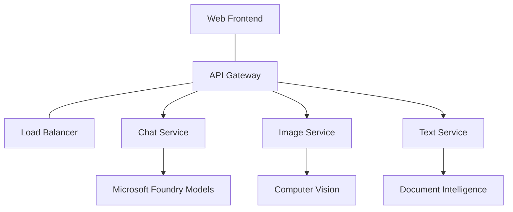

# Кращі практики робочих навантажень AI для виробництва з AZD

**Навігація по розділах:**
- **📚 Домашня сторінка курсу**: [AZD для початківців](../../README.md)
- **📖 Поточний розділ**: Розділ 8 - Виробничі та корпоративні шаблони
- **⬅️ Попередній розділ**: [Розділ 7: Усунення несправностей](../chapter-07-troubleshooting/debugging.md)
- **⬅️ Також пов’язано**: [Лабораторія AI Workshop](../chapter-02-ai-development/ai-workshop-lab.md)
- **🎯 Завершення курсу**: [AZD для початківців](../../README.md)

## Огляд

Цей посібник пояснює шаблони проєктування AI для виробництва з використанням Azure Developer CLI (AZD). Це довідник із проєктування, а не готовий до розгортання застосунок або сертифікат для виробництва.

**Приклади межі:** Якщо явно не описано як завершені, фрагменти Bicep припускають параметри та ресурси, що посилаються, з контейнерного шаблону. Вони не включають хост-зображення/плани, ідентичності, призначення ролей, DNS, виводи та інші необхідні інтеграції. Шляхи сервісів YAML і скрипти хуків/тестів — це ілюстративні файли для створення у **вашому власному застосунку**; вони не надаються цим курсом. Використовуйте робочий зразок AZD як основу, скомпілюйте повну інфраструктуру та протестуйте її в ізольованому середовищі перед виробництвом.

## Основні вирішувані проблеми

Загальні проблеми для виробництва включають розгортання багатосервісних застосунків, управління ідентичностями і секретами, масштабування, контроль витрат і моніторинг. Тут не претендується на вимірену поширеність.

## Архітектурні шаблони для виробничого AI

### Шаблон 1: Архітектура AI на базі мікросервісів

**Коли використовувати**: складні AI-застосунки з кількома можливостями



**Реалізація AZD**:

```yaml
# azure.yaml
name: enterprise-ai-platform
services:
  web:
    project: ./web
    host: staticwebapp
  api-gateway:
    project: ./api-gateway
    host: containerapp
  chat-service:
    project: ./services/chat
    host: containerapp
  vision-service:
    project: ./services/vision
    host: containerapp
  text-service:
    project: ./services/text
    host: containerapp
```

### Шаблон 2: Подієво-орієнтована обробка AI

**Коли використовувати**: пакетна обробка, аналіз документів, асинхронні робочі процеси

```bicep
// Event Hub for AI processing pipeline
resource eventHub 'Microsoft.EventHub/namespaces@2024-01-01' = {
  name: eventHubNamespaceName
  location: location
  sku: {
    name: 'Standard'
    tier: 'Standard'
    capacity: 1
  }
}

// Service Bus for reliable message processing
resource serviceBus 'Microsoft.ServiceBus/namespaces@2024-01-01' = {
  name: serviceBusNamespaceName
  location: location
  sku: {
    name: 'Premium'
    tier: 'Premium'
    capacity: 1
  }
}

// Function App for processing
resource functionApp 'Microsoft.Web/sites@2023-01-01' = {
  name: functionAppName
  location: location
  kind: 'functionapp,linux'
  properties: {
    siteConfig: {
      appSettings: [
        {
          name: 'FUNCTIONS_EXTENSION_VERSION'
          value: '~4'
        }
        {
          name: 'AZURE_OPENAI_ENDPOINT'
          value: '@Microsoft.KeyVault(VaultName=${keyVault.name};SecretName=openai-endpoint)'
        }
      ]
    }
  }
}
```

Це створює фрагменти іменних просторів, а не хаби, черги, підписки чи тригери функцій. Виконувана функція також потребує хостинг-плану, конфігурації середовища виконання/зберігання, прикріпленої ідентичності, RBAC і мережевого доступу. Посилання на Key Vault потребує дозволу на читання секрету; URL кінцевої точки сам по собі не є обліковими даними.

## Роздуми про здоров’я AI агента

Коли традиційний веб-застосунок ламається, симптоми знайомі: сторінка не завантажується, API повертає помилку або розгортання не вдається. Застосунки з AI можуть ламатися так само, але також можуть поводитися неправильно більш тонкими способами, які не дають очевидних помилок.

Цей розділ допоможе вам побудувати ментальну модель для моніторингу робочих навантажень AI, щоб знати, куди дивитись, коли щось не так.

### Чим здоров’я агента відрізняється від здоров’я традиційного застосунку

Традиційні застосунки також можуть мати тонкі проблеми з коректністю. AI агент додає недетерміновану якість відповіді до звичних питань доступності й коректності. Розгляньте здоров’я агента на двох рівнях:

| Рівень | На що дивитись | Де дивитись |
|-------|--------------|---------------|
| **Здоров’я інфраструктури** | Сервіс працює? Ресурси надані? Кінцеві точки досяжні? | `azd monitor`, здоров’я ресурсу в Azure Portal, логи контейнерів/застосунку |
| **Здоров’я поведінки** | Агент відповідає точно? Відповіді вчасні? Модель викликається коректно? | сліди Application Insights, метрики латентності виклику моделі, логи якості відповіді |

Здоров’я інфраструктури знайоме — воно однакове для будь-якого застосунку azd. Здоров’я поведінки — це новий рівень, який вводять робочі навантаження AI.

### Куди дивитись, коли AI-застосунки поводяться не так, як очікувалося

Якщо ваш AI-застосунок не дає очікуваних результатів, ось концептуальний чеклист:

1. **Почніть з основ.** Чи працює застосунок? Чи може він дістатися своїх залежностей? Перевірте `azd monitor` і здоров’я ресурсу так само, як і для будь-якого застосунку.
2. **Перевірте підключення до моделі.** Чи ваш застосунок успішно викликає AI модель? Неуспішні або тайм-аут виклики моделі — найпоширеніша причина проблем AI-застосунку, вони з’являться у логах застосунку.
3. **Безпечно перевірте введення і заземлення.** Неправильні відповіді можуть бути через отримання даних, інструкції, обмеження моделі або виконання інструментів. Використовуйте діагностичні дані з контролем доступу та редагуванням; не вмикайте необмежене логування запитів/відповідей у виробництві.
4. **Перевірте затримку відповіді.** Виклики AI моделей повільніші за типові виклики API. Якщо застосунок здається повільним, перевірте збільшення часу відповіді моделі — це може вказувати на обмеження пропускної здатності, ліміти ємності або регіональні затори.
5. **Слідкуйте за сигналами вартості.** Несподівані стрибки у використанні токенів або викликів API можуть означати цикл, некоректно налаштований запит або надмірні повторні спроби.

Вам не потрібно одразу освоювати інструменти спостереження. Ключова думка — AI-застосунки мають додатковий рівень поведінки для моніторингу, і вбудований у azd моніторинг (`azd monitor`) дає відправну точку для розслідування обох рівнів.

---

## Кращі практики безпеки

### 1. Модель безпеки з нульовою довірою (Zero-Trust)

**Стратегія впровадження**:
- Немає зв’язку сервіс до сервісу без автентифікації
- Всі API виклики використовують керовані ідентичності
- Ізоляція мережі з приватними кінцевими точками
- Контроль доступу з найменшими повноваженнями

```bicep
// Managed Identity for each service
resource chatServiceIdentity 'Microsoft.ManagedIdentity/userAssignedIdentities@2023-01-31' = {
  name: 'chat-service-identity'
  location: location
}

// Role assignments with minimal permissions
resource openAIUserRole 'Microsoft.Authorization/roleAssignments@2022-04-01' = {
  scope: openAIAccount
  name: guid(openAIAccount.id, chatServiceIdentity.id, '5e0bd9bd-7b93-4f28-af87-19fc36ad61bd')
  properties: {
    roleDefinitionId: subscriptionResourceId('Microsoft.Authorization/roleDefinitions', '5e0bd9bd-7b93-4f28-af87-19fc36ad61bd')
    principalId: chatServiceIdentity.properties.principalId
    principalType: 'ServicePrincipal'
  }
}
```

### 2. Безпечне управління секретами

**Шаблон інтеграції Key Vault**:

```bicep
// Key Vault with proper access policies
resource keyVault 'Microsoft.KeyVault/vaults@2023-02-01' = {
  name: keyVaultName
  location: location
  properties: {
    tenantId: tenant().tenantId
    sku: {
      family: 'A'
      name: 'standard' // Premium is needed for HSM-backed keys, not ordinary secrets
    }
    enableRbacAuthorization: true  // Use RBAC instead of access policies
    enablePurgeProtection: true    // Prevent accidental deletion
    enableSoftDelete: true
    softDeleteRetentionInDays: 90
  }
}

// Optional legacy key-auth alternative; omit when using Entra ID.
resource openAIKeySecret 'Microsoft.KeyVault/vaults/secrets@2023-02-01' = {
  parent: keyVault
  name: 'openai-api-key'
  properties: {
    value: openAIAccount.listKeys().key1
    attributes: {
      enabled: true
    }
  }
}
```

Призначте ідентичність середовища виконання `Key Vault Secrets User` у відповідному просторі та прив’яжіть її до хоста; сам по собі `enableRbacAuthorization` не дає доступу. Віддавайте перевагу автентифікації за керованою ідентичністю OpenAI з `disableLocalAuth: true`. Опціональний секрет ключа осмислений лише для навмисно активованого ключем облікового запису, і головному обліковому запису також потрібен дозвіл на запис секретів.

### 3. Мережева безпека

**Конфігурація приватної кінцевої точки**:

```bicep
// Virtual Network for AI services
resource virtualNetwork 'Microsoft.Network/virtualNetworks@2023-04-01' = {
  name: vnetName
  location: location
  properties: {
    addressSpace: {
      addressPrefixes: ['10.0.0.0/16']
    }
    subnets: [
      {
        name: 'ai-services-subnet'
        properties: {
          addressPrefix: '10.0.1.0/24'
          privateEndpointNetworkPolicies: 'Disabled'
        }
      }
      {
        name: 'app-services-subnet'
        properties: {
          addressPrefix: '10.0.2.0/24'
          delegations: [
            {
              name: 'Microsoft.Web/serverFarms'
              properties: {
                serviceName: 'Microsoft.Web/serverFarms'
              }
            }
          ]
        }
      }
    ]
  }
}

// Private endpoints for all AI services
resource openAIPrivateEndpoint 'Microsoft.Network/privateEndpoints@2023-04-01' = {
  name: '${openAIAccountName}-pe'
  location: location
  properties: {
    subnet: {
      id: virtualNetwork.properties.subnets[0].id
    }
    privateLinkServiceConnections: [
      {
        name: 'openai-connection'
        properties: {
          privateLinkServiceId: openAIAccount.id
          groupIds: ['account']
        }
      }
    ]
  }
}
```

Приватні кінцеві точки також потребують груп приватних зон DNS/VNet посилань і інтеграції застосунку з VNet. Вони автоматично не блокують публічний доступ: явним чином відключіть публічний мережевий доступ облікового запису AI після перевірки приватної доступності і доступу до розгортання.

## Продуктивність і масштабування

### 1. Стратегії автоматичного масштабування

**Автоматичне масштабування Container Apps**:

```bicep
resource containerApp 'Microsoft.App/containerApps@2023-05-01' = {
  name: containerAppName
  location: location
  properties: {
    configuration: {
      ingress: {
        external: true
        targetPort: 8000
        transport: 'http'
      }
    }
    template: {
      scale: {
        minReplicas: 2  // Always have 2 instances minimum
        maxReplicas: 50 // Scale up to 50 for high load
        rules: [
          {
            name: 'http-scaling'
            http: {
              metadata: {
                concurrentRequests: '20'  // Scale when >20 concurrent requests
              }
            }
          }
          {
            name: 'cpu-scaling'
            custom: {
              type: 'cpu'
              metadata: {
                type: 'Utilization'
                value: '70'  // Scale when CPU >70%
              }
            }
          }
        ]
      }
    }
  }
}
```

### 2. Стратегії кешування

**Кеш Redis для відповідей AI**:

```bicep
// Legacy Azure Cache for Redis example (not recommended for new deployments)
resource redisCache 'Microsoft.Cache/redis@2023-04-01' = {
  name: redisCacheName
  location: location
  properties: {
    sku: {
      name: 'Premium'
      family: 'P'
      capacity: 1
    }
    enableNonSslPort: false
    minimumTlsVersion: '1.2'
    redisConfiguration: {
      'maxmemory-policy': 'allkeys-lru'
    }
    // Sharding distributes data; replication/failover provides availability.
    shardCount: 2
  }
}

// Cache configuration in application
var cacheConnectionString = '${redisCache.properties.hostName}:6380,password=${redisCache.listKeys().primaryKey},ssl=True,abortConnect=False'
```

Azure Cache for Redis Basic/Standard/Premium перебуває на [шляху виведення з експлуатації](https://learn.microsoft.com/azure/azure-cache-for-redis/retirement-faq). Використовуйте Azure Managed Redis для нових проєктів та його документовані SKU, ідентичність та конфігурацію TLS замість копіювання цього застарілого ресурсу у нову виробничу систему. Лінія рядка з’єднання — нефункціональний заповнювач, а не облікові дані. Розбивайте ключі кешу за авторизацією, моделлю/інструкціями та версією отримання з терміном дії; спільний кеш лише для запитів може розкрити дані іншого користувача.

### 3. Балансування навантаження і управління трафіком

**Application Gateway з WAF**:

```bicep
// Application Gateway with Web Application Firewall
resource applicationGateway 'Microsoft.Network/applicationGateways@2023-04-01' = {
  name: appGatewayName
  location: location
  properties: {
    sku: {
      name: 'WAF_v2'
      tier: 'WAF_v2'
      capacity: 2
    }
    webApplicationFirewallConfiguration: {
      enabled: true
      firewallMode: 'Prevention'
      ruleSetType: 'OWASP'
      ruleSetVersion: '3.2'
    }
    // Backend pools for AI services
    backendAddressPools: [
      {
        name: 'ai-services-pool'
        properties: {
          backendAddresses: [
            {
              fqdn: '${containerApp.properties.configuration.ingress.fqdn}'
            }
          ]
        }
      }
    ]
  }
}
```

Це частковий ресурс шлюзу: для реального розгортання потрібні також підмережі шлюзу/конфігурація IP, фронтенд IP та порти, TLS слухачі/сертифікати, налаштування HTTP бекенду/перевірки, правила маршрутизації та пріоритети, а також переглянута політика WAF. TLS ім’я хоста/SNI і автентифікація повинні відповідати бекенду Container App.

## 💰 Оптимізація витрат

### 1. Вірний розмір ресурсів

**Конфігурації для конкретного середовища**:

Ці імена є **ілюстративними вхідними даними кастомного шаблону**, а не автоматичними налаштуваннями AZD. Спершу відобразіть кожен у `infra/main.parameters.json`/Bicep та конфігурації хоста. Наприклад, зразок RAG використовує `AZURE_SEARCH_SERVICE_SKU` та `AZURE_OPENAI_CHATGPT_DEPLOYMENT_CAPACITY`, а не загальні імена нижче. Задайте пам’ять Container Apps у підтримуваній одиниці, такій як `1Gi` у фактичному ресурсі. Застосуйте зміни інфраструктури за допомогою `azd up` або `azd provision`; сам `azd deploy` не застосовує зміни Bicep.

```bash
# Development environment
azd env new development
azd env set AZURE_OPENAI_SKU "S0"
azd env set AZURE_OPENAI_CAPACITY 10
azd env set AZURE_SEARCH_SKU "basic"
azd env set CONTAINER_CPU 0.5
azd env set CONTAINER_MEMORY 1.0

# Production environment  
azd env new production
azd env set AZURE_OPENAI_SKU "S0"
azd env set AZURE_OPENAI_CAPACITY 100
azd env set AZURE_SEARCH_SKU "standard"
azd env set CONTAINER_CPU 2.0
azd env set CONTAINER_MEMORY 4.0
```

### 2. Моніторинг витрат та бюджети

```bicep
// Supply the first day of the current UTC month, e.g. 2026-11-01T00:00:00Z.
param budgetStartDate string

// Cost management and budgets
resource budget 'Microsoft.Consumption/budgets@2024-08-01' = {
  name: 'ai-workload-budget'
  properties: {
    timePeriod: {
      startDate: budgetStartDate
    }
    timeGrain: 'Monthly'
    amount: 2000  // In the billing currency, not necessarily USD
    category: 'Cost'
    notifications: {
      warning: {
        enabled: true
        operator: 'GreaterThan'
        threshold: 80
        contactEmails: [
          'finance@company.com'
          'engineering@company.com'
        ]
        contactRoles: [
          'Owner'
          'Contributor'
        ]
      }
      critical: {
        enabled: true
        operator: 'GreaterThan'
        threshold: 95
        contactEmails: [
          'cto@company.com'
        ]
      }
    }
  }
}
```

Замініть приклади отримувачів і перевірте область/дозволи. Сповіщення бюджету використовують затримані дані білінгу і не обмежують витрати.

### 3. Оптимізація використання токенів

**Управління витратами OpenAI**:

Це лише евристика на основі символів для перегляду інтерфейсу, **не** валідатор ліміту токенів моделі. Виробничий код має використовувати токенізатор, відповідний розгорнутій моделі, та враховувати системні інструкції, схеми інструментів, історію й бюджет виводу. Відхиляйте занадто великий користувацький запит, а не тихо обрізайте його.

```typescript
// Application-level token optimization
class TokenOptimizer {
  private readonly maxTokens = 4000;
  private readonly reserveTokens = 500;
  
  optimizePrompt(userInput: string, context: string): string {
    const availableTokens = this.maxTokens - this.reserveTokens;
    if (this.estimateTokens(userInput) + 8 >= availableTokens) {
      throw new Error("User input exceeds the illustrative prompt budget");
    }
    const estimatedTokens = this.estimateTokens(userInput + context) + 8;
    
    if (estimatedTokens > availableTokens) {
      // Truncate context, not user input
      context = this.truncateContext(context, Math.max(0, availableTokens - this.estimateTokens(userInput) - 8));
    }
    
    return `${context}\n\nUser: ${userInput}`;
  }
  
  private estimateTokens(text: string): number {
    // Rough estimation: 1 token ≈ 4 characters
    return Math.ceil(text.length / 4);
  }

  private truncateContext(text: string, estimatedBudget: number): string {
    return text.slice(0, Math.max(0, estimatedBudget) * 4);
  }
}
```

## Моніторинг та спостережливість

### 1. Повний Application Insights

```bicep
// Application Insights with advanced features
resource applicationInsights 'Microsoft.Insights/components@2020-02-02' = {
  name: applicationInsightsName
  location: location
  kind: 'web'
  properties: {
    Application_Type: 'web'
    WorkspaceResourceId: logAnalyticsWorkspace.id
    SamplingPercentage: 100  // Ingestion setting; review cost and SDK sampling separately
    DisableIpMasking: false  // Retain IP masking
  }
}

// Custom metrics for AI operations
resource aiMetricAlerts 'Microsoft.Insights/metricAlerts@2018-03-01' = {
  name: 'ai-high-error-rate'
  location: 'global'
  properties: {
    description: 'Alert when failed request count exceeds 10 in five minutes'
    severity: 2
    enabled: true
    scopes: [
      applicationInsights.id
    ]
    evaluationFrequency: 'PT1M'
    windowSize: 'PT5M'
    criteria: {
      'odata.type': 'Microsoft.Azure.Monitor.SingleResourceMultipleMetricCriteria'
      allOf: [
        {
          name: 'high-error-rate'
          metricName: 'requests/failed'
          operator: 'GreaterThan'
          threshold: 10
          timeAggregation: 'Count'
        }
      ]
    }
  }
}
```

### 2. Моніторинг, специфічний для AI

**Користувацькі панелі приладів для метрик AI**:

```json
{
  "dashboard": {
    "name": "AI Application Monitoring",
    "tiles": [
      {
        "name": "OpenAI Request Volume",
        "query": "dependencies | where target contains 'openai' | summarize count() by bin(timestamp, 5m)"
      },
      {
        "name": "AI Response Latency",
        "query": "dependencies | where target contains 'openai' | summarize avg(duration) by bin(timestamp, 5m)"
      },
      {
        "name": "Token Usage",
        "query": "customMetrics | where name == 'openai_tokens_used' | summarize sum(value) by bin(timestamp, 1h)"
      },
      {
        "name": "Cost per Hour",
        "query": "customMetrics | where name == 'openai_cost' | summarize sum(value) by bin(timestamp, 1h)"
      }
    ]
  }
}
```

Цей JSON — ескіз, визначений застосунком, а не імпортована схема панелі Azure portal. Запити для токенів/витрат вимагають, щоб ваш застосунок виводив саме ці метрики; AZD їх не створює. Підлаштуйте фільтри залежностей під ваші фактичні імена кінцевих точок/спанів моделі.

### 3. Перевірки стану і моніторинг доступності

```bicep
// Application Insights availability tests
resource availabilityTest 'Microsoft.Insights/webtests@2022-06-15' = {
  name: 'ai-app-availability-test'
  location: location
  tags: {
    'hidden-link:${applicationInsights.id}': 'Resource'
  }
  properties: {
    SyntheticMonitorId: 'ai-app-availability-test'
    Name: 'AI Application Availability Test'
    Description: 'Tests AI application endpoints'
    Enabled: true
    Frequency: 300  // 5 minutes
    Timeout: 120    // 2 minutes
    Kind: 'standard'
    Locations: [
      {
        Id: 'us-east-2-azr'
      }
      {
        Id: 'us-west-2-azr'
      }
    ]
    Request: {
      RequestUrl: 'https://${webApp.properties.defaultHostName}/health'
      HttpVerb: 'GET'
      FollowRedirects: true
      ParseDependentRequests: false
    }
    ValidationRules: {
      ExpectedHttpStatusCode: 200
      SSLCheck: true
      SSLCertRemainingLifetimeCheck: 7
    }
  }
}
```

## Відновлення після катастроф і висока доступність

Попередній тест припускає існування App Service `webApp` та ресурсу Application Insights. Стандартні тести доступності виставляються в рахунок та потребують досяжної кінцевої точки; програми тільки з приватним доступом потребують відповідного приватного дизайну моніторингу. Тести пінгу URL застаріли; використовуйте [стандартні тести доступності](https://learn.microsoft.com/azure/azure-monitor/app/availability).

### 1. Розгортання в кількох регіонах

```yaml
# azure.yaml - Multi-region configuration
name: ai-app-multiregion
services:
  api-primary:
    project: ./api
    host: containerapp
    env:
      AZURE_REGION: eastus
  api-secondary:
    project: ./api
    host: containerapp
    env:
      AZURE_REGION: westus2
```

```bicep
// Separate App Service topology, not the Container Apps declarations above
resource trafficManager 'Microsoft.Network/trafficManagerProfiles@2022-04-01' = {
  name: trafficManagerProfileName
  location: 'global'
  properties: {
    profileStatus: 'Enabled'
    trafficRoutingMethod: 'Priority'
    dnsConfig: {
      relativeName: trafficManagerProfileName
      ttl: 30
    }
    monitorConfig: {
      protocol: 'HTTPS'
      port: 443
      path: '/health'
      intervalInSeconds: 30
      toleratedNumberOfFailures: 3
      timeoutInSeconds: 10
    }
    endpoints: [
      {
        name: 'primary-endpoint'
        type: 'Microsoft.Network/trafficManagerProfiles/azureEndpoints'
        properties: {
          targetResourceId: primaryAppService.id
          endpointStatus: 'Enabled'
          priority: 1
        }
      }
      {
        name: 'secondary-endpoint'
        type: 'Microsoft.Network/trafficManagerProfiles/azureEndpoints'
        properties: {
          targetResourceId: secondaryAppService.id
          endpointStatus: 'Enabled'
          priority: 2
        }
      }
    ]
  }
}
```

Змінні середовища не вибирають розташування ресурсів. IaC має провізувати окремі регіональні хости і прив’язувати кожен сервіс тегами `resourceName` або `azd-service-name`. Приклад Traffic Manager — це **окрема топологія App Service** (`primaryAppService`/`secondaryAppService`), а не маршрутизація для декларацій Container Apps. Container Apps вимагає належним чином налаштованої зовнішньої кінцевої точки/front door, TLS/маршрутизації з власним доменом і перевірки стану.

### 2. Резервне копіювання і відновлення даних

```bicep
// Backup configuration for critical data
resource backupVault 'Microsoft.DataProtection/backupVaults@2023-05-01' = {
  name: backupVaultName
  location: location
  identity: {
    type: 'SystemAssigned'
  }
  properties: {
    storageSettings: [
      {
        datastoreType: 'VaultStore'
        type: 'LocallyRedundant'
      }
    ]
  }
}

```

Сам сховок не виконує резервне копіювання. Налаштуйте **специфічну для робочого навантаження підтримувану політику і екземпляр резервного копіювання**, початкові дозволи, зберігання і тести відновлення з використанням [матриць підтримки Azure Backup](https://learn.microsoft.com/azure/backup/backup-support-matrix). Для розгортання моделей Azure OpenAI немає загальної політики резервного копіювання Azure. Зберігайте дефініції інфраструктури/моделі в системі контролю версій; захищайте завантажені документи, дані застосунку та артефакти тонкого налаштування з використанням підтримуваних функцій резервного копіювання/експорту кожного сервісу. Чітко визначте і протестуйте RPO/RTO.

## DevOps та інтеграція CI/CD

### 1. Робочий процес GitHub Actions

```yaml
# .github/workflows/deploy-ai-app.yml
name: Deploy AI Application

on:
  push:
    branches: [main]
  pull_request:
    branches: [main]

jobs:
  test:
    runs-on: ubuntu-latest
    steps:
      - uses: actions/checkout@v4
      
      - name: Setup Python
        uses: actions/setup-python@v4
        with:
          python-version: '3.11'
          
      - name: Install dependencies
        run: |
          pip install -r requirements.txt
          pip install pytest
          
      - name: Run tests
        run: pytest tests/
        
      - name: AI Safety Tests
        run: |
          python scripts/test_ai_safety.py
          python scripts/validate_prompts.py

```

Це **частина робочого процесу тільки для тестування** і передбачає, що ви створили `requirements.txt`, `tests/`, а також два скрипти безпеки. Додайте автентифіковані завдання OIDC провізування/розгортання з [конфігурації CI/CD](#cicd-pipeline-configuration), з `needs: test`, надійним тригером push/manual і захищеними середовищами GitHub. Не розгортайте недовірений код pull-request з обліковими даними хмари. Новий раннер не має вибраного локального середовища AZD; подайте вхідні дані середовища/підписки/розташування і використовуйте `azd auth login`, а не тільки `azure/login`.

### 2. Перевірка інфраструктури

```bash
# scripts/validate_infrastructure.sh
#!/bin/bash
set -euo pipefail

echo "Validating AI infrastructure deployment..."

# Requires Azure CLI login and the resource group selected explicitly.
: "${AZURE_RESOURCE_GROUP:?Set AZURE_RESOURCE_GROUP}"
: "${AZURE_OPENAI_NAME:?Set AZURE_OPENAI_NAME}"
: "${AZURE_OPENAI_CHAT_DEPLOYMENT:?Set the actual deployment name}"

# A successful empty list is not proof that resources exist.
types=("Microsoft.CognitiveServices/accounts" "Microsoft.Search/searchServices"
       "Microsoft.Storage/storageAccounts" "Microsoft.KeyVault/vaults")
for resource_type in "${types[@]}"; do
    count=$(az resource list --resource-group "$AZURE_RESOURCE_GROUP" \
        --resource-type "$resource_type" --query "length(@)" -o tsv)
    if [[ "$count" -lt 1 ]]; then
        echo "ERROR: No $resource_type found in $AZURE_RESOURCE_GROUP"
        exit 1
    fi
done

# Validate OpenAI model deployments
echo "Validating OpenAI model deployments..."
state=$(az cognitiveservices account deployment show \
  --name "$AZURE_OPENAI_NAME" --resource-group "$AZURE_RESOURCE_GROUP" \
  --deployment-name "$AZURE_OPENAI_CHAT_DEPLOYMENT" \
  --query "properties.provisioningState" -o tsv)
if [[ "$state" != "Succeeded" ]]; then
    echo "ERROR: Required model deployment is not provisioned successfully"
    exit 1
fi

echo "Infrastructure validation completed successfully!"
```

Очікувано: нульовий код виходу і повідомлення про завершення лише тоді, коли всі очікувані типи існують, а іменоване розгортання моделі надане. Це перевіряє інвентаризацію/стан провізування, **не** здоров’я ресурсу, точну топологію, RBAC, мережеву досяжність або поведінку моделі. Підлаштуйте очікувані типи під вашу архітектуру, потім виконайте окремий автентифікований тест готовності застосунку.

## Чеклист готовності до виробництва

### Безпека ✅
- [ ] Всі сервіси використовують керовані ідентичності
- [ ] Секрети збережені в Key Vault
- [ ] Приватні кінцеві точки налаштовані
- [ ] Реалізовані мережеві групи безпеки
- [ ] RBAC з найменшими повноваженнями
- [ ] WAF увімкнено на публічних кінцевих точках

### Продуктивність ✅
- [ ] Налаштовано автоматичне масштабування
- [ ] Реалізовано кешування
- [ ] Налаштовано балансування навантаження
- [ ] CDN для статичного вмісту
- [ ] Пулінг підключень до бази даних
- [ ] Оптимізація використання токенів

### Моніторинг ✅
- [ ] Налаштовано Application Insights
- [ ] Визначено кастомні метрики
- [ ] Налаштовано правила оповіщень
- [ ] Створено панель приладів
- [ ] Реалізовано перевірки стану
- [ ] Політики зберігання логів

### Надійність ✅
- [ ] Розгортання в кількох регіонах
- [ ] План резервного копіювання і відновлення
- [ ] Реалізовані запобіжники (Circuit breakers)
- [ ] Налаштовані політики повторних спроб
- [ ] Плавне деградування
- [ ] Кінцеві точки перевірки стану

### Управління витратами ✅
- [ ] Налаштовано оповіщення бюджету
- [ ] Вірний розмір ресурсів
- [ ] Застосовано знижки для dev/test
- [ ] Закупівля зарезервованих інстансів
- [ ] Панель моніторингу витрат
- [ ] Регулярні огляди витрат

### Відповідність ✅
- [ ] Вимоги до розташування даних дотримані
- [ ] Увімкнено журналювання аудиту
- [ ] Застосовані політики відповідності
- [ ] Реалізовані базові стандарти безпеки
- [ ] Регулярні оцінки безпеки
- [ ] План реагування на інциденти

## Бенчмарки продуктивності

### Ілюстративні виробничі цілі

Це приклади SLO для узгодження та навантажувального тестування, а не виміряні бенчмарки або гарантії. Затримка відповіді залежить від моделі/довжини виводу; місячні витрати токенів залежать від трафіку і цін, а не лише від кількості токенів.

| Метрика | Ціль | Моніторинг |
|--------|--------|------------|
| **Час відповіді** | < 2 секунди | Application Insights |
| **Доступність** | 99.9% | Моніторинг Uptime |
| **Рівень помилок** | < 0.1% | Логи застосунку |
| **Витрати на модель** | < $500/місяць (приклад бюджету) | Управління витратами |
| **Кількість одночасних користувачів** | 1000+ | Навантажувальне тестування |
| **Час відновлення** | < 1 години | Тести аварійного відновлення |

### Тестування навантаження

Нижче наведено ескіз інтерфейсу для скрипта тестування навантаження, **який ви маєте реалізувати**; цей репозиторій не містить `scripts/load_test.py`. Визначте навантаження на запити, автентифікацію, репрезентативні робочі обсяги, твердження щодо затримки/помилок перцентилів та ліміт витрат у вибраному інструменті тестування навантаження перед запуском:

```bash
# Load testing script for AI applications
python scripts/load_test.py \
  --endpoint https://your-ai-app.azurewebsites.net \
  --concurrent-users 100 \
  --duration 300 \
  --ramp-up 60
```

## 🤝 Найкращі практики спільноти

На основі відгуків спільноти Microsoft Foundry Discord:

### Головні рекомендації від спільноти:

1. **Починайте з малого, масштабуйте поступово**: починайте з базових SKU і масштабуйте відповідно до фактичного використання
2. **Моніторте все**: налаштуйте всебічний моніторинг з першого дня
3. **Автоматизуйте безпеку**: використовуйте інфраструктуру як код для послідовної безпеки
4. **Ретельно тестуйте**: включайте тестування, специфічне для AI, у ваш конвеєр
5. **Плануйте витрати**: моніторте використання токенів і встановлюйте бюджетні сповіщення заздалегідь

### Типові помилки, яких слід уникати:

- ❌ Жорстке кодування API-ключів в коді
- ❌ Відсутність налаштування належного моніторингу
- ❌ Ігнорування оптимізації витрат
- ❌ Відсутність тестування сценаріїв відмов
- ❌ Розгортання без перевірок стану

## Команди та розширення AZD AI CLI

AZD включає зростаючий набір команд і розширень, специфічних для AI, які спрощують робочі процеси виробництва AI. Ці інструменти долають розрив між локальною розробкою та розгортанням у виробництві для AI-навантажень.

> **Огляд випуску (2026-11-04):** Нижче наведені вказівки CLI перевірено відповідно до опублікованих релізів `azd` **1.37.2**, `azure.ai.agents` **1.0.0-beta.23**, і `azure.ai.evaluations` **1.0.0-beta.2**. Агентам beta.23 потрібен `azd >= 1.37.0`; оцінкам beta.2 потрібен `azd >= 1.33.0`. Використовуйте принаймні 1.37.0 для комбінованого робочого процесу. Це огляд документації/джерела, а не перевірка живого розгортання Azure.

### Розширення AZD для AI

AZD використовує систему розширень для додавання специфічних для AI можливостей. Встановлюйте і керуйте розширеннями за допомогою:

```bash
# List all available extensions (including AI)
azd extension list

# Inspect installed extension details
azd version
azd extension show azure.ai.agents

# Install the Foundry agents extension
azd extension install azure.ai.agents

# Install the separate Foundry evaluations extension
azd extension install azure.ai.evaluations

# Install the fine-tuning extension
azd extension install azure.ai.finetune

# Install the custom models extension
azd extension install azure.ai.models

# Upgrade all installed extensions
azd extension upgrade --all
```

**Доступні AI-розширення:**

| Розширення | Призначення | Статус |
|-----------|------------|--------|
| `azure.ai.agents` | Керування службою Foundry Agent | Попередній перегляд |
| `azure.ai.evaluations` | Оцінкові набори даних, оцінювачі, групи оцінок і запуски | Попередній перегляд |
| `azure.ai.skills` | Повторно використовувані навички агента | Попередній перегляд |
| `azure.ai.connections` | З’єднання Foundry (джерела даних, інструменти) | Попередній перегляд |
| `azure.ai.finetune` | Тонке налаштування моделей Foundry | Попередній перегляд |
| `azure.ai.models` | Користувацькі моделі Foundry | Попередній перегляд |
| `azure.coding-agent` | Конфігурація кодувального агента | Доступно |

> Запустіть `azd extension list --installed` і `azd extension show azure.ai.evaluations` для перевірки встановлених версій. Спочатку оновіть основний CLI за допомогою [інструкцій з установки/оновлення](https://learn.microsoft.com/azure/developer/azure-developer-cli/install-azd) (для установки Windows winget: `winget upgrade Microsoft.Azd`), після чого виконайте `azd extension upgrade --all`. Команди основного `azd upgrade` відсутні. Ознайомтеся з критичними змінами перед оновленням виробничої автоматизації; не припускайте, що оновлення розширення зберігає старі формати команд або конфігурації.

### Останні зміни та виправлення у релізах

| Реліз | Що змінено для цього курсу |
|---------|-------------------------|
| `azd 1.37.0` | Додає стабільні API для попереднього перегляду розгортання і виправляє редагування розширення, що перезаписують несуттєві налаштування `azure.yaml`. |
| `azd 1.37.1` | Виправляє поширення Ctrl+C через розширення та розрізняє скасування/тайм-аути від загальних збоїв. |
| `azd 1.37.2` | Покращує валідацію провізії: критичні попередження за замовчуванням **Ні**, у безконтрольних запусках – збої без підтвердження, а скасування пропускає післяпровізійні хуки. Також виправляє незрозумілі значення оточення в списках заперечень Deployment Stacks для увімкненої альфа-функції. |
| Агенти `beta.22` | Міграція оцінок на `azd ai eval`, зміна оптимізації на GA v1 API, вимагає множини `toolboxes`, і розділяє керовані режими, голосові та довготривалі попередні перегляди. Виправляє вибір моделей та автентифікацію toolbox відповідно до оточення. |
| Агенти `beta.23` | Відкриває `init --harness`; виправляє вивід відповіді A2A 0.3, недійсні шляхи/модулі prompt-agent в інфраструктурних шарах, діагностику тайм-аутів активації, і збережені попередження розробника RBAC. |
| Оцінки `beta.2` | Вимагає конфігурацію оцінки у camelCase, додає створення статичних/симульованих розмов і явні джерела локальних файлів, а також виправляє обробку ідентичності/версії наборів даних, підрахунок якісних проходів і діагностику невдалих запусків. |

Таймаут активації агента не означає відмову розгортання: спочатку перевірте спробувану версію та її стан перед повторною спробою. Попередження RBAC розробника можуть залишатися навіть при успішній провізії; усуньте відсутність доступу перед викликом під тим розробником.

Джерела: [релізи AZD](https://github.com/Azure/azure-dev/releases), [реліз агентів beta.23](https://github.com/Azure/azure-dev/releases/tag/azd-ext-azure-ai-agents_1.0.0-beta.23), [міграція агентів beta.22](https://github.com/Azure/azure-dev/releases/tag/azd-ext-azure-ai-agents_1.0.0-beta.22), та [реліз оцінок beta.2](https://github.com/Azure/azure-dev/releases/tag/azd-ext-azure-ai-evaluations_1.0.0-beta.2).

**Що таке нові розширення `skills` та `connections`?**

Два розширення в попередньому перегляді з’явилися разом з інструментами агента і варто їх зрозуміти навіть як новачок:

- **`azure.ai.skills`** — **навичка** це повторно використовувана можливість (упакований інструмент або поведінка), яку можна прикріпити до одного або кількох агентів замість повторного впровадження. Уявіть це як спільний будівельний блок: визначте навичку «пошуку в документації» або «перевірки замовлення» один раз і повторно використовуйте її серед агентів. Це забезпечує послідовність у багатофункціональних системах агентів (розділ 5) і уникає копіювання.
- **`azure.ai.connections`** — **з’єднання** це кероване посилання з вашого проекту Foundry до зовнішнього ресурсу, необхідного агентам — джерело даних (наприклад, Azure AI Search), кінцева точка інструменту або інша служба. З’єднання централізують *де* і *як* агенти отримують доступ до даних, тому облікові дані та кінцеві точки зберігаються в одному контрольованому місці, а не розкидані по коду.

Вам не потрібні ці функції для першого розгортання агентів — дотримуйтеся `azure.ai.agents` під час навчання. Використовуйте `skills`, коли дублюєте той самий інструмент серед агентів, і `connections`, коли кілька агентів спільно використовують одне джерело даних.

### Ініціалізація агентських проєктів з `azd ai agent init`

Команда `azd ai agent init` створює шаблон проекту агента Microsoft Foundry. Використовуйте актуальний шаблон проекту `azure.yaml`, а не спадковий явний маніфест агента:

```bash
# Initialize a new agent project from a local project template
azd ai agent init --template ./templates/support-agent/azure.yaml

# Initialize and target a specific Foundry project
azd ai agent init --template ./templates/support-agent/azure.yaml --project-id <foundry-project-id>

# Adopt the template into a different directory
azd ai agent init --template ./templates/support-agent/azure.yaml --src ./agents/my-agent
```

**Головні прапорці:**

| Прапорець | Опис |
|----------|------|
| `-t, --template` | Шлях або підтримуваний GitHub URI до документу проекту `azure.yaml` |
| `-p, --project-id` | Існуючий Microsoft Foundry Project ID для вашого середовища azd |
| `-s, --src` | Каталог джерел для створених агентів або цільовий каталог при прийнятті проекту |
| `--kind` | Ініціалізує `hosted`, `prompt` або попередній перегляд агента `prompt-voice` |
| `--harness` | Опційне середовище виконання для `--kind prompt`; вимагає підписки на попередній перегляд |
| `-e, --environment` | Середовище azd для використання |

`--manifest`/`-m` — це застарілий псевдонім для `--template`/`-t`; перейменування прапорця не перетворює старий маніфест у актуальний документ проекту. `--host containerapp` не є актуальним прапорцем agent-init. Для звичайного додатку Container Apps використовуйте `azd init --template` з шаблоном, що оголошує `host: containerapp`.

Для існуючого проекту з точно одним сервісом `azure.ai.project`, `azd ai agent add support-agent --file ./agents/support-agent.yaml` додає або оновлює прямий опис агента без провізії або розгортання. Команди під час виконання не підтримують спадкові імпліцитні `agent.yaml`/AgentManifest і вкладені сервісні визначення `config:`; мігруйте їх на актуальний сервіс `azure.ai.agent`. Коли init виводить наступний крок `cd`, виконайте його перед `azd up`: init не змінює вашу робочу директорію shell.

**Практична порада**: Використовуйте `--project-id`, щоб з’єднатися безпосередньо з існуючим проектом Foundry, зберігаючи зв’язок вашого коду агента та хмарних ресурсів із самого початку.

#### Опційні функції попереднього перегляду

Керований режим, голос і довготривалі виклики за замовчуванням окремо відключені. Встановлюйте лише перемикач для потрібної функції у **середовищі процесу shell/CI**, а не за допомогою `azd env set`:

| Функція | Змінна середовища процесу |
|---------|---------------------------|
| Керований режим (`init --kind prompt --harness ...`) | `AZD_ALPHA_ENABLE_AGENTS_MANAGED_HARNESS=true` |
| Голос (`init --kind prompt-voice`) | `AZD_ALPHA_ENABLE_AGENTS_VOICE=true` |
| Довготривалі виклики | `AZD_ALPHA_ENABLE_AGENTS_LONG_RUNNING=true` |

Наприклад, у Bash використовуйте `export AZD_ALPHA_ENABLE_AGENTS_MANAGED_HARNESS=true` або в PowerShell — `$env:AZD_ALPHA_ENABLE_AGENTS_MANAGED_HARNESS = "true"` перед запуском відповідної команди. Один перемикач не активує інші. Дивіться [початковий README агентів](https://github.com/Azure/azure-dev/blob/azd-ext-azure-ai-agents_1.0.0-beta.23/cli/azd/extensions/azure.ai.agents/README.md) для всіх перемикачів попереднього перегляду та обмежень.

### Керування життєвим циклом агента

Використовуйте `azure.ai.agents` для тестування, огляду, оптимізації та виведення з експлуатації агентів, а окреме розширення `azure.ai.evaluations` — для вимірювання якості:

```bash
# Invoke a deployed agent and view server response timing
# (total latency and time to first byte)
azd ai agent invoke

# Show the live endpoint configuration before changing it
azd ai agent endpoint show

# Download the deployed source of a code-based hosted agent
# (with SHA-256 verification)
azd ai agent code download

# Delete a hosted agent and all of its versions
# (--force terminates active sessions)
azd ai agent delete --force
```

**Життєвий цикл на перший погляд:**

| Етап | Команда | Використання у продакшені |
|-------|---------|--------------------------|
| Тестування | `azd ai agent invoke` | Перевірка відповідей і вимірювання затримки перед релізом |
| Огляд | `azd ai agent endpoint show` | Перевірка автентифікації/налаштувань кінцевої точки; раннє виявлення серйозних змін |
| Вимірювання | `azd ai eval init`, `generate`, `run start` | Визначення, розгортання і виконання повторюваних оцінок |
| Поліпшення | `azd ai agent optimize --eval <evaluation-name> --optimize-model <optimizer-deployment>` | Повторне використання сумісної оцінки для оптимізації агента |
| Відновлення | `azd ai agent code download` | Відновлення точної розгорнутої версії для аудиту/відкату |
| Виведення з експлуатації | `azd ai agent delete --force` | Очищення агента та його версій |

> Це команди попереднього перегляду і можуть змінюватися між версіями розширень. Запустіть `azd ai agent --help`, щоб побачити точні підкоманди у вашій встановленій версії.

`endpoint show` підтримує хостовані, prompt і голосові агенти, але оновлення кінцевих точок доступні лише для хостованих; агенти робочого процесу не підтримуються. Завантаження коду і приклад виведення хостованого агента вище не є універсальними операціями для всіх типів агентів.

#### Міграція оцінок і перевірка якості

Починаючи з агентів **1.0.0-beta.22 (2026-10-23)**, застарілі команди `azd ai agent eval` надають інструкції для міграції замість колишнього робочого процесу оцінки. Не копіюйте старі приклади `eval generate --dataset ...`: оцінка тепер знаходиться під **`azd ai eval`**.

В ініціалізованому проекті агента аутентифікуйтеся за допомогою `azd auth login`, підтвердіть вибране середовище/проект Foundry та встановіть `azure.ai.evaluations`. Для оцінки моделі судді потрібне розгортання моделі; генерація і симуляція розмов можуть вимагати власних виборів моделей і викликати додаткові витрати.

```bash
# Scaffold evals/ and wire an azure.ai.eval service into azure.yaml
azd ai eval init

# Optionally synthesize a rubric and dataset from the agent
azd ai eval generate

# Review generated files, then register datasets, evaluators, and eval groups
azd up

# Start an evaluation and wait for its results
azd ai eval run start --wait

# Inspect runs and available test-case output
azd ai eval run list
azd ai eval run show <run-id>
azd ai eval run output list <run-id>
```

Дотримуйтесь інтерактивних виборів і надрукованих наступних кроків замість припущень, що згенеровані ресурси вже зареєстровані. Конфігурація оцінки зазвичай розміщується у `evals/azure.eval.yaml`, на яку посилається сервіс `azure.ai.eval` у `azure.yaml`. Ключі мають бути **camelCase** (`evaluationLevel`, `maxSamples`, `initializationParameters`, `dataMapping`); старі ключі конфігурації у snake_case відхиляються. Шляхи у посилальних конфігураціях розв’язуються відносно цього файлу, а не кореня репозиторію.

Для оцінки розмов виберіть **статичну**, щоб оцінити готові стенограми без виклику агента, або **симуляцію**, щоб генерувати розмови за основою сценаріїв. Для симуляції потрібен цільовий агент, модель симулятора і окремий вибір моделі судді. Для безлюдних команд вкажіть вхідні дані, перелічені у `azd ai eval init --help` і `azd ai eval generate --help`; не припускайте, що модель генерації також є суддею або симулятором.

Для CI налаштуйте явну політику якості за допомогою `azd ai eval run start --help` (`--fail-on`) і вважайте ненульовий вихід хоста невдачею. Завершений запуск не означає автоматического проходження якості. Перевірте рядки з помилками та діагностику; відсутність або невідповідність кількості результатів не є доказом успіху. Зареєстровані набори даних зберігають ідентичність/версію сервісу; `--max-samples` не може вибірково обробляти зареєстрований набір даних. Публікуйте навмисно менший набір даних або використовуйте підтримуване локальне джерело файлів.

```bash
# Example CI policy: at least 90% of all test cases must pass
azd ai eval run start --wait --fail-on "pass-rate=0.9"
```

Прохідний поріг використовує кількість пройдених тестів, поділену на загальну кількість; невдалі, з помилками, пропущені та інші непройдені рядки враховуються проти нього. Не комбінуйте поріг з `--no-wait`, яка повертає результат раніше, ніж стає доступний вердикт.

#### Міграція конфігурації оптимізації

Оптимізація тепер використовує GA v1 API. Щоб повторно використати сумісну **оцінку на рівні кроку, підкріплену набором даних** з нового робочого процесу:

```bash
# Replace placeholders with the evaluation name and optimizer model deployment
azd ai agent optimize --eval-config ./evals/azure.eval.yaml --eval <evaluation-name> --optimize-model <optimizer-deployment>
```

`--eval` вибирає оцінку; `--eval-config` вибирає її конфігураційний файл (включно з визначеннями на основі файлів). `--config` замість цього приймає **окремий запит на оптимізацію API** у форматі YAML або JSON. Не передавайте старого агента `eval.yaml` або нового `azure.eval.yaml` в `--config`, і не поєднуйте `--config` з `--eval`/`--eval-config`. Оцінки на основі розмов, трасування або моделювання не є взаємозамінними з оптимізаційним скороченням на основі набору даних; для цих сценаріїв використовуйте підтримуваний формат запиту на оптимізацію. Переглядайте кандидати перед застосуванням або розгортанням.

Див. [довідку оцінок для переглянутого релізу](https://github.com/Azure/azure-dev/blob/azd-ext-azure-ai-evaluations_1.0.0-beta.2/cli/azd/extensions/azure.ai.evaluations/README.md) та [початковий код команди оптимізації для переглянутого релізу](https://github.com/Azure/azure-dev/blob/azd-ext-azure-ai-agents_1.0.0-beta.23/cli/azd/extensions/azure.ai.agents/internal/cmd/optimize.go) для точних опцій.

#### Попередній перегляд розгортання розміщеного агента лише для читання

Для існуючого середовища, пов’язаного з Foundry, з уніфікованим сервісом `azure.ai.agent` від `kind: hosted`, порівняйте підтримувану конфігурацію перед розгортанням:

```bash
azd deploy <service-name> --preview --no-prompt
```

Цей попередній перегляд не розгортає агента. Це не повний диференціал інфраструктури/безпеки: агенти підказок/голосу/робочих процесів, застарілі макети конфігурацій і деякі розміщені налаштування поза його сферою. Результат `unknown` не є дозволом на розгортання. Немає окремої команди `azd ai agent deploy` або агента `--dry-run`; використовуйте основний робочий процес розгортання.

### Протокол контексту моделі (MCP) з `azd mcp`

AZD має вбудовану підтримку MCP-сервера (альфа), що дозволяє AI-агентам і інструментам взаємодіяти з вашими ресурсами Azure через стандартизований протокол:

```bash
# Start the MCP server for your project
azd mcp start

# Review current Copilot consent rules for tool execution
azd copilot consent list
```

MCP-сервер надає ваш контекст проекту azd — середовища, сервіси та ресурси Azure — інструментам розробки на основі штучного інтелекту. Це забезпечує:

- **Допомога при розгортанні за допомогою AI**: дає агентам коду можливість запитувати стан вашого проекту та запускати розгортання
- **Виявлення ресурсів**: інструменти AI можуть виявляти, які ресурси Azure використовує ваш проект
- **Управління середовищами**: агенти можуть перемикатися між середовищами розробки/стейджингу/продукції

### Генерація інфраструктури з `azd infra generate`

Для виробничих AI-навантажень ви можете генерувати та налаштовувати Інфраструктуру як код замість автоматичного забезпечення:

```bash
# Generate supported infrastructure for this project type
azd infra generate
```

Підтримка залежить від проекту/хозяїна і встановлених провайдерів; це не загальна команда зворотного інжинірингу для довільних ресурсів Azure і не обіцянка генерувати одночасно Bicep та Terraform. Запустіть `azd infra generate --help` і перевірте згенерований формат. Там, де підтримується, запис IaC на диск дає вам можливість:
- Переглядати та проводити аудит інфраструктури перед розгортанням
- Додавати власні політики безпеки (мережеві правила, приватні кінцеві точки)
- Інтегрувати з існуючими процесами аудиту IaC
- Контролювати версії змін інфраструктури окремо від коду додатка

### Хуки життєвого циклу виробництва

Хуки AZD дозволяють впроваджувати власну логіку на кожному етапі життєвого циклу розгортання — критично для виробничих AI-навантажень:

```yaml
# azure.yaml - Production hooks example
name: ai-production-app
hooks:
  preprovision:
    shell: sh
    run: scripts/validate-quotas.sh    # Check AI model quota before provisioning
  postprovision:
    shell: sh
    run: scripts/verify-networking.sh  # Verify IaC-provisioned private connectivity
  predeploy:
    shell: sh
    run: scripts/run-ai-safety-tests.sh  # Run prompt safety checks
  postdeploy:
    shell: sh
    run: scripts/smoke-test.sh           # Verify agent responses post-deploy
services:
  agent-api:
    project: ./src/agent
    host: containerapp
    hooks:
      predeploy:
        shell: sh
        run: scripts/validate-model-access.sh  # Per-service hook
```

```bash
# Run a specific hook manually during development
azd hooks run predeploy
```

**Рекомендовані хуки виробництва для AI-навантажень:**

| Хук | Випадок використання |
|------|----------|
| `preprovision` | Перевірка квот підписки для ємності AI моделей |
| `postprovision` | Перевірка приватного підключення та необхідних виходів ресурсів |
| `predeploy` | Запуск тестів безпеки AI, перевірка шаблонів підказок |
| `postdeploy` | Тестування реакцій агента, перевірка підключення моделі |

### Налаштування CI/CD конвеєра

Використовуйте `azd pipeline config` для підключення вашого проекту до GitHub Actions або Azure Pipelines з безпечною аутентифікацією Azure:

```bash
# Configure CI/CD pipeline (interactive)
azd pipeline config

# Configure with a specific provider
azd pipeline config --provider github
```

Ця команда:
- Створює або налаштовує особу конвеєра; переглядайте її сформовані області ролей/дозволи замість припущення мінімальних привілеїв
- Налаштовує федеративні облікові дані (без збережених секретів)
- Генерує або оновлює файл визначення конвеєра
- Встановлює потрібні змінні середовища у вашій системі CI/CD

#### Крок за кроком: ваш перший конвеєр GitHub Actions

Ось повний покроковий процес від робочого проекту azd до автоматизованих розгортань при кожному пуші.

**1. Переконайтеся, що ваш проект знаходиться на GitHub**

```bash
git init
git add .
git commit -m "Initial azd project"
gh repo create my-ai-app --private --source=. --push
```

**2. Запустіть конфігурацію конвеєра**

```bash
azd pipeline config --provider github
```

azd інтерактивно:
- Запитає, яку підписку Azure і середовище цілити
- Створить Entra **реєстрацію додатка + сервісний принципал** для конвеєра
- Налаштує **федеративні облікові дані (OIDC)** — щоб GitHub аутентифікувався в Azure за допомогою короткочасних токенів і **без збереження секретів**
- Надішле потрібні **змінні** у ваш репозиторій GitHub (`AZURE_CLIENT_ID`, `AZURE_TENANT_ID`, `AZURE_SUBSCRIPTION_ID`, `AZURE_ENV_NAME`, `AZURE_LOCATION`)

**3. Ознайомтеся з згенерованим робочим процесом**

Для підтримуваного шаблону налаштуйте/перегляньте `.github/workflows/azure-dev.yml`. Ключові частини виглядають так (шаблон має надавати набори інструментів і параметри середовища додатка):

```yaml
# .github/workflows/azure-dev.yml
on:
  push:
    branches: [ main ]
  workflow_dispatch:        # lets you run it manually too

permissions:
  id-token: write           # required for OIDC federated login
  contents: read

jobs:
  build:
    runs-on: ubuntu-latest
    env:
      AZURE_CLIENT_ID: ${{ vars.AZURE_CLIENT_ID }}
      AZURE_TENANT_ID: ${{ vars.AZURE_TENANT_ID }}
      AZURE_SUBSCRIPTION_ID: ${{ vars.AZURE_SUBSCRIPTION_ID }}
      AZURE_ENV_NAME: ${{ vars.AZURE_ENV_NAME }}
      AZURE_LOCATION: ${{ vars.AZURE_LOCATION }}
    steps:
      - uses: actions/checkout@v4
      - name: Install azd
        uses: Azure/setup-azd@v2
      - name: Log in with OIDC
        run: azd auth login --client-id "$AZURE_CLIENT_ID" --federated-credential-provider "github" --tenant-id "$AZURE_TENANT_ID"
      - name: Provision infrastructure
        run: azd provision --no-prompt
      - name: Deploy application
        run: azd deploy --no-prompt
```

**4. Перевірте, що все працює**

```bash
# Push a change to trigger the pipeline
git commit -am "Trigger pipeline" --allow-empty
git push
```

Відкрийте вкладку **Actions** у вашому репозиторії GitHub і спостерігайте, як автоматично виконуються `azd provision` і `azd deploy`.

> **Чому федеративні облікові дані важливі:** старі конвеєри зберігали секрет клієнта в GitHub. Федеративні облікові дані OIDC повністю усувають цей секрет — GitHub запитує короткочасний токен під час виконання, що є більш безпечним і не вимагає обертання або ризику витоку. Це налаштування за замовчуванням, яке встановлює `azd pipeline config`.

> **Секрети проти змінних:** не конфіденційні ідентифікатори (`AZURE_CLIENT_ID` тощо) розміщуються в репозиторії як **змінні**. Якщо вашому додатку дійсно потрібен секрет на етапі збірки, додайте його як GitHub **секрет** і посилайтеся на нього через `${{ secrets.NAME }}` — але надавайте перевагу Key Vault + керованій ідентичності під час виконання (див. [Розділ 3](../chapter-03-configuration/authsecurity.md)).

**Виробничий робочий процес з конфігурацією конвеєра:**

```bash
# 1. Set up production environment
azd env new production
azd env set AZURE_OPENAI_CAPACITY 100

# 2. Configure the pipeline
azd pipeline config --provider github

# 3. Review the generated trigger, provisioning/deployment steps, and approvals
```

#### Крок за кроком: Azure DevOps Pipelines

Віддаєте перевагу Azure DevOps замість GitHub Actions? azd підтримує його нативно через провайдера `azdo`. Потік майже ідентичний — azd генерує файл конвеєра, створює сервісне підключення та налаштовує аутентифікацію.

**1. Переконайтеся, що у вас є проект в Azure DevOps**

Потрібна організація і проект в `https://dev.azure.com/<your-org>`. Згенеруйте Особистий токен доступу (PAT) з правами **Build (читання та виконання)**, **Code (читання і запис)** і **Service Connections (читання, запит і керування)** — azd запитає його у вас.

**2. Налаштуйте конвеєр**

```bash
azd pipeline config --provider azdo
```

azd:
- Запитає вашу організацію Azure DevOps та проект
- Створить (або повторно використає) **сервісне підключення** до Azure за допомогою сервісного принципала
- Налаштує **федерацію робочих ідентичностей (OIDC)** так, що секрет клієнта не зберігається
- Налаштує визначення конвеєра (звичайно `.azdo/pipelines/azure-dev.yml`) із шаблону конвеєра проекту

**3. Перегляньте згенерований конвеєр**

Використовуйте згенерований конвеєр проекту, включно з його **Azure сервісним підключенням і кроками аутентифікації AZD**. Офіційний [посібник з налаштування Azure Pipelines](https://learn.microsoft.com/azure/developer/azure-developer-cli/pipeline-azure-pipelines) містить нижченаведений фрагмент інсталяції; це **тільки інсталяція**, а не робочий процес розгортання з аутентифікацією:

```yaml
# .azdo/pipelines/azure-dev.yml (installer fragment only)
trigger:
  - main

pool:
  vmImage: ubuntu-latest

steps:
  - task: setup-azd@0
    displayName: Install azd
```

Встановіть розширення AZD Azure DevOps, якщо завдання недоступне у вашій організації. Не копіюйте голі `azd provision`/`azd deploy` shell кроки без аутентифікації: наявність налаштованого сервісного підключення не означає автоматичний вхід у AZD для всіх процесів. Дотримуйтеся OIDC-логіну та контексту авторизованого завдання згенерованого шаблону і вказуйте вибране середовище/підписку/локацію.

**4. Звідки беруться змінні**

azd зберігає значення середовищ (`AZURE_ENV_NAME`, `AZURE_LOCATION`, `AZURE_SUBSCRIPTION_ID`) у вигляді **групи змінних** в Azure DevOps, щоб конвеєр міг їх читати. Ви можете переглянути і редагувати їх у **Pipelines → Library**.

> **Такий самий OIDC виграш, як у GitHub:** провайдер `azdo` також за замовчуванням налаштовує федерацію робочих ідентичностей, тому секрет клієнта не зберігається у сервісному підключенні — Azure DevOps обмінює короткочасний токен під час виконання. Передавайте `--auth-type client-credentials` лише в разі, якщо ваша організація ще не може використовувати OIDC.

**5. Запустіть його**

```bash
git commit -am "Add Azure DevOps pipeline" --allow-empty
git push
```

Відкрийте **Pipelines** в Azure DevOps, щоб спостерігати за виконанням `azd provision` і `azd deploy`.

### Додавання компонентів за допомогою `azd add`

Поступово додавайте сервіси Azure в існуючий проект:

```bash
# Add a new service component interactively
azd add
```

Це особливо корисно для розширення виробничих AI-додатків — наприклад, додавання сервісу векторного пошуку, нової кінцевої точки агента або компонента моніторингу до існуючого розгортання.

## Додаткові ресурси

- **Azure Well-Architected Framework**: [Рекомендації для AI-навантажень](https://learn.microsoft.com/azure/well-architected/ai/)
- **Документація Microsoft Foundry**: [Офіційна документація](https://learn.microsoft.com/azure/ai-studio/)
- **Шаблони спільноти**: [Azure Samples](https://github.com/Azure-Samples)
- **Спільнота Discord**: [#Azure канал](https://discord.gg/microsoft-azure)
- **Навички агента для Azure**: [microsoft/github-copilot-for-azure на skills.sh](https://skills.sh/microsoft/github-copilot-for-azure) – багаторазові навички агента для Azure AI, Foundry, розгортання, оптимізації витрат і діагностики. Встановіть у вашому редакторі:
  ```bash
  npx skills add microsoft/github-copilot-for-azure
  ```

---

**Навігація по розділах:**
- **📚 Головна сторінка курсу**: [AZD Для початківців](../../README.md)
- **📖 Поточний розділ**: Розділ 8 — Виробничі та корпоративні шаблони
- **⬅️ Попередній розділ**: [Розділ 7: Усунення несправностей](../chapter-07-troubleshooting/debugging.md)
- **⬅️ Також пов’язано**: [AI Workshop Lab](../chapter-02-ai-development/ai-workshop-lab.md)
- **🎯 Завершення курсу**: [AZD Для початківців](../../README.md)

**Пам’ятайте**: Виробничі AI-навантаження вимагають ретельного планування, моніторингу та постійної оптимізації. Починайте з цих шаблонів і адаптуйте їх під свої конкретні вимоги.

---

<!-- CO-OP TRANSLATOR DISCLAIMER START -->
**Відмова від відповідальності**:
Цей документ було перекладено за допомогою сервісу штучного інтелекту для перекладу [Co-op Translator](https://github.com/Azure/co-op-translator). Хоча ми прагнемо до точності, будь ласка, майте на увазі, що автоматичні переклади можуть містити помилки або неточності. Оригінальний документ рідною мовою слід вважати авторитетним джерелом. Для критично важливої інформації рекомендується професійний людський переклад. Ми не несемо відповідальності за будь-які непорозуміння або неправильні тлумачення, що виникли внаслідок використання цього перекладу.
<!-- CO-OP TRANSLATOR DISCLAIMER END -->