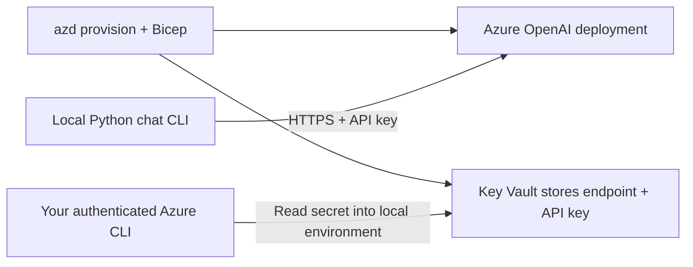

# Azure OpenAI Chat — Локальний CLI та інфраструктура AZD

**Рівень:** Середній · **Час:** 35–60 хвилин включно з налаштуванням

Цей зразок забезпечує **ресурс Azure OpenAI та Key Vault**, а потім запускає
інтерактивний чат CLI Python **на вашій машині**. Він не розміщує вебдодаток
або Container App. Модель за замовчуванням — `gpt-4.1`, версія `2025-04-14`, з
потужністю розгортання `GlobalStandard` 20. Перед створенням перевірте поточну доступність і квоту в
обраному регіоні; дати життєвого циклу моделі можуть змінюватися.

## Навчальні цілі

- Забезпечити інфраструктуру моделі з Bicep і azd.
- Отримати API-ключ із Key Vault без розміщення його в результатах розгортання.
- Відправляти запити Chat Completions і підтримувати історію розмови.
- Інтерпретувати підрахунок токенів і обмеження оцінки вартості.



У цьому зразку немає інтеграції з керованою ідентичністю під час виконання, мульти-регіонального
перемикання, власного обмежувача швидкості, режиму потокової передачі чи розміщених обчислень.
SDK OpenAI виконує до двох повторних спроб при відмовах із можливістю повторної спроби; CLI повідомляє про залишкові помилки.

## Передумови

- Актуальна стабільна версія [azd](https://learn.microsoft.com/azure/developer/azure-developer-cli/install-azd)
  (застосовна на момент огляду: 1.37.2).
- [Azure CLI](https://learn.microsoft.com/cli/azure/install-azure-cli).
- Python **3.10+** (рекомендується 3.11) та віртуальне оточення.
- Підписка Azure з дозволом створювати ресурси Cognitive Services та Key Vault,
  розгортати моделі та читати секрети сховища.
- Регіональна доступність і квота `GlobalStandard` для `gpt-4.1`. Вимоги доступу залежать
  від підписки та функції; гарантій строків затвердження немає.

```bash
azd version
az version
python --version
azd auth login
az login
```

Це окремі сесії автентифікації. Оберіть ту ж підписку в обох
інструментах перед запуском наведених нижче команд.

## Швидкий старт (Bash)

Запустіть з кореня репозиторію:

```bash
cd examples/azure-openai-chat
azd env new myopenai
azd provision
```

Оберіть підтримуваний регіон. Під час створення створюється група ресурсів, обліковий запис OpenAI,
розгортання моделі, Key Vault та секрети `openai-endpoint`/`openai-api-key`.
Немає **служб для розгортання** в `azure.yaml`.

Завантажте несекретні вихідні дані та отримайте секрет у ваш поточний shell:

```bash
export AZURE_OPENAI_ENDPOINT="$(azd env get-value AZURE_OPENAI_ENDPOINT)"
export AZURE_OPENAI_MODEL="$(azd env get-value AZURE_OPENAI_MODEL)"
KV_NAME="$(azd env get-value AZURE_KEY_VAULT_NAME)"
export AZURE_OPENAI_API_KEY="$(az keyvault secret show \
  --vault-name "$KV_NAME" --name openai-api-key --query value --output tsv)"

python -m venv .venv
source .venv/bin/activate
python -m pip install -r src/requirements.txt
python src/chat.py
```

У PowerShell активуйте за допомогою `.\.venv\Scripts\Activate.ps1` і призначте змінні середовища
за допомогою `$env:AZURE_OPENAI_ENDPOINT = azd env get-value AZURE_OPENAI_ENDPOINT`
(і аналогічно для моделі). Отримайте ключ API за допомогою
`$env:AZURE_OPENAI_API_KEY = az keyvault secret show --vault-name $KV_NAME --name openai-api-key --query value -o tsv`.
Спочатку встановіть `$KV_NAME = azd env get-value AZURE_KEY_VAULT_NAME`.

Не виводьте, не комітьте та не вставляйте ключ API у звіти про помилки. CLI читає змінні процесу
середовища; він **не** отримує секрети Key Vault або не завантажує файли `.env`.
`config.py` перевіряє кінцеву точку, ліміт токенів і температуру під час запуску.

Очікуваний результат (вміст і використання варіюються):

```text
Azure OpenAI Chat Application
Model: gpt-4.1
...
You: Say hello in one sentence.
Assistant: Hello! How can I help you today?
[Tokens: ... | Cost: $...]
```

Команди: `stats` показує підсумки, `clear` очищує історію розмов, а
`quit`/`exit` завершує сесію. Команд `--stream`, `--show-tokens`, `tokens`
або `cost` немає.

## Перевірте розгортання

Після завантаження змінних оболонки вище:

```bash
curl --fail-with-body \
  "${AZURE_OPENAI_ENDPOINT%/}/openai/deployments/${AZURE_OPENAI_MODEL}/chat/completions?api-version=2024-10-21" \
  -H "Content-Type: application/json" \
  -H "api-key: $AZURE_OPENAI_API_KEY" \
  -d '{"messages":[{"role":"user","content":"Say hello!"}],"max_tokens":50}'

az keyvault secret list --vault-name "$KV_NAME" --query "[].name" -o table
```

Успіх: API повертає HTTP 200 з `choices[0].message.content` і `usage`;
сховище містить `openai-api-key` і `openai-endpoint`. Саме вдале розгортання ARM
не підтверджує роботу інференсу.

## Файли та конфігурація

```text
azure.yaml                         # Infrastructure-only AZD project
infra/main.bicep                   # Subscription deployment
infra/main.parameters.json         # Environment, location, principal ID
infra/resources/openai.bicep       # Account + model
infra/resources/keyvault.bicep     # Vault + deploying user's secret access policy
infra/resources/secrets.bicep      # Writes secrets, no key output
src/chat.py                        # Interactive CLI
src/config.py                      # Environment validation
src/requirements.txt               # Python packages
```

Щоб змінити модель/версію/мощності, відредагуйте значення за замовчуванням у
`infra/main.bicep` і запустіть `azd provision`. Встановлення `AZURE_OPENAI_MODEL` у вашій
оболонці лише вибирає **існуючу назву розгортання**; це не розгортає іншу модель.

| Змінна середовища виконання | Значення за замовчуванням / Джерело |
|---|---|
| `AZURE_OPENAI_ENDPOINT` | Обов’язково; azd вихід без секретів |
| `AZURE_OPENAI_API_KEY` | Обов’язково; отримати з Key Vault |
| `AZURE_OPENAI_MODEL` | `gpt-4.1`; назва розгортання Azure |
| `AZURE_OPENAI_MAX_TOKENS` | 800 (діапазон валідації 1–4096) |
| `AZURE_OPENAI_TEMPERATURE` | 0.7 (діапазон 0–2) |
| `AZURE_OPENAI_INPUT_PRICE_PER_1K` | 0.002 USD; орієнтовна ставка за необроблений вхід |
| `AZURE_OPENAI_OUTPUT_PRICE_PER_1K` | 0.008 USD; орієнтовна ставка за вихід |

## Витрати та обмеження безпеки

Відображення вартості є **оцінкою**, а не рахунком Azure. Воно множить використання токенів API
за налаштованими ставками і не враховує знижки за кешований вхід,
регіональні/відмінності SKU, податки, зміну цін або неуспішні/повторені виклики.
Перезапишіть **обидві ставки**, якщо ви використовуєте іншу модель або SKU, і перевірте актуальні
[ціни Azure OpenAI](https://azure.microsoft.com/pricing/details/cognitive-services/openai-service/).

Для ілюстрації, 100 запитів, кожен із 500 незакешованими вхідними токенами та 200 вихідними токенами
за стандартними тарифами коштують `100 × (500/1000 × .002 + 200/1000 × .008) = $0.26`.
Операції з Key Vault/сховищем тягнуть за собою окремі витрати. Для цього локального CLI немає фіксованої плати $50/місяць
і у шаблоні немає розміщених обчислювальних ресурсів.

Сейф використовує політику доступу для суб’єкта, що розгортає; це не RBAC або
приклад застосунку з керованою ідентичністю. Для навчання використовуються публічні кінцеві точки та автентифікація за API-ключем.
Обмежте дозволи та додайте відповідні керування ідентичністю/мережею перед адаптацією для виробництва.


## Практичні вправи

### 1. Перевірити контекст і скинути його

**Початок:** запуск CLI. **Мета:** спостерігати історію.
Скажіть «Запам’ятай слово cedar», потім запитайте «Яке слово я попросив тебе запам’ятати?»
Запустіть `stats`; два успішні кроки повинні зараховуватися як два обміняні повідомлення.
Запустіть `clear` і `stats`; обмінені повідомлення мають бути нульовими (загальна кількість токенів не змінюється).
Точна формулювання моделі не детерміністична.

### 2. Змінити ліміт відповіді

**Початок:** вийти з CLI, залишаючись у тому самому терміналі.
Запустіть `export AZURE_OPENAI_MAX_TOKENS=100`, перезапустіть `python src/chat.py` і попросіть
коротке пояснення azd. Перевірте, що бенгер показує 100.
Відновіть за допомогою `unset AZURE_OPENAI_MAX_TOKENS`. Менший ліміт відповіді не
зменшує токени історії, які вже надіслані.

### Загальні проблеми

- **Відсутні змінні середовища:** провіжнінг не експортує значення оболонки;
  повторіть кроки експорту. У новому терміналі їх потрібно встановити знову.
- **403 при читанні Key Vault:** перевірте підписку/вхід в Azure CLI і суб’єкт
  у політиці доступу сейфу. Зміни політики можуть займати час для поширення.
- **404 inference:** перевірте ім’я розгортання, кінцеву точку та статус розгортання.
- **429 inference:** зачекайте на скидання обмежень частоти; перевірте квоту регіональної моделі.
  CLI видаляє помилкові кроки з історії, тому повторна спроба не подвоює їх.
- **Довжина контексту:** зразок не обрізає довгі розмови; використовуйте `clear`.
- **Модель недоступна/знята з обслуговування:** перевірте актуальну доступність моделі і оновіть
  модель/версію/SKU разом; версія API і версія моделі — різні настройки.

## Прибирання й наступні кроки

```bash
azd down
unset AZURE_OPENAI_API_KEY
```

У Key Vault період зберігання після м’якого видалення становить сім днів; очищення вимагає окремих дозволів.
Тестовий набір не зафіксований; не запускайте неіснуючу команду `pytest tests/`.
Додайте змодельовані тести API перед розширенням коду.

[Приклади контейнерів](../../../../examples/container-app) · [Шаблон архітектури роздрібної торгівлі](../retail-scenario.md) ·
[Головна сторінка курсу](../../README.md) · [Повідомити про проблему](https://github.com/microsoft/AZD-for-beginners/issues)

---

<!-- CO-OP TRANSLATOR DISCLAIMER START -->
**Відмова від відповідальності**:
Цей документ було перекладено за допомогою сервісу штучного інтелекту для перекладу [Co-op Translator](https://github.com/Azure/co-op-translator). Хоча ми прагнемо до точності, будь ласка, майте на увазі, що автоматичні переклади можуть містити помилки або неточності. Оригінальний документ рідною мовою слід вважати авторитетним джерелом. Для критично важливої інформації рекомендується професійний людський переклад. Ми не несемо відповідальності за будь-які непорозуміння або неправильні тлумачення, що виникли внаслідок використання цього перекладу.
<!-- CO-OP TRANSLATOR DISCLAIMER END -->