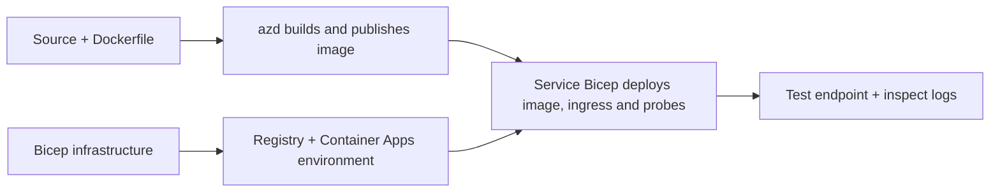

# Приклади розгортання Container App з AZD

Цей каталог містить два навчальні зразки з вихідним кодом, Dockerfile,
інфраструктурою Bicep та `azure.yaml`. Жоден із них не є готовим для продакшну.

## Виберіть приклад

| Зразок | Що реалізовано | Вимоги |
|---|---|---|
| [Простий Flask API](../../../../examples/container-app/simple-flask-api) | Один Python CRUD API, елементи в пам’яті, перевірки стану, масштабування HTTP | Базові знання CLI та HTTP |
| [Дві мікросервіси](../../../../examples/container-app/microservices) | Шлюз Node.js, внутрішній Python сервіс продукту лише для читання, телеметрія та масштабування | Спочатку завершіть приклад з одним сервісом |

Виділіть 30–60 хвилин включно з налаштуванням та перевіркою. Часи надання Azure залежать від навантаження.

## Вимоги

- [Azure Developer CLI](https://learn.microsoft.com/azure/developer/azure-developer-cli/install-azd)
- [Azure CLI](https://learn.microsoft.com/cli/azure/install-azure-cli) для команд перевірки
- Docker із запущеним демоном для створення цих контейнерних образів
- Підписка Azure з дозволами на створення ресурсів і достатньою квотою для регіону
- Bash для прикладів у shell або еквівалентні команди PowerShell

```bash
azd version
az version
docker info
azd auth login
az login
```

Ці два інструменти мають окремі сесії входу. Використовуйте актуальний стабільний azd; поточна
опублікована версія на момент рецензії — 1.37.2. Старі мінімальні вимоги щодо версії не
є гарантією сумісності.

## Швидкий старт

Від кореня репозиторію:

```bash
cd examples/container-app/simple-flask-api
azd env new flask-demo
azd up
API_URL=$(azd env get-value API_ENDPOINT)
curl --fail-with-body "${API_URL}/health"
```

Очікується: HTTP 200 з `"status": "healthy"`. Дотримуйтесь прикладу README, щоб створити,
читати, оновлювати та видаляти елемент, а також перевіряти журнали.



Початкове розгортання використовує публічний образ hello-world на порту 80. Специфічні для сервісу
параметри Bicep дозволяють `azd deploy` замінити його на створений образ додатку
і правильний порт/проби додатку (8000 для Flask/product, 8080 для шлюзу).
Залишайте ці файли зі своїми `azure.yaml` `module` налаштуваннями.

## Конфігурація: що змінює що

`azure.yaml` обирає вихідні каталоги, мови, хости та модулі розгортання.
CPU/пам’ять контейнера, вхідні підключення, проби, кількість копій і правила масштабування визначаються
у **Bicep**, а не у довільних `resources`, `scale` або `regions` властивостях сервісу.

`azd env set SOME_VALUE ...` зберігає значення локально. Воно змінює розгорнутий
ресурс лише тоді, коли параметр, відображення середовища або хуку явно використовує це
значення. Ці приклади не використовують `MAX_REPLICAS`, `SCALE_TO_ZERO_TIMEOUT`,
`CONTAINER_APP_REPLICA_TYPE` або власні налаштування canary зі значень середовища azd.
Відредагуйте відповідний Bicep і запустіть `azd up` для повторного подачі та розгортання.

Не розміщуйте вихідний код додатку під `infra/`. `project` повинно вказувати на вихідний
каталог, який містить Dockerfile і маніфест залежностей.

## Моніторинг і витрати

- `azd monitor --logs` відкриває портал; це не потокове відображення журналів терміналу.
  Використовуйте `az containerapp logs show --follow` з фактичною назвою ресурсу.
- Проста API записує журнали stdout, зібрані через Container Apps/Log Analytics.
  Ресурс Application Insights, що створено, не інструментований автоматично.
- Шлюз мікросервісів використовує SDK Application Insights для Node.js; Python-
  сервіс експортує трасування журналів додатку. Повне трасування запитів/залежностей Python
  не налаштоване.
- Можливість scale-to-zero може зменшити витрати на обчислення, але реєстр і прийом/зберігання журналів
  все ще можуть коштувати грошей. За замовчуванням мікросервісів копії залишаються активними.
  Оцініть свій регіон та використання у
  [калькуляторі цін Azure](https://azure.microsoft.com/pricing/calculator/).

## Розвинуті патерни — не включені реалізації

Це напрямки дизайну, а не додаткові локальні проекти або шматки коду для копіювання та запуску:

- **Постійні дані та автентифікація:** замініть тимчасові сховища й додайте
  автентифікацію/авторизацію Microsoft Entra ID перед виходом у продакшн.
- **Blue-green/canary:** використовуйте режим багатоверсійності Container Apps, мітки
  ревізій, ваги трафіку, перевірку стану і процедури відкату.
  У цих прикладах немає `deploymentStrategy: canary` конфігурації azd.
  Докладніше дивіться [керування ревізіями](https://learn.microsoft.com/azure/container-apps/revisions).
- **Багаторегіональність:** створюйте окремі середовища й додатки в Bicep і плануйте
  глобальне маршрутизування і консистенцію даних. Список сервісів `regions` не є механізмом
  розгортання azd.
- **Працювальники черги:** додайте вихідний код працівника, залежності, ресурси черги,
  керовану ідентичність із ролями на рівні даних і автентифіковане правило масштабування.
  Не копіюйте порожній шлях `src/worker` і не очікуйте працюючий проект.
- **Dapr:** подайте компоненти, налаштуйте сайдкар, встановіть відповідний SDK
  і реалізуйте обробку помилок стану/pub-sub.
- **Секрети:** користуйтеся керованою ідентичністю і призначеннями ролей де можливо. Просто
  створення Key Vault не надає додаткам доступ або не завантажує секрети.

## Очищення

З каталогу прикладу:

```bash
azd down
```

Перевірте запити на видалення і підтвердіть, що видалено виділену групу ресурсів.
Не використовуйте ці приклади як базу для продакшену без додаткового дизайну і тестування.

[Індекс прикладів](../README.md) · [Домашня сторінка курсу](../../README.md) ·
[Документація Container Apps](https://learn.microsoft.com/azure/container-apps/) ·
[Повідомити про проблему](https://github.com/microsoft/AZD-for-beginners/issues)

---

<!-- CO-OP TRANSLATOR DISCLAIMER START -->
**Відмова від відповідальності**:
Цей документ було перекладено за допомогою сервісу штучного інтелекту для перекладу [Co-op Translator](https://github.com/Azure/co-op-translator). Хоча ми прагнемо до точності, будь ласка, майте на увазі, що автоматичні переклади можуть містити помилки або неточності. Оригінальний документ рідною мовою слід вважати авторитетним джерелом. Для критично важливої інформації рекомендується професійний людський переклад. Ми не несемо відповідальності за будь-які непорозуміння або неправильні тлумачення, що виникли внаслідок використання цього перекладу.
<!-- CO-OP TRANSLATOR DISCLAIMER END -->