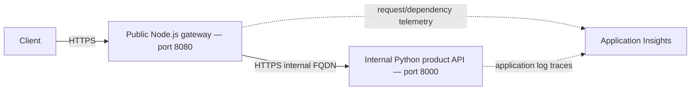

# Мікросервіси з двома сервісами — Azure Container Apps

**Рівень:** Середній · **Час:** 45–60 хвилин включно з налаштуванням

Цей навчальний приклад реалізує **Node.js API Gateway** та **тільки для читання Python Product Service**. Джерело, Dockerfiles, Bicep та конфігурація azd включені.

Це не система, готова до роботи у виробничому середовищі.

## Чого ви навчитесь

- Розгортати два сервіси окремо.
- Використовувати внутрішній backend FQDN через HTTPS.
- Перевіряти відповіді: успіх, не знайдено та недоступність сервісу.
- Розуміти телеметрію та межі незалежного масштабування.



Каталог продуктів містить п’ять фіксованих продуктів у пам’яті. Там **немає обробників POST,
PUT або DELETE**, бази даних, Service Bus, служби замовлень/користувачів/повідомлень,
коду на C# або Go. Це ідеї для майбутньої розробки, не включені в функціонал.
Шлюз не автентифікує користувачів; внутрішній вхід не замінює
авторизацію в додатку.

## Передумови

Спершу завершіть [single Flask API](../../../../../examples/container-app/simple-flask-api).
Встановіть поточну стабільну версію azd (на момент перегляду випущена версія: 1.37.2), Azure CLI,
та Docker з запущеним демонтом. Вам потрібна підписка Azure, права на створення ресурсів
та регіональна квота Container Apps.

```bash
azd version
az version
docker info
azd auth login
az login
```

Використовуйте одну й ту ж підписку в обох CLI-інструментах. Команди нижче використовують Bash.

## Розгортання та перевірка

З кореневого каталогу репозиторію:

```bash
cd examples/container-app/microservices
azd env new microservices-demo
azd up
GATEWAY_URL=$(azd env get-value API_GATEWAY_URL)
RG_NAME=$(azd env get-value AZURE_RESOURCE_GROUP)
GATEWAY_NAME=$(azd env get-value API_GATEWAY_NAME)
PRODUCT_NAME=$(azd env get-value PRODUCT_SERVICE_NAME)

curl --fail-with-body "${GATEWAY_URL}/health"
curl --fail-with-body "${GATEWAY_URL}/api/products"
curl --fail-with-body "${GATEWAY_URL}/api/products/1"
curl -i "${GATEWAY_URL}/api/products/999"
```

**Успіх:** health 200; list 200 з **п’ятьма** продуктами; продукт 1 — це ноутбук
з ціною 999.99 і запасом 50; невідомий продукт повертає 404.
Відповіді містять описи; позначки часу варіюються.

Початкове надання використовує публічні образи hello-world на порту 80, тому не намагається
завантажити неіснуючі образи з порожнього реєстру. Специфічні для сервісу Bicep-модулі
та файли параметрів замінюють їх на побудовані образи та порти/проби додатка під час
`azd deploy`. Основні параметри зберігають опубліковані імена образів для пізнішого надання.

## Сервіси та мережа

| Сервіс | Відкриті кінцеві точки | Ресурси за замовчуванням |
|---|---|---|
| Gateway | GET `/`, `/health`, `/api/products`, `/api/products/:id` | 1 vCPU, 2 GiB, 2–20 реплік |
| Product | GET `/`, `/health`, `/products`, `/products/<id>` | 0.5 vCPU, 1 GiB, 1–10 реплік |

Вхід для продукту має `external: false` і `allowInsecure: false`. Bicep вводить
`PRODUCT_SERVICE_URL=https://<actual-internal-fqdn>` у шлюз. HTTP буде
перенаправляти; HTTPS відповідає налаштованому входу. Коротке DNS-ім’я має співпадати з
**фактичним ім’ям Container App**, а не з логічним ключем сервісу `product-service`.
Не намагайтеся звертатися до внутрішньої URL безпосередньо з вашого ноутбука.

У шлюзі таймаут виклику продукту п’ять секунд. Відсутні ID продуктів
поширюються як 404; збої транспорту/інші збої бекенда повертають 503. Шлюз
`/health` перевіряє лише доступність шлюзу, а не бекенду.

## Файли та конфігурація

```text
azure.yaml
infra/main.bicep
infra/main.parameters.json
infra/abbreviations.json
infra/core/container-apps-environment.bicep
infra/core/monitor.bicep
infra/app/api-gateway.bicep
infra/app/api-gateway.parameters.json
infra/app/product-service.bicep
infra/app/product-service.parameters.json
src/api-gateway/{app.js,package.json,Dockerfile}
src/product-service/{main.py,requirements.txt,Dockerfile}
```

Масштабування, CPU/пам’ять, порти і проби налаштовуються в `infra/app/*.bicep`. Змініть ці
файли і запустіть `azd up` для застосування інфраструктури та повторного розгортання. В цьому прикладі
відсутній параметр з середовища `GATEWAY_MAX_REPLICAS`.

Для змін тільки коду:

```bash
azd deploy product-service
azd deploy api-gateway
```

Образ Node використовує Node 22; образ Python — Python 3.11. Обидва прив’язуються до
`0.0.0.0`. Вхід/проби використовують порт 8080 (шлюз) і 8000 (продукт) відповідно.

## Локальна розробка з Docker

Запустіть з цього каталогу прикладу. Використовуйте визначену користувачем мережу, **не `localhost`
для доступу одного контейнера до іншого**:

```bash
docker network create azd-microservices-demo
docker build -t local-product ./src/product-service
docker build -t local-gateway ./src/api-gateway
docker run -d --name azd-product --network azd-microservices-demo local-product
docker run -d --name azd-gateway --network azd-microservices-demo \
  -p 8080:8080 -e PRODUCT_SERVICE_URL=http://azd-product:8000 local-gateway
curl --fail-with-body http://localhost:8080/api/products
```

Очікувано: п’ять продуктів. HTTP використовується лише для цієї локальної мережі Docker.

```bash
docker stop azd-product azd-gateway
docker rm azd-product azd-gateway
docker network rm azd-microservices-demo
```

## Моніторинг

```bash
az containerapp logs show --name "$GATEWAY_NAME" --resource-group "$RG_NAME" --follow
# In a separate terminal:
az containerapp logs show --name "$PRODUCT_NAME" --resource-group "$RG_NAME" --tail 100
```

`azd monitor --logs` відкриває портал; він не передає потік логів терміналу.
SDK Node збирає запити/залежності шлюзу. Python `AzureLogHandler`
експортує **трасування логів**, а не автоматичні запити Flask, SQL-залежності або повні
розподілені трасування. OpenCensus — це застарілий SDK; переважно використовувати Azure Monitor OpenTelemetry
при розширенні цього прикладу.

В Application Insights Logs генеруйте запити та перевіряйте:

```kusto
requests
| where timestamp > ago(1h)
| where name contains "products"
| summarize RequestCount=count(), AvgDuration=avg(duration) by bin(timestamp, 5m)
```

Для повідомлень додатку Python:

```kusto
traces
| where timestamp > ago(1h)
| where message contains "products"
| project timestamp, message, severityLevel
```

Дозвольте затримку поглинання та вибірку; не очікуйте точної кількості запитів чи
гарантованої затримки. Немає налаштованих користувацьких попереджень або дашбордів.

## Практичні вправи

### Вправа 1: Змініть каталог

**Вихідна точка:** `src/product-service/main.py`.
**Мета:** перевірити незалежне розгортання сервісу.
Змініть запас ноутбука з 50 на 49 у фіксованому списку `products`, запустіть
`azd deploy product-service`, потім зробіть запит `${GATEWAY_URL}/api/products/1`.

**Критерії успіху / рішення:** HTTP 200 з `"stock":49`. Відновіть 50 та повторно розгорніть.
**Поширена помилка:** редагування шлюзу замість сервісу, що володіє каталогом.
Це змінює вихідні дані, а не постійну базу даних запасів.

### Вправа 2: Перевірка конфігурації реплік

**Вихідна точка:** `infra/app/product-service.bicep`.
**Мета:** спостерігати за зміною інфраструктури без припущень про авто масштабування.
Змініть `minReplicas: 1` на `minReplicas: 2`, запустіть `azd up`, потім:

```bash
az containerapp show --name "$PRODUCT_NAME" --resource-group "$RG_NAME" \
  --query properties.template.scale -o json
```

**Критерії успіху:** мінімум налаштований на 2, максимум залишається 10.
Відновіть мінімум 1 і запустіть `azd up`.
**Поширена помилка:** один `azd deploy` не застосовує зміни до не пов’язаних спільних
інфраструктур. Не встановлюйте `maxReplicas` в нуль як симуляцію помилки.
Це перевірка конфігурації, а не тест навантаження або гарантія миттєвої кількості реплік.

### Вправа 3: Тестування обробки недоступного сервісу локально

**Вихідна точка:** обидва локальні Docker-контейнери вище запущені.
**Мета:** відрізнити збій бекенду від відсутнього продукту.
Зупиніть лише контейнер продукту:

```bash
docker stop azd-product
curl -i http://localhost:8080/api/products
docker start azd-product
curl --fail-with-body http://localhost:8080/api/products
```

**Критерії успіху:** під час паузи шлюз повертає 503 з
`"error":"Product service unavailable"`; після перезапуску список повертає 200.
Повторіть запит після короткої затримки запуску, якщо потрібно.
**Поширена помилка:** зупинка шлюзу тестує інший збій (відсутня HTTP-відповідь).

## Витрати та прогалини у виробництві

Мінімальні репліки за замовчуванням постійно тримають обчислення у роботі. Реєстр і моніторинг також
створюють витрати. Не існує підтвердженої фіксованої суми $50/місяць: оцінюйте регіональні CPU/пам’ять,
години реплік, запити, реєстр та зберігання логів у
[калькуляторі цін Azure](https://azure.microsoft.com/pricing/calculator/).
Видаляйте навчальні ресурси одразу після використання.

Робота у виробництві включає автентифікацію/авторизацію, сфокусовані керовані ідентичності,
постійні дані, перевірку вхідних/вихідних даних, підтримку інструментування спостереження,
тестування навантаження/збоїв, CI/CD, сповіщення і процедури відновлення. Додавання служби замовлень,
черги або бази даних — окреме завдання розробки, а не завершена
вправа чи функція, уже доступна тут.

## Вирішення проблем і очищення

- **Образ не знайдено під час першого забезпечення:** початкове налаштування має використовувати публічний образ;
  перевірте значення параметрів за замовчуванням для основного образу та відповідність модулів розгортання.
- **503 продукти:** перевірте логи продукту, ревізію образу та введений внутрішній HTTPS-URL.
- **404 несподіваний шлях:** API продукту тільки для читання; перевірте маршрут, а не неіснуючого обробника CRUD.
- **Відсутність телеметрії:** перевірте рядки підключення під час виконання без розкриття та
  дайте можливість затримці поглинання. Таблиці запитів Python не заповнюються обробником логів.

З цього каталогу прикладу:

```bash
azd down
```

Перегляньте підказки видалення і впевніться, що присвячена група ресурсів видалена.

[Попередній: Flask API](../../../../../examples/container-app/simple-flask-api) · [Наступний: Додаток бази даних](../../../../../examples/database-app) ·
[Розробка ШІ](../../../docs/chapter-02-ai-development/README.md) ·
[Домашня сторінка курсу](../../../README.md) · [Повідомити про проблему](https://github.com/microsoft/AZD-for-beginners/issues)

---

<!-- CO-OP TRANSLATOR DISCLAIMER START -->
**Відмова від відповідальності**:
Цей документ було перекладено за допомогою сервісу штучного інтелекту для перекладу [Co-op Translator](https://github.com/Azure/co-op-translator). Хоча ми прагнемо до точності, будь ласка, майте на увазі, що автоматичні переклади можуть містити помилки або неточності. Оригінальний документ рідною мовою слід вважати авторитетним джерелом. Для критично важливої інформації рекомендується професійний людський переклад. Ми не несемо відповідальності за будь-які непорозуміння або неправильні тлумачення, що виникли внаслідок використання цього перекладу.
<!-- CO-OP TRANSLATOR DISCLAIMER END -->