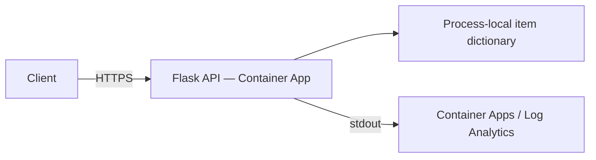

# Простий Flask API — Azure Container Apps

**Рівень:** Початковий · **Час:** 30–45 хвилин включно з налаштуванням

Розгорніть API Python Flask CRUD за допомогою Azure Developer CLI (azd). Включено вихідний код, Dockerfile,
Bicep та параметри розгортання. Це **навчальний приклад**, а не
продакшн API.

## Чого ви навчитесь

- Створювати та публікувати контейнер через azd.
- Налаштовувати вхідний трафік та перевірки працездатності/готовності.
- Перевіряти відповіді CRUD та переглядати журнали додатків.
- Розуміти, чому дані в пам’яті непридатні для стійких додатків.



**Важливо:** елементи зберігаються в одному процесі. За замовчуванням використовується **один Gunicorn worker,
0–1 реплік**, щоб уникнути розбіжностей даних між воркерами/репліками.
Елементи втрачаються при рестарті, зміні ревізії або масштабуванні до нуля. Збільшення кількості реплік
вимагає спільного постійного сховища. API не має автентифікації чи авторизації.

## Необхідні умови

- [Актуальна стабільна версія azd](https://learn.microsoft.com/azure/developer/azure-developer-cli/install-azd)
  (опублікована на час перегляду: 1.37.2).
- [Azure CLI](https://learn.microsoft.com/cli/azure/install-azure-cli) для перевірки.
- Docker з активним демоном; необхідний для стандартної локальної збірки образу.
- Підписка Azure, дозволи на створення ресурсів і регіональне квотування Container Apps.
- Bash для наведених нижче команд (або еквівалент PowerShell).
- Python 3.11 для необов’язкової локальної розробки.

```bash
azd version
az version
docker info
azd auth login
az login
```

CLI інструменти мають окремі сесії входу. Використовуйте одну й ту ж підписку в обох.

## Швидкий початок

З кореневої теки репозиторію:

```bash
cd examples/container-app/simple-flask-api
azd env new flask-demo
azd up
API_URL=$(azd env get-value API_ENDPOINT)
RG_NAME=$(azd env get-value AZURE_RESOURCE_GROUP)
API_NAME=$(azd env get-value API_NAME)
curl --fail-with-body "${API_URL}/health"
```

Очікувано: HTTP 200 і JSON з `"status":"healthy"`,
`"service":"simple-flask-api"` та актуальним UTC timestamp.
Проведення розгортання та збірки образу зазвичай займає кілька хвилин; час залежить від обставин.

Початкове розгортання використовує публічний hello-world образ, що слухає порт 80.
`azure.yaml` вибирає `infra/app/api.bicep` та відповідний файл параметрів для
розгортання сервісу, який змінює образ, вхідний трафік і перевірки на порт 8000.
Не видаляйте параметри розгортання.

## Перевірка CRUD

Виконайте послідовно, доки активна одна й та ж репліка:

```bash
# Create: HTTP 201; note the returned id (1 for a fresh process).
curl -i -X POST "${API_URL}/api/items" \
  -H "Content-Type: application/json" \
  -d '{"name":"Test Item","description":"My first item"}'

# Read list: HTTP 200, total 1 in a fresh process.
curl --fail-with-body "${API_URL}/api/items"

# Replace 1 if your create response returned another id.
curl --fail-with-body "${API_URL}/api/items/1"
curl -i -X PUT "${API_URL}/api/items/1" \
  -H "Content-Type: application/json" -d '{"name":"Updated Item"}'
curl -i -X DELETE "${API_URL}/api/items/1"
curl -i "${API_URL}/api/items/1"
```

Успіх: POST 201, читання/PUT 200, DELETE 204 без тіла, потім відсутній елемент 404.
Неправильний/необ’єктний JSON або пусте ім'я повертає 400.
Якщо елемент зникає між запитами, перевірте рестарт або масштабування до нуля;
це умисне обмеження в пам’яті, не стійкість.

| Endpoint | Методи |
|---|---|
| `/` | GET — інформація про сервіс |
| `/health` | GET — перевірки працездатності/готовності |
| `/api/items` | GET, POST |
| `/api/items/{id}` | GET, PUT, DELETE |

## Журнали та конфігурація

```bash
az containerapp logs show --name "$API_NAME" --resource-group "$RG_NAME" --follow
```

Очікувано: запуск Gunicorn, журнали доступу за запитами та повідомлення додатку.
`azd monitor --logs` відкриває портал; він не транслює в термінал.
Application Insights розгорнуто, але **цей Flask код його не інструментує**;
використовуйте Container Apps/Log Analytics для stdout журналів.

Відредагуйте `infra/app/api.bicep` для CPU/пам’яті, лімітів реплік або правил масштабування, потім
запустіть `azd up`. За замовчуванням 0.5 vCPU, 1 GiB, мінімум 0 / максимум 1 репліка та
HTTP поріг 50 одночасних запитів. Масштабування до нуля може додати затримку холодного старту.

Будь-які довільні `azd env set MAX_REPLICAS`, `API_KEY`, `LOG_LEVEL` або
`SCALE_TO_ZERO_TIMEOUT` значення **не підключені до цього шаблону чи додатку**.
Встановлення значення не перетворює його автоматично на змінну середовища під час виконання.
Образ явно прив’язує порт 8000; оновлюйте Dockerfile, Bicep ingress і probes
одночасно, якщо змінюєте порт.

## Файли

```text
azure.yaml
infra/main.bicep
infra/main.parameters.json
infra/app/container-apps.bicep       # Environment, registry, monitoring
infra/app/api.bicep                  # App, ingress, probes, scale settings
infra/app/api.parameters.json        # Image and resource values for azd deploy
src/app.py
src/Dockerfile
src/requirements.txt
```

## Локальна розробка

З цієї теки прикладу:

```bash
python -m venv .venv
source .venv/bin/activate  # PowerShell: .\.venv\Scripts\Activate.ps1
python -m pip install -r src/requirements.txt
python src/app.py
```

В іншому терміналі протестуйте `http://localhost:8000/health` та кінцеві точки CRUD.
Або зберіть та запустіть фактичний образ:

```bash
docker build -t flask-api:local ./src
docker run --rm -p 8000:8000 flask-api:local
```

Для змін тільки коду після першого розгортання запустіть `azd deploy api`.
Для змін Bicep запустіть `azd up` для повторного розгортання.

## Практичні вправи

### 1. Перевірка відхилення вхідних даних

**Вихідна точка:** розгорнутий API, `API_URL` вище.
**Мета:** перевірити, що API відхиляє некоректні JSON структури та відсутні імена.

```bash
curl -i -X POST "${API_URL}/api/items" \
  -H "Content-Type: application/json" -d '[]'
curl -i -X POST "${API_URL}/api/items" \
  -H "Content-Type: application/json" -d '{"name":""}'
```

**Критерії успіху/розв’язання:** обидва повертають 400 з JSON помилкою, не 500.
**Поширена проблема:** відсутність заголовка content-type JSON.

### 2. Додати кінцеву точку лише для читання

**Вихідна точка:** `src/app.py`. **Мета:** розширити та повторно розгорнути API.
Додайте це перед блоком `if __name__ == '__main__':`:

```python
@app.route('/version', methods=['GET'])
def version():
    return jsonify({'version': '1.0.0'})
```

Запустіть `azd deploy api`, потім `curl --fail-with-body "${API_URL}/version"`.
**Критерії успіху:** HTTP 200 і `{"version":"1.0.0"}`.
**Поширена проблема:** розміщувати маршрут після блокуючого виклику `app.run()` під час
тестування з `python src/app.py`.

### Контроль знань

Чому одного воркера недостатньо для стійких даних? Тому що навіть один процес втрачає
свій словник при рестарті. Продакшн версія потребує спільного постійного сховища,
автентифікації, авторизації, міграцій, тестів і моніторингу в експлуатації.

## Витрати та усунення неполадок

Це не гарантоване розгортання за $0: базовий реєстр і зберігання/увімкнення журналів
можуть викликати витрати навіть коли обчислювальні ресурси додатка на нулі. Використовуйте
[калькулятор вартості](https://azure.microsoft.com/pricing/calculator/) для вашого регіону.

- **Помилка збірки Docker:** перевірте `docker info`, доступ до мережі та залежності.
- **Нездоровий додаток:** перегляньте журнали консолі/системи та переконайтесь, що порт образу, ingress
  та перевірки співпадають. Запасний контейнер не повинен проходити перевірку на порті Flask.
- **403/дозволи:** перевірте підписку та дозволи на створення ресурсів.
- **Елементи зникають:** стан в пам’яті скидається при рестарті або масштабуванні до нуля; додайте базу даних
  для стійкої поведінки.

## Очищення та наступні кроки

```bash
azd down
```

Ознайомтесь з підказкою видалення та переконайтеся, що видалена виділена група ресурсів.
Не використовуйте руйнівне очищення для груп ресурсів з нерелевантними даними.

[Далі: Додаток бази даних](../../../../../examples/database-app) · [Мікросервіси](../../../../../examples/container-app/microservices) ·
[Огляд контейнерів](../README.md) · [Головна сторінка курсу](../../../README.md) ·
[Повідомити про проблему](https://github.com/microsoft/AZD-for-beginners/issues)

---

<!-- CO-OP TRANSLATOR DISCLAIMER START -->
**Відмова від відповідальності**:
Цей документ було перекладено за допомогою сервісу штучного інтелекту для перекладу [Co-op Translator](https://github.com/Azure/co-op-translator). Хоча ми прагнемо до точності, будь ласка, майте на увазі, що автоматичні переклади можуть містити помилки або неточності. Оригінальний документ рідною мовою слід вважати авторитетним джерелом. Для критично важливої інформації рекомендується професійний людський переклад. Ми не несемо відповідальності за будь-які непорозуміння або неправильні тлумачення, що виникли внаслідок використання цього перекладу.
<!-- CO-OP TRANSLATOR DISCLAIMER END -->