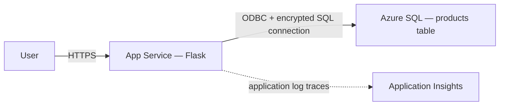

# Flask і Azure SQL на App Service

**Рівень:** Середній · **Час:** 30–60 хвилин включно з підготовчими кроками

Цей приклад розгортає API для читання на Python Flask у **Linux App Service** та базу даних Azure SQL Basic.
Включено вихідний код, Bicep та конфігурацію azd. Це
навчальний додаток, а не готова до використання у продуктиві архітектура бази даних.

## Чого ви навчитесь

- Забезпечувати ресурси App Service, SQL і моніторингу за допомогою Bicep.
- Налаштовувати зашифроване підключення до SQL без збереження облікових даних.
- Ініціалізувати схему перед запуском працівників Gunicorn.
- Перевіряти додані дані, відповіді "не знайдено" та стан бази даних.



Ресурси: виділена група ресурсів, план App Service B1 для Linux, Web App на Python 3.11,
SQL сервер та база даних Basic обсягом 2 ГБ, Application Insights та Log Analytics.
Web App використовує **розгортання з вихідного коду/ZIP та інсталяцію залежностей через Oryx**;
`azd deploy` не збирає та не розгортає необов’язковий Dockerfile.

## Необхідні умови

- Поточна стабільна версія [azd](https://learn.microsoft.com/azure/developer/azure-developer-cli/install-azd)
  (версія на момент перегляду: 1.37.2).
- [Azure CLI](https://learn.microsoft.com/cli/azure/install-azure-cli) для перевірки.
- Підписка Azure, дозволи на створення перерахованих ресурсів та регіональна квота.
- Python **3.11** для локальної розробки; у закоміченому `pyodbc==5.0.1` можуть бути потрібні
  нативні засоби збірки для новіших версій Python.
- Microsoft ODBC Driver 18 (або 17) для SQL Server на локальних машинах. `pip install
  pyodbc` не встановлює системний драйвер. Дивіться
  [інсталяцію ODBC](https://learn.microsoft.com/sql/connect/odbc/download-odbc-driver-for-sql-server).
- Docker лише якщо ви тестуєте необов’язковий контейнер локально.

```bash
azd version
az version
azd auth login
az login
```

Використовуйте одну й ту ж підписку в обох інструментах. Команди нижче виконуються в Bash.

## Розгортання

З кореня репозиторію:

```bash
cd examples/database-app
azd env new sql-demo
azd provision
azd deploy
WEB_URL=$(azd env get-value WEB_APP_URI)
WEB_NAME=$(azd env get-value WEB_APP_NAME)
RG_NAME=$(azd env get-value AZURE_RESOURCE_GROUP)
```

Виберіть підтримуваний регіон. `sqlAdminLogin` за замовчуванням використовує `sqladmin`; необхідний
`sqlAdminPassword` є безпечним параметром. Введіть складний пароль, коли буде відповідний запит.
Не зберігайте облікові дані розгортання у Git чи звітах про помилки. Поточне підключення
інтерполяція рядка очікує пароль без роздільників рядка підключення, таких як
`;`; адаптуйте екранування перед використанням таких значень.

Bicep встановлює команду запуску, яка виконується `init_database()` **перед тим**, як починають роботу робочі процеси Gunicorn.
Це необхідно, тому що імпорт `app:app` не виконує
блок `if __name__ == '__main__'` Python. На свіжій базі даних ініціалізація
створює `products` та вставляє п’ять рядків. Це просте навчальне насіння, а не
конкурентна структура міграцій; використовуйте правильні міграції перед масштабуванням екземплярів.

Додаток вибирає встановлений Microsoft ODBC Driver 18, потім 17, якщо рядок з’єднання
явно не вказує драйвер. Якщо жоден не встановлений, запуск не вдається через
помилку, що вимагає встановлення. Перевірте наявність драйвера у вашому вибраному
середовищі виконання App Service, а не припускайте це.

## Перевірка

```bash
curl --fail-with-body "${WEB_URL}/"
curl --fail-with-body "${WEB_URL}/health"
curl --fail-with-body "${WEB_URL}/products"
curl --fail-with-body "${WEB_URL}/products/1"
curl -i "${WEB_URL}/products/999"
```

Очікувано:

- `/` повертає інформацію про кінцеву точку.
- `/health` повертає 200 з `{"status":"healthy","database":"connected"}`.
- `/products` повертає п’ять доданих продуктів у новій базі даних.
- `/products/1` повертає Laptop з ціною 1299.99.
- Несуществуючий продукт повертає 404 з `{"error":"Product not found"}`.

API лише для читання. Маршрут POST/PUT/DELETE чи браузерний інтерфейс відсутні.
Помилка підключення до бази даних повертає 503 з `/health`; це не успіх.

## Файли та конфігурація

```text
azure.yaml                         # Python App Service source deployment
infra/main.bicep
infra/main.parameters.json
infra/abbreviations.json
infra/resources/sql-server.bicep
infra/resources/sql-database.bicep
infra/resources/app-service-plan.bicep
infra/resources/web-app.bicep       # Settings + initialization/startup command
infra/resources/app-insights.bicep
src/web/app.py
src/web/requirements.txt
src/web/Dockerfile                 # Optional local container, not the azd target
.env.sample
```

`SQL_CONNECTION_STRING` передається як безпечний параметр Bicep до модуля Web App
і зберігається в налаштуваннях App Service, а не в результатах розгортання.
`APPLICATIONINSIGHTS_CONNECTION_STRING` налаштовує експорт журналів.
`SCM_DO_BUILD_DURING_DEPLOYMENT=true` активує встановлення залежностей на стороні сервера.
Встановлення довільних значень `azd env` не змінює автоматично налаштування програми.

Правило `0.0.0.0` SQL-брандмауера дозволяє підключення з **служб Azure,
включно з підписками інших клієнтів**, за умови аутентифікації SQL. Воно
не обмежується цією програмою чи підпискою. Дозволено публічний доступ до мережі SQL.
Використовуйте обмежене мережеве підключення та неадміністраторський ідентифікатор програми перед запуском у виробництво.

## Локальна розробка

Використовуйте Python 3.11 та встановлений драйвер Microsoft SQL ODBC:

```bash
python -m venv .venv
source .venv/bin/activate  # PowerShell: .\.venv\Scripts\Activate.ps1
python -m pip install -r src/web/requirements.txt
export SQL_CONNECTION_STRING='Server=tcp:YOUR_SERVER.database.windows.net,1433;Database=YOUR_DATABASE;UID=YOUR_USER;PWD=YOUR_PASSWORD;Encrypt=yes;TrustServerCertificate=no;Connection Timeout=30;'
python src/web/app.py
```

Безпечно замініть заповнювачі. Скопійований файл `.env` **не завантажується автоматично**
цією програмою. Замість цього експортуйте змінні у поточній оболонці.
Для Azure SQL з ноутбука тимчасово дозволяйте лише вашу власну публічну IP-адресу:

```bash
SQL_SERVER=$(azd env get-value SQL_SERVER_NAME)
MY_IP=YOUR_PUBLIC_IP
az sql server firewall-rule create -g "$RG_NAME" -s "$SQL_SERVER" \
  -n AllowMyLearningIP --start-ip-address "$MY_IP" --end-ip-address "$MY_IP"
```

Видаліть правило після тестування:

```bash
az sql server firewall-rule delete -g "$RG_NAME" -s "$SQL_SERVER" -n AllowMyLearningIP
```

Необов’язковий тест контейнера з цієї прикладної директорії:

```bash
docker build -t sql-flask:local src/web
docker run --rm -p 8000:8000 -e SQL_CONNECTION_STRING sql-flask:local
```

Цей образ встановлює Драйвер 18 за допомогою репозиторію пакетів Debian 12, що відповідає його
базі Bookworm, ініціалізує базу даних один раз, потім запускає Gunicorn.

## Моніторинг та усунення неполадок

Активуйте/переглядайте файли журналів додатку App Service для діагностики запуску:

```bash
az webapp log config --name "$WEB_NAME" --resource-group "$RG_NAME" \
  --application-logging filesystem --level information
az webapp log tail --name "$WEB_NAME" --resource-group "$RG_NAME"
```

Цей код експортує **трасування журналів** додатку через застарілий менеджер OpenCensus.
Він не налаштовує автоматичне трасування запитів/залежностей Flask, Live Metrics,
аудит SQL, діагностичні налаштування чи сповіщення. Для цього потрібна окрема конфігурація.
Для нового інструментування рекомендується використовувати Azure Monitor OpenTelemetry.

В Application Insights Logs, після виконання запитів API:

```kusto
traces
| where timestamp > ago(1h)
| where message contains "products" or message contains "Health check"
| project timestamp, message, severityLevel
```

Урахуйте затримку при обробці. Активність у таблиці запитів або Live Metrics не є завершенням
критерій для цього інструментування тільки для ведення журналу.

- **Відсутній драйвер:** перевірте `pyodbc.drivers()` у середовищі виконання та встановіть
  підтримуваний драйвер Microsoft ODBC. Лише пакет Python недостатній.
- **Помилка підключення:** перевірте параметри SQL, облікові дані, брандмауер і вибрану
  підписку. Не вимикайте шифрування для обходу помилки.
- **Відсутня таблиця продуктів:** підтвердіть, що команда запуску Bicep була розгорнута;
  запуск `gunicorn app:app` окремо пропускає ініціалізацію.
- **Помилка збірки пакету:** використовуйте Python 3.11 або забезпечте наявність нативних передумов збірки.
- **Дані з нульовою ціною:** нуль — це дійсна десяткова ціна; він має серіалізуватися як 0.0,
  а не `null`.

## Практичні вправи

### Вправа 1: перевірка поведінки при відсутньому продукті

**Початкова точка:** розгорнуте API та `WEB_URL` вище.
**Мета:** відрізнити відсутній рядок від зламаної бази даних.
Виконайте запити `/health` і `/products/999` за допомогою команд вище.
**Критерії успіху / відповідь:** health 200, неіснуючий продукт 404 (не 500 або 503).
**Поширена проблема:** припущення, що відповідь «не знайдено» доводить, що підключення до SQL зламане.

### Вправа 2: змінити початкове значення

**Початкова точка:** Azure SQL Query Editor, підключений до демонстраційної бази даних.
**Мета:** показати, що дані API зберігаються в SQL, а не в пам’яті процесу.

```sql
UPDATE products SET price = 0 WHERE id = 1;
SELECT id, name, price FROM products WHERE id = 1;
```

Виконайте запит `${WEB_URL}/products/1`. **Критерії успіху:** ціна це `0.0`, а не `null`.
Відновіть значення:

```sql
UPDATE products SET price = 1299.99 WHERE id = 1;
```

**Поширена проблема:** редагування початкового списку Python не оновлює рядки, що вже містяться в SQL.
Не запускайте вправи зі схемою/даними на продуктивній базі даних.

### Вправа 3: Додайте кінцеву точку лише для читання з підрахунком

**Початкова точка:** `src/web/app.py`.
**Мета:** розширити API за допомогою агрегованого запиту без параметрів.
Додайте це перед блоком `if __name__ == '__main__':`:

```python
@app.route('/product-count')
def product_count():
    from contextlib import closing
    with closing(get_db_connection()) as conn, closing(conn.cursor()) as cursor:
        cursor.execute("SELECT COUNT(*) FROM products")
        return jsonify({'count': cursor.fetchone()[0]})
```

Запустіть `azd deploy web`, потім зробіть запит `${WEB_URL}/product-count`.
**Критерії успіху:** відповідь 200 з `{"count":5}` на незмінній заповненій базі даних.
**Поширена проблема:** зміна маршруту без повторного розгортання.
Для продуктивного середовища додайте обробку помилок/тести; ця коротка вправа зосереджена на запиті.

## Витрати, прогалини в продуктивності та очищення

Сервіс B1 App Service і база даних Basic оплачуються, поки вони розгорнуті. Зупинка
Web App **не** зупиняє списання плати за план App Service. Логи та сховище можуть додавати витрати.
Використовуйте [калькулятор цін Azure](https://azure.microsoft.com/pricing/calculator/)
для актуальних регіональних тарифів. Перехід на F1 також вимагає відключення `alwaysOn`;
це не одноразова заміна однією стрічкою. SQL serverless автоматично не є безкоштовним.

Робота в продукції включає ідентифікацію програми з мінімальними привілеями (не адміністратор SQL),
аутентифікацію/авторизацію, приватну мережу, безпечні міграції, перегляд пулінгу/життєвого циклу підключення,
телеметрію, аудит, сповіщення, тести та процедури відновлення.
Кешування Redis і додаткові таблиці - це ідеї для розвитку, не реалізовані вправи.

З цієї директорії прикладів:

```bash
azd down
```

Перевірте запит на видалення і впевніться, що відповідна група ресурсів видалена.
Не видаляйте групи, що містять несуміжні дані.

[Приклади контейнерів](../../../../examples/container-app) ·
[Розробка ШІ](../../docs/chapter-02-ai-development/README.md) ·
[Головна сторінка курсу](../../README.md) · [Повідомити про проблему](https://github.com/microsoft/AZD-for-beginners/issues)

---

<!-- CO-OP TRANSLATOR DISCLAIMER START -->
**Відмова від відповідальності**:
Цей документ було перекладено за допомогою сервісу штучного інтелекту для перекладу [Co-op Translator](https://github.com/Azure/co-op-translator). Хоча ми прагнемо до точності, будь ласка, майте на увазі, що автоматичні переклади можуть містити помилки або неточності. Оригінальний документ рідною мовою слід вважати авторитетним джерелом. Для критично важливої інформації рекомендується професійний людський переклад. Ми не несемо відповідальності за будь-які непорозуміння або неправильні тлумачення, що виникли внаслідок використання цього перекладу.
<!-- CO-OP TRANSLATOR DISCLAIMER END -->