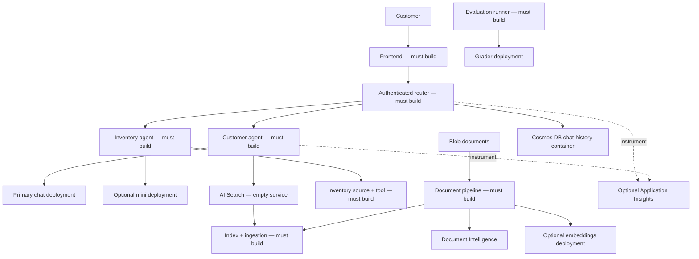

# Підтримка клієнтів з багатьма агентами — архітектурний план рітейлу

**Розділ 5: Багатоагентні AI-рішення**

- [Головна сторінка курсу](../README.md)
- [Розділ 5](../docs/chapter-05-multi-agent/README.md)
- [Вимоги: інтеграція AI](../docs/chapter-02-ai-development/microsoft-foundry-integration.md)
- [Далі: Планування пропускної здатності](../docs/chapter-06-pre-deployment/capacity-planning.md)
- [ARM інфраструктурний каркас](retail-multiagent-arm-template/README.md)

> **Це керівництво з архітектури, а не робочий додаток.** Єдині файли реалізації
> рітейлу — `azuredeploy.json`, `azuredeploy.parameters.json` і `deploy.sh` у
> `retail-multiagent-arm-template/`. Контейнери маршрутизатора/фронтенда — це заглушки типу hello-world.
> Локально відсутні агент рітейлу, UI, конвеєр прийому, оцінювач, сканер або
> тестовий набір додатку.

## Огляд

**Мета:** спроєктувати систему підтримки клієнтів з клієнтським агентом і агентом
інвентарю, визначити, що забезпечує інфраструктура, та запланувати відсутні
контракти додатку і перевірку.

**Аудиторія:** розробники, які завершили локальні
[приклад чату](../../../examples/azure-openai-chat) і [приклад контейнера з двома сервісами](../../../examples/container-app/microservices).
Виділіть 2–3 години на вивчення архітектури. Розробка додатку — це окремий
проєкт: орієнтовна оцінка часу розробки для досвідчених розробників — 80–120 годин,
**а не обіцянка доставки**; виробнича підготовка, тести,
перевірка безпеки і операції потребують додаткової роботи.

### Результати навчання

- Пояснити маршрутизацію, прив’язку до контексту, дозволи інструментів і власність розмов.
- Розрізняти ідентифікатори моделей, імена розгортань, версії API і версії ARM.
- Проєктувати прийом документів і їх пошук зі співпадаючими розмірностями векторів.
- Визначати перевірені функціональні, оцінювальні й вимоги щодо відновлення після збоїв.
- Відокремити необов’язкові цілі архітектури від реально створених ресурсів.

## Архітектура рішення



Це **цільова архітектура додатку**, а не діаграма запущених сервісів агентів.
Каркас ARM створює лише базові сервіси й два контейнери-заглушки.
Front Door, реєстр, керовані ідентичності, призначення ролей,
приватні кінцеві точки, перемикання при збоях, інструментування додатку й сповіщення не включені.

### Відповідальності та контракти

| Компонент | Необхідна поведінка | Докази готовності |
|---|---|---|
| Фронтенд | Аутентифікація користувачів, відображення чату, безпечне завантаження документів | UI та тести завантаження, доступні повідомлення про помилки |
| Маршрутизатор | Авторизація запитів, вибір агента, обмеження викликів інструментів/таймаути | Тести маршрутизації, перевірки авторизації, тести збоїв |
| Агент клієнта | Основувати політику/відповіді продукту на схвалених джерелах | Коректні цитати, утримання при відсутності даних |
| Інструмент інвентаризації | Читати авторитетні дані про запаси з обмеженими дозволами | Детерміністичні тести запасів; без вигаданої наявності |
| Конвеєр документів | Витягувати, розбивати, вбудовувати, індексувати, оновлювати/видаляти | Зафіксовані індекси, поведінка повторних спроб/мертвих листів |
| Зберігання розмов | Ізоляція користувачів, забезпечення терміну зберігання | Перевірки авторизації між користувачами та TTL |
| Виконавець оцінки | Порівняння результатів з істинними даними та рубрикою | Покриття, кількість збоїв, відтворювані звіти |

Уявіть маршрутизатор як стійку реєстрації, а інструменти — як обмежені внутрішні системи:
вибір спеціаліста — це не авторизація на доступ до записів всіх клієнтів.
Забезпечуйте ідентичність і дозволи в коді додатку й службах даних, а не в запитах.

## Інфраструктура проти додатку

Перед розгортанням прочитайте [README каркасу](retail-multiagent-arm-template/README.md).
Він містить точний перелік ресурсів, режими, вартість і обмеження.

| Логічне призначення | Ім’я розгортання ARM | Модель / версія | Регіон за замовчуванням |
|---|---|---|---|
| Клієнтський чат | `gpt-4.1-chat` | `gpt-4.1` / `2025-04-14` | `eastus2` |
| Інвентаризація | `gpt-4.1-mini-inventory` | `gpt-4.1-mini` / `2025-04-14` | `westus2`, опційно |
| Вбудовування | `text-embedding-ada-002` | `text-embedding-ada-002` / `2` | `francecentral`, опційно |
| Оцінка | `gpt-4.1-grader` | `gpt-4.1` / `2025-04-14` | За замовчуванням основний регіон |

Перевірте доступність моделей/версій/SKU і квоти в **кожному регіоні**. Для чату/міні/оцінювача
використовується `GlobalStandard`; для вбудовування — `Standard`. Відповідність одиниць
пропускної здатності до TPM специфічна для моделі. Не додавайте несумісні одиниці пропускної здатності як універсальну гарантію квоти.

Аргумент `model` запиту Azure OpenAI — це **ім’я розгортання**, а не
обов’язково ідентифікатор моделі каталогу. Версія API planes даних `2024-10-21`
відрізняється від версії моделі `2025-04-14` і ресурсу ARM `apiVersion`.
Неможливо виправити відсутню модель, змінивши лише версію API planes даних.

`--no-multi-region` пропускає вторинні та embedding акаунти. Залишаються основний чат- та
незалежний акаунт оцінювача. Окремі акаунти моделей не забезпечують автоматичне
перемикання при збоях; для цього потрібна маршрутизація додатку, сумісні розгортання, перевірки стану,
ліміти повторних спроб і огляд розміщення даних.

## Дорожня карта реалізації

### 1. Починайте з одного протестованого взаємодії

Перед розгортанням великого каркасу використайте локальний приклад чату, щоб встановити
зв’язок для виведення. Визначте одне репрезентативне запитання клієнта, схвалене
джерело відповіді, очікувану цитату і поведінку при відсутності цього джерела.

### 2. Визначте межі маршрутизації та інструментів

Створіть власне джерело маршрутизатора, маніфест залежностей, Dockerfile та тести.  
Ілюстративний контракт може бути `POST /chat` з `{"message":"...","conversation_id":"..."}`.  
**Цей кінцевий пункт — це проект дизайну; його не реалізовано шаблоном ARM.**  

Перевіряйте типи/обмеження тіла, виводьте ідентичність користувача з автентифікації, забезпечуйте  
право власності на розмову, застосовуйте тайм-аути запитів і повертайте змістовні коди помилок.  
Не вважайте HTTP-помилки або порожні відповіді успішними результатами агента.  

### 3. Реалізація заземлення та інгестування  

Шаблон ARM не створює пошуковий індекс. Це **еталонний JSON-фрагмент  
для адаптації у власному визначенні індексу**, а не файл, що вже є в репозиторії:  

```json
{
  "name": "retail-product-index",
  "fields": [
    {"name": "id", "type": "Edm.String", "key": true},
    {"name": "title", "type": "Edm.String", "searchable": true},
    {"name": "content", "type": "Edm.String", "searchable": true},
    {"name": "category", "type": "Edm.String", "filterable": true},
    {
      "name": "content_vector",
      "type": "Collection(Edm.Single)",
      "searchable": true,
      "dimensions": 1536,
      "vectorSearchProfile": "retail-profile"
    }
  ],
  "vectorSearch": {
    "algorithms": [{"name": "retail-hnsw", "kind": "hnsw"}],
    "profiles": [{"name": "retail-profile", "algorithm": "retail-hnsw"}]
  }
}
```
  
Профіль зв’язує векторне поле з його алгоритмом. Розміри мають відповідати  
фактичному виводу вбудовування (1536 для цього розгортання `ada-002`). Для отримання Python  
використовуйте `azure.search.documents.models.VectorizedQuery` замість неповного  
словника, що не має виду векторного запиту:  

```python
# Reference function only: supply an authenticated async SearchClient and an embedding.
from azure.search.documents.models import VectorizedQuery

async def retrieve(search_client, embedding):
    results = await search_client.search(
        search_text=None,
        vector_queries=[VectorizedQuery(
            vector=embedding,
            k_nearest_neighbors=5,
            fields="content_vector"
        )],
        select=["id", "title", "content"]
    )
    return [document async for document in results]
```
  
Створіть окрему реалізацію інгестування, яка:  

1. Авторизує доступ для завантаження та перевіряє тип і розмір контенту.  
2. Зчитує приватні блоби за допомогою автентифікованих викликів SDK. URL приватного блоба сам по собі  
   **не є** читабельним вхідним файлом Document Intelligence; надсилайте завантажені байти з  
   `AnalyzeDocumentRequest(bytes_source=...)` або використовуйте відповідний,  
   короткоживучий SAS після перегляду вимог доступу.  
3. Витягує текст, ділить його на шматки відповідно до обмежень для вбудовування та генерує вбудовування.  
4. Створює стабільні дійсні ключі документів і завантажує шматки з відповідними векторами.  
5. Перевіряє результати індексації по документах, опрацьовує повторні спроби та оновлює/видаляє застарілі дані.  

Не вставляйте довільні ключі/значення користувача в фільтри OData. Дозволяйте лише певні поля,  
перевіряйте типи значень і екранізуйте лапки рядків. Логічні та числові фільтри потребують  
типізованих літералів, а не рядків у лапках.  

### 4. Веб-заземлення  

**Bing Search v7 було виведено з експлуатації 11 серпня 2025 року.** Старий ресурс `Microsoft.Bing/accounts`  
і приклади `api.bing.microsoft.com/v7.0/search` не є підтримуваним шляхом реалізації. Оцініть поточні підтримувані  
інтеграції заземлення у Microsoft Foundry та його SDK, дозволи, білінг і вимоги до цитування;  
жодна з них тут не реалізована. Це не є заміною кінцевого пункту, що виведено з експлуатації.  
 

### 5. Додайте телеметрію та оцінювання  

Створення Application Insights не інструментує код. Використовуйте підтримуване інструментування  
Azure Monitor OpenTelemetry під час створення нового додатку, передавайте контекст трасування  
між сервісами і уникайте журналювання запитів клієнтів, документів або секретів.  
Обрізання запиту **не** анонімізує його.  

Вимірюйте час запиту, збої маршрутизації/інструментів, релевантність вибірки, коректність цитування,  
використання токенів і утримання від відповіді. Зберігайте фактичні інвентарні/політичні дані  
разом з випадками оцінки: оцінювач не може достовірно визначити фактичну точність  
лише за питанням і відповіддю.  

Розгортання оцінювача — це не виконавець оцінки. Реалізуйте версійовану рубрику,  
структурований вивід/валидацію схеми, перевірки діапазону оцінок, підрахунок збоїв транспорту  
і випадки, що перевіряються людиною. Повідомляйте про неповні/помилкові випадки окремо; не перетворюйте  
їх на успішні оцінки і не додавайте їх тихо як відповіді моделі з нульовою якістю.  

Аналогічно, декілька перевірок ключових слів не є сертифікацією безпеки. Невдалий HTTP-  
запит, відсутність стратегії тестування або порожня відповідь мають робити тест **неоднозначним або  
проваленим**, а не дають «100% безпечний» бал. Проводьте авторизоване тестування за допомогою відповідних  
інструментів і людської перевірки перед будь-якою заявою про готовність до виробництва.  

### 6. Розгортайте ваш додаток

Створіть власні каталоги джерел, маніфести, тести, реєстр і дозволи на завантаження образів.
Замініть заповнювачі на зібрані образи та оновіть ingress/probes відповідно до
порту прослуховування кожного додатка. Налаштуйте змінні середовища виконання у Bicep
або в явному підтримуваному відображенні середовища azd.

Не існує загального словника `config` під службою azd, який автоматично
створював би змінні середовища виконання. `azd env set` змінює лише ресурси, які
явно споживають ці значення. У цій основі немає імплементації канаркового запуску,
списку регіонів або гнучких гачків.

## Практичні завдання з дизайну

Це **архітектурні вправи**, а не твердження про працюючий роздрібний стартовий код.

### Вправа 1: Перевірте межі

**Початкова точка:** три файли в `retail-multiagent-arm-template/`.
**Мета:** розрізнити надання ресурсів від функціональності додатка.
Відкрийте `azuredeploy.json`, знайдіть обидва образи контейнерів і значення `targetPort`,
а потім перелічи відсутні компоненти додатка в репозиторії.

**Критерії успіху / відповідь:** обидва образи — це заповнювачі hello-world, які слухають
на порту 80; відсутні агенти, інтерфейс чату, обробники маршрутизатора, індекс/завантаження,
оцінювач і сканер. Успішний кореневий запит до заповнювача не перевіряє `/chat`.
**Поширена помилка:** тлумачити імена ресурсів, таких як `retail-router`, як працюючий код.

### Вправа 2: Відстежте конфігурацію вектора

**Початкова точка:** наведений вище JSON індексу.
**Мета:** зрозуміти відношення поле → профіль → алгоритм.
Визначте, які значення потрібно змінити при переході на модель вбудовування з
іншим розміром виходу, потім перевірте функцію `retrieve`.

**Критерії успіху / відповідь:** змінити поле `dimensions` на фактичну довжину вектора;
тримати `vectorSearchProfile` у відповідності з оголошеним профілем та його алгоритмом;
запит `fields` повинен іменувати векторне поле. Перегенеруйте існуючі вектори документів
при зміні моделі вбудовування.
**Поширена помилка:** змінювати лише ім'я моделі, зберігаючи несумісні вектори.

### Вправа 3: Визначте тест відмови

**Початкова точка:** таблиця відповідальностей.
**Мета:** запобігти хибному успіху.
Опишіть очікувану поведінку для недоступного API інвентаризації, індексу пошуку без
відповідних документів і запиту на оцінку, що повертає HTTP 503.

**Критерії успіху / відповідь:** відсутність вигаданих значень інвентаризації; явне утримання або
ескалація, коли відсутній контекст; оцінка повідомляє про збій транспорту,
а не про якість або безпеку. Додавайте виконувані тести під час розробки додатка.
**Поширена помилка:** ловити всі виключення та продовжувати з порожньою відповіддю.

## Витрати, усунення неполадок та очищення

- Інфраструктура має постійні витрати навіть з порожніми індексами пошуку та заповнювачами
  додатків. Використовуйте поточні регіональні ціни; ні “мінімальний”, ні багаторегіональний варіанти не є безкоштовними.
- Вартість токенів залежить від моделі, кешованого/некешованого вводу, виводу та SKU розгортання.
  Маршрутизація може заощадити гроші лише якщо виміряне навантаження та результати якості це обґрунтовують;
  фіксована економія 60–80% не гарантована.
- Перевірте доступність моделі та квоту перед наданням ресурсів; відрізняйте дозвіл,
  помилки deployment-name, region, model-version і API-version.
- Не запускайте відсутні `setup-data.sh`, evaluetor CLI або `pytest tests/` команди.
  Їх реалізації є частиною вашого списку завдань на розробку.
- Каркас призначений лише для ARM: дотримуйтесь його
  [інструкцій з перевірки та очищення](retail-multiagent-arm-template/README.md).
  `azd down` не керує цими ресурсами.

## Пов’язані ресурси

- [Приклад робочого локального чату](../../../examples/azure-openai-chat)
- [Приклад двосервісного контейнера](../../../examples/container-app/microservices)
- [Векторні індекси AI Search](https://learn.microsoft.com/azure/search/vector-search-how-to-create-index)
- [Документація Container Apps](https://learn.microsoft.com/azure/container-apps/)
- [Вирішення проблем](../docs/chapter-07-troubleshooting/common-issues.md)
- [Повідомити про проблему](https://github.com/microsoft/AZD-for-beginners/issues)

---

<!-- CO-OP TRANSLATOR DISCLAIMER START -->
**Відмова від відповідальності**:
Цей документ було перекладено за допомогою сервісу штучного інтелекту для перекладу [Co-op Translator](https://github.com/Azure/co-op-translator). Хоча ми прагнемо до точності, будь ласка, майте на увазі, що автоматичні переклади можуть містити помилки або неточності. Оригінальний документ рідною мовою слід вважати авторитетним джерелом. Для критично важливої інформації рекомендується професійний людський переклад. Ми не несемо відповідальності за будь-які непорозуміння або неправильні тлумачення, що виникли внаслідок використання цього перекладу.
<!-- CO-OP TRANSLATOR DISCLAIMER END -->