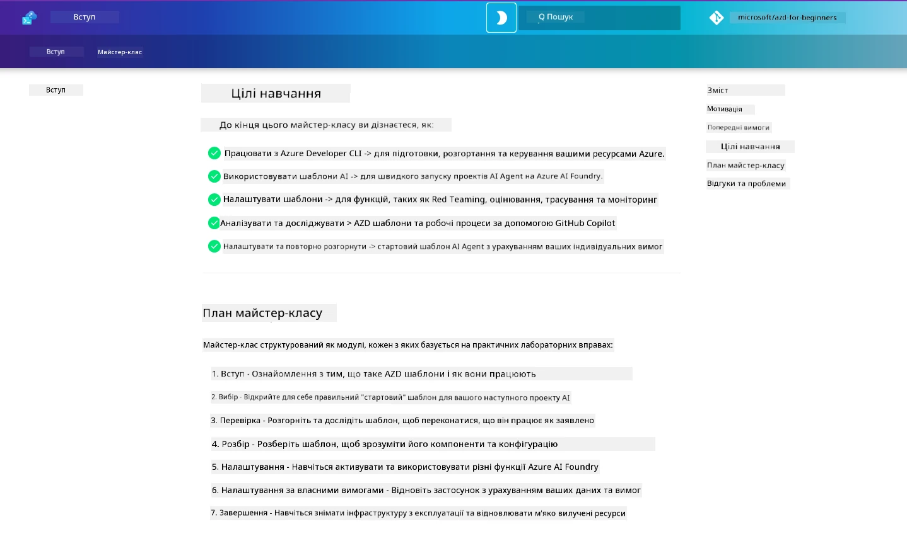

<div align="center">
  <div style="background: linear-gradient(135deg, #0078d4, #106ebe); border-radius: 10px; padding: 20px; margin: 20px 0; box-shadow: 0 4px 15px rgba(0, 120, 212, 0.3); border: 2px solid #005a9e;">
    <h2 style="color: white; margin: 0; font-size: 24px; text-shadow: 1px 1px 2px rgba(0,0,0,0.3);">
      🎯 Майстер-клас AZD для розробників штучного інтелекту
    </h2>
    <p style="color: white; margin: 10px 0 0 0; font-size: 16px; text-shadow: 1px 1px 2px rgba(0,0,0,0.3);">
      <strong>Практичний майстер-клас з розробки AI-застосунків за допомогою Azure Developer CLI.</strong><br>
      Пройдіть 7 модулів, щоб опанувати шаблони AZD і робочі процеси розгортання AI.
    </p>
    <div style="margin-top: 15px;">
      <span style="background: rgba(255,255,255,0.2); padding: 5px 10px; border-radius: 15px; color: white; font-size: 14px;">
        📅 Переглянуто джерело: листопад 2026
      </span>
    </div>
  </div>
</div>

# Майстер-клас AZD для розробників штучного інтелекту

Ласкаво просимо на практичний майстер-клас з вивчення Azure Developer CLI (AZD) з акцентом на розгортання AI-застосунків. Цей майстер-клас допоможе вам на практиці зрозуміти шаблони AZD у 3 кроки:

1. **Відкриття** - знайдіть шаблон, який підходить саме вам.
1. **Розгортання** - розгорніть і підтвердьте, що він працює
1. **Налаштування** - змінюйте і адаптуйте під себе!

Протягом цього майстер-класу ви також ознайомитеся з основними інструментами та робочими процесами розробника, щоб оптимізувати вашу повністю інтегровану розробку.

<br/>

## Керівництво у браузері

Уроки майстер-класу представлені у форматі Markdown. Ви можете переглядати їх безпосередньо на GitHub або запустити браузерний перегляд, як показано на скріншоті нижче.



Щоб скористатися цією можливістю - зробіть форк репозиторію у свій профіль і запустіть GitHub Codespaces. Коли термінал VS Code стане активним, введіть цю команду:

Цей браузерний перегляд працює у GitHub Codespaces, dev-контейнерах або локальному клоні з установленими Python та MkDocs.

```bash title="" linenums="0"
python -m pip install -r requirements-dev.txt
python -m mkdocs serve --config-file workshop/mkdocs.yml
```

Запускайте ці команди з **кореневої папки репозиторію курсу**, а не з окремо ініціалізованого AI-прикладу. Тримайте перегляд на передньому плані, щоб бачити помилки; зупиніть Ctrl+C. Щоб перевірити сайт без запуску сервера, виконайте `python -m mkdocs build --strict --config-file workshop/mkdocs.yml`.

Через кілька секунд з’явиться спливаюче вікно. Виберіть варіант `Open in browser`. Веб-керівництво відкриється у новій вкладці браузера. Деякі переваги цього перегляду:

1. **Вбудований пошук** - швидко знаходьте ключові слова або уроки.
1. **Іконка копіювання** - наведіть курсор на кодові блоки, щоб побачити цю опцію
1. **Перемикач теми** - змінюйте між темною та світлою темами
1. **Отримайте допомогу** - натисніть іконку Discord у підвалі, щоб приєднатися!

<br/>

## Огляд майстер-класу

**Тривалість:** 3-4 годин  
**Рівень:** Початківець до середнього  
**Вимоги:** Знайомство з Azure, концепціями ШІ, VS Code та інструментами командного рядка.

Це практичний майстер-клас, де ви вчитеся практично. Після виконання вправ рекомендуємо переглянути навчальну програму AZD For Beginners, щоб продовжити навчання найкращим практикам безпеки та продуктивності.

| Час| Модуль  | Мета |
|:---|:---|:---|
| 15 хв | [Вступ](docs/instructions/0-Introduction.md) | Встановити цілі та зрозуміти задачі |
| 30 хв | [Вибір шаблону AI](docs/instructions/1-Select-AI-Template.md) | Обрати варіанти та початковий шаблон | 
| 30 хв | [Валідація шаблону AI](docs/instructions/2-Validate-AI-Template.md) | Розгорнути стандартне рішення в Azure |
| 30 хв | [Деконструкція шаблону AI](docs/instructions/3-Deconstruct-AI-Template.md) | Дослідити структуру та конфігурацію |
| 30 хв | [Налаштування шаблону AI](docs/instructions/4-Configure-AI-Template.md) | Активувати та спробувати доступні функції |
| 30 хв | [Індивідуалізація шаблону AI](docs/instructions/5-Customize-AI-Template.md) | Адаптувати шаблон під ваші потреби |
| 30 хв | [Демонтаж інфраструктури](docs/instructions/6-Teardown-Infrastructure.md) | Очистка та звільнення ресурсів |
| 15 хв | [Підсумки та подальші кроки](docs/instructions/7-Wrap-up.md) | Навчальні ресурси, виклик майстер-класу |

<br/>

## Чого ви навчитесь

Розглядайте шаблон AZD як навчальну пісочницю для дослідження різних можливостей та інструментів для повноцінної розробки на Microsoft Foundry. До кінця майстер-класу ви повинні отримати інтуїтивне розуміння різних інструментів і концепцій у цьому контексті.

| Концепція  | Мета |
|:---|:---|
| **Azure Developer CLI** | Зрозуміти команди інструменту та робочі процеси|
| **Шаблони AZD**| Зрозуміти структуру проекту та конфігурацію|
| **Azure AI Agent**| Забезпечити та розгорнути проект Microsoft Foundry  |
| **Azure AI Search**| Активувати контекстну інженерію за допомогою агентів |
| **Спостережуваність**| Ознайомитись із трасуванням, моніторингом та оцінками |
| **Red Teaming**| Вивчати тестування на атаки та пом’якшення наслідків |

<br/>

## Структура майстер-класу

Майстер-клас організовано так, щоб провести вас від відкриття шаблону до розгортання, деконструкції та налаштування - використовуючи офіційний стартер [Getting Started with AI Agents](https://github.com/Azure-Samples/get-started-with-ai-agents) як основу.

### [Модуль 1: Вибір шаблону AI](docs/instructions/1-Select-AI-Template.md) (30 хв)

- Що таке AI-шаблони?
- Де я можу знайти AI-шаблони?
- Як розпочати створення AI-агентів?
- **Лабораторна робота**: Швидкий старт у Codespaces або dev-контейнері

### [Модуль 2: Валідація шаблону AI](docs/instructions/2-Validate-AI-Template.md) (30 хв)

- Яка архітектура AI-шаблону?
- Який робочий процес розробки AZD?
- Як отримати допомогу з розробкою AZD?
- **Лабораторна робота**: Розгортання та перевірка шаблону AI-агентів

### [Модуль 3: Деконструкція шаблону AI](docs/instructions/3-Deconstruct-AI-Template.md) (30 хв)

- Досліджуйте ваше середовище у `.azure/` 
- Досліджуйте налаштування ресурсів у `infra/` 
- Досліджуйте конфігурацію AZD у `azure.yaml`s
- **Лабораторна робота**: Змінити змінні середовища та перебудувати

### [Модуль 4: Налаштування шаблону AI](docs/instructions/4-Configure-AI-Template.md) (30 хв)
- Ознайомтесь: Відновлення із підсиленням (Retrieval Augmented Generation)
- Ознайомтесь: Оцінка агентів та Red Teaming
- Ознайомтесь: Трасування та моніторинг
- **Лабораторна робота**: Ознайомлення з AI агентом + спостережуваністю 

### [Модуль 5: Індивідуалізація шаблону AI](docs/instructions/5-Customize-AI-Template.md) (30 хв)
- Визначте: PRD із вимогами сценарію
- Налаштуйте: змінні середовища для AZD
- Реалізуйте: хуки життєвого циклу для додаткових завдань
- **Лабораторна робота**: Індивідуалізація шаблону під мій сценарій

### [Модуль 6: Демонтаж інфраструктури](docs/instructions/6-Teardown-Infrastructure.md) (30 хв)
- Підсумок: Що таке шаблони AZD?
- Підсумок: Чому використовувати Azure Developer CLI?
- Наступні кроки: Спробуйте інший шаблон!
- **Лабораторна робота**: Зняття інфраструктури та очищення

<br/>

## Виклик майстер-класу

Хочете собі виклик зробити складніше? Ось кілька проєктних пропозицій - або поділіться своїми ідеями з нами!!

| Проєкт | Опис |
|:---|:---|
|1. **Деконструкція складного AI-шаблону** | Використовуйте описані робочі процеси та інструменти і спробуйте розгорнути, перевірити та індивідуалізувати інший шаблон AI-рішення. _Що ви дізналися?_|
|2. **Індивідуалізація під ваш сценарій**  | Спробуйте написати PRD (Документ вимог до продукту) для іншого сценарію. Потім використовуйте GitHub Copilot у вашому репозиторії шаблону в режимі Agent Model - і попросіть згенерувати робочий процес індивідуалізації. _Що ви дізналися? Як можна покращити ці пропозиції?_|
| | |

## Маєте відгук?

1. Створіть issue в цьому репозиторії - для зручності позначте тегом `Workshop`.
1. Приєднуйтесь до Microsoft Foundry Discord - спілкуйтеся з однодумцями!


| | | 
|:---|:---|
| **📚 Головна сторінка курсу**| [AZD For Beginners](../README.md)|
| **📖 Документація** | [Початок роботи з AI-шаблонами](https://learn.microsoft.com/en-us/azure/ai-foundry/how-to/develop/ai-template-get-started)|
| **🛠️ AI-шаблони** | [Microsoft Foundry Templates](https://ai.azure.com/templates) |
|**🚀 Наступні кроки** | [Почати майстер-клас](#workshop-overview) |
| | |

<br/>

---

**Навігація:** [Головний курс](../README.md) | [Вступ](docs/instructions/0-Introduction.md) | [Модуль 1: Вибір шаблону](docs/instructions/1-Select-AI-Template.md)

**Готові розпочати розробку AI-застосунків з AZD?**

[Почати майстер-клас: Вступ →](docs/instructions/0-Introduction.md)

---

<!-- CO-OP TRANSLATOR DISCLAIMER START -->
**Відмова від відповідальності**:
Цей документ було перекладено за допомогою сервісу штучного інтелекту для перекладу [Co-op Translator](https://github.com/Azure/co-op-translator). Хоча ми прагнемо до точності, будь ласка, майте на увазі, що автоматичні переклади можуть містити помилки або неточності. Оригінальний документ рідною мовою слід вважати авторитетним джерелом. Для критично важливої інформації рекомендується професійний людський переклад. Ми не несемо відповідальності за будь-які непорозуміння або неправильні тлумачення, що виникли внаслідок використання цього перекладу.
<!-- CO-OP TRANSLATOR DISCLAIMER END -->