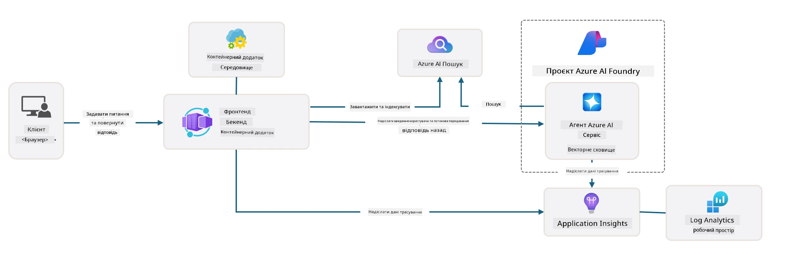
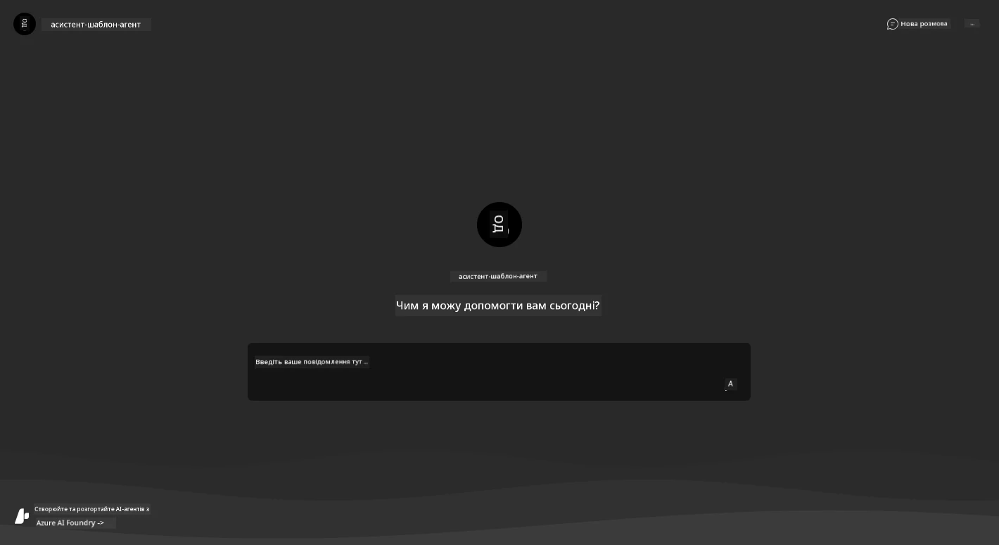

# 2. Перевірка шаблону

> Керівництво джерела перевірено на відповідність AZD 1.37.2 та поточному зразку станом на 4 листопада 2026 року. Скриншоти мають ілюстративний характер; навігація порталу, значення за замовчуванням шаблонів та доступність сервісів можуть змінюватися. Цей огляд не виконував розгортання в Azure в реальному часі.

!!! tip "НА КІНЕЦЬ ЦЬОГО МОДУЛЮ ВИ ЗМОЖЕТЕ"

    - [ ] Identify the sample's prerequisites and intended resources
    - [ ] Deploy the selected template into an intentional environment
    - [ ] Verify the application and agent behavior separately from deployment success
    - [ ] **Lab 2:** Record evidence of a working baseline, or an actionable deployment blocker

---

## 1. Перевірте передумови

Інструмент командного рядка [Azure Developer CLI](https://learn.microsoft.com/azure/developer/azure-developer-cli/) керує розгортанням додатків за допомогою конфігурації, інфраструктури та коду шаблону. Перевірте вашу встановлену версію:

```bash
azd version
```

За потреби використовуйте [поточні інструкції з встановлення/оновлення](https://learn.microsoft.com/azure/developer/azure-developer-cli/install-azd). Переглянутий зразок оголошує AZD `>=1.14.0`, але рекомендується використовувати поточний підтримуваний випуск. Додаткові розширення AI мають окремі вимоги до версії; звичайний робочий процес `azd up` цього зразка не потребує розширення агентів.

Перед розгортанням ознайомтеся з [налаштуванням облікового запису Azure](https://github.com/Azure-Samples/get-started-with-ai-agents/blob/main/docs/azure_account_setup.md) та [керівництвом із розгортання](https://github.com/Azure-Samples/get-started-with-ai-agents/blob/main/docs/deployment.md) для вибраного зразка. Підтвердіть вашу підписку, дозволи, доступність моделі, регіональну квоту та очікувані витрати. Безкоштовний обліковий запис Azure не гарантує доступ або безкоштовне використання для кожної потрібної служби.

## 2. Відкрийте вибраний зразок

Використовуйте репозиторій [Get Started with AI Agents](https://github.com/Azure-Samples/get-started-with-ai-agents), ініціалізований у Модулі 1. Якщо ви його не ініціалізували, оберіть одну з цих альтернатив:

- Відкрийте [Codespace для прикладу](https://github.com/codespaces/new/Azure-Samples/get-started-with-ai-agents).
- Клонуйте приклад і виконайте його локальне/дев-контейнерне налаштування.
- У **порожній директорії** виконайте:

```bash
azd init --template Azure-Samples/get-started-with-ai-agents .
```

Не ініціалізуйте другий шаблон у наявному проекті. Запускайте подальші команди з кореня прикладу, що містить `azure.yaml`, а не з кореня репозиторію курсу.

У прикладі розміщено чат-додаток на основі агента у Container Apps, а також розгорнуто допоміжні ресурси Foundry. Ознайомтеся з поточною архітектурою та додатковими службами, замість того щоб сприймати старий скріншот як точний перелік ресурсів.



## 3. Розгортайте свідомо

```bash
azd auth login
azd up
```

Перегляньте підказки:

1. Оберіть унікальне ім'я середовища AZD.
2. Виберіть потрібну підписку, а не просто ту, що пропонується першою.
3. Виберіть регіон, який підтримує потрібну модель/версію/SKU і відповідає вашій квоті.
4. Прочитайте вивід під час провізування, розгортання та пост-розгортання.

Переглянуті налаштування за замовчуванням включають `gpt-5-mini`, версію `2025-08-07` та `GlobalStandard`. Перевірте ваш ініціалізований шаблон і [підтримувані комбінації моделей/регіонів](https://learn.microsoft.com/azure/ai-services/agents/concepts/model-region-support). Немає регіону, який гарантовано працює універсально.

Тривалість розгортання варіюється. Якщо провізування не вдалося, збережіть помилку і усуньте її причину перед повторною спробою. Не видаляйте розгортання і не очищуйте ресурси назавжди як загальний крок для усунення неполадок.

## 4. Перевірте застосунок

```bash
azd show
```

Відкрийте кінцеву точку для `api_and_frontend` або знайдіть Container App у групі ресурсів розгортання у [порталі Azure](https://portal.azure.com/). Дотримуйтеся інструкцій з доступу/автентифікації з прикладу, якщо потрібен вхід; не вимикайте автентифікацію, щоб пройти пробний тест.



Спробуйте кілька [зразкових запитань](https://github.com/Azure-Samples/get-started-with-ai-agents/blob/main/docs/sample_questions.md):

- Загальне фактологічне запитання.
- Запитання, на яке відповідь має бути у завантажених документах зразка.
- Запитання, на яке не можна відповісти з цих документів.

Перевірте, чи завантажується інтерфейс користувача, чи відповідає API, чи використовується очікувані дані для отримання інформації, чи збігаються посилання з джерельним вмістом і чи коректно обробляються питання, які не підтримуються. Один лише успішний `azd up` повідомлення не гарантує ці результати.

## 5. Перевірте розгорнутого агента

Відкрийте свій проект у [Foundry portal](https://ai.azure.com/). У переглянутому потоці порталу оберіть **Build**, потім **Agents**, і знайдіть агента, створеного зразком. Назви навігації можуть змінюватися.

Запишіть:

- Ім'я агента та версію.
- Налаштоване розгортання моделі.
- Фактичні інструкції та увімкнені інструменти.
- Які файли або індекс пошуку підключені, та чи завершено налаштування успішно.

Розглянутий зразок використовує ідентифікатор агента у формі `agent_name:agent_version` для своїх тестів оцінювання. Не копіюйте класичний ідентифікатор агента/потоку зі старого скріншота у новіший робочий процес API.

Порівняйте завантажені документи з `src/files/` у вашій ініціалізованій ревізії. Раніше на скріншотах було показано 32 файли; ця кількість не є гарантованою поточною за замовчуванням. Перевірте будь-яку відповідь про клієнтів/продукти зразка щодо фактичних синтетичних джерельних даних і не завантажуйте реальні дані клієнтів для цього завдання.

## 6. Порівняйте з майданчиком (playground)

Відкрийте майданчик вибраного агента у Foundry і поставте те саме питання для отримання інформації. Порівняйте налаштовану версію агента, інструменти, посилання та якість відповіді з розгорнутим застосунком.

Відповіді є імовірнісними; слово в слово співпадання — не критерій. Якщо результати суттєво відрізняються, переконайтеся, що застосунок і майданчик націлені на той самий проект, агента/версію і джерело знань.

## 7. Перевірте передумови спостережуваності

Довідник [спостережливості](https://github.com/Azure-Samples/get-started-with-ai-agents/blob/main/docs/observability.md) зразка є основою правди для трасування, оцінки та налаштування red-teaming.

У переглянутих стандартних налаштуваннях інфраструктури Application Insights увімкнено, але **клієнтське трасування вимкнено** (`ENABLE_AZURE_MONITOR_TRACING=false`). Створення ресурсу моніторингу не підтверджує, що додаток експортує трасування. У Модулі 5 розглядається увімкнення трасування та створення тестового запиту.

Використовуйте журнали додатка Container App для дослідження помилок запуску/API. У Foundry перевірте доступні подання трасування та моніторингу агента. Записи оцінки вимагають відповідної конфігурації, підтримуваних оцінювачів/регіону та фактичних запитів; вони не гарантовано з’являються автоматично при кожному запуску.

Не вмикайте захоплення вмісту підказок/відповідей, якщо не було перевірено вимоги щодо конфіденційності, збереження, доступу та редагування.

## 8. Розуміння значень середовища

AZD зберігає вибране середовище під `.azure/<environment-name>/`. Постійні вхідні дані та результати розгортання можна прочитати за допомогою:

```bash
azd env list
azd env get-value AZURE_ENV_NAME
azd env get-value AZURE_LOCATION
```

`azd env get-values` відображає всі значення, які можуть включати конфіденційну конфігурацію. Не вставляйте цей вивід у публічні задачі чи журнали.

AZD використовує вибране середовище при виконанні своїх команд/гачків, тоді як змінні оточення процесу також можуть впливати на команди й шаблони. Це **не** експортує значення у ваш батьківський шелл або кожен окремо запущений процес Python. Виконуйте [інструкції з локальної розробки зразка](https://github.com/Azure-Samples/get-started-with-ai-agents/blob/main/docs/local_development.md).

Значення за замовчуванням для шаблону можна застосувати в `infra/main.parameters.json` без відображення їх як явні локальні значення. Встановлення довільної змінної не змінює інфраструктуру, поки шаблон її не використовує.

Наприклад, щоб явно вибрати переглянуті стандартні моделі:

```bash
azd env set AZURE_AI_AGENT_MODEL_NAME gpt-5-mini
azd env set AZURE_AI_AGENT_MODEL_VERSION 2025-08-07
azd env set AZURE_AI_AGENT_DEPLOYMENT_SKU GlobalStandard
azd provision --preview
azd up
```

Спочатку перевірте сумісність, ємність, доступність і заплановані зміни. Оновлення інфраструктури вимагають забезпечення ресурсів; одного `azd deploy` недостатньо. Зазвичай зміни підтримуваної моделі не вимагають повного розгортання застосунку заново.

`azd env refresh` отримує вихідні дані розгортання для доступного середовища; він не відтворює всі власні вхідні параметри, не синхронізує секрети і не замінює управління конфігурацією.

## 9. Зафіксуйте свої базові показники

- [ ] Перевірено правильність середовища, підписки, регіону та моделі.
- [ ] Забезпечення ресурсів, розгортання та необхідні хуки налаштування виконані без невирішених помилок.
- [ ] Перевірено доступ до застосунку, чат, отримання даних та цитування.
- [ ] Визначені агент/версія та джерело знань.
- [ ] Задокументовано передумови спостережуваності і будь-які залишкові блокувальники.

Продовжуйте до [Розбирання шаблону](3-Deconstruct-AI-Template.md).

---

<!-- CO-OP TRANSLATOR DISCLAIMER START -->
**Відмова від відповідальності**:
Цей документ було перекладено за допомогою сервісу штучного інтелекту для перекладу [Co-op Translator](https://github.com/Azure/co-op-translator). Хоча ми прагнемо до точності, будь ласка, майте на увазі, що автоматичні переклади можуть містити помилки або неточності. Оригінальний документ рідною мовою слід вважати авторитетним джерелом. Для критично важливої інформації рекомендується професійний людський переклад. Ми не несемо відповідальності за будь-які непорозуміння або неправильні тлумачення, що виникли внаслідок використання цього перекладу.
<!-- CO-OP TRANSLATOR DISCLAIMER END -->