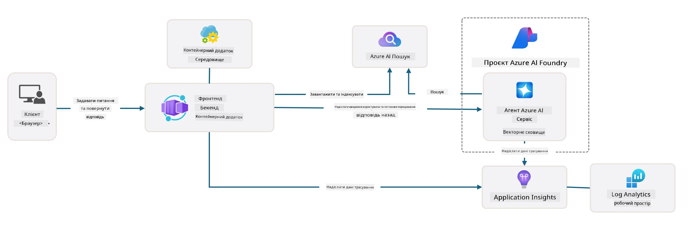

# 3. Розібрати шаблон

!!! tip "НА КІНЕЦЬ ЦЬОГО МОДУЛЮ ВИ ЗМОЖЕТЕ"

    - [ ] Use GitHub Copilot and optional MCP tools for Azure documentation and read-only exploration
    - [ ] Identify the template's application, infrastructure, configuration, and test entry points
    - [ ] Verify generated explanations against actual repository files
    - [ ] **Lab 3:** Trace one request and one configuration input through the project

---

## 1. Активувати GitHub Copilot

Відкрийте ініціалізований штучний інтелект зразка у VS Code і ввімкніть [GitHub Copilot](https://code.visualstudio.com/docs/copilot/chat/chat-agent-mode). Увійдіть за допомогою акаунта з дійсним планом; ліміти використання різняться. Попросіть Copilot пояснити репозиторій перед авторизацією змін.

### Додаткові сервери MCP (за бажанням)

Ці сервіси можуть надати додаткові інструменти:

- [Azure MCP Server](https://learn.microsoft.com/azure/developer/azure-mcp-server/overview)
- [Microsoft Learn MCP Server](https://learn.microsoft.com/training/support/mcp)

У VS Code перегляньте [керівництво з конфігурації MCP](https://code.visualstudio.com/docs/copilot/chat/mcp-servers) і створіть `.vscode/mcp.json` за необхідності:

```json
{
  "servers": {
    "Azure MCP Server": {
      "type": "stdio",
      "command": "npx",
      "args": ["-y", "@azure/mcp@latest", "server", "start"]
    },
    "microsoft.docs.mcp": {
      "type": "http",
      "url": "https://learn.microsoft.com/api/mcp"
    }
  }
}
```

Команда `npx` потребує встановленого та підтримуваного Node.js/npm та завантажує виконуваний код. Перегляньте пакет і закріпіть дозволену версію для відтворюваної командної конфігурації. Запустіть сервери за допомогою MCP-контролів VS Code і перевірте доступні інструменти; назви можуть змінюватись між версіями.

**Аутентифікація окрема.** Використовуйте `azd auth login` для AZD. Дотримуйтеся задокументованого процесу автентифікації Azure MCP для його інструментів; лише вхід до AZD не встановлює сесію MCP. Використовуйте `az login` окремо, коли вправа або хук викликає Azure CLI.

Спробуйте запити лише для читання:

1. «Використайте Microsoft Learn MCP, щоб знайти документацію з конфігурації Azure Developer CLI.»
2. «Поясни `azure.yaml` цього репозиторію; наведи файли, що реалізують кожен хук.»
3. «За допомогою доступних інструментів Azure MCP перелічіть мої розгорнуті ресурси, не змінюючи нічого.»

Перевіряйте вибрану оренду/підписку та кожен запропонований виклик інструменту. Не погоджуйте створення, видалення ресурсів або зміни доступу лише заради вивчення архітектури.

## 2. Зрозуміти архітектуру

Зразок містить бекенд на Python FastAPI та фронтенд на React/TypeScript у Azure Container Apps. Бекенд взаємодіє з агентом у проекті Microsoft Foundry. Отримання даних і спостереження залежать від увімкнених функцій шаблону та успішного налаштування; вони не гарантовані лише через розгортання додатку.



Порівняйте цю діаграму з [поточним керівництвом з розгортання](https://github.com/Azure-Samples/get-started-with-ai-agents/blob/main/docs/deployment.md) і вашими фактичними ресурсами. Перевірте налаштоване розгортання моделі, інструменти агента, керовану ідентичність, призначення ролей та необов’язкові ресурси Azure AI Search/Application Insights.

**Вправа:** Попросіть Copilot відслідкувати чат-запит від фронтенда через API до Foundry з посиланнями на файли й функції. Відкрийте ці посилання й перевірте пояснення. Не робіть висновки про реалізовану аутентифікацію, маршрутизацію чи авторизацію лише з діаграми.

## 3. Структура репозиторію

Наступні вибрані шляхи були перевірені у зразку 4 листопада 2026 року. Ваш ініціалізований ревізійний стан залишається джерелом істини:

```text
get-started-with-ai-agents/
  azure.yaml
  docker-compose.yaml
  requirements-dev.txt
  .devcontainer/
  infra/
    main.bicep
    main.parameters.json
    api.bicep
    core/
  src/
    Dockerfile
    pyproject.toml
    requirements.txt
    api/
      main.py
      routes.py
      search_index_manager.py
    frontend/
      package.json
      src/
    files/
  scripts/
    validate_env_vars.sh
    validate_env_vars.ps1
    postdeploy.sh
    postdeploy.ps1
  tests/
    test_evaluation.py
    test_red_teaming.py
  docs/
    deployment.md
    deploy_customization.md
    ai_search.md
    observability.md
    local_development.md
    troubleshooting.md
```

### Інфраструктура та конфігурація

`infra/main.bicep` оркеструє ресурси; `main.parameters.json` поєднує вхідні дані шаблону з значеннями середовища AZD. `azure.yaml` обирає сервіс додатку та життєві хуки. Прослідкуйте вхід `USE_AZURE_AI_SEARCH_SERVICE` через ці файли, щоб побачити, що фактично змінюється.

### Додаток та ідентичність

Читайте `src/api/` і `src/frontend/` разом. Визначте, де створюється чи отримується агент, де налаштовуються інструкції/інструменти, і яка ідентичність використовується для кожного виклику Azure. Файли зразків у `src/files/` — демонстраційні дані, а не продакшн-каталог чи модель авторизації.

### Тести та спостереження

Поточні точки входу для оцінки та тестування безпеки — у `tests/`; старі посилання на каталоги `evals/` і `airedteaming/` вважаються застарілими у цьому зразку. Прочитайте `docs/observability.md` щодо вимог і вартості перед виконанням тестів у хмарі. Ці тести на Python окремі від необов’язкового розширення AZD `azure.ai.evaluations`.

## 4. Перевірте свої висновки

- Ідентифікуйте маршрут API, взаємодію агента та код отримання даних для одного тестового питання.
- Поясніть, яка ідентичність отримує доступ до Foundry і яка конфігурація обирає його кінцеву точку.
- Знайдіть фактичні скрипти pre-up і post-deploy та їх поведінку при обробці помилок.
- Перелічіть залежності або додаткові функції, яких немає у вашому розгортанні.

Продовжуйте до [Налаштування шаблону](4-Configure-AI-Template.md).

---

<!-- CO-OP TRANSLATOR DISCLAIMER START -->
**Відмова від відповідальності**:
Цей документ було перекладено за допомогою сервісу штучного інтелекту для перекладу [Co-op Translator](https://github.com/Azure/co-op-translator). Хоча ми прагнемо до точності, будь ласка, майте на увазі, що автоматичні переклади можуть містити помилки або неточності. Оригінальний документ рідною мовою слід вважати авторитетним джерелом. Для критично важливої інформації рекомендується професійний людський переклад. Ми не несемо відповідальності за будь-які непорозуміння або неправильні тлумачення, що виникли внаслідок використання цього перекладу.
<!-- CO-OP TRANSLATOR DISCLAIMER END -->