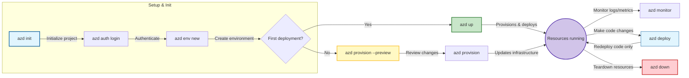
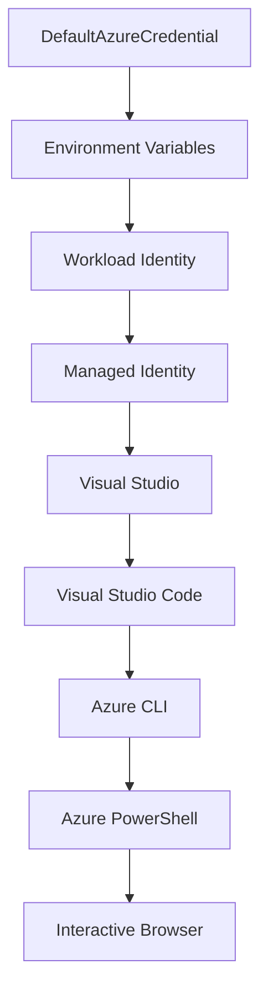

# AZD بنیادیات - بنیادی تصورات اور اصول

**باب کی نیویگیشن:**
- **📚 کورس ہوم**: [ابتدائیوں کے لئے AZD](../../README.md)
- **📖 موجودہ باب**: باب 1 - بنیاد اور فوری آغاز
- **⬅️ پچھلا**: [کورس کا جائزہ](../../README.md#-chapter-1-foundation--quick-start)
- **➡️ اگلا**: [انسٹالیشن اور سیٹ اپ](installation.md)
- **🚀 اگلا باب**: [باب 2: AI-فرسٹ ڈویلپمنٹ](../chapter-02-ai-development/microsoft-foundry-integration.md)

## تعارف

> جائزہ لیا گیا ہے `azd 1.37.2` (نومبر 2026) کے مطابق۔ باش کمانڈز میں اقتباس شدہ پلیس ہولڈرز استعمال ہوتے ہیں جنہیں آپ کو تبدیل کرنا ہوگا۔ ٹیمپلیٹ ورک فلو میں موجود `.` موجودہ ڈائریکٹری کو ابتدائیہ کرنے کے لیے استعمال ہوتا ہے؛ بغیر ڈائریکٹری آرگیومنٹ کے، ٹیمپلیٹ کی ابتدائیہ سب ڈائریکٹری بناتی ہے اور آپ کے شیل کی ورکنگ ڈائریکٹری کو تبدیل نہیں کرتی۔ ترقی یافتہ کوڈ کے ٹکڑے صرف وضاحتی ہیں، مکمل پروجیکٹس نہیں۔

اس سبق میں آپ کو ایزور ڈویلپر CLI (azd) سے متعارف کروایا جائے گا، جو ایک طاقتور کمانڈ لائن ٹول ہے جو آپ کی مقامی ترقی سے ایزور پر تعیناتی کے عمل کو تیز کرتا ہے۔ آپ بنیادی تصورات، مرکزی خصوصیات سیکھیں گے اور سمجھیں گے کہ azd کلاؤڈ-نیٹو ایپلیکیشن کی تعیناتی کو کس طرح آسان بناتا ہے۔

## تعلیمی مقاصد

اس سبق کے اختتام تک، آپ:
- یہ سمجھ سکیں گے کہ Azure Developer CLI کیا ہے اور اس کا بنیادی مقصد کیا ہے
- ٹیمپلیٹس، ماحول، اور خدمات کے بنیادی تصورات سیکھیں گے
- ٹیمپلیٹ پر مبنی ترقی اور Infrastructure as Code جیسے کلیدی فوائد دریافت کریں گے
- azd پروجیکٹ کی ساخت اور ورک فلو کو سمجھیں گے
- اپنے ترقیاتی ماحول کے لیے azd انسٹال اور ترتیب دینے کے لیے تیار ہوں گے

## تعلیمی نتائج

اس سبق کے مکمل ہونے کے بعد، آپ قابل ہوں گے:
- azd کے جدید کلاؤڈ ترقیاتی ورک فلوز میں کردار کی وضاحت کریں
- azd پروجیکٹ کی ساخت کے اجزاء کی شناخت کریں
- وضاحت کریں کہ ٹیمپلیٹس، ماحول، اور خدمات کس طرح مل کر کام کرتے ہیں
- azd کے ذریعے Infrastructure as Code کے فوائد کو سمجھیں
- مختلف azd کمانڈز اور ان کے مقاصد کی شناخت کریں

## Azure Developer CLI (azd) کیا ہے؟

Azure Developer CLI (azd) ایک کمانڈ لائن ٹول ہے جو آپ کی مقامی ترقی سے Azure پر تعیناتی کے سفر کو تیز کرنے کے لیے ڈیزائن کیا گیا ہے۔ یہ Azure پر کلاؤڈ-نیٹو ایپلیکیشنز کی تعمیر، تعیناتی، اور انتظام کے عمل کو آسان بناتا ہے۔

### آپ azd کے ساتھ کیا تعینات کر سکتے ہیں؟

azd متعدد کاموں کی حمایت کرتا ہے—اور فہرست مسلسل بڑھ رہی ہے۔ آج آپ azd کو تعینات کرنے کے لیے استعمال کر سکتے ہیں:

| کام کی قسم | مثالیں | کیا ورک فلو ایک جیسا ہے؟ |
|---------------|----------|----------------|
| **روایتی ایپلیکیشنز** | ویب ایپس، REST APIs، جامد سائٹس | ✅ `azd up` |
| **خدمات اور مائیکرو سروسز** | کنٹینر ایپس، فنکشن ایپس، ملٹی سروس بیک اینڈز | ✅ `azd up` |
| **AI سے لیس ایپلیکیشنز** | Microsoft Foundry Models کے ساتھ چیٹ ایپس، AI سرچ کے ساتھ RAG حل | ✅ `azd up` |
| **ذہین ایجنٹس** | Foundry ہوسٹڈ ایجنٹس، ملٹی ایجنٹ آرکیسٹریشنز | ✅ `azd up` |

کلیدی بات یہ ہے کہ **azd کی لائف سائیکل آپ جو کچھ بھی تعینات کر رہے ہیں، یکساں رہتی ہے**۔ آپ پروجیکٹ کو ابتدائیہ کرتے ہیں، انفراسٹرکچر فراہم کرتے ہیں، کوڈ تعینات کرتے ہیں، اپنی ایپ کی نگرانی کرتے ہیں، اور صفائی کرتے ہیں—چاہے یہ ایک سادہ ویب سائٹ ہو یا ایک پیچیدہ AI ایجنٹ۔

یہ تسلسل جان بوجھ کر ڈیزائن کیا گیا ہے۔ azd AI صلاحیتوں کو آپ کی ایپلیکیشن کی ایک اور قسم کی خدمت کے طور پر لیتا ہے، نہ کہ کچھ بنیادی طور پر مختلف۔ Microsoft Foundry Models سے معاونت یافتہ چیٹ اینڈ پوائنٹ، azd کی نظر سے، محض ایک اور خدمت ہے جسے ترتیب دینا اور تعینات کرنا ہے۔

### 🎯 AZD کیوں استعمال کریں؟ ایک حقیقی دنیا کا موازنہ

آئیے ایک سادہ ویب ایپ کو ڈیٹا بیس کے ساتھ تعینات کرنے کا موازنہ کرتے ہیں:

#### ❌ بغیر AZD کے: دستی Azure تعیناتی (30+ منٹ)

**وضاحتی باش موازنہ، چلائے جانے والا ایپلی کیشن اسٹارٹر نہیں۔** یہ موجودہ ایپلیکیشن کوڈ، منفرد وسائل کے نام، Azure CLI کی توثیق، اور کسی بھی ضروری CLI توسیعات کو فرض کرتا ہے۔ نیچے کے ٹیمپلیٹ مشق میں مکمل معاونت یافتہ راہ استعمال کریں۔

```bash
# Step 1: Create resource group
az group create --name myapp-rg --location eastus

# Step 2: Create App Service Plan
az appservice plan create --name myapp-plan \
  --resource-group myapp-rg \
  --sku B1 --is-linux

# Step 3: Create Web App
az webapp create --name myapp-web-unique123 \
  --resource-group myapp-rg \
  --plan myapp-plan \
  --runtime "NODE:22-lts"

# Step 4: Create Cosmos DB account (10-15 minutes)
az cosmosdb create --name myapp-cosmos-unique123 \
  --resource-group myapp-rg \
  --kind MongoDB

# Step 5: Create database
az cosmosdb mongodb database create \
  --account-name myapp-cosmos-unique123 \
  --resource-group myapp-rg \
  --name tododb

# Step 6: Create collection
az cosmosdb mongodb collection create \
  --account-name myapp-cosmos-unique123 \
  --resource-group myapp-rg \
  --database-name tododb \
  --name todos

# Step 7: Get connection string
CONN_STR=$(az cosmosdb keys list \
  --name myapp-cosmos-unique123 \
  --resource-group myapp-rg \
  --type connection-strings \
  --query "connectionStrings[0].connectionString" -o tsv)

# Step 8: Configure app settings
az webapp config appsettings set \
  --name myapp-web-unique123 \
  --resource-group myapp-rg \
  --settings MONGODB_URI="$CONN_STR"

# Step 9: Enable logging
az webapp log config --name myapp-web-unique123 \
  --resource-group myapp-rg \
  --application-logging filesystem \
  --detailed-error-messages true

# Step 10: Set up Application Insights
az monitor app-insights component create \
  --app myapp-insights \
  --location eastus \
  --resource-group myapp-rg

# Step 11: Link App Insights to Web App
INSTRUMENTATION_KEY=$(az monitor app-insights component show \
  --app myapp-insights \
  --resource-group myapp-rg \
  --query "instrumentationKey" -o tsv)

az webapp config appsettings set \
  --name myapp-web-unique123 \
  --resource-group myapp-rg \
  --settings APPINSIGHTS_INSTRUMENTATIONKEY="$INSTRUMENTATION_KEY"

# Step 12: Build application locally
npm install
npm run build

# Step 13: Create deployment package
zip -r app.zip . -x "*.git*" "node_modules/*"

# Step 14: Deploy application
az webapp deployment source config-zip \
  --resource-group myapp-rg \
  --name myapp-web-unique123 \
  --src app.zip

# Step 15: Wait and pray it works 🙏
# (No automated validation, manual testing required)
```

**مسائل:**
- ❌ یاد رکھنے اور ترتیب سے چلانے کے لیے 15+ کمانڈز
- ❌ 30-45 منٹ کے دستی کام
- ❌ غلطیاں کرنا آسان (ٹائپوس، غلط پیرامیٹرز)
- ❌ سہولیات کو واضح ہینڈلنگ کی ضرورت ہے؛ ڈیبگ لاگز اور شیل ٹریسنگ ان کا انکشاف کر سکتی ہے
- ❌ اگر کچھ ناکام ہو جائے تو خودکار رول بیک نہیں ہوتا
- ❌ ٹیم کے اراکین کے لیے نقل کرنا مشکل ہے
- ❌ ہر بار مختلف (دہرائے نہ جانے والے)

#### ✅ AZD کے ساتھ: خودکار تعیناتی (5 کمانڈز، 10-15 منٹ)

```bash
# Step 1: Initialize from template
azd init --template todo-nodejs-mongo .

# Step 2: Authenticate
azd auth login

# Step 3: Select the environment created during init
azd env select dev

# Step 4: Preview changes (optional but recommended)
azd provision --preview

# Step 5: Deploy everything
azd up

# ✨ Done! Everything is deployed, configured, and monitored
```

**فائدے:**
- ✅ **5 کمانڈز** بمقابلہ 15+ دستی مراحل
- ✅ **کل وقت 10-15 منٹ** (زیادہ تر Azure کا انتظار)
- ✅ **کم دستی غلطیاں** - مستقل، ٹیمپلیٹ پر مبنی ورک فلو
- ✅ **محفوظ خفیہ ہینڈلنگ** - بہت سے ٹیمپلیٹس Azure کے زیر انتظام خفیہ اسٹوریج استعمال کرتے ہیں
- ✅ **دہرائی جانے والی تعیناتیاں** - ہر بار ایک جیسا ورک فلو
- ✅ **دہرائی جانے والی انفراسٹرکچر کی تعریفیں** - کوٹہ، علاقائی دستیابی، اور ٹیمپلیٹ کے ورژنز کے تابع
- ✅ **ٹیم کے لیے تیار** - کوئی بھی ایک ہی کمانڈز سے تعینات کر سکتا ہے
- ✅ **انفراسٹرکچر ایز کوڈ** - ورژن کنٹرول شدہ بائسک ٹیمپلیٹس
- ✅ **ٹیمپلیٹ سے متعین مانیٹرنگ** - جب ٹیمپلیٹ میں شامل ہو تو Application Insights

### وقت اور قابل اعتمادیت

اوپر دیے گئے اوقات اندازے ہیں، معیار نہیں۔ azd وہ کمانڈز کم کرتا ہے جنہیں آپ کو مربوط کرنا ہوتا ہے، لیکن تعیناتی کا دورانیہ، غلطیوں کا خاتمہ، یا خودکار ایپلیکیشن/ڈیٹا بیس رول بیک کی ضمانت نہیں دیتا۔ فعال ورژنز کو سورس کنٹرول میں رکھیں اور بحالی کے طریقہ کار کا ٹیسٹ کریں۔

## بنیادی تصورات

### ٹیمپلیٹس
ٹیمپلیٹس azd کی بنیاد ہیں۔ وہ شامل ہیں:
- **ایپلیکیشن کوڈ** - آپ کا سورس کوڈ اور انحصارات
- **انفراسٹرکچر کی تعریفیں** - بائسک یا ٹیرافارم میں Azure وسائل کی تعریف
- **کنفیگریشن فائلز** - ترتیبات اور ماحولیاتی متغیرات
- **تعیناتی اسکرپٹ** - خودکار تعیناتی کے ورک فلو

### ماحولیات
ماحولیات مختلف تعیناتی کے مقامات کی نمائندگی کرتے ہیں:
- **ترقی** - ٹیسٹنگ اور ڈیولپمنٹ کے لیے
- **اسٹیجنگ** - پری پروڈکشن ماحول
- **پروڈکشن** - لائیو پروڈکشن ماحول

ہر ماحول اپنا رکھتا ہے:
- ماحول کا نام اور اقدار؛ وسائل کی علیحدگی انفراسٹرکچر ٹیمپلیٹ پر منحصر ہوتی ہے
- کنفیگریشن سیٹنگز
- تعیناتی کی حالت

### خدمات
خدمات `azure.yaml` میں تعیناتی کے قابل ایپلیکیشن اجزاء کو بیان کرتی ہیں:
- **فرنٹ اینڈ** - ویب ایپلیکیشنز، SPAs
- **بیک اینڈ** - APIs، مائیکرو سروسز

ڈیٹابیسز اور اسٹوریج عام طور پر انفراسٹرکچر وسائل کے طور پر مہیا کیے جاتے ہیں، نہ کہ تخلیق شدہ سروس ہوسٹس جیسے کہ `host: postgres`۔

## کلیدی خصوصیات

### 1. ٹیمپلیٹ پر مبنی ترقی
```bash
# Browse available templates
azd template list

# Initialize from a template
azd init --template "<template-name>" .
```

### 2. انفراسٹرکچر ایز کوڈ
- **بائسک** - Azure کا ڈومین-اسپیسفک زبان
- **ٹیرافارم** - ملٹی کلاؤڈ انفراسٹرکچر ٹول
- بائسک ARM ٹیمپلیٹس میں کمپائل ہوتا ہے؛ خام ARM JSON کوئی الگ بلٹ ان `infra.provider` نہیں ہے۔

### 3. مربوط ورک فلو
```bash
# Complete deployment workflow
azd up            # Provision + Deploy this is hands off for first time setup

# 🧪 NEW: Preview infrastructure changes before deployment (SAFE)
azd provision --preview    # Simulate infrastructure deployment without making changes

azd provision     # Create Azure resources if you update the infrastructure use this
azd deploy        # Deploy application code or redeploy application code once update
azd down          # Clean up resources
```

#### 🛡️ معائنہ کے ساتھ محفوظ انفراسٹرکچر منصوبہ بندی
`azd provision --preview` کمانڈ محفوظ تعیناتیوں کے لیے ایک اہم تبدیلی ہے:
- **خشک دوڑ تجزیہ** - دکھاتا ہے کیا بنایا، تبدیل یا حذف کیا جائے گا
- **کوئی انفراسٹرکچر اطلاق نہیں** - فراہم کنندہ کی تبدیلیوں کا جائزہ لیتا ہے؛ سب سے پہلے پروجیکٹ ہکس کا معائنہ کریں، کیونکہ ہکس سائیڈ ایفیکٹس والی کمانڈز چلا سکتے ہیں
- **ٹیم تعاون** - تعیناتی سے پہلے پیش نظارہ نتائج شیئر کریں
- **لاگت کی منصوبہ بندی کا ان پٹ** - تجویز کردہ SKUs کا معائنہ کریں، پھر Azure پرائسنگ کیلکولیٹر سے قیمت لگائیں؛ پیش نظارہ قیمت نہیں نکالتا

```bash
# Example preview workflow
azd provision --preview           # See what will change
# Review the output, discuss with team
azd provision                     # Apply changes with confidence
```

### 📊 بصری: AZD ڈیولپمنٹ ورک فلو



**ورک فلو کی وضاحت:**
1. **ابتدائیہ** - ٹیمپلیٹ یا نیا پروجیکٹ شروع کریں
2. **تصدیق** - Azure کے ساتھ تصدیق کریں
3. **ماحول** - علیحدہ تعیناتی ماحول تخلیق کریں
4. **پیش نظارہ** - 🆕 ہمیشہ پہلے انفراسٹرکچر کی تبدیلیوں کا پیش نظارہ کریں (محفوظ عمل)
5. **پروویژن** - Azure وسائل بنائیں/اپ ڈیٹ کریں
6. **تعیناتی** - اپنا ایپلیکیشن کوڈ اپ لوڈ کریں
7. **نگرانی** - ایپلیکیشن کی کارکردگی کو ملاحظہ کریں
8. **دہرانا** - تبدیلیاں کریں اور کوڈ دوبارہ تعین کریں
9. **صفائی** - کام ختم ہونے پر وسائل ہٹائیں

### 4. ماحول کا انتظام
```bash
# Create and manage environments
azd env new "<environment-name>"
azd env select "<environment-name>"
azd env list
```

### 5. ایکسٹینشنز اور AI کمانڈز

azd ایکسٹینشن سسٹم استعمال کرتا ہے تاکہ بنیادی CLI سے آگے صلاحیتیں شامل کی جا سکیں۔ یہ خاص طور پر AI کام کے بوجھ کے لیے مفید ہے:

```bash
# List available extensions
azd extension list

# Install the GA Foundry bundle (requires azd >= 1.37.0)
azd ext install microsoft.foundry

# Initialize an AI agent project interactively
azd ai agent init

# Test a deployed agent (shows latency and time-to-first-byte)
azd ai agent invoke

# Start the MCP server for AI-assisted development (Alpha)
azd mcp start
```

**ایجنٹ لائف سائیکل، ابتدا سے آخر تک۔** GA `microsoft.foundry` بنڈل میں `azure.ai.agents` اور چھ دیگر بنیادی ایکسٹینشنز شامل ہیں۔ الگ الگ جانچ کے لیے `azure.ai.evaluations` انسٹال کریں۔ اس ورک فلو کے لیے `azd >= 1.37.0` استعمال کریں۔ آپ کو پہلے دن ان سب کی ضرورت نہیں ہے:

| مرحلہ | کمانڈ | یہ کیا کرتا ہے |
|-------|---------|--------------|
| **سکافولڈ** | `azd ai agent init --template <path-to-azure.yaml>` | موجودہ ایجنٹ پروجیکٹ ٹیمپلیٹ اپنائیں |
| **مقامی طور پر چلائیں** | `azd ai agent run`، پھر دوسرے ٹرمینل میں `azd ai agent invoke --local "Test prompt"` | ایجنٹ انسپیکٹر میں مقامی سرگرمی کا معائنہ کریں؛ ماڈل کالز اب بھی Azure استعمال کرتی ہیں |
| **تعیناتی** | `azd deploy` | کوڈ موڈ ہوںڈ ایجنٹس کے لیے، ریموٹ Foundry بلڈ کے لیے ذرائع اپ لوڈ کریں |
| **جانچ** | `azd ai agent invoke` | ایجنٹ کو کال کریں اور جواب کی ٹائمنگ دیکھیں |
| **نابندی** | `azd ai eval init`, `generate`, `run start` | الگ ایکسٹینشن استعمال کرتے ہوئے جانچیں ترتیب دیں، تعینات کریں، اور چلائیں |
| **بہتری** | `azd ai agent optimize --eval <evaluation-name> --optimize-model <optimizer-deployment>` | ایجنٹ کو بہتر بنانے کے لیے ایک مطابقت پذیر جانچ دوبارہ استعمال کریں |
| **معائنہ** | `azd ai agent endpoint show` | لائیو اینڈپوائنٹ کنفیگریشن دیکھیں |
| **صفائی کریں** | `azd ai agent delete` | کسی ہوسٹ کیے گئے ایجنٹ اور اس کی تمام ورژنز کو حذف کریں |

> شروع کریں [GA ہوسٹڈ ایجنٹ واک تھرو](../chapter-02-ai-development/microsoft-foundry-integration.md#hosted-agent-walkthrough-ga) سے، جو پری ریکوزیٹس، پروویژننگ، اور محفوظ صفائی کو کور کرتا ہے۔ ایکسٹینشنز مزید تفصیل میں [AZD AI CLI کمانڈز](../chapter-08-production/production-ai-practices.md#azd-ai-cli-commands-and-extensions) حوالہ میں شامل ہیں۔

## 📁 پروجیکٹ کا ڈھانچہ

ایک عام azd پروجیکٹ کا ڈھانچہ:
```
my-app/
├── .azure/                  # Local environments and selected-environment config
│   ├── config.json
│   └── dev/.env
├── .devcontainer/          # Development container config
├── .github/workflows/      # GitHub Actions
├── .vscode/               # VS Code settings
├── infra/                 # Infrastructure code
│   ├── main.bicep        # Main infrastructure template
│   ├── main.parameters.json
│   └── modules/          # Reusable modules
├── src/                  # Application source code
│   ├── api/             # Backend services
│   └── web/             # Frontend application
├── azure.yaml           # azd project configuration
└── README.md
```

## 🔧 کنفیگریشن فائلیں

### azure.yaml
مرکزی پروجیکٹ کی کنفیگریشن فائل:
```yaml
name: my-awesome-app
metadata:
  template: my-template@1.0.0

services:
  web:
    project: ./src/web
    language: js
    host: appservice
  api:
    project: ./src/api
    language: js
    host: appservice

hooks:
  preprovision:
    shell: pwsh
    run: echo "Preparing to provision..."
```

### .azure/config.json
پروجیکٹ-مقامی ڈیفالٹ ماحول کا انتخاب (مثالی؛ azd کے ذریعے منظم):
```json
{
  "defaultEnvironment": "dev"
}
```

## 🎪 عام ورک فلو اور عملی مشقیں

> **💡 سیکھنے کا اشارہ:** AZD مہارتیں بتدریج بنانے کے لیے یہ مشقیں ترتیب سے کریں۔

### 🎯 مشق 1: اپنا پہلا پروجیکٹ شروع کریں

**مقصد:** AZD پروجیکٹ بنائیں اور اس کا ڈھانچہ دریافت کریں

**قدامات:**
```bash
# Use a proven template
mkdir azd-basics-practice
cd azd-basics-practice
# Choose "dev" for the environment name when prompted
azd init --template todo-nodejs-mongo .

# Explore the generated files
ls -la  # View all files including hidden ones

# Key files created:
# - azure.yaml (main config)
# - infra/ (infrastructure code)
# - src/ (application code)
```

**✅ کامیابی:** آپ کے پاس azure.yaml، infra/، اور src/ ڈائریکٹریز موجود ہیں

---

### 🎯 مشق 2: Azure پر تعیناتی کریں

**مقصد:** مکمل اختتامی تعیناتی

**اقدامات:**
```bash
# 1. Authenticate
azd auth login

# 2. Select the dev environment created in Exercise 1
azd env select dev
azd env set AZURE_LOCATION eastus

# 3. Preview changes (RECOMMENDED)
azd provision --preview

# 4. Deploy everything
azd up

# 5. Verify deployment
azd show    # View your app URL
```

**متوقع وقت:** 10-15 منٹ  
**✅ کامیابی:** براؤزر میں درخواست کا URL کھل جائے

---

### 🎯 مشق 3: متعدد ماحولیات

**مقصد:** dev اور staging پر تعینات کرنا

**اقدامات:**
```bash
# Already have dev, create staging
azd env new staging
azd env set AZURE_LOCATION westus2
azd up

# Switch between them
azd env list
azd env select dev
```

**✅ کامیابی:** Azure پورٹل میں دو الگ الگ ریسورس گروپس

**صفائی:** مشق 3 ایک دوسرا بل ایبل تعیناتی بناتی ہے۔ ختم کرنے پر دونوں کو حذف کریں:

```bash
azd down --environment dev
azd down --environment staging
```

---

### 🛡️ تباہ کن صفائی: `azd down --force --purge`

جب آپ خاص طور پر منتخب شدہ ماحول کے Azure ریسورسز کو حذف کرنا چاہتے ہیں:

```bash
azd down --force --purge
```

**یہ کیا کرتا ہے:**
- `--force`: کوئی تصدیقی پرامپٹس نہیں
- `--purge`: نیز درمیانی طور پر حذف شدہ معاون وسائل کو مستقل طور پر حذف کرتا ہے (مثلاً کی والٹس)، جہاں پرج پروٹیکشن اجازت دیتا ہے۔ یہ مقامی `.azure/` ڈائریکٹری کو حذف نہیں کرتا۔

**استعمال کریں جب:** ایک قابل ضیاع ماحول کے ساتھ کام ختم ہو چکا ہو۔ تباہ کن صفائی کو توثیق، کوٹا، یا کنفیگریشن غلطی کے لئے پہلا ردعمل نہ سمجھیں۔

---

## 🎪 اصل ورک فلو کا حوالہ

### نیا پروجیکٹ شروع کرنا
```bash
# Method 1: Use existing template
azd init --template todo-nodejs-mongo .

# Method 2: Start from scratch
azd init

# Method 3: Use current directory
azd init .
```

### ترقیاتی سائیکل
```bash
# Set up development environment
azd auth login
azd env new dev
azd env select dev

# Deploy everything
azd up

# Make changes and redeploy
azd deploy

# Clean up when done
azd down --force --purge # Deletes this environment's discovered Azure resources; review before forcing deletion.
```

## `azd down --force --purge` کو سمجھنا
`azd down --force --purge` کمانڈ azd ماحول اور تمام منسلک وسائل کو مکمل طور پر ختم کرنے کا ایک طاقتور طریقہ ہے۔ یہاں ہر فلیگ کا خلاصہ ہے:
```
--force
```
- تصدیقی پرامپٹس کو چھوڑ دیتا ہے۔
- آٹومیشن یا اسکرپٹنگ کے لئے مفید جہاں دستی انپٹ ممکن نہ ہو۔
- اجازت نامے، پرج پروٹیکشن، یا حذف کرنے کی ناکامیوں کو نظرانداز نہیں کرتا۔

```
--purge
```
مستقل طور پر معاون سافٹ-ڈیلیٹ کی گئی Azure وسائل کو بغیر اضافی تصدیق کے حذف کر دیتا ہے۔ پرج تحفظ اور اجازتیں اب بھی لاگو ہوتی ہیں۔ یہ **مقامی ماحولیات** یا `.azure/` فولڈر کو حذف نہیں کرتا۔


### دونوں کا استعمال کیوں کریں؟
دونوں کا استعمال صرف اس وقت کریں جب آپ منتخب ماحول کے Azure وسائل کو حذف کرنے اور قابل بازیافت وسائل کو حذف کرنے کا ارادہ رکھتے ہوں۔ یہ تباہ کن صفائی ہے، عمومی مرمت یا مقامی-حالت ری سیٹ نہیں۔

یہ خاص طور پر Azure پورٹل میں دستی وسائل کی حذف کاری کے بعد یا ٹیمپلیٹس، ماحول، یا وسائلی گروپ کے نام دینے کے معیار کو تبدیل کرتے وقت مددگار ہوتا ہے۔


### متعدد ماحولیات کا انتظام
```bash
# Create staging environment
azd env new staging
azd env select staging
azd up

# Switch back to dev
azd env select dev

# Compare environments
azd env list
```

## 🔐 توثیق اور اسناد

تعیناتی کی توثیق (`azd auth login`) کو ایپلیکیشن SDK کی توثیق (`DefaultAzureCredential`) سے الگ کریں۔ یہ دونوں مختلف ہیں۔ azd ڈیفالٹ کے طور پر Azure CLI کی اسناد استعمال نہیں کرتا۔

### Azure CLI کی توثیق (`az login`)

azd کے لیے `azd auth login` چلائیں۔ مندرجہ ذیل Azure CLI کمانڈز اختیاری ہیں اور `az` کمانڈز کی علیحدہ توثیق کرتی ہیں:

```bash
# Interactive login (opens browser)
az login

# Login with specific tenant
az login --tenant "<tenant-id>"

# Login with service principal
az login --service-principal -u "<app-id>" -p "<password>" --tenant "<tenant-id>"

# Check current login status
az account show

# List available subscriptions
az account list --output table

# Set default subscription
az account set --subscription "<subscription-id>"
```

### توثیقی عمل
1. **انٹرایکٹو لاگ ان**: توثیق کے لیے آپ کا ڈیفالٹ براؤزر کھولتا ہے
2. **ڈیوائس کوڈ فلو**: غیر براؤزر ماحول کے لیے
3. **سروس پرنسپل**: خودکاری اور CI/CD منظرناموں کے لیے
4. **مینجڈ آئیڈینٹیٹی**: Azure پر میزبانی شدہ ایپلیکیشنز کے لیے

### DefaultAzureCredential چین

`DefaultAzureCredential` ایک اسناد کی قسم ہے جو مخصوص ترتیب میں خودکار طور پر متعدد اسناد ذرائع آزما کر سادہ تصدیقی تجربہ فراہم کرتی ہے:

#### ایپلیکیشن SDK اسناد کی چین

درست چین Azure Identity SDK زبان، ورژن، نصب کردہ پلگ انز، اور اختیارات پر منحصر ہے۔ یہ خاکہ تصوری ہے، کوئی مقررہ azd تصدیقی تسلسل نہیں؛ حالیہ SDKs میں Azure Developer CLI اسناد بھی شامل ہو سکتی ہیں۔


#### 1. ماحولیاتی متغیرات
```bash
# Set environment variables for service principal
export AZURE_CLIENT_ID="<app-id>"
export AZURE_CLIENT_SECRET="<password>"
export AZURE_TENANT_ID="<tenant-id>"
```

#### 2. ورک لوڈ آئیڈینٹیٹی (Kubernetes/GitHub Actions)
خودکار طور پر استعمال کی جاتی ہے:
- Azure Kubernetes سروس (AKS) کے ساتھ ورک لوڈ آئیڈینٹیٹی
- GitHub Actions کے ساتھ OIDC فیڈریشن
- دیگر وفاقی شناخت منظرنامے

#### 3. مینجد آئیڈینٹیٹی
Azure وسائل جیسے:
- ورچوئل مشینیں
- ایپ سروس
- Azure فنکشنز
- کنٹینر انسٹینسز

```bash
# Inspect a deployed Container App's configured identity (requires az login)
az containerapp show --name "<app-name>" --resource-group "<rg-name>" --query identity
```

#### 4. ڈویلپر ٹولز انٹیگریشن
- **ویژول اسٹوڈیو**: خود بخود سائن ان اکاؤنٹ استعمال کرتا ہے
- **VS کوڈ**: سپورٹ SDK اور اس کے معاون بروکر/پلگ ان سیٹ اپ پر منحصر ہے
- **Azure CLI**: `az login` اسناد استعمال کرتا ہے (مقامی ترقی کے لیے سب سے عام)

### AZD تصدیقی سیٹ اپ

```bash
# Method 1: Direct azd authentication (recommended)
azd auth login

# Method 2: Direct azd authentication
azd auth login --use-device-code  # For headless environments

# Method 3: Check authentication status
azd auth login --check-status

# Method 4: Logout and re-authenticate
azd auth logout
azd auth login
```

### تصدیق کے بہترین طریقے

#### مقامی ترقی کے لیے
```bash
# 1. Log in to azd
azd auth login

# 2. Select the subscription for this initialized environment
azd env set AZURE_SUBSCRIPTION_ID "<subscription-id>"

# 3. Check azd sign-in details (read the status message)
azd auth login --check-status
```

#### CI/CD پائپ لائنز کے لیے
```yaml
# Partial GitHub Actions steps: assumes checkout, azd installation,
# required AZURE_* environment values, and pipeline secret configuration.
- name: Deploy with azd
  run: |
    azd auth login --client-id ${{ secrets.AZURE_CLIENT_ID }} \
                    --client-secret ${{ secrets.AZURE_CLIENT_SECRET }} \
                    --tenant-id ${{ secrets.AZURE_TENANT_ID }}
    azd up --no-prompt
```

#### پیداوار کے ماحول کے لیے
- Azure وسائل پر چلتے ہوئے **مینجد آئیڈینٹیٹی** استعمال کریں
- خودکاری منظرناموں کے لیے **سروس پرنسپل** استعمال کریں
- کوڈ یا کنفیگریشن فائلوں میں اسناد ذخیرہ کرنے سے گریز کریں
- حساس کنفیگریشن کے لیے **Azure Key Vault** استعمال کریں

### عام تصدیقی مسائل اور حل

#### مسئلہ: "کوئی سبسکرپشن نہیں ملا"
```bash
# Solution: Set default subscription
az account list --output table
az account set --subscription "<subscription-id>"
azd env set AZURE_SUBSCRIPTION_ID "<subscription-id>"
```

#### مسئلہ: "ناکافی اجازتیں"
```bash
# Solution: Check and assign required roles
az role assignment list --assignee $(az account show --query user.name --output tsv)

# Common required roles:
# - Contributor (for resource management)
# - User Access Administrator (for role assignments)
```

#### مسئلہ: "ٹوکن کی میعاد ختم ہوگئی"
```bash
# Solution: Re-authenticate
az logout
az login
azd auth logout
azd auth login
```

### مختلف منظرناموں میں تصدیق

#### مقامی ترقی
```bash
# Personal development account
az login
azd auth login
```

#### ٹیم ترقی
```bash
# Use specific tenant for organization
az login --tenant contoso.onmicrosoft.com
azd auth login --tenant-id "<tenant-id>"
```

#### ملٹی ٹیننٹ منظرنامے
```bash
# Switch between tenants
az login --tenant tenant1.onmicrosoft.com
azd auth login --tenant-id "<tenant-1-id>"
# Select an environment configured with tenant 1's subscription
azd env select tenant1-dev
# Deploy to tenant 1
azd up

az login --tenant tenant2.onmicrosoft.com  
azd auth login --tenant-id "<tenant-2-id>"
azd env select tenant2-dev
# Deploy to tenant 2
azd up
```

### سیکیورٹی کے خیالات

1. **اسناد کا ذخیرہ**: اسناد کو کبھی ماخذ کوڈ میں نہ رکھیں
2. **حد بندی دائرہ کار**: سروس پرنسپلز کے لیے کم سے کم مراعات کا اصول استعمال کریں
3. **ٹوکن کی تبدیلی**: سروس پرنسپل کے رازوں کو باقاعدگی سے تبدیل کریں
4. **آڈٹ ٹریل**: تصدیق اور تعیناتی سرگرمیوں کی نگرانی کریں
5. **نیٹ ورک سیکیورٹی**: جہاں ممکن ہو نجی اینڈ پوائنٹس استعمال کریں

### تصدیق کی خرابیوں کا ازالہ

```bash
# Debug authentication issues
azd auth login --check-status
az account show
az account get-access-token

# Common diagnostic commands
whoami                          # Current user context
az ad signed-in-user show      # Microsoft Entra ID user details
az group list                  # Test resource access
```

## کمانڈ دریافت

### دریافت
```bash
azd template list              # Browse templates
azd template list --help       # Template discovery options
azd init --help               # Initialization options
```

### پراجیکٹ مینجمنٹ
```bash
azd show                     # Project overview
azd env list                # Available environments and selected default
azd config show            # Configuration settings
```

### مانیٹرنگ
```bash
azd monitor                  # Open Azure portal monitoring
azd monitor --logs           # View application logs
azd monitor --live           # View live metrics
azd pipeline config          # Set up CI/CD
```

## بہترین طریقے

### 1. معنی خیز نام استعمال کریں
```bash
# Good
azd env new production-east
azd init --template todo-nodejs-mongo .

# Avoid
azd env new env1
azd init --template template1 .
```

### 2. ٹیمپلیٹس سے فائدہ اٹھائیں
- موجودہ ٹیمپلیٹس سے شروع کریں
- اپنی ضروریات کے مطابق تخصیص کریں
- اپنی تنظیم کے لیے قابلِ استعمال ٹیمپلیٹس بنائیں

### 3. ماحول کی علیحدگی
- ڈیولپمنٹ/اسٹیجنگ/پروڈ کے لیے الگ الگ ماحول استعمال کریں
- مقامی مشین سے براہ راست پیداوار پر تعیناتی کبھی نہ کریں
- پیداوار کی تعیناتی کے لیے CI/CD پائپ لائن استعمال کریں

### 4. کنفیگریشن مینجمنٹ
- رازوں کے لیے مینجد آئیڈینٹیٹی اور Key Vault استعمال کریں؛ عام `azd env set` اقدار مقامی سادہ متن ہیں
- کنفیگریشن کو ورژن کنٹرول میں رکھیں
- ماحول پر مخصوص ترتیبات کی دستاویز بنائیں

## سیکھنے کی ترقی

### ابتدائی (ہفتہ 1-2)
1. azd انسٹال کریں اور تصدیق کریں
2. ایک سادہ ٹیمپلیٹ تعینات کریں
3. پراجیکٹ کا ڈھانچہ سمجھیں
4. بنیادی کمانڈز سیکھیں (up, down, deploy)

### درمیانہ (ہفتہ 3-4)
1. ٹیمپلیٹس تخصیص کریں
2. متعدد ماحول کا انتظام کریں
3. بنیادی ڈھانچے کا کوڈ سمجھیں
4. CI/CD پائپ لائنز سیٹ اپ کریں

### اعلیٰ (ہفتہ 5+)
1. حسب ضرورت ٹیمپلیٹس بنائیں
2. جدید بنیادی ڈھانچے کے نمونے
3. ملٹی ریجن تعیناتیاں
4. انٹرپرائز گریڈ کنفیگریشنز

## اگلے اقدامات

**📖 باب 1 کی تعلیم جاری رکھیں:**
- [انسٹالیشن اور سیٹ اپ](installation.md) - azd انسٹال کریں اور ترتیب دیں
- [آپ کا پہلا پروجیکٹ](first-project.md) - مکمل ہینڈز آن سبق
- [کنفیگریشن گائیڈ](../chapter-03-configuration/configuration.md) - جدید کنفیگریشن اختیارات

**🎯 اگلے باب کے لیے تیار؟**
- [باب 2: AI-فرسٹ ڈیولپمنٹ](../chapter-02-ai-development/microsoft-foundry-integration.md) - AI ایپلیکیشنز بنانا شروع کریں

## اضافی وسائل

- [Azure Developer CLI کا جائزہ](https://learn.microsoft.com/en-us/azure/developer/azure-developer-cli/)
- [ٹیمپلیٹ گیلری](https://azure.github.io/awesome-azd/)
- [کمیونٹی نمونے](https://github.com/Azure-Samples)

---

## 🙋 بار بار پوچھے گئے سوالات

### عمومی سوالات

**س: AZD اور Azure CLI میں کیا فرق ہے؟**

ج: Azure CLI (`az`) انفرادی Azure وسائل کا انتظام کرنے کے لیے ہے۔ AZD (`azd`) مکمل ایپلیکیشنز کا انتظام کرنے کے لیے ہے:

```bash
# Azure CLI - Low-level resource management
az webapp create --name myapp --resource-group rg
az sql server create --name myserver --resource-group rg
# ...many more commands needed

# AZD - Application-level management
azd up  # Deploys entire app with all resources
```

**اسے اس طرح سمجھیں:**
- `az` = انفرادی LEGO بلاکس پر عمل کرنا
- `azd` = مکمل LEGO سیٹ کے ساتھ کام کرنا

---

**س: کیا مجھے AZD استعمال کرنے کے لیے Bicep یا Terraform جاننا ضروری ہے؟**

ج: نہیں! ٹیمپلیٹس سے شروع کریں:
```bash
# Use existing template - no IaC knowledge needed
azd init --template todo-nodejs-mongo .
azd up
```

آپ بعد میں Bicep سیکھ کر بنیادی ڈھانچے کو تخصیص کر سکتے ہیں۔ ٹیمپلیٹس عملی مثالیں فراہم کرتے ہیں جن سے سیکھا جا سکتا ہے۔

---

**س: AZD ٹیمپلیٹس چلانے کی لاگت کتنی ہے؟**

ج: لاگتیں ریجن، SKU، اپ ٹائم، ڈیٹا بیس موڈ، اور ماڈل کے استعمال کے مطابق مختلف ہوتی ہیں۔ ایک ترقیاتی ماحول اِن وقتی حالت میں بھی کافی ماہانہ چارجز لا سکتا ہے؛ عمومی $50-150 کی حد فرض نہ کریں:

```bash
# Preview resource changes (not prices)
azd provision --preview

# Always cleanup when not using
azd down --force --purge  # Removes all resources
```

**پیشہ ورانہ مشورہ:** جہاں ممکن ہو مفت سطحیں استعمال کریں:
- ایپ سروس: F1 (مفت) سطح
- Azure OpenAI: عام ماہانہ مفت ٹوکن الاوونس کی ضمانت نہیں؛ موجودہ ماڈل اور پیشکش کی قیمت چیک کریں
- Cosmos DB: اہل پروویژنڈ تھرو پٹ اکاؤنٹس مفت سطح میں حصہ لے سکتے ہیں؛ سرورلیس ٹیمپلیٹس خود بخود اہل نہیں ہوتے

---

**س: کیا میں موجودہ Azure وسائل کے ساتھ AZD استعمال کر سکتا ہوں؟**

ج: ہاں، لیکن تازہ آغاز کرنا آسان ہے۔ AZD تب بہترین کام کرتا ہے جب یہ مکمل زندگی سائیکل کا انتظام کرے۔ موجودہ وسائل کے لیے:

```bash
# Option 1: Import existing resources (advanced)
azd init
# Then modify infra/ to reference existing resources

# Option 2: Start fresh (recommended)
azd init --template "<verified-template-name>" .
azd up  # Creates new environment
```

---

**س: میں اپنے پروجیکٹ کو ٹیم کے اراکین کے ساتھ کیسے شیئر کروں؟**

ج: AZD پروجیکٹ کو Git میں کمیٹ کریں (لیکن .azure فولڈر نہیں):

```bash
# Already in .gitignore by default
.azure/        # Contains secrets and environment data
*.env          # Environment variables

# Team members then:
git clone "<your-repo>"
# Change into the cloned repository before running the remaining commands.
azd auth login
azd env new "<their-name>-dev"
azd up
```

سب کو ایک جیسے بنیادی ڈھانچے کی ٹیمپلیٹس ملتے ہیں۔

---

### مسئلے حل کرنے کے سوالات

**س: "azd up" آدھے راستے میں ناکام ہو گیا۔ میں کیا کروں؟**

ج: ایرر چیک کریں، اسے ٹھیک کریں، پھر دوبارہ کوشش کریں:

```bash
# Capture detailed diagnostics (redact sensitive values before sharing)
azd up --debug

# Common fixes:

# 1. If quota exceeded:
azd env set AZURE_LOCATION "westus2"  # Try different region

# 2. If resource name conflict:
azd down --force --purge  # Clean slate
azd up  # Retry

# 3. If auth expired:
az login
azd auth login
azd up
```

**سب سے عام مسئلہ:** غلط Azure سبسکرپشن منتخب کرنا
```bash
az account list --output table
az account set --subscription "<correct-subscription>"
azd env set AZURE_SUBSCRIPTION_ID "<correct-subscription-id>"
```

---

**س: میں بس کوڈ میں تبدیلیاں تعینات کیسے کروں بغیر دوبارہ پروویژن کیے؟**

ج: `azd deploy` استعمال کریں بجائے `azd up` کے:

```bash
azd up          # First time: provision + deploy (slow)

# Make code changes...

azd deploy      # Subsequent times: deploy only (fast)
```

رفتار کا موازنہ:
- `azd up`: 10-15 منٹ (بنیادی ڈھانچہ تیار کرتا ہے)
- `azd deploy`: 2-5 منٹ (صرف کوڈ)

---

**س: کیا میں بنیادی ڈھانچے کے ٹیمپلیٹس تخصیص کر سکتا ہوں؟**

ج: ہاں! `infra/` میں Bicep فائلوں میں ترمیم کریں:

```bash
# After azd init
cd infra/
code main.bicep  # Edit in VS Code

# Preview changes
azd provision --preview

# Apply changes
azd provision
```

**مشورہ:** چھوٹے سے شروع کریں - پہلے SKU تبدیل کریں:
```bicep
// infra/main.bicep
sku: {
  name: 'B1'  // Change to 'P1V2' for production
}
```

---

**س: میں AZD کے بنائے گئے تمام کچھ کیسے ڈیلیٹ کروں؟**

ج: ایک کمانڈ تمام وسائل ہٹا دیتی ہے:

```bash
azd down --force --purge

# This deletes:
# - Azure resources/resource groups discovered for the selected environment
# - Supported soft-deleted resources, if purge protection allows
# Local .azure files remain; shared/external resources may remain too.
```

**ہمیشہ اس وقت چلائیں جب:**
- ٹیمپلیٹ کا ٹیسٹ مکمل ہو جائے
- مختلف پروجیکٹ پر سوئچ کریں
- تازہ آغاز کرنا ہو

**لاگت کی جانچ:** Azure میں حذف ہونے کی تصدیق کریں اور بقایا/مشترکہ وسائل چیک کریں۔ پہلے سے لگائی گئی لاگتیں اب بھی لاگو ہوتی ہیں۔

---

**س: اگر میں نے غلطی سے Azure پورٹل میں وسائل حذف کر دیے تو؟**

ج: AZD کی حالت ہم آہنگی سے باہر ہو سکتی ہے۔ صاف آغاز کا طریقہ:

```bash
# 1. Delete remaining resources only if that is your intent
azd down --force --purge

# 2. Start fresh
azd up

# Alternative: Let AZD detect and fix
azd provision  # Will create missing resources
```

---

### اعلیٰ سوالات

**س: کیا میں CI/CD پائپ لائنز میں AZD استعمال کر سکتا ہوں؟**

ج: ہاں! GitHub Actions کی مثال:

```yaml
# .github/workflows/deploy.yml
name: Deploy with AZD

on:
  push:
    branches: [main]

jobs:
  deploy:
    runs-on: ubuntu-latest
    steps:
      - uses: actions/checkout@v4
      
      - name: Install azd
        run: curl -fsSL https://aka.ms/install-azd.sh | bash
      
      - name: Azure Login
        run: |
          azd auth login \
            --client-id ${{ secrets.AZURE_CLIENT_ID }} \
            --client-secret ${{ secrets.AZURE_CLIENT_SECRET }} \
            --tenant-id ${{ secrets.AZURE_TENANT_ID }}
      
      - name: Deploy
        env:
          AZURE_ENV_NAME: dev
          AZURE_LOCATION: ${{ vars.AZURE_LOCATION }}
          AZURE_SUBSCRIPTION_ID: ${{ vars.AZURE_SUBSCRIPTION_ID }}
        run: azd up --no-prompt
```

---

**س: میں راز اور حساس ڈیٹا کیسے سنبھالوں؟**

ج: Key Vault واضح طور پر استعمال کریں۔ `azd env set` عام اقدار مقامی ماحول کی فائل میں لکھتا ہے؛ یہ خود بخود والٹ نہیں بناتا، رولز تفویض نہیں کرتا، یا آپ کی ایپلیکیشن میں راز داخل نہیں کرتا۔

```bash
# Interactive: create/select a Key Vault secret and save its reference
azd env set-secret DATABASE_PASSWORD
```

آپ کو مناسب والٹ اجازتیں درکار ہیں۔ آپ کا بنیادی ڈھانچہ/ایپلیکیشن اب بھی راز کو صارف تک پہنچانے اور رن ٹائم شناخت کو رسائی دینے کا بندوبست کرے گا۔ حل شدہ راز کو لاگز میں کبھی نہ پرنٹ کریں۔

**کبھی کمیٹ نہ کریں:**
- `.azure/` فولڈر (ماحولیاتی ڈیٹا شامل ہے)
- `.env` فائلیں (مقامی راز)
- کنکشن سٹرنگز

---

**س: کیا میں متعدد علاقوں میں تعینات کر سکتا ہوں؟**

ج: ہاں، ہر خطے کے لیے ماحول بنائیں:

```bash
# East US environment
azd env new prod-eastus
azd env set AZURE_LOCATION eastus
azd up

# West Europe environment
azd env new prod-westeurope
azd env set AZURE_LOCATION westeurope
azd up

# Each environment is independent
azd env list
```

حقیقی ملٹی ریجن ایپس کے لیے، بائسپ ٹیمپلیٹس کو تخصیص کریں تاکہ بیک وقت متعدد علاقوں میں تعینات کی جا سکے۔

---

**س: اگر میں پھنس جاؤں تو مدد کہاں سے حاصل کروں؟**

1. **AZD دستاویزات:** https://learn.microsoft.com/azure/developer/azure-developer-cli/
2. **GitHub مسائل:** https://github.com/Azure/azure-dev/issues
3. **ڈسکارڈ:** [Azure Discord](https://discord.gg/microsoft-azure) - #azure-developer-cli چینل
4. **اسٹیک اوور فلو:** ٹیگ `azure-developer-cli`
5. **یہ کورس:** [مسائل حل کرنے کی گائیڈ](../chapter-07-troubleshooting/common-issues.md)

**پیشہ ورانہ مشورہ:** پوچھنے سے پہلے، چلائیں:
```bash
azd show       # Shows current state
azd version    # Shows your version
```
 تیز مدد کے لیے اپنے سوال میں یہ معلومات شامل کریں۔

---

## 🎓 آگے کیا ہے؟

آپ اب AZD کے بنیادی اصول سمجھتے ہیں۔ اپنی راہ منتخب کریں:

### 🎯 ابتدائیوں کے لیے:
1. **اگلا:** [انسٹالیشن اور سیٹ اپ](installation.md) - اپنی مشین پر AZD انسٹال کریں
2. **پھر:** [آپ کا پہلا پروجیکٹ](first-project.md) - اپنی پہلی ایپ تعینات کریں
3. **مشقی کریں:** اس سبق کے تمام 3 مشقیں مکمل کریں

### 🚀 AI ڈویلپرز کے لیے:
1. **اسکپ کریں:** [باب 2: AI-فرسٹ ڈیولپمنٹ](../chapter-02-ai-development/microsoft-foundry-integration.md)
2. **تعینات کریں:** ایک خالی پروجیکٹ ڈائریکٹری میں، `azd init --template get-started-with-ai-chat .` سے شروع کریں
3. **سیکھیں:** تعینات کرتے وقت تعمیر کریں

### 🏗️ تجربہ کار ڈویلپرز کے لیے:
1. **جائزہ لیں:** [کنفیگریشن گائیڈ](../chapter-03-configuration/configuration.md) - جدید ترتیبات
2. **دریافت کریں:** [انفراسٹرکچر ایز کوڈ](../chapter-04-infrastructure/provisioning.md) - Bicep کی تفصیلی جانچ
3. **تعمیر کریں:** اپنی اسٹیک کے لیے حسب ضرورت ٹیمپلیٹس بنائیں

---

**باب کی نیویگیشن:**
- **📚 کورس ہوم**: [AZD برائے ابتدائی](../../README.md)
- **📖 موجودہ باب**: باب 1 - بنیاد اور جلد آغاز  
- **⬅️ پچھلا**: [کورس کا جائزہ](../../README.md#-chapter-1-foundation--quick-start)
- **➡️ اگلا**: [انسٹالیشن اور سیٹ اپ](installation.md)
- **🚀 اگلا باب**: [باب 2: AI-فرسٹ ڈیولپمنٹ](../chapter-02-ai-development/microsoft-foundry-integration.md)

---

<!-- CO-OP TRANSLATOR DISCLAIMER START -->
**ڈس کلیمر**:
یہ دستاویز AI ترجمہ سروس [Co-op Translator](https://github.com/Azure/co-op-translator) کے ذریعے ترجمہ کی گئی ہے۔ جبکہ ہم درستگی کے لیے کوشاں ہیں، براہ کرم اس بات سے آگاہ رہیں کہ خودکار ترجمے میں غلطیاں یا عدم درستیاں ہو سکتی ہیں۔ اصل دستاویز اپنے مادری زبان میں مستند ماخذ سمجھی جائے گی۔ حساس معلومات کے لیے پیشہ ور انسانی ترجمہ کی سفارش کی جاتی ہے۔ اس ترجمے کے استعمال سے پیدا ہونے والی کسی بھی غلط فہمی یا غلط تشریح کی ذمہ داری ہم قبول نہیں کرتے۔
<!-- CO-OP TRANSLATOR DISCLAIMER END -->