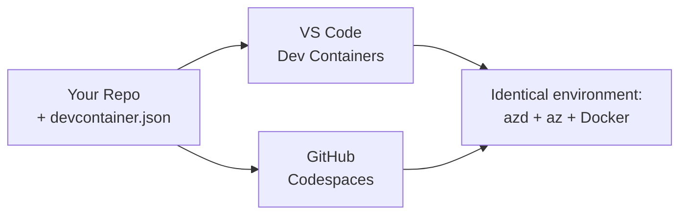

# azd کے لیے ڈیولپمنٹ کنٹینرز اور GitHub Codespaces

**باب نیویگیشن:**
- **📚 کورس ہوم**: [نئے شروع کرنے والوں کے لیے AZD](../../README.md)
- **📖 موجودہ باب**: باب 1 - بنیاد اور فوری آغاز
- **⬅️ پچھلا**: [اپنی ایپ لائیں](bring-your-own-app.md)
- **🚀 اگلا باب**: [باب 2: AI-پہلا ترقیاتی](../chapter-02-ai-development/README.md)

> کمانڈ اور کنفیگریشن کا جائزہ ہدف: `azd 1.37.2` (نومبر 2026)۔ اس جائزے میں کنٹینر کی بلڈنگ اور آزور ڈیپلائمنٹس شامل نہیں کی گئیں۔

## تعارف

azd، درست زبان کے رن ٹائم، Docker، اور Azure CLI ہر مشین پر انسٹال کرنا ایک مشکل کام ہے—اور یہی سب سے بڑا سبب ہے کہ ایک لرننگ ٹیوٹوریل جو "میری مشین پر چلتا ہے" دوسرے کے لیے ناکام ہوتا ہے۔ ایک **dev container** اس مسئلے کو حل کرتا ہے کیونکہ یہ آپ کے پورے ٹول چین کو ایک فائل میں بیان کرتا ہے۔ جو کوئی بھی پروجیکٹ کو VS Code یا GitHub Codespaces میں کھولتا ہے اسے بالکل وہی ماحول ملتا ہے، جس میں azd پہلے سے انسٹال ہوتا ہے۔ یہ سبق آپ کو سکھائے گا کہ اسے کیسے شامل کریں۔

## سیکھنے کے مقاصد

اس سبق کے اختتام تک آپ:
- سمجھیں گے کہ dev container کیا ہے اور azd کے ساتھ یہ کیسے مدد دیتا ہے
- ایک کم از کم `.devcontainer/devcontainer.json` پروجیکٹ میں شامل کریں گے
- Dev Container *فیچرز* کے ذریعے azd، Azure CLI، اور Docker شامل کریں گے
- پروجیکٹ کو GitHub Codespaces یا VS Code میں کھولیں گے

## سیکھنے کے نتائج

یہ سبق مکمل کرنے کے بعد، آپ کے قابل ہو جائیں گے:
- azd پروجیکٹ کے لیے `devcontainer.json` تیار کرنا
- بغیر دستی انسٹال کے azd اور Azure ٹولنگ شامل کرنا
- کنٹینر یا Codespace کے اندر سے `azd up` چلانا

---

## dev container کیا ہے؟

dev container آپ کے ریپوزٹری میں موجود ایک `.devcontainer/devcontainer.json` فائل کے ذریعے متعین کردہ Docker پر مبنی ترقیاتی ماحول ہوتا ہے۔ جب آپ پروجیکٹ کھولتے ہیں:

- **VS Code** (Dev Containers ایکسٹینشن کے ساتھ) کنٹینر بناتا ہے اور اس سے جڑ جاتا ہے۔
- **GitHub Codespaces** وہی کنٹینر کلاؤڈ میں بناتا ہے اور آپ کو ایک براؤزر بیسڈ ایڈیٹر فراہم کرتا ہے۔

کسی بھی صورت میں، ہر شراکت دار کے پاس بالکل ایک جیسے ٹولز ہوتے ہیں—کوئی "کیا آپ نے azd انسٹال کیا؟" جیسی مشکلات پیش نہیں آتی۔



---

## مرحلہ 1: devcontainer فائل بنائیں

اپنے پروجیکٹ کی روٹ میں `.devcontainer/devcontainer.json` بنائیں:

```json
{
  "name": "azd-project",
  "image": "mcr.microsoft.com/devcontainers/base:bookworm",
  "features": {
    "ghcr.io/devcontainers/features/azure-cli:1": {},
    "ghcr.io/azure/azure-dev/azd:0": { "version": "1.37.2" },
    "ghcr.io/devcontainers/features/docker-in-docker:2": {},
    "ghcr.io/devcontainers/features/node:1": {}
  },
  "customizations": {
    "vscode": {
      "extensions": [
        "ms-azuretools.azure-dev",
        "ms-azuretools.vscode-bicep"
      ]
    }
  },
  "forwardPorts": [3000],
  "postCreateCommand": "azd version"
}
```

ہر حصے کا مطلب:

| کلید | مقصد |
|-----|---------|
| `image` | کنٹینر کے لیے بنیادی OS |
| `features` | پہلے سے بنے ہوئے انسٹالرز — یہاں: Azure CLI، **azd**، Docker، اور Node.js |
| `customizations.vscode.extensions` | azd اور Bicep VS Code ایکسٹینشنز کو خودکار طریقے سے انسٹال کرتا ہے |
| `forwardPorts` | آپ کی ایپ کا پورٹ آپ کے براؤزر کے لیے کھولتا ہے |
| `postCreateCommand` | کنٹینر بنانے کے بعد ایک دفعہ چلتا ہے (یہاں، ایک سنینیٹی چیک) |

> فیچر ورژن (`azd:0`) اور انسٹال شدہ CLI ورژن مختلف ہیں۔ CLI کو پیِن کرنے کے لیے فیچر کے `version` آپشن کو `"1.37.2"` پر سیٹ کریں؛ CLI ورژن بطور فیچر ٹیگ استعمال نہ کریں۔

---

## مرحلہ 2: اپنی ایپ کی زبان کے مطابق فیچر منتخب کریں

جو بھی زبان آپ کی ایپ استعمال کرتی ہے اس کے لیے `node` فیچر کو تبدیل کریں:

```jsonc
// Python project
"ghcr.io/devcontainers/features/python:1": {},

// .NET project
"ghcr.io/devcontainers/features/dotnet:2": {},

// Java project
"ghcr.io/devcontainers/features/java:1": {},

// Go project
"ghcr.io/devcontainers/features/go:1": {}
```

لوکل تصویریں بنانے کے لیے `docker-in-docker` کو رکھیں۔ ایک تشکیل شدہ ریموٹ ACR بلڈ (`docker.remoteBuild: true`) متبادل ہے؛ صرف میزبان قسم ہمیشہ لوکل Docker کی ضرورت نہیں ہوتی۔

---

## مرحلہ 3: اسے کھولیں

**VS Code میں:**
1. **Dev Containers** ایکسٹینشن انسٹال کریں۔
2. پروجیکٹ فولڈر کھولیں۔
3. جب پوچھا جائے تو **Reopen in Container** پر کلک کریں (یا *Dev Containers: Reopen in Container* چلائیں)۔

**GitHub Codespaces میں:**
1. ریپو کو GitHub پر دھکیلیں۔
2. **Code → Codespaces → Create codespace on main** پر کلک کریں۔
3. کنٹینر کے بننے کا انتظار کریں — azd ٹرمینل میں تیار ہوگا۔

---

## مرحلہ 4: کنٹینر کے اندر سے ڈیپلائے کریں

کنٹینر میں azd پہلے سے انسٹال ہوتا ہے، اس لیے معمول کا ورک فلو بس کام کرتا ہے:

```bash
azd auth login --use-device-code   # device code is handy inside Codespaces
azd up
```

> **کیوں `--use-device-code`؟** ریموٹ کنٹینر یا Codespace میں کوئی لوکل براؤزر نہیں ہوتا جس کی طرف ری ڈائریکٹ کیا جائے، لہٰذا ڈیوائس-کوڈ لاگ ان قابل اعتماد طریقہ ہے۔ آپ سائن ان مکمل کرنے کے لیے ایک کوڈ براؤزر کے ٹیب میں چسپاں کریں گے۔

---

## عام مسائل

| مسئلہ | حل |
|---------|-----|
| `azd up` تصویر نہیں بنا سکتا | `docker-in-docker` فیچر شامل کریں |
| Codespaces میں براؤزر لاگ ان رکتا ہے | `azd auth login --use-device-code` استعمال کریں |
| ٹیم کے ارکان کے ٹولز مختلف ہیں | azd فیچر کے `version` آپشن کے ذریعے CLI کو پیِن کریں اور زبان کے رن ٹائمز کو پیِن کریں |
| ایپ براؤزر میں قابل رسائی نہیں | پورٹ کو `forwardPorts` میں شامل کریں |

---

## خلاصہ

- dev container آپ کے azd ٹول چین کو ہر ایک کے لیے دوبارہ قابل استعمال بناتا ہے۔
- azd، Azure CLI، اور Docker کو Dev Container *فیچرز* کے ذریعہ شامل کریں۔
- زبان کا فیچر آپ کی ایپ کے مطابق کریں اور کنٹینر میزبانوں کے لیے `docker-in-docker` رکھیں۔
- Codespaces میں چلانے کے دوران ڈیوائس-کوڈ لاگ ان استعمال کریں۔

---

## 🔗 نیویگیشن

| سمت | وسائل |
|-----------|----------|
| **پچھلا** | [اپنی ایپ لائیں](bring-your-own-app.md) |
| **باب ہوم** | [باب 1: بنیاد اور فوری آغاز](README.md) |
| **اگلا باب** | [باب 2: AI-پہلا ترقیاتی](../chapter-02-ai-development/README.md) |

## 📖 متعلقہ وسائل

- [تنصیب اور سیٹ اپ](installation.md)
- [کمانڈ چیٹ شیٹ](../../resources/cheat-sheet.md)
- [سرکاری Dev Containers وضاحت](https://containers.dev/)
- [azd Dev Container فیچر](https://github.com/Azure/azure-dev/tree/main/ext/devcontainer)

---

<!-- CO-OP TRANSLATOR DISCLAIMER START -->
**ڈس کلیمر**:
یہ دستاویز AI ترجمہ سروس [Co-op Translator](https://github.com/Azure/co-op-translator) کے ذریعے ترجمہ کی گئی ہے۔ جبکہ ہم درستگی کے لیے کوشاں ہیں، براہ کرم اس بات سے آگاہ رہیں کہ خودکار ترجمے میں غلطیاں یا عدم درستیاں ہو سکتی ہیں۔ اصل دستاویز اپنے مادری زبان میں مستند ماخذ سمجھی جائے گی۔ حساس معلومات کے لیے پیشہ ور انسانی ترجمہ کی سفارش کی جاتی ہے۔ اس ترجمے کے استعمال سے پیدا ہونے والی کسی بھی غلط فہمی یا غلط تشریح کی ذمہ داری ہم قبول نہیں کرتے۔
<!-- CO-OP TRANSLATOR DISCLAIMER END -->