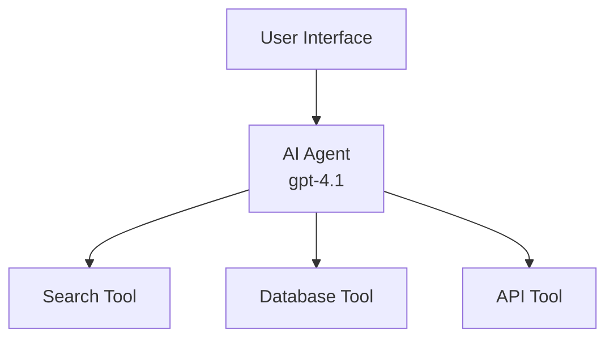
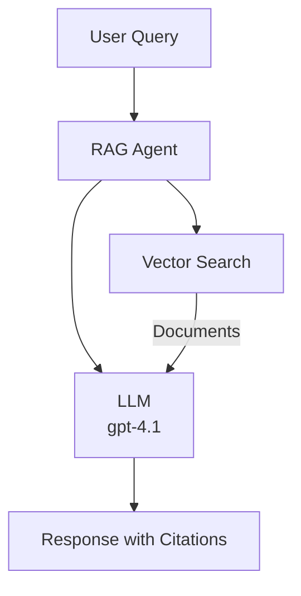
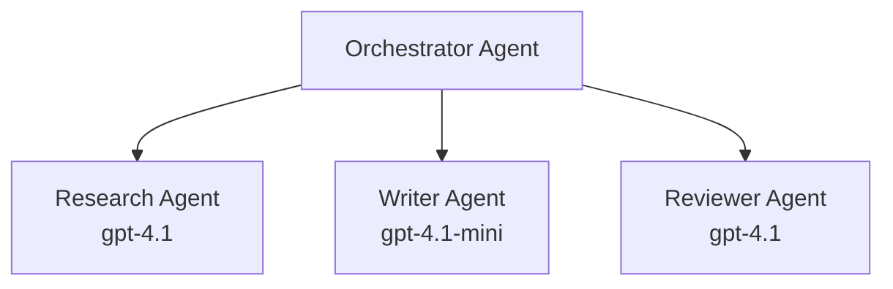

# Azure Developer CLI کے ساتھ AI ایجنٹس

**باب کی نیویگیشن:**
- **📚 کورس ہوم**: [AZD For Beginners](../../README.md)
- **📖 موجودہ باب**: باب 2 - AI-فسٹ ڈیولپمنٹ
- **⬅️ پچھلا**: [Microsoft Foundry Integration](microsoft-foundry-integration.md)
- **➡️ اگلا**: [AI Model Deployment](ai-model-deployment.md)
- **🚀 جدید**: [Multi-Agent Solutions](../../examples/retail-scenario.md)

---

## تعارف

AI ایجنٹس خود مختار پروگرامز ہیں جو اپنے ماحول کو محسوس کر سکتے ہیں، فیصلے کر سکتے ہیں، اور مخصوص اہداف حاصل کرنے کے لئے اقدامات کر سکتے ہیں۔ سادہ چیٹ بوٹس کے برعکس جو صرف پرامپٹس کے جواب دیتے ہیں، ایجنٹس یہ کر سکتے ہیں:

- **اوُزار استعمال کریں** - APIs کال کریں، ڈیٹا بیس تلاش کریں، کوڈ چلائیں
- **منصوبہ بندی اور استدلال کریں** - پیچیدہ کاموں کو مراحل میں تقسیم کریں
- **سیاق و سباق سے سیکھیں** - یادداشت برقرار رکھیں اور رویے کو ڈھالیں
- **تعاون کریں** - دوسرے ایجنٹس کے ساتھ کام کریں (کثیر ایجنٹ نظام)

یہ رہنمائی آپ کو دکھاتی ہے کہ Azure Developer CLI (azd) کا استعمال کرتے ہوئے Azure پر AI ایجنٹس کو کیسے ڈپلائے کیا جائے۔

بات چیت کے سیاق و سباق کا استعمال ماڈل ٹریننگ نہیں ہے: مستقل یادداشت، رسائی کنٹرول، اور تحفظ کو ایپلیکیشن کے ذریعہ نافذ / ترتیب دینا ضروری ہے۔

> **Foundry GA اپ ڈیٹ (2026-11-09):** عام دستیاب `microsoft.foundry` 1.0 بنڈل کو `azd >= 1.37.0` کے ساتھ انسٹال کریں۔ جانچ علیحدہ انسٹال کی جاتی ہے؛ لازمی پریویو فیچرز اور نیچے دیے گئے کلاسک SDK حصے کو بنڈل اعلان کے ذریعہ GA میں شامل نہیں کیا گیا۔ یہ رہنمائی [GA اعلان](https://devblogs.microsoft.com/azure-sdk/microsoft-foundry-azure-developer-cli-ga/) اور دستاویزات پر مبنی ہے، براہِ راست Azure ڈپلائمنٹ پر نہیں۔

## سیکھنے کے مقاصد

اس رہنمائی کو مکمل کر کے آپ:
- سمجھیں گے کہ AI ایجنٹس کیا ہیں اور وہ چیٹ بوٹس سے کیسے مختلف ہیں
- AZD کا استعمال کرتے ہوئے پہلے سے تیار AI ایجنٹ ٹیمپلیٹس کو ڈپلائے کریں گے
- کسٹم ایجنٹس کے لیے Foundry Agents کو ترتیب دیں گے
- بنیادی ایجنٹ پیٹرن نافذ کریں گے (اوُزار کا استعمال، RAG، کثیر ایجنٹ)
- تعین شدہ ایجنٹس کی نگرانی اور ڈیبگ کریں گے

## سیکھنے کے نتائج

مکمل کرنے پر، آپ قابل ہوں گے کہ:
- ایک کمانڈ کے ذریعے Azure پر AI ایجنٹ ایپلیکیشنز کو ڈپلائے کریں
- ایجنٹ کے اوُزار اور صلاحیتوں کو ترتیب دیں
- ایجنٹس کے ساتھ ریکوری-آگمینٹڈ جنریشن (RAG) نافذ کریں
- پیچیدہ ورک فلو کے لیے کثیر ایجنٹ آرکیٹیکچرز ڈیزائن کریں
- عام ایجنٹ ڈپلائمنٹ مسائل کا حل نکالیں

---

## 🤖 ایجنٹ کو چیٹ بوٹ سے مختلف کیا بناتا ہے؟

| خصوصیت | چیٹ بوٹ | AI ایجنٹ |
|---------|---------|----------|
| **رویہ** | پرامپٹس کے جواب دیتا ہے | خود مختار اقدامات کرتا ہے |
| **اوُزار** | ممکن ہے ریٹریول یا اوُزار استعمال کرے | عام طور پر ایک مقصدی لوپ میں اوُزار استعمال کرتا ہے |
| **یادداشت** | ایپلیکیشن پر منحصر | صرف اگر واضح طور پر نافذ کیا جائے تو مستقل یادداشت |
| **منصوبہ بندی** | واحد جواب | کثیر مرحلہ استدلال |
| **تعاون** | واحد ہستی | دوسرے ایجنٹس کے ساتھ کام کر سکتا ہے |

### آسان تشبیہ

- **چیٹ بوٹ** = ایک مددگار شخص جو معلوماتی ڈیسک پر سوالات کے جواب دیتا ہے
- **AI ایجنٹ** = ایک ذاتی معاون جو کالز کر سکتا ہے، ملاقاتیں بُک کر سکتا ہے، اور آپ کے لیے کام مکمل کر سکتا ہے

---

## 🚀 تیز آغاز: اپنا پہلا ایجنٹ ڈپلائے کریں

ایک **نئی خالی ورکنگ ڈائریکٹری** میں ایک آپشن منتخب کریں۔ آخری `.` وہاں initialize کرتا ہے؛ بغیر واضح منزل کے، موجودہ AZD ممکنہ طور پر template-named سب ڈائریکٹری بناتا ہے اور آپ کے شیل کی ڈائریکٹری کو تبدیل نہیں کرتا۔ مختلف templates/environments کو مختلف ڈائریکٹریوں میں رکھیں۔

نیچے دیے گئے وقت/لاگت کے دائرے مثال کے طور پر ہیں، تصدیق شدہ نرخ نہیں۔ ہر نمونے کی موجودہ شرائط، قیمت، ماڈل کوٹہ، اور اختیاری خدمات کو تعیناتی سے پہلے چیک کریں۔

### آپشن 1: Foundry Agents Template (تجویز کردہ)

```bash
# Initialize the AI agents template
azd init --template get-started-with-ai-agents .

# Deploy to Azure
azd up
```

**کیا تعینات ہوتا ہے:** نمونے کا موجودہ بنیادی ڈھانچہ اور منتخب اختیارات ماڈل، اوزار، ہوسٹنگ، اور مانیٹرنگ وسائل کا تعین کرتے ہیں۔ فراہم کرنے سے پہلے اس کا README اور `infra/` کا جائزہ لیں؛ ہر ایجنٹ ٹیمپلیٹ میں Search یا ویب انٹرفیس شامل ہونے کی توقع نہ رکھیں۔

**وقت:** تقریباً 15-20 منٹ
**لاگت:** تقریباً $100-150/مہینہ (ترقیاتی)

### آپشن 2: Prompty کے ساتھ Creative Writing Agents

```bash
# Initialize the Prompty-based agent template
azd init --template https://github.com/Azure-Samples/contoso-creative-writer .

# Deploy to Azure
azd up
```

**کیا تعینات ہوتا ہے:** FastAPI/Prompty ملٹی ایجنٹ تحریری نمونہ جو Azure OpenAI، Bing Grounding، اور Azure AI Search کا استعمال کرتا ہے۔ سابقہ `agent-openai-python-prompty` ریپوزٹری یہاں ری ڈائریکٹ کرتی ہے؛ یہ مختصر Azure Functions weather-agent ٹیمپلیٹ نہیں ہے۔ ہوسٹنگ، ماڈل کوٹہ، اور Bing Grounding کی شرائط کے لیے اس کا موجودہ README پڑھیں۔

**وقت:** تقریباً 10-15 منٹ
**لاگت:** تقریباً $50-100/مہینہ (ترقیاتی)

### آپشن 3: RAG Chat Agent

```bash
# Initialize RAG chat template
azd init --template azure-search-openai-demo .

# Deploy to Azure
azd up
```

**کیا تعینات ہوتا ہے:**
- ✅ Microsoft Foundry Models
- ✅ نمونہ ڈیٹا کے ساتھ Azure AI Search
- ✅ دستاویزات کی پروسیسنگ پائپ لائن
- ✅ حوالہ جات کے ساتھ چیٹ انٹرفیس

**وقت:** تقریباً 15-25 منٹ
**لاگت:** تقریباً $80-150/مہینہ (ترقیاتی)

### آپشن 4: GA Foundry Bundle کے ساتھ Hosted Agent

بنیادی Python Agent Framework Responses API نمونے کے لیے [مکمل hosted-agent واک تھرو](microsoft-foundry-integration.md#hosted-agent-walkthrough-ga) استعمال کریں۔ اس کوڈ تعیناتی کے لیے Python 3.13+، موجودہ uv، Foundry اجازت نامے، اور علاقائی ماڈل کوٹہ کی ضرورت ہے۔ Azure CLI کی سندوں کا استعمال کرتے ہوئے مقامی SDK کالز الگ سے مستند کریں۔

```bash
azd auth login
azd ext install microsoft.foundry
```

خالی ڈائریکٹری میں، نمونہ initialize کریں:

```text
azd ai agent init --template https://github.com/microsoft-foundry/foundry-samples/blob/main/samples/python/hosted-agents/agent-framework/responses/01-basic/azure.yaml --deploy-mode code --src .
```

نیا یا موجودہ پروجیکٹ منتخب کریں، `azure.yaml` کا جائزہ لیں، اور `azd provision` چلائیں۔ Agent Inspector کو کھولنے کے لیے `azd ai agent run` استعمال کریں اور اسی ڈائریکٹری میں دوسرے ٹرمینل سے `azd ai agent invoke --local "Explain how this agent is hosted."` چلائیں۔ مقامی تصدیق کے بعد، تعینات شدہ جواب کا موازنہ کرنے کے لیے `azd deploy` اور `azd ai agent invoke "Explain how this agent is hosted."` استعمال کریں۔ Foundry اپ لوڈ کیے گئے ماخذ کو دور سے بناتا ہے؛ مقامی container کی تعمیر ضروری نہیں۔

**`azd ai agent init` بمقابلہ `azd init --template` کب استعمال کریں:**

| طریقہ کار | بہترین ہے | کیسے کام کرتا ہے |
|----------|----------|------|
| `azd init --template` | کام کرنے والے نمونہ ایپ سے شروع کرنا | مکمل ٹیمپلیٹ ریپو کلون کرتا ہے جس میں کوڈ + بنیادی ڈھانچہ شامل ہے |
| `azd ai agent init --template` | موجودہ Foundry ایجنٹ پروجیکٹ اپنانا | ایک `azure.yaml` پروجیکٹ دستاویز اور اس کی تعریفات استعمال کرتا ہے |

> **مشورہ:** آپشن 1-3 مکمل ایپلیکیشن ٹیمپلیٹس سے شروع ہوتے ہیں؛ آپشن 4 GA hosted-agent ورک فلو سکھاتا ہے۔ کوئی بھی initialization کمانڈ پرانے ایجنٹ manifests کو خودکار طور پر منتقل نہیں کرتا۔ موجودہ پروجیکٹ میں براہ راست ایجنٹ کی تعریف شامل کرنے کے لیے، [initialization and migration guidance](../chapter-08-production/production-ai-practices.md#initializing-agent-projects-with-azd-ai-agent-init) دیکھیں۔

علیحدہ سے `azure.ai.evaluations` انسٹال کریں تاکہ ٹیسٹ ڈیٹا/روبریکس تیار اور جائزہ لیا جا سکے، ایک evaluation ترتیب دیں، اور اسے `azd ai eval` چلائیں۔ اصلاح کے لیے ہم آہنگ evaluation کو دوبارہ استعمال کیا جا سکتا ہے؛ تعیناتی سے پہلے امیدواروں کا جائزہ لیں۔ [evaluation workflow](../chapter-08-production/production-ai-practices.md#evaluation-migration-and-quality-checks) اور [optimization migration](../chapter-08-production/production-ai-practices.md#optimization-configuration-migration) کو پرانے نمونوں کو دوبارہ استعمال کرنے سے پہلے فالو کریں۔ صفائی کے لیے، دوبارہ استعمال کردہ Foundry پروجیکٹ کے وسائل `azd down` کے بعد رہتے ہیں؛ نیا بنائے گئے پروجیکٹ کا resource group حذف کر دیا جاتا ہے۔ [walkthrough cleanup guidance](microsoft-foundry-integration.md#7-clean-up-deliberately) دیکھیں۔

---

## 🏗️ ایجنٹ کے تعمیراتی نمونے

### نمونہ 1: ٹولز کے ساتھ سنگل ایجنٹ

سب سے آسان ایجنٹ نمونہ - ایک ایجنٹ جو متعدد اوزار استعمال کر سکتا ہے۔



**بہترین ہے:**
- کسٹمر سپورٹ بوٹس
- تحقیقاتی معاونین
- ڈیٹا تجزیہ کے ایجنٹ

**متعلقہ ایپلیکیشن نمونہ:** `azure-search-openai-demo` RAG کو ظاہر کرتا ہے، ایک عام کسی بھی اوزار والے ایجنٹ لوپ کو نہیں۔

### نمونہ 2: RAG ایجنٹ (ریٹریول-اوگمینٹڈ جنریشن)

ایک ایجنٹ جو جواب تیار کرنے سے پہلے متعلقہ دستاویزات نکالتا ہے۔



**بہترین ہے:**
- ادارہ جاتی علم کے ذخائر
- دستاویزات کے جاننے کے نظام
- تعمیل اور قانونی تحقیق

**AZD ٹیمپلیٹ:** `azure-search-openai-demo`

### نمونہ 3: ملٹی ایجنٹ سسٹم

متعدد تخصص یافتہ ایجنٹس جو پیچیدہ کاموں پر مل کر کام کرتے ہیں۔



**بہترین ہے:**
- پیچیدہ مواد کی تخلیق
- کثیر مراحل کے ورک فلو
- مختلف مہارت کی ضرورت والے کام

**مزید جانیں:** [ملٹی ایجنٹ کوآرڈینیشن پیٹرنز](../chapter-06-pre-deployment/coordination-patterns.md)

---

## ⚙️ ایجنٹ اوزار کی ترتیب

ایجنٹس طاقتور ہو جاتے ہیں جب وہ اوزار استعمال کر سکتے ہیں۔ یہاں عام اوزاروں کو ترتیب دینے کا طریقہ ہے:

### Foundry Agents میں ٹول کنفیگریشن

یہ **کلاسک Agent Service SDK فریگمنٹ** `azure-ai-projects==1.0.0` اور `azure-ai-agents==1.1.0` کو `azure-identity` کے ساتھ نشانہ بناتا ہے۔ یہ کچھ موجودہ Foundry ٹیمپلیٹس میں استعمال ہونے والے نوے ورژند-agent/Responses API یا `azure.ai.agents` AZD ایکسٹینشن (ایک مختلف پیکج) نہیں ہے۔ ان API جنریشنز کو مکس نہ کریں۔ `PROJECT_ENDPOINT` کو کلاسک Foundry پروجیکٹ اینڈپوائنٹ پر سیٹ کریں اور `MODEL_DEPLOYMENT_NAME` کو پہلے سے حمایت یافتہ ماڈل تعیناتی پر؛ مقامی طور پر `az login` کے ساتھ مستند کریں اور مطلوبہ پروجیکٹ اجازت نامے دیں۔

```python
# agent_config.py
import os
from azure.ai.projects import AIProjectClient
from azure.ai.agents.models import FunctionTool
from azure.identity import DefaultAzureCredential

def search_knowledge_base(query: str) -> str:
    """Search the demonstration knowledge base.

    :param query: Search text.
    :return: Matching demonstration information.
    """
    # Local fixture only, not a production search implementation.
    return "Demo policy: returns are accepted within 30 days."

project_client = AIProjectClient(
    endpoint=os.environ["PROJECT_ENDPOINT"],
    credential=DefaultAzureCredential(),
)
search_tool = FunctionTool(functions={search_knowledge_base})
project_client.agents.enable_auto_function_calls(search_tool)
agent = project_client.agents.create_agent(
    model=os.environ["MODEL_DEPLOYMENT_NAME"],
    name="Support Agent",
    instructions="Use search_knowledge_base for policy questions. Label results as demo data.",
    tools=search_tool.definitions,
)
```

فنکشن اسکیمہ رجسٹر کرنا سروس پر Python کو execute نہیں کرتا۔ اس SDK میں، `enable_auto_function_calls` کے ساتھ `agents.runs.create_and_process(...)` رجسٹرڈ کال بیکس کو آپ کے کلائنٹ پروسیس میں چلاتا ہے۔ [ریلیز شدہ SDK مثال](https://github.com/Azure/azure-sdk-for-python/blob/azure-ai-agents_1.1.0/sdk/ai/azure-ai-agents/samples/agents_tools/sample_agents_auto_function_call.py) دیکھیں۔ ختم کرنے پر کلائنٹ کو بند کریں اور ڈیمو ایجنٹس/تھریڈز کو حذف کریں۔

### ماحول کی ترتیب

مندرجہ ذیل نام **مثالی کسٹم ٹیمپلیٹ انپٹس** ہیں، نہ کہ بلٹ-ان AZD سوئچز۔ پہلے ہر قدر کو `infra/main.parameters.json`، بنیادی ڈھانچے، اور ایپلیکیشن کوڈ کے ذریعے وائر کریں۔ صرف `azd env set` ایجنٹ کے اوزار یا ہدایات کو تبدیل نہیں کرتا۔

```bash
# Set up agent-specific environment variables
azd env set AZURE_OPENAI_MODEL "gpt-4.1"
azd env set AGENT_INSTRUCTIONS "You are a helpful assistant..."
azd env set ENABLE_CODE_INTERPRETER "true"
azd env set ENABLE_FILE_SEARCH "true"

# Apply wired infrastructure and application changes
azd up
```

---

## 📊 ایجنٹس کی نگرانی

### Application Insights انٹیگریشن

اگر آپ کا منتخب ٹیمپلیٹ Application Insights فراہم کرتا ہے اور انسٹرومنٹیشن کو ترتیب دیتا ہے:

```bash
# Open monitoring dashboard
azd monitor --overview

# Open the Application Insights logs view (not a streaming log tail)
azd monitor --logs

# View live metrics
azd monitor --live
```

### اہم میٹرکس جو ٹریک کریں

| میٹرک | وضاحت | ہدف |
|--------|-------------|--------|
| جواب کی تاخیر | جواب تیار کرنے کا وقت | < 5 سیکنڈ |
| ٹوکن کا استعمال | ہر درخواست میں ٹوکنز | لاگت کا جائزہ لیں |
| ٹول کال کی کامیابی کی شرح | کامیاب ٹولز کے فیصد | > 95% |
| غلطی کی شرح | ناکام ایجنٹ درخواستیں | < 1% |
| صارف کی اطمینان | تاثرات کے اسکورز | > 4.0/5.0 |

### ایجنٹس کے لیے کسٹم لاگنگ

```python
import os
from azure.monitor.opentelemetry import configure_azure_monitor
from opentelemetry import trace

# Configure Azure Monitor with OpenTelemetry
configure_azure_monitor(
    connection_string=os.environ["APPLICATIONINSIGHTS_CONNECTION_STRING"]
)

tracer = trace.get_tracer(__name__)

def log_agent_interaction(user_query, agent_response, tools_used, latency_ms):
    with tracer.start_as_current_span("agent_interaction") as span:
        span.set_attributes({
            "query_length": len(user_query),  # Do not log raw prompts or personal data
            "response_length": len(agent_response),
            "tools_used": tools_used,
            "latency_ms": latency_ms
        })
```

> **نوٹ:** مطلوبہ پیکج انسٹال کریں: `pip install azure-monitor-opentelemetry`۔ یہ OpenTelemetry کی dependencies لے آتا ہے؛ import namespace پیکج انسٹال کرنے کی شرط نہیں ہے جس کا نام `opentelemetry` ہے۔

---

## 💰 لاگت کے تحفظات

### نمونہ کے لحاظ سے متوقع ماہانہ لاگت

یہ محض وضاحتی منصوبہ بندی کی حدیں ہیں، قیمتیں یا اخراجات کی حدیں نہیں۔ علاقہ، ماڈل ٹوکنز، سرچ/کمپیوٹ ایس کے یوز، ٹول سیشنز، اسٹوریج، اور ٹریفک ان سے تجاوز کر سکتے ہیں۔ نمونے کی لاگت کی رہنمائی اور Azure کی قیمتوں کو جانچیں اس سے پہلے کہ `azd up`۔

| پیٹرن | ڈیولپمنٹ ماحول | پروڈکشن |
|---------|-----------------|------------|
| سنگل ایجنٹ | $50-100 | $200-500 |
| RAG ایجنٹ | $80-150 | $300-800 |
| ملٹی ایجنٹ (2-3 ایجنٹس) | $150-300 | $500-1,500 |
| انٹرپرائز ملٹی ایجنٹ | $300-500 | $1,500-5,000+ |

### لاگت کی بچت کے نکات

1. **سادہ کاموں کے لیے gpt-4.1-mini استعمال کریں** (صرف اگر آپ کی ٹیمپلیٹ یہ ان پٹ استعمال کرتی ہے)
   ```bash
   azd env set AZURE_OPENAI_MODEL "gpt-4.1-mini"
   ```

2. **محفوظ، بار بار ہونے والی پوچھ گچھ کے لیے سکوبڈ کیشنگ نافذ کریں۔** کیش کی چابی میں ٹیننٹ/صارف کی اجازت، ماڈل ڈپلائمنٹ، ہدایات، اور بازیافت کا ورژن شامل کریں؛ ایک معیاد مقرر کریں۔ نجی گفتگو کے جوابات کو عمل-وسیع صرف سوال کیش میں شیئر نہ کریں۔ SDK ایجنٹ آبجیکٹ کے پاس کوئی عمومی `agent.run()` طریقہ نہیں ہے۔

3. **ہر رن کے لیے ٹوکن کی حد مقرر کریں**
   ```python
   # Set max_completion_tokens when running the agent, not during creation
   run = project_client.agents.runs.create_and_process(
       thread_id=thread.id,
       agent_id=agent.id,
       max_completion_tokens=1000  # Budget across the run; may finish as incomplete
   )
   ```

4. **قابلِ اہلیت کنٹینر ایپس کو جب استعمال نہ ہوں صفر تک اسکیل کریں**
   ```bash
   # Custom-template input: must map to template.scale.minReplicas
   azd env set MIN_REPLICAS "0"
   ```
  اسٹرکچر تبدیل کرنے کے لیے `azd provision` یا `azd up` استعمال کریں۔ صفر تک اسکیل کرنا مناسب ٹریگر کا متقاضی ہے اور سرچ، اسٹوریج، یا ماڈل/ٹول چارجز کو بند نہیں کرتا۔

---

## 🔧 ایجنٹس کی خرابیوں کا ازالہ

### عام مسائل اور حل

<details>
<summary><strong>❌ ایجنٹ ٹول کالز کا جواب نہیں دے رہا</strong></summary>

```bash
# Inspect the application deployment (not the agent's registered tools)
azd show

# Verify OpenAI deployment
az cognitiveservices account deployment list \
  --name $AZURE_OPENAI_NAME \
  --resource-group $RG_NAME

# Check agent logs
azd monitor --logs
```

**عام وجوہات:**
- ٹول فنکشن دستخط میں مطابقت نہ ہونا
- مطلوبہ اجازت نامے غائب ہیں
- API اینڈ پوائنٹ قابل رسائی نہیں
</details>

<details>
<summary><strong>❌ ایجنٹ کے ردعمل میں زیادہ تاخیر</strong></summary>

```bash
# Check Application Insights for bottlenecks
azd monitor --live

# Consider using a faster model
azd env set AZURE_OPENAI_MODEL "gpt-4.1-mini"
azd up
```

**بہتری کے نکات:**
- اسٹریمنگ ردعمل استعمال کریں
- ردعمل کی کیشنگ نافذ کریں
- سیاق و سباق کی ونڈو کا سائز کم کریں
</details>

<details>
<summary><strong>❌ ایجنٹ غلط یا من گھڑت معلومات دے رہا ہے</strong></summary>

```python
# Improve with better system prompts
instructions = """
You are a helpful assistant. IMPORTANT:
- Only answer based on provided context
- If you don't know, say "I don't know"
- Always cite your sources
- Never make up information
"""

# Use these instructions in the agent definition.
# For classic file search, first upload/index documents in a vector store,
# then use FileSearchTool(vector_store_ids=[...]) and pass both its
# .definitions and .resources when creating the agent.
```
 ہدایات اور بازیافت خطرے کو کم کرتی ہیں؛ کوئی فیکٹ چیک یقینی نہیں بناتی۔ معلوم جوابات کے خلاف مؤقف رہنما اور دائرہ کار سے باہر سوالات کی جانچ کریں۔
</details>

<details>
<summary><strong>❌ ٹوکن کی حد سے تجاوز کرنے کی غلطیاں</strong></summary>

```python
# Implement context window management
def truncate_context(messages, max_tokens=8000, model="gpt-4.1"):
    """Approximate content-only budget for objects with .content strings."""
    import tiktoken
    encoding = tiktoken.encoding_for_model(model)
    total_tokens = 0
    truncated = []
    
    for msg in reversed(messages):
        msg_tokens = len(encoding.encode(msg.content))
        if total_tokens + msg_tokens > max_tokens:
            break
        truncated.insert(0, msg)
        total_tokens += msg_tokens
    
    return truncated
```
 یہ مددگار رول/ٹول اسکیمز، نظام کی ہدایات، امیج ٹوکنز، اور پروٹوکول اوورہیڈ کو خارج کرتا ہے۔ ان اور تکمیل کے لیے جگہ مختص کریں؛ ٹول-کال/نتیجہ کے جوڑے کو تقسیم یا مطلوبہ نظام کی ہدایات کو خارج نہ کریں۔ `tiktoken` کو علیحدہ انسٹال کریں۔ یہ عمومی سیاق و سباق کی ونڈو کی تصدیق کار نہیں ہے۔
</details>

---

## 🎓 عملی مشقیں

### مشق 1: ایک بنیادی ایجنٹ تعینات کریں (20 منٹ)

**مقصد:** AZD استعمال کرتے ہوئے اپنا پہلا AI ایجنٹ تعینات کریں

```bash
# Step 1: Initialize template
azd init --template get-started-with-ai-agents .

# Step 2: Login to Azure
azd auth login
# If you work across tenants, add --tenant-id <tenant-id>

# Step 3: Deploy
azd up

# Step 4: Test the agent
# Expected output after deployment:
#   Deployment Complete!
#   Endpoint: https://<app-name>.<region>.azurecontainerapps.io
# Open the URL shown in the output and try asking a question

# Step 5: View monitoring
azd monitor --overview

# Step 6: Review the listed resources and confirm cleanup
azd down
```

**کامیابی کے معیار:**
- [ ] ایجنٹ سوالات کے جواب دیتا ہے
- [ ] `azd monitor` کے ذریعے مانیٹرنگ ڈیش بورڈ تک رسائی حاصل کر سکتا ہے
- [ ] وسائل کامیابی کے ساتھ صاف کیے گئے

### مشق 2: ایک کسٹم ٹول شامل کریں (30 منٹ)

**مقصد:** ایک ایجنٹ کو کسٹم ٹول کے ساتھ بڑھانا

**آغاز کا نقطہ:** مختلف SDK نسل کے ساتھ کسی بھی جُدا ٹیمپلیٹ کی بجائے [ٹول کنفیگریشن](#tool-configuration-in-foundry-agents) سے کلاسک SDK کلائنٹ استعمال کریں۔

1. اس قطعی فکسچر کو شامل کریں `agent_config.py` میں:
   ```python
   def get_weather(location: str) -> str:
       """Return demonstration weather, not live conditions.

       :param location: City name.
       :return: A clearly labelled fixture.
       """
       print(f"TOOL_CALLED: {location}")
       return f"Demo weather in {location}: Sunny, 72°F (fixture, not live)"
   ```
2. سرچ ٹول کی رجسٹریشن اور تخلیق کا بلاک اس کے ساتھ تبدیل کریں:
   ```python
   weather_tool = FunctionTool(functions={get_weather})
   project_client.agents.enable_auto_function_calls(weather_tool)
   agent = project_client.agents.create_agent(
       model=os.environ["MODEL_DEPLOYMENT_NAME"],
       name="Weather Agent",
       instructions="Call get_weather for weather questions; explain that it returns demo data.",
       tools=weather_tool.definitions,
   )
   thread = project_client.agents.threads.create()
   try:
       project_client.agents.messages.create(
           thread_id=thread.id, role="user", content="Use get_weather for Seattle."
       )
       run = project_client.agents.runs.create_and_process(
           thread_id=thread.id, agent_id=agent.id
       )
       if run.status != "completed":
           raise RuntimeError(f"Run status: {run.status}; error: {run.last_error}")
       for message in project_client.agents.messages.list(thread_id=thread.id):
           for text in message.text_messages:
               print(text.text.value)
   finally:
       project_client.agents.threads.delete(thread.id)
       project_client.agents.delete_agent(agent.id)
       project_client.close()
   ```
3. مقامی طور پر چلائیں (یہ موجودہ Azure پروجیکٹ کو کال کرتا ہے اور ماڈل کے چارجز لگتے ہیں):
   ```bash
   python agent_config.py
   # Expected: TOOL_CALLED: Seattle, then a completed answer labelled demo data.
   ```

**کامیابی کے معیارات:**
- [ ] ایجنٹ موسم سے متعلق سوالات کو پہچانتا ہے
- [ ] ٹول کو صحیح طریقے سے کال کیا گیا ہے
- [ ] جواب میں موسم کی معلومات شامل ہے

### مشق 3: ایک RAG ایجنٹ بنائیں (45 منٹ)

**مقصد:** ایسا ایجنٹ بنائیں جو آپ کے دستاویزات سے سوالات کا جواب دے

```bash
# Step 1: Deploy RAG template
azd init --template azure-search-openai-demo .
azd up

# Step 2: Upload your documents
# For the sample's local ingestion path, place supported files in data/.
# Run from the sample root after following its Python environment setup:
./scripts/prepdocs.sh
# Windows PowerShell equivalent: .\\scripts\\prepdocs.ps1

# Step 3: Test with domain-specific questions
# Open the web app URL from the azd up output
# Ask questions about your uploaded documents
# Responses should include citation references like [doc.pdf]
```

**کامیابی کے معیار:**
- [ ] ایجنٹ اپلوڈ کیے گئے دستاویزات سے جواب دیتا ہے
- [ ] جوابات میں حوالہ جات شامل ہیں
- [ ] دائرہ کار سے باہر ٹیسٹ سوالات کو بغیر غیر معاون دعووں کے سنبھالا جاتا ہے (ہر مستقبل کے سوال کے لیے گارنٹی نہیں)

اگر `USE_CLOUD_INGESTION=true` ہو، تو اس کے بجائے نمونہ کے کلاؤڈ انجییکشن/اپلوڈ ورک فلو کا استعمال کریں؛ مقامی ریپر جان بوجھ کر انجییکشن چھوڑ دیتا ہے۔ جانچ کے بعد، RAG ماحول میں `azd down` چلائیں اور حذف کیے جانے والے وسائل کا جائزہ لیں۔

---

## 📚 اگلے اقدامات

اب جب کہ آپ AI ایجنٹس کو سمجھ گئے ہیں، ان ترقی یافتہ موضوعات کو دریافت کریں:

| موضوع | وضاحت | لنک |
|-------|-------------|------|
| **کثیر ایجنٹ سسٹمز** | متعدد مل کر کام کرنے والے ایجنٹس کے ساتھ نظام بنائیں | [Retail Multi-Agent Example](../../examples/retail-scenario.md) |
| **تعاون کے نمونے** | مربوط کرنے اور مواصلاتی نمونوں کو سیکھیں | [Coordination Patterns](../chapter-06-pre-deployment/coordination-patterns.md) |
| **پیداوار کی تنصیب** | ادارہ جاتی تیار ایجنٹ کی تنصیب | [پیداوار AI کے طریقے](../chapter-08-production/production-ai-practices.md) |
| **ایجنٹ کی جانچ** | ایجنٹ کی کارکردگی کی جانچ اور تشخیص کریں | [AI کے مسئلے حل کرنا](../chapter-07-troubleshooting/ai-troubleshooting.md) |
| **AI ورکشاپ لیب** | عملی: اپنے AI حل کو AZD کے لئے تیار کریں | [AI ورکشاپ لیب](ai-workshop-lab.md) |

---

## 📖 اضافی وسائل

### سرکاری دستاویزات
- [Microsoft Foundry ایجنٹ سروس](https://learn.microsoft.com/azure/ai-services/agents/)
- [Microsoft Foundry ایجنٹ سروس فوری آغاز](https://learn.microsoft.com/azure/ai-services/agents/quickstart)
- [Semantic Kernel ایجنٹ فریم ورک](https://learn.microsoft.com/semantic-kernel/)

### ایجنٹس کے لیے AZD ٹیمپلیٹس
- [AI ایجنٹس کے ساتھ آغاز کریں](https://github.com/Azure-Samples/get-started-with-ai-agents)
- [Promptly کے ساتھ تخلیقی تحریری ایجنٹس](https://github.com/Azure-Samples/contoso-creative-writer)
- [Azure سرچ OpenAI ڈیمو](https://github.com/Azure-Samples/azure-search-openai-demo)

### کمیونٹی وسائل
- [زبردست AZD - ایجنٹ ٹیمپلیٹس](https://azure.github.io/awesome-azd/?tags=ai-agents)
- [Azure AI ڈسکارڈ](https://discord.gg/microsoft-azure)
- [Microsoft Foundry ڈسکارڈ](https://discord.gg/nTYy5BXMWG)

### آپ کے ایڈیٹر کے لیے ایجنٹ مہارتیں
- [**مائیکروسافٹ ایزور ایجنٹ مہارتیں**](https://skills.sh/microsoft/github-copilot-for-azure) - گٹ ہب کوپائلٹ، کرسر، یا کسی بھی معاون ایجنٹ میں ایزور کی ترقی کے لیے دوبارہ قابل استعمال AI ایجنٹ مہارتیں انسٹال کریں۔ اس میں [Azure AI](https://skills.sh/microsoft/github-copilot-for-azure/azure-ai)، [Microsoft Foundry](https://skills.sh/microsoft/github-copilot-for-azure/microsoft-foundry)، [توسیع](https://skills.sh/microsoft/github-copilot-for-azure/azure-deploy)، اور [تشخیص](https://skills.sh/microsoft/github-copilot-for-azure/azure-diagnostics) کے لیے مہارتیں شامل ہیں:
  ```bash
  npx skills add microsoft/github-copilot-for-azure
  ```

---

**نیویگیشن**
- **پچھلا سبق**: [Microsoft Foundry Integration](microsoft-foundry-integration.md)
- **اگلا سبق**: [AI Model Deployment](ai-model-deployment.md)

---

<!-- CO-OP TRANSLATOR DISCLAIMER START -->
**ڈس کلیمر**:
یہ دستاویز AI ترجمہ سروس [Co-op Translator](https://github.com/Azure/co-op-translator) کے ذریعے ترجمہ کی گئی ہے۔ جبکہ ہم درستگی کے لیے کوشاں ہیں، براہ کرم اس بات سے آگاہ رہیں کہ خودکار ترجمے میں غلطیاں یا عدم درستیاں ہو سکتی ہیں۔ اصل دستاویز اپنے مادری زبان میں مستند ماخذ سمجھی جائے گی۔ حساس معلومات کے لیے پیشہ ور انسانی ترجمہ کی سفارش کی جاتی ہے۔ اس ترجمے کے استعمال سے پیدا ہونے والی کسی بھی غلط فہمی یا غلط تشریح کی ذمہ داری ہم قبول نہیں کرتے۔
<!-- CO-OP TRANSLATOR DISCLAIMER END -->