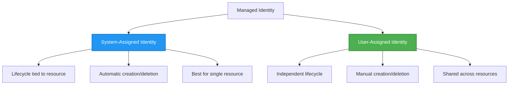

# تصدیقی نمونے اور منظم شناخت

⏱️ **متوقع وقت**: 45-60 منٹ مطالعہ؛ مشقوں کو شامل کرنے کے لیے اضافی وقت دیں | 💰 **لاگت کا اثر**: شناخت/RBAC مفت ہیں؛ تعینات شدہ کمپیوٹ، اسٹوریج، اور کی والٹ کے اخراجات لاگو ہوتے ہیں | ⭐ **پیچیدگی**: درمیانہ درجے کی

> کا جائزہ لیا گیا `azd 1.37.2` (نومبر 2026) کے خلاف۔ یہ سبق **مثالی انضمامی ٹکڑے شامل کرتا ہے، مکمل ڈاؤن لوڈ کے قابل `secure-app` ٹیمپلیٹ نہیں**۔ حوالہ دی گئی فائلیں بنائیں، متعلقہ انفراسٹرکچر فراہم کریں، اور جگہ رکھنے والے متون کو تعیناتی سے پہلے تبدیل کریں۔ جائزے کے دوران کوئی Azure وسائل مہیا نہیں کیے گئے۔

**📚 تعلیمی راستہ:**
- ← پچھلا: [کنفیگریشن مینجمنٹ](configuration.md) - ماحول کے متغیرات اور رازوں کا انتظام
- 🎯 **آپ یہاں ہیں**: تصدیق اور سیکیورٹی (مینجڈ شناخت، کی وولت، محفوظ پیٹرنز)
- → اگلا: [انفراسٹرکچر ایز کوڈ](../chapter-04-infrastructure/README.md) - وسائل کی فراہمی اور تعیناتی
- 🏠 [کورس ہوم](../../README.md)

---

## آپ کیا سیکھیں گے

اس سبق کو مکمل کر کے آپ:
- Azure کی تصدیقی پیٹرنز کو سمجھیں گے (کیز، کنکشن سٹرنگز، مینجد شناخت)
- **مینجد شناخت** کو بغیر پاس ورڈ کی تصدیق کے لیے استعمال کریں گے
- رازوں کو **Azure Key Vault** انضمام کے ساتھ محفوظ کریں گے
- AZD تعیناتیوں کے لیے **رول بیسڈ ایکسیس کنٹرول (RBAC)** ترتیب دیں گے
- کنٹینر ایپس اور Azure سروسز میں سیکیورٹی بہترین طریقے اپنائیں گے
- کلیدی بنیاد سے شناختی بنیاد پر مبنی تصدیق کی طرف منتقل ہوں گے

## مینجد شناخت کیوں اہم ہے

### مسئلہ: روایتی تصدیق

**مینجد شناخت سے پہلے:**
```javascript
// ❌ SECURITY RISK: Hardcoded secrets in code
const connectionString = "Server=mydb.database.windows.net;User=admin;Password=P@ssw0rd123";
const storageKey = "xK7mN9pQ2wR5tY8uI0oP3aS6dF1gH4jK...";
const cosmosKey = "C2x7B9n4M1p8Q5w3E6r0T2y5U8i1O4p7...";
```

**مسائل:**
- 🔴 کوڈ، کنفیگریشن فائلز، اور ماحول کے متغیرات میں **رازوں کا افشاء**
- 🔴 **کریڈینشل کی تبدیلی** کے لیے کوڈ میں تبدیلی اور دوبارہ تعیناتی ضروری ہے
- 🔴 **آڈٹ کے مسائل** - کس نے کب کیا رسائی حاصل کی؟
- 🔴 **پھیلاؤ** - راز مختلف نظاموں میں بکھرے ہوئے ہیں
- 🔴 **تعمیل کے خطرات** - سیکیورٹی آڈٹ میں ناکامی

### حل: مینجد شناخت

**مینجڈ آئیڈینٹی کے بعد:**
```javascript
// ✅ SECURE: No secrets in code
const credential = new DefaultAzureCredential();
const client = new BlobServiceClient(
  "https://mystorageaccount.blob.core.windows.net",
  credential  // Azure automatically handles authentication
);
```

**فوائد:**
- ✅ **کوڈ یا کنفیگریشن میں صفر راز**
- ✅ **خودکار گردش** - Azure اس کا انتظام کرتا ہے
- ✅ **مکمل آڈٹ ٹریل** Microsoft Entra ID کے لاگز میں
- ✅ **مرکزی سیکیورٹی** - Azure پورٹل میں انتظام کریں
- ✅ **تعمیل کے لیے تیار** - سیکیورٹی کے معیار پر پورا اترتا ہے

**تشبیہ**: روایتی توثیق کئی مختلف دروازوں کی چابیاں رکھنے کے مترادف ہے۔ مینجڈ آئیڈینٹی ایک سیکیورٹی بیج کی مانند ہے جو خود بخود آپ کی شناخت کی بنیاد پر رسائی دیتا ہے—نہ کوئی چابی کھونے، نقل کرنے، یا گردش کرنے کی ضرورت۔

---

## فن تعمیر کا جائزہ

### مینجڈ آئیڈینٹی کے ساتھ توثیقی عمل

```mermaid
sequenceDiagram
    participant App as Your Application<br/>(Container App)
    participant MI as Managed Identity<br/>(Microsoft Entra ID)
    participant KV as Key Vault
    participant Storage as Azure Storage
    participant DB as Azure SQL
    
    App->>MI: Request access token<br/>(automatic)
    MI->>MI: Verify identity<br/>(no password needed)
    MI-->>App: Return token for requested audience<br/>(lifetime varies)
    
    App->>KV: Get secret<br/>(using token)
    KV->>KV: Check RBAC permissions
    KV-->>App: Return secret value
    
    App->>Storage: Upload blob<br/>(using token)
    Storage->>Storage: Check RBAC permissions
    Storage-->>App: Success
    
    App->>DB: Query data<br/>(using token)
    DB->>DB: Check SQL permissions
    DB-->>App: Return results
    
    Note over App,DB: Request a separate token for each service audience;<br/>SDK credentials handle caching and renewal
```

### مینجڈ آئیڈینٹی کی اقسام



| خصوصیت | سسٹم-تفویض شدہ | صارف-تفویض شدہ |
|---------|----------------|---------------|
| **لائف سائکل** | وسائل سے منسلک | آزاد |
| **تخلیق** | وسائل کے ساتھ خودکار | دستی تخلیق |
| **حذف کرنا** | وسائل کے حذف ہونے پر حذف | وسائل کے حذف ہونے کے بعد بھی موجود رہتا ہے |
| **اشتراک** | صرف ایک وسیلہ | کئی وسائل |
| **استعمال کے واقعات** | سادہ حالات | پیچیدہ کثیر وسائل حالات |
| **ٹیمپلیٹ انتخاب** | انفراسٹرکچر میں طے شدہ | انفراسٹرکچر میں طے شدہ |

---

## پہلے سے درکار چیزیں

### ضروری آلات

آپ نے یہ سابقہ اسباق سے پہلے ہی انسٹال کر لیے ہوں گے:

```bash
# Verify Azure Developer CLI
azd version
# ✅ Expected: azd version 1.0.0 or higher

# Verify Azure CLI
az --version
# ✅ Expected: azure-cli 2.50.0 or higher
```

### Azure کی ضروریات

- فعال Azure سبسکرپشن
- اجازتیں:
  - مینجڈ آئیڈینٹیز بنائیں
  - RBAC رول تفویض کریں
  - Key Vault وسائل بنائیں
  - Container Apps تعینات کریں

### علم کی ضروریات

آپ نے مکمل کیا ہونا چاہیے:
- [انسٹالیشن گائیڈ](../chapter-01-foundation/installation.md) - AZD سیٹ اپ
- [AZD بنیادی باتیں](../chapter-01-foundation/azd-basics.md) - بنیادی تصورات
- [تشکیلاتی انتظام](configuration.md) - ماحول کے متغیرات

---

## سبق 1: تصدیقی نمونوں کو سمجھنا

### نمونہ 1: کنکشن سٹرنگز (پرانی - گریز کریں)

**یہ کیسے کام کرتا ہے:**
```bash
# Connection string contains credentials
STORAGE_CONNECTION_STRING="DefaultEndpointsProtocol=https;AccountName=myaccount;AccountKey=xK7mN9pQ2wR5..."
COSMOS_CONNECTION_STRING="AccountEndpoint=https://myaccount.documents.azure.com:443/;AccountKey=C2x7..."
SQL_CONNECTION_STRING="Server=myserver.database.windows.net;User=admin;Password=P@ssw0rd..."
```

**مسائل:**
- ❌ راز ماحول کے متغیرات میں ظاہر ہوتے ہیں
- ❌ ڈپلائمنٹ سسٹمز میں لاگ ہوتے ہیں
- ❌ گھماؤ مشکل ہے
- ❌ رسائی کا کوئی آڈٹ ٹریل نہیں ہے

**استعمال کب کریں:** جب ہدف سروس کو کی بیسڈ تصدیق کی ضرورت ہو۔ جہاں ممکن ہو شناخت کو ترجیح دیں؛ ورنہ چابیاں محفوظ طریقے سے محفوظ کریں اور گھمائیں، بشمول پیداوار میں۔

---

### نمونہ 2: کی ویولت حوالہ جات (بہتر)

**یہ کیسے کام کرتا ہے:**
**حصہ بائسک ٹکڑے:** ضروری والیٹ فیلڈز، کنٹینر ایپ کی شناخت، اور اس کا `configuration.secrets` داخلہ چھوڑ دیا گیا ہے۔ `secretRef` ایک کنٹینر ایپ سیکرٹ کا نام دیتا ہے؛ یہ **خود** کی ویولت یو آر آئی نہیں ہے۔ کی ویولت استعمال کرنے کے لیے، اس نامزد سیکرٹ کو `keyVaultUrl` اور ایک مجاز `identity` کے ساتھ متعین کریں۔

```bicep
// Store secret in Key Vault
resource keyVault 'Microsoft.KeyVault/vaults@2023-02-01' = {
  name: 'mykv'
  properties: {
    enableRbacAuthorization: true
  }
}

// Reference in Container App
env: [
  {
    name: 'STORAGE_KEY'
    secretRef: 'storage-key'  // References Key Vault
  }
]
```

**فائدے:**
- ✅ راز کی ویولت میں محفوظ ہیں
- ✅ مرکزی راز کا انتظام
- ✅ کوڈ میں تبدیلی کے بغیر گھماؤ

**محدودیتیں:**
- ⚠️ اب بھی چابیاں/پاس ورڈ استعمال کر رہے ہیں
- ⚠️ کی ویولت رسائی کا انتظام کرنا ضروری ہے

**استعمال کب کریں:** کنکشن سٹرنگز سے منیجڈ شناخت کی جانب عبوری قدم۔

---

### نمونہ 3: منیجڈ شناخت (بہترین طریقہ کار)

**یہ کیسے کام کرتا ہے:**
**حصہ بائسک:** شناخت بلاک کو مکمل کنٹینر ایپ میں ضم کریں اور `storageAccount` اور رول کی تعریف فراہم کریں۔ رول اسائنمنٹ کے لیے ایک مقرر `name` بھی ضروری ہے۔

```bicep
// Enable managed identity
resource containerApp 'Microsoft.App/containerApps@2023-05-01' = {
  name: 'myapp'
  identity: {
    type: 'SystemAssigned'  // Automatically creates identity
  }
}

// Grant permissions
resource roleAssignment 'Microsoft.Authorization/roleAssignments@2022-04-01' = {
  name: guid(storageAccount.id, containerApp.id, storageBlobDataContributorRole)
  scope: storageAccount
  properties: {
    roleDefinitionId: storageBlobDataContributorRole
    principalId: containerApp.identity.principalId
    principalType: 'ServicePrincipal'
  }
}
```

**ایپلیکیشن کوڈ:**
```javascript
// No secrets needed!
const { DefaultAzureCredential } = require('@azure/identity');
const { BlobServiceClient } = require('@azure/storage-blob');

const credential = new DefaultAzureCredential();
const blobServiceClient = new BlobServiceClient(
  'https://mystorageaccount.blob.core.windows.net',
  credential
);
```

**فائدے:**
- ✅ کوڈ/تشکیلات میں صفر راز
- ✅ خودکار اسناد کا گھماؤ
- ✅ مکمل آڈٹ ٹریل
- ✅ RBAC پر مبنی اجازتیں
- ✅ تعمیل کے لئے تیار

**استعمال کب کریں:** Azure میزبان ایپلیکیشنز کے لیے ترجیح دیں جو Microsoft Entra تصدیق کی حمایت کرنے والی سروسز تک رسائی حاصل کرتی ہیں۔

---

### نمونہ 4: سروس پرنسپلز (CI/CD اور خود کاری)

منیجڈ شناخت Azure کے اندر چلنے والے وسائل کے لیے سنہری معیار ہے۔ لیکن Azure کے باہر جو چیزیں چل رہی ہوں — جیسے CI/CD پائپ لائن کسی بلڈ ایجنٹ پر، یا آپ کے لیپ ٹاپ پر کوئی اسکرپٹ جو آپ کے انٹرایکٹو لاگ ان کا استعمال نہیں کر سکتی؟ وہاں سروس پرنسپل کام آتا ہے: ایک غیر انسانی شناخت جس کی اپنی اسناد ہوتی ہیں جس کے طور پر ایک خود کار عمل سائن ان کر سکتا ہے۔

**یہ کیسے کام کرتا ہے:**

ایک سروس پرنسپل بنائیں جس کی اسکوب ریسورس گروپ تک ہو (کم سے کم اجازت):

```bash
az ad sp create-for-rbac \
  --name "myapp-cicd" \
  --role contributor \
  --scopes "/subscriptions/<sub-id>/resourceGroups/<rg-name>"
```

یہ ایک کلائنٹ ID، کلائنٹ سیکرٹ، اور ٹیننٹ ID پرنٹ کرتا ہے۔ azd ان کے ساتھ بغیر انٹرایکشن کے سائن ان کر سکتا ہے:

```bash
azd auth login \
  --client-id "<appId>" \
  --client-secret "<password>" \
  --tenant-id "<tenant>"
```

**راز کی بجائے فیدریٹیڈ اسناد (OIDC) کو ترجیح دیں۔** طویل مدتی کلائنٹ سیکرٹ کی جگہ ایک فیدریٹیڈ اسناد ترتیب دیں تاکہ پائپ لائن ایک کم مدت کے ٹوکن کا تبادلہ کرے — کوئی راز لیک یا گھمانے کی ضرورت نہیں:

```bash
azd auth login \
  --client-id "<appId>" \
  --federated-credential-provider "github" \
  --tenant-id "<tenant>"
```

> `azd pipeline config` آپ کے لیے خود بخود یہ ترتیب دیتا ہے۔ [باب 8](../chapter-08-production/production-ai-practices.md) میں CI/CD کے واک تھرو دیکھیں۔

**فائدے:**
- ✅ ایزور کے باہر کام کرتا ہے (بلڈ ایجنٹس، آن-پریمی، دیگر کلاؤڈز)
- ✅ ایک کردار کے ساتھ ایک واحد ریسورس گروپ تک محدود کیا جا سکتا ہے
- ✅ فیڈریٹڈ (OIDC) ورژن میں کوئی محفوظ شدہ راز استعمال نہیں ہوتا

**تجارت کے تقابل:**
- ⚠️ راز پر مبنی ورژن کو احتیاط سے ذخیرہ کرنے اور گھمانے کی ضرورت ہوتی ہے
- ⚠️ اگر راز لیک ہو جائے تو SP جتنا کچھ کر سکتا ہے اسے دے دیتا ہے—دائرہ کار کو محدود رکھیں

**استعمال کرنے کا وقت:** CI/CD پائپ لائنز اور آٹومیشن جو مینیجڈ شناخت استعمال نہیں کر سکتی۔ ہمیشہ **فیڈریٹڈ/OIDC** ورژن کو کلائنٹ سیکرٹ پر ترجیح دیں، اور جب بھی ورک لوڈ ایزور کے اندر چلے تو مینیجڈ شناخت کو ترجیح دیں۔

**اسناد کو محفوظ طریقے سے ذخیرہ کرنا:**
- راز کبھی کمٹ نہ کریں—اپنی پائپ لائن کے سیکرٹ اسٹور استعمال کریں (GitHub Actions secrets، Azure DevOps variable groups / Key Vault)۔
- SP کو سب سے چھوٹے کردار اور ریسورس گروپ تک محدود کریں جس کی اسے ضرورت ہو۔
- ایک مدت ختم مقرر کریں اور گھمائیں، یا OIDC کے ساتھ راز کو مکمل طور پر ختم کریں۔

---

## سبق 2: AZD کے ساتھ مینیجڈ شناخت کا نفاذ

### مرحلہ وار نفاذ

درج ذیل حصے دکھاتے ہیں کہ مینیجڈ شناخت کو کانٹینر ایپ پروجیکٹ میں کیسے شامل کیا جائے۔ یہ **نقل اور چلانے کا شروع کرنے والا مواد نہیں ہیں**: اسٹوریج ماڈیول، مکمل مینیجڈ ماحول/رجسٹری انفراسٹرکچر، ڈاکر فائل، اور پیرامیٹر فائل یہاں مکمل فراہم نہیں کی گئی ہیں۔ ایک کام کرنے والے کانٹینر ایپس ٹیمپلیٹ سے شروع کریں اور ان پیٹرنز کو ضم کریں، اس کی رجسٹری کنفیگریشن اور سروس ٹیگز کو برقرار رکھتے ہوئے۔

### پروجیکٹ کی ساخت

```
secure-app/
├── azure.yaml                 # AZD configuration
├── infra/
│   ├── main.bicep            # Main infrastructure
│   ├── core/
│   │   ├── identity.bicep    # Managed identity setup
│   │   ├── keyvault.bicep    # Key Vault configuration
│   │   └── storage.bicep     # Storage with RBAC
│   └── app/
│       └── container-app.bicep
└── src/
    ├── app.js                # Application code
    ├── package.json
    └── Dockerfile
```

### 1. AZD (azure.yaml) کو ترتیب دیں

```yaml
name: secure-app
metadata:
  template: secure-app@1.0.0

services:
  api:
    project: ./src
    language: js
    host: containerapp

# Managed identity must be enabled in the infrastructure, not by this YAML.
```

### 2. انفراسٹرکچر: مینیجڈ شناخت کو فعال کریں

**فائل: `infra/main.bicep`**

```bicep
targetScope = 'subscription'

param environmentName string
param location string = 'eastus'
param containerAppsEnvironmentId string
param containerImage string

var tags = { 'azd-env-name': environmentName }

// Resource group
resource rg 'Microsoft.Resources/resourceGroups@2021-04-01' = {
  name: 'rg-${environmentName}'
  location: location
  tags: tags
}

// Storage Account
module storage './core/storage.bicep' = {
  name: 'storage'
  scope: rg
  params: {
    name: 'st${uniqueString(rg.id)}'
    location: location
    tags: tags
  }
}

// Key Vault
module keyVault './core/keyvault.bicep' = {
  name: 'keyvault'
  scope: rg
  params: {
    name: 'kv-${uniqueString(rg.id)}'
    location: location
    tags: tags
  }
}

// Container App with Managed Identity
module containerApp './app/container-app.bicep' = {
  name: 'container-app'
  scope: rg
  params: {
    name: 'ca-${environmentName}'
    location: location
    tags: tags
    storageAccountName: storage.outputs.name
    keyVaultName: keyVault.outputs.name
    containerAppsEnvironmentId: containerAppsEnvironmentId
    containerImage: containerImage
  }
}

// Grant Container App access to Storage
module storageRoleAssignment './core/role-assignment.bicep' = {
  name: 'storage-role'
  scope: rg
  params: {
    principalId: containerApp.outputs.identityPrincipalId
    roleDefinitionId: 'ba92f5b4-2d11-453d-a403-e96b0029c9fe'  // Storage Blob Data Contributor
    targetResourceType: 'storage'
    targetResourceName: storage.outputs.name
  }
}

// Grant Container App access to Key Vault
module kvRoleAssignment './core/role-assignment.bicep' = {
  name: 'kv-role'
  scope: rg
  params: {
    principalId: containerApp.outputs.identityPrincipalId
    roleDefinitionId: '4633458b-17de-408a-b874-0445c86b69e6'  // Key Vault Secrets User
    targetResourceType: 'keyvault'
    targetResourceName: keyVault.outputs.name
  }
}

// Outputs
output AZURE_STORAGE_ACCOUNT_NAME string = storage.outputs.name
output AZURE_KEY_VAULT_NAME string = keyVault.outputs.name
output APP_URL string = containerApp.outputs.url
```

### 3. سسٹم-اسائن کردہ شناخت کے ساتھ کانٹینر ایپ

**فائل: `infra/app/container-app.bicep`**

```bicep
param name string
param location string
param tags object = {}
param storageAccountName string
param keyVaultName string
param containerAppsEnvironmentId string
param containerImage string

resource containerApp 'Microsoft.App/containerApps@2023-05-01' = {
  name: name
  location: location
  tags: union(tags, { 'azd-service-name': 'api' })
  identity: {
    type: 'SystemAssigned'  // 🔑 Enable managed identity
  }
  properties: {
    managedEnvironmentId: containerAppsEnvironmentId
    configuration: {
      ingress: {
        external: true
        targetPort: 3000
      }
    }
    template: {
      containers: [
        {
          name: 'api'
          image: containerImage // Must exist; configure registry credentials for private images
          resources: {
            cpu: json('0.5')
            memory: '1Gi'
          }
          env: [
            {
              name: 'AZURE_STORAGE_ACCOUNT_NAME'
              value: storageAccountName
            }
            {
              name: 'AZURE_KEY_VAULT_NAME'
              value: keyVaultName
            }
            // 🔑 No secrets - managed identity handles authentication!
          ]
        }
      ]
    }
  }
}

// Output the identity for RBAC assignments
output identityPrincipalId string = containerApp.identity.principalId
output id string = containerApp.id
output url string = 'https://${containerApp.properties.configuration.ingress.fqdn}'
```

### 4. RBAC کردار تفویض کرنے کا ماڈیول

**فائل: `infra/core/role-assignment.bicep`**

```bicep
param principalId string
param roleDefinitionId string  // Azure built-in role ID
@allowed(['storage', 'keyvault'])
param targetResourceType string
param targetResourceName string

// Typed existing resources give Bicep a valid resource scope, not a string ID.
resource storageTarget 'Microsoft.Storage/storageAccounts@2023-01-01' existing = {
  name: targetResourceName
}
resource vaultTarget 'Microsoft.KeyVault/vaults@2023-02-01' existing = {
  name: targetResourceName
}

resource storageAssignment 'Microsoft.Authorization/roleAssignments@2022-04-01' = if (targetResourceType == 'storage') {
  name: guid(storageTarget.id, principalId, roleDefinitionId)
  scope: storageTarget
  properties: {
    roleDefinitionId: subscriptionResourceId('Microsoft.Authorization/roleDefinitions', roleDefinitionId)
    principalId: principalId
    principalType: 'ServicePrincipal'
  }
}

resource vaultAssignment 'Microsoft.Authorization/roleAssignments@2022-04-01' = if (targetResourceType == 'keyvault') {
  name: guid(vaultTarget.id, principalId, roleDefinitionId)
  scope: vaultTarget
  properties: {
    roleDefinitionId: subscriptionResourceId('Microsoft.Authorization/roleDefinitions', roleDefinitionId)
    principalId: principalId
    principalType: 'ServicePrincipal'
  }
}

// This module assigns at the target resource scope, not the whole resource group.
```

### 5. مینیجڈ شناخت کے ساتھ ایپلیکیشن کوڈ

**فائل: `src/app.js`**

```javascript
const express = require('express');
const { DefaultAzureCredential } = require('@azure/identity');
const { BlobServiceClient } = require('@azure/storage-blob');
const { SecretClient } = require('@azure/keyvault-secrets');

const app = express();
const PORT = process.env.PORT || 3000;

// 🔑 Initialize credential (works automatically with managed identity)
const credential = new DefaultAzureCredential();

// Azure Storage setup
const storageAccountName = process.env.AZURE_STORAGE_ACCOUNT_NAME;
const blobServiceClient = new BlobServiceClient(
  `https://${storageAccountName}.blob.core.windows.net`,
  credential  // No keys needed!
);

// Key Vault setup
const keyVaultName = process.env.AZURE_KEY_VAULT_NAME;
const secretClient = new SecretClient(
  `https://${keyVaultName}.vault.azure.net`,
  credential  // No keys needed!
);

// Health check
app.get('/health', (req, res) => {
  res.json({ status: 'healthy', authentication: 'managed-identity' });
});

// Upload file to blob storage
app.post('/upload', async (req, res) => {
  try {
    const containerClient = blobServiceClient.getContainerClient('uploads');
    await containerClient.createIfNotExists();
    
    const blobName = `file-${Date.now()}.txt`;
    const blockBlobClient = containerClient.getBlockBlobClient(blobName);
    
    const content = 'Hello from managed identity!';
    await blockBlobClient.upload(content, Buffer.byteLength(content));
    
    res.json({
      success: true,
      blobName: blobName,
      message: 'File uploaded using managed identity!'
    });
  } catch (error) {
    console.error('Upload error:', error);
    res.status(500).json({ error: error.message });
  }
});

// Get secret from Key Vault
app.get('/secret/:name', async (req, res) => {
  try {
    const secretName = req.params.name;
    const secret = await secretClient.getSecret(secretName);
    
    res.json({
      name: secretName,
      retrieved: secret.value !== undefined, // Never return the secret value to callers
      message: 'Secret retrieved using managed identity!'
    });
  } catch (error) {
    console.error('Secret error:', error);
    res.status(500).json({ error: error.message });
  }
});

// List blob containers (demonstrates read access)
app.get('/containers', async (req, res) => {
  try {
    const containers = [];
    for await (const container of blobServiceClient.listContainers()) {
      containers.push(container.name);
    }
    
    res.json({
      containers: containers,
      count: containers.length,
      message: 'Containers listed using managed identity!'
    });
  } catch (error) {
    console.error('List error:', error);
    res.status(500).json({ error: error.message });
  }
});

app.listen(PORT, () => {
  console.log(`Secure API listening on port ${PORT}`);
  console.log('Authentication: Managed Identity (passwordless)');
});
```

**فائل: `src/package.json`**

```json
{
  "name": "secure-app",
  "version": "1.0.0",
  "dependencies": {
    "express": "^4.18.2",
    "@azure/identity": "^4.0.0",
    "@azure/storage-blob": "^12.17.0",
    "@azure/keyvault-secrets": "^4.7.0"
  },
  "scripts": {
    "start": "node app.js"
  }
}
```

### 6. تعیناتی اور جانچ

صرف یہ کمانڈز چلائیں **اس کے بعد** کہ آپ نے اپنی موجودہ پروجیکٹ میں گمشدہ انفراسٹرکچر، ڈاکر فائل، اور مطابقت رکھنے والے `main.parameters.json` مکمل کر لیے ہوں۔ azd کو `azd auth login` کے ساتھ تصدیق کریں؛ ایزور CLI کی جانچ کے لیے الگ سے `az login` کے ساتھ سائن ان کریں۔ دکھائے گئے اینڈ پوائنٹس نمائش ہیں اور عوامی استعمال سے پہلے مناسب رسائی کنٹرولز کی ضرورت ہے۔

```bash
# Initialize AZD environment
azd init

# Deploy infrastructure and application
azd up

# Get the app URL
APP_URL=$(azd env get-value APP_URL)

# Test health check
curl $APP_URL/health
```

**✅ متوقع نتیجہ:**
```json
{
  "status": "healthy",
  "authentication": "managed-identity"
}
```

**بلب اپ لوڈ کی جانچ:**
```bash
curl -X POST $APP_URL/upload
```

**✅ متوقع نتیجہ:**
```json
{
  "success": true,
  "blobName": "file-1700404800000.txt",
  "message": "File uploaded using managed identity!"
}
```

**کنٹینر کی فہرست کی جانچ:**
```bash
curl $APP_URL/containers
```

**✅ متوقع نتیجہ:**
```json
{
  "containers": ["uploads"],
  "count": 1,
  "message": "Containers listed using managed identity!"
}
```

---

## عام Azure RBAC کردار

### مینیجڈ شناخت کے لیے بلٹ-ان کردار IDs

| سروس | کردار کا نام | کردار ID | اجازتیں |
|---------|-----------|---------|-------------|
| **Storage** | Storage Blob Data Reader | `2a2b9908-6ea1-4ae2-8e65-a410df84e7d1` | بلبز اور کنٹینرز کو پڑھیں |
| **Storage** | Storage Blob Data Contributor | `ba92f5b4-2d11-453d-a403-e96b0029c9fe` | بلبز کو پڑھیں، لکھیں، حذف کریں |
| **Storage** | Storage Queue Data Contributor | `974c5e8b-45b9-4653-ba55-5f855dd0fb88` | قطاروں/پیغامات کو پڑھیں، لکھیں، حذف کریں |
| **کی والٹ** | کی والٹ سیکرٹس یوزر | `4633458b-17de-408a-b874-0445c86b69e6` | راز پڑھیں |
| **کی والٹ** | کی والٹ سیکرٹس آفیسر | `b86a8fe4-44ce-4948-aee5-eccb2c155cd7` | راز پڑھیں، لکھیں، حذف کریں |
| **کازموس ڈی بی** | کازموس ڈی بی بلٹ-ان ڈیٹا ریڈر | `00000000-0000-0000-0000-000000000001` | کازموس ڈی بی ڈیٹا پڑھیں |
| **کازموس ڈی بی** | کازموس ڈی بی بلٹ-ان ڈیٹا کنٹریبیوٹر | `00000000-0000-0000-0000-000000000002` | کازموس ڈی بی ڈیٹا پڑھیں، لکھیں |
| **SQL ڈیٹا بیس** | SQL ڈی بی کنٹریبیوٹر | `9b7fa17d-e63e-47b0-bb0a-15c516ac86ec` | ڈیٹا بیس وسائل کا انتظام کریں؛ SQL ڈیٹا تک رسائی نہیں دیتا |
| **سروس بس** | ایزور سروس بس ڈیٹا اونر | `090c5cfd-751d-490a-894a-3ce6f1109419` | پیغامات بھیجیں، وصول کریں، انتظام کریں |

### رول آئی ڈی کیسے تلاش کریں

کازموس ڈی بی برائے نو ایس کیو ایل کے اوپر دئیے گئے دو آئی ڈیز **مقامی کازموس ڈیٹا-پلیٹ فارم رول تعریفیں** ہیں، ایزور RBAC سبسکرپشن رول آئی ڈیز نہیں۔ انہیں `az cosmosdb sql role assignment create` (یا `Microsoft.DocumentDB/databaseAccounts/sqlRoleAssignments`) کے ساتھ تفویض کریں، نہ کہ `az role assignment create` کے ساتھ۔ SQL ڈیٹا تک رسائی کے لیے انٹرا ڈیٹا بیس یوزر اور SQL اجازتیں درکار ہیں۔

```bash
# List all built-in roles
az role definition list --query "[].{Name:roleName, ID:name}" --output table

# Search for specific role
az role definition list --query "[?contains(roleName, 'Storage Blob')].{Name:roleName, ID:name}" --output table

# Get role details
az role definition list --name "Storage Blob Data Contributor"
```

---

## عملی مشقیں

**تینوں مشقوں کے لیے انضمامی پیشگی شرائط:** آپ کے اپنے پروجیکٹ میں ایک فعال کنٹینر ایپ ٹیمپلیٹ، مماثل بائسکوس ریسورسز، ایزور CLI/azd سائن ان، اور ضروری رولز تفویض کرنے کا اختیار۔ یہ رہنمائی شدہ موافقتیں ہیں، مقامی اسٹارٹرز نہیں؛ نمونہ ریسورس ناموں کو اپنی تعینات کردہ ناموں سے تبدیل کریں۔

### مشق 1: موجودہ ایپ کے لیے مینیجڈ آئیڈینٹی فعال کریں ⭐⭐ (درمیانہ)

**مقصد**: موجودہ کنٹینر ایپ تعیناتی میں مینیجڈ آئیڈینٹی شامل کریں

**منظر نامہ**: آپ کے پاس کنکشن سٹرنگز استعمال کرنے والی کنٹینر ایپ ہے۔ اسے مینیجڈ آئیڈینٹی میں تبدیل کریں۔

**آغاز**: کنٹینر ایپ اس ترتیب کے ساتھ:

```bicep
// ❌ Current: Using connection string
env: [
  {
    name: 'STORAGE_CONNECTION_STRING'
    secretRef: 'storage-connection'
  }
]
```

**مراحل**:

1. **بائسکوس میں مینیجڈ آئیڈینٹی فعال کریں:**

```bicep
resource containerApp 'Microsoft.App/containerApps@2023-05-01' = {
  name: 'myapp'
  identity: {
    type: 'SystemAssigned'  // Add this
  }
  // ... rest of configuration
}
```

2. **اسٹوریج تک رسائی دیں:**

```bicep
// Get storage account reference
resource storageAccount 'Microsoft.Storage/storageAccounts@2023-01-01' existing = {
  name: storageAccountName
}

// Assign role
resource roleAssignment 'Microsoft.Authorization/roleAssignments@2022-04-01' = {
  name: guid(containerApp.id, 'ba92f5b4-2d11-453d-a403-e96b0029c9fe', storageAccount.id)
  scope: storageAccount
  properties: {
    roleDefinitionId: subscriptionResourceId('Microsoft.Authorization/roleDefinitions', 'ba92f5b4-2d11-453d-a403-e96b0029c9fe')
    principalId: containerApp.identity.principalId
    principalType: 'ServicePrincipal'
  }
}
```

3. **ایپلیکیشن کوڈ کو اپ ڈیٹ کریں:**

**پہلے (کنکشن سٹرنگ):**
```javascript
const { BlobServiceClient } = require('@azure/storage-blob');

const blobServiceClient = BlobServiceClient.fromConnectionString(
  process.env.STORAGE_CONNECTION_STRING
);
```

**بعد میں (مینیجڈ آئیڈینٹی):**
```javascript
const { DefaultAzureCredential } = require('@azure/identity');
const { BlobServiceClient } = require('@azure/storage-blob');

const credential = new DefaultAzureCredential();
const blobServiceClient = new BlobServiceClient(
  `https://${process.env.STORAGE_ACCOUNT_NAME}.blob.core.windows.net`,
  credential
);
```

4. **ماحول کے متغیرات کو اپ ڈیٹ کریں:**

```bicep
env: [
  {
    name: 'STORAGE_ACCOUNT_NAME'
    value: storageAccountName  // Just the name, no secrets!
  }
  // Remove STORAGE_CONNECTION_STRING
]
```

5. **تعیناتی اور جانچ کریں:**

```bash
# Redeploy
azd up

# Test that it still works
APP_URL=$(azd show --output json | jq -er '.services.api.ingressUrl')
curl --fail -X POST "$APP_URL/upload"
```

**✅ کامیابی کے معیارات:**
- ✅ ایپلیکیشن بغیر کسی غلطی کے تعینات ہو جائے
- ✅ اسٹوریج کے آپریشنز (اپ لوڈ، فہرست، ڈاؤن لوڈ) کام کریں
- ✅ ماحول کے متغیرات میں کوئی کنکشن سٹرنگ نہیں
- ✅ ایزور پورٹل میں "Identity" بلیڈ کے تحت شناخت نظر آئے

**تصدیق:**

```bash
# Check managed identity is enabled
az containerapp show \
  --name myapp \
  --resource-group rg-myapp \
  --query "identity.type"
# ✅ Expected: "SystemAssigned"

# Check role assignment
az role assignment list \
  --assignee $(az containerapp show --name myapp --resource-group rg-myapp --query "identity.principalId" -o tsv) \
  --scope /subscriptions/{sub-id}/resourceGroups/rg-myapp/providers/Microsoft.Storage/storageAccounts/mystorageaccount
# ✅ Expected: Shows "Storage Blob Data Contributor" role
```

**وقت**: 20-30 منٹ

---

### مشق 2: یوزر اسائنڈ آئیڈینٹی کے ساتھ ملٹی سروس رسائی ⭐⭐⭐ (اعلیٰ)

**مقصد**: ایک یوزر اسائنڈ آئیڈینٹی بنائیں جو متعدد کنٹینر ایپس میں مشترکہ ہو

**منظر نامہ**: آپ کے پاس 3 مائیکروسروسز ہیں جنہیں ایک ہی اسٹوریج اکاؤنٹ اور کی والٹ تک رسائی درکار ہے۔

**مراحل**:

1. **یوزر اسائنڈ آئیڈینٹی بنائیں:**

**فائل: `infra/core/identity.bicep`**

```bicep
param name string
param location string
param tags object = {}

resource userAssignedIdentity 'Microsoft.ManagedIdentity/userAssignedIdentities@2023-01-31' = {
  name: name
  location: location
  tags: tags
}

output id string = userAssignedIdentity.id
output principalId string = userAssignedIdentity.properties.principalId
output clientId string = userAssignedIdentity.properties.clientId
```

2. **یوزر اسائنڈ آئیڈینٹی کو رولز تفویض کریں:**

```bicep
// In main.bicep
module userIdentity './core/identity.bicep' = {
  name: 'user-identity'
  scope: rg
  params: {
    name: 'id-${environmentName}'
    location: location
    tags: tags
  }
}

// Grant Storage access
resource storageRoleAssignment 'Microsoft.Authorization/roleAssignments@2022-04-01' = {
  name: guid(storageAccount.id, environmentName, 'storage-contributor')
  scope: storageAccount
  properties: {
    roleDefinitionId: subscriptionResourceId('Microsoft.Authorization/roleDefinitions', 'ba92f5b4-2d11-453d-a403-e96b0029c9fe')
    principalId: userIdentity.outputs.principalId
    principalType: 'ServicePrincipal'
  }
}

// Grant Key Vault access
resource kvRoleAssignment 'Microsoft.Authorization/roleAssignments@2022-04-01' = {
  name: guid(keyVault.id, environmentName, 'kv-secrets-user')
  scope: keyVault
  properties: {
    roleDefinitionId: subscriptionResourceId('Microsoft.Authorization/roleDefinitions', '4633458b-17de-408a-b874-0445c86b69e6')
    principalId: userIdentity.outputs.principalId
    principalType: 'ServicePrincipal'
  }
}
```

3۔ **متعدد Container Apps کو شناخت تفویض کریں:**

```bicep
resource apiGateway 'Microsoft.App/containerApps@2023-05-01' = {
  name: 'api-gateway'
  identity: {
    type: 'UserAssigned'
    userAssignedIdentities: {
      '${userIdentity.outputs.id}': {}
    }
  }
  // ... rest of config
}

resource productService 'Microsoft.App/containerApps@2023-05-01' = {
  name: 'product-service'
  identity: {
    type: 'UserAssigned'
    userAssignedIdentities: {
      '${userIdentity.outputs.id}': {}
    }
  }
  // ... rest of config
}

resource orderService 'Microsoft.App/containerApps@2023-05-01' = {
  name: 'order-service'
  identity: {
    type: 'UserAssigned'
    userAssignedIdentities: {
      '${userIdentity.outputs.id}': {}
    }
  }
  // ... rest of config
}
```

4۔ **ایپلیکیشن کوڈ (تمام خدمات ایک ہی پیٹرن استعمال کرتی ہیں):**

```javascript
const { ManagedIdentityCredential } = require('@azure/identity');
const { BlobServiceClient } = require('@azure/storage-blob');

// For user-assigned identity, specify the client ID
const credential = new ManagedIdentityCredential(
  process.env.AZURE_CLIENT_ID  // User-assigned identity client ID
);

// Alternative (choose ONE credential declaration):
// const { DefaultAzureCredential } = require('@azure/identity');
// const credential = new DefaultAzureCredential({
//   managedIdentityClientId: process.env.AZURE_CLIENT_ID
// });

const blobServiceClient = new BlobServiceClient(
  `https://${process.env.STORAGE_ACCOUNT_NAME}.blob.core.windows.net`,
  credential
);
```

ہر Container App کے رن ٹائم `AZURE_CLIENT_ID` کو `userIdentity.outputs.clientId` پر اور `STORAGE_ACCOUNT_NAME` کو آپ کے ذخیرہ کے نام پر بائسپس میں سیٹ کریں۔ صرف شناخت تفویض کرنا یا `azd env set` چلانا ان رن ٹائم ویلیوز کو ترتیب نہیں دیتا۔

5۔ **تعینات کریں اور تصدیق کریں:**

```bash
azd up

# Test all services can access storage
# Replace with the actual ingress URLs reported for your three services
curl --fail -X POST "$API_GATEWAY_URL/upload"
curl --fail -X POST "$PRODUCT_SERVICE_URL/upload"
curl --fail -X POST "$ORDER_SERVICE_URL/upload"
```

**✅ کامیابی کے معیار:**
- ✅ تین خدمات کے درمیان ایک شناخت مشترک
- ✅ تمام خدمات ذخیرہ اور کی ویلت تک رسائی حاصل کر سکتی ہیں
- ✅ اگر آپ ایک سروس حذف کریں تو شناخت برقرار رہتی ہے
- ✅ مرکزی اجازت کا انتظام

**صارف تفویض کردہ شناخت کے فوائد:**
- ایک ہی شناخت کو منظم کرنا
- خدمات کے درمیان مستقل اجازتیں
- سروس کی حذف کے بعد بھی زندہ رہتی ہے
- پیچیدہ فن تعمیر کے لیے بہتر

**وقت**: 30-40 منٹ

---

### مشق 3: کی ویلت سیکرٹ روٹیشن کو نافذ کریں ⭐⭐⭐ (اعلیٰ سطح)

**مقصد**: تیسری پارٹی کی API کیز کو کی ویلت میں محفوظ کرنا اور انہیں مینیجد شناخت کے ذریعے ایکسیس کرنا

**منظر نامہ**: آپ کی ایپ کو ایک خارجی API (OpenAI, Stripe, SendGrid) کال کرنی ہے جو API کیز کا تقاضا کرتی ہے۔

**اقدامات**:

1۔ **RBAC کے ساتھ کی ویلت بنائیں:**

**فائل: `infra/core/keyvault.bicep`**

```bicep
param name string
param location string
param tags object = {}

resource keyVault 'Microsoft.KeyVault/vaults@2023-02-01' = {
  name: name
  location: location
  tags: tags
  properties: {
    enableRbacAuthorization: true  // Use RBAC instead of access policies
    sku: {
      family: 'A'
      name: 'standard'
    }
    tenantId: subscription().tenantId
    enableSoftDelete: true
    softDeleteRetentionInDays: 90
  }
}

// Allow Container App to read secrets
output id string = keyVault.id
output name string = keyVault.name
output uri string = keyVault.properties.vaultUri
```

2۔ **کی ویلت میں اسرار محفوظ کریں:**

```bash
# Get Key Vault name
KV_NAME=$(azd env get-value AZURE_KEY_VAULT_NAME)

# Store third-party API keys
az keyvault secret set \
  --vault-name $KV_NAME \
  --name "OpenAI-ApiKey" \
  --value "sk-proj-xxxxxxxxxxxxx"

az keyvault secret set \
  --vault-name $KV_NAME \
  --name "Stripe-ApiKey" \
  --value "sk_live_xxxxxxxxxxxxx"

az keyvault secret set \
  --vault-name $KV_NAME \
  --name "SendGrid-ApiKey" \
  --value "SG.xxxxxxxxxxxxx"
```

3۔ **اسرار بازیافت کرنے کے لیے ایپلیکیشن کوڈ:**

**فائل: `src/config.js`**

```javascript
const { DefaultAzureCredential } = require('@azure/identity');
const { SecretClient } = require('@azure/keyvault-secrets');

class Config {
  constructor() {
    this.credential = new DefaultAzureCredential();
    this.secretClient = new SecretClient(
      `https://${process.env.AZURE_KEY_VAULT_NAME}.vault.azure.net`,
      this.credential
    );
    this.cache = {};
  }

  async getSecret(secretName) {
    // Check cache first
    if (this.cache[secretName]) {
      return this.cache[secretName];
    }

    try {
      const secret = await this.secretClient.getSecret(secretName);
      this.cache[secretName] = secret.value;
      console.log(`✅ Retrieved secret: ${secretName}`);
      return secret.value;
    } catch (error) {
      console.error(`❌ Failed to get secret ${secretName}:`, error.message);
      throw error;
    }
  }

  async getOpenAIKey() {
    return this.getSecret('OpenAI-ApiKey');
  }

  async getStripeKey() {
    return this.getSecret('Stripe-ApiKey');
  }

  async getSendGridKey() {
    return this.getSecret('SendGrid-ApiKey');
  }
}

module.exports = new Config();
```

4۔ **ایپلیکیشن میں اسرار استعمال کریں:**

**فائل: `src/app.js`**

اس **متبادل ایپلیکیشن فریگمنٹ** کو `npm install openai`، ایک حقیقی تیسری پارٹی کی کلید، ایک قابل رسائی ماڈل، اور آپ کے کام کے پروجیکٹ کے انفراسٹرکچر کی ضرورت ہے۔ یہ براہ راست OpenAI کو کال کرتا ہے، Azure OpenAI تعیناتی نہیں۔ نیچے موجود پلیس ہولڈر کیز درخواست کی اجازت نہیں دیتیں۔

```javascript
const express = require('express');
const config = require('./config');
const { OpenAI } = require('openai');

const app = express();

// Initialize OpenAI with key from Key Vault
let openaiClient;

async function initializeServices() {
  const openaiKey = await config.getOpenAIKey();
  openaiClient = new OpenAI({ apiKey: openaiKey });
  console.log('✅ Services initialized with secrets from Key Vault');
}

app.post('/chat', async (req, res) => {
  try {
    const completion = await openaiClient.chat.completions.create({
      model: 'gpt-4.1',
      messages: [{ role: 'user', content: 'Hello!' }]
    });
    
    res.json({
      response: completion.choices[0].message.content,
      authentication: 'Key from Key Vault via Managed Identity'
    });
  } catch (error) {
    res.status(500).json({ error: error.message });
  }
});

// Start listening only after initialization succeeds.
initializeServices().then(() => {
  app.listen(3000, () => console.log('Key Vault demo running'));
}).catch(error => {
  console.error('Initialization failed:', error.message);
  process.exitCode = 1;
});
```

5. **تعینات کریں اور آزماہ کریں:**

```bash
azd up

# Test that API keys work
curl -X POST https://myapp.azurecontainerapps.io/chat \
  -H "Content-Type: application/json" \
  -d '{"message":"Hello AI"}'
```

**✅ کامیابی کے معیارات:**
- ✅ کوڈ یا ماحول کے متغیرات میں API کیز نہیں ہونی چاہئیں
- ✅ ایپلیکیشن کیز کو Key Vault سے حاصل کرتی ہے
- ✅ تیسری پارٹی کے APIs صحیح طریقے سے کام کرتے ہیں
- ✅ کیز کو کوڈ میں تبدیلیوں کے بغیر گھما سکتے ہیں

**ایک خفیہ کو گھمائیں:**

```bash
# Update secret in Key Vault
az keyvault secret set \
  --vault-name $KV_NAME \
  --name "OpenAI-ApiKey" \
  --value "sk-proj-NEW_KEY_HERE"

# Find the active revision name, then restart it to clear the in-process cache
az containerapp revision list --name myapp --resource-group rg-myapp --output table
az containerapp revision restart \
  --name myapp \
  --resource-group rg-myapp \
  --revision "<active-revision-name>"
```

**وقت**: 25-35 منٹ

---

## علمی چیک پوائنٹ

### 1. توثیقی نمونے ✓

اپنی سمجھ کو جانچیں:

- [ ] **سوال 1**: تین اہم توثیقی نمونے کیا ہیں؟ 
  - **جواب**: کنکشن اسٹرنگز (پرانا طریقہ)، کی ویولت حوالہ جات (منتقلی)، منظم شناخت (بہترین)

- [ ] **سوال 2**: منظم شناخت کنکشن اسٹرنگز سے بہتر کیوں ہے؟
  - **جواب**: کوڈ میں کوئی راز نہیں، خودکار گھماؤ، مکمل آڈٹ ٹریل، RBAC اجازت نامے

- [ ] **سوال 3**: کب آپ صارف متعین شناخت کو نظامی شناخت کی جگہ استعمال کریں گے؟
  - **جواب**: جب شناخت کو متعدد وسائل کے درمیان شیئر کرنا ہو یا شناخت کی زندگی وسائل کی زندگی سے آزاد ہو

**عملی تصدیق:**
```bash
# Check what type of identity your app uses
az containerapp show \
  --name myapp \
  --resource-group rg-myapp \
  --query "identity.type"

# List all role assignments for the identity
az role assignment list \
  --assignee $(az containerapp show --name myapp --resource-group rg-myapp --query "identity.principalId" -o tsv)
```

---

### 2. RBAC اور اجازت نامے ✓

اپنی سمجھ کو جانچیں:

- [ ] **سوال 1**: "Storage Blob Data Contributor" کے لیے رول ID کیا ہے؟
  - **جواب**: `ba92f5b4-2d11-453d-a403-e96b0029c9fe`

- [ ] **سوال 2**: "Key Vault Secrets User" کونسی اجازت دیتا ہے؟
  - **جواب**: رازوں تک صرف پڑھنے کی رسائی (نہیں بنا سکتا، اپ ڈیٹ یا حذف کر سکتا)

- [ ] **سوال 3**: آپ Container App کو Azure SQL تک کیسے رسائی دیں گے؟
  - **جواب**: Microsoft Entra توثیق ترتیب دیں، شناخت کو ڈیٹا بیس صارف کے طور پر بنائیں، اور SQL کی ضروری اجازتیں دیں۔ "SQL DB Contributor" صرف Azure وسائل کا انتظام کرتا ہے؛ اس سے سوالات کی اجازت نہیں ملتی۔

**عملی تصدیق:**
```bash
# Find specific role
az role definition list --name "Storage Blob Data Contributor"

# Check what roles are assigned to your identity
PRINCIPAL_ID=$(az containerapp show --name myapp --resource-group rg-myapp --query "identity.principalId" -o tsv)
az role assignment list --assignee $PRINCIPAL_ID --output table
```

---

### 3. کی ویولت انضمام ✓

اپنی سمجھ کو جانچیں:

- [ ] **سوال 1**: کی ویولت کے لیے RBAC کو کس طرح فعال کریں نہ کہ رسائی کی پالیسیوں کو؟
  - **جواب**: Bicep میں `enableRbacAuthorization: true` سیٹ کریں

- [ ] **سوال 2**: منظم شناخت کی توثیق کس Azure SDK لائبریری سے ہوتی ہے؟
  - **جواب**: `@azure/identity` جس میں `DefaultAzureCredential` کلاس استعمال ہوتی ہے

- [ ] **سوال 3**: کی ویولت کے راز کتنے عرصے تک کیش میں رہتے ہیں؟
  - **جواب**: ایپلیکیشن پر منحصر؛ اپنی کیشنگ حکمت عملی نافذ کریں

**عملی تصدیق:**
```bash
# Test Key Vault access
az keyvault secret show \
  --vault-name $KV_NAME \
  --name "OpenAI-ApiKey" \
  --query "{name:name,enabled:attributes.enabled}"

# Check RBAC is enabled
az keyvault show \
  --name $KV_NAME \
  --query "properties.enableRbacAuthorization"
# ✅ Expected: true
```

---

## سیکیورٹی بہترین طریقے

### ✅ کریں:

1. **ہمیشہ پیداواری ماحول میں منظم شناخت استعمال کریں**
   ```bicep
   identity: {
     type: 'SystemAssigned'
   }
   ```

2. **کم از کم اجازت والا RBAC رول استعمال کریں**
   - جب ممکن ہو "Reader" رول استعمال کریں
   - "Owner" یا "Contributor" سے بچیں جب تک ضروری نہ ہو

3. **تیسری پارٹی کی کلیدیں Key Vault میں محفوظ کریں**
   ```javascript
   const apiKey = await secretClient.getSecret('ThirdPartyApiKey');
   ```

4. **آڈٹ لاگنگ فعال کریں** (جزوی وسائل کا فریگمنٹ؛ اپنے والٹ اور ورک اسپیس کے بیانات کے ساتھ ضم کریں)
   ```bicep
   resource vaultDiagnostics 'Microsoft.Insights/diagnosticSettings@2021-05-01-preview' = {
     name: 'vault-audit'
     scope: keyVault
     properties: {
       workspaceId: logAnalytics.id
       logs: [{ category: 'AuditEvent', enabled: true }]
     }
   }
   ```

5. **مختلف ماحول کے لیے مختلف شناختیں استعمال کریں (ڈویلپمنٹ، اسٹیجنگ، پروڈکشن)**
   ```bash
   azd env new dev
   azd env new staging
   azd env new prod
   ```

6. **رازوں کو باقاعدگی سے گھمائیں**
   - Key Vault رازوں پر اختتامی تاریخ مقرر کریں
   - Azure Functions کے ذریعے گھماؤ کو خودکار کریں

### ❌ نہ کریں:

1. **کسی بھی وقت خفیہ معلومات کو کوڈ میں سخت نہ کریں**
   ```javascript
   // ❌ BAD
   const apiKey = "sk-proj-xxxxxxxxxxxxx";
   ```

2. **پیداواری ماحول میں کنکشن اسٹرنگز استعمال نہ کریں**
   ```javascript
   // ❌ BAD
   BlobServiceClient.fromConnectionString(process.env.STORAGE_CONNECTION_STRING)
   ```

3. **زیادہ اجازتیں نہ دیں**
   ```bicep
   // ❌ BAD - too much access
   roleDefinitionId: subscriptionResourceId('Microsoft.Authorization/roleDefinitions', '8e3af657-a8ff-443c-a75c-2fe8c4bcb635')
   
   // ✅ GOOD - least privilege
   roleDefinitionId: subscriptionResourceId('Microsoft.Authorization/roleDefinitions', '2a2b9908-6ea1-4ae2-8e65-a410df84e7d1')
   ```

4. **رازوں کو لاگ نہ کریں**
   ```javascript
   // ❌ BAD
   console.log('API Key:', apiKey);
   
   // ✅ GOOD
   console.log('API Key retrieved successfully');
   ```

5. **پیداواری شناختوں کو مختلف ماحول کے درمیان شیئر نہ کریں**
   ```bicep
   // ❌ BAD - same identity for dev and prod
   // ✅ GOOD - separate identities per environment
   ```

---

## خرابیوں کا سراغ لگانے کا رہنما

### مسئلہ: Azure Storage تک رسائی پر "Unauthorized" آتا ہے

**علامات:**
```
Error: Unauthorized (403)
AuthorizationPermissionMismatch: This request is not authorized to perform this operation
```

**تشخیص:**

```bash
# Check if managed identity is enabled
az containerapp show \
  --name myapp \
  --resource-group rg-myapp \
  --query "identity.type"
# ✅ Expected: "SystemAssigned" or "UserAssigned"

# Check role assignments
PRINCIPAL_ID=$(az containerapp show --name myapp --resource-group rg-myapp --query "identity.principalId" -o tsv)
az role assignment list --assignee $PRINCIPAL_ID

# Expected: Should see "Storage Blob Data Contributor" or similar role
```

**حل:**

1. **صحیح RBAC رول دیں:**
```bash
STORAGE_ID=$(az storage account show --name mystorageaccount --resource-group rg-myapp --query "id" -o tsv)
az role assignment create \
  --assignee $PRINCIPAL_ID \
  --role "Storage Blob Data Contributor" \
  --scope $STORAGE_ID
```

2. **منتقلی کے لیے انتظار کریں (5-10 منٹ لگ سکتے ہیں):**
```bash
# Check role assignment status
az role assignment list --assignee $PRINCIPAL_ID --scope $STORAGE_ID
```

3. **یقین دہانی کریں کہ ایپلیکیشن کوڈ صحیح کریڈینشل استعمال کر رہا ہے:**
```javascript
// Make sure you're using DefaultAzureCredential
const credential = new DefaultAzureCredential();
```

---

### مسئلہ: Key Vault تک رسائی سے انکار

**علامات:**
```
Error: Forbidden (403)
The user, group or application does not have secrets get permission
```

**تشخیص:**

```bash
# Check Key Vault RBAC is enabled
az keyvault show \
  --name $KV_NAME \
  --query "properties.enableRbacAuthorization"
# ✅ Expected: true

# Check role assignments
az role assignment list \
  --assignee $PRINCIPAL_ID \
  --scope /subscriptions/{sub-id}/resourceGroups/rg-myapp/providers/Microsoft.KeyVault/vaults/$KV_NAME
```

**حل:**

1. **Key Vault پر RBAC کو فعال کریں:**
```bash
az keyvault update \
  --name $KV_NAME \
  --enable-rbac-authorization true
```

2. **Key Vault Secrets User کا رول دیں:**
```bash
KV_ID=$(az keyvault show --name $KV_NAME --query "id" -o tsv)
az role assignment create \
  --assignee $PRINCIPAL_ID \
  --role "Key Vault Secrets User" \
  --scope $KV_ID
```

---

### مسئلہ: DefaultAzureCredential لوکل پر ناکام ہو رہا ہے

**علامات:**
```
Error: DefaultAzureCredential failed to retrieve a token
CredentialUnavailableError: No credential available
```

**تشخیص:**

```bash
# Check if you're logged in
az account show

# Check Azure CLI authentication
az ad signed-in-user show
```

**حل:**

1. **Azure CLI میں لاگ ان کریں:**
```bash
az login
```

2. **Azure سبسکرپشن سیٹ کریں:**
```bash
az account set --subscription "Your Subscription Name"
```

3. **لوکل ترقی کے لیے ماحول کے متغیرات استعمال کریں:**
```bash
export AZURE_TENANT_ID="your-tenant-id"
export AZURE_CLIENT_ID="your-client-id"
export AZURE_CLIENT_SECRET="your-client-secret"
```

4. **یا لوکل پر مختلف کریڈینشل استعمال کریں:**
```javascript
const { DefaultAzureCredential, AzureCliCredential } = require('@azure/identity');

// Use AzureCliCredential for local dev
const credential = process.env.NODE_ENV === 'production' 
  ? new DefaultAzureCredential()
  : new AzureCliCredential();
```

---

### مسئلہ: رول تفویض کے پروپیگیٹ ہونے میں بہت وقت لگتا ہے

**علامات:**
- رول کامیابی سے تفویض ہو گیا
- پھر بھی 403 کی خرابی آرہی ہے
- وقفے وقفے سے رسائی (کبھی کام کرتا ہے، کبھی نہیں)

**وضاحت:**
Azure RBAC تبدیلیوں کو عالمی سطح پر پہنچنے میں 5-10 منٹ لگ سکتے ہیں۔

**حل:**

```bash
# Wait and retry
echo "Waiting for RBAC propagation..."
sleep 300  # Wait 5 minutes

# Test access
curl --fail -X POST "$APP_URL/upload"

# If still failing, restart the app
az containerapp revision restart \
  --name myapp \
  --resource-group rg-myapp \
  --revision "<active-revision-name>"
```

---

## لاگت کے امور

### منظم شناخت کی لاگت

| وسائل | لاگت |
|----------|------|
| **منظم شناخت** | 🆓 **مفت** - کوئی چارج نہیں |
| **RBAC رول تفویض** | 🆓 **مفت** - کوئی چارج نہیں |
| **Microsoft Entra ID ٹوکن کی درخواستیں** | 🆓 **مفت** - شامل ہے |
| **Key Vault آپریشنز** | $0.03 فی 10,000 آپریشنز |
| **Key Vault راز ذخیرہ کاری** | موجودہ قیمت چیک کریں؛ ہر راز کے لیے ماہانہ فیس فرض نہ کریں |

**منظم شناخت سے پیسے بچتے ہیں:**
- ✅ سروس سے سروس توثیق کے لیے Key Vault آپریشنز ختم کر کے
- ✅ سیکیورٹی واقعات کم کر کے (کوئی لیک شدہ اسناد نہیں)
- ✅ آپریشنل اوور ہیڈ کم کر کے (دستی گھماؤ نہیں)

ایپلیکیشن کی درخواست کی تعداد Key Vault آپریشن کی تعداد کے برابر نہیں ہوتی: کیشنگ اور گھماؤ کے نمونے خفیہ پڑھنے کی لاگت طے کرتے ہیں۔ شناخت کمپیوٹ/ذخیرہ لاگت نہیں نکالتی۔ [Key Vault کی قیمت](https://azure.microsoft.com/pricing/details/key-vault/) اور اپنے خطے کے لیے Azure پرائسنگ کیلکولیٹر چیک کریں، صرف درخواست کی تعداد سے ماہانہ بچت کا اندازہ نہ لگائیں۔

---

## مزید جانیں

### سرکاری دستاویزات
- [Azure Managed Identity](https://learn.microsoft.com/entra/identity/managed-identities-azure-resources/overview)
- [Azure RBAC](https://learn.microsoft.com/azure/role-based-access-control/overview)
- [Azure Key Vault](https://learn.microsoft.com/azure/key-vault/general/overview)
- [DefaultAzureCredential](https://learn.microsoft.com/dotnet/api/azure.identity.defaultazurecredential)

### SDK دستاویزات
- [@azure/identity (Node.js)](https://www.npmjs.com/package/@azure/identity)
- [Azure.Identity (C#)](https://www.nuget.org/packages/Azure.Identity/)
- [azure-identity (Python)](https://pypi.org/project/azure-identity/)

### اس کورس کے اگلے اقدامات
- ← پچھلا: [Configuration Management](configuration.md)
- → اگلا: [Infrastructure as Code](../chapter-04-infrastructure/README.md)
- 🏠 [Course Home](../../README.md)

### متعلقہ مثالیں
- [Microsoft Foundry Models Chat Example](../../../../examples/azure-openai-chat) - Microsoft Foundry Models کے لیے منظم شناخت استعمال کرتا ہے
- [Microservices Example](../../../../examples/microservices) - ملٹی سروس توثیقی نمونے

---

## خلاصہ

**آپ نے سیکھا:**
- ✅ تین توثیقی نمونے (کنکشن اسٹرنگز، کی ویولت، منظم شناخت)
- ✅ AZD میں منظم شناخت کو فعال اور ترتیب دینا
- ✅ Azure خدمات کے لیے RBAC رول تفویض
- ✅ تیسری پارٹی کے راز کے لیے کی ویولت انضمام
- ✅ صارف متعین بمقابلہ نظامی شناخت
- ✅ سیکیورٹی بہترین طریقے اور خرابیوں کا سراغ لگانا

**اہم نکات:**
1. **ہمیشہ پیداواری میں منظم شناخت استعمال کریں** - صفر راز، خودکار گھماؤ
2. **کم از کم اجازت والا RBAC رول استعمال کریں** - صرف ضروری اجازت دیں
3. **تیسری پارٹی کی کلیدیں Key Vault میں محفوظ کریں** - مرکزی راز کا انتظام
4. **ہر ماحول کے لیے علیحدہ شناختیں** - ڈویلپمنٹ، اسٹیجنگ، پروڈکشن کی علیحدگی
5. **آڈٹ لاگنگ فعال کریں** - معلوم کریں کہ کس نے کیا رسائی کی

**اگلے اقدامات:**
1. اوپر دی گئی عملی مشقیں مکمل کریں
2. موجودہ ایپ کو کنکشن اسٹرنگ سے منظم شناخت پر منتقل کریں
3. ابتدائی تعیناتی کا عمل دوبارہ دیکھیں: [First Project](../chapter-01-foundation/first-project.md)

---

<!-- CO-OP TRANSLATOR DISCLAIMER START -->
**ڈس کلیمر**:
یہ دستاویز AI ترجمہ سروس [Co-op Translator](https://github.com/Azure/co-op-translator) کے ذریعے ترجمہ کی گئی ہے۔ جبکہ ہم درستگی کے لیے کوشاں ہیں، براہ کرم اس بات سے آگاہ رہیں کہ خودکار ترجمے میں غلطیاں یا عدم درستیاں ہو سکتی ہیں۔ اصل دستاویز اپنے مادری زبان میں مستند ماخذ سمجھی جائے گی۔ حساس معلومات کے لیے پیشہ ور انسانی ترجمہ کی سفارش کی جاتی ہے۔ اس ترجمے کے استعمال سے پیدا ہونے والی کسی بھی غلط فہمی یا غلط تشریح کی ذمہ داری ہم قبول نہیں کرتے۔
<!-- CO-OP TRANSLATOR DISCLAIMER END -->