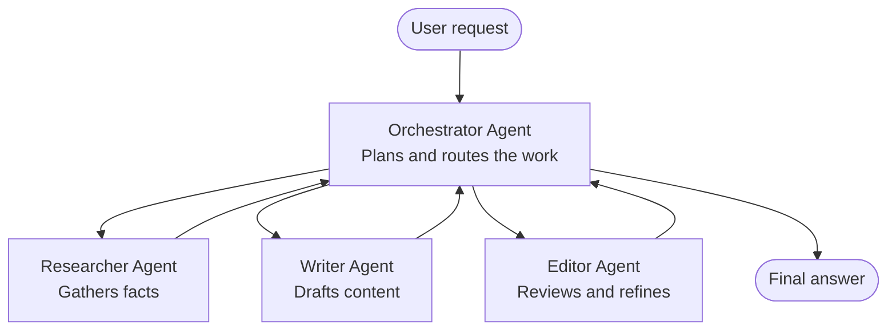

# ملٹی ایجنٹ بنیادی معلومات - اپنا پہلا مربوط AI سسٹم تعینات کریں

**باب کی نیویگیشن:**
- **📚 کورس ہوم**: [AZD برائے ابتدائی](../../README.md)
- **📖 موجودہ باب**: باب 5 - ملٹی ایجنٹ AI حل
- **⬅️ پچھلا**: [باب 4: انفراسٹرکچر](../chapter-04-infrastructure/README.md)
- **➡️ اگلا**: [ہم آہنگی کے پیٹرنز](../chapter-06-pre-deployment/coordination-patterns.md)

> کمانڈ گائیڈنس کو جاری کردہ `azd 1.37.2` حوالہ کے خلاف جائزہ لیا گیا۔ کلاؤڈ کی تعیناتی عمل میں نہیں لائی گئی۔

## تعارف

پچھلے ابواب میں آپ نے ایک واحد ایپلیکیشن تعینات کی—اور باب 2 میں آپ نے ایک واحد AI ایجنٹ تعینات کیا۔ یہ سبق اگلا قدم اٹھاتا ہے: ایک **ملٹی ایجنٹ نظام** تعینات کرنا، جہاں کئی ماہر ایجنٹ مل کر ایک ایسا مسئلہ حل کرتے ہیں جسے ایک ایجنٹ اکیلے اچھی طرح نہیں سنبھال سکتا۔

شروع کرنے والوں کے لیے خوشخبری: **آپ کو نئے کمانڈز کی ضرورت نہیں ہے۔** ملٹی ایجنٹ حل اب بھی ایک azd پروجیکٹ ہے۔ آپ `azd init`، `azd up`، ٹیسٹ، اور `azd down` کریں گے—بالکل وہی ورک فلو جو آپ پہلے سے جانتے ہیں۔ جو بدلتا ہے وہ ایپ کے اندر کا *ڈھانچہ* ہے۔

## سیکھنے کے اہداف

اس سبق کے اختتام تک، آپ:
- سمجھیں گے کہ "ملٹی ایجنٹ" کا کیا مطلب ہے اور کب اس کی اضافی پیچیدگی قابلِ قدر ہوتی ہے
- ملٹی ایجنٹ نظام میں عام کرداروں کو پہچانیں گے (آرکسٹریٹر + ماہرین)
- `azd up` کے ساتھ حقیقی، کام کرنے والے ملٹی ایجنٹ ٹیمپلیٹ کو تعینات کریں گے
- اس بات کو سمجھیں گے کہ کس طرح Azure وسائل ملٹی ایجنٹ ایپ کا پشت پناہی کرتے ہیں
- جانیں گے کہ حل کی تصدیق، تخصیص، اور اسے محفوظ طریقے سے ختم کرنے کا طریقہ

## سیکھنے کے نتائج

اس سبق کو مکمل کرنے کے بعد، آپ قابل ہوں گے:
- ایک واحد ایجنٹ اور ملٹی ایجنٹ نظام کے درمیان فرق کی وضاحت کریں
- ایک واحد ایجنٹ جس کے پاس آلات ہوں اور ایک حقیقی ملٹی ایجنٹ ڈیزائن کے درمیان انتخاب کریں
- ایک ملٹی ایجنٹ ٹیمپلیٹ کو azd کے ساتھ شروع سے آخر تک تعینات اور ٹیسٹ کریں
- شناخت کریں کہ ہر ایجنٹ کہاں چلتا ہے اور وہ کیسے بات چیت کرتے ہیں
- جاری رہنے والے اخراجات سے بچنے کے لیے تمام وسائل کی صفائی کریں

---

## ملٹی ایجنٹ نظام کیا ہے؟

ایک واحد AI ایجنٹ ایک ماڈل ہوتا ہے جس میں ہدایات کا ایک سیٹ اور (اختیاری طور پر) کچھ اوزار ہوتے ہیں۔ یہ مرکوز کاموں کے لیے اچھا کام کرتا ہے۔ لیکن جب کام بڑھتا ہے—تحقیق، پھر تحریر، پھر ترمیم، پھر حقائق کی جانچ—سب کچھ ایک پرامپٹ میں ڈالنا ایجنٹ کو سست، کم قابلِ اعتماد، اور دشوارِ جانچ بناتا ہے۔

ایک **ملٹی ایجنٹ نظام** کام کو ماہرین میں تقسیم کرتا ہے جو ہر ایک ایک بہتر کام انجام دیتا ہے، جسے ایک آرکسٹریٹر مربوط کرتا ہے:



### وہ دو کردار جو آپ ہمیشہ دیکھیں گے

| کردار | کام | مثال |
|------|-----|---------|
| **آرکسٹریٹر** | فیصلہ کرتا ہے *کہ اگلا کیا ہوگا* اور ایجنٹس کے درمیان کام تقسیم کرتا ہے | "پہلے تحقیق، پھر تحریر، پھر ترمیم" |
| **ماہر** | ایک مرتکز کام انجام دیتا ہے اور نتیجہ دیتا ہے | ایک "محقق" جو صرف حقائق جمع کرتا ہے |

### کیا واقعی آپ کو کئی ایجنٹس کی ضرورت ہے؟

سادہ سے شروع کریں۔ ملٹی ایجنٹ **تبھی** اپنائیں جب یہ سچ ہو:

- ✅ کام کے **مختلف مراحل** ہوں جو مختلف ہدایات کے فائدے والے ہوں (تحقیق بمقابلہ تحریر بمقابلہ جائزہ)
- ✅ آپ چاہتے ہیں کہ ماہرین **ہم وقت** چلیں تاکہ وقت بچ سکے
- ✅ مختلف مراحل کو **مختلف اوزار یا ڈیٹا ذرائع** کی ضرورت ہو
- ✅ آپ چاہتے ہیں کہ ہر مرحلہ **مستقل طور پر آزمایا اور خرابی درست کیا جا سکے**

اگر آپ کا کام سادہ سوال و جواب یا ایک سادہ ٹول کال ہے، تو **اوزاروں کے ساتھ واحد ایجنٹ** (باب 2) آسان، سستا، اور چلانے میں آسان ہے۔

> **ابتدائی ٹپ:** "زیادہ ایجنٹس" کا مطلب "بہتر" نہیں ہوتا۔ ہر ایجنٹ اضافی تاخیر، خرچ، اور نگرانی کا نیا پہلو شامل کرتا ہے۔ صرف اس وقت ایجنٹس شامل کریں جب مسئلہ واضح طور پر حصوں میں تقسیم ہو۔

---

## Azure پر ملٹی ایجنٹ کے دو طریقے

| طریقہ | یہ کیا ہے | بہترین استعمال |
|----------|-----------|----------|
| **واحد ایجنٹ + اوزار** | ایک Foundry ایجنٹ جو فنکشنز/اوزار کال کرتا ہے | سادہ ورک فلو، شروع کرنے کے لیے |
| **کئی مربوط ایجنٹس** | کئی ایجنٹس جنہیں ایک آرکسٹریٹر مربوط کرتا ہے | مختلف مراحل، ہم وقت کام، تخصص |

یہ سبق دوسرے طریقے پر توجہ دیتا ہے جو **تیار شدہ ٹیمپلیٹ** استعمال کرتا ہے، تاکہ آپ اپنا خود کا بنانے سے پہلے ایک حقیقی ملٹی ایجنٹ نظام دیکھ سکیں۔

---

## عملی: ایک کام کرنے والی ملٹی ایجنٹ ایپ تعینات کریں

ہم **Contoso Creative Writer** تعینات کریں گے، ایک سرکاری Azure نمونہ جو تحقیق، مصنوعات، تحریر، اور ترمیم کرنے والے ایجنٹس کو مربوط کرتا ہے تاکہ مضمون تیار کرے۔ آگے بڑھنے سے پہلے، [نمونے کی پیشگی شرائط اور لاگتوں](https://github.com/Azure-Samples/contoso-creative-writer#azure-account-requirements) کو چیک کریں: اسے ماڈل کوٹا، Azure AI سرچ، Bing گراؤنڈنگ رسائی، Python، Docker، اور Bash-مطابقت رکھنے والے ہکس کی ضرورت ہے۔ ماڈل اور علاقائی دستیابی آپ کی رکنیت پر منحصر ہے؛ کسی مخصوص علاقہ کا انتخاب تعیناتی کی ضمانت نہیں دیتا۔

### مرحلہ 1: ٹیمپلیٹ کو شروع کریں

```bash
# Create a working folder
mkdir creative-writer && cd creative-writer

# Initialize from the official multi-agent template
azd init --template Azure-Samples/contoso-creative-writer .
```

> مزید ملٹی ایجنٹ ٹیمپلیٹس کسی بھی وقت [Awesome AZD AI gallery](https://azure.github.io/awesome-azd/?tags=ai) میں براؤز کریں۔ دوسرے ابتدائی دوستانہ اختیارات میں `get-started-with-ai-agents` اور `azure-ai-travel-agents` شامل ہیں۔

### مرحلہ 2: توثیق کریں

```bash
# Required for azd workflows
azd auth login

# Also required by this sample's Azure CLI hooks
az login
```

### مرحلہ 3: ماحول کی جانچ کریں

```bash
# init normally creates/selects an environment; confirm it before proceeding
azd env list
# Only if you need an additional environment:
# azd env new dev
```

### مرحلہ 4: پیش نظارہ کریں، پھر تعینات کریں

```bash
# See what will be created before spending anything (recommended)
azd provision --preview

# Provision infrastructure and deploy all agents in one step
azd up
```

`azd up` غائب سبسکرپشن اور ریجن کی ترتیبات کے لیے پرامپٹ کرے گا، پھر وسائل مہیا کرے گا اور ایپلیکیشن کو تعینات کرے گا۔ پیش نظارہ کوئی کوٹا محفوظ نہیں کرتا یا کامیابی کی ضمانت نہیں دیتا؛ ٹیمپلیٹ ہکس اب بھی پروویژننگ کے پیش نظارہ کے دوران چل سکتے ہیں، لہٰذا پہلے ان کا جائزہ لیں۔ ہر **سروس تعیناتی** (ماڈل پروویژننگ نہیں) کے لیے azd جتنا وقت انتظار کرتا ہے اسے بڑھانے کے لیے:

```bash
azd deploy --timeout 1800
```

ایک ٹائم آؤٹ azd کے انتظار کو روک دیتا ہے؛ یہ Azure میں تعیناتی کو منسوخ نہیں کرتا۔ دوبارہ کوشش کرنے سے پہلے وسائل کی حالت کا جائزہ لیں۔

> **اخراجات اور صلاحیت کی معلومات:** ملٹی-ایجنٹ ایپس AI ماڈلز تعینات کرتی ہیں جو کوٹا استعمال کرتے ہیں اور لاگت کا باعث بنتے ہیں۔ اگر `azd up` ماڈل کوٹا پر ناکام ہو جائے، تو علاقے اور کوٹا کی اصلاح کے لیے [AI Troubleshooting](../chapter-07-troubleshooting/ai-troubleshooting.md) دیکھیں، اور باب 6 [Capacity Planning](../chapter-06-pre-deployment/capacity-planning.md) ملاحظہ کریں۔

---

## آپ نے جو تعینات کیا اسے سمجھنا

ایسی ایک عام ملٹی-ایجنٹ ایپ چند Azure وسائل مہیا کرتی ہے جو بالکل اوپر دیے گئے ڈایاگرام میں ذمہ داریوں سے میل کھاتے ہیں:

| وسائل | یہ یہاں کیوں ہے |
|----------|----------------|
| **Microsoft Foundry / Models** | ہر ایجنٹ کے استعمال کے لیے زبان کے ماڈلز کی میزبانی کرتا ہے |
| **Azure AI Search** | محقق ایجنٹ کو سرچ کے لیے واقف ڈیٹا فراہم کرتا ہے |
| **Container Apps** (یا App Service) | آرکیسٹریٹر اور ایجنٹ کوڈ کی میزبانی کرتا ہے |
| **Cosmos DB** (کچھ نمونوں میں) | ایجنٹس کے درمیان مشترکہ حالت/میموری ذخیرہ کرتا ہے |
| **Application Insights** | درخواستوں کو ایجنٹس *کے درمیان* ٹریس کرتا ہے تاکہ آپ فلو کو ڈیبگ کر سکیں |

### ایجنٹس کیسے ایک دوسرے سے بات کرتے ہیں

زیادہ تر azd ملٹی-ایجنٹ نمونوں میں، **آرکیسٹریٹر آپ کے ایپلیکیشن کوڈ میں چلتا ہے** (مثلاً، Semantic Kernel یا Microsoft Agent Framework جیسا فریم ورک استعمال کرتے ہوئے)۔ آرکیسٹریٹر بالترتیب ہر ماہر ایجنٹ کو کال کرتا ہے، نتائج پاس کرتا ہے، اور حتمی جواب مرتب کرتا ہے۔ ایجنٹس سیاق و سباق کو مندرجہ ذیل کے ذریعے شیئر کرتے ہیں:

- **فنکشن/ٹول کالز** — آرکیسٹریٹر ماہر کو کال کرتا ہے اور جواب وصول کرتا ہے
- **مشترکہ میموری** — ایک ڈیٹا بیس (اکثر Cosmos DB) ایسی حالت رکھتا ہے جو دونوں ایجنٹس پڑھ سکتے ہیں
- **پیغامات/واقعات** — کم مربوطی کے لیے، ایجنٹس قطار یا سروس بس کے ذریعے بات چیت کرتے ہیں

> **ڈیبگ کرنے کے لیے کیوں اہم ہے:** چونکہ ہر قدم الگ ہے، Application Insights آپ کو بتاتا ہے کہ *کون سا* ایجنٹ سست یا ناکام رہا۔ یہی وجہ ہے کہ کام کو ایجنٹس میں تقسیم کرنا ضروری ہے۔

---

## تعیناتی کی تصدیق کریں

آگے بڑھنے سے پہلے نظام کے کام کرنے کی تصدیق کریں:

```bash
# Show the deployed endpoints
azd show

# Open the app's monitoring dashboard
azd monitor

# Open Application Insights Logs (not a terminal log stream)
azd monitor --logs
```

پھر `azd show` سے ایپ URL کھولیں اور ایک مختصر مضمون کی درخواست کریں۔ نمونے کی ڈیبگ ویو استعمال کریں تاکہ اس کے ایجنٹ ورک فلو کا جائزہ لے سکیں۔ Application Insights ٹرانزیکشن سرچ انفرادی مراحل تب ہی دکھا سکتا ہے جب نمونہ ان میں آلات لگائے اور ان کا تعلق بنائے؛ azd خودکار طور پر ایجنٹ اسپینز نہیں جوڑتا۔

**کامیابی کے معیار:**
- ✅ `azd show` قابل رسائی اینڈ پوائنٹ کی فہرست دیتا ہے
- ✅ ایک درخواست ایسا نتیجہ دیتی ہے جو واضح طور پر متعدد مراحل سے گزرتا ہے
- ✅ ڈیبگ ویو متعدد ایجنٹ مراحل دکھاتا ہے؛ اگر ٹریسنگ فعال ہو، تو انٹیک کے بعد متعلقہ ٹیلی میٹری کی تصدیق کریں

---

## تخصیص کریں: کوئی ایجنٹ شامل کریں یا ایڈجسٹ کریں

چونکہ ہر ایجنٹ صرف ہدایات اور ٹولز پر مشتمل ہوتا ہے، تخصیص آسان ہے:

1. **ایجنٹ کی تعریفوں کو تلاش کریں** ٹیمپلیٹ میں (عام طور پر `prompts/`، `agents/`، یا `*.prompty` فائلوں کا مجموعہ)۔
2. **ایجنٹ کی ہدایات کو ایڈجسٹ کریں** — مثال کے طور پر، ایڈیٹر ایجنٹ کو مخصوص انداز یا الفاظ کی گنتی نافذ کرنے کو کہیں۔
3. **صرف کوڈ کو دوبارہ تعینات کریں** (انفراسٹرکچر بدلا نہیں گیا ہے):

   ```bash
   azd deploy
   ```

اپنے *اپنے* Foundry ایجنٹ پروجیکٹ کے ساتھ مزید آگے بڑھنے کے لیے، AZD 1.37.0+ کے ساتھ GA بنڈل کو ایک الگ خالی ڈائریکٹری میں استعمال کریں:

```bash
azd ext install microsoft.foundry
azd ai agent init
azd up
azd ai agent invoke      # test, with response timing
```

Agent Inspector کے مقامی ٹیسٹنگ، ریموٹ کوڈ تعیناتی، اور کلین اپ کی ملکیت کے لئے [GA hosted-agent walkthrough](../chapter-02-ai-development/microsoft-foundry-integration.md#hosted-agent-walkthrough-ga) ملاحظہ کریں۔ [AZD AI CLI reference](../chapter-08-production/production-ai-practices.md#azd-ai-cli-commands-and-extensions) بھی الگ الگ evaluations ایکسٹینشن، اصلاح، اور ایجنٹ کی حذف کاری کو شامل کرتا ہے۔

---

## صفائی

ملٹی ایجنٹ ایپس متعدد بل ایبل خدمات چلاتی ہیں۔ کام ختم ہونے پر سب کچھ ختم کر دیں:

```bash
# Review the resources and confirm deletion interactively
azd down
```

حذف کرنا تباہ کن عمل ہے۔ ایک ضائع کرنے والا لیب کے لیے، `azd down --force --purge` حذف کو چھوڑ دیتا ہے اور نرم حذف کی تصدیقات کو بھی؛ صفائی الٹی نہیں ہو سکتی جہاں حمایت کی جاتی ہے اور یہ صفائی کی حفاظت سے روکی جا سکتی ہے۔ نرم حذف بازیابی / نام دوبارہ استعمال کا مسئلہ ہے، خود میں جاری چارجز کا ثبوت نہیں۔ صفائی کے بعد محفوظ شدہ وسائل اور بلنگ کو چیک کریں۔

اگر آپ نے کسی موجودہ Foundry پروجیکٹ کے خلاف بھی ہوسٹڈ ایجنٹ کو شروع کیا ہے، تو `azd down` اس پروجیکٹ کے ایجنٹ اور دیگر وسائل کو جگہ پر چھوڑ دیتا ہے۔ صرف غیر مطلوبہ وسائل کو علیحدہ سے حذف کریں جو آپ کے قابل ملکیت ہیں۔ AZD ماحول کے ذریعہ بنائے گئے نئے Foundry پروجیکٹ کے لیے، `azd down` ریسورس گروپ اور اس میں موجود سب کچھ حذف کر دیتا ہے۔

---

## پیداواری ملٹی ایجنٹ سسٹمز پر ایک نوٹ

اس ریپو میں موجود [ریٹیل ملٹی ایجنٹ سلوشن](../../examples/retail-scenario.md) ایک **آرکیٹیکچر بلیو پرنٹ** ہے، نہ کہ ایک کمانڈ سے چلنے والا ٹیمپلیٹ—یہ دستاویز کرتا ہے کہ ایک پیداواری ریٹیل سسٹم *کیسے* بنایا جائے گا (اور واضح طور پر بتاتا ہے کہ مکمل تعمیر ایک بڑا کام ہے)۔ اسے یہاں ایک کام کرتے ہوئے سیمپل کو تعینات کرنے کے *بعد* ڈیزائن ریفرنس کے طور پر استعمال کریں۔ پیداواری مسائل (مستعدی، لاگت، نگرانی، حکمرانی) کے لیے [باب 8: پیداواری اے آئی طریقہ کار](../chapter-08-production/production-ai-practices.md) کا حوالہ لیں۔

---

## خلاصہ

- ایک ملٹی ایجنٹ سسٹم کام کو ماہرین میں تقسیم کرتا ہے جنہیں ایک آرکیسٹریٹر مربوط کرتا ہے۔
- اسے صرف اسی وقت استعمال کریں جب کام میں مختلف مراحل، متوازی عمل، یا ہر مرحلے کے لیے مختلف آلات ہوں—ورنہ ایک واحد ایجنٹ کو ترجیح دیں۔
- ازڈ ورک فلو ویسا ہی رہتا ہے: `azd init` → `azd up` → ٹیسٹ → `azd down`۔
- ایک حقیقی ٹیمپلیٹ جیسے `contoso-creative-writer` آپ کو آج ایک کام کرنے والی ملٹی ایجنٹ ایپ دیکھنے اور حسب ضرورت بنانے دیتا ہے۔
- ایجنٹوں کے درمیان ایپلیکیشن انسائٹس ٹریسنگ ملٹی ایجنٹ ڈیزائن کے سب سے بڑے عملی فوائد میں سے ایک ہے۔

---

## 🔗 نیویگیشن

| سمت | سبق |
|-----------|--------|
| **پچھلا** | [باب 4: انفراسٹرکچر](../chapter-04-infrastructure/README.md) |
| **اگلا** | [رابطہ کاری پیٹرنز](../chapter-06-pre-deployment/coordination-patterns.md) |

## 📖 متعلقہ وسائل

- [اے آئی ایجنٹس گائیڈ](../chapter-02-ai-development/agents.md)
- [رابطہ کاری پیٹرنز](../chapter-06-pre-deployment/coordination-patterns.md)
- [پیداواری اے آئی طریقہ کار](../chapter-08-production/production-ai-practices.md)
- [AI مسائل کا حل](../chapter-07-troubleshooting/ai-troubleshooting.md)

---

<!-- CO-OP TRANSLATOR DISCLAIMER START -->
**ڈس کلیمر**:
یہ دستاویز AI ترجمہ سروس [Co-op Translator](https://github.com/Azure/co-op-translator) کے ذریعے ترجمہ کی گئی ہے۔ جبکہ ہم درستگی کے لیے کوشاں ہیں، براہ کرم اس بات سے آگاہ رہیں کہ خودکار ترجمے میں غلطیاں یا عدم درستیاں ہو سکتی ہیں۔ اصل دستاویز اپنے مادری زبان میں مستند ماخذ سمجھی جائے گی۔ حساس معلومات کے لیے پیشہ ور انسانی ترجمہ کی سفارش کی جاتی ہے۔ اس ترجمے کے استعمال سے پیدا ہونے والی کسی بھی غلط فہمی یا غلط تشریح کی ذمہ داری ہم قبول نہیں کرتے۔
<!-- CO-OP TRANSLATOR DISCLAIMER END -->