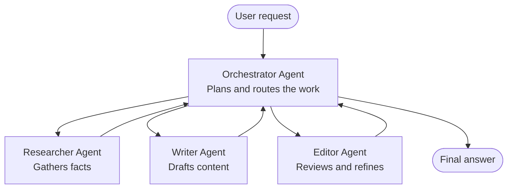

# ملٹی ایجنٹ کی بنیادیں - اپنا پہلا مربوط AI نظام تعینات کریں

**باب کی نیویگیشن:**
- **📚 کورس ہوم**: [AZD ابتدائیوں کے لیے](../../README.md)
- **📖 موجودہ باب**: باب 5 - ملٹی ایجنٹ AI حل
- **⬅️ پچھلا**: [باب 4: انفراسٹرکچر](../chapter-04-infrastructure/README.md)
- **➡️ اگلا**: [ہم آہنگی کے پیٹرنز](../chapter-06-pre-deployment/coordination-patterns.md)

> جاری کیے گئے `azd 1.37.2` حوالہ کے مقابلے میں کمانڈ ہدایت کا جائزہ لیا گیا۔ کلاؤڈ تعیناتیاں انجام نہیں دی گئیں۔

## تعارف

پچھلے ابواب میں آپ نے ایک ایپلیکیشن تعینات کی — اور باب 2 میں آپ نے ایک AI ایجنٹ تعینات کیا۔ یہ سبق اگلا قدم لیتا ہے: ایک **ملٹی ایجنٹ نظام** تعینات کرنا، جہاں متعدد تخصصی ایجنٹس مل کر کام کرتے ہیں تاکہ ایسا مسئلہ حل کیا جا سکے جسے کوئی واحد ایجنٹ خود بہتر طریقے سے حل نہ کر سکے۔

ابتدائیوں کے لیے خوشخبری: **آپ کو نئے کمانڈز کی ضرورت نہیں ہے۔** ملٹی ایجنٹ حل پھر بھی ایک azd پروجیکٹ ہے۔ آپ `azd init`، `azd up`، ٹیسٹ، اور `azd down` کریں گے — بالکل وہی ورک فلو جو آپ پہلے سے جانتے ہیں۔ جو تبدیل ہوتا ہے وہ ایپ کے اندر کا *پہلو* ہے۔

## سیکھنے کے مقاصد

اس سبق کے آخر تک، آپ:
- سمجھیں گے کہ "ملٹی ایجنٹ" کا مطلب کیا ہے اور کب یہ اضافی پیچیدگی کے قابل ہوتا ہے
- ملٹی ایجنٹ نظام میں عام کرداروں کو پہچانیں گے (آرکیسٹریٹر + ماہرین)
- ایک حقیقی، کام کرنے والا ملٹی ایجنٹ ٹیمپلیٹ `azd up` کے ساتھ تعینات کریں گے
- ان Azure وسائل کو سمجھیں گے جو ملٹی ایجنٹ ایپ کے پیچھے ہوتے ہیں
- حل کو محفوظ طریقے سے تصدیق، تخصیص، اور ختم کرنا جانیں گے

## سیکھنے کے نتائج

اس سبق کو مکمل کرنے کے بعد، آپ قائل ہوں گے کہ:
- ایک واحد ایجنٹ اور ملٹی ایجنٹ نظام کے درمیان فرق کی وضاحت کر سکیں
- اوزاروں کے ساتھ ایک واحد ایجنٹ اور حقیقی ملٹی ایجنٹ ڈیزائن کے درمیان انتخاب کریں
- azd کے ساتھ ملٹی ایجنٹ ٹیمپلیٹ کو سرے سے سرے تک تعینات اور آزمائیں
- شناخت کریں کہ ہر ایجنٹ کہاں چلتا ہے اور وہ کیسے بات چیت کرتے ہیں
- جاری چارجز سے بچنے کے لیے تمام وسائل کو صاف کریں

---

## ملٹی ایجنٹ نظام کیا ہے؟

ایک واحد AI ایجنٹ ایک ماڈل ہوتا ہے جس میں ہدایات کا ایک مجموعہ اور (اختیاری طور پر) کچھ اوزار ہوتے ہیں۔ یہ فوکس شدہ کاموں کے لیے اچھا کام کرتا ہے۔ لیکن جب کام بڑھتا ہے — تحقیق، پھر لکھنا، پھر تدوین، پھر حقائق کی تحقیق — سب کچھ ایک پرامپٹ میں ڈالنے سے ایجنٹ سست، کم قابل اعتماد، اور ڈیبگ کرنا مشکل ہو جاتا ہے۔

ایک **ملٹی ایجنٹ نظام** کام کو تخصصی افراد میں تقسیم کرتا ہے جو ہر ایک ایک کام مہارت سے کرتا ہے، ایک آرکیسٹریٹر کے ذریعے مربوط ہوتا ہے:



### دو کردار جو آپ ہمیشہ دیکھیں گے

| کردار | کام | مثال |
|------|-----|---------|
| **آرکیسٹریٹر** | فیصلہ کرتا ہے *اگلا کیا ہوگا* اور ایجنٹس کے درمیان کام تقسیم کرتا ہے | "پہلے تحقیق، پھر لکھنا، پھر تدوین" |
| **ماہر** | ایک مخصوص کام انجام دیتا ہے اور نتیجہ لوٹاتا ہے | ایک "محقق" جو صرف حقائق جمع کرتا ہے |

### کیا آپ کو واقعی متعدد ایجنٹس کی ضرورت ہے؟

سادہ سے شروع کریں۔ صرف تب ملٹی ایجنٹ کے لیے جائیں جب درج ذیل میں سے کوئی سچ ہو:

- ✅ کام کے **مختلف مراحل** ہوں جو مختلف ہدایات سے فائدہ اٹھائیں (تحقیق بمقابلہ لکھنا بمقابلہ جائزہ)
- ✅ آپ چاہتے ہیں کہ ماہرین **متوازی طور پر** چلیں تاکہ وقت بچایا جا سکے
- ✅ مختلف مراحل میں **مختلف اوزار یا ڈیٹا سورسز** کی ضرورت ہو
- ✅ آپ چاہتے ہیں کہ ہر مرحلہ **الگ سے ٹیسٹ اور ڈیبگ کیا جا سکے**

اگر آپ کا کام ایک سادہ سوال و جواب ہے یا ایک آسان ٹول کال، تو **اوزاروں کے ساتھ واحد ایجنٹ** (باب 2) زیادہ سادہ، سستا اور آپریٹ کرنے میں آسان ہے۔

> **ابتدائی ٹپ:** "زیادہ ایجنٹس" کا مطلب "بہتر" نہیں ہے۔ ہر ایجنٹ تاخیر، قیمت، اور نگرانی کی ایک نئی چیز کا اضافہ کرتا ہے۔ ایجنٹس صرف اس وقت شامل کریں جب مسئلہ واضح طور پر حصوں میں تقسیم ہو۔

---

## Azure پر ملٹی ایجنٹ بنانے کے دو طریقے

| طریقہ | یہ کیا ہے | بہترین استعمال کے لیے |
|----------|-----------|----------|
| **واحد ایجنٹ + اوزار** | ایک Foundry ایجنٹ جو فنکشن/اوزار کال کرتا ہے | سادہ ورک فلو، شروع کرنے کے لیے |
| **متعدد مربوط ایجنٹس** | متعدد ایجنٹس آرکیسٹریٹر کے ساتھ | مختلف مراحل، متوازی کام، تخصص |

یہ سبق دوسرے طریقے پر توجہ دیتا ہے، جس میں **تیار شدہ ٹیمپلیٹ** استعمال کی جاتی ہے، تاکہ آپ اپنا نظام بنانے سے پہلے حقیقی ملٹی ایجنٹ نظام چلتے ہوئے دیکھ سکیں۔

---

## عملی مشق: ایک کام کرنے والا ملٹی ایجنٹ ایپ تعینات کریں

ہم **Contoso Creative Writer** تعینات کریں گے، ایک آفیشل Azure سیمپل جو تحقیق، مصنوعات، لکھائی، اور تدوین ایجنٹس کو منظم کرتا ہے تاکہ ایک مضمون تیار کیا جا سکے۔ آگے بڑھنے سے پہلے، [سیمپل کی درکار شرائط اور لاگت](https://github.com/Azure-Samples/contoso-creative-writer#azure-account-requirements) چیک کریں: اسے ماڈل کوٹہ، Azure AI Search، Bing Grounding کی رسائی، Python، Docker، اور Bash-مطابق ہکس کی ضرورت ہے۔ ماڈل اور علاقہ کی دستیابی آپ کی سبسکرپشن پر منحصر ہے؛ کسی خاص علاقے کا انتخاب کر کے تعیناتی کی ضمانت نہیں ہے۔

### مرحلہ 1: ٹیمپلیٹ کو شروع کریں

```bash
# Create a working folder
mkdir creative-writer && cd creative-writer

# Initialize from the official multi-agent template
azd init --template Azure-Samples/contoso-creative-writer .
```

> مزید کثیر ایجنٹ ٹیمپلیٹس کسی بھی وقت [Awesome AZD AI gallery](https://azure.github.io/awesome-azd/?tags=ai) میں براؤز کریں۔ دیگر شروعاتی دوستانہ اختیارات میں `get-started-with-ai-agents` اور `azure-ai-travel-agents` شامل ہیں۔

### مرحلہ 2: توثیق کریں

```bash
# Required for azd workflows
azd auth login

# Also required by this sample's Azure CLI hooks
az login
```

### مرحلہ 3: ماحول کی جانچ کریں

```bash
# init normally creates/selects an environment; confirm it before proceeding
azd env list
# Only if you need an additional environment:
# azd env new dev
```

### مرحلہ 4: پیش نظارہ کریں، پھر تعینات کریں

```bash
# See what will be created before spending anything (recommended)
azd provision --preview

# Provision infrastructure and deploy all agents in one step
azd up
```

`azd up` غائب سبسکرپشن اور علاقائی ترتیبات کے لئے پوچھے گا، پھر وسائل فراہم کرے گا اور ایپلیکیشن کو تعینات کرے گا۔ پیش نظارہ کوئی کوٹہ محفوظ نہیں کرتا اور کامیابی کی ضمانت نہیں دیتا؛ ٹیمپلیٹ ہوکس ابھی بھی تعیناتی کے پیش نظارہ کے دوران چل سکتے ہیں، لہذا پہلے ان کا معائنہ کریں۔ azd کے انتظار کے وقت کو بڑھانے کے لیے ہر **سروس کی تعیناتی** (ماڈل فراہم کرنے سے مختلف) کے لئے:

```bash
azd deploy --timeout 1800
```

ایک ٹائم آؤٹ azd کے انتظار کو روکتا ہے؛ یہ Azure میں تعیناتی کو منسوخ نہیں کرتا۔ دوبارہ کوشش کرنے سے پہلے وسائل کی حالت کا معائنہ کریں۔

> **لاگت اور صلاحیت پر معلومات:** کثیر ایجنٹ ایپلیکیشنز AI ماڈلز کو تعینات کرتی ہیں جو کوٹہ استعمال کرتے ہیں اور لاگت اٹھاتی ہیں۔ اگر `azd up` ماڈل کوٹہ پر ناکام ہو جاتا ہے، تو [AI Troubleshooting](../chapter-07-troubleshooting/ai-troubleshooting.md) دیکھیں علاقہ اور کوٹہ کی اصلاحات کے لئے، اور باب 6 [Capacity Planning](../chapter-06-pre-deployment/capacity-planning.md)۔

---

## جو آپ نے تعینات کیا اسے سمجھنا

اس قسم کی ایک عام کثیر ایجنٹ ایپ Azure کے وسائل کا ایک سیٹ فراہم کرتی ہے جو بالکل اوپر والے خاکے میں ذمہ داریوں کے مطابق ہے:

| وسیلہ | یہاں ہونے کی وجہ |
|----------|----------------|
| **Microsoft Foundry / Models** | زبان کے ماڈلز کی میزبانی کرتا ہے جو ہر ایجنٹ استعمال کرتا ہے |
| **Azure AI Search** | محقق ایجنٹ کو معتبر ڈیٹا فراہم کرتا ہے تاکہ وہ تلاش کر سکے |
| **Container Apps** (یا App Service) | آرکیسٹریٹر اور ایجنٹ کوڈ کی میزبانی کرتا ہے |
| **Cosmos DB** (کچھ نمونوں میں) | مشترکہ حالت/یادداشت ذخیرہ کرتا ہے جو ایجنٹس کے درمیان منتقل ہوتی ہے |
| **Application Insights** | درخواستوں کا پتہ لگاتا ہے *ایجنٹس کے درمیان* تاکہ آپ بہاؤ کو ڈیبگ کر سکیں |

### ایجنٹس ایک دوسرے سے کس طرح بات کرتے ہیں

زیادہ تر azd کثیر ایجنٹ نمونوں میں، **آرکیسٹریٹر آپ کے ایپلیکیشن کوڈ میں چلتا ہے** (مثال کے طور پر، Semantic Kernel یا Microsoft Agent Framework جیسے فریم ورک کا استعمال کرتے ہوئے)۔ آرکیسٹریٹر ہر ماہر ایجنٹ کو باری باری کال کرتا ہے، نتائج منتقل کرتا ہے، اور حتمی جواب ترتیب دیتا ہے۔ ایجنٹس مشترکہ سیاق و سباق بانٹتے ہیں:

- **فنکشن / ٹول کالز** — آرکیسٹریٹر ایک ماہر کو کال کرتا ہے اور نتیجہ حاصل کرتا ہے
- **مشترکہ یادداشت** — ایک ڈیٹا بیس (اکثر Cosmos DB) ایسی حالت رکھتا ہے جسے دونوں ایجنٹس پڑھ سکتے ہیں
- **پیغامات / واقعات** — خوشگوار جوڑنے کے لئے، ایجنٹس قطار یا سروس بس کے ذریعہ بات چیت کرتے ہیں

> **ڈیبگنگ کے لیے یہ کیوں اہم ہے:** چونکہ ہر مرحلہ الگ ہے، Application Insights آپ کو دکھاتا ہے کہ *کون سا* ایجنٹ سست یا ناکام رہا۔ یہی بڑی وجہ ہے کہ کام کو ایجنٹس میں تقسیم کیا جاتا ہے۔

---

## تعیناتی کی تصدیق کریں

آگے بڑھنے سے پہلے تصدیق کریں کہ نظام حقیقت میں کام کر رہا ہے:

```bash
# Show the deployed endpoints
azd show

# Open the app's monitoring dashboard
azd monitor

# Open Application Insights Logs (not a terminal log stream)
azd monitor --logs
```

پھر `azd show` سے ایپ کا URL کھولیں اور ایک مختصر مضمون طلب کریں۔ نمونہ کے ڈیبگ ویو سے اس کے ایجنٹ ورک فلو کا معائنہ کریں۔ Application Insights ٹرانزیکشن سرچ صرف تب ہی انفرادی مراحل دکھا سکتی ہے اگر نمونہ ان کے لیے آلات لگائے اور ان کا تعلق قائم کرے؛ azd خود بخود ایجنٹ اسپینز شامل نہیں کرتا۔

**کامیابی کے معیار:**
- ✅ `azd show` ایک قابل رسائی اینڈپوائنٹ کی فہرست دیتا ہے
- ✅ ایک درخواست ایسا نتیجہ پیدا کرتی ہے جو واضح طور پر متعدد مراحل سے گزرتا ہے
- ✅ ڈیبگ ویو متعدد ایجنٹ مراحل دکھاتا ہے؛ اگر ٹریسنگ فعال ہے تو، انٹیک کے بعد متعلقہ ٹیلی میٹری کی تصدیق کریں

---

## تخصیص کریں: کوئی ایجنٹ شامل کریں یا ایڈجسٹ کریں

چونکہ ہر ایجنٹ صرف ہدایات اور اوزار ہیں، تخصیص آسان ہے:

1. **ایجنٹ کی تعریفات تلاش کریں** ٹیمپلیٹ میں (اکثر ایک `prompts/`، `agents/`، یا `*.prompty` فائلوں کا مجموعہ)۔
2. **ایجنٹ کی ہدایات کو بہتر بنائیں** — مثال کے طور پر، ایڈیٹر ایجنٹ کو مخصوص لہجہ یا الفاظ کی تعداد نافذ کرنے کے لیے کہیں۔
3. **صرف کوڈ کو دوبارہ تعینات کریں** (انفراسٹرکچر میں کوئی تبدیلی نہیں):

   ```bash
   azd deploy
   ```

اپنے *اپنے* Foundry ایجنٹ پروجیکٹ کے ساتھ آگے بڑھنے کے لیے، ایجنٹ ایکسٹینشن کی انٹرایکٹو انیشیالائزیشن استعمال کریں:

```bash
azd extension install azure.ai.agents
azd ai agent init
azd up
azd ai agent invoke      # test, with response timing
```

مکمل لائف سائیکل کے لیے [باب 2: ایجنٹس](../chapter-02-ai-development/agents.md) اور [AZD AI CLI حوالہ](../chapter-08-production/production-ai-practices.md#azd-ai-cli-commands-and-extensions) دیکھیں: ایجنٹ `invoke`، الگ الگ جانچ کے ایکسٹینشن کا `azd ai eval` ورک فلو، ایجنٹ `optimize`، اور ایجنٹ `delete`۔

---

## صفائی

ملٹی ایجنٹ ایپس متعدد قابل بلنگ خدمات چلائیں۔ ختم کرنے کے بعد سب کچھ بند کر دیں:

```bash
# Review the resources and confirm deletion interactively
azd down
```

حذف کرنا نقصان دہ ہے۔ ایک عارضی لیب کے لیے، `azd down --force --purge` حذف کو چھوڑ دیتا ہے اور سافٹ-ڈیلیٹ صفائی کی تصدیقات کی حمایت کرتا ہے؛ صفائی ناقابل واپسی ہے جہاں سپورٹ ہو اور اسے صفائی کی حفاظت سے روکا جا سکتا ہے۔ سافٹ حذف بازیابی/نام کے دوبارہ استعمال کا مسئلہ ہے، خود بخود جاری چارجز کا ثبوت نہیں۔ صفائی کے بعد محفوظ شدہ وسائل اور بلنگ چیک کریں۔

---

## پیداواری ملٹی ایجنٹ سسٹمز پر ایک نوٹ

اس ریپو میں [ریٹیل ملٹی ایجنٹ حل](../../examples/retail-scenario.md) ایک **فن تعمیر کا خاکہ** ہے، ایک کمانڈ ٹیمپلیٹ نہیں—یہ دستاویزی طور پر بتاتا ہے کہ ایک پیداواری ریٹیل نظام *کیسے* بنایا جائے گا (اور واضح کرتا ہے کہ مکمل تعمیر ایک معقول محنت ہے)۔ اسے یہاں ایک کام کرنے والے نمونے کو تعینات کرنے کے *بعد* ڈیزائن کے حوالے کے طور پر استعمال کریں۔ پیداواری معاملات کے لیے (مزاحمت، لاگت، نگرانی، گورننس)، جاری رکھیں [باب 8: پیداواری AI طریقے](../chapter-08-production/production-ai-practices.md)۔

---

## خلاصہ

- ایک ملٹی ایجنٹ سسٹم کام کو ماہرین میں تقسیم کرتا ہے جو ایک آرکیسٹریٹر کے ذریعے مربوط ہوتے ہیں۔
- اسے صرف اس وقت استعمال کریں جب کام کے مختلف مراحل، متوازی عمل، یا ہر مرحلے کے لیے مختلف اوزار ہوں—ورنہ ایک واحد ایجنٹ کو ترجیح دیں۔
- azd ورک فلو بغیر تبدیلی کے برقرار ہے: `azd init` → `azd up` → ٹیسٹ → `azd down`۔
- ایک حقیقی ٹیمپلیٹ جیسے `contoso-creative-writer` آپ کو آج ایک کام کرنے والی ملٹی ایجنٹ ایپ دیکھنے اور اپنی مرضی کے مطابق بنانے دیتا ہے۔
- ایپلیکیشن انسائٹس ٹریسنگ ایجنٹس کے درمیان ملٹی ایجنٹ ڈیزائن کے سب سے بڑے عملی فوائد میں سے ایک ہے۔

---

## 🔗 نیویگیشن

| سمت | سبق |
|-----------|--------|
| **پچھلا** | [باب 4: بنیادی ڈھانچہ](../chapter-04-infrastructure/README.md) |
| **اگلا** | [تعلقات کے نمونے](../chapter-06-pre-deployment/coordination-patterns.md) |

## 📖 متعلقہ وسائل

- [AI ایجنٹس گائیڈ](../chapter-02-ai-development/agents.md)
- [تعلقات کے نمونے](../chapter-06-pre-deployment/coordination-patterns.md)
- [پیداواری AI طریقے](../chapter-08-production/production-ai-practices.md)
- [AI مسائل کا حل](../chapter-07-troubleshooting/ai-troubleshooting.md)

---

<!-- CO-OP TRANSLATOR DISCLAIMER START -->
**ڈس کلیمر**:
یہ دستاویز AI ترجمہ سروس [Co-op Translator](https://github.com/Azure/co-op-translator) کے ذریعے ترجمہ کی گئی ہے۔ جبکہ ہم درستگی کے لیے کوشاں ہیں، براہ کرم اس بات سے آگاہ رہیں کہ خودکار ترجمے میں غلطیاں یا عدم درستیاں ہو سکتی ہیں۔ اصل دستاویز اپنے مادری زبان میں مستند ماخذ سمجھی جائے گی۔ حساس معلومات کے لیے پیشہ ور انسانی ترجمہ کی سفارش کی جاتی ہے۔ اس ترجمے کے استعمال سے پیدا ہونے والی کسی بھی غلط فہمی یا غلط تشریح کی ذمہ داری ہم قبول نہیں کرتے۔
<!-- CO-OP TRANSLATOR DISCLAIMER END -->