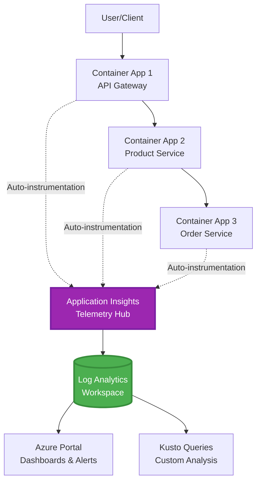
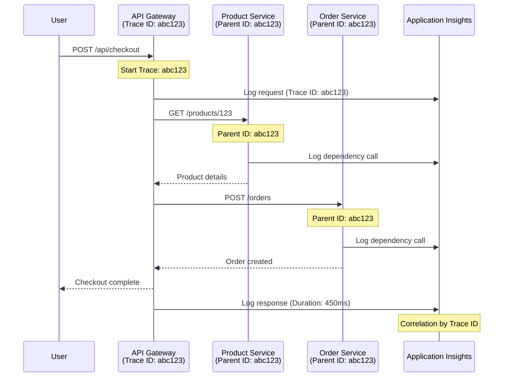

# AZD کے ساتھ Application Insights کا انضمام

⏱️ **تخمینی وقت**: ۴۰-۵۰ منٹ | 💰 **لاگت کا اثر**: تقریباً $۵-۱۵/ماہ | ⭐ **پیچیدگی**: درمیانہ

**📚 تعلیمی راستہ:**
- ← پچھلا: [Preflight Checks](preflight-checks.md) - پری ڈپلائمنٹ کی تصدیق
- 🎯 **آپ یہاں ہیں**: Application Insights کا انضمام (مانیٹرنگ، ٹیلی میٹری، ڈیبگنگ)
- → اگلا: [Deployment Guide](../chapter-04-infrastructure/deployment-guide.md) - Azure پر تعینات کریں
- 🏠 [کورس ہوم](../../README.md)

---

## آپ کیا سیکھیں گے

اس سبق کو مکمل کرنے سے آپ:
- AZD میں **Application Insights** کا اعلان کریں گے اور SDK انسٹرومنٹیشن کو ترتیب دیں گے
- مائیکرو سروسز کے لیے **distributed tracing** کو کنفیگر کریں گے
- **کسٹم ٹیلی میٹری** (مٹرکس، ایونٹس، انحصار) نافذ کریں گے
- حقیقی وقت کی نگرانی کے لیے **live metrics** قائم کریں گے
- AZD کی ڈپلائمنٹ سے **alerts اور dashboards** بنائیں گے
- **telemetry queries** کے ساتھ پروڈکشن مسائل کو ڈیبگ کریں گے
- **لاگت اور سیمپلنگ** حکمت عملیوں کو بہتر بنائیں گے
- **AI/LLM ایپلیکیشنز** (ٹوکنز، لیٹنسی، لاگت) کی نگرانی کریں گے

## AZD کے ساتھ Application Insights کیوں اہم ہے

### چیلنج: پروڈکشن کی منظوری

**Application Insights کے بغیر:**
```
❌ No visibility into production behavior
❌ Manual log aggregation across services
❌ Reactive debugging (wait for customer complaints)
❌ No performance metrics
❌ Cannot trace requests across services
❌ Unknown failure rates and bottlenecks
```

**Application Insights + AZD کے ساتھ:**
```
✅ Automatic telemetry collection
✅ Centralized logs from all services
✅ Proactive issue detection
✅ End-to-end request tracing
✅ Performance metrics and insights
✅ Real-time dashboards
✅ AZD provisions the monitoring declared in your templates
```

**مثال**: Application Insights آپ کی ایپلیکیشن کیلئے "بلیک باکس" فلائٹ ریکارڈر + کاک پٹ ڈیش بورڈ کی طرح ہے۔ آپ حقیقی وقت میں ہر چیز دیکھ سکتے ہیں اور کسی بھی واقعہ کو دوبارہ چلا سکتے ہیں۔

---

## آرکیٹیکچر کا جائزہ

### AZD آرکیٹیکچر میں Application Insights



### خودکار طور پر کیا مانیٹر کیا جاتا ہے

سپورٹڈ آٹو انسٹرومنٹیشن انسٹرومنٹڈ لائبریریز کے لیے درخواستیں/انحصار کو کیپچر کرتی ہے۔ کسٹم ایونٹس اور مٹرکس کے لیے ایپلیکیشن کوڈ کی ضرورت ہوتی ہے؛ availability ٹیسٹس کو الگ سے کنفیگر کرنا پڑتا ہے۔ یہ صرف اس لیے ہر صف کو نہیں جمع کرتا کہ وہ ریسورس موجود ہے۔

| ٹیلی میٹری قسم | کیا کیپچر ہوتا ہے | استعمال کیس |
|----------------|------------------|----------|
| **درخواستیں** | HTTP درخواستیں، اسٹیٹس کوڈ، دورانیہ | API کی کارکردگی کی نگرانی |
| **انحصار** | بیرونی کالز (DB, APIs, اسٹوریج) | رکاوٹوں کی شناخت |
| **استثناء** | غیر سنبھالے گئے ایررز کے ساتھ اسٹیک ٹریسز | ناکامیوں کی ڈیبگنگ |
| **کسٹم ایونٹس** | کاروباری ایونٹس (سائن اپ، خریداری) | تجزیہ اور فنیلز |
| **مٹرکس** | کارکردگی کے کاؤنٹرز، کسٹم مٹرکس | صلاحیت کی منصوبہ بندی |
| **ٹریسز** | سنجیدگی کے ساتھ لاگ پیغامات | ڈیبگنگ اور آڈٹنگ |
| **دستیابی** | اپ ٹائم اور ریسپانس ٹائم ٹیسٹس | SLA کی نگرانی |

---

## ضروریات

### درکار ٹولز

```bash
# Verify Azure Developer CLI
azd version
# Command reference baseline: azd 1.37.2

# Verify Azure CLI
az --version
# ✅ Expected: azure-cli 2.50.0 or higher
```

### Azure کی ضروریات

- فعال Azure سبسکرپشن
- بنانے کی اجازتیں:
  - Application Insights ریسورسز
  - لاگ اینالیٹکس ورک اسپیسز
  - کنٹینر ایپس
  - ریسورس گروپس

### علم کی ضروریات

آپ نے مکمل کیا ہونا چاہیے:
- [AZD Basics](../chapter-01-foundation/azd-basics.md) - AZD کے بنیادی تصورات
- [Configuration](../chapter-03-configuration/configuration.md) - ماحول کی ترتیب
- [First Project](../chapter-01-foundation/first-project.md) - بنیادی ڈپلائمنٹ

---

## سبق ۱: AZD کے ساتھ خودکار Application Insights

### AZD کیسے Application Insights کو پروویژن کرتا ہے

AZD Application Insights کو **صرف اس وقت پروویژن کرتا ہے جب پراجیکٹ کا انفراسٹرکچر اسے ظاہر کرے**۔ `azure.yaml` اکیلا مانیٹرنگ یا ایپلیکیشن کوڈ کو انسٹرومنٹ نہیں کرتا۔

> **مثال کا دائرہ:** یہ سبق انضمام کے ٹکڑے رکھتا ہے، اس ریپوزٹری میں مکمل `monitored-app` پراجیکٹ نہیں۔ ایک مرکزی ٹیمپلیٹ اور پیرا میٹر میپنگ، ایک کنٹینر ایپس ماحول، ریجسٹری/امیج اور شناخت کی ترتیب، Dockerfile، اور سروس ٹیگز فراہم کریں اس سے پہلے کہ تعینات کریں۔ بعد کے اسباق متبادل/وزیع ٹکڑے دکھاتے ہیں، نہ کہ وہ فائلیں جو بغیر تبدیلی کے چسپاں کی جا سکیں۔ اگر آپ کو چلانے کے لئے بنیادی لائن چاہیے تو ایک کام کرنے والا [microservices example](../../../../examples/microservices) سے شروع کریں۔

### پراجیکٹ کی ساخت

```
monitored-app/
├── azure.yaml                     # AZD configuration
├── infra/
│   ├── main.bicep                # Main infrastructure
│   ├── core/
│   │   └── monitoring.bicep      # Application Insights + Log Analytics
│   └── app/
│       └── api.bicep             # Container App with monitoring
└── src/
    ├── app.py                    # Application with telemetry
    ├── requirements.txt
    └── Dockerfile
```

---

### پہلا قدم: AZD کو ترتیب دیں (azure.yaml)

**فائل: `azure.yaml`**

```yaml
name: monitored-app
metadata:
  template: monitored-app@1.0.0

services:
  api:
    project: ./src
    language: python
    host: containerapp

# Monitoring must be declared in infra/ and enabled in application code.
```

یہ تعیناتی سروس کا اعلان کرتا ہے۔ مندرجہ ذیل بائسک اور SDK کنفیگریشن مانیٹرنگ فراہم کرتے ہیں؛ azd انہیں خودکار طور پر شامل نہیں کرتا۔

---

### دوسرا قدم: مانیٹرنگ انفراسٹرکچر (بائسک)

**فائل: `infra/core/monitoring.bicep`**

```bicep
param logAnalyticsName string
param applicationInsightsName string
param location string = resourceGroup().location
param tags object = {}

// Log Analytics Workspace (required for Application Insights)
resource logAnalytics 'Microsoft.OperationalInsights/workspaces@2022-10-01' = {
  name: logAnalyticsName
  location: location
  tags: tags
  properties: {
    sku: {
      name: 'PerGB2018'  // Pay-as-you-go pricing
    }
    retentionInDays: 30  // Keep logs for 30 days
    features: {
      enableLogAccessUsingOnlyResourcePermissions: true
    }
  }
}

// Application Insights
resource applicationInsights 'Microsoft.Insights/components@2020-02-02' = {
  name: applicationInsightsName
  location: location
  tags: tags
  kind: 'web'
  properties: {
    Application_Type: 'web'
    WorkspaceResourceId: logAnalytics.id
    IngestionMode: 'LogAnalytics'
    publicNetworkAccessForIngestion: 'Enabled'
    publicNetworkAccessForQuery: 'Enabled'
  }
}

// Outputs for Container Apps
output logAnalyticsWorkspaceId string = logAnalytics.id
output logAnalyticsWorkspaceName string = logAnalytics.name
output applicationInsightsConnectionString string = applicationInsights.properties.ConnectionString
output applicationInsightsInstrumentationKey string = applicationInsights.properties.InstrumentationKey
output applicationInsightsName string = applicationInsights.name
output applicationInsightsId string = applicationInsights.id
```

---

### تیسرا قدم: کنٹینر ایپ کو Application Insights سے جوڑیں

**فائل: `infra/app/api.bicep`**

```bicep
param name string
param location string
param tags object = {}
param containerAppsEnvironmentId string
param containerImage string
param applicationInsightsConnectionString string

resource containerApp 'Microsoft.App/containerApps@2023-05-01' = {
  name: name
  location: location
  tags: tags
  properties: {
    managedEnvironmentId: containerAppsEnvironmentId
    configuration: {
      ingress: {
        external: true
        targetPort: 8000
      }
      secrets: [
        {
          name: 'appinsights-connection-string'
          value: applicationInsightsConnectionString
        }
      ]
    }
    template: {
      containers: [
        {
          name: 'api'
          image: containerImage // Supply an accessible image and registry authentication
          resources: {
            cpu: json('0.5')
            memory: '1Gi'
          }
          env: [
            {
              name: 'APPLICATIONINSIGHTS_CONNECTION_STRING'
              secretRef: 'appinsights-connection-string'
            }
            {
              name: 'APPLICATIONINSIGHTS_ENABLED'
              value: 'true'
            }
          ]
        }
      ]
    }
  }
}

output uri string = 'https://${containerApp.properties.configuration.ingress.fqdn}'
```

---

### چوتھا قدم: ٹیلی میٹری کے ساتھ ایپلیکیشن کوڈ

**فائل: `src/app.py`**

```python
from flask import Flask, request, jsonify
from azure.monitor.opentelemetry import configure_azure_monitor
import logging
import os

app = Flask(__name__)

# Get Application Insights connection string
connection_string = os.environ.get('APPLICATIONINSIGHTS_CONNECTION_STRING')

if connection_string:
    # Azure Monitor OpenTelemetry instruments supported libraries, including Flask.
    configure_azure_monitor(
        connection_string=connection_string,
        logger_name=__name__,
        enable_live_metrics=True
    )
    logger = logging.getLogger(__name__)
    logger.setLevel(logging.INFO)
    
    print("✅ Application Insights enabled")
else:
    logger = logging.getLogger(__name__)
    logger.setLevel(logging.INFO)
    print("⚠️ Application Insights not configured")

@app.route('/health')
def health():
    logger.info('Health check endpoint called')
    return jsonify({'status': 'healthy', 'monitoring': 'enabled' if connection_string else 'disabled'})

@app.route('/api/products')
def get_products():
    logger.info('Fetching products')
    
    # In-memory fixture: this is not a database dependency call.
    products = [
        {'id': 1, 'name': 'Laptop', 'price': 999.99},
        {'id': 2, 'name': 'Mouse', 'price': 29.99},
        {'id': 3, 'name': 'Keyboard', 'price': 79.99}
    ]
    
    logger.info(f'Returned {len(products)} products')
    return jsonify(products)

@app.route('/api/error-test')
def error_test():
    """Test error tracking"""
    logger.error('Testing error tracking')
    try:
        raise ValueError('This is a test exception')
    except Exception as e:
        logger.exception('Exception occurred in error-test endpoint')
        return jsonify({'error': str(e)}), 500

@app.route('/api/slow')
def slow_endpoint():
    """Test performance tracking"""
    import time
    logger.info('Slow endpoint called')
    time.sleep(3)  # Simulate slow operation
    logger.warning('Endpoint took 3 seconds to respond')
    return jsonify({'message': 'Slow operation completed'})

if __name__ == '__main__':
    app.run(host='0.0.0.0', port=8000)
```

**فائل: `src/requirements.txt`**

```txt
Flask
azure-monitor-opentelemetry
gunicorn
requests
openai
```

ان انحصاروں کو اپنے پراجیکٹ میں حل کریں، انہیں ایک ساتھ ٹیسٹ کریں، اور نتیجہ خیز ورژنز کو لاک کریں۔ نئے پراجیکٹس کو Azure Monitor OpenTelemetry استعمال کرنا چاہیے، نہ کہ ریٹائرڈ OpenCensus Python ایکسپورٹرز۔

---

### پانچواں قدم: تعیناتی اور تصدیق

```bash
# Deploy only after completing and wiring the infrastructure fragments above
azd up

# Get app URL
APP_URL=$(azd env get-value API_URL) # Requires this output in main.bicep

# Generate telemetry
curl $APP_URL/health
curl $APP_URL/api/products
curl $APP_URL/api/error-test
curl $APP_URL/api/slow
```

**✅ متوقع نتیجہ:**
```json
{
  "status": "healthy",
  "monitoring": "enabled"
}
```

---

### چھٹا قدم: Azure پورٹل میں ٹیلی میٹری دیکھیں

```bash
# Get Application Insights details
azd env get-values | grep APPLICATIONINSIGHTS

# Open in Azure Portal
az monitor app-insights component show \
  --app $(azd env get-values | grep APPLICATIONINSIGHTS_NAME | cut -d '=' -f2 | tr -d '"') \
  --resource-group $(azd env get-values | grep AZURE_RESOURCE_GROUP | cut -d '=' -f2 | tr -d '"') \
  --query "appId" -o tsv
```

**Azure پورٹل → Application Insights → Transaction Search پر جائیں**

آپ کو نظر آنا چاہیے:
- ✅ HTTP درخواستیں اور ان کے اسٹیٹس کوڈز
- ✅ درخواست کی مدت (3+ سیکنڈز کے لیے `/api/slow`)
- ✅ `/api/error-test` سے استثنائی تفصیلات
- ✅ کسٹم لاگ پیغامات

---

## سبق 2: کسٹم ٹیلی میٹری اور ایونٹس

### کاروباری ایونٹس کو ٹریک کریں

آئیے کاروباری اہم ایونٹس کے لیے کسٹم ٹیلی میٹری شامل کرتے ہیں۔

**فائل: `src/telemetry.py`**

```python
from contextlib import contextmanager
from azure.monitor.opentelemetry import configure_azure_monitor
from opentelemetry import metrics, trace
from opentelemetry.trace import SpanKind
import logging
import os

class TelemetryClient:
    """Custom telemetry client for Application Insights"""
    
    def __init__(self, connection_string=None):
        self.connection_string = connection_string or os.environ.get('APPLICATIONINSIGHTS_CONNECTION_STRING')
        
        # Configure once per process. If app.py already calls this, keep only
        # one configure_azure_monitor call and use logger_name='telemetry'.
        if self.connection_string:
            configure_azure_monitor(
                connection_string=self.connection_string,
                logger_name=__name__,
                enable_live_metrics=True
            )
        self.logger = logging.getLogger(__name__)
        self.logger.setLevel(logging.INFO)
        self.tracer = trace.get_tracer(__name__)
        self.meter = metrics.get_meter(__name__)
        self.instruments = {}
    
    def track_event(self, event_name: str, properties: dict = None):
        """Track custom business event"""
        properties = properties or {}
        self.logger.info(
            f"CustomEvent: {event_name}",
            extra={
                # OTel log attributes become customDimensions in App Insights.
                    'event_name': event_name,
                    **properties
            }
        )
    
    def track_metric(self, metric_name: str, value: float, properties: dict = None):
        """Track custom metric"""
        properties = properties or {}
        if metric_name not in self.instruments:
            self.instruments[metric_name] = self.meter.create_histogram(metric_name)
        self.instruments[metric_name].record(value, attributes=properties)
    
    @contextmanager
    def track_dependency(self, name: str):
        """Time the real operation inside a client span; exceptions mark failure."""
        with self.tracer.start_as_current_span(name, kind=SpanKind.CLIENT) as span:
            yield span

# Global telemetry client
telemetry = TelemetryClient()
```

### ایپلیکیشن کو کسٹم ایونٹس کے ساتھ اپ ڈیٹ کریں

**فائل: `src/app.py` (بہتر کی گئی)**

موجودہ Flask ایپلیکیشن میں یہ راستے شامل کریں؛ پہلے والے health/test راستے برقرار رکھیں۔ نیچے دیا گیا مختصر بلاک وضاحت کے لیے الگ ایپ دکھاتا ہے۔ ٹیلی میٹری کی ابتدا اب `telemetry.py` میں ہوتی ہے — برآمد کنندگان کو دوبارہ initialize نہ کریں۔

```python
from flask import Flask, request, jsonify
from telemetry import telemetry
import time
import random
import os

app = Flask(__name__)

@app.route('/api/purchase', methods=['POST'])
def purchase():
    """Track purchase event with custom telemetry"""
    data = request.get_json(silent=True) or {}
    product_id = data.get('product_id')
    quantity = data.get('quantity', 1)
    price = data.get('price', 0)
    if not isinstance(quantity, int) or quantity < 1 or \
       not isinstance(price, (int, float)) or price < 0:
        return jsonify({'error': 'quantity and price must be non-negative numbers; quantity >= 1'}), 400
    
    # Track business event
    telemetry.track_event('Purchase', {
        'product_id': product_id,
        'quantity': quantity,
        'total_amount': price * quantity,
        'user_id': request.headers.get('X-User-Id', 'anonymous')
    })
    
    # Track revenue metric
    telemetry.track_metric('Revenue', price * quantity, {
        'product_id': product_id,
        'currency': 'USD'
    })
    
    return jsonify({
        'order_id': f'ORD-{random.randint(1000, 9999)}',
        'status': 'confirmed',
        'total': price * quantity
    })

@app.route('/api/search')
def search():
    """Track search queries"""
    query = request.args.get('q', '')
    
    start_time = time.time()
    
    # Simulate search (would be real database query)
    results = [{'id': 1, 'name': f'Result for {query}'}]
    
    duration = (time.time() - start_time) * 1000  # Convert to ms
    
    # Track search event
    telemetry.track_event('Search', {
        'query': query,
        'results_count': len(results),
        'duration_ms': duration
    })
    
    # Track search performance metric
    telemetry.track_metric('SearchDuration', duration, {
        'query_length': len(query)
    })
    
    return jsonify({'results': results, 'count': len(results)})

@app.route('/api/external-call')
def external_call():
    """Track external API dependency"""
    import requests
    
    try:
        # Set an actual test endpoint; api.example.com is not a working API.
        with telemetry.track_dependency('ExternalAPI'):
            response = requests.get(os.environ['EXTERNAL_API_URL'], timeout=5)
            response.raise_for_status()
            result = response.json()
    except Exception as e:
        return jsonify({'error': 'External dependency failed'}), 502
    
    return jsonify(result)

if __name__ == '__main__':
    app.run(host='0.0.0.0', port=8000)
```

### کسٹم ٹیلی میٹری کی جانچ کریں

```bash
# Track purchase event
curl -X POST $APP_URL/api/purchase \
  -H "Content-Type: application/json" \
  -H "X-User-Id: user123" \
  -d '{"product_id": 1, "quantity": 2, "price": 29.99}'

# Track search event
curl "$APP_URL/api/search?q=laptop"

# Track external dependency
curl $APP_URL/api/external-call
```

**Azure پورٹل میں دیکھیں:**

Application Insights → Logs پر جائیں، پھر درج ذیل چلائیں:

```kusto
// View purchase events
traces
| where customDimensions.event_name == "Purchase"
| project 
    timestamp,
    product_id = tostring(customDimensions.product_id),
    total_amount = todouble(customDimensions.total_amount),
    user_id = tostring(customDimensions.user_id)
| order by timestamp desc

// Revenue recorded in Purchase events (not a billing ledger)
traces
| where customDimensions.event_name == "Purchase"
| summarize TotalRevenue = sum(todouble(customDimensions.total_amount)) by bin(timestamp, 1h)
| render timechart

// View search performance
traces
| where customDimensions.event_name == "Search"
| summarize 
    AvgDuration = avg(todouble(customDimensions.duration_ms)),
    SearchCount = count()
  by bin(timestamp, 5m)
| render timechart
```

---

## سبق 3: مائیکرو سروسز کے لیے تقسیم شدہ ٹریسنگ

### کراس-سروس ٹریسنگ کو فعال کریں

مطابقت پذیر انسرومنٹیشن اور W3C trace-context propagation کے ساتھ، Application Insights خدمات کے درمیان درخواستوں کو مربوط کرتا ہے۔ صرف کنکشن اسٹرنگ کا اشتراک کرنے سے پیرینٹ-چائلڈ اسپین قائم نہیں ہوتے۔ درج ذیل آرکیٹیکچر کا حوالہ وہ ماڈیولز دیتا ہے جنہیں آپ کو نافذ کرنا ہے۔

**فائل: `infra/main.bicep`**

```bicep
targetScope = 'subscription'

param environmentName string
param location string = 'eastus'

var tags = { 'azd-env-name': environmentName }

resource rg 'Microsoft.Resources/resourceGroups@2021-04-01' = {
  name: 'rg-${environmentName}'
  location: location
  tags: tags
}

// Monitoring (shared by all services)
module monitoring './core/monitoring.bicep' = {
  name: 'monitoring'
  scope: rg
  params: {
    logAnalyticsName: 'log-${environmentName}'
    applicationInsightsName: 'appi-${environmentName}'
    location: location
    tags: tags
  }
}

// API Gateway
module apiGateway './app/api-gateway.bicep' = {
  name: 'api-gateway'
  scope: rg
  params: {
    name: 'ca-gateway-${environmentName}'
    location: location
    tags: union(tags, { 'azd-service-name': 'gateway' })
    applicationInsightsConnectionString: monitoring.outputs.applicationInsightsConnectionString
  }
}

// Product Service
module productService './app/product-service.bicep' = {
  name: 'product-service'
  scope: rg
  params: {
    name: 'ca-products-${environmentName}'
    location: location
    tags: union(tags, { 'azd-service-name': 'products' })
    applicationInsightsConnectionString: monitoring.outputs.applicationInsightsConnectionString
  }
}

// Order Service
module orderService './app/order-service.bicep' = {
  name: 'order-service'
  scope: rg
  params: {
    name: 'ca-orders-${environmentName}'
    location: location
    tags: union(tags, { 'azd-service-name': 'orders' })
    applicationInsightsConnectionString: monitoring.outputs.applicationInsightsConnectionString
  }
}

output APPLICATIONINSIGHTS_CONNECTION_STRING string = monitoring.outputs.applicationInsightsConnectionString
output GATEWAY_URL string = apiGateway.outputs.uri
```

### اختتام سے اختتام تک ٹرانزیکشن دیکھیں



**اختتام سے اختتام ٹریس کا استفسار کریں:**

```kusto
// Find complete request flow
let traceId = "abc123...";  // Copy operation_Id from a request in Application Insights
dependencies
| union requests
| where operation_Id == traceId
| project 
    timestamp,
    type = itemType,
    name,
    duration,
    success,
    cloud_RoleName
| order by timestamp asc
```

---

## سبق 4: لائیو میٹرکس اور حقیقی وقت کی نگرانی

### لائیو میٹرکس اسٹریم کو فعال کریں

لائیو میٹرکس تب فراہم کرتا ہے جب SDK کے ذریعے حمایت یافتہ ہو اور فعال کیا جائے۔ یہ تاخیر کی SLA نہیں ہے۔ اوپر دی گئی Python OpenTelemetry سیٹ اپ `enable_live_metrics=True` کے ساتھ شامل ہوتی ہے۔

**لائیو میٹرکس تک رسائی:**

```bash
# Get Application Insights resource
APPI_NAME=$(azd env get-values | grep APPLICATIONINSIGHTS_NAME | cut -d '=' -f2 | tr -d '"')

# Get resource group
RG_NAME=$(azd env get-values | grep AZURE_RESOURCE_GROUP | cut -d '=' -f2 | tr -d '"')

echo "Navigate to: Azure Portal → Resource Groups → $RG_NAME → $APPI_NAME → Live Metrics"
```

**حقیقی وقت میں جو دیکھتے ہیں:**
- ✅ انکمنگ درخواست کی شرح (درخواستیں/سیکنڈ)
- ✅ آؤٹ گوئنگ انحصاری کالز
- ✅ استثنائی گنتی
- ✅ CPU اور میموری کا استعمال
- ✅ فعال سرورز کی تعداد
- ✅ سیمپل ٹیلی میٹری

### ٹیسٹنگ کے لیے لوڈ تخلیق کریں

```bash
# Generate load to see live metrics
for i in {1..100}; do
  curl --silent --max-time 10 "$APP_URL/api/products"
  curl --silent --max-time 10 "$APP_URL/api/search?q=test$i"
done

# Watch live metrics in Azure Portal
# You should see request rate spike
```

---

## عملی مشقیں

### مشق 1: الرٹس سیٹ اپ کریں ⭐⭐ (درمیانہ)

**مقصد**: زیادہ ایرر ریٹس اور سست ردعمل کے لیے الرٹس بنائیں۔

**قدم:**

1. **ایرر ریٹ کے لیے الرٹ بنائیں:**

```bash
# Get Application Insights resource ID
APPI_ID=$(az monitor app-insights component show \
  --app $APPI_NAME \
  --resource-group $RG_NAME \
  --query "id" -o tsv)

# Create metric alert for failed requests
az monitor metrics alert create \
  --name "High-Error-Rate" \
  --resource-group $RG_NAME \
  --scopes $APPI_ID \
  --condition "count requests/failed > 10" \
  --window-size 5m \
  --evaluation-frequency 1m \
  --description "Alert when failed request count exceeds 10 per 5 minutes"
```

2. **سست ردعمل کے لیے الرٹ بنائیں:**

```bash
az monitor metrics alert create \
  --name "Slow-Responses" \
  --resource-group $RG_NAME \
  --scopes $APPI_ID \
  --condition "avg requests/duration > 3000" \
  --window-size 5m \
  --evaluation-frequency 1m \
  --description "Alert when average response time exceeds 3 seconds"
```

3. **Bicep کے ذریعے الرٹ بنائیں (AZD کے لیے ترجیحی):**

**فائل: `infra/core/alerts.bicep`**

```bicep
param applicationInsightsId string
param actionGroupId string = ''
param location string = resourceGroup().location

// High error rate alert
resource errorRateAlert 'Microsoft.Insights/metricAlerts@2018-03-01' = {
  name: 'high-error-rate'
  location: 'global'
  properties: {
    description: 'Alert when error rate exceeds threshold'
    severity: 2
    enabled: true
    scopes: [
      applicationInsightsId
    ]
    evaluationFrequency: 'PT1M'
    windowSize: 'PT5M'
    criteria: {
      'odata.type': 'Microsoft.Azure.Monitor.SingleResourceMultipleMetricCriteria'
      allOf: [
        {
          name: 'Error rate'
          metricName: 'requests/failed'
          operator: 'GreaterThan'
          threshold: 10
          timeAggregation: 'Count'
        }
      ]
    }
    actions: actionGroupId != '' ? [
      {
        actionGroupId: actionGroupId
      }
    ] : []
  }
}

// Slow response alert
resource slowResponseAlert 'Microsoft.Insights/metricAlerts@2018-03-01' = {
  name: 'slow-responses'
  location: 'global'
  properties: {
    description: 'Alert when response time is too high'
    severity: 3
    enabled: true
    scopes: [
      applicationInsightsId
    ]
    evaluationFrequency: 'PT1M'
    windowSize: 'PT5M'
    criteria: {
      'odata.type': 'Microsoft.Azure.Monitor.SingleResourceMultipleMetricCriteria'
      allOf: [
        {
          name: 'Response duration'
          metricName: 'requests/duration'
          operator: 'GreaterThan'
          threshold: 3000
          timeAggregation: 'Average'
        }
      ]
    }
  }
}

output errorAlertId string = errorRateAlert.id
output slowResponseAlertId string = slowResponseAlert.id
```

4. **الرٹس کی جانچ کریں:**

```bash
# Generate errors
for i in {1..20}; do
  curl $APP_URL/api/error-test
done

# Generate slow responses
for i in {1..10}; do
  curl $APP_URL/api/slow
done

# Check rule configuration (not fired/resolved alert-instance history)
az monitor metrics alert list \
  --resource-group $RG_NAME \
  --query "[].{Name:name, Enabled:enabled}" \
  --output table
```

**✅ کامیابی کے معیار:**
- ✅ الرٹس کامیابی سے بن گئے
- ✅ جب حد سے تجاوز ہو تو الرٹس چلتے ہیں
- ✅ Azure پورٹل میں الرٹ کی تاریخ دیکھ سکتے ہیں
- ✅ AZD تعیناتی کے ساتھ مربوط

**وقت**: 20-25 منٹ

---

### مشق 2: کسٹم ڈیش بورڈ بنائیں ⭐⭐ (درمیانہ)

**مقصد**: ایک ڈیش بورڈ بنائیں جو کلیدی ایپلیکیشن میٹرکس دکھائے۔

**قدم:**

1. **Azure پورٹل کے ذریعے ڈیش بورڈ بنائیں:**

جائیں: Azure پورٹل → Dashboards → New Dashboard

2. **کلیدی میٹرکس کے لیے ٹائلز شامل کریں:**

- گزشتہ 24 گھنٹوں کی درخواستوں کی تعداد
- اوسط ردعمل کا وقت
- ایرر ریٹ
- سب سے سست 5 آپریشنز
- صارفین کی جغرافیائی تقسیم

3. **Bicep کے ذریعے ڈیش بورڈ بنائیں:**

**فائل: `infra/core/dashboard.bicep`**

```bicep
param dashboardName string
param applicationInsightsId string
param location string = resourceGroup().location

resource dashboard 'Microsoft.Portal/dashboards@2020-09-01-preview' = {
  name: dashboardName
  location: location
  properties: {
    lenses: [
      {
        order: 0
        parts: [
          // Request count
          {
            position: {
              x: 0
              y: 0
              rowSpan: 4
              colSpan: 6
            }
            metadata: {
              type: 'Extension/Microsoft_OperationsManagementSuite_Workspace/PartType/LogsDashboardPart'
              inputs: [
                {
                  name: 'resourceId'
                  value: applicationInsightsId
                }
                {
                  name: 'query'
                  value: '''
                    requests
                    | summarize RequestCount = count() by bin(timestamp, 1h)
                    | render timechart
                  '''
                }
              ]
            }
          }
          // Error rate
          {
            position: {
              x: 6
              y: 0
              rowSpan: 4
              colSpan: 6
            }
            metadata: {
              type: 'Extension/Microsoft_OperationsManagementSuite_Workspace/PartType/LogsDashboardPart'
              inputs: [
                {
                  name: 'resourceId'
                  value: applicationInsightsId
                }
                {
                  name: 'query'
                  value: '''
                    requests
                    | summarize 
                        Total = count(),
                        Failed = countif(success == false)
                    | extend ErrorRate = (Failed * 100.0) / Total
                    | project ErrorRate
                  '''
                }
              ]
            }
          }
        ]
      }
    ]
  }
}

output dashboardId string = dashboard.id
```

4. **ڈیش بورڈ کو تعینات کریں:**

```bicep
// Add to a subscription-scoped main.bicep with rg and monitoring declared
module dashboard './core/dashboard.bicep' = {
  name: 'dashboard'
  scope: rg
  params: {
    dashboardName: 'dashboard-${environmentName}'
    applicationInsightsId: monitoring.outputs.applicationInsightsId
    location: location
  }
}
```

```bash
# Deploy
azd up
```

**✅ کامیابی کے معیار:**
- ✅ ڈیش بورڈ کلیدی میٹرکس دکھاتا ہے
- ✅ Azure پورٹل ہوم میں پن کیا جا سکتا ہے
- ✅ حقیقی وقت میں اپ ڈیٹ ہوتا ہے
- ✅ AZD کے ذریعے تعینات ہونے کے قابل

**وقت**: 25-30 منٹ

---

### مشق 3: AI/LLM ایپلیکیشن کی نگرانی کریں ⭐⭐⭐ (اعلیٰ)

**مقصد**: Microsoft Foundry ماڈلز کے استعمال (ٹوکنز، لاگتیں، تاخیر) کو ٹریک کریں۔

**قدم:**

1. **AI مانیٹرنگ ریپر بنائیں:**

**فائل: `src/ai_telemetry.py`**

```python
from telemetry import telemetry
from openai import AzureOpenAI
import time

class MonitoredAzureOpenAI:
    """Microsoft Foundry Models client with automatic telemetry"""
    
    def __init__(self, api_key, endpoint, input_usd_per_million,
                 output_usd_per_million, api_version="2024-10-21"):
        self.client = AzureOpenAI(
            api_key=api_key,
            api_version=api_version,
            azure_endpoint=endpoint
        )
        self.input_rate = input_usd_per_million
        self.output_rate = output_usd_per_million
    
    def chat_completion(self, model: str, messages: list, **kwargs):
        """Track chat completion with telemetry"""
        start_time = time.time()
        
        try:
            # Call Microsoft Foundry Models
            response = self.client.chat.completions.create(
                model=model,
                messages=messages,
                **kwargs
            )
            
            duration = (time.time() - start_time) * 1000  # ms
            
            # Extract usage
            usage = response.usage
            prompt_tokens = usage.prompt_tokens
            completion_tokens = usage.completion_tokens
            total_tokens = usage.total_tokens
            
            # Approximation: supply actual deployment/region/contract rates.
            # Cached input, batch, provisioned and other charges need separate accounting.
            prompt_cost = (prompt_tokens / 1_000_000) * self.input_rate
            completion_cost = (completion_tokens / 1_000_000) * self.output_rate
            total_cost = prompt_cost + completion_cost
            
            # Track custom event
            telemetry.track_event('OpenAI_Request', {
                'model': model,
                'prompt_tokens': prompt_tokens,
                'completion_tokens': completion_tokens,
                'total_tokens': total_tokens,
                'duration_ms': duration,
                'cost_usd': total_cost,
                'success': True
            })
            
            # Track metrics
            telemetry.track_metric('OpenAI_Tokens', total_tokens, {
                'model': model,
                'type': 'total'
            })
            
            telemetry.track_metric('OpenAI_Cost', total_cost, {
                'model': model,
                'currency': 'USD'
            })
            
            telemetry.track_metric('OpenAI_Duration', duration, {
                'model': model
            })
            
            return response
            
        except Exception as e:
            duration = (time.time() - start_time) * 1000
            
            telemetry.track_event('OpenAI_Request', {
                'model': model,
                'duration_ms': duration,
                'success': False,
                'error': str(e)
            })
            
            raise
```

2. **مانیٹرڈ کلائنٹ کا استعمال کریں:**

```python
from flask import Flask, request, jsonify
from ai_telemetry import MonitoredAzureOpenAI
import os

app = Flask(__name__)

# Initialize monitored OpenAI client
openai_client = MonitoredAzureOpenAI(
    api_key=os.environ['AZURE_OPENAI_API_KEY'],
    endpoint=os.environ['AZURE_OPENAI_ENDPOINT'],
    input_usd_per_million=float(os.environ['INPUT_USD_PER_MILLION']),
    output_usd_per_million=float(os.environ['OUTPUT_USD_PER_MILLION'])
)

@app.route('/api/chat', methods=['POST'])
def chat():
    data = request.json
    user_message = data.get('message')
    
    # Call with automatic monitoring
    response = openai_client.chat_completion(
        model=os.environ['AZURE_OPENAI_DEPLOYMENT'], # Deployment name, not catalog ID
        messages=[
            {'role': 'user', 'content': user_message}
        ]
    )
    
    return jsonify({
        'response': response.choices[0].message.content,
        'tokens': response.usage.total_tokens
    })
```

3. **AI میٹرکس کو استفسار کریں:**

```kusto
// Total AI spend over time
traces
| where customDimensions.event_name == "OpenAI_Request"
| where tobool(customDimensions.success) == true
| summarize TotalCost = sum(todouble(customDimensions.cost_usd)) by bin(timestamp, 1h)
| render timechart

// Token usage by model
traces
| where customDimensions.event_name == "OpenAI_Request"
| summarize 
    TotalTokens = sum(toint(customDimensions.total_tokens)),
    RequestCount = count()
  by Model = tostring(customDimensions.model)

// Average latency
traces
| where customDimensions.event_name == "OpenAI_Request"
| summarize AvgDuration = avg(todouble(customDimensions.duration_ms))
| project AvgDurationSeconds = AvgDuration / 1000

// Cost per request
traces
| where customDimensions.event_name == "OpenAI_Request"
| extend Cost = todouble(customDimensions.cost_usd)
| summarize 
    TotalCost = sum(Cost),
    RequestCount = count(),
    AvgCostPerRequest = avg(Cost)
```

**✅ کامیابی کے معیار:**
- ✅ ہر OpenAI کال خودکار ٹریک کی گئی
- ✅ ٹوکن کا استعمال اور لاگتیں نظر آتی ہیں
- ✅ تاخیر کی نگرانی کی گئی
- ✅ بجٹ الرٹس مقرر کر سکتے ہیں

**وقت**: 35-45 منٹ

---

## لاگت کی بچت

### سیمپلنگ کی حکمت عملی

ٹیلی میٹری کی لاگت کو سیمپلنگ کے ذریعے کنٹرول کریں:

```python
import os

# Configure before the one configure_azure_monitor() call in your process.
os.environ["OTEL_TRACES_SAMPLER"] = "microsoft.fixed_percentage"
os.environ["OTEL_TRACES_SAMPLER_ARG"] = "0.1" # 10% trace sampling
```

ٹریس سیمپلنگ ہر ٹیلی میٹری کیٹیگری کو 90% کم نہیں کرتی۔ میٹرکس اور آزادانہ طور پر جاری شدہ لاگز کو اپنی حجم کنٹرول کی ضرورت ہوتی ہے۔ شرح کا انتخاب مشاہدے کی ضروریات کے مطابق کریں، نہ کہ پیداوار میں مکمل پابندی کے طور پر۔

SDK سیمپلنگ کو واضح طور پر سیٹ کریں؛ کمپونینٹ کا `SamplingPercentage` پراپرٹی Python OpenTelemetry سیمپلر کو ترتیب دینے کا متبادل نہیں ہے۔

### ڈیٹا کی رکھوالی

```bicep
resource logAnalytics 'Microsoft.OperationalInsights/workspaces@2022-10-01' = {
  name: logAnalyticsName
  properties: {
    retentionInDays: 30  // Minimum (cheapest)
    // Options: 30, 31, 60, 90, 120, 180, 270, 365, 550, 730
  }
}
```

### ماہانہ لاگت کے اندازے

| ڈیٹا کا حجم | رکھوالی | ماہانہ لاگت |
|-------------|-----------|--------------|
| 1 GB/ماہ | 30 دن | ~ $2-5 |
| 5 GB/ماہ | 30 دن | ~ $10-15 |
| 10 GB/ماہ | 90 دن | ~ $25-40 |
| 50 GB/ماہ | 90 دن | ~ $100-150 |

یہ اعداد و شمار تخمینی ہیں، قیمتیں نہیں۔ اپنے علاقے اور معاہدے میں انجسٹ، رکھوالی، الرٹ، اور ٹیسٹ کی قیمت کی تصدیق کریں؛ مفت الفا ض Azure Monitor کی قیمتوں کے مطابق شریک/محدود ہوتے ہیں، نہ کہ ہر Application Insights وسائل کے لیے مفت SKU کی ضمانت۔

---

## علم کا معائنہ

### 1. بنیادی انضمام ✓

اپنی سمجھ بوجھ کی جانچ کریں:

- [ ] **سوال 1**: AZD نے Application Insights کو کیسے فراہم کیا ہے؟
  - **جواب**: یہ پروجیکٹ کے Bicep/Terraform ٹیمپلیٹس میں صراحت سے ظاہر کردہ مانیٹرنگ وسائل کو تعینات کرتا ہے۔

- [ ] **سوال 2**: کون سا ماحول کا متغیر Application Insights کو فعال کرتا ہے؟
  - **جواب**: `APPLICATIONINSIGHTS_CONNECTION_STRING`

- [ ] **سوال 3**: تین اہم ٹیلی میٹری کی اقسام کیا ہیں؟
  - **جواب**: درخواستیں (HTTP کالز)، انحصاریاں (بیرونی کالز)، استثنائی حالات (غلطیاں)

**ہاتھوں سے تصدیق:**
```bash
# Check if Application Insights is configured
azd env get-values | grep APPLICATIONINSIGHTS

# Verify telemetry is flowing
az monitor app-insights metrics show \
  --app $APPI_NAME \
  --resource-group $RG_NAME \
  --metric "requests/count"
```

---

### 2. کسٹم ٹیلی میٹری ✓

اپنی سمجھ بوجھ کی جانچ کریں:

- [ ] **سوال 1**: کس طرح کسٹم کاروباری ایونٹس کو ٹریک کیا جاتا ہے؟
  - **جواب**: اس سبق کا ریپر `event_name` خصوصیات کے ساتھ ساختہ OTel لاگز لکھتا ہے، جو `traces` میں استفسار کے قابل ہیں؛ یہ خود بخود `customEvents` نہیں ہوتے۔

- [ ] **سوال 2**: ایونٹس اور میٹرکس میں کیا فرق ہے؟
  - **جواب**: ایونٹس مخصوص واقعات ہوتے ہیں، میٹرکس عددی پیمائشیں ہوتی ہیں

- [ ] **سوال 3**: آپ سروسز کے درمیان ٹیلی میٹری کو کیسے مربوط کرتے ہیں؟
  - **جواب**: Application Insights خود کار طریقے سے `operation_Id` استعمال کرتا ہے

**ہاتھوں سے تصدیق:**
```kusto
// Verify custom events
traces
| where customDimensions.event_name != ""
| summarize count() by tostring(customDimensions.event_name)
```

---

### 3. پیداوار کی نگرانی ✓

اپنی سمجھ بوجھ کی جانچ کریں:

- [ ] **سوال 1**: سیمپلنگ کیا ہے اور اسے کیوں استعمال کریں؟
  - **جواب**: سیمپلنگ ٹیلی میٹری کا حجم (اور لاگت) کم کرتی ہے صرف کچھ فیصد کو ریکارڈ کرکے

- [ ] **سوال 2**: الرٹس کیسے سیٹ اپ کرتے ہیں؟
  - **جواب**: Application Insights میٹرکس کی بنیاد پر Bicep یا Azure پورٹل میں میٹرک الرٹس استعمال کریں

- [ ] **سوال 3**: Log Analytics اور Application Insights میں کیا فرق ہے؟
  - **جواب**: Application Insights کا ڈیٹا Log Analytics ورک اسپیس میں ذخیرہ ہوتا ہے؛ App Insights ایپلیکیشن مخصوص نظریات فراہم کرتا ہے

**ہاتھوں سے تصدیق:**
```bash
# Check the sampler configured for the running application, not only the ARM component.
az containerapp show --name "$APP_NAME" --resource-group "$RG_NAME" \
  --query "properties.template.containers[].env[?starts_with(name, 'OTEL_TRACES_SAMPLER')]"
```

---

## بہترین عمل

### ✅ کریں:

1. **Correlation IDs کا استعمال کریں**
   ```python
   logger.info('Processing order', extra={
           'order_id': order_id,
           'user_id': user_id
   })
   ```

2. **اہم میٹرکس کے لیے الرٹس سیٹ اپ کریں**
   ```bicep
   // Error rate, slow responses, availability
   ```

3. **ساختہ لاگنگ استعمال کریں**
   ```python
   # ✅ GOOD: Structured
   logger.info('User signup', extra={'user_id': 'pseudonymous-id'})
   
   # ❌ BAD: Unstructured
   logger.info(f'User 123 signed up')
   ```

4. **انحصاریوں کی نگرانی کریں**
   ```python
   # Automatically track database calls, HTTP requests, etc.
   ```

5. **تعیناتیوں کے دوران Live Metrics استعمال کریں**

### ❌ نہ کریں:

1. **حساس ڈیٹا کو لاگ نہ کریں**
   ```python
   # ❌ BAD
   logger.info(f'Login: {username}:{password}')
   
   # ✅ GOOD
   logger.info('Login attempt', extra={'result': 'failed'})
   ```

2. **حجم اور تشخیصی ضروریات کو ناپے بغیر سیمپلنگ کا انتخاب نہ کریں**
   ```python
   # ❌ Expensive
   # 100% traces may be appropriate for a small workload or investigation.
   
   # ✅ Cost-effective
   # A lower trace rate reduces visibility; validate coverage before enabling.
   ```

3. **مردہ خط قطاروں کو نظرانداز نہ کریں**

4. **ڈیٹا رکھنے کی حدیں مقرر کرنا نہ بھولیں**

---

## مسئلہ حل کرنا

### مسئلہ: کوئی ٹیلی میٹری ظاہر نہیں ہو رہی

**تشخیص:**
```bash
# Check connection string is set
azd env get-values | grep APPLICATIONINSIGHTS

# Check application logs via Azure Monitor
azd monitor --logs

# Or use Azure CLI for Container Apps:
az containerapp logs show --name $APP_NAME --resource-group $RG_NAME --tail 50
```

**حل:**
```bash
# Verify connection string in Container App
az containerapp show \
  --name $APP_NAME \
  --resource-group $RG_NAME \
  --query "properties.template.containers[0].env" \
  | grep -i applicationinsights
```

---

### مسئلہ: زیادہ اخراجات

**تشخیص:**
```bash
# Query ingestion volume in the linked Log Analytics workspace.
# WORKSPACE_ID is the workspace customer ID (GUID), not its ARM resource ID.
az monitor log-analytics query --workspace "$WORKSPACE_ID" \
  --analytics-query "Usage | where TimeGenerated > ago(30d) | where IsBillable == true | summarize IngestedMB=sum(Quantity) by DataType"
```

**حل:**
- سیمپلنگ کی شرح کم کریں
- رکھنے کی مدت کم کریں
- زائد لاگنگ کو ختم کریں

---

## مزید جانیں

### سرکاری دستاویزات
- [Application Insights Overview](https://learn.microsoft.com/azure/azure-monitor/app/app-insights-overview)
- [Azure Monitor OpenTelemetry setup](https://learn.microsoft.com/azure/azure-monitor/app/opentelemetry-enable?tabs=python)
- [Kusto Query Language](https://learn.microsoft.com/azure/data-explorer/kusto/query/)
- [AZD Monitoring](https://learn.microsoft.com/azure/developer/azure-developer-cli/monitor-your-app)

### اس کورس کے اگلے مراحل
- ← پچھلا: [Preflight Checks](preflight-checks.md)
- → اگلا: [Deployment Guide](../chapter-04-infrastructure/deployment-guide.md)
- 🏠 [Course Home](../../README.md)

### متعلقہ مثالیں
- [Microsoft Foundry Models Example](../../../../examples/azure-openai-chat) - AI ٹیلی میٹری
- [Microservices Example](../../../../examples/microservices) - تقسیم شدہ ٹریسنگ

---

## خلاصہ

**آپ نے سیکھا:**
- ✅ AZD کے ذریعے خودکار Application Insights کی فراہمی
- ✅ حسب ضرورت ٹیلی میٹری (واقعات، میٹرکس، انحصارات)
- ✅ مائیکروسروسز میں تقسیم شدہ ٹریسنگ
- ✅ لائیو میٹرکس اور حقیقی وقت کی نگرانی
- ✅ الرٹس اور ڈیش بورڈز
- ✅ AI/LLM ایپلیکیشن کی نگرانی
- ✅ لاگت کی اصلاح کی حکمت عملیاں

**اہم نکات:**
1. **نگرانی کو واضح طور پر ظاہر کریں** - AZD آپ کے ٹیمپلیٹس کو تعینات کرتا ہے؛ SDK کی اسٹرومنٹیشن ٹیلی میٹری بھیجتی ہے
2. **منظّم لاگنگ استعمال کریں** - سوال کرنے کو آسان بناتا ہے
3. **کاروباری واقعات کی نگرانی کریں** - صرف تکنیکی میٹرکس نہیں
4. **AI کے اخراجات کی نگرانی کریں** - ٹوکنز اور خرچ پر نظر رکھیں
5. **الرٹس مرتب کریں** - ردعمل کے بجائے پیشگی اقدامات کریں
6. **لاگت کی اصلاح کریں** - سیمپلنگ اور رکھنے کی حدیں استعمال کریں

**اگلے مراحل:**
1. عملی مشقیں مکمل کریں
2. اپنے AZD پروجیکٹس میں Application Insights شامل کریں
3. اپنی ٹیم کے لیے حسب ضرورت ڈیش بورڈ بنائیں
4. سیکھیں [تعیناتی گائیڈ](../chapter-04-infrastructure/deployment-guide.md)

---

<!-- CO-OP TRANSLATOR DISCLAIMER START -->
**ڈس کلیمر**:
یہ دستاویز AI ترجمہ سروس [Co-op Translator](https://github.com/Azure/co-op-translator) کے ذریعے ترجمہ کی گئی ہے۔ جبکہ ہم درستگی کے لیے کوشاں ہیں، براہ کرم اس بات سے آگاہ رہیں کہ خودکار ترجمے میں غلطیاں یا عدم درستیاں ہو سکتی ہیں۔ اصل دستاویز اپنے مادری زبان میں مستند ماخذ سمجھی جائے گی۔ حساس معلومات کے لیے پیشہ ور انسانی ترجمہ کی سفارش کی جاتی ہے۔ اس ترجمے کے استعمال سے پیدا ہونے والی کسی بھی غلط فہمی یا غلط تشریح کی ذمہ داری ہم قبول نہیں کرتے۔
<!-- CO-OP TRANSLATOR DISCLAIMER END -->