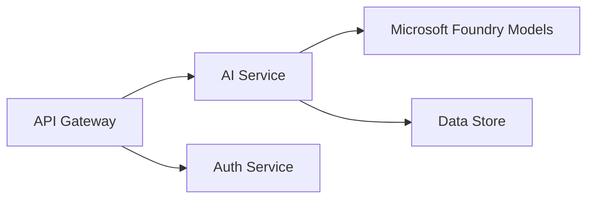

# باب 8: پیداوار اور انٹرپرائز پیٹرنز

**📚 کورس**: [AZD برائے ابتدائی افراد](../../README.md) | **⏱️ دورانیہ**: 2-3 گھنٹے | **⭐ پیچیدگی**: پیشرفتہ

---

## جائزہ

یہ باب انٹرپرائز کے لیے تیار تعیناتی کے پیٹرنز، سیکیورٹی ہارڈننگ، نگرانی، اور پیداواری AI ورک لوڈز کے لیے لاگت کی اصلاح پر مشتمل ہے۔

یہ ایک معماری حوالہ ہے، مکمل قابل تعیناتی پیداواری ٹیمپلیٹ نہیں۔ مثالیں انضمام کی تفصیلات چھوڑ دیتی ہیں جو آپ کی اپنی ایپلیکیشن میں فراہم کی جانی اور جانچی جانی چاہیے؛ چیک لسٹ پڑھنا پیداواری تیاری کی تصدیق نہیں کرتا۔

> **Foundry GA اپ ڈیٹ (2026-11-09):** Foundry ورک فلو کے لیے `azd >= 1.37.0` اور عام دستیاب `microsoft.foundry` 1.0 بنڈل استعمال کریں؛ جائزے علیحدہ انسٹال ہوتے ہیں۔ ملاحظہ کریں [ریلیز دائرہ کار اور مائیگریشن](production-ai-practices.md#recent-release-changes-and-fixes) اور [مصدقہ پائپ لائن کی مثال](production-ai-practices.md#cicd-pipeline-configuration)۔ یہ دستاویزات کا جائزہ ہے، براہ راست تعیناتی کی توثیق یا اختیاری پِری ویو فیچرز کے لیے عمومی GA حیثیت نہیں۔

## تعلیمی مقاصد

اس باب کو مکمل کرنے کے بعد، آپ:
- متعدد خطوں میں لچکدار ایپلیکیشنز تعینات کریں گے
- انٹرپرائز سیکیورٹی پیٹرنز نافذ کریں گے
- جامع نگرانی ترتیب دیں گے
- پیمانے پر لاگت کی اصلاح کریں گے
- AZD کے ساتھ CI/CD پائپ لائنز قائم کریں گے

---

## 📚 اسباق

| # | سبق | تفصیل | وقت |
|---|--------|-------------|------|
| 1 | [پیداواری AI طریقے](production-ai-practices.md) | انٹرپرائز تعیناتی کے پیٹرنز | 90 منٹ |

---

## 🚀 پیداوار چیک لسٹ

- [ ] لچک کے لیے متعدد خطوں میں تعیناتی
- [ ] توثیق کے لیے منیجڈ شناخت (کوئی کیز نہیں)
- [ ] نگرانی کے لیے ایپلیکیشن انسائٹس
- [ ] لاگت کے بجٹ اور انتباہات ترتیب دیے گئے
- [ ] سیکیورٹی اسکیننگ فعال کی گئی
- [ ] CI/CD پائپ لائن انضمام
- [ ] آفت کی بازیابی کا منصوبہ

---

## 🏗️ معماری پیٹرنز

### پیٹرن 1: مائیکروسروسز AI



### پیٹرن 2: ایونٹ ڈرائیون AI


---

## 🔐 سیکیورٹی بہترین طریقے

```bicep
// Illustrative properties from different resources, NOT a standalone Bicep file.
// Attach identity to the application host:
identity: {
  type: 'SystemAssigned'
}

// AI account properties (also require private endpoints, DNS and app connectivity):
properties: {
  publicNetworkAccess: 'Disabled'
  networkAcls: {
    defaultAction: 'Deny'
  }
}
```

---

## 💰 لاگت کی بہتری

| حکمت عملی | بنیادی پابندی |
|----------|---------|
| صفر تک پیمانہ (کنٹینر ایپس) | مناسب ٹرگر کی ضرورت ہے؛ دوسری خدمات پر لاگت آتی رہتی ہے |
| ڈیولپمنٹ کے لیے کنزمپشن ٹیرز استعمال کریں | منتخب کردہ سروس کی قیمت اور ورک لوڈ کا موازنہ کریں |
| شیڈول شدہ سکالنگ | معاونت یافتہ انفراسٹرکچر/آٹومیشن کے ذریعے پیمانہ بڑھائیں |
| ریزرویشنز/پروویژند صلاحیت | صرف جب سپورٹڈ ہو؛ وعدے غیر فعال لاگت بڑھا سکتے ہیں |

ایک درست شروع ہونے کی تاریخ، بلنگ دائرہ کار، وصول کنندگان، اور اجازتوں کے ساتھ [مکمل بجٹ ریسورس پیٹرن](production-ai-practices.md#2-cost-monitoring-and-budgets) استعمال کریں۔ بجٹ انتباہات بھیجتا ہے؛ یہ خرچ کی حد نہیں لگاتا۔ بچت پیمائش شدہ استعمال پر منحصر ہوتی ہے اور ضمانت یافتہ فیصد نہیں ہوتی۔

---

## 📊 نگرانی کی ترتیب

```bash
# Open the Application Insights logs view (requires configured monitoring)
azd monitor --logs

# Check Application Insights
azd monitor --overview

# View metrics
az monitor metrics list --resource <resource-id>
```

---

## 🔗 نیویگیشن

| سمت | باب |
|-----------|---------|
| **پچھلا** | [باب 7: مسئلے حل کرنا](../chapter-07-troubleshooting/README.md) |
| **کورس مکمل** | [کورس ہوم](../../README.md) |

---

## 📖 متعلقہ وسائل

- [AI ایجنٹس گائیڈ](../chapter-02-ai-development/agents.md)
- [ایپلیکیشن انسائٹس](../chapter-06-pre-deployment/application-insights.md)
- [متعدد ایجنٹ حل](../chapter-05-multi-agent/README.md)
- [مائیکروسروسز کی مثال](../../examples/microservices/README.md)

---

<!-- CO-OP TRANSLATOR DISCLAIMER START -->
**ڈس کلیمر**:
یہ دستاویز AI ترجمہ سروس [Co-op Translator](https://github.com/Azure/co-op-translator) کے ذریعے ترجمہ کی گئی ہے۔ جبکہ ہم درستگی کے لیے کوشاں ہیں، براہ کرم اس بات سے آگاہ رہیں کہ خودکار ترجمے میں غلطیاں یا عدم درستیاں ہو سکتی ہیں۔ اصل دستاویز اپنے مادری زبان میں مستند ماخذ سمجھی جائے گی۔ حساس معلومات کے لیے پیشہ ور انسانی ترجمہ کی سفارش کی جاتی ہے۔ اس ترجمے کے استعمال سے پیدا ہونے والی کسی بھی غلط فہمی یا غلط تشریح کی ذمہ داری ہم قبول نہیں کرتے۔
<!-- CO-OP TRANSLATOR DISCLAIMER END -->