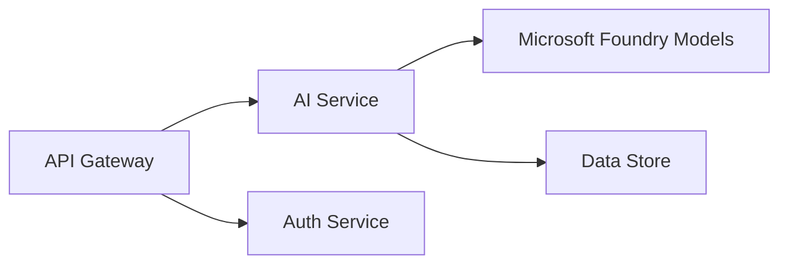

# باب 8: پیداواری اور انٹرپرائز پیٹرنز

**📚 کورس**: [AZD برائے مبتدئین](../../README.md) | **⏱️ دورانیہ**: 2-3 گھنٹے | **⭐ پیچیدگی**: اعلیٰ

---

## جائزہ

یہ باب انٹرپرائز کے لیے تیار شدہ تعیناتی کے نمونے، سیکیورٹی کی مضبوطی، نگرانی، اور پیداواری AI کاموں کے لیے لاگت کی بہتری کا احاطہ کرتا ہے۔

یہ ایک تعمیراتی حوالہ ہے، مکمل تعیناتی والے پیداواری ٹیمپلیٹ نہیں۔ مثالیں انضمامی تفصیلات کو چھوڑ دیتی ہیں جو آپ کی اپنی ایپلیکیشن میں فراہم اور جانچی جانی چاہئیں؛ چیک لسٹ پڑھنا پیداواری تیاری کی تصدیق نہیں کرتا۔

> **ریلیز کا جائزہ (2026-11-04):** AI CLI گائیڈنس `azd 1.37.2`، ایجنٹس `1.0.0-beta.23`، اور جائزوں `1.0.0-beta.2` دستاویزات/ماخذ کے خلاف چیک کی گئی۔ مطابقت کی ضروریات اور مائیگریشن کی تفصیلات کے لیے [ریلیز تبدیلیاں اور اصلاحات](production-ai-practices.md#recent-release-changes-and-fixes) دیکھیں؛ یہ لائیو تعیناتی کی تصدیق نہیں ہے۔

## تعلیمی مقاصد

اس باب کو مکمل کرکے، آپ:
- کثیر خطوں میں مضبوط ایپلیکیشنز تعینات کریں گے
- انٹرپرائز سیکیورٹی پیٹرنز نافذ کریں گے
- جامع نگرانی ترتیب دیں گے
- پیمانے پر لاگت کی اصلاح کریں گے
- AZD کے ساتھ CI/CD پائپ لائنز قائم کریں گے

---

## 📚 اسباق

| # | سبق | وضاحت | وقت |
|---|--------|-------------|------|
| 1 | [پیداواری AI طریقے](production-ai-practices.md) | انٹرپرائز تعیناتی کے نمونے | 90 منٹ |

---

## 🚀 پیداواری چیک لسٹ

- [ ] مضبوطی کے لیے کثیر خطوں میں تعیناتی
- [ ] توثیق کے لیے منظم کردہ شناخت (کوئی کلیدیں نہیں)
- [ ] نگرانی کے لیے ایپلیکیشن انسائٹس
- [ ] لاگتی بجٹس اور انتباہات کی ترتیب
- [ ] سیکیورٹی اسکیننگ فعال
- [ ] CI/CD پائپ لائن انضمام
- [ ] آفت کی بازیابی کا منصوبہ

---

## 🏗️ تعمیراتی نمونے

### پیٹرن 1: مائیکروسروسز AI



### پیٹرن 2: ایونٹ ڈرائیون AI


---

## 🔐 سیکیورٹی کے بہترین طریقے

```bicep
// Illustrative properties from different resources, NOT a standalone Bicep file.
// Attach identity to the application host:
identity: {
  type: 'SystemAssigned'
}

// AI account properties (also require private endpoints, DNS and app connectivity):
properties: {
  publicNetworkAccess: 'Disabled'
  networkAcls: {
    defaultAction: 'Deny'
  }
}
```

---

## 💰 لاگت کی بہتری

| حکمت عملی | اہم پابندی |
|----------|---------|
| زیرو تک پیمانہ (کنٹینر ایپس) | ایک مناسب ٹریگر کی ضرورت؛ دیگر خدمات پر لاگت جاری رہتی ہے |
| ترقی کے لیے صارفیت درجات کا استعمال | منتخب شدہ خدمت کی قیمت اور کام کا موازنہ کریں |
| شیڈیول کردہ پیمانہ | معاونت شدہ بنیادی ڈھانچہ / خودکار کاری کے ذریعے پیمانہ بنائیں |
| ریزرویشن/پروویژنڈ صلاحیت | صرف جب معاون ہو؛ وعدے فارغ لاگت بڑھا سکتے ہیں |

درست آغاز تاریخ، بلنگ دائرہ کار، وصول کنندگان، اور اجازت ناموں کے ساتھ [مکمل بجٹ وسیلہ نمونہ](production-ai-practices.md#2-cost-monitoring-and-budgets) استعمال کریں۔ بجٹ الرٹس بھیجتا ہے؛ یہ خرچ کی حد مقرر نہیں کرتا۔ بچت ماپے گئے استعمال پر منحصر ہوتی ہے اور یہ ضمانتی فیصد نہیں ہوتی۔

---

## 📊 مانیٹرنگ سیٹ اپ

```bash
# Open the Application Insights logs view (requires configured monitoring)
azd monitor --logs

# Check Application Insights
azd monitor --overview

# View metrics
az monitor metrics list --resource <resource-id>
```

---

## 🔗 نیویگیشن

| سمت | باب |
|-----------|---------|
| **پچھلا** | [باب 7: مسئلے کا حل](../chapter-07-troubleshooting/README.md) |
| **کورس مکمل** | [کورس کا ہوم پیج](../../README.md) |

---

## 📖 متعلقہ وسائل

- [AI ایجنٹس گائیڈ](../chapter-02-ai-development/agents.md)
- [ایپلیکیشن انسائٹس](../chapter-06-pre-deployment/application-insights.md)
- [کئی ایجنٹ حل](../chapter-05-multi-agent/README.md)
- [مائیکروسروسز کی مثال](../../examples/microservices/README.md)

---

<!-- CO-OP TRANSLATOR DISCLAIMER START -->
**ڈس کلیمر**:
یہ دستاویز AI ترجمہ سروس [Co-op Translator](https://github.com/Azure/co-op-translator) کے ذریعے ترجمہ کی گئی ہے۔ جبکہ ہم درستگی کے لیے کوشاں ہیں، براہ کرم اس بات سے آگاہ رہیں کہ خودکار ترجمے میں غلطیاں یا عدم درستیاں ہو سکتی ہیں۔ اصل دستاویز اپنے مادری زبان میں مستند ماخذ سمجھی جائے گی۔ حساس معلومات کے لیے پیشہ ور انسانی ترجمہ کی سفارش کی جاتی ہے۔ اس ترجمے کے استعمال سے پیدا ہونے والی کسی بھی غلط فہمی یا غلط تشریح کی ذمہ داری ہم قبول نہیں کرتے۔
<!-- CO-OP TRANSLATOR DISCLAIMER END -->