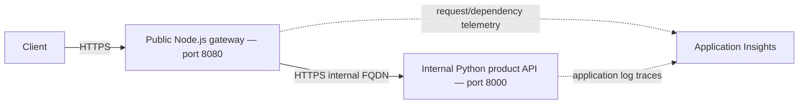

# دو سروسز مائیکرو سروسز — Azure Container Apps

**سطح:** متوسط · **وقت:** 45–60 منٹ سیٹ اپ سمیت

یہ لرننگ سیمپل ایک **Node.js API گیٹ وے** اور ایک **صرف پڑھنے والا Python
پروڈکٹ سروس** کو نافذ کرتا ہے۔ سورس، Dockerfiles، Bicep، اور azd کنفیگریشن شامل ہیں۔
یہ ایک پروڈکشن ہارڈنڈ سسٹم نہیں ہے۔

## آپ کیا سیکھیں گے

- دو سروسز کو آزادانہ طور پر تعینات کریں۔
- HTTPS پر ایک داخلی بیک اینڈ FQDN استعمال کریں۔
- کامیاب، نہ ملنے، اور غیر دستیاب سروس کے جوابات کی تصدیق کریں۔
- ٹیلی میٹری اور آزادانہ اسکیلنگ کی حدوں کو سمجھیں۔



پروڈکٹ کیٹلاگ میں میموری میں پانچ مقررہ مصنوعات ہیں۔ **کوئی POST،  
PUT، یا DELETE ہینڈلرز نہیں ہیں**، ڈیٹابیس، سروس بس، آرڈر/یوزر/نوٹیفیکیشن سروس،  
C#، یا Go کوڈ نہیں ہے۔ یہ مستقبل کی ترقی کے آئیڈیاز ہیں، شامل فیچرز نہیں۔  
گیٹ وے صارفین کو تصدیق نہیں کرتا؛ داخلی ان گریس درخواست کے اجازت نامے کا نعم البدل نہیں ہے۔  
 

## ضروریات  

پہلے [سنگل Flask API](../../../../../examples/container-app/simple-flask-api) مکمل کریں۔  
ایک موجودہ مستحکم azd انسٹال کریں (جائزہ کے وقت شائع شدہ ریلیز: 1.37.2)، Azure CLI،  
اور Docker جس کا ڈیمن چل رہا ہو۔ آپ کو Azure سبسکرپشن، وسائل بنانے کی اجازتیں،  
اور Container Apps علاقائی کوٹہ درکار ہے۔  

```bash
azd version
az version
docker info
azd auth login
az login
```
  
دونوں CLI ٹولز میں وہی سبسکرپشن استعمال کریں۔ نیچے دیئے گئے کمانڈز Bash استعمال کرتے ہیں۔  

## تعیناتی اور تصدیق  

ذخیرہ جاتی جڑ سے:  

```bash
cd examples/container-app/microservices
azd env new microservices-demo
azd up
GATEWAY_URL=$(azd env get-value API_GATEWAY_URL)
RG_NAME=$(azd env get-value AZURE_RESOURCE_GROUP)
GATEWAY_NAME=$(azd env get-value API_GATEWAY_NAME)
PRODUCT_NAME=$(azd env get-value PRODUCT_SERVICE_NAME)

curl --fail-with-body "${GATEWAY_URL}/health"
curl --fail-with-body "${GATEWAY_URL}/api/products"
curl --fail-with-body "${GATEWAY_URL}/api/products/1"
curl -i "${GATEWAY_URL}/api/products/999"
```
  
**کامیابی:** health 200؛ فہرست 200 کے ساتھ **پانچ** مصنوعات؛ پروڈکٹ 1 ایک لیپ ٹاپ ہے  
جس کی قیمت 999.99 ہے اور اسٹاک 50 ہے؛ نامعلوم پروڈکٹ 404 لوٹاتی ہے۔  
تفصیلات جوابات میں شامل ہیں؛ ٹائم اسٹیمپس مختلف ہوتے ہیں۔  

ابتدائی فراہمی پبلک hello-world تصاویر پورٹ 80 پر استعمال کرتی ہے تاکہ یہ  
خالی رجسٹری سے غیر موجود تصاویر نہ کھینچے۔ سروس مخصوص بائسک ماڈیولز  
اور پیرامیٹر فائلیں انہیں بنائی گئی تصاویر اور ایپ پورٹس/پروبز سے تبدیل کرتی ہیں جب  
`azd deploy`۔ اہم پیرامیٹر بعد میں فراہمی کے لیے شائع شدہ امیج نام محفوظ کرتے ہیں۔  

## خدمات اور نیٹ ورکنگ  

| سروس | ظاہری اختتامی پوائنٹس | ڈیفالٹ وسائل |  
|---|---|---|  
| گیٹ وے | GET `/`، `/health`، `/api/products`، `/api/products/:id` | 1 vCPU، 2 GiB، 2–20 نقول |  
| پروڈکٹ | GET `/`، `/health`، `/products`، `/products/<id>` | 0.5 vCPU، 1 GiB، 1–10 نقول |  

پروڈکٹ انگریس میں `external: false` اور `allowInsecure: false` شامل ہیں۔ بائسک  
`PRODUCT_SERVICE_URL=https://<actual-internal-fqdn>` کو گیٹ وے میں انجیکٹ کرتا ہے۔ HTTP  
ری ڈائریکٹ؛ HTTPS ترتیب دیے گئے انگریس سے میل کھاتا ہے۔ ایک مختصر DNS نام کو میل کھانا چاہیے
**حقیقی کنٹینر ایپ کا نام**, منطقی سروس کی کلید `product-service` نہیں۔
اپنا لیپ ٹاپ سے براہِ راست داخلی URL کو کال کرنے کی کوشش نہ کریں۔

گیٹ وے کے پاس پروڈکٹ کالز کے لیے پانچ سیکنڈ کی ٹائم آؤٹ ہے۔ گمشدہ پروڈکٹ IDs
404 کے طور پر پھیلتی ہیں؛ ٹرانسپورٹ کی ناکامیاں/دیگر بیک اینڈ کی ناکامیاں 503 واپس کرتی ہیں۔ گیٹ وے
`/health` صرف گیٹ وے چیک کرتا ہے، بیک اینڈ کی دستیابی نہیں۔

## فائلیں اور کنفیگریشن

```text
azure.yaml
infra/main.bicep
infra/main.parameters.json
infra/abbreviations.json
infra/core/container-apps-environment.bicep
infra/core/monitor.bicep
infra/app/api-gateway.bicep
infra/app/api-gateway.parameters.json
infra/app/product-service.bicep
infra/app/product-service.parameters.json
src/api-gateway/{app.js,package.json,Dockerfile}
src/product-service/{main.py,requirements.txt,Dockerfile}
```

اسکیلنگ، CPU/میموری، پورٹس، اور پروبز `infra/app/*.bicep` میں سیٹ کیے جاتے ہیں۔ ان
فائلوں کو بدلیں اور چھوڑیں `azd up` تاکہ انفراسٹرکچر اپلائی اور دوبارہ تعینات ہو۔ اس نمونے میں کوئی
`GATEWAY_MAX_REPLICAS` ماحول متغیر پیرامیٹر نہیں ہے۔

صرف کوڈ میں تبدیلیوں کے لیے:

```bash
azd deploy product-service
azd deploy api-gateway
```

نوڈ امیج نوڈ 22 استعمال کرتی ہے؛ پائتھن امیج پائتھن 3.11 استعمال کرتی ہے۔ دونوں بائنڈ کرتے ہیں
`0.0.0.0`۔ انگریس/پروبز بالترتیب پورٹ 8080 (گیٹ وے) اور 8000 (پروڈکٹ) استعمال کرتے ہیں۔

## Docker کے ساتھ مقامی ترقی

اس مثال کی ڈائریکٹری سے چلائیں۔ صارف کی تعریف کردہ نیٹ ورک استعمال کریں، **نہ کہ `localhost`
ایک کنٹینر سے دوسرے تک پہنچنے کے لیے**:

```bash
docker network create azd-microservices-demo
docker build -t local-product ./src/product-service
docker build -t local-gateway ./src/api-gateway
docker run -d --name azd-product --network azd-microservices-demo local-product
docker run -d --name azd-gateway --network azd-microservices-demo \
  -p 8080:8080 -e PRODUCT_SERVICE_URL=http://azd-product:8000 local-gateway
curl --fail-with-body http://localhost:8080/api/products
```

توقع کی جاتی ہے: پانچ مصنوعات۔ HTTP صرف اس مقامی Docker نیٹ ورک کے لیے استعمال ہوتا ہے۔

```bash
docker stop azd-product azd-gateway
docker rm azd-product azd-gateway
docker network rm azd-microservices-demo
```

## نگرانی

```bash
az containerapp logs show --name "$GATEWAY_NAME" --resource-group "$RG_NAME" --follow
# In a separate terminal:
az containerapp logs show --name "$PRODUCT_NAME" --resource-group "$RG_NAME" --tail 100
```

`azd monitor --logs` ایک پورٹل ویو کھولتا ہے؛ یہ ٹرمینل لاگز کو سٹریم نہیں کرتا۔
Node SDK گیٹ وے کی درخواستیں/انحصار جمع کرتا ہے۔ Python کا `AzureLogHandler`
**لاگ ٹریسز** برآمد کرتا ہے، خودکار Flask درخواستیں، SQL انحصار، یا مکمل
تقسیم شدہ ٹریسز نہیں۔ OpenCensus ایک پرانا SDK ہے؛ جب اس نمونے کو بڑھائیں تو Azure Monitor OpenTelemetry کو ترجیح دیں۔


Application Insights Logs میں، درخواستیں بنائیں اور معائنہ کریں:

```kusto
requests
| where timestamp > ago(1h)
| where name contains "products"
| summarize RequestCount=count(), AvgDuration=avg(duration) by bin(timestamp, 5m)
```

Python ایپلیکیشن پیغامات کے لیے:

```kusto
traces
| where timestamp > ago(1h)
| where message contains "products"
| project timestamp, message, severityLevel
```

انجماد میں تاخیر اور سیمپلنگ کی اجازت دیں؛ ایک عین درخواست کی تعداد یا ایک
یقینی کردہ تاخیر کی توقع نہ کریں۔ کوئی کسٹم الرٹس یا ڈیش بورڈز ترتیب نہیں دیئے گئے۔

## عملی مشقیں

### مشق 1: کیٹلاگ میں ترمیم کریں

**ابتدائی مقام:** `src/product-service/main.py`.
**مقصد:** آزاد سروس کی تعیناتی کی تصدیق کریں۔
Laptop کا اسٹاک 50 سے 49 میں تبدیل کریں مقررہ `products` فہرست میں، چلائیں
`azd deploy product-service`، پھر درخواست کریں `${GATEWAY_URL}/api/products/1`۔

**کامیابی کے معیار / حل:** HTTP 200 کے ساتھ `"stock":49`۔ 50 بحال کریں اور دوبارہ تعینات کریں۔
**عام مسئلہ:** گیٹ وے کی ترمیم کرنا بجائے اس سروس کے جو کیٹلاگ کی مالک ہو۔
اس سے ماخذ ڈیٹا تبدیل ہوتا ہے، مستقل انوینٹری ڈیٹا بیس نہیں۔

### مشق 2: ریپلیکا کنفیگریشن کی تصدیق کریں

**ابتدائی مقام:** `infra/app/product-service.bicep`.
**مقصد:** آٹوسکیلنگ کا اندازہ لگائے بغیر بنیادی ڈھانچے میں تبدیلی دیکھیں۔
`minReplicas: 1` کو `minReplicas: 2` میں تبدیل کریں، `azd up` چلائیں، پھر:

```bash
az containerapp show --name "$PRODUCT_NAME" --resource-group "$RG_NAME" \
  --query properties.template.scale -o json
```

**کامیابی کے معیار:** ترتیب یافتہ کم از کم 2 ہے اور زیادہ سے زیادہ 10 برقرار ہے۔
کم از کم 1 بحال کریں اور `azd up` چلائیں۔
**عام مسئلہ:** `azd deploy` اکیلا غیر متعلقہ مشترکہ بنیادی ڈھانچے پر تبدیلیاں لاگو نہیں کرتا۔
ناکامی کی مشابہت کے طور پر `maxReplicas` کو صفر پر سیٹ نہ کریں۔
یہ کنفیگریشن کی تصدیق کرتا ہے، لوڈ ٹیسٹ یا یقینی فوری ریپلیکا تعداد نہیں۔

### مشق 3: مقامی طور پر غیر دستیاب سروس کی ہینڈلنگ کا ٹیسٹ کریں

**ابتدائی مقام:** اوپر دونوں مقامی Docker کنٹینر چل رہے ہیں۔
**مقصد:** بیک اینڈ ناکامی کو گمشدہ پروڈکٹ سے تمیز دیں۔
صرف پروڈکٹ کنٹینر کو روکیں:

```bash
docker stop azd-product
curl -i http://localhost:8080/api/products
docker start azd-product
curl --fail-with-body http://localhost:8080/api/products
```

**کامیابی کے معیار:** جب روکا جائے، گیٹ وے 503 واپس کرے
`"error":"Product service unavailable"` کے ساتھ؛ دوبارہ شروع کے بعد، فہرست 200 واپس کرتی ہے۔
اگر ضروری ہو تو مختصر اسٹارٹ اپ تاخیر کے بعد دوبارہ کوشش کریں۔
**عام مسئلہ:** گیٹ وے کو روکنا ایک مختلف ناکامی کا ٹیسٹ کرتا ہے (کوئی HTTP جواب نہیں)۔

## اخراجات اور پیداوار کے خلاء

ڈیفالٹ کم از کم ریپلیکا کمپیوٹ کو چلتا رکھتا ہے۔ رجسٹری اور نگرانی بھی
چارجز لیتی ہے۔ کوئی تصدیق شدہ مقررہ $50/ماہ کل نہیں: علاقائی CPU/میموری کا اندازہ لگائیں،
ریپلیکا گھنٹے، درخواستیں، رجسٹری، اور لاگ برقرار رکھنے کو
[Azure پرائسنگ کیلکولیٹر](https://azure.microsoft.com/pricing/calculator/) میں۔
سیکھنے کے وسائل کو فوری طور پر حذف کریں۔

پیداواری کاموں میں تصدیق/اجازت، محدود شدہ انتظام شدہ شناختیں،
مستقل ڈیٹا، ان پٹ/جواب کی تصدیق، معاون مشاہداتی آلات،
لوڈ/ناکامی کی جانچ، CI/CD، الرٹس، اور بحالی کے طریقہ کار شامل ہیں۔ ایک آرڈر سروس،
قطار، یا ڈیٹا بیس شامل کرنا ایک الگ نفاذ کا کام ہے، ایک مکمل
مشق یا یہاں پہلے سے دستیاب فیچر نہیں۔

## مسئلہ حل کرنا اور صفائی

- **پہلی فراہمی کے دوران تصویر نہیں ملی:** بوٹ اسٹریپ کو عوامی تصویر استعمال کرنی چاہیے؛
  مرکزی تصویر کے پیرا میٹر کے ڈیفالٹس اور تعیناتی ماڈیول کے نقشے کی تصدیق کریں۔
- **503 مصنوعات:** پروڈکٹ لاگز، تصویر کی ترمیم، اور شامل کردہ اندرونی HTTPS URL چیک کریں۔
- **404 غیر متوقع راہ:** پروڈکٹ API صرف پڑھنے کے لیے ہے؛ راستہ کی تصدیق کریں، نہ کہ غیر موجود CRUD ہینڈلر۔
- **کوئی ٹیلی میٹری نہیں:** رن ٹائم کنکشن سٹرنگز کا معائنہ کریں بغیر ان کو ظاہر کیے اور
  انجماد میں تاخیر کی اجازت دیں۔ Python کی درخواست کی میزیں اس کے لاگ ہینڈلر کے ذریعے بھر نہیں جاتیں۔

اس نمونہ کی ڈائریکٹری سے:

```bash
azd down
```

حذف کرنے کی پرامپٹس کا جائزہ لیں اور مخصوص ریسورس گروپ کے ہٹانے کی تصدیق کریں۔

[پچھلا: Flask API](../../../../../examples/container-app/simple-flask-api) · [اگلا: ڈیٹا بیس ایپ](../../../../../examples/database-app) ·
[AI ترقی](../../../docs/chapter-02-ai-development/README.md) ·
[کورس ہوم](../../../README.md) · [مسئلہ رپورٹ کریں](https://github.com/microsoft/AZD-for-beginners/issues)

---

<!-- CO-OP TRANSLATOR DISCLAIMER START -->
**ڈس کلیمر**:
یہ دستاویز AI ترجمہ سروس [Co-op Translator](https://github.com/Azure/co-op-translator) کے ذریعے ترجمہ کی گئی ہے۔ جبکہ ہم درستگی کے لیے کوشاں ہیں، براہ کرم اس بات سے آگاہ رہیں کہ خودکار ترجمے میں غلطیاں یا عدم درستیاں ہو سکتی ہیں۔ اصل دستاویز اپنے مادری زبان میں مستند ماخذ سمجھی جائے گی۔ حساس معلومات کے لیے پیشہ ور انسانی ترجمہ کی سفارش کی جاتی ہے۔ اس ترجمے کے استعمال سے پیدا ہونے والی کسی بھی غلط فہمی یا غلط تشریح کی ذمہ داری ہم قبول نہیں کرتے۔
<!-- CO-OP TRANSLATOR DISCLAIMER END -->