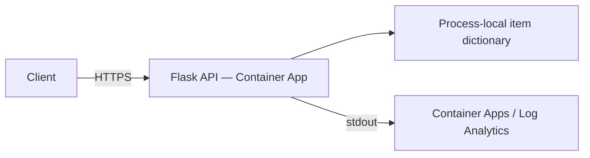

# سادہ فلاسک API — ایژر کنٹینر ایپس

**سطح:** ابتدائی · **وقت:** 30–45 منٹ بشمول سیٹ اپ

Azure Developer CLI (azd) کے ساتھ Python Flask CRUD API نافذ کریں۔ سورس، Dockerfile،
Bicep، اور تعیناتی کے پیرامیٹرز شامل ہیں۔ یہ ایک **تعلیمی نمونہ** ہے، نہ کہ
پروڈکشن کے لیے تیار API۔

## آپ کیا سیکھیں گے

- azd کے ذریعے ایک کنٹینر بنائیں اور شائع کریں۔
- انگریس اور لائیو نیس/ریڈی نیس پروبز ترتیب دیں۔
- CRUD ردعمل کی تصدیق کریں اور ایپلیکیشن لاگز کا معائنہ کریں۔
- سمجھیں کہ کیوں یادداشت میں ڈیٹا پائیدار ایپلیکیشنز کے لیے مناسب نہیں ہے۔



**اہم:** آئٹمز ایک ہی عمل میں رکھے جاتے ہیں۔ ڈیفالٹ ہے **ایک گنیکورن ورکر،
0–1 نقلیں**، خاص طور پر ورکرز/نقلوں کے درمیان غیر متناسق ڈیٹا سے بچنے کے لیے۔
آئٹمز ری اسٹارٹ، نظرثانی کی تبدیلی، یا صفر تک اسکیل کرنے پر ختم ہو جاتے ہیں۔
نقلوں میں اضافے کے لیے مشترکہ مستقل اسٹوریج کی ضرورت ہوتی ہے۔ API میں کوئی توثیق یا اجازت نہیں ہے۔

## شرائط

- [موجودہ مستحکم azd](https://learn.microsoft.com/azure/developer/azure-developer-cli/install-azd)
  (ریویو کے وقت شائع شدہ ریلیز: 1.37.2)۔
- تصدیق کے لیے [Azure CLI](https://learn.microsoft.com/cli/azure/install-azure-cli)۔
- Docker جس کا ڈیمان چل رہا ہو؛ یہ ڈیفالٹ لوکل امیج بیلڈ کے لیے ضروری ہے۔
- Azure سبسکرپشن، وسائل بنانے کی اجازتیں، اور کنٹینر ایپس علاقائی کوٹا۔
- نیچے والے کمانڈز کے لیے Bash (یا مساوی PowerShell)۔
- اختیاری لوکل ڈیولپمنٹ کے لیے Python 3.11۔

```bash
azd version
az version
docker info
azd auth login
az login
```

CLI ٹولز کے علیحدہ لاگ ان سیشنز ہوتے ہیں۔ دونوں میں ایک ہی سبسکرپشن استعمال کریں۔

## جلد آغاز

مخزن کی روٹ سے:

```bash
cd examples/container-app/simple-flask-api
azd env new flask-demo
azd up
API_URL=$(azd env get-value API_ENDPOINT)
RG_NAME=$(azd env get-value AZURE_RESOURCE_GROUP)
API_NAME=$(azd env get-value API_NAME)
curl --fail-with-body "${API_URL}/health"
```

متوقع: HTTP 200 اور JSON جس میں `"status":"healthy"`،
`"service":"simple-flask-api"`، اور موجودہ UTC ٹائم اسٹیمپ ہوں۔
پروویژنینگ اور امیج کی تعمیر معمولاً چند منٹ لیتے ہیں؛ وقت مختلف ہو سکتا ہے۔

ابتدائی پروویژنینگ ایک پبلک hello-world امیج استعمال کرتا ہے جو پورٹ 80 پر سن رہا ہوتا ہے۔
`azure.yaml` میں `infra/app/api.bicep` اور اس کے مماثل پیرامیٹر فائل کو منتخب کرتا ہے
سروس کی تعیناتی کے لیے، جو امیج، انگریس، اور پروبز کو پورٹ 8000 پر تبدیل کرتا ہے۔
ان تعیناتی کے پیرامیٹرز کو حذف نہ کریں۔

## CRUD کی تصدیق کریں

درج ذیل کو تسلسل سے چلائیں جب تک ایک ہی نقل فعال رہے:

```bash
# Create: HTTP 201; note the returned id (1 for a fresh process).
curl -i -X POST "${API_URL}/api/items" \
  -H "Content-Type: application/json" \
  -d '{"name":"Test Item","description":"My first item"}'

# Read list: HTTP 200, total 1 in a fresh process.
curl --fail-with-body "${API_URL}/api/items"

# Replace 1 if your create response returned another id.
curl --fail-with-body "${API_URL}/api/items/1"
curl -i -X PUT "${API_URL}/api/items/1" \
  -H "Content-Type: application/json" -d '{"name":"Updated Item"}'
curl -i -X DELETE "${API_URL}/api/items/1"
curl -i "${API_URL}/api/items/1"
```

کامیابی: POST 201، پڑھنا/PUT 200، DELETE 204 بغیر جسم کے، پھر غیر موجود آئٹم 404۔
خراب یا غیر آبجیکٹ JSON یا خالی نام 400 لوٹاتا ہے۔
اگر کسی درخواست کے درمیان آئٹم غائب ہو جائے، تو ری اسٹارٹ یا صفر تک اسکیل چیک کریں؛
یہ یادداشت کی حد بندی ہے، مستقل نہیں۔

| اینڈپوائنٹ | میتھڈز |
|---|---|
| `/` | GET — سروس معلومات |
| `/health` | GET — لائیو نیس/ریڈی نیس |
| `/api/items` | GET، POST |
| `/api/items/{id}` | GET، PUT، DELETE |

## لاگز اور ترتیب

```bash
az containerapp logs show --name "$API_NAME" --resource-group "$RG_NAME" --follow
```

متوقع: گنیکورن کے آغاز کی معلومات، درخواست کی رسائی کے لاگز، اور ایپلیکیشن کے پیغامات۔
`azd monitor --logs` ایک پورٹل ویو کھولتا ہے؛ یہ ٹرمینل کو سٹریم نہیں کرتا۔
ایپلیکیشن انسائٹس پروویژینڈ ہے لیکن **اس فلاسک کوڈ کے ذریعے انسٹرومنٹ نہیں کیا گیا**؛
stdout لاگز کے لیے کنٹینر ایپس/لاگ اینالٹکس استعمال کریں۔

CPU/میموری، نقل کی حد، یا اسکیل رولز کے لیے `infra/app/api.bicep` کو ایڈٹ کریں، پھر
`azd up` چلائیں۔ ڈیفالٹ 0.5 vCPU، 1 GiB، کم از کم 0 / زیادہ سے زیادہ 1 نقل، اور ایک
HTTP حد 50 ہم وقت درخواستیں ہے۔ صفر تک اسکیل کرنے سے کولڈ اسٹارٹ کی تاخیر ہو سکتی ہے۔

من مانی `azd env set MAX_REPLICAS`، `API_KEY`، `LOG_LEVEL`، یا
`SCALE_TO_ZERO_TIMEOUT` اقدار **اس ٹیمپلیٹ یا ایپ سے منسلک نہیں ہیں**۔
قدر سیٹ کرنے سے خود بخود اسے رن ٹائم ماحول متغیر نہیں بنایا جاتا۔
امیج صریحاً پورٹ 8000 کو باندھتا ہے؛ پورٹ تبدیل کرتے ہوئے Dockerfile، Bicep انگریس، اور پروبز کو
ایک ساتھ اپ ڈیٹ کریں۔

## فائلز

```text
azure.yaml
infra/main.bicep
infra/main.parameters.json
infra/app/container-apps.bicep       # Environment, registry, monitoring
infra/app/api.bicep                  # App, ingress, probes, scale settings
infra/app/api.parameters.json        # Image and resource values for azd deploy
src/app.py
src/Dockerfile
src/requirements.txt
```

## لوکل ڈیولپمنٹ

اس مثال کے ڈائریکٹری سے:

```bash
python -m venv .venv
source .venv/bin/activate  # PowerShell: .\.venv\Scripts\Activate.ps1
python -m pip install -r src/requirements.txt
python src/app.py
```

دوسرے ٹرمینل میں `http://localhost:8000/health` اور CRUD اینڈپوائنٹس آزمائیں۔
یا اصل امیج کو بنائیں اور چلائیں:

```bash
docker build -t flask-api:local ./src
docker run --rm -p 8000:8000 flask-api:local
```

پہلی تعیناتی کے بعد صرف کوڈ تبدیلیوں کے لیے، `azd deploy api` چلائیں۔
Bicep تبدیلیوں کے لیے، دوبارہ پروویژن اور تعیناتی کے لیے `azd up` چلائیں۔

## عملی مشقیں

### 1. ان پٹ ریجیکشن کی تصدیق کریں

**شروع کرنے کا مقام:** تعینات شدہ API، اوپر `API_URL`۔
**مقصد:** یہ تصدیق کریں کہ API غلط JSON ساخت اور غائب نام کو رد کرتا ہے۔

```bash
curl -i -X POST "${API_URL}/api/items" \
  -H "Content-Type: application/json" -d '[]'
curl -i -X POST "${API_URL}/api/items" \
  -H "Content-Type: application/json" -d '{"name":""}'
```

**کامیابی کا معیار / حل:** دونوں 400 کے ساتھ JSON غلطی لوٹاتے ہیں، 500 نہیں۔
**عام مسئلہ:** JSON کونٹینٹ-ٹائپ ہیڈر کو شامل نہ کرنا۔

### 2. صرف پڑھنے والا ورژن اینڈپوائنٹ شامل کریں

**شروع کرنے کا مقام:** `src/app.py`۔ **مقصد:** API کو بڑھانا اور دوبارہ تعینات کرنا۔
`if __name__ == '__main__':` بلاک سے پہلے یہ شامل کریں:

```python
@app.route('/version', methods=['GET'])
def version():
    return jsonify({'version': '1.0.0'})
```

`azd deploy api` چلائیں، پھر `curl --fail-with-body "${API_URL}/version"`۔
**کامیابی کا معیار:** HTTP 200 اور `{"version":"1.0.0"}`۔
**عام مسئلہ:** بلاک کرنے والی `app.run()` کال کے بعد راستہ ڈالنا جب
`python src/app.py` سے ٹیسٹ کیا جا رہا ہو۔

### علم کا نقطہ چیک

ایک ورکر پائیدار ڈیٹا کے لیے ناکافی کیوں ہے؟ کیونکہ ایک بھی عمل ری اسٹارٹ پر
اپنی لغت کھو دیتا ہے۔ پروڈکشن ورژن کو مستقل مشترکہ اسٹوریج،
توثیق، اجازت، مائیگریشنز، ٹیسٹ، اور آپریشنل مانیٹرنگ کی ضرورت ہوتی ہے۔

## اخراجات اور مسائل کا حل

یہ ایک یقینی $0 تعیناتی نہیں ہے: بنیادی رجسٹری اور لاگ اسٹوریج/انجیکشن
اس وقت بھی چارجز لا سکتے ہیں جب ایپ کمپیوٹ صفر پر ہو۔ اپنے علاقے کے لیے
[قیمت کا کیلکولیٹر](https://azure.microsoft.com/pricing/calculator/) استعمال کریں۔

- **Docker کی تعمیر ناکام:** `docker info`، نیٹ ورک رسائی، اور انحصارات کی تصدیق کریں۔
- **غیر صحت مند ایپ:** کنسول/سسٹم لاگز کا جائزہ لیں اور امیج پورٹ، انگریس،
  اور پروبز کی ہم آہنگی کی تصدیق کریں۔ Flask پورٹ پر پلیس ہولڈر کی جانچ نہ کریں۔
- **403/اجازت:** سبسکرپشن اور وسائل بنانے کی اجازت کی تصدیق کریں۔
- **آئٹمز غائب ہو جاتے ہیں:** ری اسٹارٹ/صفر تک اسکیل پر یادداشت کی حالت ری سیٹ ہوتی ہے؛
  پائیدار رویے کے لیے ڈیٹابیس شامل کریں۔

## صفائی اور اگلے اقدامات

```bash
azd down
```

حذف کرنے کے پیغام کا جائزہ لیں اور مخصوص ریسورس گروپ کے ہٹ جانے کی تصدیق کریں۔
غیر متعلقہ ڈیٹا والے ریسورس گروپ کے خلاف تباہ کن صفائی استعمال نہ کریں۔

[اگلا: ڈیٹابیس ایپ](../../../../../examples/database-app) · [مائیکرو سروسز](../../../../../examples/container-app/microservices) ·
[کنٹینر جائزہ](../README.md) · [کورس ہوم](../../../README.md) ·
[مسئلہ رپورٹ کریں](https://github.com/microsoft/AZD-for-beginners/issues)

---

<!-- CO-OP TRANSLATOR DISCLAIMER START -->
**ڈس کلیمر**:
یہ دستاویز AI ترجمہ سروس [Co-op Translator](https://github.com/Azure/co-op-translator) کے ذریعے ترجمہ کی گئی ہے۔ جبکہ ہم درستگی کے لیے کوشاں ہیں، براہ کرم اس بات سے آگاہ رہیں کہ خودکار ترجمے میں غلطیاں یا عدم درستیاں ہو سکتی ہیں۔ اصل دستاویز اپنے مادری زبان میں مستند ماخذ سمجھی جائے گی۔ حساس معلومات کے لیے پیشہ ور انسانی ترجمہ کی سفارش کی جاتی ہے۔ اس ترجمے کے استعمال سے پیدا ہونے والی کسی بھی غلط فہمی یا غلط تشریح کی ذمہ داری ہم قبول نہیں کرتے۔
<!-- CO-OP TRANSLATOR DISCLAIMER END -->