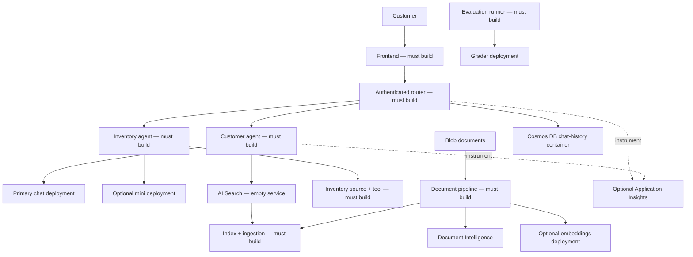

# ملٹی ایجنٹ کسٹمر سپورٹ — ریٹیل آرکیٹیکچر بلیو پرنٹ

**باب 5: ملٹی ایجنٹ اے آئی حل**

- [کورس کا ہوم](../README.md)
- [باب 5](../docs/chapter-05-multi-agent/README.md)
- [پری ریکوزیشن: AI انٹیگریشن](../docs/chapter-02-ai-development/microsoft-foundry-integration.md)
- [اگلا: گنجائش کی منصوبہ بندی](../docs/chapter-06-pre-deployment/capacity-planning.md)
- [ARM انفراسٹرکچر سکیفولڈ](retail-multiagent-arm-template/README.md)

> **آرکیٹیکچر کا رہنما، ایک کام کرنے والی ایپلیکیشن نہیں۔** واحد ریٹیل نفاذ
> فائلز ہیں `azuredeploy.json`، `azuredeploy.parameters.json`، اور `deploy.sh` میں
> `retail-multiagent-arm-template/`۔ راؤٹر/فرنٹ اینڈ کنٹینرز ہیلو ورلڈ
> پلیس ہولڈرز ہیں۔ کوئی ریٹیل ایجنٹ، یوزر انٹرفیس، انجیکشن پائپ لائن، ایویلیوئیٹر، اسکینر، یا
> ایپلیکیشن ٹیسٹ سوئٹ مقامی طور پر موجود نہیں ہے۔

## جائزہ

**هدف:** ایک کسٹمر سپورٹ سسٹم ڈیزائن کرنا جس میں ایک کسٹمر ایجنٹ اور ایک انوینٹری
ایجنٹ ہو، یہ شناخت کرنا کہ انفراسٹرکچر کیا فراہم کرتا ہے، اور 
گمشدہ ایپلیکیشن کنٹریکٹس اور توثیق کی منصوبہ بندی کرنا۔

**ناظرین:** وہ ڈویلپرز جنہوں نے لوکل
[چیٹ نمونہ](../../../examples/azure-openai-chat) اور [دو-سروس کنٹینر نمونہ](../../../examples/container-app/microservices) مکمل کیا ہے۔
فن تعمیر کا مطالعہ کرنے کے لیے 2–3 گھنٹے مختص کریں۔ ایپلیکیشن کی تعمیر ایک الگ
پروجیکٹ ہے: تجربہ کار ڈویلپرز کے لیے 80–120 ترقیاتی گھنٹے ایک تخمینا منصوبہ بندی ہے،
**ڈلیوری کی ضمانت نہیں**؛ پیداواری ہارڈننگ، ٹیسٹ،
سیکورٹی جائزہ، اور آپریشنز کے لیے اضافی کام درکار ہے۔

### سیکھنے کے نتائج

- روٹنگ، گراؤنڈنگ، ٹول اجازت نامے، اور بات چیت کی ملکیت کی وضاحت کریں۔
- ماڈل شناخت کاروں، ڈپلائمنٹ ناموں، API ورژنز، اور ARM ورژنز کو فرق کریں۔
- دستاویز انجیسیشن اور بازیافت کو میچ کرنے والے ویکٹر ابعاد کے ساتھ ڈیزائن کریں۔
- قابل تصدیق فنکشنل، جائزہ، اور ناکامی کی بحالی کی ضروریات کی تعریف کریں۔
- اختیاری فن تعمیر کے مقاصد کو حقیقت میں فراہم کردہ وسائل سے الگ کریں۔

## حل کا فن تعمیر



یہ ایک **ہدف ایپلیکیشن فن تعمیر** ہے، چلنے والے ایجنٹ خدمات کا خاکہ نہیں۔
ARM اسکیفولڈ بنیادی خدمات اور صرف دو پلیس ہولڈر
کنٹینرز بناتا ہے۔ فرنٹ ڈور، رجسٹری، مینیجڈ شناختیں، کردار تفویض،
نجی اختتامی نکات، فیلوور، ایپلیکیشن انسٹرومنٹیشن، اور الرٹس شامل نہیں ہیں۔

### ذمہ داریاں اور معاہدے

| جزو | ضروری رویہ | مکمل ہونے سے پہلے شواہد |
|---|---|---|
| فرنٹ اینڈ | صارفین کی توثیق کریں، چیٹ رینڈر کریں، دستاویزات کو محفوظ طریقے سے اپ لوڈ کریں | UI اور اپ لوڈ کے ٹیسٹ، قابل رسائی غلطیاں |
| راؤٹر | درخواستوں کو مجاز کریں، ایجنٹ منتخب کریں، محدود ٹول کالز / ٹائم آؤٹس | روٹنگ ٹیسٹ، اجازت کی جانچ، ناکامی کے ٹیسٹ |
| کسٹمر ایجنٹ | منظور شدہ ذرائع میں پالیسی / مصنوعات کے جوابات کی بنیاد رکھیں | درست حوالہ جات، جب ڈیٹا موجود نہ ہو تو پرہیز |
| انوینٹری ٹول | دائرہ کار اجازتوں کے ساتھ مستند اسٹاک پڑھیں | متعین اسٹاک ٹیسٹ؛ کوئی فرض کردہ دستیابی نہیں |
| دستاویز پائپ لائن | نکالیں، ٹکڑے کریں، ایمبیڈ کریں، انڈیکس کریں، اپ ڈیٹ / حذف کریں | انڈیکس شدہ فکسچرز اور ری ٹرائی / ڈیڈ لیٹر رویہ |
| بات چیت اسٹوریج | صارفین کو جدا کریں، برقرار رکھنے کا نفاذ کریں | کراس یوزر اجازت اور TTL ٹیسٹ |
| جائزہ رنر | آؤٹ پٹس کا موازنہ گراؤنڈ سچائی اور روبریک سے کریں | کوریج، ناکامی کی گنتی، دوبارہ قابلِ تخلیق رپورٹیں |

راؤٹر کو ایک استقبالیہ ڈیسک سمجھیں اور ٹولز کو محدود داخلی نظام:
ایک ماہر کا انتخاب کرنا ہر کسٹمر کے ریکارڈز تک رسائی کی اجازت نہیں ہے۔
شناخت اور اجازت کو ایپلیکیشن کوڈ اور ڈیٹا سروسز میں نافذ کریں، پرومپٹس میں نہیں۔

## بنیادی ڈھانچہ بمقابلہ ایپلیکیشن

فراہم کرنے سے پہلے [scaffold README](retail-multiagent-arm-template/README.md) پڑھیں۔
اس میں مخصوص وسائل، انداز، اخراجات، اور حدود کی فہرست دی گئی ہے۔

| منطقی استعمال | ARM تعیناتی کا نام | ماڈل / ورژن | ڈیفالٹ علاقہ |
|---|---|---|---|
| صارف چیٹ | `gpt-4.1-chat` | `gpt-4.1` / `2025-04-14` | `eastus2` |
| انوینٹری | `gpt-4.1-mini-inventory` | `gpt-4.1-mini` / `2025-04-14` | `westus2`، اختیاری |
| ایمبیڈنگز | `text-embedding-ada-002` | `text-embedding-ada-002` / `2` | `francecentral`، اختیاری |
| جانچ | `gpt-4.1-grader` | `gpt-4.1` / `2025-04-14` | ڈیفالٹ کے طور پر بنیادی علاقہ |

ہر **علاقے میں** ماڈل/ورژن/SKU کی دستیابی اور کوٹا چیک کریں۔ چیٹ/منی/گریڈر
استعمال کرتے ہیں `GlobalStandard`؛ ایمبیڈنگز استعمال کرتے ہیں `Standard`۔ صلاحیت یونٹ سے TPM کی میپنگز
ماڈل مخصوص ہوتی ہیں۔ مختلف صلاحیت یونٹس کو بطور عالمی کوٹا گارنٹی شامل نہ کریں۔

ایک Azure OpenAI درخواست کی `model` دلیل **ڈیپلائمنٹ کا نام** ہے، نہ کہ
لازمی طور پر کیٹلاگ ماڈل شناخت کنندہ نہیں۔ ڈیٹا-پلیٹ فارم API ورژن `2024-10-21`
ماڈل ورژن `2025-04-14` اور ARM وسائل `apiVersion` سے مختلف ہے۔
صرف ڈیٹا-پلیٹ فارم API ورژن کو تبدیل کر کے ایک غیر دستیاب ماڈل کو درست نہیں کیا جا سکتا۔

`--no-multi-region` ثانوی اور ایمبیڈنگ اکاؤنٹس کو چھوڑ دیتا ہے۔ ایک پرائمری چیٹ اور
خودمختار گریڈر اکاؤنٹ برقرار رہتا ہے۔ الگ الگ ماڈل اکاؤنٹس خودکار
فال اوور فراہم نہیں کرتے؛ اس کے لیے ایپلیکیشن راؤٹنگ، مطابقت پذیر تعیناتیاں، صحت کی جانچ،
دوبارہ کوشش کی حدیں، اور ڈیٹا رہائش کا جائزہ درکار ہے۔

## نفاذ کا روڈ میپ

### 1. ایک آزمودہ تعامل سے شروع کریں

بڑے سکیفولڈ کی فراہمی سے پہلے، لوکل چیٹ نمونے کا استعمال کرتے ہوئے
استنتاج کنیکٹوٹی قائم کریں۔ ایک نمائندہ صارف کا سوال، منظور شدہ
جواب کا ماخذ، متوقع حوالہ، اور جب وہ ماخذ نہیں ملے تو ناکامی کا رویہ تعریف کریں۔

### 2. راؤٹنگ اور ٹول کی حد بندی کریں

اپنا روٹر سورس، انحصار مینیفیسٹ، Dockerfile، اور ٹیسٹ بنائیں۔ ایک 
مثالی معاہدہ `POST /chat` کے ساتھ `{"message":"...","conversation_id":"..."}` ہو سکتا ہے۔
**وہ endpoint ایک ڈیزائن تجویز ہے؛ اسے ARM ٹیمپلیٹ کے ذریعے نافذ نہیں کیا گیا ہے۔**

باڈی کی اقسام/حدود کی تصدیق کریں، تصدیق سے صارف کی شناخت حاصل کریں، 
گفتگو کی ملکیت نافذ کریں، درخواست کا وقت ختم ہونے کے قواعد لاگو کریں، اور معنی خیز 
خرابی کوڈز واپس کریں۔ HTTP ناکامیوں یا خالی جوابات کو کامیاب ایجنٹ کے نتائج نہ سمجھیں۔

### 3. گراونڈنگ اور انجیسشن کو نافذ کریں

ARM ٹیمپلیٹ سرچ انڈیکس نہیں بناتا۔ یہ ایک **حوالہ جات JSON 
فریگمنٹ ہے جسے آپ اپنے انڈیکس تعریف میں ڈھال سکتے ہیں**، یہ ریپو میں پہلے سے موجود فائل نہیں ہے:

```json
{
  "name": "retail-product-index",
  "fields": [
    {"name": "id", "type": "Edm.String", "key": true},
    {"name": "title", "type": "Edm.String", "searchable": true},
    {"name": "content", "type": "Edm.String", "searchable": true},
    {"name": "category", "type": "Edm.String", "filterable": true},
    {
      "name": "content_vector",
      "type": "Collection(Edm.Single)",
      "searchable": true,
      "dimensions": 1536,
      "vectorSearchProfile": "retail-profile"
    }
  ],
  "vectorSearch": {
    "algorithms": [{"name": "retail-hnsw", "kind": "hnsw"}],
    "profiles": [{"name": "retail-profile", "algorithm": "retail-hnsw"}]
  }
}
```

پروفائل ویکٹر فیلڈ کو اس کے الگورتھم سے منسلک کرتا ہے۔ ابعاد کا میل ضروری ہے
حقیقی ایمبیڈنگ آؤٹ پٹ (اس `ada-002` تعیناتی کے لیے 1536)۔ پائتھن رٹریول کے لیے،
نامکمل لغت کی بجائے `azure.search.documents.models.VectorizedQuery` استعمال کریں
جو اس کا ویکٹر کوئری قسم نہ رکھتا ہو:

```python
# Reference function only: supply an authenticated async SearchClient and an embedding.
from azure.search.documents.models import VectorizedQuery

async def retrieve(search_client, embedding):
    results = await search_client.search(
        search_text=None,
        vector_queries=[VectorizedQuery(
            vector=embedding,
            k_nearest_neighbors=5,
            fields="content_vector"
        )],
        select=["id", "title", "content"]
    )
    return [document async for document in results]
```

ایک الگ انٹیک عمل درآمد بنائیں جو:

1. اپ لوڈ کی رسائی کو اجازت دیتا ہے اور مواد کی قسم اور حجم کی تصدیق کرتا ہے۔
2. تصدیق شدہ SDK کالز کے ذریعے نجی بلبز کو پڑھتا ہے۔ صرف نجی بلب URL
   بذات خود ایک قابل پڑھنے والا ڈاکیومنٹ انٹیلی جنس ان پٹ نہیں ہے؛ ڈاؤن لوڈ کیے گئے بائٹس کو
   `AnalyzeDocumentRequest(bytes_source=...)` کے ساتھ بھیجیں یا مناسب دائرہ کار والا،
   مختصر مدتی SAS استعمال کریں جب رسائی کی ضروریات کا جائزہ لیا جائے۔
3. متن نکالنا، اسے ایمبیڈنگ حدوں کے مطابق ٹکڑوں میں تقسیم کرنا، اور ایمبیڈنگ تیار کرنا۔
4. مستحکم معتبر دستاویز کیز تیار کرنا اور ملتے جلتے ویکٹروں کے ساتھ ٹکڑوں کو اپ لوڈ کرنا۔
5. فی دستاویز انڈیکسنگ کے نتائج چیک کرنا، دوبارہ کوششوں کو سنبھالنا، اور پرانی معلومات کو اپ ڈیٹ/حذف کرنا۔

OData فلٹرز میں بے ترتیب صارف کی کیز/ویلیوز کو شامل نہ کریں۔ فیلڈز کی اجازت دیں،
ویلیو کی اقسام کی تصدیق کریں، اور سٹرنگ کے کوٹس کو بچائیں۔ بولیئن اور عددی فلٹرز کے لیے
ٹائپڈ لیٹرلز چاہیے، نہ کہ کوٹ کیے گئے سٹرنگز۔

### 4. ویب گراؤنڈنگ

**بنگ سرچ v7 کو 11 اگست، 2025 کو ریٹائر کر دیا گیا ہے۔** پرانا `Microsoft.Bing/accounts`
وسیلہ اور `api.bing.microsoft.com/v7.0/search` مثالیں کوئی معاون عمل درآمد کا راستہ نہیں ہیں۔
موجودہ طور پر معاون گراؤنڈنگ انٹیگریشن کو مائیکروسافٹ فاؤنڈری میں
اور اس کے SDK، اجازتوں، بلنگ، اور حوالہ جاتی ضروریات کا جائزہ لیں؛
یہاں کوئی عمل درآمد نہیں کیا گیا ہے۔ یہ ریٹائر شدہ اینڈ پوائنٹ کے لیے کوئی براہ راست متبادل نہیں ہے۔

### 5. ٹیلی میٹری اور تشخیص شامل کریں

ایپلیکیشن ان سائٹس بنانا کوڈ کو انسٹرومنٹ نہیں کرتا۔ نیا ایپ بناتے وقت معاون Azure Monitor
OpenTelemetry انسٹرومنٹیشن استعمال کریں، سروسز کے درمیان ٹریس کانٹیکسٹ منتقل کریں، اور صارف کی پرامپٹس، دستاویزات، یا رازوں کو لاگ کرنے سے گریز کریں۔
کوئری کو مختصر کرنا اسے گمنام نہیں کرتا۔


اور پرہیز کی پیمائش کریں۔ تشخیصی کیسز کے ساتھ حقیقت جانچ اور پالیسی حقائق کا ذخیرہ کریں:
ایک گریڈر صرف سوال اور جواب کی بنیاد پر مستند درستگی کا قابل اعتبار تعین نہیں کرسکتا۔

گریڈر کی تعیناتی کوئی تشخیصی رنر نہیں ہے۔ ایک ورژن شدہ روبریک،

اور انسانی جائزہ شدہ کیسز کو نافذ کریں۔ مکمل/غلط کیسز کی الگ رپورٹنگ کریں؛ انہیں کامیاب گریڈ میں تبدیل نہ کریں یا انہیں خاموشی سے صفر معیار کے ماڈل جوابات کے طور پر شامل نہ کریں۔

اسی طرح، چند کی ورڈ چیکس سیکیورٹی سرٹیفیکیشن نہیں ہیں۔ ناکام HTTP
درخواست، گمشدہ ٹیسٹ حکمت عملی، یا خالی جواب کو ایک ٹیسٹ **ناقابل یقین یا ناکام**

آلات اور انسانی جائزے کے ساتھ مجاز ٹیسٹنگ انجام دیں۔

### 6. اپنی ایپلیکیشن کو تعینات کریں


پلیس ہولڈرز کو بنائی گئی امیجز سے بدلیں اور ہر ایپ کے سننے والے پورٹ کے مطابق انگریس/پروبز کو اپ ڈیٹ کریں۔


اجازتیں۔ ہولڈرز کو بنائے گئے امیجز سے تبدیل کریں اور انگریس/پروبز کو تازہ کریں تاکہ
ہر ایپ کے سننے والے پورٹ سے میل کھائیں۔ رن ٹائم ماحول کے متغیرات کو بائسپ میں ترتیب دیں
یا واضح طور پر سپورٹ شدہ azd ماحول میپنگ میں۔

ایک عمومی `config` لغت azd سروس کے تحت نہیں ہے جو خود بخود
رن ٹائم ماحول متغیرات بنائے۔ `azd env set` صرف ان وسائل کو تبدیل کرتا ہے جو
واضح طور پر ان اقدار کو استعمال کرتے ہیں۔ اس اسکافولڈ میں کوئی کینری، خطوں کی فہرست، یا باریکی سے ایڈجسٹ کرنے والا ہک
نافذ نہیں کیا گیا ہے۔

## عملی ڈیزائن کی مشقیں

یہ **معماری کی مشقیں** ہیں، قابل عمل ریٹیل اسٹارٹر کوڈ کے دعوے نہیں۔

### مشق 1: حد کی تصدیق کریں

**آغاز کرنے کی جگہ:** تین فائلیں جو `retail-multiagent-arm-template/` میں ہیں۔
**مقصد:** پرویژننگ اور ایپلیکیشن کی فعالیت میں فرق کرنا۔
`azuredeploy.json` کھولیں، دونوں کنٹینر امیجز اور `targetPort` کی قدریں تلاش کریں،
پھر ریپوزیٹری سے ایپلیکیشن اجزاء کی فہرست بنائیں جو موجود نہیں ہیں۔

**کامیابی کے معیار / جواب:** دونوں تصاویر ہیلؤ-ورلڈ پلیس ہولڈرز ہیں جو
پورٹ 80 پر سن رہے ہیں؛ ایجنٹس، چیٹ UI، راؤٹر ہینڈلرز، انڈیکس/انجیکشن،
ایویلیوایٹر، اور اسکینر موجود نہیں ہیں۔ ایک کامیاب پلیس ہولڈر روٹ ریکویسٹ `/chat` کی تصدیق نہیں کرتا۔
**عام مسئلہ:** وسائل کے ناموں کو جیسے `retail-router` کام کرنے والے کوڈ کے طور پر سمجھنا۔

### مشق 2: ویکٹر کنفیگریشن کا سراغ لگائیں

**آغاز کا نقطہ:** اوپر دیا گیا انڈیکس JSON۔
**مقصد:** فیلڈ → پروفائل → الگورتھم کے تعلق کو سمجھنا۔
ان اقدار کی شناخت کریں جنہیں ایک ایمبیڈنگ ماڈل میں سوئچ کرتے وقت تبدیل کرنا ضروری ہے جس کی 
آؤٹ پٹ ڈائمینشن مختلف ہو، پھر `retrieve` فنکشن کا جائزہ لیں۔

**کامیابی کے معیار / جواب:** فیلڈ `dimensions` کو حقیقی ویکٹر کی لمبائی میں تبدیل کریں؛
`vectorSearchProfile` کو کسی اعلان شدہ پروفائل اور اس کے الگورتھم کے مطابق رکھیں؛
استفسار `fields` کو ویکٹر فیلڈ کا نام دینا چاہیے۔ جب ایمبیڈنگ ماڈل تبدیل ہو تو موجودہ دستاویزی ویکٹرز کو دوبارہ جنریٹ کریں۔

**عام مسئلہ:** ماڈل کا نام تبدیل کرنا لیکن غیر مطابقت پذیر ویکٹرز کو برقرار رکھنا۔

### مشق 3: فیلئر ٹیسٹ کی تعریف کریں

**شروع کرنے کا نقطہ:** ذمہ داریوں کی میز۔
**مقصد:** جھوٹی کامیابی کو روکنا۔
ایک دستیاب نہیں ہونے والے انوینٹری API کے لیے متوقع رویہ لکھیں، ایک سرچ انڈیکس جس میں کوئی 
میچنگ دستاویزات نہ ہوں، اور ایک ایویلیوایشن درخواست جو HTTP 503 واپس کرے۔

**کامیابی کے معیار / جواب:** کوئی ایجاد شدہ انوینٹری ویلیوز نہیں؛ جب سیاق و سباق موجود نہ ہو تو صریح انکار یا 
بڑھاوا؛ ایویلیوایشن ٹرانسپورٹ فیلئر کی اطلاع دے نہ کہ معیار یا سیکیورٹی پاس کی۔ جب آپ ایپلیکیشن بنائیں تو قابل عمل ٹیسٹ شامل کریں۔
**عام مسئلہ:** ہر استثناء کو پکڑ لینا اور خالی جواب کے ساتھ جاری رکھنا۔


- انفراسٹرکچر میں خالی سرچ انڈیکسز اور پلیس ہولڈر ایپس کے ساتھ بھی جاری چارجز ہوتے ہیں۔
  موجودہ علاقائی قیمتیں استعمال کریں؛ "کم از کم" یا کثیر علاقائی مفت نہیں ہے۔
- ٹوکن کی لاگت ماڈل، کیشڈ/انکیشڈ ان پٹ، آؤٹ پٹ، اور تعیناتی SKU پر منحصر ہے۔
  روٹنگ صرف اسی صورت میں پیسے بچا سکتی ہے جب ماپا گیا ورک لوڈ اور معیار کے نتائج اسے جائز قرار دیں؛
  ایک مقررہ 60–80% بچت کی ضمانت نہیں ہے۔
- فراہم کرنے سے پہلے ماڈل کی دستیابی اور کوٹہ چیک کریں؛ اجازت،
  تعیناتی کا نام، خطہ، ماڈل کا ورژن، اور API ورژن کی غلطیوں میں تمیز کریں۔
- غائب `setup-data.sh`، ایویلیو ایٹر CLI، یا `pytest tests/` کمانڈز کو نہ چلائیں۔
  ان کے اطلاق آپ کے ترقیاتی کام کی فہرست کا حصہ ہیں۔
- اس فولڈ ARM-صرف ہے: اس کے
  [تصدیق اور صفائی ہدایات](retail-multiagent-arm-template/README.md) کی پیروی کریں۔
  `azd down` ان وسائل کا انتظام نہیں کرتا۔

## متعلقہ وسائل

- [کام کرنے والا لوکل چیٹ نمونہ](../../../examples/azure-openai-chat)
- [کام کرنے والا دو-سروس کنٹینر نمونہ](../../../examples/container-app/microservices)
- [AI سرچ ویکٹر انڈیکسز](https://learn.microsoft.com/azure/search/vector-search-how-to-create-index)
- [کنٹینر ایپس دستاویزات](https://learn.microsoft.com/azure/container-apps/)
- [مسائل حل کرنا](../docs/chapter-07-troubleshooting/common-issues.md)
- [مسئلہ رپورٹ کریں](https://github.com/microsoft/AZD-for-beginners/issues)

---

<!-- CO-OP TRANSLATOR DISCLAIMER START -->
**ڈس کلیمر**:
یہ دستاویز AI ترجمہ سروس [Co-op Translator](https://github.com/Azure/co-op-translator) کے ذریعے ترجمہ کی گئی ہے۔ جبکہ ہم درستگی کے لیے کوشاں ہیں، براہ کرم اس بات سے آگاہ رہیں کہ خودکار ترجمے میں غلطیاں یا عدم درستیاں ہو سکتی ہیں۔ اصل دستاویز اپنے مادری زبان میں مستند ماخذ سمجھی جائے گی۔ حساس معلومات کے لیے پیشہ ور انسانی ترجمہ کی سفارش کی جاتی ہے۔ اس ترجمے کے استعمال سے پیدا ہونے والی کسی بھی غلط فہمی یا غلط تشریح کی ذمہ داری ہم قبول نہیں کرتے۔
<!-- CO-OP TRANSLATOR DISCLAIMER END -->