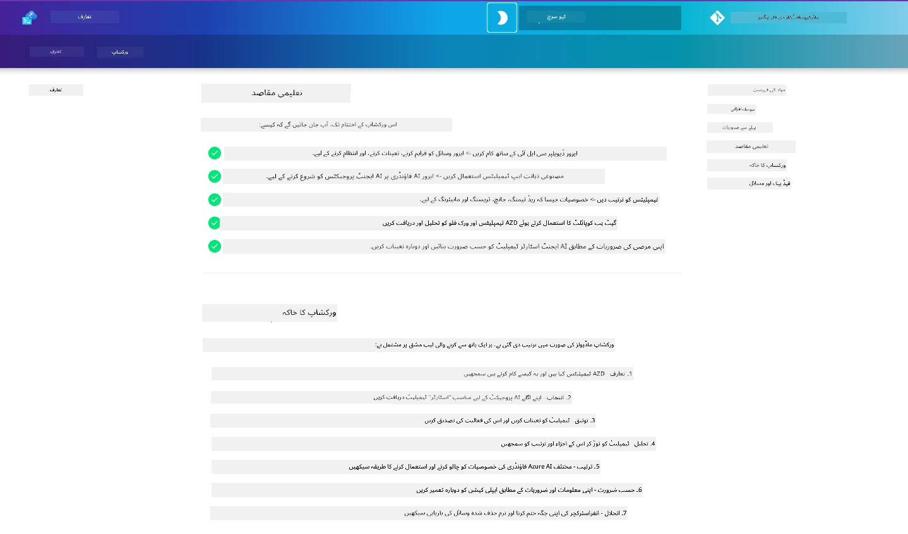

<div align="center">
  <div style="background: linear-gradient(135deg, #0078d4, #106ebe); border-radius: 10px; padding: 20px; margin: 20px 0; box-shadow: 0 4px 15px rgba(0, 120, 212, 0.3); border: 2px solid #005a9e;">
    <h2 style="color: white; margin: 0; font-size: 24px; text-shadow: 1px 1px 2px rgba(0,0,0,0.3);">
      🎯 AZD برائے AI ڈویلپرز ورکشاپ
    </h2>
    <p style="color: white; margin: 10px 0 0 0; font-size: 16px; text-shadow: 1px 1px 2px rgba(0,0,0,0.3);">
      <strong>Azure Developer CLI کے ساتھ AI ایپلیکیشنز بنانے کے لیے ایک ہینڈز آن ورکشاپ۔</strong><br>
      AZD ٹیمپلیٹس اور AI ڈپلائمنٹ ورک فلو کو مکمل کرنے کے لیے 7 ماڈیول مکمل کریں۔
    </p>
    <div style="margin-top: 15px;">
      <span style="background: rgba(255,255,255,0.2); padding: 5px 10px; border-radius: 15px; color: white; font-size: 14px;">
        📅 ماخذ رہنمائی کا جائزہ لیا گیا: نومبر 2026
      </span>
    </div>
  </div>
</div>

# AZD برائے AI ڈویلپرز ورکشاپ

Azure Developer CLI (AZD) سیکھنے کے لیے ہینڈز آن ورکشاپ میں خوش آمدید جس کا مرکز AI ایپلیکیشنز کی تعیناتی ہے۔ یہ ورکشاپ آپ کو AZD ٹیمپلیٹس کو 3 مراحل میں عملی سمجھ فراہم کرتی ہے:

1. **دریافت** - اپنے لیے درست ٹیمپلیٹ تلاش کریں۔
1. **تنصیب** - تعینات کریں اور اس کی کارکردگی کی تصدیق کریں۔
1. **حسب ضرورت سازی** - اپنی مرضی کے مطابق ترمیم کریں اور بار بار کریں!

اس ورکشاپ کے دوران آپ کو بنیادی ڈویلپر ٹولز اور ورک فلو سے بھی روشناس کرایا جائے گا، تاکہ آپ کے اختتامی نقطہ نظر کے ترقیاتی سفر کو ہموار کیا جا سکے۔

<br/>

## براؤزر پر مبنی رہنمائی

ورکشاپ کے اسباق مارک ڈاؤن میں ہیں۔ آپ انہیں براہ راست گٹ ہب پر نیویگیٹ کر سکتے ہیں - یا نیچے دی گئی اسکرین شاٹ میں دکھائے گئے براؤزر پر مبنی پریویو کو لانچ کریں۔



اس آپشن کو استعمال کرنے کے لیے - ریپوزیٹری کو اپنے پروفائل پر فورک کریں، اور GitHub Codespaces کو لانچ کریں۔ جب VS Code ٹرمینل فعال ہو، تو یہ کمانڈ لکھیں:

یہ براؤزر پریویو GitHub Codespaces، dev containers، یا Python اور MkDocs انسٹال کردہ مقامی کلون میں کام کرتا ہے۔

```bash title="" linenums="0"
python -m pip install -r requirements-dev.txt
python -m mkdocs serve --config-file workshop/mkdocs.yml
```

یہ کمانڈز **کورس ریپوزیٹری کی روٹ** سے چلائیں، نہ کہ الگ سے Initialized AI نمونے سے۔ پریویو کو سامنے رکھیں تاکہ غلطیاں واضح رہیں؛ Ctrl+C سے اسے بند کریں۔ سائٹ کو بغیر سرو کرنے کے چیک کرنے کے لیے `python -m mkdocs build --strict --config-file workshop/mkdocs.yml` چلائیں۔

چند سیکنڈ میں ایک پاپ اپ ڈائیلاگ ظاہر ہوگا۔ `Open in browser` آپشن منتخب کریں۔ ویب پر مبنی رہنمائی اب نئے براؤزر ٹیب میں کھلے گی۔ اس پریویو کے کچھ فائدے:

1. **ان بلٹ سرچ** - کی ورڈز یا اسباق جلدی تلاش کریں۔
1. **کاپی آئیکن** - کوڈ بلاکس پر ہوور کریں یہ آپشن دیکھنے کے لیے
1. **تھیم ٹوگل** - ڈارک اور لائٹ تھیمز کے درمیان سوئچ کریں
1. **مدد حاصل کریں** - فُوٹر میں ڈسکارڈ آئیکن پر کلک کریں!

<br/>

## ورکشاپ کا جائزہ

**دورانیہ:** 3-4 گھنٹے  
**سطح:** ابتدائی سے درمیانہ  
**پیشگی تقاضے:** Azure، AI تصورات، VS Code اور کمانڈ لائن ٹولز کا واقفیت۔

یہ ایک ہینڈز آن ورکشاپ ہے جہاں آپ عمل کر کے سیکھتے ہیں۔ ورزشیں مکمل کرنے کے بعد، ہم AZD For Beginners نصاب کا جائزہ لینے کی سفارش کرتے ہیں تاکہ آپ سیکیورٹی اور پیداواریت کی بہترین عملی طریقوں کی جانب اپنے سیکھنے کے سفر کو جاری رکھ سکیں۔

| وقت| ماڈیول  | مقصد |
|:---|:---|:---|
| 15 منٹ | [تعارف](docs/instructions/0-Introduction.md) | اسٹیج سیٹ کریں، اہداف سمجھیں |
| 30 منٹ | [AI ٹیمپلیٹ منتخب کریں](docs/instructions/1-Select-AI-Template.md) | اختیارات دریافت کریں اور آغاز کریں | 
| 30 منٹ | [AI ٹیمپلیٹ کی تصدیق کریں](docs/instructions/2-Validate-AI-Template.md) | Azure پر ڈیفالٹ حل تعینات کریں |
| 30 منٹ | [AI ٹیمپلیٹ کی تجزیہ کریں](docs/instructions/3-Deconstruct-AI-Template.md) | ڈھانچہ اور سیٹنگز دریافت کریں |
| 30 منٹ | [AI ٹیمپلیٹ کو ترتیب دیں](docs/instructions/4-Configure-AI-Template.md) | دستیاب خصوصیات کو فعال کریں اور آزمائیں |
| 30 منٹ | [AI ٹیمپلیٹ ذاتی بنائیں](docs/instructions/5-Customize-AI-Template.md) | ٹیمپلیٹ کو اپنی ضروریات کے مطابق بنائیں |
| 30 منٹ | [انفراسٹرکچر ختم کریں](docs/instructions/6-Teardown-Infrastructure.md) | صفائی اور وسائل کو جاری کریں |
| 15 منٹ | [اختتام اور اگلے مراحل](docs/instructions/7-Wrap-up.md) | سیکھنے کے وسائل، ورکشاپ کا چیلنج |

<br/>

## آپ کیا سیکھیں گے

AZD ٹیمپلیٹ کو ایک سیکھنے کی ریتھ لپیٹ کے طور پر سوچیں تاکہ Microsoft Foundry پر اختتامی نقطہ نظر کی ترقی کے مختلف صلاحیتوں اور ٹولز کو دریافت کیا جا سکے۔ اس ورکشاپ کے اختتام پر، آپ کو اس سیاق و سباق میں مختلف ٹولز اور تصورات کا ایک فطری احساس حاصل ہو جانا چاہیے۔

| تصور  | مقصد |
|:---|:---|
| **Azure Developer CLI** | ٹول کمانڈز اور ورک فلو کو سمجھیں |
| **AZD ٹیمپلیٹس**| پروجیکٹ کا ڈھانچہ اور کنفیگریشن سمجھیں |
| **Azure AI Agent**| Microsoft Foundry پروجیکٹ فراہم کریں اور تعینات کریں |
| **Azure AI Search**| ایجنٹس کے ساتھ کانٹیکسٹ انجینئرنگ کو فعال کریں |
| **مشاہدہ پذیری**| ٹریسنگ، مانیٹرنگ اور تجزیات دریافت کریں |
| **ریڈ ٹیمنگ**| مخالفانہ ٹیسٹنگ اور تخفیف دریافت کریں |

<br/>

## ورکشاپ کا ڈھانچہ

ورکشاپ کو اس طرح ترتیب دیا گیا ہے کہ آپ کو ٹیمپلیٹ کی دریافت، تعیناتی، تجزیہ اور حسب ضرورت کاری کے سفر پر لے جائے - جو سرکاری [Getting Started with AI Agents](https://github.com/Azure-Samples/get-started-with-ai-agents) سٹارٹر ٹیمپلیٹ پر مبنی ہے۔

### [ماڈیول 1: AI ٹیمپلیٹ منتخب کریں](docs/instructions/1-Select-AI-Template.md) (30 منٹ)

- AI ٹیمپلیٹس کیا ہیں؟
- AI ٹیمپلیٹس کہاں مل سکتے ہیں؟
- AI ایجنٹس کی تعمیر کیسے شروع کروں؟
- **لیب**: Codespaces یا dev container میں کوئیک اسٹارٹ

### [ماڈیول 2: AI ٹیمپلیٹ کی تصدیق کریں](docs/instructions/2-Validate-AI-Template.md) (30 منٹ)

- AI ٹیمپلیٹ کی ساخت کیا ہے؟
- AZD ترقیاتی ورک فلو کیا ہے؟
- AZD ترقی میں مدد کیسے حاصل کریں؟
- **لیب**: AI ایجنٹس ٹیمپلیٹ تعینات اور تصدیق کریں

### [ماڈیول 3: AI ٹیمپلیٹ کا تجزیہ کریں](docs/instructions/3-Deconstruct-AI-Template.md) (30 منٹ)

- اپنے ماحول کو `.azure/` میں تلاش کریں
- اپنے وسائل کی ترتیب کو `infra/` میں دیکھیں
- اپنے AZD کی ترتیب کو `azure.yaml`s میں دریافت کریں
- **لیب**: ماحول کے متغیرات میں تبدیلی کریں اور دوبارہ تعینات کریں

### [ماڈیول 4: AI ٹیمپلیٹ کو ترتیب دیں](docs/instructions/4-Configure-AI-Template.md) (30 منٹ)
- دریافت کریں: Retrieval Augmented Generation
- دریافت کریں: Agent Evaluation اور Red Teaming
- دریافت کریں: ٹریسنگ اور مانیٹرنگ
- **لیب**: AI ایجنٹ + مشاہدہ پذیری دریافت کریں

### [ماڈیول 5: AI ٹیمپلیٹ ذاتی بنائیں](docs/instructions/5-Customize-AI-Template.md) (30 منٹ)
- وضاحت کریں: PRD کے ساتھ منظرنامے کی ضروریات
- ترتیب دیں: AZD کے لیے ماحول کے متغیرات
- نفاذ کریں: اضافی کاموں کے لیے Lifecycle Hooks
- **لیب**: اپنے منظرنامے کے مطابق ٹیمپلیٹ کو ذاتی بنائیں

### [ماڈیول 6: انفراسٹرکچر ختم کریں](docs/instructions/6-Teardown-Infrastructure.md) (30 منٹ)
- جائزہ: AZD ٹیمپلیٹس کیا ہیں؟
- جائزہ: Azure Developer CLI کیوں استعمال کریں؟
- اگلے اقدامات: کوئی مختلف ٹیمپلیٹ آزمائیں!
- **لیب**: انفراسٹرکچر کو ڈی پروویزن کریں اور صفائی کریں

<br/>

## ورکشاپ چیلنج

کیا آپ خود کو مزید چیلنج کرنا چاہتے ہیں؟ یہاں کچھ پروجیکٹ تجاویز ہیں - یا اپنے خیالات ہمارے ساتھ شیئر کریں!!

| پروجیکٹ | وضاحت |
|:---|:---|
|1. **ایک پیچیدہ AI ٹیمپلیٹ کا تجزیہ کریں** | ہم نے جو ورک فلو اور ٹولز بیان کیے ہیں ان کا استعمال کریں اور دیکھیں کیا آپ مختلف AI حل ٹیمپلیٹ کو تعینات، تصدیق، اور ذاتی بنا سکتے ہیں۔ _آپ نے کیا سیکھا؟_|
|2. **اپنے منظرنامے کے ساتھ حسب ضـرورت بنائیں**  | کسی مختلف منظرنامے کے لیے PRD (پروڈکٹ ضروریات ڈاکومنٹ) تحریر کرنے کی کوشش کریں۔ پھر GitHub Copilot کو اپنے ٹیمپلیٹ ریپو میں Agent Model میں استعمال کریں - اور اسے حسب ضرورت بنانے کا ورک فلو بنانے کو کہیں۔ _آپ نے کیا سیکھا؟ آپ ان تجاویز کو کیسے بہتر بنا سکتے ہیں؟_|
| | |

## آپ کی رائے ہے؟

1. اس ریپو پر ایک مسئلہ پوسٹ کریں - آسانی کے لیے اسے `Workshop` ٹیگ کریں۔
1. Microsoft Foundry Discord میں شامل ہوں - اپنے ساتھیوں سے جڑیں!


| | | 
|:---|:---|
| **📚 کورس ہوم**| [AZD For Beginners](../README.md)|
| **📖 دستاویزات** | [AI ٹیمپلیٹس کے ساتھ شروع کریں](https://learn.microsoft.com/en-us/azure/ai-foundry/how-to/develop/ai-template-get-started)|
| **🛠️ AI ٹیمپلیٹس** | [Microsoft Foundry ٹیمپلیٹس](https://ai.azure.com/templates) |
|**🚀 اگلے اقدامات** | [ورکشاپ شروع کریں](#workshop-overview) |
| | |

<br/>

---

**رہنمائی:** [مین کورس](../README.md) | [تعارف](docs/instructions/0-Introduction.md) | [ماڈیول 1: ٹیمپلیٹ منتخب کریں](docs/instructions/1-Select-AI-Template.md)

**کیا آپ AZD کے ساتھ AI ایپلیکیشنز بنانا شروع کرنے کے لیے تیار ہیں؟**

[ورکشاپ شروع کریں: تعارف →](docs/instructions/0-Introduction.md)

---

<!-- CO-OP TRANSLATOR DISCLAIMER START -->
**ڈس کلیمر**:
یہ دستاویز AI ترجمہ سروس [Co-op Translator](https://github.com/Azure/co-op-translator) کے ذریعے ترجمہ کی گئی ہے۔ جبکہ ہم درستگی کے لیے کوشاں ہیں، براہ کرم اس بات سے آگاہ رہیں کہ خودکار ترجمے میں غلطیاں یا عدم درستیاں ہو سکتی ہیں۔ اصل دستاویز اپنے مادری زبان میں مستند ماخذ سمجھی جائے گی۔ حساس معلومات کے لیے پیشہ ور انسانی ترجمہ کی سفارش کی جاتی ہے۔ اس ترجمے کے استعمال سے پیدا ہونے والی کسی بھی غلط فہمی یا غلط تشریح کی ذمہ داری ہم قبول نہیں کرتے۔
<!-- CO-OP TRANSLATOR DISCLAIMER END -->