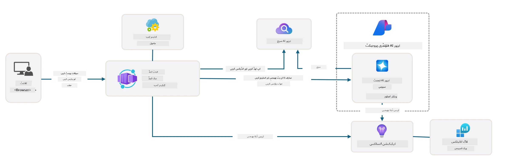

# 3. ایک ٹیمپلیٹ کو توڑنا

!!! tip "اس ماڈیول کے آخر تک آپ قابل ہو جائیں گے"

    - [ ] Use GitHub Copilot and optional MCP tools for Azure documentation and read-only exploration
    - [ ] Identify the template's application, infrastructure, configuration, and test entry points
    - [ ] Verify generated explanations against actual repository files
    - [ ] **Lab 3:** Trace one request and one configuration input through the project

---

## 1. GitHub Copilot کو فعال کریں

VS Code میں شروع کیا گیا AI نمونہ کھولیں اور [GitHub Copilot](https://code.visualstudio.com/docs/copilot/chat/chat-agent-mode) کو فعال کریں۔ اس اکاؤنٹ سے سائن ان کریں جس کے پاس اہل منصوبہ ہو؛ استعمال کی حدود مختلف ہو سکتی ہیں۔ تبدیلیوں کی اجازت دینے سے پہلے Copilot سے ذخیرہ کو سمجھنے کو کہیں۔

### اختیاری MCP سرورز

یہ خدمات اضافی اوزار فراہم کر سکتی ہیں:

- [Azure MCP Server](https://learn.microsoft.com/azure/developer/azure-mcp-server/overview)
- [Microsoft Learn MCP Server](https://learn.microsoft.com/training/support/mcp)

VS Code میں، [MCP کنفیگریشن ہدایت](https://code.visualstudio.com/docs/copilot/chat/mcp-servers) کا جائزہ لیں اور اگر ضرورت ہو تو `.vscode/mcp.json` بنائیں:

```json
{
  "servers": {
    "Azure MCP Server": {
      "type": "stdio",
      "command": "npx",
      "args": ["-y", "@azure/mcp@latest", "server", "start"]
    },
    "microsoft.docs.mcp": {
      "type": "http",
      "url": "https://learn.microsoft.com/api/mcp"
    }
  }
}
```

`npx` کمانڈ کے لیے Node.js/npm نصب شدہ ہونا ضروری ہے اور یہ قابل عمل کوڈ ڈاؤن لوڈ کرتی ہے۔ پیکیج کا جائزہ لیں اور ایک منظور شدہ ورژن مقرر کریں تاکہ ٹیم کا ترتیب قابل تکرار ہو۔ VS Code کے MCP کنٹرولز استعمال کر کے سرورز کو شروع کریں اور دستیاب اوزار کا معائنہ کریں؛ نام ورژن کے ساتھ بدل سکتے ہیں۔

**تصدیق الگ ہے۔** AZD کے لیے `azd auth login` استعمال کریں۔ Azure MCP کی دستاویزات میں تصدیقی عمل کی پیروی کریں؛ صرف AZD لاگ ان کرنے سے MCP سیشن قائم نہیں ہوتا۔ جب کوئی مشق یا ہک Azure CLI کو کال کرے تو الگ سے `az login` استعمال کریں۔

صرف پڑھنے کے لیے ہدایات آزما کر دیکھیں:

1. "Microsoft Learn MCP استعمال کریں تاکہ Azure Developer CLI کی کنفیگریشن دستاویزات تلاش کی جا سکیں۔"
2. "اس ذخیرے کے `azure.yaml` کی وضاحت کریں؛ ان فائلوں کا حوالہ دیں جو ہر ہک کا نفاذ کرتی ہیں۔"
3. "دستیاب Azure MCP آلات استعمال کرتے ہوئے، میری تعینات شدہ وسائل کی فہرست بنائیں بغیر کسی تبدیلی کے۔"

منتخب کردہ ٹیننٹ/سبسکرپشن اور ہر مجوزہ اوزار کی کال کا جائزہ لیں۔ صرف فن تعمیر کو سمجھنے کے لیے وسائل کی تخلیق، حذف یا رسائی کی تبدیلیوں کی اجازت نہ دیں۔

## 2. فن تعمیر کو سمجھیں

یہ نمونہ Python FastAPI بیک اینڈ اور React/TypeScript فرنٹ اینڈ کو Azure Container Apps میں ہوسٹ کرتا ہے۔ بیک اینڈ Microsoft Foundry پروجیکٹ کے ایجنٹ کے ساتھ بات چیت کرتا ہے۔ بازیافت اور مشاہدہ ٹیمپلیٹ خصوصیات کی فعال حالت اور کامیاب ترتیب پر منحصر ہے؛ صرف ایپلیکیشن کی تعیناتی سے یہ یقینی نہیں ہوتا۔



اس خاکے کا موازنہ [موجودہ اپ اسٹریم تعیناتی گائیڈ](https://github.com/Azure-Samples/get-started-with-ai-agents/blob/main/docs/deployment.md) اور آپ کے اصل وسائل سے کریں۔ ترتیب شدہ ماڈل تعیناتی، ایجنٹ کے اوزار، منیجڈ شناخت، رول اسائنمنٹس، اور اختیاری AI Search/Application Insights وسائل چیک کریں۔

**مشق:** Copilot سے کہیں کہ فرنٹ اینڈ سے API کے ذریعے Foundry تک چیٹ درخواست کو فایل اور فنکشن حوالہ جات کے ساتھ ٹریس کرے۔ ان حوالہ جات کو کھولیں اور وضاحت کی تصدیق کریں۔ صرف ایک خاکہ کی بنیاد پر نفاذ شدہ تصدیق، راستہ سازی، یا اجازت کا اندازہ نہ لگائیں۔

## 3. ذخیرہ ساخت

منتخب کردہ راستوں کو 4 نومبر، 2026 کو نمونہ کے ساتھ چیک کیا گیا تھا۔ آپ کی شروع شدہ نظرثانی حقیقت کا ماخذ ہے:

```text
get-started-with-ai-agents/
  azure.yaml
  docker-compose.yaml
  requirements-dev.txt
  .devcontainer/
  infra/
    main.bicep
    main.parameters.json
    api.bicep
    core/
  src/
    Dockerfile
    pyproject.toml
    requirements.txt
    api/
      main.py
      routes.py
      search_index_manager.py
    frontend/
      package.json
      src/
    files/
  scripts/
    validate_env_vars.sh
    validate_env_vars.ps1
    postdeploy.sh
    postdeploy.ps1
  tests/
    test_evaluation.py
    test_red_teaming.py
  docs/
    deployment.md
    deploy_customization.md
    ai_search.md
    observability.md
    local_development.md
    troubleshooting.md
```

### انفراسٹرکچر اور کنفیگریشن

`infra/main.bicep` وسائل کا انتظام کرتا ہے؛ `main.parameters.json` ٹیمپلیٹ ان پٹ کو AZD کے ماحول کی قدروں سے جوڑتا ہے۔ `azure.yaml` ایپلیکیشن سروس اور لائف سائیکل ہکس کا انتخاب کرتا ہے۔ `USE_AZURE_AI_SEARCH_SERVICE` جیسے ان پٹ کو ان فائلوں میں ٹریس کریں تاکہ معلوم ہو کہ اصل میں کیا تبدیل ہوتا ہے۔

### ایپلیکیشن اور شناخت

`src/api/` اور `src/frontend/` کو ساتھ پڑھیں۔ جہاں ایجنٹ بنایا یا بازیافت ہوتا ہے، ہدایات/اوزار ترتیب دیے جاتے ہیں، اور ہر Azure کال کون سی شناخت استعمال کرتی ہے، شناخت کریں۔ `src/files/` کے تحت نمونہ فائلیں ڈیموسٹریشن ڈیٹا ہیں، پروڈکشن کیٹلاگ یا اجازت نامہ ماڈل نہیں۔

### ٹیسٹس اور مشاہدہ

موجودہ جائزہ اور ریڈ ٹیم کے داخلہ پوائنٹس `tests/` کے تحت ہیں؛ پرانے `evals/` اور `airedteaming/` ڈائریکٹری حوالے اس نمونے کے لیے فرسودہ ہیں۔ کلاؤڈ ٹیسٹس چلانے سے پہلے `docs/observability.md` کو پڑھیں تاکہ تقاضے اور لاگت معلوم ہو سکے۔ یہ Python ٹیسٹس اختیاری `azure.ai.evaluations` AZD ایکسٹینشن سے الگ ہیں۔

## 4. اپنی دریافتوں کی تصدیق کریں

- ایک نمونہ سوال کے لیے API روٹ، ایجنٹ تعامل، اور بازیافت کوڈ کی شناخت کریں۔
- وضاحت کریں کہ کون سی شناخت Foundry تک رسائی حاصل کرتی ہے اور کون سی ترتیب اس کا اینڈ پوائنٹ منتخب کرتی ہے۔
- اصل پری اپ اور پوسٹ ڈپلائے اسکرپٹ تلاش کریں اور ان کی غلطی سنبھالنے کے رویے کو دیکھیں۔
- آپ کی تعیناتی میں موجود کسی بھی انحصار یا اختیاری خصوصیات کی فہرست بنائیں جن کا فقدان ہو۔

جاری رکھیں [ایک ٹیمپلیٹ کو ترتیب دیں](4-Configure-AI-Template.md)۔

---

<!-- CO-OP TRANSLATOR DISCLAIMER START -->
**ڈس کلیمر**:
یہ دستاویز AI ترجمہ سروس [Co-op Translator](https://github.com/Azure/co-op-translator) کے ذریعے ترجمہ کی گئی ہے۔ جبکہ ہم درستگی کے لیے کوشاں ہیں، براہ کرم اس بات سے آگاہ رہیں کہ خودکار ترجمے میں غلطیاں یا عدم درستیاں ہو سکتی ہیں۔ اصل دستاویز اپنے مادری زبان میں مستند ماخذ سمجھی جائے گی۔ حساس معلومات کے لیے پیشہ ور انسانی ترجمہ کی سفارش کی جاتی ہے۔ اس ترجمے کے استعمال سے پیدا ہونے والی کسی بھی غلط فہمی یا غلط تشریح کی ذمہ داری ہم قبول نہیں کرتے۔
<!-- CO-OP TRANSLATOR DISCLAIMER END -->