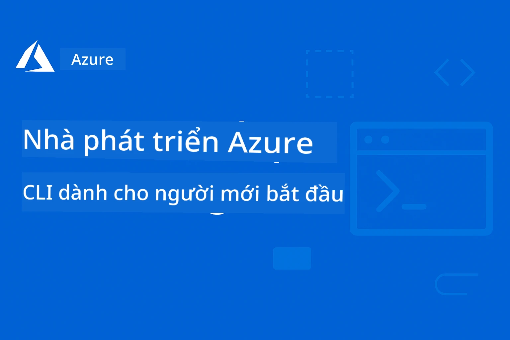

# AZD Dành Cho Người Mới Bắt Đầu: Hành Trình Học Có Cấu Trúc

 

[](https://github.com/microsoft/AZD-for-beginners)
[](https://GitHub.com/microsoft/azd-for-beginners/network/)
[](https://github.com/microsoft/AZD-for-beginners)

[](https://discord.com/invite/nkVh3dp)
[](https://discord.gg/nTYy5BXMWG)

---

### Dịch Tự Động (Luôn Cập Nhật Mới Nhất)

<!-- CO-OP TRANSLATOR LANGUAGES TABLE START -->
[Arabic](../ar/README.md) | [Bengali](../bn/README.md) | [Bulgarian](../bg/README.md) | [Burmese (Myanmar)](../my/README.md) | [Chinese (Simplified)](../zh-CN/README.md) | [Chinese (Traditional, Hong Kong)](../zh-HK/README.md) | [Chinese (Traditional, Macau)](../zh-MO/README.md) | [Chinese (Traditional, Taiwan)](../zh-TW/README.md) | [Croatian](../hr/README.md) | [Czech](../cs/README.md) | [Danish](../da/README.md) | [Dutch](../nl/README.md) | [Estonian](../et/README.md) | [Finnish](../fi/README.md) | [French](../fr/README.md) | [German](../de/README.md) | [Greek](../el/README.md) | [Hebrew](../he/README.md) | [Hindi](../hi/README.md) | [Hungarian](../hu/README.md) | [Indonesian](../id/README.md) | [Italian](../it/README.md) | [Japanese](../ja/README.md) | [Kannada](../kn/README.md) | [Khmer](../km/README.md) | [Korean](../ko/README.md) | [Lithuanian](../lt/README.md) | [Malay](../ms/README.md) | [Malayalam](../ml/README.md) | [Manipuri (Meitei Mayek)](../mni/README.md) | [Marathi](../mr/README.md) | [Nepali](../ne/README.md) | [Nigerian Pidgin](../pcm/README.md) | [Norwegian](../no/README.md) | [Persian (Farsi)](../fa/README.md) | [Polish](../pl/README.md) | [Portuguese (Brazil)](../pt-BR/README.md) | [Portuguese (Portugal)](../pt-PT/README.md) | [Punjabi (Gurmukhi)](../pa/README.md) | [Romanian](../ro/README.md) | [Russian](../ru/README.md) | [Serbian (Cyrillic)](../sr/README.md) | [Slovak](../sk/README.md) | [Slovenian](../sl/README.md) | [Spanish](../es/README.md) | [Swahili](../sw/README.md) | [Swedish](../sv/README.md) | [Tagalog (Filipino)](../tl/README.md) | [Tamil](../ta/README.md) | [Telugu](../te/README.md) | [Thai](../th/README.md) | [Turkish](../tr/README.md) | [Ukrainian](../uk/README.md) | [Urdu](../ur/README.md) | [Vietnamese](./README.md)

> **Ưu Tiên Clone Cục Bộ?**
>
> Kho lưu trữ này bao gồm hơn 50 bản dịch ngôn ngữ, làm tăng đáng kể kích thước tải xuống. Để clone không có bản dịch, sử dụng sparse checkout:
>
> **Bash / macOS / Linux:**
> ```bash
> git clone --filter=blob:none --sparse https://github.com/microsoft/AZD-for-beginners.git
> cd AZD-for-beginners
> git sparse-checkout set --no-cone '/*' '!translations' '!translated_images'
> ```
>
> **CMD (Windows):**
> ```cmd
> git clone --filter=blob:none --sparse https://github.com/microsoft/AZD-for-beginners.git
> cd AZD-for-beginners
> git sparse-checkout set --no-cone "/*" "!translations" "!translated_images"
> ```
>
> Điều này cung cấp cho bạn mọi thứ cần thiết để hoàn thành khóa học với tốc độ tải xuống nhanh hơn nhiều.
<!-- CO-OP TRANSLATOR LANGUAGES TABLE END -->

## 🆕 Có Gì Mới Trong azd Hôm Nay

> 📌 **Đánh giá phát hành AI CLI (2026-11-04):** Hướng dẫn đã được kiểm tra so với tài liệu/nguồn **`azd 1.37.2`**, **agents `1.0.0-beta.23`**, và **evaluations `1.0.0-beta.2`** đã công bố. Sử dụng `azd >= 1.37.0` cho quy trình làm việc kết hợp. Chạy `azd version` và [cập nhật core CLI](https://learn.microsoft.com/azure/developer/azure-developer-cli/install-azd) trước các phần mở rộng. Xem [thay đổi và sửa lỗi phát hành](docs/chapter-08-production/production-ai-practices.md#recent-release-changes-and-fixes). Đây không phải là xác thực triển khai trực tiếp của toàn bộ khóa học.

Azure Developer CLI hỗ trợ nhiều loại ứng dụng, bao gồm web apps, APIs và AI agents, qua các host, mẫu, và phần mở rộng được hỗ trợ.

Ý nghĩa điều đó với bạn là:

- **AI agents giờ là workload azd hạng nhất.** Bạn có thể khởi tạo, triển khai và quản lý dự án AI agent bằng quy trình làm việc `azd init` → `azd up` mà bạn đã quen.
- **Chu kỳ sống của agent qua hai phần mở rộng.** Dùng `azure.ai.agents` để khởi tạo, kích hoạt, tối ưu hóa và nghỉ hưu agents. Cài đặt riêng **`azure.ai.evaluations`** cho `azd ai eval init`, `generate`, và `run start`. Agents beta.22 thay thế quy trình đánh giá cũ và thay đổi cấu hình tối ưu; làm theo [hướng dẫn di trú](docs/chapter-08-production/production-ai-practices.md#evaluation-migration-and-quality-checks).
- **Nhiều khối xây dựng AI hơn.** Phần mở rộng xem trước mới — `azure.ai.skills` và `azure.ai.connections` — cho phép bạn quản lý kỹ năng agent có thể tái sử dụng và kết nối Foundry trực tiếp với azd.
- **Tích hợp Microsoft Foundry** mang triển khai mô hình, hosting agent và cấu hình dịch vụ AI trực tiếp vào hệ sinh thái mẫu azd.
- **Cơ bản hàng ngày mượt mà hơn.** Các bản phát hành gần đây làm cho `azd init` idempotent (an toàn chạy lại), làm cho `azd auth login` tự động xóa token cũ, và thêm lời nhắc thiết lập lần đầu thân thiện `azd tool`.
- **Quy trình làm việc cốt lõi không thay đổi.** Cho dù bạn triển khai ứng dụng todo, microservice, hay giải pháp AI đa agent, các lệnh giống nhau.

> **Ghi chú cho người dùng Aspire:** Microsoft bây giờ gọi đơn giản là **Aspire** (trước đây là ".NET Aspire"). Hỗ trợ Aspire trong azd không thay đổi — chỉ cập nhật tên.

Nếu bạn đã dùng azd trước đây, hỗ trợ AI là mở rộng tự nhiên — không phải công cụ riêng hay lộ trình nâng cao. Nếu bạn bắt đầu mới, bạn sẽ học quy trình làm việc đơn cho mọi thứ.

---

## 🚀 Azure Developer CLI (azd) Là Gì?

**Azure Developer CLI (azd)** là công cụ dòng lệnh thân thiện với nhà phát triển giúp bạn dễ dàng triển khai ứng dụng lên Azure. Thay vì tạo và kết nối hàng chục tài nguyên Azure thủ công, bạn có thể triển khai toàn bộ ứng dụng chỉ với một lệnh.

### Phép Thần Kỳ của `azd up`

```bash
# This single command does everything:
# ✅ Creates all Azure resources  
# ✅ Configures networking and security
# ✅ Builds your application code
# ✅ Deploys to Azure
# ✅ Gives you a working URL
azd up
```

Mẫu cung cấp cấu hình ứng dụng và hạ tầng. Triển khai thành công vẫn cần dịch vụ/mẫu được hỗ trợ, quota và quyền hạn đủ, đầu vào chính xác, và xác minh ứng dụng đã triển khai. `azd up` không tự động làm cho mẫu an toàn, tuân thủ hay sẵn sàng cho sản xuất.

---

## ❓ Azure Developer CLI và Azure CLI: Sự Khác Biệt Là Gì?

Đây là câu hỏi phổ biến nhất của người mới. Đây là câu trả lời đơn giản:

| Tính Năng | **Azure CLI (`az`)** | **Azure Developer CLI (`azd`)** |
|---------|---------------------|--------------------------------|
| **Mục đích** | Quản lý tài nguyên Azure riêng lẻ | Triển khai ứng dụng hoàn chỉnh |
| **Tư duy** | Tập trung hạ tầng | Tập trung ứng dụng |
| **Ví dụ** | `az webapp create --name myapp...` | `azd up` |
| **Độ khó học** | Cần biết dịch vụ Azure | Chỉ cần hiểu app của bạn |
| **Dành cho ai** | DevOps, Hạ tầng | Nhà phát triển, Prototype |

### Tương Tự Đơn Giản

- **Azure CLI** giống như có đầy đủ công cụ xây nhà - búa, cưa, đinh. Bạn có thể xây bất cứ thứ gì, nhưng phải biết xây dựng.
- **Azure Developer CLI** giống như thuê nhà thầu - bạn mô tả muốn gì, họ đảm nhận xây dựng.

### Khi Nào Dùng Loại Nào

| Tình Huống | Dùng Cái Này |
|----------|----------|
| "Tôi muốn triển khai nhanh ứng dụng web" | `azd up` |
| "Tôi chỉ cần tạo tài khoản lưu trữ" | `az storage account create` |
| "Tôi xây dựng ứng dụng AI đầy đủ" | `azd init --template azure-search-openai-demo` |
| "Tôi cần debug một tài nguyên Azure cụ thể" | `az resource show` |
| "Tôi muốn triển khai môi trường sản xuất đã cấu hình" | Xem lại cấu hình, quyền truy cập, chi phí, và các rào cản vận hành trước khi `azd up --environment production` |

### Chúng Hoạt Động Cùng Nhau!

AZD và Azure CLI có xác thực và cấu hình riêng. Dùng `azd auth login` cho AZD, và `az login` khi lệnh hook hoặc chẩn đoán cần Azure CLI rõ ràng. Bạn có thể dùng cả hai:
```bash
# Deploy your app with AZD
azd up

# Then fine-tune specific resources with Azure CLI
az webapp config set --name myapp --always-on true
```

---

## 🌟 Tìm Mẫu Trong Awesome AZD

Đừng bắt đầu từ đầu! **Awesome AZD** là bộ sưu tập cộng đồng các mẫu sẵn sàng triển khai:

| Tài Nguyên | Mô Tả |
|----------|-------------|
| 🔗 [**Awesome AZD Gallery**](https://azure.github.io/awesome-azd/) | Duyệt qua hơn 200 mẫu với triển khai một lần nhấp |
| 🔗 [**Gửi Mẫu**](https://github.com/Azure/awesome-azd/issues) | Đóng góp mẫu của bạn cho cộng đồng |
| 🔗 [**Kho GitHub**](https://github.com/Azure/awesome-azd) | Thêm sao và khám phá mã nguồn |

### Mẫu AI Phổ Biến Từ Awesome AZD

Chọn một mẫu trong thư mục trống riêng; các lệnh dưới đây là các lựa chọn thay thế. `.` phía cuối để khởi tạo thư mục đó.

```bash
# RAG Chat with Microsoft Foundry Models + AI Search
azd init --template azure-search-openai-demo .

# Quick AI Chat Application
azd init --template openai-chat-app-quickstart .

# AI Agents with Foundry Agents
azd init --template get-started-with-ai-agents .
```

---

## 🎯 Bắt Đầu Trong 3 Bước

Trước khi bắt đầu, đảm bảo máy bạn đã sẵn sàng cho mẫu bạn muốn triển khai:

**Windows:**
```powershell
.\validate-setup.ps1
```

**macOS / Linux:**
```bash
bash ./validate-setup.sh
```

Nếu kiểm tra cần thiết nào thất bại, sửa trước rồi tiếp tục với bắt đầu nhanh.

### Bước 1: Cài đặt AZD (2 phút)

**Windows:**
```powershell
winget install microsoft.azd
```

**macOS:**
```bash
brew tap azure/azd && brew install azd
```

**Linux:**
```bash
curl -fsSL https://aka.ms/install-azd.sh | bash
```

### Bước 2: Xác thực cho AZD

```bash
# Optional if you plan to use Azure CLI commands directly in this course
az login

# Required for AZD workflows
azd auth login
```

Nếu không chắc bạn cần cái nào, làm theo quy trình thiết lập đầy đủ tại [Cài đặt & Thiết lập](docs/chapter-01-foundation/installation.md#authentication-setup).

### Bước 3: Triển khai Ứng Dụng Đầu Tiên Của Bạn

```bash
# Initialize from a template
azd init --template todo-nodejs-mongo .

# Deploy to Azure (creates everything!)
azd up
```

**🎉 Đó là nó!** Ứng dụng của bạn bây giờ đã hoạt động trên Azure.

### Dọn Dẹp (Đừng Quên!)

```bash
# Remove all resources when done experimenting
azd down --force --purge
```

---

## 📚 Cách Sử Dụng Khóa Học Này

Khóa học này được thiết kế cho **học tiến bộ** - bắt đầu từ mức bạn thoải mái và tiếp tục nâng cao:

| Kinh Nghiệm Của Bạn | Bắt Đầu Tại Đây |
|-----------------|------------|
| **Hoàn toàn mới với Azure** | [Chương 1: Nền Tảng](#-chapter-1-foundation--quick-start) |
| **Biết Azure, mới với AZD** | [Chương 1: Nền Tảng](#-chapter-1-foundation--quick-start) |
| **Muốn triển khai ứng dụng AI** | [Chương 2: Phát Triển AI-First](#-chapter-2-ai-first-development-recommended-for-ai-developers) |
| **Muốn thực hành thực tế** | [🎓 Workshop Tương Tác](workshop/README.md) - phòng lab hướng dẫn 3-4 giờ |
| **Cần mẫu sản xuất** | [Chương 8: Sản Xuất & Doanh Nghiệp](#-chapter-8-production--enterprise-patterns) |

### Thiết Lập Nhanh

1. **Fork Kho Lưu Trữ Này**: [](https://GitHub.com/microsoft/azd-for-beginners/fork)
2. **Clone Nó**: `git clone https://github.com/YOUR-USERNAME/azd-for-beginners.git`
3. **Nhận Giúp Đỡ**: [Cộng Đồng Azure Discord](https://discord.com/invite/ByRwuEEgH4)

> **Ưu Tiên Clone Cục Bộ?**

> Kho lưu trữ này bao gồm hơn 50 bản dịch ngôn ngữ, làm tăng đáng kể kích thước tải xuống. Để clone không có bản dịch, sử dụng sparse checkout:
> ```bash
> git clone --filter=blob:none --sparse https://github.com/microsoft/AZD-for-beginners.git
> cd AZD-for-beginners
> git sparse-checkout set --no-cone '/*' '!translations' '!translated_images'
> ```
> Điều này cung cấp cho bạn mọi thứ bạn cần để hoàn thành khóa học với tốc độ tải xuống nhanh hơn nhiều.


## Tổng Quan Khóa Học

Thành thạo Azure Developer CLI (azd) thông qua các chương có cấu trúc được thiết kế cho việc học theo tiến trình. **Tập trung đặc biệt vào triển khai ứng dụng AI với tích hợp Microsoft Foundry.**

### Tại Sao Khóa Học Này Lại Quan Trọng Đối Với Các Nhà Phát Triển Hiện Đại

Các nhà phát triển triển khai khối lượng công việc AI thường cần hướng dẫn về:
- Kiến trúc AI phức tạp đa dịch vụ
- Thực tiễn triển khai AI trong môi trường sản xuất  
- Tích hợp và cấu hình dịch vụ AI Azure
- Tối ưu chi phí cho khối lượng công việc AI
- Khắc phục sự cố cụ thể trong triển khai AI

### Mục Tiêu Học Tập

Bằng cách hoàn thành khóa học có cấu trúc này, bạn sẽ:
- **Thành thạo Các Kiến Thức Cơ Bản AZD**: Các khái niệm cốt lõi, cài đặt và cấu hình
- **Triển khai Ứng dụng AI**: Sử dụng AZD với dịch vụ Microsoft Foundry
- **Triển khai Hạ Tầng Dưới Dạng Mã**: Quản lý tài nguyên Azure với các mẫu Bicep
- **Khắc phục Sự cố Triển khai**: Giải quyết các vấn đề thường gặp và gỡ lỗi
- **Tối ưu cho Môi trường Sản xuất**: Bảo mật, mở rộng, giám sát và quản lý chi phí
- **Xây dựng Giải pháp Đa Tác nhân**: Triển khai kiến trúc AI phức tạp

## Trước Khi Bắt Đầu: Tài Khoản, Quyền Truy Cập & Giả Định

Trước khi bắt đầu Chương 1, hãy chắc chắn bạn đã có những điều sau. Các bước cài đặt sau trong hướng dẫn giả định các nền tảng cơ bản này đã được chuẩn bị.

- **Một đăng ký Azure**: Bạn có thể dùng đăng ký hiện tại từ công việc hoặc tài khoản cá nhân của bạn, hoặc tạo [dùng thử miễn phí](https://aka.ms/azurefreetrial) để bắt đầu.
- **Quyền tạo tài nguyên Azure**: Đối với hầu hết bài tập, bạn nên có ít nhất quyền **Contributor** trên đăng ký hoặc nhóm tài nguyên mục tiêu. Một số chương còn giả định bạn có thể tạo nhóm tài nguyên, managed identities và gán RBAC.
- [**Tài khoản GitHub**](https://github.com): hữu ích để fork kho lưu trữ, theo dõi thay đổi của bạn và dùng GitHub Codespaces cho workshop.
- **Yêu cầu trước dành cho runtime template**: Một số mẫu cần công cụ cục bộ như Node.js, Python, Java hoặc Docker. Chạy trình kiểm tra cài đặt trước khi bắt đầu để phát hiện thiếu sót sớm.
- **Kiến thức cơ bản về dòng lệnh**: Bạn không cần là chuyên gia nhưng nên thoải mái chạy các lệnh `git clone`, `azd auth login`, và `azd up`.

> **Làm việc trong đăng ký doanh nghiệp?**
> Nếu môi trường Azure của bạn được quản lý bởi quản trị viên, hãy xác nhận trước rằng bạn có thể triển khai tài nguyên trên đăng ký hoặc nhóm tài nguyên bạn dự định sử dụng. Nếu không, hãy yêu cầu đăng ký sandbox hoặc quyền Contributor trước khi bắt đầu.

> **Mới với Azure?**
> Bắt đầu với đăng ký Azure trial hoặc trả theo mức sử dụng tại https://aka.ms/azurefreetrial để bạn có thể hoàn thành bài tập trọn vẹn mà không phải chờ phê duyệt cấp tenant.

## 🗺️ Bản Đồ Khóa Học: Điều Hướng Nhanh Theo Chương

Mỗi chương có một README riêng với mục tiêu học tập, hướng dẫn nhanh và bài tập:

| Chương | Chủ đề | Bài học | Thời lượng | Độ khó |
|---------|-------|---------|----------|------------|
| **[Ch 1: Nền Tảng](docs/chapter-01-foundation/README.md)** | Bắt đầu | [Cơ bản AZD](docs/chapter-01-foundation/azd-basics.md) &#124; [Cài đặt](docs/chapter-01-foundation/installation.md) &#124; [Dự án đầu tiên](docs/chapter-01-foundation/first-project.md) | 30-45 phút | ⭐ |
| **[Ch 2: Phát Triển AI](docs/chapter-02-ai-development/README.md)** | Ứng dụng AI-First | [Tích hợp Foundry](docs/chapter-02-ai-development/microsoft-foundry-integration.md) &#124; [Tác nhân AI](docs/chapter-02-ai-development/agents.md) &#124; [Triển khai Mô hình](docs/chapter-02-ai-development/ai-model-deployment.md) &#124; [Workshop](docs/chapter-02-ai-development/ai-workshop-lab.md) | 1-2 giờ | ⭐⭐ |
| **[Ch 3: Cấu Hình](docs/chapter-03-configuration/README.md)** | Xác thực & Bảo mật | [Cấu hình](docs/chapter-03-configuration/configuration.md) &#124; [Xác thực & Bảo mật](docs/chapter-03-configuration/authsecurity.md) | 45-60 phút | ⭐⭐ |
| **[Ch 4: Hạ Tầng](docs/chapter-04-infrastructure/README.md)** | IaC & Triển khai | [Hướng dẫn Triển khai](docs/chapter-04-infrastructure/deployment-guide.md) &#124; [Cấp phát tài nguyên](docs/chapter-04-infrastructure/provisioning.md) | 1-1.5 giờ | ⭐⭐⭐ |
| **[Ch 5: Đa Tác nhân](docs/chapter-05-multi-agent/README.md)** | Giải pháp Tác nhân AI | [Kịch bản Bán lẻ](examples/retail-scenario.md) &#124; [Mẫu Điều phối](docs/chapter-06-pre-deployment/coordination-patterns.md) | 2-3 giờ | ⭐⭐⭐⭐ |
| **[Ch 6: Trước Triển khai](docs/chapter-06-pre-deployment/README.md)** | Lập kế hoạch & Xác nhận | [Kiểm tra Trước Chuyến bay](docs/chapter-06-pre-deployment/preflight-checks.md) &#124; [Lập kế hoạch Công suất](docs/chapter-06-pre-deployment/capacity-planning.md) &#124; [Lựa chọn SKU](docs/chapter-06-pre-deployment/sku-selection.md) &#124; [App Insights](docs/chapter-06-pre-deployment/application-insights.md) | 1 giờ | ⭐⭐ |
| **[Ch 7: Khắc phục sự cố](docs/chapter-07-troubleshooting/README.md)** | Gỡ lỗi & Sửa lỗi | [Vấn đề Thường Gặp](docs/chapter-07-troubleshooting/common-issues.md) &#124; [Gỡ lỗi](docs/chapter-07-troubleshooting/debugging.md) &#124; [Vấn đề AI](docs/chapter-07-troubleshooting/ai-troubleshooting.md) | 1-1.5 giờ | ⭐⭐ |
| **[Ch 8: Sản xuất](docs/chapter-08-production/README.md)** | Mẫu Doanh nghiệp | [Thực tiễn Sản xuất](docs/chapter-08-production/production-ai-practices.md) | 2-3 giờ | ⭐⭐⭐⭐ |
| **[🎓 Workshop](workshop/README.md)** | Thực hành | [Giới thiệu](workshop/docs/instructions/0-Introduction.md) &#124; [Lựa chọn](workshop/docs/instructions/1-Select-AI-Template.md) &#124; [Xác nhận](workshop/docs/instructions/2-Validate-AI-Template.md) &#124; [Phân tích](workshop/docs/instructions/3-Deconstruct-AI-Template.md) &#124; [Cấu hình](workshop/docs/instructions/4-Configure-AI-Template.md) &#124; [Tùy chỉnh](workshop/docs/instructions/5-Customize-AI-Template.md) &#124; [Dừng lại](workshop/docs/instructions/6-Teardown-Infrastructure.md) &#124; [Kết thúc](workshop/docs/instructions/7-Wrap-up.md) | 3-4 giờ | ⭐⭐ |

**Tổng Thời Lượng Khóa Học:** ~10-14 giờ | **Trình độ Kỹ năng:** Người mới → Sẵn sàng Sản xuất

---

## 📚 Các Chương Học

*Chọn lộ trình học phù hợp với trình độ và mục tiêu của bạn*

### 🚀 Chương 1: Nền Tảng & Bắt Đầu Nhanh
**Yêu cầu trước**: Đăng ký Azure, kiến thức cơ bản về dòng lệnh  
**Thời lượng**: 30-45 phút  
**Độ khó**: ⭐

#### Những Gì Bạn Sẽ Học
- Hiểu các kiến thức cơ bản về Azure Developer CLI
- Cài đặt AZD trên nền tảng của bạn
- Triển khai thành công dự án đầu tiên

#### Tài Nguyên Học Tập
- **🎯 Bắt đầu tại đây**: [Azure Developer CLI là gì?](#-what-is-azure-developer-cli-azd)
- **📖 Lý thuyết**: [Cơ bản AZD](docs/chapter-01-foundation/azd-basics.md) - Các khái niệm và thuật ngữ chính
- **⚙️ Cài đặt**: [Hướng dẫn Cài đặt & Thiết lập](docs/chapter-01-foundation/installation.md) - Hướng dẫn theo nền tảng
- **🛠️ Thực hành**: [Dự án Đầu tiên của bạn](docs/chapter-01-foundation/first-project.md) - Hướng dẫn từng bước
- **📋 Tham khảo Nhanh**: [Bảng lệnh Cheat Sheet](resources/cheat-sheet.md)

#### Bài Tập Thực Tế
```bash
# Quick installation check
azd version

# Deploy your first application
azd init --template todo-nodejs-mongo .
azd up
```

**💡 Kết quả Chương**: Triển khai thành công một ứng dụng web đơn giản lên Azure sử dụng AZD

**✅ Xác nhận Thành công:**
```bash
# After completing Chapter 1, you should be able to:
azd version              # Shows installed version
azd init --template todo-nodejs-mongo  # Initializes project
azd up                  # Deploys to Azure
azd show                # Displays running app URL
# Application opens in browser and works
azd down --force --purge  # Cleans up resources
```

**📊 Thời gian đầu tư:** 30-45 phút  
**📈 Trình độ sau khi hoàn thành:** Có thể triển khai ứng dụng cơ bản một cách độc lập

---

### 🤖 Chương 2: Phát Triển AI-First (Khuyến nghị cho Nhà phát triển AI)
**Yêu cầu trước**: Hoàn thành Chương 1  
**Thời lượng**: 1-2 giờ  
**Độ khó**: ⭐⭐

#### Những Gì Bạn Sẽ Học
- Tích hợp Microsoft Foundry với AZD
- Triển khai ứng dụng sử dụng AI
- Hiểu về cấu hình dịch vụ AI

#### Tài Nguyên Học Tập
- **🎯 Bắt đầu tại đây**: [Tích hợp Microsoft Foundry](docs/chapter-02-ai-development/microsoft-foundry-integration.md)
- **🤖 Các Tác nhân AI**: [Hướng dẫn Tác nhân AI](docs/chapter-02-ai-development/agents.md) - Triển khai tác nhân thông minh với AZD
- **📖 Mẫu thiết kế**: [Triển khai Mô hình AI](docs/chapter-02-ai-development/ai-model-deployment.md) - Triển khai và quản lý mô hình AI
- **🛠️ Workshop**: [Phòng thí nghiệm Workshop AI](docs/chapter-02-ai-development/ai-workshop-lab.md) - Chuẩn bị giải pháp AI sẵn sàng AZD
- **🎥 Hướng dẫn Tương tác**: [Tài liệu Workshop](workshop/README.md) - Học trực quan trên trình duyệt với MkDocs * Môi trường DevContainer
- **📋 Mẫu template**: [Mẫu Microsoft Foundry](#featured-microsoft-foundry-templates)
- **📝 Ví dụ**: [Ví dụ Triển khai AZD](examples/README.md)

#### Bài Tập Thực Tế
```bash
# Deploy your first AI application
azd init --template azure-search-openai-demo .
azd up

# Try additional AI templates
azd init --template openai-chat-app-quickstart .
azd init --template agent-openai-python-prompty .
```

**💡 Kết quả Chương**: Triển khai và cấu hình ứng dụng chat sử dụng AI với khả năng RAG

**✅ Xác nhận Thành công:**
```bash
# After Chapter 2, you should be able to:
azd init --template azure-search-openai-demo .
azd up
# Test the AI chat interface
# Ask questions and get AI-powered responses with sources
# Verify search integration works
azd monitor  # Check Application Insights shows telemetry
azd down --force --purge
```

**📊 Thời gian đầu tư:** 1-2 giờ  
**📈 Trình độ sau khi hoàn thành:** Có thể triển khai ứng dụng học AI và xác định yêu cầu bổ sung để sẵn sàng sản xuất
**💰 Nhận thức Chi phí:** Hiểu chi phí phát triển $80-150/tháng, chi phí sản xuất $300-3500/tháng

#### 💰 Cân nhắc Chi phí cho Triển khai AI

**Môi trường Phát triển (Ước tính $80-150/tháng):**
- Mô hình Microsoft Foundry (Trả theo mức sử dụng): $0-50/tháng (tùy vào lượng token sử dụng)
- AI Search (Cấp độ cơ bản): $75/tháng
- Container Apps (Tiêu thụ): $0-20/tháng
- Lưu trữ (Tiêu chuẩn): $1-5/tháng

**Môi trường Sản xuất (Ước tính $300-3,500+/tháng):**
- Mô hình Microsoft Foundry (PTU cho hiệu năng nhất quán): $3,000+/tháng HOẶC trả theo mức sử dụng với khối lượng cao
- AI Search (Cấp độ tiêu chuẩn): $250/tháng
- Container Apps (Dedicated): $50-100/tháng
- Application Insights: $5-50/tháng
- Lưu trữ (Cao cấp): $10-50/tháng

**💡 Mẹo Tối ưu Chi phí:**
- Kiểm tra giá inference mô hình và các tín dụng riêng của tài khoản; Azure OpenAI không bao gồm một hạn mức miễn phí 50,000 token hàng tháng chung
- Chạy `azd down` để xóa tài nguyên khi không còn cần, sau khi xem xét môi trường đã chọn
- Bắt đầu với thanh toán dựa trên mức tiêu thụ, chỉ nâng cấp PTU cho sản xuất
- Sử dụng `azd provision --preview` để xem trước hạ tầng dự kiến, sau đó định giá tài nguyên với Azure Pricing Calculator
- Kích hoạt tự động mở rộng: chỉ trả tiền cho mức sử dụng thực tế

**Giám sát Chi phí:**
```bash
# Inspect planned resources (this does not calculate prices)
azd provision --preview

# Monitor actual costs in Azure Portal
az consumption budget list --resource-group <your-rg>
```

---

### ⚙️ Chương 3: Cấu Hình & Xác thực
**Yêu cầu trước**: Hoàn thành Chương 1  
**Thời lượng**: 45-60 phút  
**Độ khó**: ⭐⭐

#### Những Gì Bạn Sẽ Học
- Cấu hình và quản lý môi trường
- Thực tiễn tốt nhất về xác thực và bảo mật
- Đặt tên và tổ chức tài nguyên

#### Tài Nguyên Học Tập
- **📖 Cấu hình**: [Hướng dẫn Cấu hình](docs/chapter-03-configuration/configuration.md) - Thiết lập môi trường
- **🔐 Bảo mật**: [Mẫu xác thực và managed identity](docs/chapter-03-configuration/authsecurity.md) - Mẫu xác thực
- **📝 Ví dụ**: [Ví dụ Ứng dụng Database](examples/database-app/README.md) - Ví dụ về AZD Database

#### Bài Tập Thực Tế
- Cấu hình nhiều môi trường (dev, staging, prod)
- Thiết lập xác thực managed identity
- Triển khai cấu hình riêng theo môi trường

**💡 Kết quả Chương**: Quản lý nhiều môi trường với xác thực và bảo mật đúng chuẩn

---

### 🏗️ Chương 4: Hạ Tầng Dưới Dạng Mã & Triển khai
**Yêu cầu trước**: Hoàn thành Chương 1-3  
**Thời lượng**: 1-1.5 giờ  
**Độ khó**: ⭐⭐⭐

#### Những Gì Bạn Sẽ Học
- Mẫu triển khai nâng cao
- Hạ tầng dưới dạng mã với Bicep
- Chiến lược cấp phát tài nguyên

#### Tài Nguyên Học Tập
- **📖 Triển khai**: [Hướng dẫn Triển khai](docs/chapter-04-infrastructure/deployment-guide.md) - Quy trình hoàn chỉnh
- **🏗️ Cấp phát tài nguyên**: [Cấp phát tài nguyên](docs/chapter-04-infrastructure/provisioning.md) - Quản lý tài nguyên Azure
- **📝 Ví dụ**: [Ví dụ Container App](../../examples/container-app) - Triển khai chứa đựng

#### Bài Tập Thực Tế
- Tạo mẫu Bicep tùy chỉnh
- Triển khai ứng dụng đa dịch vụ
- Thực hiện chiến lược triển khai blue-green

**💡 Kết quả Chương**: Triển khai ứng dụng đa dịch vụ phức tạp bằng mẫu hạ tầng tùy chỉnh

---

### 🎯 Chương 5: Giải pháp AI Đa Tác nhân (Nâng cao)
**Yêu cầu trước**: Hoàn thành Chương 1-2  
**Thời lượng**: 2-3 giờ  
**Độ khó**: ⭐⭐⭐⭐

#### Những Gì Bạn Sẽ Học
- Mẫu kiến trúc đa tác nhân
- Điều phối và phối hợp các tác nhân
- Triển khai AI chuẩn sản xuất

#### Tài Nguyên Học Tập
- **🤖 Thiết kế nổi bật**: [Giải pháp Đa Tác nhân cho Bán lẻ](examples/retail-scenario.md) - Bản thiết kế kiến trúc, không phải ứng dụng hoàn chỉnh
- **🛠️ Mẫu ARM**: [Gói Mẫu ARM](../../examples/retail-multiagent-arm-template) - Khung hạ tầng; xem xét các điều kiện tiên quyết và các thành phần ứng dụng còn thiếu
- **📖 Kiến trúc**: [Mẫu phối hợp đa tác nhân](docs/chapter-06-pre-deployment/coordination-patterns.md) - Các mẫu

#### Bài tập thực hành
```bash
# Inspect the retail infrastructure scaffold before choosing to deploy it
cd examples/retail-multiagent-arm-template
cat README.md

# After an intentional deployment, inspect infrastructure state
az deployment group show --resource-group <rg-name> --name <deployment-name>
```

**💡 Kết quả chương học**: Hiểu thiết kế đa tác nhân và xác định các công việc triển khai, xác thực và vận hành cần thiết vượt ra ngoài khung hạ tầng

---

### 🔍 Chương 6: Xác Thực & Lập Kế Hoạch Trước Khi Triển Khai
**Điều kiện tiên quyết**: Hoàn thành Chương 4  
**Thời lượng**: 1 giờ  
**Độ phức tạp**: ⭐⭐

#### Những gì bạn sẽ học
- Lập kế hoạch công suất và xác thực tài nguyên
- Chiến lược lựa chọn SKU
- Kiểm tra trước khi bay và tự động hóa

#### Tài nguyên học tập
- **📊 Lập kế hoạch**: [Lập kế hoạch công suất](docs/chapter-06-pre-deployment/capacity-planning.md) - Xác thực tài nguyên
- **💰 Lựa chọn**: [Lựa chọn SKU](docs/chapter-06-pre-deployment/sku-selection.md) - Lựa chọn tiết kiệm chi phí
- **✅ Xác thực**: [Kiểm tra trước khi bay](docs/chapter-06-pre-deployment/preflight-checks.md) - Kịch bản tự động

#### Bài tập thực hành
- Chạy kịch bản xác thực công suất
- Tối ưu lựa chọn SKU cho chi phí
- Triển khai kiểm tra tự động trước khi triển khai

**💡 Kết quả chương học**: Xác thực và tối ưu triển khai trước khi thực thi

---

### 🚨 Chương 7: Khắc phục sự cố & Gỡ lỗi
**Điều kiện tiên quyết**: Hoàn thành bất kỳ chương triển khai nào  
**Thời lượng**: 1-1.5 giờ  
**Độ phức tạp**: ⭐⭐

#### Những gì bạn sẽ học
- Các phương pháp gỡ lỗi có hệ thống
- Các sự cố và giải pháp phổ biến
- Khắc phục sự cố đặc thù AI

#### Tài nguyên học tập
- **🔧 Vấn đề phổ biến**: [Các vấn đề phổ biến](docs/chapter-07-troubleshooting/common-issues.md) - Câu hỏi thường gặp và giải pháp
- **🕵️ Gỡ lỗi**: [Hướng dẫn gỡ lỗi](docs/chapter-07-troubleshooting/debugging.md) - Chiến lược từng bước
- **🤖 Vấn đề AI**: [Khắc phục sự cố AI](docs/chapter-07-troubleshooting/ai-troubleshooting.md) - Sự cố dịch vụ AI

#### Bài tập thực hành
- Chẩn đoán lỗi triển khai
- Giải quyết vấn đề xác thực
- Gỡ lỗi kết nối dịch vụ AI

**💡 Kết quả chương học**: Tự chủ chẩn đoán và giải quyết các sự cố triển khai phổ biến

---

### 🏢 Chương 8: Mẫu Sản Xuất & Doanh Nghiệp
**Điều kiện tiên quyết**: Hoàn thành các Chương 1-4  
**Thời lượng**: 2-3 giờ  
**Độ phức tạp**: ⭐⭐⭐⭐

#### Những gì bạn sẽ học
- Chiến lược triển khai sản xuất
- Mẫu bảo mật doanh nghiệp
- Giám sát và tối ưu chi phí

#### Tài nguyên học tập
- **🏭 Sản xuất**: [Thực hành tốt AI trong sản xuất](docs/chapter-08-production/production-ai-practices.md) - Mẫu doanh nghiệp
- **📝 Ví dụ**: [Ví dụ về Microservices](../../examples/microservices) - Kiến trúc phức tạp
- **📊 Giám sát**: [Tích hợp Application Insights](docs/chapter-06-pre-deployment/application-insights.md) - Giám sát

#### Bài tập thực hành
- Triển khai mẫu bảo mật doanh nghiệp
- Thiết lập giám sát toàn diện
- Triển khai sản xuất với quản trị phù hợp

**💡 Kết quả chương học**: Triển khai ứng dụng sẵn sàng doanh nghiệp với đầy đủ khả năng sản xuất

---

## 🎓 Tổng quan Hội thảo: Trải nghiệm học tập thực hành

> **⚠️ TRẠNG THÁI HỘI THẢO: Đang phát triển**  
> Tài liệu hội thảo hiện đang được phát triển và hoàn thiện. Các module cốt lõi hoạt động được, nhưng một số phần nâng cao chưa hoàn chỉnh. Chúng tôi đang tích cực hoàn thiện toàn bộ nội dung. [Theo dõi tiến độ →](workshop/README.md)

### Tài liệu Hội thảo Tương tác
**Học thực hành toàn diện với công cụ dựa trên trình duyệt và bài tập có hướng dẫn**

Tài liệu hội thảo của chúng tôi cung cấp trải nghiệm học tập có cấu trúc, tương tác bổ sung cho chương trình học theo chương ở trên. Hội thảo được thiết kế cho cả học tự tốc độ và phiên giảng viên dẫn dắt.

#### 🛠️ Tính năng Hội thảo
- **Giao diện dựa trên trình duyệt**: Hội thảo sử dụng MkDocs hoàn chỉnh, có tìm kiếm, sao chép và tính năng giao diện
- **Tích hợp GitHub Codespaces**: Thiết lập môi trường phát triển chỉ với một cú nhấp
- **Lộ trình học có cấu trúc**: 8 module bài tập hướng dẫn (tổng 3-4 giờ)
- **Phương pháp tiến bộ**: Giới thiệu → Lựa chọn → Xác thực → Phân tích → Cấu hình → Tùy chỉnh → Gỡ bỏ → Tổng kết
- **Môi trường DevContainer tương tác**: Công cụ và phụ thuộc được cấu hình sẵn

#### 📚 Cấu trúc Module Hội thảo
Hội thảo theo **phương pháp tiến bộ 8 module** dẫn bạn từ khám phá đến làm chủ triển khai:

| Module | Chủ đề | Những gì bạn sẽ làm | Thời lượng |
|--------|-------|----------------|----------|
| **0. Giới thiệu** | Tổng quan Hội thảo | Hiểu mục tiêu học tập, điều kiện tiên quyết và cấu trúc hội thảo | 15 phút |
| **1. Lựa chọn** | Khám phá Mẫu | Khám phá các mẫu AZD và chọn mẫu AI phù hợp cho trường hợp của bạn | 20 phút |
| **2. Xác thực** | Triển khai & Xác minh | Triển khai mẫu với `azd up` và xác thực hạ tầng hoạt động | 30 phút |
| **3. Phân tích** | Hiểu Cấu trúc | Sử dụng GitHub Copilot khám phá kiến trúc mẫu, các file Bicep, và tổ chức mã | 30 phút |
| **4. Cấu hình** | Tìm hiểu sâu azure.yaml | Thành thạo cấu hình `azure.yaml`, hooks vòng đời, và biến môi trường | 30 phút |
| **5. Tùy chỉnh** | Tùy chỉnh theo ý bạn | Kích hoạt AI Search, theo dõi, đánh giá, và tùy chỉnh cho trường hợp của bạn | 45 phút |
| **6. Gỡ bỏ** | Dọn dẹp | An toàn thu hồi tài nguyên với `azd down --purge` | 15 phút |
| **7. Tổng kết** | Các bước tiếp theo | Đánh giá thành tựu, khái niệm chính, và tiếp tục hành trình học tập | 15 phút |

**Quy trình Hội thảo:**
```
Introduction → Selection → Validation → Deconstruction → Configuration → Customization → Teardown → Wrap-up
     ↓            ↓           ↓              ↓               ↓              ↓            ↓           ↓
  Overview    Find the     Deploy &      Explore        Master         Customize     Clean up    Review &
             right        verify        code &        azure.yaml      for your      resources   next steps
             template                   structure                     scenario
```

#### 🚀 Bắt đầu với Hội thảo
```bash
# Option 1: GitHub Codespaces (Recommended)
# Click "Code" → "Create codespace on main" in the repository

# Option 2: Local Development
git clone https://github.com/microsoft/azd-for-beginners.git
cd azd-for-beginners/workshop
# Follow the setup instructions in workshop/README.md
```

#### 🎯 Kết quả học tập Hội thảo
Khi hoàn thành hội thảo, người tham gia sẽ:
- **Triển khai Ứng dụng AI Sản xuất**: Sử dụng AZD với dịch vụ Microsoft Foundry
- **Làm chủ Kiến trúc Đa tác nhân**: Triển khai giải pháp phối hợp các tác nhân AI
- **Thực hiện Thực hành Bảo mật Tốt nhất**: Cấu hình xác thực và kiểm soát truy cập
- **Tối ưu theo Quy mô**: Thiết kế triển khai tiết kiệm chi phí và hiệu quả
- **Khắc phục Sự cố Triển khai**: Giải quyết sự cố phổ biến một cách độc lập

#### 📖 Tài nguyên Hội thảo
- **🎥 Hướng dẫn tương tác**: [Tài liệu Hội thảo](workshop/README.md) - Môi trường học tập trên trình duyệt
- **📋 Hướng dẫn từng module**:
  - [0. Giới thiệu](workshop/docs/instructions/0-Introduction.md) - Tổng quan và mục tiêu hội thảo
  - [1. Lựa chọn](workshop/docs/instructions/1-Select-AI-Template.md) - Tìm kiếm và lựa chọn mẫu AI
  - [2. Xác thực](workshop/docs/instructions/2-Validate-AI-Template.md) - Triển khai và xác minh mẫu
  - [3. Phân tích](workshop/docs/instructions/3-Deconstruct-AI-Template.md) - Khám phá kiến trúc mẫu
  - [4. Cấu hình](workshop/docs/instructions/4-Configure-AI-Template.md) - Thành thạo azure.yaml
  - [5. Tùy chỉnh](workshop/docs/instructions/5-Customize-AI-Template.md) - Tùy chỉnh theo trường hợp của bạn
  - [6. Gỡ bỏ](workshop/docs/instructions/6-Teardown-Infrastructure.md) - Dọn dẹp tài nguyên
  - [7. Tổng kết](workshop/docs/instructions/7-Wrap-up.md) - Đánh giá và các bước tiếp theo
- **🛠️ Phòng Lab AI Workshop**: [Phòng Lab AI Workshop](docs/chapter-02-ai-development/ai-workshop-lab.md) - Bài tập tập trung AI
- **💡 Khởi động nhanh**: [Hướng dẫn thiết lập Hội thảo](workshop/README.md#browser-based-guide) - Cấu hình môi trường

**Phù hợp cho**: Đào tạo doanh nghiệp, khóa học đại học, học tự tốc độ, và bootcamp lập trình viên.

---

## 📖 Tìm hiểu sâu về năng lực AZD

Ngoài các kiến thức cơ bản, AZD cung cấp các tính năng mạnh mẽ cho triển khai sản xuất:

- **Triển khai dựa trên mẫu** - Sử dụng các mẫu dựng sẵn cho các mẫu ứng dụng phổ biến
- **Hạ tầng dưới dạng mã** - Quản lý tài nguyên Azure bằng Bicep hoặc Terraform  
- **Quy trình tích hợp** - Dựng, triển khai và giám sát ứng dụng liền mạch
- **Thân thiện với nhà phát triển** - Tối ưu cho năng suất và trải nghiệm nhà phát triển

### **AZD + Microsoft Foundry: Hoàn hảo cho Triển khai AI**

**Tại sao chọn AZD cho Giải pháp AI?** AZD giải quyết các thách thức hàng đầu mà nhà phát triển AI gặp phải:

- **Mẫu sẵn sàng AI** - Mẫu cấu hình sẵn cho Microsoft Foundry Models, dịch vụ Azure AI, và khối lượng công việc ML
- **Triển khai AI an toàn** - Mẫu bảo mật tích hợp cho dịch vụ AI, khóa API, và điểm cuối mô hình  
- **Mẫu AI trong sản xuất** - Thực hành tốt nhất cho triển khai ứng dụng AI có thể mở rộng, tiết kiệm chi phí
- **Quy trình AI đầu-cuối** - Từ phát triển mô hình đến triển khai sản xuất với giám sát thích hợp
- **Tối ưu chi phí** - Chiến lược phân bổ tài nguyên thông minh và mở rộng cho công việc AI
- **Tích hợp Microsoft Foundry** - Kết nối liền mạch với danh mục và điểm cuối mô hình Microsoft Foundry

---

## 🎯 Thư viện Mẫu & Ví dụ

### Nổi bật: Mẫu Microsoft Foundry
**Bắt đầu tại đây nếu bạn đang triển khai ứng dụng AI!**

> **Lưu ý:** Các mẫu này minh họa các mẫu AI khác nhau. Một số là Azure Samples bên ngoài, số khác là triển khai cục bộ.

| Mẫu | Chương | Độ phức tạp | Dịch vụ | Loại |
|----------|---------|------------|----------|------|
| [**Bắt đầu với trò chuyện AI**](https://github.com/Azure-Samples/get-started-with-ai-chat) | Chương 2 | ⭐⭐ | AzureOpenAI + Azure AI Model Inference API + Azure AI Search + Azure Container Apps + Application Insights | Bên ngoài |
| [**Bắt đầu với tác nhân AI**](https://github.com/Azure-Samples/get-started-with-ai-agents) | Chương 2 | ⭐⭐ | Foundry Agents + AzureOpenAI + Azure AI Search + Azure Container Apps + Application Insights| Bên ngoài |
| [**Demo Azure Search + OpenAI**](https://github.com/Azure-Samples/azure-search-openai-demo) | Chương 2 | ⭐⭐ | Azure OpenAI + Azure AI Search + Container Apps (mặc định) + Storage | Bên ngoài |
| [**Khởi động nhanh ứng dụng Chat OpenAI**](https://github.com/Azure-Samples/openai-chat-app-quickstart) | Chương 2 | ⭐ | AzureOpenAI + Container Apps + Application Insights | Bên ngoài |
| [**Agent OpenAI Python Prompty**](https://github.com/Azure-Samples/agent-openai-python-prompty) | Chương 5 | ⭐⭐⭐ | AzureOpenAI + Azure Functions + Prompty | Bên ngoài |
| [**Contoso Chat RAG**](https://github.com/Azure-Samples/contoso-chat) | Chương 8 | ⭐⭐⭐⭐ | AzureOpenAI + AI Search + Cosmos DB + Container Apps | Bên ngoài |
| [**Giải pháp đa tác nhân bán lẻ**](examples/retail-scenario.md) | Chương 5 | ⭐⭐⭐⭐ | Kiến trúc đề xuất và khung hạ tầng; cần triển khai ứng dụng | **Bản thiết kế cục bộ** |

### Nổi bật: Kịch bản học tập hoàn chỉnh
**Mẫu ứng dụng sẵn sàng sản xuất liên kết theo chương học**

| Mẫu | Chương học | Độ phức tạp | Kiến thức chính |
|----------|------------------|------------|--------------|
| [**openai-chat-app-quickstart**](https://github.com/Azure-Samples/openai-chat-app-quickstart) | Chương 2 | ⭐ | Mẫu triển khai AI cơ bản |
| [**azure-search-openai-demo**](https://github.com/Azure-Samples/azure-search-openai-demo) | Chương 2 | ⭐⭐ | Triển khai RAG với Azure AI Search |
| [**get-started-with-ai-agents**](https://github.com/Azure-Samples/get-started-with-ai-agents) | Chương 2 | ⭐⭐ | Trò chuyện dựa trên tác nhân và kiểm thử đánh giá mẫu |
| [**agent-openai-python-prompty**](https://github.com/Azure-Samples/agent-openai-python-prompty) | Chương 5 | ⭐⭐⭐ | Khung tác nhân và gọi hàm |
| [**contoso-chat**](https://github.com/Azure-Samples/contoso-chat) | Chương 8 | ⭐⭐⭐ | Điều phối AI doanh nghiệp |
| [**retail-multi-agent-solution**](examples/retail-scenario.md) | Chương 5 | ⭐⭐⭐⭐ | Kiến trúc đa tác nhân với tác nhân Khách hàng và Tồn kho |

### Học theo loại ví dụ

> **📌 Ví dụ cục bộ vs. bên ngoài:**  
> **Ví dụ cục bộ** (trong kho này) = Kiểm tra README của ví dụ để xem trạng thái triển khai và điều kiện tiên quyết
> **Ví dụ bên ngoài** (Azure Samples) = Sao chép từ kho liên kết

#### Ví dụ cục bộ (Sẵn sàng sử dụng)
- [**Giải pháp đa tác nhân bán lẻ**](examples/retail-scenario.md) - Bản thiết kế kiến trúc với khung hạ tầng ARM
  - Vai trò khách hàng và tác nhân tồn kho được đề xuất
  - Phải triển khai và xác minh mã ứng dụng, theo dõi, đánh giá
  - Chỉ tạo tài nguyên không tạo ra ứng dụng bán lẻ hoạt động

#### Ví dụ cục bộ - Ứng dụng Container (Chương 2-5)
**Ví dụ triển khai container toàn diện trong kho này:**
- [**Ví dụ Ứng dụng Container**](examples/container-app/README.md) - Hướng dẫn đầy đủ triển khai container
  - [API Flask đơn giản](../../examples/container-app/simple-flask-api) - REST API cơ bản với khả năng scale-to-zero
  - [Kiến trúc Microservices](../../examples/container-app/microservices) - Ví dụ học hai dịch vụ; cần bổ sung tối ưu sản xuất
  - Mẫu khởi động nhanh, sản xuất, và nâng cao
  - Hướng dẫn giám sát, bảo mật, và tối ưu chi phí

#### Ví dụ bên ngoài - Ứng dụng đơn giản (Chương 1-2)
**Sao chép các kho Azure Samples này để bắt đầu:**
- [Ứng dụng Web đơn giản - Node.js + MongoDB](https://github.com/Azure-Samples/todo-nodejs-mongo) - Mẫu triển khai cơ bản
- [Website tĩnh - React SPA](https://github.com/Azure-Samples/todo-csharp-sql-swa-func) - Triển khai nội dung tĩnh
- [Ứng dụng Container - Python Flask](https://github.com/Azure-Samples/container-apps-store-api-microservice) - Triển khai REST API

#### Ví dụ bên ngoài - Tích hợp cơ sở dữ liệu (Chương 3-4)  
- [Ứng dụng cơ sở dữ liệu - C# + SQL](https://github.com/Azure-Samples/todo-csharp-sql) - Mẫu kết nối cơ sở dữ liệu
- [Hàm + Cosmos DB](https://github.com/Azure-Samples/todo-python-mongo-swa-func) - Quy trình dữ liệu serverless

#### Ví dụ bên ngoài - Mẫu nâng cao (Chương 4-8)
- [Java Microservices](https://github.com/Azure-Samples/java-microservices-aca-lab) - Kiến trúc đa dịch vụ
- [Jobs Container Apps](https://github.com/Azure-Samples/container-apps-jobs) - Xử lý nền  
- [Pipeline ML Doanh nghiệp](https://github.com/Azure/mlops-v2) - Mẫu tham khảo MLOps; không phải mẫu AZD có thể dùng ngay

### Bộ sưu tập mẫu bên ngoài
- [**Thư viện mẫu AZD chính thức**](https://azure.github.io/awesome-azd/) - Bộ sưu tập mẫu chính thức và cộng đồng được tuyển chọn
- [**Mẫu Azure Developer CLI**](https://learn.microsoft.com/en-us/azure/developer/azure-developer-cli/azd-templates) - Tài liệu mẫu trên Microsoft Learn
- [**Thư mục Ví dụ**](examples/README.md) - Ví dụ học tập tại chỗ với giải thích chi tiết

---

## 📚 Tài nguyên học tập & Tham khảo

### Tham khảo nhanh
- [**Bảng lệnh tắt**](resources/cheat-sheet.md) - Các lệnh azd thiết yếu được tổ chức theo chương
- [**Thuật ngữ**](resources/glossary.md) - Thuật ngữ Azure và azd  
- [**Câu hỏi thường gặp**](resources/faq.md) - Câu hỏi phổ biến được tổ chức theo chương học
- [**Hướng dẫn học tập**](resources/study-guide.md) - Bài tập thực hành toàn diện

### Hội thảo thực hành
- [**Phòng thí nghiệm AI**](docs/chapter-02-ai-development/ai-workshop-lab.md) - Biến giải pháp AI của bạn có thể triển khai bằng AZD (2-3 giờ)
- [**Hội thảo tương tác**](workshop/README.md) - 8 bài tập có hướng dẫn với MkDocs và GitHub Codespaces
  - Theo thứ tự: Giới thiệu → Lựa chọn → Xác thực → Phân tích → Cấu hình → Tùy chỉnh → Dọn dẹp → Tổng kết

### Tài nguyên học tập bên ngoài
- [Tài liệu Azure Developer CLI](https://learn.microsoft.com/en-us/azure/developer/azure-developer-cli/)
- [Trung tâm Kiến trúc Azure](https://learn.microsoft.com/en-us/azure/architecture/)
- [Máy tính giá Azure](https://azure.microsoft.com/pricing/calculator/)
- [Tình trạng Azure](https://status.azure.com/)

### Kỹ năng Đại lý AI cho Trình soạn thảo của bạn
- [**Kỹ năng Microsoft Azure trên skills.sh**](https://skills.sh/microsoft/github-copilot-for-azure) - 37 kỹ năng đại lý mở cho Azure AI, Foundry, triển khai, chẩn đoán, tối ưu chi phí và nhiều hơn nữa. Cài đặt chúng trong GitHub Copilot, Cursor, Claude Code hoặc bất kỳ đại lý nào được hỗ trợ:
  ```bash
  npx skills add microsoft/github-copilot-for-azure
  ```

---

## 🔧 Hướng dẫn Khắc phục sự cố Nhanh

**Các vấn đề phổ biến người mới gặp và giải pháp ngay lập tức:**

<details>
<summary><strong>❌ "azd: không tìm thấy lệnh"</strong></summary>

```bash
# Install AZD first
# Windows (PowerShell):
winget install microsoft.azd

# macOS:
brew tap azure/azd && brew install azd

# Linux:
curl -fsSL https://aka.ms/install-azd.sh | bash

# Verify installation
azd version
```
</details>

<details>
<summary><strong>❌ "Không tìm thấy đăng ký" hoặc "Chưa đặt đăng ký"</strong></summary>

```bash
# List available subscriptions
az account list --output table

# Set default subscription
az account set --subscription "<subscription-id-or-name>"

# Set for AZD environment
azd env set AZURE_SUBSCRIPTION_ID "<subscription-id>"

# Verify
az account show
```
</details>

<details>
<summary><strong>❌ "InsufficientQuota" hoặc "Vượt quá hạn mức"</strong></summary>

```bash
# Try different Azure region
azd env set AZURE_LOCATION "westus2"
azd up

# Or use smaller SKUs in development
# Edit infra/main.parameters.json:
{
  "sku": "B1"  // Instead of "P1V2"
}
```
</details>

<details>
<summary><strong>❌ "azd up" thất bại giữa chừng</strong></summary>

```bash
# Option 1: Inspect the error and retry after correcting its cause
azd show
azd up --debug

# Option 2: Just fix infrastructure
azd provision

# Option 3: Check detailed status
azd show

# Option 4: Check logs in Azure Monitor
azd monitor --logs
```
</details>

<details>
<summary><strong>❌ "Xác thực thất bại" hoặc "Token hết hạn"</strong></summary>

```bash
# Re-authenticate for AZD
azd auth logout
azd auth login

# Optional: refresh Azure CLI too if you are running az commands
az logout
az login

# Verify authentication
az account show
```
</details>

<details>
<summary><strong>❌ "Tài nguyên đã tồn tại" hoặc tranh chấp tên</strong></summary>

```bash
# Inspect the conflicting resource before changing or deleting anything.
# For an isolated new deployment, create a separate environment:
azd env new dev-v2
azd up
```
</details>

<details>
<summary><strong>❌ Triển khai mẫu mất quá nhiều thời gian</strong></summary>

**Thời gian chờ bình thường:**
- Ứng dụng web đơn giản: 5-10 phút
- Ứng dụng với cơ sở dữ liệu: 10-15 phút
- Ứng dụng AI: 15-25 phút (Cấp phát OpenAI chậm)

```bash
# Check progress
azd show

# If stuck >30 minutes, check Azure Portal:
azd monitor --overview
# Look for failed deployments
```
</details>

<details>
<summary><strong>❌ "Không có quyền" hoặc "Bị cấm"</strong></summary>

```bash
# Check your Azure role
az role assignment list --assignee $(az account show --query user.name -o tsv)

# You need at least "Contributor" role
# Ask your Azure admin to grant:
# - Contributor (for resources)
# - User Access Administrator (for role assignments)
```
</details>

<details>
<summary><strong>❌ Không tìm thấy URL ứng dụng đã triển khai</strong></summary>

```bash
# Show all service endpoints
azd show

# Or open Azure Portal
azd monitor

# Check specific service
azd env get-values
# Look for *_URL variables
```
</details>

### 📚 Tài nguyên Khắc phục sự cố Toàn diện

- **Hướng dẫn Các vấn đề phổ biến:** [Giải pháp Chi tiết](docs/chapter-07-troubleshooting/common-issues.md)
- **Các vấn đề cụ thể AI:** [Khắc phục sự cố AI](docs/chapter-07-troubleshooting/ai-troubleshooting.md)
- **Hướng dẫn Gỡ lỗi:** [Gỡ lỗi từng bước](docs/chapter-07-troubleshooting/debugging.md)
- **Nhận hỗ trợ:** [Azure Discord](https://discord.gg/microsoft-azure) #azure-developer-cli

---

## 🎓 Hoàn thành Khóa học & Chứng nhận

### Theo dõi tiến độ
Theo dõi tiến trình học của bạn qua từng chương:

- [ ] **Chương 1**: Nền tảng & Bắt đầu nhanh ✅
- [ ] **Chương 2**: Phát triển AI-First ✅  
- [ ] **Chương 3**: Cấu hình & Xác thực ✅
- [ ] **Chương 4**: Hạ tầng dưới dạng Mã & Triển khai ✅
- [ ] **Chương 5**: Giải pháp AI đa đại lý ✅
- [ ] **Chương 6**: Xác thực & Lập kế hoạch trước triển khai ✅
- [ ] **Chương 7**: Khắc phục sự cố & Gỡ lỗi ✅
- [ ] **Chương 8**: Mô hình sản xuất & Doanh nghiệp ✅

### Xác minh học tập
Sau khi hoàn thành mỗi chương, xác minh kiến thức của bạn bằng cách:
1. **Bài tập Thực hành**: Hoàn thành triển khai thực tế của chương
2. **Kiểm tra Kiến thức**: Xem lại phần Câu hỏi thường gặp của chương
3. **Thảo luận Cộng đồng**: Chia sẻ trải nghiệm của bạn trên Azure Discord
4. **Chương tiếp theo**: Chuyển sang mức độ phức tạp kế tiếp

### Lợi ích khi hoàn thành khóa học
Khi hoàn thành tất cả các chương, bạn sẽ có:
- **Kinh nghiệm Sản xuất**: Đã triển khai các ứng dụng AI thực tế trên Azure
- **Kỹ năng Chuyên nghiệp**: Năng lực triển khai doanh nghiệp  
- **Công nhận Cộng đồng**: Thành viên tích cực của cộng đồng nhà phát triển Azure
- **Thăng tiến Nghề nghiệp**: Chuyên môn AZD và triển khai AI được săn đón

---

## 🤝 Cộng đồng & Hỗ trợ

### Nhận Hỗ trợ & Giúp đỡ
- **Vấn đề Kỹ thuật**: [Báo lỗi và yêu cầu tính năng](https://github.com/microsoft/azd-for-beginners/issues)
- **Câu hỏi Học tập**: [Cộng đồng Microsoft Azure Discord](https://discord.gg/microsoft-azure) và [](https://discord.gg/nTYy5BXMWG)
- **Hỗ trợ AI cụ thể**: Tham gia [](https://discord.gg/nTYy5BXMWG)
- **Tài liệu**: [Tài liệu chính thức Azure Developer CLI](https://learn.microsoft.com/en-us/azure/developer/azure-developer-cli/)

### Thông tin Cộng đồng từ Microsoft Foundry Discord

**Các chủ đề được cộng đồng thảo luận:**
- Triển khai đa dịch vụ, quản lý chứng chỉ và sẵn sàng sản xuất
- Mẫu dành riêng cho AI, hướng dẫn khắc phục sự cố và các thực hành tốt nhất

**Tham gia cộng đồng của chúng tôi để:**
- Chia sẻ kinh nghiệm AZD + AI và nhận hỗ trợ
- Truy cập bản xem trước sớm các mẫu AI mới
- Đóng góp cho các thực hành tốt nhất trong triển khai AI
- Ảnh hưởng đến phát triển tính năng AI + AZD trong tương lai

### Đóng góp cho Khóa học
Chúng tôi hoan nghênh các đóng góp! Vui lòng đọc [Hướng dẫn Đóng góp](CONTRIBUTING.md) để biết chi tiết về:
- **Cải tiến Nội dung**: Nâng cao các chương và ví dụ hiện có
- **Ví dụ Mới**: Thêm kịch bản và mẫu thực tế  
- **Dịch thuật**: Hỗ trợ duy trì đa ngôn ngữ
- **Báo cáo Lỗi**: Cải thiện độ chính xác và rõ ràng
- **Tiêu chuẩn Cộng đồng**: Tuân thủ các hướng dẫn cộng đồng hòa nhập của chúng tôi

---

## 📄 Thông tin Khóa học

### Giấy phép
Dự án này được cấp phép theo Giấy phép MIT - xem tệp [LICENSE](../../LICENSE) để biết chi tiết.

### Tài nguyên Học tập Liên quan của Microsoft

Nhóm của chúng tôi sản xuất các khóa học học tập toàn diện khác:

<!-- CO-OP TRANSLATOR OTHER COURSES START -->
### LangChain
[](https://aka.ms/langchain4j-for-beginners)
[](https://aka.ms/langchainjs-for-beginners?WT.mc_id=m365-94501-dwahlin)
[](https://github.com/microsoft/langchain-for-beginners?WT.mc_id=m365-94501-dwahlin)
---

### Azure / Edge / MCP / Đại lý
[](https://github.com/microsoft/AZD-for-beginners?WT.mc_id=academic-105485-koreyst)
[](https://github.com/microsoft/edgeai-for-beginners?WT.mc_id=academic-105485-koreyst)
[](https://github.com/microsoft/mcp-for-beginners?WT.mc_id=academic-105485-koreyst)
[](https://github.com/microsoft/ai-agents-for-beginners?WT.mc_id=academic-105485-koreyst)

---
 
### Loạt bài AI Tạo sinh
[](https://github.com/microsoft/generative-ai-for-beginners?WT.mc_id=academic-105485-koreyst)
[-9333EA?style=for-the-badge&labelColor=E5E7EB&color=9333EA)](https://github.com/microsoft/Generative-AI-for-beginners-dotnet?WT.mc_id=academic-105485-koreyst)
[-C084FC?style=for-the-badge&labelColor=E5E7EB&color=C084FC)](https://github.com/microsoft/generative-ai-for-beginners-java?WT.mc_id=academic-105485-koreyst)
[-E879F9?style=for-the-badge&labelColor=E5E7EB&color=E879F9)](https://github.com/microsoft/generative-ai-with-javascript?WT.mc_id=academic-105485-koreyst)

---
 
### Học tập Cốt lõi
[](https://aka.ms/ml-beginners?WT.mc_id=academic-105485-koreyst)
[](https://aka.ms/datascience-beginners?WT.mc_id=academic-105485-koreyst)
[](https://aka.ms/ai-beginners?WT.mc_id=academic-105485-koreyst)
[](https://github.com/microsoft/Security-101?WT.mc_id=academic-96948-sayoung)
[](https://aka.ms/webdev-beginners?WT.mc_id=academic-105485-koreyst)
[](https://aka.ms/iot-beginners?WT.mc_id=academic-105485-koreyst)
[](https://github.com/microsoft/xr-development-for-beginners?WT.mc_id=academic-105485-koreyst)

---
 
### Loạt bài Copilot
[](https://aka.ms/GitHubCopilotAI?WT.mc_id=academic-105485-koreyst)
[](https://github.com/microsoft/mastering-github-copilot-for-dotnet-csharp-developers?WT.mc_id=academic-105485-koreyst)
[](https://github.com/microsoft/CopilotAdventures?WT.mc_id=academic-105485-koreyst)
<!-- CO-OP TRANSLATOR OTHER COURSES END -->

---

## 🗺️ Điều hướng Khóa học

**🚀 Sẵn sàng Bắt đầu Học?**

**Người mới bắt đầu**: Bắt đầu với [Chương 1: Nền tảng & Bắt đầu nhanh](#-chapter-1-foundation--quick-start)  
**Nhà phát triển AI**: Nhảy tới [Chương 2: Phát triển AI-First](#-chapter-2-ai-first-development-recommended-for-ai-developers)  
**Nhà phát triển có kinh nghiệm**: Bắt đầu với [Chương 3: Cấu hình & Xác thực](#️-chapter-3-configuration--authentication)

**Bước tiếp theo**: [Bắt đầu Chương 1 - Kiến thức cơ bản AZD](docs/chapter-01-foundation/azd-basics.md) →

---

<!-- CO-OP TRANSLATOR DISCLAIMER START -->
**Tuyên bố miễn trừ trách nhiệm**:
Tài liệu này đã được dịch bằng dịch vụ dịch thuật AI [Co-op Translator](https://github.com/Azure/co-op-translator). Mặc dù chúng tôi cố gắng đảm bảo độ chính xác, xin lưu ý rằng bản dịch tự động có thể chứa lỗi hoặc sai sót. Tài liệu gốc bằng ngôn ngữ gốc nên được coi là nguồn tin chính thức. Đối với thông tin quan trọng, nên sử dụng dịch vụ dịch thuật chuyên nghiệp bởi con người. Chúng tôi không chịu trách nhiệm về bất kỳ hiểu lầm hoặc giải thích sai nào phát sinh từ việc sử dụng bản dịch này.
<!-- CO-OP TRANSLATOR DISCLAIMER END -->