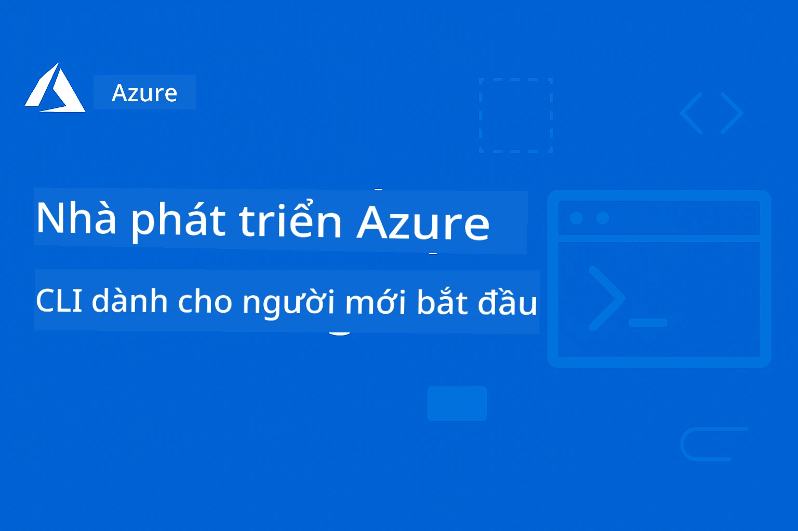

# AZD Cho Người Mới Bắt Đầu: Hành Trình Học Tập Có Cấu Trúc

 

[](https://github.com/microsoft/AZD-for-beginners)
[](https://GitHub.com/microsoft/azd-for-beginners/network/)
[](https://github.com/microsoft/AZD-for-beginners)

[](https://discord.com/invite/nkVh3dp)
[](https://discord.gg/nTYy5BXMWG)

---

### Bản Dịch Tự Động (Luôn Cập Nhật)

<!-- CO-OP TRANSLATOR LANGUAGES TABLE START -->
[Arabic](../ar/README.md) | [Bengali](../bn/README.md) | [Bulgarian](../bg/README.md) | [Burmese (Myanmar)](../my/README.md) | [Chinese (Simplified)](../zh-CN/README.md) | [Chinese (Traditional, Hong Kong)](../zh-HK/README.md) | [Chinese (Traditional, Macau)](../zh-MO/README.md) | [Chinese (Traditional, Taiwan)](../zh-TW/README.md) | [Croatian](../hr/README.md) | [Czech](../cs/README.md) | [Danish](../da/README.md) | [Dutch](../nl/README.md) | [Estonian](../et/README.md) | [Finnish](../fi/README.md) | [French](../fr/README.md) | [German](../de/README.md) | [Greek](../el/README.md) | [Hebrew](../he/README.md) | [Hindi](../hi/README.md) | [Hungarian](../hu/README.md) | [Indonesian](../id/README.md) | [Italian](../it/README.md) | [Japanese](../ja/README.md) | [Kannada](../kn/README.md) | [Khmer](../km/README.md) | [Korean](../ko/README.md) | [Lithuanian](../lt/README.md) | [Malay](../ms/README.md) | [Malayalam](../ml/README.md) | [Marathi](../mr/README.md) | [Nepali](../ne/README.md) | [Nigerian Pidgin](../pcm/README.md) | [Norwegian](../no/README.md) | [Persian (Farsi)](../fa/README.md) | [Polish](../pl/README.md) | [Portuguese (Brazil)](../pt-BR/README.md) | [Portuguese (Portugal)](../pt-PT/README.md) | [Punjabi (Gurmukhi)](../pa/README.md) | [Romanian](../ro/README.md) | [Russian](../ru/README.md) | [Serbian (Cyrillic)](../sr/README.md) | [Slovak](../sk/README.md) | [Slovenian](../sl/README.md) | [Spanish](../es/README.md) | [Swahili](../sw/README.md) | [Swedish](../sv/README.md) | [Tagalog (Filipino)](../tl/README.md) | [Tamil](../ta/README.md) | [Telugu](../te/README.md) | [Thai](../th/README.md) | [Turkish](../tr/README.md) | [Ukrainian](../uk/README.md) | [Urdu](../ur/README.md) | [Vietnamese](./README.md)

> **Ưu tiên Nhân Bản (Clone) Cục Bộ?**
>
> Kho lưu trữ này bao gồm bản dịch hơn 50 ngôn ngữ, điều này làm tăng đáng kể kích thước tải xuống. Để nhân bản mà không có bản dịch, hãy sử dụng sparse checkout:
>
> **Bash / macOS / Linux:**
> ```bash
> git clone --filter=blob:none --sparse https://github.com/microsoft/AZD-for-beginners.git
> cd AZD-for-beginners
> git sparse-checkout set --no-cone '/*' '!translations' '!translated_images'
> ```
>
> **CMD (Windows):**
> ```cmd
> git clone --filter=blob:none --sparse https://github.com/microsoft/AZD-for-beginners.git
> cd AZD-for-beginners
> git sparse-checkout set --no-cone "/*" "!translations" "!translated_images"
> ```
>
> Điều này cung cấp cho bạn tất cả những gì cần thiết để hoàn thành khóa học với tốc độ tải xuống nhanh hơn nhiều.
<!-- CO-OP TRANSLATOR LANGUAGES TABLE END -->

## 🆕 Có gì mới trong azd Hôm Nay

> 📌 **Cập nhật Foundry GA (2026-11-09):** Bộ **`microsoft.foundry` 1.0 đã chính thức có sẵn**, được công bố vào [Ngày 5 tháng 11 năm 2026](https://devblogs.microsoft.com/azure-sdk/microsoft-foundry-azure-developer-cli-ga/). Sử dụng **`azd >= 1.37.0`** và cài đặt với `azd ext install microsoft.foundry`. Theo dõi [hướng dẫn host-agent](docs/chapter-02-ai-development/microsoft-foundry-integration.md#hosted-agent-walkthrough-ga) để thiết lập, thử nghiệm cục bộ và triển khai. Cập nhật này dựa trên hướng dẫn đã công bố, không phải một triển khai Azure trực tiếp; bộ GA không đảm bảo mọi tính năng tùy chọn, tiện ích mở rộng hoặc SDK đều có mặt.

Azure Developer CLI hỗ trợ nhiều loại ứng dụng, bao gồm ứng dụng web, API và các đại lý AI, thông qua các host, mẫu và tiện ích mở rộng được hỗ trợ.

Điều này có nghĩa gì với bạn:

- **Bộ GA cho phát triển Foundry.** `microsoft.foundry` cài đặt bảy tiện ích mở rộng cốt lõi, bao gồm đại lý, dự án và Agent Inspector. Mã đại lý và cấu hình triển khai được giữ cùng nhau trong `azure.yaml`.
- **Thử nghiệm cục bộ, sau đó triển khai mã.** Sử dụng `azd ai agent init --deploy-mode code`, `azd provision` và `azd ai agent run` để kiểm tra các yêu cầu và phản hồi cục bộ. Sau đó sử dụng `azd deploy` để xây dựng từ xa trong Foundry, không cần xây dựng container cục bộ.
- **Đo lường chất lượng riêng biệt.** Cài đặt **`azure.ai.evaluations`** cho `azd ai eval generate`, `init` và `run start`; tiện ích này không có trong bộ. Giữ các bộ dữ liệu đã xem xét và rubrics cùng với mã của bạn. Các dự án cũ hơn nên theo [hướng dẫn di cư đánh giá và tối ưu hóa](docs/chapter-08-production/production-ai-practices.md#evaluation-migration-and-quality-checks).
- **Tái sử dụng cấu hình trong CI/CD.** Sau khi `azd up` thành công, cấu hình pipeline với `azd pipeline config`. Cài đặt bộ trên runner và giữ các cài đặt xác thực và môi trường được tạo ra.
- **Nâng cao trải nghiệm cơ bản hàng ngày.** Các phiên bản gần đây làm cho `azd init` trở nên idempotent (an toàn để chạy lại), tự động xóa token cũ trong `azd auth login`, và thêm lời nhắc thiết lập thân thiện khi chạy lần đầu `azd tool`.
- **Quy trình chính không thay đổi.** Cho dù bạn triển khai ứng dụng todo, dịch vụ vi mô hay giải pháp AI đa đại lý, các lệnh đều giống nhau.

> **Lưu ý cho người dùng Aspire:** Microsoft hiện gọi sản phẩm đơn giản là **Aspire** (trước đây là ".NET Aspire"). Hỗ trợ Aspire của azd không thay đổi — chỉ có tên được cập nhật.

Nếu bạn đã sử dụng azd trước đây, hỗ trợ AI là phần mở rộng tự nhiên — không phải công cụ riêng hay lộ trình nâng cao. Nếu bạn mới bắt đầu, bạn sẽ học một quy trình làm việc áp dụng cho mọi thứ.

---

## 🚀 Azure Developer CLI (azd) là gì?

**Azure Developer CLI (azd)** là công cụ dòng lệnh thân thiện với nhà phát triển giúp việc triển khai ứng dụng lên Azure trở nên đơn giản. Thay vì phải tạo và kết nối hàng tá tài nguyên Azure thủ công, bạn có thể triển khai toàn bộ ứng dụng chỉ với một lệnh duy nhất.

### Phép màu của `azd up`

```bash
# This single command does everything:
# ✅ Creates all Azure resources  
# ✅ Configures networking and security
# ✅ Builds your application code
# ✅ Deploys to Azure
# ✅ Gives you a working URL
azd up
```

Mẫu cung cấp cấu hình ứng dụng và hạ tầng. Việc triển khai thành công vẫn đòi hỏi các dịch vụ/mô hình được hỗ trợ, hạn mức và quyền đủ, đầu vào đúng và xác minh ứng dụng đã triển khai. `azd up` không tự động biến mẫu thành an toàn, tuân thủ, hay sẵn sàng sản xuất.

---

## ❓ Azure Developer CLI và Azure CLI: Điểm Khác Biệt?

Đây là câu hỏi phổ biến nhất của người mới. Đây là câu trả lời đơn giản:

| Tính Năng | **Azure CLI (`az`)** | **Azure Developer CLI (`azd`)** |
|---------|---------------------|--------------------------------|
| **Mục đích** | Quản lý tài nguyên Azure riêng lẻ | Triển khai ứng dụng hoàn chỉnh |
| **Tư duy** | Tập trung vào hạ tầng | Tập trung vào ứng dụng |
| **Ví dụ** | `az webapp create --name myapp...` | `azd up` |
| **Độ khó học** | Phải biết dịch vụ Azure | Chỉ cần biết về ứng dụng của bạn |
| **Phù hợp với** | DevOps, Hạ tầng | Lập trình viên, Phát triển nguyên mẫu |

### Minh họa Đơn giản

- **Azure CLI** giống như có đầy đủ công cụ xây nhà - búa, cưa, đinh. Bạn có thể xây bất cứ gì, nhưng phải biết xây dựng.
- **Azure Developer CLI** giống như thuê nhà thầu - bạn mô tả bạn muốn gì, họ lo xây dựng.

### Khi nào dùng cái nào

| Tình huống | Dùng cái này |
|----------|----------|
| "Tôi muốn triển khai ứng dụng web nhanh chóng" | `azd up` |
| "Tôi chỉ cần tạo tài khoản lưu trữ" | `az storage account create` |
| "Tôi đang xây dựng ứng dụng AI đầy đủ" | `azd init --template azure-search-openai-demo` |
| "Tôi cần gỡ lỗi một tài nguyên Azure cụ thể" | `az resource show` |
| "Tôi muốn triển khai tới môi trường sản xuất đã cấu hình" | Xem lại cấu hình, quyền truy cập, chi phí và các cổng vận hành trước khi `azd up --environment production` |

### Chúng Hoạt Động Cùng Nhau!

AZD và Azure CLI có xác thực và cấu hình riêng biệt. Dùng `azd auth login` cho AZD, và `az login` khi lệnh hook hoặc chẩn đoán cần rõ Azure CLI. Bạn có thể dùng cả hai:
```bash
# Deploy your app with AZD
azd up

# Then fine-tune specific resources with Azure CLI
az webapp config set --name myapp --always-on true
```

---

## 🌟 Tìm Mẫu trong Awesome AZD

Đừng bắt đầu từ đầu! **Awesome AZD** là bộ sưu tập cộng đồng các mẫu có thể triển khai ngay:

| Tài nguyên | Mô tả |
|----------|-------------|
| 🔗 [**Thư viện Awesome AZD**](https://azure.github.io/awesome-azd/) | Duyệt hơn 200 mẫu với một cú nhấp triển khai |
| 🔗 [**Gửi Mẫu**](https://github.com/Azure/awesome-azd/issues) | Góp phần mẫu của bạn cho cộng đồng |
| 🔗 [**Kho GitHub**](https://github.com/Azure/awesome-azd) | Thêm sao và khám phá mã nguồn |

### Mẫu AI Phổ biến từ Awesome AZD

Chọn một mẫu trong thư mục trống riêng; các lệnh bên dưới là các lựa chọn thay thế. `.` đính kèm khởi tạo thư mục đó.

```bash
# RAG Chat with Microsoft Foundry Models + AI Search
azd init --template azure-search-openai-demo .

# Quick AI Chat Application
azd init --template openai-chat-app-quickstart .

# AI Agents with Foundry Agents
azd init --template get-started-with-ai-agents .
```

---

## 🎯 Bắt Đầu Trong 3 Bước

Trước khi bắt đầu, hãy đảm bảo máy của bạn sẵn sàng cho mẫu bạn muốn triển khai:

**Windows:**
```powershell
.\validate-setup.ps1
```

**macOS / Linux:**
```bash
bash ./validate-setup.sh
```

Nếu có kiểm tra nào không đạt, hãy sửa nó trước rồi tiếp tục với hướng dẫn nhanh.

### Bước 1: Cài đặt AZD (2 phút)

**Windows:**
```powershell
winget install microsoft.azd
```

**macOS:**
```bash
brew tap azure/azd && brew install azd
```

**Linux:**
```bash
curl -fsSL https://aka.ms/install-azd.sh | bash
```

### Bước 2: Xác Thực cho AZD

```bash
# Optional if you plan to use Azure CLI commands directly in this course
az login

# Required for AZD workflows
azd auth login
```

Nếu bạn không chắc cần dùng cái nào, hãy theo đầy đủ quy trình thiết lập trong [Cài đặt & Thiết lập](docs/chapter-01-foundation/installation.md#authentication-setup).

### Bước 3: Triển khai Ứng dụng Đầu tiên của Bạn

```bash
# Initialize from a template
azd init --template todo-nodejs-mongo .

# Deploy to Azure (creates everything!)
azd up
```

**🎉 Hoàn thành!** Ứng dụng của bạn giờ đã hoạt động trên Azure.

### Dọn Dẹp (Đừng Quên!)

```bash
# Remove all resources when done experimenting
azd down --force --purge
```

---

## 📚 Cách Sử Dụng Khóa Học Này

Khóa học này được thiết kế cho **học tập tuần tự** - bắt đầu từ nơi bạn thấy thoải mái và tiếp tục nâng cao:

| Kinh nghiệm của bạn | Bắt đầu ở đây |
|-----------------|------------|
| **Hoàn toàn mới với Azure** | [Chương 1: Nền tảng](#-chapter-1-foundation--quick-start) |
| **Biết về Azure, mới với AZD** | [Chương 1: Nền tảng](#-chapter-1-foundation--quick-start) |
| **Muốn triển khai ứng dụng AI** | [Chương 2: Phát triển AI-Đầu tiên](#-chapter-2-ai-first-development-recommended-for-ai-developers) |
| **Muốn thực hành trực tiếp** | [🎓 Hội thảo Tương tác](workshop/README.md) - phòng thí nghiệm hướng dẫn 3-4 giờ |
| **Cần mẫu sản xuất** | [Chương 8: Sản xuất & Doanh nghiệp](#-chapter-8-production--enterprise-patterns) |

### Thiết Lập Nhanh

1. **Fork Kho Lưu Trữ Này**: [](https://GitHub.com/microsoft/azd-for-beginners/fork)
2. **Nhân Bản**: `git clone https://github.com/YOUR-USERNAME/azd-for-beginners.git`
3. **Nhờ Trợ Giúp**: [Cộng đồng Azure Discord](https://discord.com/invite/ByRwuEEgH4)

> **Ưu tiên Nhân Bản (Clone) Cục Bộ?**

> Kho lưu trữ này bao gồm hơn 50 bản dịch ngôn ngữ làm tăng đáng kể dung lượng tải xuống. Để sao chép mà không có bản dịch, hãy sử dụng sparse checkout:
> ```bash
> git clone --filter=blob:none --sparse https://github.com/microsoft/AZD-for-beginners.git
> cd AZD-for-beginners
> git sparse-checkout set --no-cone '/*' '!translations' '!translated_images'
> ```
> Điều này cung cấp cho bạn tất cả những gì cần thiết để hoàn thành khóa học với tốc độ tải xuống nhanh hơn nhiều.


## Tổng quan khóa học

Thành thạo Azure Developer CLI (azd) qua các chương được cấu trúc dành cho học tập tiến bộ. **Tập trung đặc biệt vào triển khai ứng dụng AI với tích hợp Microsoft Foundry.**

### Tại sao khóa học này thiết yếu cho các nhà phát triển hiện đại

Các nhà phát triển triển khai khối lượng công việc AI thường cần hướng dẫn về:
- Các kiến trúc AI phức tạp với đa dịch vụ
- Thực hành triển khai AI trong môi trường sản xuất tốt nhất  
- Tích hợp và cấu hình dịch vụ AI Azure
- Tối ưu chi phí cho khối lượng công việc AI
- Xử lý sự cố các vấn đề triển khai đặc thù AI

### Mục tiêu học tập

Khi hoàn thành khóa học có cấu trúc này, bạn sẽ:
- **Thành thạo kiến thức cơ bản AZD**: Khái niệm chính, cài đặt và cấu hình
- **Triển khai ứng dụng AI**: Sử dụng AZD với dịch vụ Microsoft Foundry
- **Triển khai Hạ tầng dưới dạng Mã**: Quản lý tài nguyên Azure với mẫu Bicep
- **Xử lý sự cố triển khai**: Giải quyết các sự cố phổ biến và gỡ lỗi vấn đề
- **Tối ưu cho môi trường sản xuất**: Bảo mật, mở rộng, giám sát và quản lý chi phí
- **Xây dựng giải pháp đa tác nhân**: Triển khai kiến trúc AI phức tạp

## Trước khi bắt đầu: Tài khoản, Quyền truy cập và Các giả định

Trước khi bắt đầu Chương 1, hãy đảm bảo bạn đã có sẵn các yếu tố sau. Các bước cài đặt trong hướng dẫn này giả định những điều cơ bản này đã được xử lý.

- **Một đăng ký Azure**: Bạn có thể sử dụng đăng ký hiện tại từ công việc hoặc tài khoản cá nhân, hoặc tạo một [dùng thử miễn phí](https://aka.ms/azurefreetrial) để bắt đầu.
- **Quyền tạo tài nguyên Azure**: Đối với phần lớn bài tập, bạn nên có quyền ít nhất là **Contributor** trên đăng ký hoặc nhóm tài nguyên mục tiêu. Một số chương có thể giả định bạn có thể tạo nhóm tài nguyên, định danh được quản lý và phân quyền RBAC.
- [**Tài khoản GitHub**](https://github.com): Điều này hữu ích để fork kho lưu trữ, theo dõi thay đổi cá nhân và sử dụng GitHub Codespaces cho hội thảo.
- **Yêu cầu môi trường chạy mẫu**: Một số mẫu cần công cụ cục bộ như Node.js, Python, Java hoặc Docker. Chạy trình xác thực cài đặt trước khi bắt đầu để phát hiện thiếu công cụ sớm.
- **Hiểu biết cơ bản về terminal**: Bạn không cần phải là chuyên gia, nhưng nên thoải mái chạy các lệnh như `git clone`, `azd auth login` và `azd up`.

> **Làm việc trong đăng ký doanh nghiệp?**
> Nếu môi trường Azure của bạn do quản trị viên quản lý, hãy xác nhận trước rằng bạn có thể triển khai tài nguyên trong đăng ký hoặc nhóm tài nguyên dự kiến sử dụng. Nếu không, yêu cầu đăng ký sandbox hoặc quyền Contributor trước khi bắt đầu.

> **Mới với Azure?**
> Bắt đầu với đăng ký thử nghiệm hoặc trả phí theo lượng sử dụng của riêng bạn tại https://aka.ms/azurefreetrial để có thể hoàn thành các bài tập từ đầu đến cuối mà không phải chờ phê duyệt cấp thuê.

## 🗺️ Bản đồ khóa học: Điều hướng nhanh theo chương

Mỗi chương có README riêng với mục tiêu học tập, hướng dẫn nhanh và bài tập:

| Chương | Chủ đề | Bài học | Thời lượng | Độ khó |
|---------|-------|---------|----------|------------|
| **[Ch 1: Nền tảng](docs/chapter-01-foundation/README.md)** | Bắt đầu | [Kiến thức cơ bản AZD](docs/chapter-01-foundation/azd-basics.md) &#124; [Cài đặt](docs/chapter-01-foundation/installation.md) &#124; [Dự án đầu tiên](docs/chapter-01-foundation/first-project.md) | 30-45 phút | ⭐ |
| **[Ch 2: Phát triển AI](docs/chapter-02-ai-development/README.md)** | Ứng dụng lấy AI làm trung tâm | [Tích hợp Foundry](docs/chapter-02-ai-development/microsoft-foundry-integration.md) &#124; [Tác nhân AI](docs/chapter-02-ai-development/agents.md) &#124; [Triển khai mô hình](docs/chapter-02-ai-development/ai-model-deployment.md) &#124; [Hội thảo](docs/chapter-02-ai-development/ai-workshop-lab.md) | 1-2 giờ | ⭐⭐ |
| **[Ch 3: Cấu hình](docs/chapter-03-configuration/README.md)** | Xác thực & Bảo mật | [Cấu hình](docs/chapter-03-configuration/configuration.md) &#124; [Xác thực & Bảo mật](docs/chapter-03-configuration/authsecurity.md) | 45-60 phút | ⭐⭐ |
| **[Ch 4: Hạ tầng](docs/chapter-04-infrastructure/README.md)** | Hạ tầng dưới dạng mã & Triển khai | [Hướng dẫn triển khai](docs/chapter-04-infrastructure/deployment-guide.md) &#124; [Cung cấp tài nguyên](docs/chapter-04-infrastructure/provisioning.md) | 1-1.5 giờ | ⭐⭐⭐ |
| **[Ch 5: Đa tác nhân](docs/chapter-05-multi-agent/README.md)** | Giải pháp tác nhân AI | [Kịch bản bán lẻ](examples/retail-scenario.md) &#124; [Mẫu phối hợp](docs/chapter-06-pre-deployment/coordination-patterns.md) | 2-3 giờ | ⭐⭐⭐⭐ |
| **[Ch 6: Trước triển khai](docs/chapter-06-pre-deployment/README.md)** | Lập kế hoạch & Xác thực | [Kiểm tra tiền triển khai](docs/chapter-06-pre-deployment/preflight-checks.md) &#124; [Lập kế hoạch năng lực](docs/chapter-06-pre-deployment/capacity-planning.md) &#124; [Chọn SKU](docs/chapter-06-pre-deployment/sku-selection.md) &#124; [Giám sát ứng dụng](docs/chapter-06-pre-deployment/application-insights.md) | 1 giờ | ⭐⭐ |
| **[Ch 7: Xử lý sự cố](docs/chapter-07-troubleshooting/README.md)** | Gỡ lỗi & Sửa lỗi | [Vấn đề thường gặp](docs/chapter-07-troubleshooting/common-issues.md) &#124; [Gỡ lỗi](docs/chapter-07-troubleshooting/debugging.md) &#124; [Vấn đề AI](docs/chapter-07-troubleshooting/ai-troubleshooting.md) | 1-1.5 giờ | ⭐⭐ |
| **[Ch 8: Sản xuất](docs/chapter-08-production/README.md)** | Mẫu doanh nghiệp | [Thực hành sản xuất](docs/chapter-08-production/production-ai-practices.md) | 2-3 giờ | ⭐⭐⭐⭐ |
| **[🎓 Hội thảo](workshop/README.md)** | Thực hành | [Giới thiệu](workshop/docs/instructions/0-Introduction.md) &#124; [Lựa chọn](workshop/docs/instructions/1-Select-AI-Template.md) &#124; [Xác thực](workshop/docs/instructions/2-Validate-AI-Template.md) &#124; [Phân tích](workshop/docs/instructions/3-Deconstruct-AI-Template.md) &#124; [Cấu hình](workshop/docs/instructions/4-Configure-AI-Template.md) &#124; [Tùy biến](workshop/docs/instructions/5-Customize-AI-Template.md) &#124; [Dỡ bỏ](workshop/docs/instructions/6-Teardown-Infrastructure.md) &#124; [Kết thúc](workshop/docs/instructions/7-Wrap-up.md) | 3-4 giờ | ⭐⭐ |

**Tổng thời lượng khóa học:** ~10-14 giờ | **Tiến trình kỹ năng:** Người mới bắt đầu → Sẵn sàng môi trường sản xuất

---

## 📚 Các chương học

*Chọn lộ trình học phù hợp dựa trên trình độ và mục tiêu*

### 🚀 Chương 1: Nền tảng & Bắt đầu nhanh
**Điều kiện tiên quyết**: Đăng ký Azure, kiến thức cơ bản dòng lệnh  
**Thời lượng**: 30-45 phút  
**Độ khó**: ⭐

#### Những gì bạn sẽ học
- Hiểu về kiến thức cơ bản Azure Developer CLI
- Cài đặt AZD trên nền tảng của bạn
- Triển khai thành công dự án đầu tiên

#### Tài nguyên học tập
- **🎯 Bắt đầu tại đây**: [Azure Developer CLI là gì?](#-what-is-azure-developer-cli-azd)
- **📖 Lý thuyết**: [Kiến thức cơ bản AZD](docs/chapter-01-foundation/azd-basics.md) - Khái niệm và thuật ngữ chính
- **⚙️ Cài đặt**: [Hướng dẫn cài đặt & thiết lập](docs/chapter-01-foundation/installation.md) - Hướng dẫn nền tảng cụ thể
- **🛠️ Thực hành**: [Dự án đầu tiên của bạn](docs/chapter-01-foundation/first-project.md) - Hướng dẫn từng bước
- **📋 Tham khảo nhanh**: [Bảng lệnh tắt](resources/cheat-sheet.md)

#### Bài tập thực hành
```bash
# Quick installation check
azd version

# Deploy your first application
azd init --template todo-nodejs-mongo .
azd up
```

**💡 Kết quả chương**: Triển khai thành công ứng dụng web đơn giản lên Azure bằng AZD

**✅ Xác nhận thành công:**
```bash
# After completing Chapter 1, you should be able to:
azd version              # Shows installed version
azd init --template todo-nodejs-mongo  # Initializes project
azd up                  # Deploys to Azure
azd show                # Displays running app URL
# Application opens in browser and works
azd down --force --purge  # Cleans up resources
```

**📊 Thời gian đầu tư:** 30-45 phút  
**📈 Trình độ sau khi hoàn thành:** Có thể triển khai các ứng dụng cơ bản độc lập

---

### 🤖 Chương 2: Phát triển AI Làm Trung Tâm (Khuyến nghị cho nhà phát triển AI)
**Điều kiện tiên quyết**: Đã hoàn thành Chương 1  
**Thời lượng**: 1-2 giờ  
**Độ khó**: ⭐⭐

#### Những gì bạn sẽ học
- Tích hợp Microsoft Foundry với AZD
- Triển khai ứng dụng có AI tích hợp
- Hiểu cấu hình dịch vụ AI

#### Tài nguyên học tập
- **🎯 Bắt đầu tại đây**: [Tích hợp Microsoft Foundry](docs/chapter-02-ai-development/microsoft-foundry-integration.md)
- **🤖 Tác nhân AI**: [Hướng dẫn tác nhân AI](docs/chapter-02-ai-development/agents.md) - Triển khai tác nhân thông minh với AZD
- **📖 Mẫu**: [Triển khai mô hình AI](docs/chapter-02-ai-development/ai-model-deployment.md) - Triển khai và quản lý mô hình AI
- **🛠️ Hội thảo**: [Phòng thí nghiệm hội thảo AI](docs/chapter-02-ai-development/ai-workshop-lab.md) - Chuẩn bị giải pháp AI sẵn sàng với AZD
- **🎥 Hướng dẫn tương tác**: [Tài liệu hội thảo](workshop/README.md) - Học qua trình duyệt với MkDocs * Môi trường DevContainer
- **📋 Mẫu**: [Mẫu Microsoft Foundry](#featured-microsoft-foundry-templates)
- **📝 Ví dụ**: [Ví dụ triển khai AZD](examples/README.md)

#### Bài tập thực hành
```bash
# Deploy your first AI application
azd init --template azure-search-openai-demo .
azd up

# Try additional AI templates
azd init --template openai-chat-app-quickstart .
azd init --template agent-openai-python-prompty .
```

**💡 Kết quả chương**: Triển khai và cấu hình ứng dụng chat AI với khả năng RAG

**✅ Xác nhận thành công:**
```bash
# After Chapter 2, you should be able to:
azd init --template azure-search-openai-demo .
azd up
# Test the AI chat interface
# Ask questions and get AI-powered responses with sources
# Verify search integration works
azd monitor  # Check Application Insights shows telemetry
azd down --force --purge
```

**📊 Thời gian đầu tư:** 1-2 giờ  
**📈 Trình độ sau khi hoàn thành:** Có thể triển khai các ứng dụng học AI và nhận diện các yêu cầu sẵn sàng sản xuất bổ sung
**💰 Ý thức chi phí:** Hiểu chi phí phát triển $80-150/tháng, chi phí sản xuất $300-3500/tháng

#### 💰 Xem xét chi phí cho triển khai AI

**Môi trường phát triển (Ước tính $80-150/tháng):**
- Mô hình Microsoft Foundry (Thanh toán theo mức sử dụng): $0-50/tháng (tùy theo token sử dụng)
- Tìm kiếm AI (cấp cơ bản): $75/tháng
- Ứng dụng Container (Chế độ tiêu thụ): $0-20/tháng
- Lưu trữ (Chuẩn): $1-5/tháng

**Môi trường sản xuất (Ước tính $300-3,500+/tháng):**
- Mô hình Microsoft Foundry (PTU cho hiệu suất ổn định): $3,000+/tháng HOẶC Thanh toán theo mức sử dụng với lưu lượng cao
- Tìm kiếm AI (cấp chuẩn): $250/tháng
- Ứng dụng Container (Dành riêng): $50-100/tháng
- Giám sát ứng dụng: $5-50/tháng
- Lưu trữ (Cao cấp): $10-50/tháng

**💡 Mẹo tối ưu chi phí:**
- Kiểm tra giá suy luận mô hình và tín dụng tài khoản; Azure OpenAI không bao gồm mức miễn phí 50,000 token hàng tháng chung
- Chạy `azd down` để xóa tài nguyên khi không còn cần thiết, sau khi xem xét môi trường đã chọn
- Bắt đầu với hóa đơn theo mức tiêu thụ, chỉ nâng cấp lên PTU cho sản xuất
- Dùng `azd provision --preview` để kiểm tra hạ tầng kế hoạch, sau đó tính chi phí tài nguyên với Azure Pricing Calculator
- Bật tự động mở rộng: chỉ trả phí cho mức sử dụng thực tế

**Giám sát chi phí:**
```bash
# Inspect planned resources (this does not calculate prices)
azd provision --preview

# Monitor actual costs in Azure Portal
az consumption budget list --resource-group <your-rg>
```

---

### ⚙️ Chương 3: Cấu hình & Xác thực
**Điều kiện tiên quyết**: Đã hoàn thành Chương 1  
**Thời lượng**: 45-60 phút  
**Độ khó**: ⭐⭐

#### Những gì bạn sẽ học
- Cấu hình và quản lý môi trường
- Thực hành tốt nhất về xác thực và bảo mật
- Đặt tên và tổ chức tài nguyên

#### Tài nguyên học tập
- **📖 Cấu hình**: [Hướng dẫn cấu hình](docs/chapter-03-configuration/configuration.md) - Thiết lập môi trường
- **🔐 Bảo mật**: [Mẫu xác thực và định danh được quản lý](docs/chapter-03-configuration/authsecurity.md) - Mẫu xác thực
- **📝 Ví dụ**: [Ví dụ ứng dụng cơ sở dữ liệu](examples/database-app/README.md) - Ví dụ AZD Database

#### Bài tập thực hành
- Cấu hình nhiều môi trường (phát triển, thử nghiệm, sản xuất)
- Thiết lập xác thực định danh được quản lý
- Triển khai cấu hình riêng cho từng môi trường

**💡 Kết quả chương**: Quản lý nhiều môi trường với xác thực và bảo mật phù hợp

---

### 🏗️ Chương 4: Hạ tầng dưới dạng mã & Triển khai
**Điều kiện tiên quyết**: Đã hoàn thành Chương 1-3  
**Thời lượng**: 1-1.5 giờ  
**Độ khó**: ⭐⭐⭐

#### Những gì bạn sẽ học
- Mẫu triển khai nâng cao
- Hạ tầng dưới dạng mã với Bicep
- Chiến lược cung cấp tài nguyên

#### Tài nguyên học tập
- **📖 Triển khai**: [Hướng dẫn triển khai](docs/chapter-04-infrastructure/deployment-guide.md) - Quy trình hoàn chỉnh
- **🏗️ Cung cấp**: [Cung cấp tài nguyên](docs/chapter-04-infrastructure/provisioning.md) - Quản lý tài nguyên Azure
- **📝 Ví dụ**: [Ví dụ ứng dụng Container](../../examples/container-app) - Triển khai container

#### Bài tập thực hành
- Tạo mẫu Bicep tùy chỉnh
- Triển khai ứng dụng đa dịch vụ
- Áp dụng chiến lược triển khai blue-green

**💡 Kết quả chương**: Triển khai ứng dụng đa dịch vụ phức tạp dùng mẫu hạ tầng tùy chỉnh

---

### 🎯 Chương 5: Giải pháp AI đa tác nhân (Nâng cao)
**Điều kiện tiên quyết**: Đã hoàn thành Chương 1-2  
**Thời lượng**: 2-3 giờ  
**Độ khó**: ⭐⭐⭐⭐

#### Những gì bạn sẽ học
- Mẫu kiến trúc đa tác nhân
- Điều phối và phối hợp tác nhân
- Triển khai AI sẵn sàng cho môi trường sản xuất

#### Tài nguyên học tập
- **🤖 Thiết kế nổi bật**: [Giải pháp đa tác nhân bán lẻ](examples/retail-scenario.md) - Bản thiết kế kiến trúc, không phải ứng dụng hoàn chỉnh
- **🛠️ Mẫu ARM**: [Gói mẫu ARM](../../examples/retail-multiagent-arm-template) - Khung hạ tầng; xem lại các điều kiện tiên quyết và các thành phần ứng dụng còn thiếu
- **📖 Kiến trúc**: [Các mẫu phối hợp đa tác nhân](docs/chapter-06-pre-deployment/coordination-patterns.md) - Các mẫu thiết kế

#### Bài tập Thực hành
```bash
# Inspect the retail infrastructure scaffold before choosing to deploy it
cd examples/retail-multiagent-arm-template
cat README.md

# After an intentional deployment, inspect infrastructure state
az deployment group show --resource-group <rg-name> --name <deployment-name>
```

**💡 Kết quả Chương**: Hiểu thiết kế đa tác nhân và xác định công việc triển khai, kiểm thử, vận hành cần làm ngoài khung hạ tầng

---

### 🔍 Chương 6: Kiểm tra & Lập kế hoạch trước Triển khai
**Điều kiện tiên quyết**: Hoàn thành Chương 4  
**Thời lượng**: 1 giờ  
**Độ phức tạp**: ⭐⭐

#### Những gì bạn sẽ học
- Lập kế hoạch năng lực và xác thực tài nguyên
- Chiến lược chọn SKU
- Kiểm tra trước khi triển khai và tự động hóa

#### Tài nguyên học tập
- **📊 Lập kế hoạch**: [Lập kế hoạch năng lực](docs/chapter-06-pre-deployment/capacity-planning.md) - Xác thực tài nguyên
- **💰 Lựa chọn**: [Chọn SKU](docs/chapter-06-pre-deployment/sku-selection.md) - Lựa chọn tiết kiệm chi phí
- **✅ Xác thực**: [Kiểm tra trước khi bay](docs/chapter-06-pre-deployment/preflight-checks.md) - Kịch bản tự động

#### Bài tập Thực hành
- Chạy các kịch bản xác thực năng lực
- Tối ưu lựa chọn SKU để tiết kiệm chi phí
- Thực hiện kiểm tra tự động trước khi triển khai

**💡 Kết quả Chương**: Xác thực và tối ưu triển khai trước khi thực hiện

---

### 🚨 Chương 7: Khắc phục sự cố & Gỡ lỗi
**Điều kiện tiên quyết**: Hoàn thành bất kỳ chương triển khai nào  
**Thời lượng**: 1-1.5 giờ  
**Độ phức tạp**: ⭐⭐

#### Những gì bạn sẽ học
- Phương pháp gỡ lỗi hệ thống có hệ thống
- Các sự cố phổ biến và giải pháp
- Khắc phục sự cố đặc thù AI

#### Tài nguyên học tập
- **🔧 Các sự cố thường gặp**: [Các vấn đề phổ biến](docs/chapter-07-troubleshooting/common-issues.md) - Câu hỏi thường gặp và giải pháp
- **🕵️ Gỡ lỗi**: [Hướng dẫn gỡ lỗi](docs/chapter-07-troubleshooting/debugging.md) - Chiến lược từng bước
- **🤖 Sự cố AI**: [Khắc phục sự cố AI](docs/chapter-07-troubleshooting/ai-troubleshooting.md) - Vấn đề dịch vụ AI

#### Bài tập Thực hành
- Chẩn đoán lỗi triển khai
- Giải quyết sự cố xác thực
- Gỡ lỗi kết nối dịch vụ AI

**💡 Kết quả Chương**: Tự chủ chẩn đoán và khắc phục các sự cố triển khai thường gặp

---

### 🏢 Chương 8: Mẫu Sản xuất & Doanh nghiệp
**Điều kiện tiên quyết**: Hoàn thành các chương 1-4  
**Thời lượng**: 2-3 giờ  
**Độ phức tạp**: ⭐⭐⭐⭐

#### Những gì bạn sẽ học
- Chiến lược triển khai sản xuất
- Mẫu bảo mật doanh nghiệp
- Giám sát và tối ưu chi phí

#### Tài nguyên học tập
- **🏭 Sản xuất**: [Các thực tiễn AI sản xuất tốt nhất](docs/chapter-08-production/production-ai-practices.md) - Mẫu doanh nghiệp
- **📝 Ví dụ**: [Ví dụ Microservices](../../examples/microservices) - Kiến trúc phức tạp
- **📊 Giám sát**: [Tích hợp Application Insights](docs/chapter-06-pre-deployment/application-insights.md) - Giám sát

#### Bài tập Thực hành
- Triển khai mẫu bảo mật doanh nghiệp
- Thiết lập giám sát toàn diện
- Triển khai lên sản xuất với quản trị đúng đắn

**💡 Kết quả Chương**: Triển khai ứng dụng sẵn sàng doanh nghiệp với đầy đủ năng lực sản xuất

---

## 🎓 Tổng quan Hội thảo: Trải nghiệm Học tập Thực hành

> **⚠️ TÌNH TRẠNG HỘI THẢO: Đang Phát triển**  
> Tài liệu hội thảo hiện đang được phát triển và hoàn thiện. Các mô-đun chính đã hoạt động, nhưng một số phần nâng cao chưa hoàn chỉnh. Chúng tôi đang tích cực hoàn thiện tất cả nội dung. [Theo dõi tiến độ →](workshop/README.md)

### Tài liệu Hội thảo Tương tác
**Học tập thực hành toàn diện với công cụ trình duyệt và bài tập hướng dẫn**

Tài liệu hội thảo cung cấp trải nghiệm học tập có cấu trúc và tương tác bổ trợ cho chương trình học theo từng chương bên trên. Hội thảo phù hợp cho cả học tự học và hướng dẫn giảng viên.

#### 🛠️ Tính năng Hội thảo
- **Giao diện trình duyệt**: Hội thảo hoàn chỉnh vận hành trên MkDocs với tìm kiếm, sao chép và các tính năng chủ đề
- **Tích hợp GitHub Codespaces**: Thiết lập môi trường phát triển chỉ với một cú nhấp
- **Lộ trình học tập có cấu trúc**: 8 mô-đun bài tập hướng dẫn (tổng 3-4 giờ)
- **Phương pháp tiến triển**: Giới thiệu → Lựa chọn → Xác thực → Phân tích → Cấu hình → Tùy chỉnh → Dọn dẹp → Tổng kết
- **Môi trường DevContainer Tương tác**: Công cụ và phụ thuộc được cấu hình sẵn

#### 📚 Cấu trúc Mô-đun Hội thảo
Hội thảo theo **phương pháp 8 mô-đun tiến triển** dẫn bạn từ giai đoạn khám phá đến thành thạo triển khai:

| Mô-đun | Chủ đề | Bạn sẽ làm gì | Thời lượng |
|--------|-------|----------------|----------|
| **0. Giới thiệu** | Tổng quan Hội thảo | Hiểu mục tiêu học tập, điều kiện tiên quyết và cấu trúc hội thảo | 15 phút |
| **1. Lựa chọn** | Khám phá mẫu | Tìm hiểu các mẫu AZD và chọn mẫu AI phù hợp cho kịch bản của bạn | 20 phút |
| **2. Xác thực** | Triển khai & Kiểm tra | Triển khai mẫu với `azd up` và xác thực hạ tầng hoạt động | 30 phút |
| **3. Phân tích** | Hiểu cấu trúc | Dùng GitHub Copilot để khám phá kiến trúc mẫu, file Bicep và tổ chức mã | 30 phút |
| **4. Cấu hình** | Nghiên cứu sâu azure.yaml | Thành thạo cấu hình `azure.yaml`, các lifecycle hook và biến môi trường | 30 phút |
| **5. Tùy chỉnh** | Làm cho nó là của bạn | Kích hoạt Tìm kiếm AI, theo dõi, đánh giá và tùy chỉnh kịch bản | 45 phút |
| **6. Dọn dẹp** | Dọn dẹp | Thu hồi tài nguyên an toàn với `azd down --purge` | 15 phút |
| **7. Tổng kết** | Các bước tiếp theo | Xem lại thành tựu, khái niệm chính và tiếp tục hành trình học | 15 phút |

**Quy trình Hội thảo:**
```
Introduction → Selection → Validation → Deconstruction → Configuration → Customization → Teardown → Wrap-up
     ↓            ↓           ↓              ↓               ↓              ↓            ↓           ↓
  Overview    Find the     Deploy &      Explore        Master         Customize     Clean up    Review &
             right        verify        code &        azure.yaml      for your      resources   next steps
             template                   structure                     scenario
```

#### 🚀 Bắt đầu với Hội thảo
```bash
# Option 1: GitHub Codespaces (Recommended)
# Click "Code" → "Create codespace on main" in the repository

# Option 2: Local Development
git clone https://github.com/microsoft/azd-for-beginners.git
cd azd-for-beginners/workshop
# Follow the setup instructions in workshop/README.md
```

#### 🎯 Kết quả học tập Hội thảo
Khi hoàn thành hội thảo, người tham gia sẽ:
- **Triển khai Ứng dụng AI Sản xuất**: Dùng AZD với dịch vụ Microsoft Foundry
- **Thành thạo Kiến trúc Đa tác nhân**: Thực hiện giải pháp phối hợp các tác nhân AI
- **Áp dụng Thực tiễn Bảo mật Tốt nhất**: Cấu hình xác thực và kiểm soát truy cập
- **Tối ưu Hóa Quy mô**: Thiết kế triển khai tiết kiệm chi phí và hiệu năng cao
- **Khắc phục sự cố Triển khai**: Giải quyết vấn đề phổ biến một cách độc lập

#### 📖 Tài nguyên Hội thảo
- **🎥 Hướng dẫn tương tác**: [Tài liệu Hội thảo](workshop/README.md) - Môi trường học tập trên trình duyệt
- **📋 Hướng dẫn theo Mô-đun**:
  - [0. Giới thiệu](workshop/docs/instructions/0-Introduction.md) - Tổng quan và mục tiêu hội thảo
  - [1. Lựa chọn](workshop/docs/instructions/1-Select-AI-Template.md) - Tìm hiểu và chọn mẫu AI
  - [2. Xác thực](workshop/docs/instructions/2-Validate-AI-Template.md) - Triển khai và kiểm tra các mẫu
  - [3. Phân tích](workshop/docs/instructions/3-Deconstruct-AI-Template.md) - Khám phá kiến trúc mẫu
  - [4. Cấu hình](workshop/docs/instructions/4-Configure-AI-Template.md) - Thành thạo azure.yaml
  - [5. Tùy chỉnh](workshop/docs/instructions/5-Customize-AI-Template.md) - Tùy chỉnh cho kịch bản của bạn
  - [6. Dọn dẹp](workshop/docs/instructions/6-Teardown-Infrastructure.md) - Dọn dẹp tài nguyên
  - [7. Tổng kết](workshop/docs/instructions/7-Wrap-up.md) - Ôn tập và bước tiếp theo
- **🛠️ Phòng thí nghiệm AI**: [Phòng thí nghiệm AI](docs/chapter-02-ai-development/ai-workshop-lab.md) - Bài tập tập trung AI
- **💡 Bắt đầu Nhanh**: [Hướng dẫn cài đặt hội thảo](workshop/README.md#browser-based-guide) - Cấu hình môi trường

**Phù hợp cho**: Đào tạo doanh nghiệp, khóa học đại học, học tự học và các trại đào tạo lập trình viên.

---

## 📖 Tìm hiểu sâu: Khả năng AZD

Ngoài các kiến thức cơ bản, AZD cung cấp tính năng mạnh mẽ cho triển khai sản xuất:

- **Triển khai dựa trên mẫu** - Dùng các mẫu có sẵn cho các mô hình ứng dụng phổ biến
- **Hạ tầng như mã** - Quản lý tài nguyên Azure bằng Bicep hoặc Terraform  
- **Quy trình tích hợp** - Cung cấp, triển khai và giám sát ứng dụng liền mạch
- **Thân thiện với nhà phát triển** - Tối ưu năng suất và trải nghiệm lập trình viên

### **AZD + Microsoft Foundry: Hoàn hảo cho triển khai AI**

**Tại sao chọn AZD cho giải pháp AI?** AZD giải quyết các thách thức hàng đầu mà nhà phát triển AI gặp phải:

- **Mẫu sẵn sàng AI** - Mẫu cấu hình sẵn cho Microsoft Foundry Models, Dịch vụ AI Azure và khối lượng ML
- **Triển khai AI an toàn** - Mẫu bảo mật tích hợp cho dịch vụ AI, khoá API và điểm cuối mô hình  
- **Mẫu AI sản xuất** - Thực tiễn tốt cho triển khai ứng dụng AI có thể mở rộng và tiết kiệm chi phí
- **Quy trình AI đầu-cuối** - Từ phát triển mô hình đến triển khai sản xuất với giám sát thích hợp
- **Tối ưu chi phí** - Chiến lược phân bổ tài nguyên thông minh và tự động mở rộng cho khối lượng AI
- **Tích hợp Microsoft Foundry** - Kết nối liền mạch với danh mục mô hình và điểm cuối Microsoft Foundry

---

## 🎯 Thư viện Mẫu & Ví dụ

### Tiêu biểu: Mẫu Microsoft Foundry
**Bắt đầu tại đây nếu bạn đang triển khai ứng dụng AI!**

> **Lưu ý:** Các mẫu này trình bày các mẫu AI khác nhau. Một số là Azure Samples bên ngoài, số khác là hiện thực địa phương.

| Mẫu | Chương | Độ phức tạp | Dịch vụ | Loại |
|----------|---------|------------|----------|------|
| [**Bắt đầu với Chat AI**](https://github.com/Azure-Samples/get-started-with-ai-chat) | Chương 2 | ⭐⭐ | AzureOpenAI + Azure AI Model Inference API + Azure AI Search + Azure Container Apps + Application Insights | Bên ngoài |
| [**Bắt đầu với tác nhân AI**](https://github.com/Azure-Samples/get-started-with-ai-agents) | Chương 2 | ⭐⭐ | Foundry Agents + AzureOpenAI + Azure AI Search + Azure Container Apps + Application Insights| Bên ngoài |
| [**Demo Azure Search + OpenAI**](https://github.com/Azure-Samples/azure-search-openai-demo) | Chương 2 | ⭐⭐ | Azure OpenAI + Azure AI Search + Container Apps (mặc định) + Storage | Bên ngoài |
| [**Khởi động nhanh Ứng dụng Chat OpenAI**](https://github.com/Azure-Samples/openai-chat-app-quickstart) | Chương 2 | ⭐ | AzureOpenAI + Container Apps + Application Insights | Bên ngoài |
| [**Agent OpenAI Python Prompty**](https://github.com/Azure-Samples/agent-openai-python-prompty) | Chương 5 | ⭐⭐⭐ | AzureOpenAI + Azure Functions + Prompty | Bên ngoài |
| [**Chat RAG Contoso**](https://github.com/Azure-Samples/contoso-chat) | Chương 8 | ⭐⭐⭐⭐ | AzureOpenAI + AI Search + Cosmos DB + Container Apps | Bên ngoài |
| [**Giải pháp Đa tác nhân Bán lẻ**](examples/retail-scenario.md) | Chương 5 | ⭐⭐⭐⭐ | Bản thiết kế kiến trúc và khung hạ tầng đề xuất; cần triển khai ứng dụng | **Bản thiết kế địa phương** |

### Tiêu biểu: Kịch bản học tập hoàn chỉnh
**Mẫu ứng dụng sẵn sàng sản xuất được phân theo chương học**

| Mẫu | Chương học | Độ phức tạp | Kiến thức chính |
|----------|------------------|------------|--------------|
| [**openai-chat-app-quickstart**](https://github.com/Azure-Samples/openai-chat-app-quickstart) | Chương 2 | ⭐ | Các mẫu triển khai AI cơ bản |
| [**azure-search-openai-demo**](https://github.com/Azure-Samples/azure-search-openai-demo) | Chương 2 | ⭐⭐ | Triển khai RAG với Azure AI Search |
| [**get-started-with-ai-agents**](https://github.com/Azure-Samples/get-started-with-ai-agents) | Chương 2 | ⭐⭐ | Chat hỗ trợ tác nhân và kiểm thử đánh giá riêng cho ví dụ |
| [**agent-openai-python-prompty**](https://github.com/Azure-Samples/agent-openai-python-prompty) | Chương 5 | ⭐⭐⭐ | Framework tác nhân và gọi hàm |
| [**contoso-chat**](https://github.com/Azure-Samples/contoso-chat) | Chương 8 | ⭐⭐⭐ | Điều phối AI doanh nghiệp |
| [**retail-multi-agent-solution**](examples/retail-scenario.md) | Chương 5 | ⭐⭐⭐⭐ | Kiến trúc đa tác nhân với tác nhân Khách hàng và Kho hàng |

### Học theo Loại Ví dụ

> **📌 Ví dụ Địa phương so với Bên ngoài:**  
> **Ví dụ Địa phương** (trong repo này) = Xem README của ví dụ để biết trạng thái triển khai và điều kiện tiên quyết
> **Ví dụ Bên ngoài** (Azure Samples) = Clone từ các repo liên kết

#### Ví dụ Địa phương (Sẵn dùng)
- [**Giải pháp Đa tác nhân Bán lẻ**](examples/retail-scenario.md) - Bản thiết kế kiến trúc với khung hạ tầng ARM
  - Vai trò đề xuất cho tác nhân Khách hàng và Kho hàng
  - Cần triển khai và kiểm thử giám sát, đánh giá, mã ứng dụng
  - Chỉ cấp phát tài nguyên không đủ để xây dựng ứng dụng bán lẻ hoạt động

#### Ví dụ Địa phương - Ứng dụng Container (Chương 2-5)
**Các ví dụ triển khai container toàn diện trong repo này:**
- [**Ví dụ Container App**](examples/container-app/README.md) - Hướng dẫn triển khai container đầy đủ
  - [API Flask đơn giản](../../examples/container-app/simple-flask-api) - REST API đơn giản với tự động scale đến 0
  - [Kiến trúc Microservices](../../examples/container-app/microservices) - Ví dụ học với hai dịch vụ; cần thêm công việc hoàn thiện triển khai sản xuất
  - Mẫu triển khai Khởi động nhanh, Sản xuất và Nâng cao
  - Hướng dẫn giám sát, bảo mật và tối ưu chi phí

#### Ví dụ Bên ngoài - Ứng dụng đơn giản (Chương 1-2)
**Clone các repo Azure Samples này để bắt đầu:**
- [Ứng dụng Web Đơn giản - Node.js + MongoDB](https://github.com/Azure-Samples/todo-nodejs-mongo) - Mẫu triển khai cơ bản
- [Website Tĩnh - React SPA](https://github.com/Azure-Samples/todo-csharp-sql-swa-func) - Triển khai nội dung tĩnh
- [Ứng dụng Container - Python Flask](https://github.com/Azure-Samples/container-apps-store-api-microservice) - Triển khai REST API

#### Ví dụ Ngoài - Tích hợp Cơ sở dữ liệu (Chương 3-4)  
- [Ứng dụng Cơ sở Dữ liệu - C# + SQL](https://github.com/Azure-Samples/todo-csharp-sql) - Mẫu kết nối cơ sở dữ liệu
- [Functions + Cosmos DB](https://github.com/Azure-Samples/todo-python-mongo-swa-func) - Quy trình dữ liệu serverless

#### Ví dụ Ngoài - Mẫu Nâng cao (Chương 4-8)
- [Dịch vụ vi mô Java](https://github.com/Azure-Samples/java-microservices-aca-lab) - Kiến trúc đa dịch vụ
- [Container Apps Jobs](https://github.com/Azure-Samples/container-apps-jobs) - Xử lý nền  
- [Dây chuyền ML Doanh nghiệp](https://github.com/Azure/mlops-v2) - Mẫu tham khảo MLOps; không phải mẫu AZD có thể áp dụng ngay

### Bộ sưu tập Mẫu Ngoài
- [**Thư viện Mẫu Chính thức AZD**](https://azure.github.io/awesome-azd/) - Bộ sưu tập được lựa chọn các mẫu chính thức và cộng đồng
- [**Mẫu Azure Developer CLI**](https://learn.microsoft.com/en-us/azure/developer/azure-developer-cli/azd-templates) - Tài liệu mẫu trên Microsoft Learn
- [**Thư mục Ví dụ**](examples/README.md) - Ví dụ học tập cục bộ với giải thích chi tiết

---

## 📚 Tài nguyên & Tham khảo Học tập

### Tham khảo Nhanh
- [**Bảng tóm tắt lệnh**](resources/cheat-sheet.md) - Các lệnh azd thiết yếu được tổ chức theo chương
- [**Thuật ngữ**](resources/glossary.md) - Thuật ngữ Azure và azd  
- [**Câu hỏi Thường gặp**](resources/faq.md) - Các câu hỏi phổ biến được tổ chức theo chương học
- [**Hướng dẫn học tập**](resources/study-guide.md) - Bài tập thực hành toàn diện

### Hội thảo Thực hành
- [**Phòng thí nghiệm AI Workshop**](docs/chapter-02-ai-development/ai-workshop-lab.md) - Biến giải pháp AI của bạn thành có thể triển khai bằng AZD (2-3 giờ)
- [**Hội thảo Tương tác**](workshop/README.md) - Bài tập 8 mô-đun được hướng dẫn với MkDocs và GitHub Codespaces
  - Theo trình tự: Giới thiệu → Lựa chọn → Xác thực → Phân tích → Cấu hình → Tùy chỉnh → Giải thể → Tổng kết

### Tài nguyên Học tập Ngoài
- [Tài liệu Azure Developer CLI](https://learn.microsoft.com/en-us/azure/developer/azure-developer-cli/)
- [Trung tâm Kiến trúc Azure](https://learn.microsoft.com/en-us/azure/architecture/)
- [Máy tính Giá Azure](https://azure.microsoft.com/pricing/calculator/)
- [Tình trạng Azure](https://status.azure.com/)

### Kỹ năng AI Agent cho Trình soạn thảo của bạn
- [**Kỹ năng Microsoft Azure trên skills.sh**](https://skills.sh/microsoft/github-copilot-for-azure) - 37 kỹ năng agent mở cho Azure AI, Foundry, triển khai, chẩn đoán, tối ưu chi phí, và hơn thế nữa. Cài đặt chúng trên GitHub Copilot, Cursor, Claude Code, hoặc bất kỳ agent được hỗ trợ:
  ```bash
  npx skills add microsoft/github-copilot-for-azure
  ```

---

## 🔧 Hướng dẫn Khắc phục sự cố Nhanh

**Các vấn đề phổ biến người mới gặp phải và giải pháp ngay lập tức:**

<details>
<summary><strong>❌ "azd: không tìm thấy lệnh"</strong></summary>

```bash
# Install AZD first
# Windows (PowerShell):
winget install microsoft.azd

# macOS:
brew tap azure/azd && brew install azd

# Linux:
curl -fsSL https://aka.ms/install-azd.sh | bash

# Verify installation
azd version
```
</details>

<details>
<summary><strong>❌ "Không tìm thấy đăng ký" hoặc "Đăng ký chưa được thiết lập"</strong></summary>

```bash
# List available subscriptions
az account list --output table

# Set default subscription
az account set --subscription "<subscription-id-or-name>"

# Set for AZD environment
azd env set AZURE_SUBSCRIPTION_ID "<subscription-id>"

# Verify
az account show
```
</details>

<details>
<summary><strong>❌ "InsufficientQuota" hoặc "Quỹ đã vượt quá giới hạn"</strong></summary>

```bash
# Try different Azure region
azd env set AZURE_LOCATION "westus2"
azd up

# Or use smaller SKUs in development
# Edit infra/main.parameters.json:
{
  "sku": "B1"  // Instead of "P1V2"
}
```
</details>

<details>
<summary><strong>❌ "azd up" thất bại giữa chừng</strong></summary>

```bash
# Option 1: Inspect the error and retry after correcting its cause
azd show
azd up --debug

# Option 2: Just fix infrastructure
azd provision

# Option 3: Check detailed status
azd show

# Option 4: Check logs in Azure Monitor
azd monitor --logs
```
</details>

<details>
<summary><strong>❌ "Xác thực thất bại" hoặc "Token đã hết hạn"</strong></summary>

```bash
# Re-authenticate for AZD
azd auth logout
azd auth login

# Optional: refresh Azure CLI too if you are running az commands
az logout
az login

# Verify authentication
az account show
```
</details>

<details>
<summary><strong>❌ "Tài nguyên đã tồn tại" hoặc xung đột tên</strong></summary>

```bash
# Inspect the conflicting resource before changing or deleting anything.
# For an isolated new deployment, create a separate environment:
azd env new dev-v2
azd up
```
</details>

<details>
<summary><strong>❌ Triển khai mẫu mất quá nhiều thời gian</strong></summary>

**Thời gian chờ bình thường:**
- Ứng dụng web đơn giản: 5-10 phút
- Ứng dụng kèm cơ sở dữ liệu: 10-15 phút
- Ứng dụng AI: 15-25 phút (Provisioning OpenAI chậm)

```bash
# Check progress
azd show

# If stuck >30 minutes, check Azure Portal:
azd monitor --overview
# Look for failed deployments
```
</details>

<details>
<summary><strong>❌ "Quyền bị từ chối" hoặc "Bị cấm"</strong></summary>

```bash
# Check your Azure role
az role assignment list --assignee $(az account show --query user.name -o tsv)

# You need at least "Contributor" role
# Ask your Azure admin to grant:
# - Contributor (for resources)
# - User Access Administrator (for role assignments)
```
</details>

<details>
<summary><strong>❌ Không tìm thấy URL ứng dụng đã triển khai</strong></summary>

```bash
# Show all service endpoints
azd show

# Or open Azure Portal
azd monitor

# Check specific service
azd env get-values
# Look for *_URL variables
```
</details>

### 📚 Tài nguyên Khắc phục sự cố Toàn diện

- **Hướng dẫn Vấn đề Thường gặp:** [Giải pháp Chi tiết](docs/chapter-07-troubleshooting/common-issues.md)
- **Vấn đề AI Cụ thể:** [Khắc phục sự cố AI](docs/chapter-07-troubleshooting/ai-troubleshooting.md)
- **Hướng dẫn Gỡ lỗi:** [Gỡ lỗi từng bước](docs/chapter-07-troubleshooting/debugging.md)
- **Nhận trợ giúp:** [Azure Discord](https://discord.gg/microsoft-azure) #azure-developer-cli

---

## 🎓 Hoàn thành Khóa học & Chứng nhận

### Theo dõi Tiến độ
Theo dõi tiến trình học qua từng chương:

- [ ] **Chương 1**: Cơ sở & Khởi đầu Nhanh ✅
- [ ] **Chương 2**: Phát triển Ưu tiên AI ✅  
- [ ] **Chương 3**: Cấu hình & Xác thực ✅
- [ ] **Chương 4**: Hạ tầng dưới dạng Mã & Triển khai ✅
- [ ] **Chương 5**: Giải pháp AI đa tác tử ✅
- [ ] **Chương 6**: Xác thực & Lập kế hoạch Trước Triển khai ✅
- [ ] **Chương 7**: Khắc phục sự cố & Gỡ lỗi ✅
- [ ] **Chương 8**: Mẫu Sản xuất & Doanh nghiệp ✅

### Xác minh Học tập
Sau khi hoàn thành mỗi chương, xác minh kiến thức của bạn bằng cách:
1. **Bài tập Thực hành**: Hoàn thành triển khai thực tế chương học
2. **Kiểm tra Kiến thức**: Xem lại phần FAQ cho chương của bạn
3. **Thảo luận Cộng đồng**: Chia sẻ trải nghiệm trong Azure Discord
4. **Chương tiếp theo**: Tiến tới cấp độ phức tạp tiếp theo

### Lợi ích khi Hoàn thành Khóa học
Sau khi hoàn thành tất cả các chương, bạn sẽ có:
- **Kinh nghiệm Sản xuất**: Triển khai ứng dụng AI thực trên Azure
- **Kỹ năng Chuyên nghiệp**: Năng lực triển khai doanh nghiệp sẵn sàng  
- **Công nhận Cộng đồng**: Thành viên tích cực cộng đồng nhà phát triển Azure
- **Thăng tiến Nghề nghiệp**: Chuyên môn AZD và triển khai AI được săn đón

---

## 🤝 Cộng đồng & Hỗ trợ

### Nhận Trợ giúp & Hỗ trợ
- **Vấn đề Kỹ thuật**: [Báo cáo lỗi và yêu cầu tính năng](https://github.com/microsoft/azd-for-beginners/issues)
- **Câu hỏi Học tập**: [Cộng đồng Microsoft Azure Discord](https://discord.gg/microsoft-azure) và [](https://discord.gg/nTYy5BXMWG)
- **Trợ giúp AI Cụ thể**: Tham gia [](https://discord.gg/nTYy5BXMWG)
- **Tài liệu**: [Tài liệu chính thức Azure Developer CLI](https://learn.microsoft.com/en-us/azure/developer/azure-developer-cli/)

### Hiểu biết Cộng đồng từ Microsoft Foundry Discord

**Chủ đề được cộng đồng thảo luận:**
- Triển khai đa dịch vụ, quản lý chứng nhận, và độ sẵn sàng sản xuất
- Mẫu AI cụ thể, hướng dẫn khắc phục sự cố, và thực hành tốt nhất

**Tham gia cộng đồng chúng tôi để:**
- Chia sẻ trải nghiệm AZD + AI và nhận trợ giúp
- Tiếp cận phiên bản xem trước sớm của các mẫu AI mới
- Đóng góp thực hành tốt nhất về triển khai AI
- Ảnh hưởng phát triển tính năng AI + AZD trong tương lai

### Đóng góp cho Khóa học
Chúng tôi hoan nghênh sự đóng góp! Vui lòng đọc [Hướng dẫn Đóng góp](CONTRIBUTING.md) để biết chi tiết về:
- **Cải thiện Nội dung**: Nâng cao chương và ví dụ hiện có
- **Ví dụ Mới**: Thêm các kịch bản và mẫu thực tế  
- **Dịch thuật**: Hỗ trợ duy trì hỗ trợ đa ngôn ngữ
- **Báo cáo Lỗi**: Cải thiện độ chính xác và rõ ràng
- **Tiêu chuẩn Cộng đồng**: Tuân theo nguyên tắc cộng đồng bao quát

---

## 📄 Thông tin Khóa học

### Giấy phép
Dự án này được cấp phép theo giấy phép MIT - xem file [LICENSE](../../LICENSE) để biết chi tiết.

### Tài nguyên Học tập Microsoft Liên quan

Nhóm chúng tôi sản xuất các khóa học học tập toàn diện khác:

<!-- CO-OP TRANSLATOR OTHER COURSES START -->
### LangChain
[](https://aka.ms/langchain4j-for-beginners)
[](https://aka.ms/langchainjs-for-beginners?WT.mc_id=m365-94501-dwahlin)
[](https://github.com/microsoft/langchain-for-beginners?WT.mc_id=m365-94501-dwahlin)
---

### Azure / Edge / MCP / Agents
[](https://github.com/microsoft/AZD-for-beginners?WT.mc_id=academic-105485-koreyst)
[](https://github.com/microsoft/edgeai-for-beginners?WT.mc_id=academic-105485-koreyst)
[](https://github.com/microsoft/mcp-for-beginners?WT.mc_id=academic-105485-koreyst)
[](https://github.com/microsoft/ai-agents-for-beginners?WT.mc_id=academic-105485-koreyst)

---
 
### Series AI Tạo sinh
[](https://github.com/microsoft/generative-ai-for-beginners?WT.mc_id=academic-105485-koreyst)
[-9333EA?style=for-the-badge&labelColor=E5E7EB&color=9333EA)](https://github.com/microsoft/Generative-AI-for-beginners-dotnet?WT.mc_id=academic-105485-koreyst)
[-C084FC?style=for-the-badge&labelColor=E5E7EB&color=C084FC)](https://github.com/microsoft/generative-ai-for-beginners-java?WT.mc_id=academic-105485-koreyst)
[-E879F9?style=for-the-badge&labelColor=E5E7EB&color=E879F9)](https://github.com/microsoft/generative-ai-with-javascript?WT.mc_id=academic-105485-koreyst)

---
 
### Học tập Cốt lõi
[](https://aka.ms/ml-beginners?WT.mc_id=academic-105485-koreyst)
[](https://aka.ms/datascience-beginners?WT.mc_id=academic-105485-koreyst)
[](https://aka.ms/ai-beginners?WT.mc_id=academic-105485-koreyst)
[](https://github.com/microsoft/Security-101?WT.mc_id=academic-96948-sayoung)
[](https://aka.ms/webdev-beginners?WT.mc_id=academic-105485-koreyst)
[](https://aka.ms/iot-beginners?WT.mc_id=academic-105485-koreyst)
[](https://github.com/microsoft/xr-development-for-beginners?WT.mc_id=academic-105485-koreyst)

---
 
### Series Copilot
[](https://aka.ms/GitHubCopilotAI?WT.mc_id=academic-105485-koreyst)
[](https://github.com/microsoft/mastering-github-copilot-for-dotnet-csharp-developers?WT.mc_id=academic-105485-koreyst)
[](https://github.com/microsoft/CopilotAdventures?WT.mc_id=academic-105485-koreyst)
<!-- CO-OP TRANSLATOR OTHER COURSES END -->

---

## 🗺️ Dẫn đường Khóa học

**🚀 Sẵn sàng Bắt đầu Học chưa?**

**Người mới bắt đầu**: Bắt đầu với [Chương 1: Cơ sở & Khởi đầu Nhanh](#-chapter-1-foundation--quick-start)  
**Nhà phát triển AI**: Nhảy tới [Chương 2: Phát triển Ưu tiên AI](#-chapter-2-ai-first-development-recommended-for-ai-developers)  
**Nhà phát triển có kinh nghiệm**: Bắt đầu với [Chương 3: Cấu hình & Xác thực](#️-chapter-3-configuration--authentication)

**Bước tiếp theo**: [Bắt đầu Chương 1 - Kiến thức cơ bản AZD](docs/chapter-01-foundation/azd-basics.md) →

---

<!-- CO-OP TRANSLATOR DISCLAIMER START -->
**Tuyên bố miễn trừ trách nhiệm**:
Tài liệu này đã được dịch bằng dịch vụ dịch thuật AI [Co-op Translator](https://github.com/Azure/co-op-translator). Mặc dù chúng tôi cố gắng đảm bảo độ chính xác, xin lưu ý rằng bản dịch tự động có thể chứa lỗi hoặc sai sót. Tài liệu gốc bằng ngôn ngữ gốc nên được coi là nguồn tin chính thức. Đối với thông tin quan trọng, nên sử dụng dịch vụ dịch thuật chuyên nghiệp bởi con người. Chúng tôi không chịu trách nhiệm về bất kỳ hiểu lầm hoặc giải thích sai nào phát sinh từ việc sử dụng bản dịch này.
<!-- CO-OP TRANSLATOR DISCLAIMER END -->