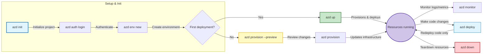
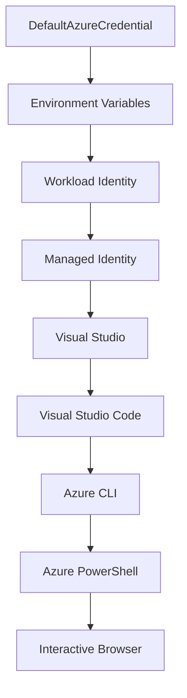

# AZD Cơ Bản - Các Khái Niệm và Kiến Thức Nền Tảng

**Điều Hướng Chương:**
- **📚 Trang Chủ Khóa Học**: [AZD Cho Người Mới Bắt Đầu](../../README.md)
- **📖 Chương Hiện Tại**: Chương 1 - Nền Tảng & Bắt Đầu Nhanh
- **⬅️ Trước đó**: [Tổng Quan Khóa Học](../../README.md#-chapter-1-foundation--quick-start)
- **➡️ Tiếp theo**: [Cài Đặt & Thiết Lập](installation.md)
- **🚀 Chương Tiếp Theo**: [Chương 2: Phát Triển Ưu Tiên AI](../chapter-02-ai-development/microsoft-foundry-integration.md)

## Giới Thiệu

> Được rà soát theo `azd 1.37.2` (Tháng 11 năm 2026). Các lệnh Bash sử dụng các chỗ giữ chỗ có dấu ngoặc kép mà bạn phải thay thế. Các workflow mẫu dùng `.` để khởi tạo thư mục hiện tại; nếu không có tham số thư mục, việc khởi tạo mẫu tạo một thư mục con và không thay đổi thư mục làm việc của shell bạn. Các đoạn mã nâng cao mang tính minh họa, không phải dự án hoàn chỉnh.

Bài học này giới thiệu về Azure Developer CLI (azd), một công cụ dòng lệnh mạnh mẽ giúp tăng tốc hành trình của bạn từ phát triển cục bộ đến triển khai trên Azure. Bạn sẽ học các khái niệm cơ bản, các tính năng chính và hiểu cách azd đơn giản hóa việc triển khai ứng dụng gốc đám mây.

## Mục Tiêu Học Tập

Sau bài học này, bạn sẽ:
- Hiểu Azure Developer CLI là gì và mục đích chính của nó
- Học các khái niệm cốt lõi về mẫu, môi trường và dịch vụ
- Khám phá các tính năng chính bao gồm phát triển theo mẫu và Hạ tầng dưới dạng Mã
- Hiểu cấu trúc dự án và quy trình làm việc của azd
- Chuẩn bị cài đặt và cấu hình azd cho môi trường phát triển của bạn

## Kết Quả Học Tập

Sau khi hoàn thành bài học, bạn sẽ có thể:
- Giải thích vai trò của azd trong quy trình phát triển đám mây hiện đại
- Nhận biết các thành phần của cấu trúc dự án azd
- Mô tả cách các mẫu, môi trường và dịch vụ phối hợp với nhau
- Hiểu lợi ích của Hạ tầng dưới dạng Mã với azd
- Nhận diện các lệnh azd khác nhau và mục đích của chúng

## Azure Developer CLI (azd) là gì?

Azure Developer CLI (azd) là công cụ dòng lệnh được thiết kế để tăng tốc hành trình của bạn từ phát triển cục bộ đến triển khai Azure. Nó đơn giản hóa quá trình xây dựng, triển khai và quản lý các ứng dụng gốc đám mây trên Azure.

### Bạn có thể triển khai gì với azd?

azd hỗ trợ nhiều loại workloads — và danh sách này vẫn đang tiếp tục mở rộng. Hiện tại, bạn có thể dùng azd để triển khai:

| Loại workload | Ví dụ | Quy trình giống nhau? |
|---------------|----------|----------------|
| **Ứng dụng truyền thống** | Ứng dụng web, API REST, trang tĩnh | ✅ `azd up` |
| **Dịch vụ và vi dịch vụ** | Ứng dụng Container, Ứng dụng Function, backend đa dịch vụ | ✅ `azd up` |
| **Ứng dụng AI** | Ứng dụng chat với Microsoft Foundry Models, giải pháp RAG với AI Search | ✅ `azd up` |
| **Tác nhân thông minh** | Tác nhân lưu trữ Foundry, phối hợp đa tác nhân | ✅ `azd up` |

Điểm quan trọng là **vòng đời azd luôn như nhau bất kể bạn triển khai gì**. Bạn khởi tạo dự án, cung cấp hạ tầng, triển khai mã, giám sát ứng dụng, và dọn dẹp — dù là trang web đơn giản hay tác nhân AI phức tạp.

Sự liên tục này được thiết kế có chủ đích. azd coi các khả năng AI như một dạng dịch vụ khác mà ứng dụng của bạn có thể dùng, không phải điều gì đó khác biệt hoàn toàn. Một điểm kết chat hỗ trợ bởi Microsoft Foundry Models, từ góc nhìn của azd, chỉ là một dịch vụ khác để cấu hình và triển khai.

### 🎯 Tại sao dùng AZD? So sánh Thực tế

Hãy so sánh việc triển khai một ứng dụng web đơn giản với cơ sở dữ liệu:

#### ❌ KHÔNG DÙNG AZD: Triển khai Azure thủ công (trên 30 phút)

**So sánh minh họa Bash, không phải ứng dụng có thể chạy trực tiếp.** Đây giả định bạn đã có mã ứng dụng, tên tài nguyên duy nhất, xác thực Azure CLI và các phần mở rộng CLI cần thiết. Hãy dùng bài tập mẫu phía dưới để làm quen quy trình từ đầu đến cuối được hỗ trợ.

```bash
# Step 1: Create resource group
az group create --name myapp-rg --location eastus

# Step 2: Create App Service Plan
az appservice plan create --name myapp-plan \
  --resource-group myapp-rg \
  --sku B1 --is-linux

# Step 3: Create Web App
az webapp create --name myapp-web-unique123 \
  --resource-group myapp-rg \
  --plan myapp-plan \
  --runtime "NODE:22-lts"

# Step 4: Create Cosmos DB account (10-15 minutes)
az cosmosdb create --name myapp-cosmos-unique123 \
  --resource-group myapp-rg \
  --kind MongoDB

# Step 5: Create database
az cosmosdb mongodb database create \
  --account-name myapp-cosmos-unique123 \
  --resource-group myapp-rg \
  --name tododb

# Step 6: Create collection
az cosmosdb mongodb collection create \
  --account-name myapp-cosmos-unique123 \
  --resource-group myapp-rg \
  --database-name tododb \
  --name todos

# Step 7: Get connection string
CONN_STR=$(az cosmosdb keys list \
  --name myapp-cosmos-unique123 \
  --resource-group myapp-rg \
  --type connection-strings \
  --query "connectionStrings[0].connectionString" -o tsv)

# Step 8: Configure app settings
az webapp config appsettings set \
  --name myapp-web-unique123 \
  --resource-group myapp-rg \
  --settings MONGODB_URI="$CONN_STR"

# Step 9: Enable logging
az webapp log config --name myapp-web-unique123 \
  --resource-group myapp-rg \
  --application-logging filesystem \
  --detailed-error-messages true

# Step 10: Set up Application Insights
az monitor app-insights component create \
  --app myapp-insights \
  --location eastus \
  --resource-group myapp-rg

# Step 11: Link App Insights to Web App
INSTRUMENTATION_KEY=$(az monitor app-insights component show \
  --app myapp-insights \
  --resource-group myapp-rg \
  --query "instrumentationKey" -o tsv)

az webapp config appsettings set \
  --name myapp-web-unique123 \
  --resource-group myapp-rg \
  --settings APPINSIGHTS_INSTRUMENTATIONKEY="$INSTRUMENTATION_KEY"

# Step 12: Build application locally
npm install
npm run build

# Step 13: Create deployment package
zip -r app.zip . -x "*.git*" "node_modules/*"

# Step 14: Deploy application
az webapp deployment source config-zip \
  --resource-group myapp-rg \
  --name myapp-web-unique123 \
  --src app.zip

# Step 15: Wait and pray it works 🙏
# (No automated validation, manual testing required)
```

**Vấn đề:**
- ❌ 15+ lệnh phải nhớ và thực thi theo thứ tự
- ❌ 30-45 phút làm thủ công
- ❌ Dễ mắc lỗi (gõ sai, tham số sai)
- ❌ Cần xử lý thông tin xác thực rõ ràng; nhật ký debug và theo dõi shell có thể lộ thông tin
- ❌ Không có rollback tự động nếu có lỗi
- ❌ Khó tái tạo cho thành viên nhóm
- ❌ Mỗi lần khác nhau (không tái lập)

#### ✅ DÙNG AZD: Triển khai tự động (5 lệnh, 10-15 phút)

```bash
# Step 1: Initialize from template
azd init --template todo-nodejs-mongo .

# Step 2: Authenticate
azd auth login

# Step 3: Select the environment created during init
azd env select dev

# Step 4: Preview changes (optional but recommended)
azd provision --preview

# Step 5: Deploy everything
azd up

# ✨ Done! Everything is deployed, configured, and monitored
```

**Lợi ích:**
- ✅ **5 lệnh** so với hơn 15 bước thủ công
- ✅ Tổng thời gian **10-15 phút** (chủ yếu chờ Azure)
- ✅ **Ít lỗi thủ công hơn** - quy trình làm việc nhất quán, theo mẫu
- ✅ **Xử lý bí mật an toàn** - nhiều mẫu dùng lưu trữ bí mật do Azure quản lý
- ✅ **Triển khai có thể lặp lại** - quy trình giống nhau mỗi lần
- ✅ **Định nghĩa hạ tầng có thể lặp lại** - chịu ràng buộc với hạn mức, vùng sẵn có và phiên bản mẫu
- ✅ **Sẵn sàng cho nhóm** - mọi người có thể triển khai với cùng lệnh
- ✅ **Hạ tầng dưới dạng Mã** - mẫu Bicep được quản lý phiên bản
- ✅ **Giám sát theo mẫu** - Application Insights khi có trong mẫu

### Thời gian và Độ tin cậy

Các khoảng thời gian trên là ước lượng, không phải chuẩn so sánh. azd giảm số lệnh bạn phải phối hợp nhưng không đảm bảo thời gian triển khai, loại bỏ lỗi, hay cung cấp rollback tự động cho ứng dụng/cơ sở dữ liệu. Hãy giữ phiên bản làm việc trong kiểm soát nguồn và thử nghiệm quy trình phục hồi.

## Các Khái Niệm Cốt Lõi

### Mẫu
Mẫu là nền tảng của azd. Chúng chứa:
- **Mã ứng dụng** - Mã nguồn và các phụ thuộc của bạn
- **Định nghĩa hạ tầng** - Tài nguyên Azure được định nghĩa bằng Bicep hoặc Terraform
- **Tệp cấu hình** - Cài đặt và biến môi trường
- **Kịch bản triển khai** - Quy trình triển khai tự động

### Môi trường
Môi trường đại diện cho các mục tiêu triển khai khác nhau:
- **Phát triển** - Cho thử nghiệm và phát triển
- **Chờ triển khai** - Môi trường tiền sản xuất
- **Sản xuất** - Môi trường sản xuất thực tế

Mỗi môi trường giữ các yếu tố riêng của nó:
- Tên môi trường và giá trị; việc tách biệt tài nguyên phụ thuộc vào mẫu hạ tầng
- Cài đặt cấu hình
- Trạng thái triển khai

### Dịch vụ
Dịch vụ trong `azure.yaml` mô tả các thành phần ứng dụng có thể triển khai:
- **Frontend** - Ứng dụng web, SPA
- **Backend** - API, vi dịch vụ

Cơ sở dữ liệu và lưu trữ thường được cung cấp dưới dạng tài nguyên hạ tầng, không phải là máy chủ dịch vụ tự tạo như `host: postgres`.

## Các Tính Năng Chính

### 1. Phát Triển Theo Mẫu
```bash
# Browse available templates
azd template list

# Initialize from a template
azd init --template "<template-name>" .
```

### 2. Hạ Tầng Dưới Dạng Mã
- **Bicep** - Ngôn ngữ chuyên môn của Azure
- **Terraform** - Công cụ hạ tầng đa đám mây
- Bicep biên dịch ra mẫu ARM; JSON ARM thô không phải là một `infra.provider` tích hợp riêng biệt.

### 3. Quy Trình Làm Việc Tích Hợp
```bash
# Complete deployment workflow
azd up            # Provision + Deploy this is hands off for first time setup

# 🧪 NEW: Preview infrastructure changes before deployment (SAFE)
azd provision --preview    # Simulate infrastructure deployment without making changes

azd provision     # Create Azure resources if you update the infrastructure use this
azd deploy        # Deploy application code or redeploy application code once update
azd down          # Clean up resources
```

#### 🛡️ Lập Kế Hoạch Hạ Tầng An Toàn với Preview
Lệnh `azd provision --preview` là bước ngoặt cho triển khai an toàn:
- **Phân tích thử** - Hiển thị những gì sẽ được tạo, sửa đổi hoặc xóa
- **Không áp dụng hạ tầng** - Xem xét các thay đổi nhà cung cấp; kiểm tra các hook của dự án trước vì hook có thể chạy lệnh có tác dụng phụ
- **Hợp tác nhóm** - Chia sẻ kết quả xem trước trước khi triển khai
- **Nhập liệu hoạch định chi phí** - Kiểm tra SKU đề xuất, sau đó tính giá bằng Azure Pricing Calculator; preview không tính toán giá

```bash
# Example preview workflow
azd provision --preview           # See what will change
# Review the output, discuss with team
azd provision                     # Apply changes with confidence
```

### 📊 Hình minh họa: Quy trình phát triển AZD



**Giải thích Quy trình:**
1. **Init** - Bắt đầu với mẫu hoặc dự án mới
2. **Auth** - Xác thực với Azure
3. **Environment** - Tạo môi trường triển khai tách biệt
4. **Preview** - 🆕 Luôn xem trước các thay đổi hạ tầng trước (thói quen an toàn)
5. **Provision** - Tạo/cập nhật tài nguyên Azure
6. **Deploy** - Đẩy mã ứng dụng của bạn
7. **Monitor** - Quan sát hiệu suất ứng dụng
8. **Iterate** - Thay đổi và triển khai lại mã
9. **Cleanup** - Loại bỏ tài nguyên khi không dùng nữa

### 4. Quản Lý Môi Trường
```bash
# Create and manage environments
azd env new "<environment-name>"
azd env select "<environment-name>"
azd env list
```

### 5. Phần Mở Rộng và Lệnh AI

azd sử dụng hệ thống phần mở rộng để thêm khả năng vượt ra ngoài CLI cốt lõi. Điều này đặc biệt hữu ích cho workloads AI:

```bash
# List available extensions
azd extension list

# Install the Foundry agents extension
azd extension install azure.ai.agents

# Initialize an AI agent project interactively
azd ai agent init

# Test a deployed agent (shows latency and time-to-first-byte)
azd ai agent invoke

# Start the MCP server for AI-assisted development (Alpha)
azd mcp start
```

**Vòng đời tác nhân, từ đầu đến cuối.** Dùng `azure.ai.agents` cho các thao tác vòng đời tác nhân và cài `azure.ai.evaluations` riêng cho đánh giá. Dùng `azd >= 1.37.0` cho quy trình kết hợp. Bạn không cần tất cả các lệnh này ngay ngày đầu:

| Giai đoạn | Lệnh | Chức năng |
|-------|---------|--------------|
| **Khung** | `azd ai agent init --template <path-to-azure.yaml>` | Áp dụng mẫu dự án tác nhân hiện có |
| **Kiểm thử** | `azd ai agent invoke` | Gọi tác nhân và xem thời gian phản hồi |
| **Đánh giá** | `azd ai eval init`, `generate`, `run start` | Cấu hình, triển khai và chạy đánh giá dùng phần mở rộng riêng |
| **Cải tiến** | `azd ai agent optimize --eval <evaluation-name> --optimize-model <optimizer-deployment>` | Tái sử dụng đánh giá tương thích để tối ưu tác nhân |
| **Kiểm tra** | `azd ai agent endpoint show` | Xem cấu hình điểm cuối trực tiếp |
| **Dọn dẹp** | `azd ai agent delete` | Xóa tác nhân lưu trữ và tất cả phiên bản của nó |

> Phần mở rộng được trình bày chi tiết trong [Chương 2: Phát Triển Ưu Tiên AI](../chapter-02-ai-development/agents.md) và tài liệu tham khảo [Lệnh AZD AI CLI](../chapter-08-production/production-ai-practices.md#azd-ai-cli-commands-and-extensions).

## 📁 Cấu Trúc Dự Án

Cấu trúc dự án azd điển hình:
```
my-app/
├── .azure/                  # Local environments and selected-environment config
│   ├── config.json
│   └── dev/.env
├── .devcontainer/          # Development container config
├── .github/workflows/      # GitHub Actions
├── .vscode/               # VS Code settings
├── infra/                 # Infrastructure code
│   ├── main.bicep        # Main infrastructure template
│   ├── main.parameters.json
│   └── modules/          # Reusable modules
├── src/                  # Application source code
│   ├── api/             # Backend services
│   └── web/             # Frontend application
├── azure.yaml           # azd project configuration
└── README.md
```

## 🔧 Các Tệp Cấu Hình

### azure.yaml
Tệp cấu hình chính của dự án:
```yaml
name: my-awesome-app
metadata:
  template: my-template@1.0.0

services:
  web:
    project: ./src/web
    language: js
    host: appservice
  api:
    project: ./src/api
    language: js
    host: appservice

hooks:
  preprovision:
    shell: pwsh
    run: echo "Preparing to provision..."
```

### .azure/config.json
Lựa chọn môi trường mặc định ở cấp dự án (minh họa; do azd quản lý):
```json
{
  "defaultEnvironment": "dev"
}
```

## 🎪 Quy trình Thông thường với Bài tập Thực hành

> **💡 Mẹo Học Tập:** Theo đúng các bài tập này để phát triển kỹ năng AZD dần dần.

### 🎯 Bài Tập 1: Khởi Tạo Dự Án Đầu Tiên

**Mục tiêu:** Tạo dự án AZD và khám phá cấu trúc của nó

**Các bước:**
```bash
# Use a proven template
mkdir azd-basics-practice
cd azd-basics-practice
# Choose "dev" for the environment name when prompted
azd init --template todo-nodejs-mongo .

# Explore the generated files
ls -la  # View all files including hidden ones

# Key files created:
# - azure.yaml (main config)
# - infra/ (infrastructure code)
# - src/ (application code)
```

**✅ Thành công:** Bạn có azure.yaml, thư mục infra/ và src/

---

### 🎯 Bài Tập 2: Triển Khai lên Azure

**Mục tiêu:** Hoàn thành triển khai từ đầu đến cuối

**Các bước:**
```bash
# 1. Authenticate
azd auth login

# 2. Select the dev environment created in Exercise 1
azd env select dev
azd env set AZURE_LOCATION eastus

# 3. Preview changes (RECOMMENDED)
azd provision --preview

# 4. Deploy everything
azd up

# 5. Verify deployment
azd show    # View your app URL
```

**Thời gian dự kiến:** 10-15 phút  
**✅ Thành công:** URL ứng dụng mở được trong trình duyệt

---

### 🎯 Bài Tập 3: Nhiều Môi Trường

**Mục tiêu:** Triển khai tới môi trường dev và staging

**Các bước:**
```bash
# Already have dev, create staging
azd env new staging
azd env set AZURE_LOCATION westus2
azd up

# Switch between them
azd env list
azd env select dev
```

**✅ Thành công:** Hai nhóm tài nguyên riêng biệt trong Azure Portal

**Dọn dẹp:** Bài tập 3 tạo một triển khai thứ hai phát sinh phí. Xóa cả hai khi đã xong:

```bash
azd down --environment dev
azd down --environment staging
```

---

### 🛡️ Dọn dẹp Phá hủy: `azd down --force --purge`

Khi bạn muốn chủ động xóa tài nguyên Azure của môi trường được chọn:

```bash
azd down --force --purge
```

**Chức năng:**
- `--force`: Không có yêu cầu xác nhận
- `--purge`: Cũng xóa vĩnh viễn các tài nguyên bị xóa mềm được hỗ trợ (ví dụ Key Vaults), nếu bảo vệ xóa cho phép. Không xóa thư mục `.azure/` cục bộ.

**Dùng khi:** đã xong với môi trường dùng một lần. Đừng coi dọn dẹp phá hủy như phản ứng đầu tiên với lỗi xác thực, hạn mức hay cấu hình.

---

## 🎪 Tài liệu Tham Khảo Quy Trình Gốc

### Bắt Đầu Dự Án Mới
```bash
# Method 1: Use existing template
azd init --template todo-nodejs-mongo .

# Method 2: Start from scratch
azd init

# Method 3: Use current directory
azd init .
```

### Chu Trình Phát Triển
```bash
# Set up development environment
azd auth login
azd env new dev
azd env select dev

# Deploy everything
azd up

# Make changes and redeploy
azd deploy

# Clean up when done
azd down --force --purge # Deletes this environment's discovered Azure resources; review before forcing deletion.
```

## Hiểu Lệnh `azd down --force --purge`
Lệnh `azd down --force --purge` là cách mạnh mẽ để phá hủy hoàn toàn môi trường azd và tất cả tài nguyên liên quan. Dưới đây là phân tích chức năng từng cờ:
```
--force
```
- Bỏ qua yêu cầu xác nhận.
- Hữu ích cho tự động hóa hoặc kịch bản không có đầu vào thủ công.
- Không bỏ qua quyền hạn, bảo vệ xóa, hoặc lỗi xóa.

```
--purge
```
Xóa vĩnh viễn các tài nguyên Azure đã bị xóa mềm được hỗ trợ mà không cần xác nhận thêm. Bảo vệ xóa sạch và quyền vẫn được áp dụng. Nó **không** xóa các môi trường cục bộ hoặc thư mục `.azure/`.


### Tại sao sử dụng cả hai?
Chỉ sử dụng cả hai khi bạn định xóa các tài nguyên Azure của môi trường đã chọn và xóa sạch các tài nguyên có thể phục hồi. Đây là việc dọn dẹp mang tính phá hủy, không phải sửa chữa chung hoặc đặt lại trạng thái cục bộ.

Nó đặc biệt hữu ích sau khi xóa tài nguyên thủ công trong cổng Azure hoặc khi chuyển đổi mẫu, môi trường, hoặc quy ước đặt tên nhóm tài nguyên.


### Quản lý nhiều môi trường
```bash
# Create staging environment
azd env new staging
azd env select staging
azd up

# Switch back to dev
azd env select dev

# Compare environments
azd env list
```

## 🔐 Xác thực và Thông tin Đăng nhập

Phân biệt xác thực triển khai (`azd auth login`) với xác thực SDK ứng dụng (`DefaultAzureCredential`). Chúng là riêng biệt. azd mặc định không sử dụng thông tin đăng nhập Azure CLI.

### Xác thực Azure CLI (`az login`)

Chạy `azd auth login` cho azd. Các lệnh Azure CLI sau là tùy chọn và xác thực các lệnh `az` riêng biệt:

```bash
# Interactive login (opens browser)
az login

# Login with specific tenant
az login --tenant "<tenant-id>"

# Login with service principal
az login --service-principal -u "<app-id>" -p "<password>" --tenant "<tenant-id>"

# Check current login status
az account show

# List available subscriptions
az account list --output table

# Set default subscription
az account set --subscription "<subscription-id>"
```

### Luồng Xác thực
1. **Đăng nhập Tương tác**: Mở trình duyệt mặc định của bạn để xác thực
2. **Luồng Mã Thiết bị**: Dành cho môi trường không có quyền truy cập trình duyệt
3. **Định danh Dịch vụ**: Dành cho tự động hóa và kịch bản CI/CD
4. **Định danh Quản lý**: Dành cho các ứng dụng được lưu trữ trên Azure

### Chuỗi DefaultAzureCredential

`DefaultAzureCredential` là một loại thông tin đăng nhập cung cấp trải nghiệm xác thực đơn giản bằng cách thử tự động nhiều nguồn thông tin đăng nhập theo một thứ tự cụ thể:

#### Chuỗi Thông tin Đăng nhập SDK Ứng dụng

Chuỗi chính xác phụ thuộc vào ngôn ngữ Azure Identity SDK, phiên bản, các plugin đã cài đặt và các tùy chọn. Sơ đồ này mang tính khái niệm, không phải là chuỗi xác thực azd cố định; các SDK gần đây cũng có thể bao gồm thông tin xác thực của Azure Developer CLI.


#### 1. Biến môi trường
```bash
# Set environment variables for service principal
export AZURE_CLIENT_ID="<app-id>"
export AZURE_CLIENT_SECRET="<password>"
export AZURE_TENANT_ID="<tenant-id>"
```

#### 2. Workload Identity (Kubernetes/GitHub Actions)
Tự động sử dụng trong:
- Azure Kubernetes Service (AKS) với Workload Identity
- GitHub Actions với liên kết OIDC
- Các kịch bản nhận dạng liên kết khác

#### 3. Managed Identity
Cho các tài nguyên Azure như:
- Máy ảo
- App Service
- Azure Functions
- Container Instances

```bash
# Inspect a deployed Container App's configured identity (requires az login)
az containerapp show --name "<app-name>" --resource-group "<rg-name>" --query identity
```

#### 4. Tích hợp công cụ dành cho nhà phát triển
- **Visual Studio**: Tự động sử dụng tài khoản đã đăng nhập
- **VS Code**: Hỗ trợ phụ thuộc vào SDK và thiết lập broker/plugin được hỗ trợ
- **Azure CLI**: Sử dụng `az login` credentials (phổ biến nhất cho phát triển cục bộ)

### Cài đặt xác thực AZD

```bash
# Method 1: Direct azd authentication (recommended)
azd auth login

# Method 2: Direct azd authentication
azd auth login --use-device-code  # For headless environments

# Method 3: Check authentication status
azd auth login --check-status

# Method 4: Logout and re-authenticate
azd auth logout
azd auth login
```

### Thực hành tốt nhất về xác thực

#### Cho phát triển cục bộ
```bash
# 1. Log in to azd
azd auth login

# 2. Select the subscription for this initialized environment
azd env set AZURE_SUBSCRIPTION_ID "<subscription-id>"

# 3. Check azd sign-in details (read the status message)
azd auth login --check-status
```

#### Cho CI/CD Pipelines
```yaml
# Partial GitHub Actions steps: assumes checkout, azd installation,
# required AZURE_* environment values, and pipeline secret configuration.
- name: Deploy with azd
  run: |
    azd auth login --client-id ${{ secrets.AZURE_CLIENT_ID }} \
                    --client-secret ${{ secrets.AZURE_CLIENT_SECRET }} \
                    --tenant-id ${{ secrets.AZURE_TENANT_ID }}
    azd up --no-prompt
```

#### Cho môi trường sản xuất
- Sử dụng **Managed Identity** khi chạy trên tài nguyên Azure
- Sử dụng **Service Principal** cho các kịch bản tự động hóa
- Tránh lưu trữ thông tin xác thực trong mã hoặc tệp cấu hình
- Sử dụng **Azure Key Vault** để lưu cấu hình nhạy cảm

### Các sự cố xác thực phổ biến và giải pháp

#### Vấn đề: "Không tìm thấy đăng ký"
```bash
# Solution: Set default subscription
az account list --output table
az account set --subscription "<subscription-id>"
azd env set AZURE_SUBSCRIPTION_ID "<subscription-id>"
```

#### Vấn đề: "Không đủ quyền"
```bash
# Solution: Check and assign required roles
az role assignment list --assignee $(az account show --query user.name --output tsv)

# Common required roles:
# - Contributor (for resource management)
# - User Access Administrator (for role assignments)
```

#### Vấn đề: "Token hết hạn"
```bash
# Solution: Re-authenticate
az logout
az login
azd auth logout
azd auth login
```

### Xác thực trong các kịch bản khác nhau

#### Phát triển cục bộ
```bash
# Personal development account
az login
azd auth login
```

#### Phát triển nhóm
```bash
# Use specific tenant for organization
az login --tenant contoso.onmicrosoft.com
azd auth login --tenant-id "<tenant-id>"
```

#### Kịch bản đa tenant
```bash
# Switch between tenants
az login --tenant tenant1.onmicrosoft.com
azd auth login --tenant-id "<tenant-1-id>"
# Select an environment configured with tenant 1's subscription
azd env select tenant1-dev
# Deploy to tenant 1
azd up

az login --tenant tenant2.onmicrosoft.com  
azd auth login --tenant-id "<tenant-2-id>"
azd env select tenant2-dev
# Deploy to tenant 2
azd up
```

### Các cân nhắc về bảo mật

1. **Lưu trữ thông tin xác thực**: Không bao giờ lưu thông tin xác thực trong mã nguồn
2. **Giới hạn phạm vi**: Sử dụng nguyên tắc ít đặc quyền nhất cho service principal
3. **Xoay vòng token**: Thường xuyên xoay vòng bí mật của service principal
4. **Theo dõi hoạt động**: Giám sát các hành động xác thực và triển khai
5. **Bảo mật mạng**: Sử dụng các điểm cuối riêng khi có thể

### Khắc phục sự cố xác thực

```bash
# Debug authentication issues
azd auth login --check-status
az account show
az account get-access-token

# Common diagnostic commands
whoami                          # Current user context
az ad signed-in-user show      # Microsoft Entra ID user details
az group list                  # Test resource access
```

## Khám phá lệnh

### Khám phá
```bash
azd template list              # Browse templates
azd template list --help       # Template discovery options
azd init --help               # Initialization options
```

### Quản lý dự án
```bash
azd show                     # Project overview
azd env list                # Available environments and selected default
azd config show            # Configuration settings
```

### Giám sát
```bash
azd monitor                  # Open Azure portal monitoring
azd monitor --logs           # View application logs
azd monitor --live           # View live metrics
azd pipeline config          # Set up CI/CD
```

## Thực hành tốt nhất

### 1. Sử dụng tên có ý nghĩa
```bash
# Good
azd env new production-east
azd init --template todo-nodejs-mongo .

# Avoid
azd env new env1
azd init --template template1 .
```

### 2. Tận dụng mẫu
- Bắt đầu với các mẫu có sẵn
- Tùy chỉnh cho nhu cầu của bạn
- Tạo mẫu tái sử dụng cho tổ chức của bạn

### 3. Cô lập môi trường
- Sử dụng các môi trường riêng biệt cho dev/staging/prod
- Không bao giờ triển khai trực tiếp vào sản xuất từ máy cục bộ
- Sử dụng CI/CD pipelines để triển khai sản xuất

### 4. Quản lý cấu hình
- Sử dụng managed identity và Key Vault cho bí mật; các giá trị `azd env set` thông thường là plaintext cục bộ
- Giữ cấu hình trong kiểm soát phiên bản
- Tài liệu các thiết lập theo môi trường

## Lộ trình học tập

### Người mới bắt đầu (Tuần 1-2)
1. Cài đặt azd và xác thực
2. Triển khai một mẫu đơn giản
3. Hiểu cấu trúc dự án
4. Học các lệnh cơ bản (up, down, deploy)

### Trung cấp (Tuần 3-4)
1. Tùy chỉnh mẫu
2. Quản lý nhiều môi trường
3. Hiểu mã hạ tầng
4. Thiết lập CI/CD pipelines

### Nâng cao (Tuần 5+)
1. Tạo mẫu tùy chỉnh
2. Mẫu hạ tầng nâng cao
3. Triển khai đa vùng
4. Cấu hình cấp doanh nghiệp

## Bước tiếp theo

**📖 Tiếp tục học Chương 1:**
- [Cài đặt & Thiết lập](installation.md) - Cài đặt và cấu hình azd
- [Dự án đầu tiên của bạn](first-project.md) - Hoàn thành bài hướng dẫn thực hành
- [Hướng dẫn cấu hình](../chapter-03-configuration/configuration.md) - Tùy chọn cấu hình nâng cao

**🎯 Sẵn sàng cho Chương tiếp theo?**
- [Chương 2: Phát triển AI trước tiên](../chapter-02-ai-development/microsoft-foundry-integration.md) - Bắt đầu xây dựng ứng dụng AI

## Tài nguyên bổ sung

- [Tổng quan Azure Developer CLI](https://learn.microsoft.com/en-us/azure/developer/azure-developer-cli/)
- [Thư viện mẫu](https://azure.github.io/awesome-azd/)
- [Mẫu cộng đồng](https://github.com/Azure-Samples)

---

## 🙋 Các câu hỏi thường gặp

### Câu hỏi chung

**Hỏi: Sự khác biệt giữa AZD và Azure CLI là gì?**

Đáp: Azure CLI (`az`) dùng để quản lý từng tài nguyên Azure riêng lẻ. AZD (`azd`) dùng để quản lý toàn bộ ứng dụng:

```bash
# Azure CLI - Low-level resource management
az webapp create --name myapp --resource-group rg
az sql server create --name myserver --resource-group rg
# ...many more commands needed

# AZD - Application-level management
azd up  # Deploys entire app with all resources
```

**Bạn có thể nghĩ như sau:**
- `az` = Thao tác trên từng viên Lego riêng lẻ
- `azd` = Làm việc với bộ Lego hoàn chỉnh

---

**Hỏi: Tôi có cần biết Bicep hoặc Terraform để dùng AZD không?**

Đáp: Không! Bắt đầu với các mẫu:
```bash
# Use existing template - no IaC knowledge needed
azd init --template todo-nodejs-mongo .
azd up
```

Bạn có thể học Bicep sau để tùy chỉnh hạ tầng. Các mẫu cung cấp ví dụ thực tế để học hỏi.

---

**Hỏi: Chi phí chạy các mẫu AZD là bao nhiêu?**

Đáp: Chi phí thay đổi theo vùng, SKU, thời gian chạy, chế độ cơ sở dữ liệu và mức sử dụng mô hình. Môi trường phát triển có thể phát sinh chi phí đáng kể hàng tháng ngay cả khi không hoạt động; đừng giả định khoảng $50-150 là chuẩn:

```bash
# Preview resource changes (not prices)
azd provision --preview

# Always cleanup when not using
azd down --force --purge  # Removes all resources
```

**Mẹo chuyên nghiệp:** Sử dụng các tầng miễn phí khi có:
- App Service: tầng F1 (miễn phí)
- Azure OpenAI: không có mức token miễn phí hàng tháng đảm bảo chung; kiểm tra giá hiện hành và mô hình
- Cosmos DB: tài khoản có cấu hình provisioned-throughput đủ điều kiện có thể chọn tầng miễn phí; mẫu serverless không tự động đủ điều kiện

---

**Hỏi: Tôi có thể dùng AZD với tài nguyên Azure hiện có không?**

Đáp: Có, nhưng dễ bắt đầu với tài nguyên mới hơn. AZD hoạt động tốt nhất khi quản lý toàn bộ vòng đời. Với tài nguyên hiện có:

```bash
# Option 1: Import existing resources (advanced)
azd init
# Then modify infra/ to reference existing resources

# Option 2: Start fresh (recommended)
azd init --template "<verified-template-name>" .
azd up  # Creates new environment
```

---

**Hỏi: Làm sao để chia sẻ dự án với đồng đội?**

Đáp: Commit dự án AZD vào Git (nhưng KHÔNG commit thư mục .azure):

```bash
# Already in .gitignore by default
.azure/        # Contains secrets and environment data
*.env          # Environment variables

# Team members then:
git clone "<your-repo>"
# Change into the cloned repository before running the remaining commands.
azd auth login
azd env new "<their-name>-dev"
azd up
```

Mọi người nhận được hạ tầng giống hệt nhau từ cùng một mẫu.

---

### Câu hỏi khắc phục sự cố

**Hỏi: "azd up" thất bại giữa chừng. Tôi phải làm gì?**

Đáp: Kiểm tra lỗi, sửa, rồi thử lại:

```bash
# Capture detailed diagnostics (redact sensitive values before sharing)
azd up --debug

# Common fixes:

# 1. If quota exceeded:
azd env set AZURE_LOCATION "westus2"  # Try different region

# 2. If resource name conflict:
azd down --force --purge  # Clean slate
azd up  # Retry

# 3. If auth expired:
az login
azd auth login
azd up
```

**Vấn đề phổ biến nhất:** Chọn sai đăng ký Azure
```bash
az account list --output table
az account set --subscription "<correct-subscription>"
azd env set AZURE_SUBSCRIPTION_ID "<correct-subscription-id>"
```

---

**Hỏi: Làm sao tôi chỉ triển khai thay đổi mã mà không reprovision?**

Đáp: Dùng `azd deploy` thay vì `azd up`:

```bash
azd up          # First time: provision + deploy (slow)

# Make code changes...

azd deploy      # Subsequent times: deploy only (fast)
```

So sánh tốc độ:
- `azd up`: 10-15 phút (triển khai hạ tầng)
- `azd deploy`: 2-5 phút (chỉ mã)

---

**Hỏi: Tôi có thể tùy chỉnh các mẫu hạ tầng không?**

Đáp: Có! Sửa các file Bicep trong `infra/`:

```bash
# After azd init
cd infra/
code main.bicep  # Edit in VS Code

# Preview changes
azd provision --preview

# Apply changes
azd provision
```

**Mẹo:** Bắt đầu nhỏ - thay đổi SKU trước:
```bicep
// infra/main.bicep
sku: {
  name: 'B1'  // Change to 'P1V2' for production
}
```

---

**Hỏi: Làm sao để xóa tất cả những gì AZD tạo ra?**

Đáp: Một lệnh xoá hết tài nguyên:

```bash
azd down --force --purge

# This deletes:
# - Azure resources/resource groups discovered for the selected environment
# - Supported soft-deleted resources, if purge protection allows
# Local .azure files remain; shared/external resources may remain too.
```

**Luôn chạy lệnh này khi:**
- Hoàn tất thử nghiệm một mẫu
- Chuyển sang dự án khác
- Muốn bắt đầu lại

**Kiểm tra chi phí:** Xác nhận xoá trên Azure và kiểm tra tài nguyên giữ lại/chia sẻ. Chi phí đã phát sinh vẫn áp dụng.

---

**Hỏi: Nếu tôi lỡ xoá tài nguyên trên Azure Portal thì sao?**

Đáp: Trạng thái AZD có thể lệch pha. Cách làm sạch:

```bash
# 1. Delete remaining resources only if that is your intent
azd down --force --purge

# 2. Start fresh
azd up

# Alternative: Let AZD detect and fix
azd provision  # Will create missing resources
```

---

### Câu hỏi nâng cao

**Hỏi: Tôi có thể dùng AZD trong CI/CD pipelines không?**

Đáp: Có! Ví dụ GitHub Actions:

```yaml
# .github/workflows/deploy.yml
name: Deploy with AZD

on:
  push:
    branches: [main]

jobs:
  deploy:
    runs-on: ubuntu-latest
    steps:
      - uses: actions/checkout@v4
      
      - name: Install azd
        run: curl -fsSL https://aka.ms/install-azd.sh | bash
      
      - name: Azure Login
        run: |
          azd auth login \
            --client-id ${{ secrets.AZURE_CLIENT_ID }} \
            --client-secret ${{ secrets.AZURE_CLIENT_SECRET }} \
            --tenant-id ${{ secrets.AZURE_TENANT_ID }}
      
      - name: Deploy
        env:
          AZURE_ENV_NAME: dev
          AZURE_LOCATION: ${{ vars.AZURE_LOCATION }}
          AZURE_SUBSCRIPTION_ID: ${{ vars.AZURE_SUBSCRIPTION_ID }}
        run: azd up --no-prompt
```

---

**Hỏi: Tôi xử lý bí mật và dữ liệu nhạy cảm thế nào?**

Đáp: Sử dụng Key Vault rõ ràng. `azd env set` ghi các giá trị bình thường vào tệp môi trường cục bộ; nó không tự động tạo vault, phân quyền, hay chèn bí mật vào ứng dụng của bạn.

```bash
# Interactive: create/select a Key Vault secret and save its reference
azd env set-secret DATABASE_PASSWORD
```

Bạn cần quyền thích hợp trên vault. Hạ tầng/ứng dụng vẫn phải kết nối bí mật với người tiêu thụ và cấp quyền truy cập cho định danh runtime. Không in giá trị bí mật đã giải mã ra nhật ký.

**Không bao giờ commit:**
- Thư mục `.azure/` (chứa dữ liệu môi trường)
- Các tệp `.env` (bí mật cục bộ)
- Chuỗi kết nối

---

**Hỏi: Tôi có thể triển khai tới nhiều vùng không?**

Đáp: Có, tạo môi trường cho mỗi vùng:

```bash
# East US environment
azd env new prod-eastus
azd env set AZURE_LOCATION eastus
azd up

# West Europe environment
azd env new prod-westeurope
azd env set AZURE_LOCATION westeurope
azd up

# Each environment is independent
azd env list
```

Với ứng dụng đa vùng thực sự, tùy chỉnh mẫu Bicep để triển khai đồng thời ở nhiều vùng.

---

**Hỏi: Tôi có thể nhận trợ giúp ở đâu nếu bị mắc kẹt?**

1. **Tài liệu AZD:** https://learn.microsoft.com/azure/developer/azure-developer-cli/
2. **GitHub Issues:** https://github.com/Azure/azure-dev/issues
3. **Discord:** [Azure Discord](https://discord.gg/microsoft-azure) - kênh #azure-developer-cli
4. **Stack Overflow:** Tag `azure-developer-cli`
5. **Khoá học này:** [Hướng dẫn khắc phục sự cố](../chapter-07-troubleshooting/common-issues.md)

**Mẹo chuyên nghiệp:** Trước khi hỏi, chạy:
```bash
azd show       # Shows current state
azd version    # Shows your version
```
Bao gồm thông tin này trong câu hỏi để nhận hỗ trợ nhanh hơn.

---

## 🎓 Tiếp theo là gì?

Bạn giờ đã hiểu các khái niệm cơ bản của AZD. Chọn con đường của bạn:

### 🎯 Cho người mới bắt đầu:
1. **Tiếp theo:** [Cài đặt & Thiết lập](installation.md) - Cài AZD trên máy bạn
2. **Sau đó:** [Dự án đầu tiên của bạn](first-project.md) - Triển khai ứng dụng đầu tiên
3. **Luyện tập:** Hoàn thành 3 bài tập trong bài học này

### 🚀 Cho nhà phát triển AI:
1. **Bỏ qua tới:** [Chương 2: Phát triển AI trước tiên](../chapter-02-ai-development/microsoft-foundry-integration.md)
2. **Triển khai:** Trong thư mục dự án trống, bắt đầu với `azd init --template get-started-with-ai-chat .`
3. **Học:** Xây dựng trong khi triển khai

### 🏗️ Cho nhà phát triển có kinh nghiệm:
1. **Xem lại:** [Hướng dẫn cấu hình](../chapter-03-configuration/configuration.md) - Các thiết lập nâng cao
2. **Khám phá:** [Hạ tầng dưới dạng mã](../chapter-04-infrastructure/provisioning.md) - Tìm hiểu sâu Bicep
3. **Xây dựng:** Tạo mẫu tùy chỉnh cho ngăn xếp của bạn

---

**Điều hướng chương:**
- **📚 Trang chủ khoá học**: [AZD dành cho người mới](../../README.md)
- **📖 Chương hiện tại**: Chương 1 - Nền tảng & Bắt đầu nhanh  
- **⬅️ Trước**: [Tổng quan khoá học](../../README.md#-chapter-1-foundation--quick-start)
- **➡️ Tiếp theo**: [Cài đặt & Thiết lập](installation.md)
- **🚀 Chương kế tiếp**: [Chương 2: Phát triển AI trước tiên](../chapter-02-ai-development/microsoft-foundry-integration.md)

---

<!-- CO-OP TRANSLATOR DISCLAIMER START -->
**Tuyên bố miễn trừ trách nhiệm**:
Tài liệu này đã được dịch bằng dịch vụ dịch thuật AI [Co-op Translator](https://github.com/Azure/co-op-translator). Mặc dù chúng tôi cố gắng đảm bảo độ chính xác, xin lưu ý rằng bản dịch tự động có thể chứa lỗi hoặc sai sót. Tài liệu gốc bằng ngôn ngữ gốc nên được coi là nguồn tin chính thức. Đối với thông tin quan trọng, nên sử dụng dịch vụ dịch thuật chuyên nghiệp bởi con người. Chúng tôi không chịu trách nhiệm về bất kỳ hiểu lầm hoặc giải thích sai nào phát sinh từ việc sử dụng bản dịch này.
<!-- CO-OP TRANSLATOR DISCLAIMER END -->