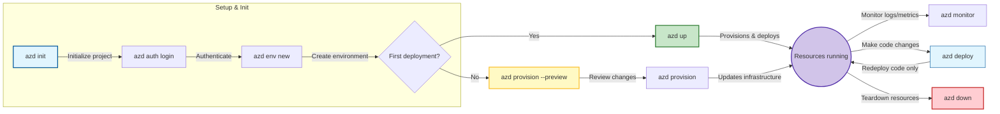
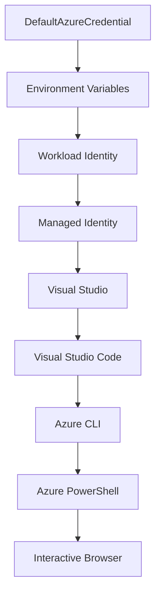

# AZD Cơ bản - Khái niệm và Nền tảng cốt lõi

**Điều hướng chương:**
- **📚 Trang Chủ Khóa Học**: [AZD Dành Cho Người Mới Bắt Đầu](../../README.md)
- **📖 Chương Hiện Tại**: Chương 1 - Nền tảng & Khởi đầu nhanh
- **⬅️ Trước**: [Tổng Quan Khóa Học](../../README.md#-chapter-1-foundation--quick-start)
- **➡️ Tiếp theo**: [Cài đặt & Thiết lập](installation.md)
- **🚀 Chương kế tiếp**: [Chương 2: Phát Triển Ưu Tiên AI](../chapter-02-ai-development/microsoft-foundry-integration.md)

## Giới thiệu

> Đã được xem xét dựa trên `azd 1.37.2` (tháng 11 năm 2026). Các lệnh Bash sử dụng các placeholder có dấu ngoặc kép mà bạn cần thay thế. Các luồng công việc mẫu dùng `.` để khởi tạo thư mục hiện tại; nếu không có đối số thư mục, việc khởi tạo mẫu sẽ tạo một thư mục con và không thay đổi thư mục làm việc của shell. Các đoạn mã nâng cao là minh họa, không phải dự án hoàn chỉnh.

Bài học này giới thiệu cho bạn Azure Developer CLI (azd), một công cụ dòng lệnh mạnh mẽ giúp tăng tốc hành trình từ phát triển cục bộ đến triển khai trên Azure. Bạn sẽ học các khái niệm cơ bản, các tính năng chính và hiểu cách azd đơn giản hóa việc triển khai ứng dụng gốc đám mây.

## Mục tiêu học tập

Sau khi kết thúc bài học này, bạn sẽ:
- Hiểu Azure Developer CLI là gì và mục đích chính của nó
- Học các khái niệm cốt lõi về mẫu, môi trường và dịch vụ
- Khám phá các tính năng chính bao gồm phát triển dựa trên mẫu và Hạ tầng như Mã lệnh (Infrastructure as Code)
- Hiểu cấu trúc dự án azd và luồng công việc
- Sẵn sàng cài đặt và cấu hình azd cho môi trường phát triển của bạn

## Kết quả học tập

Sau khi hoàn thành bài học, bạn có thể:
- Giải thích vai trò của azd trong các luồng phát triển đám mây hiện đại
- Nhận biết các thành phần của cấu trúc dự án azd
- Mô tả cách các mẫu, môi trường và dịch vụ phối hợp cùng nhau
- Hiểu lợi ích của Hạ tầng như Mã lệnh với azd
- Nhận dạng các lệnh azd khác nhau và mục đích của chúng

## Azure Developer CLI (azd) là gì?

Azure Developer CLI (azd) là một công cụ dòng lệnh được thiết kế để tăng tốc hành trình từ phát triển cục bộ đến triển khai trên Azure. Nó đơn giản hóa quá trình xây dựng, triển khai và quản lý các ứng dụng gốc đám mây trên Azure.

### Bạn có thể triển khai gì với azd?

azd hỗ trợ nhiều loại khối lượng công việc—và danh sách này vẫn đang mở rộng. Hiện nay, bạn có thể dùng azd để triển khai:

| Loại Khối Lượng Công Việc | Ví dụ | Quy trình giống nhau? |
|---------------|----------|----------------|
| **Ứng dụng truyền thống** | Ứng dụng web, REST APIs, trang tĩnh | ✅ `azd up` |
| **Dịch vụ và vi dịch vụ** | Container Apps, Function Apps, backend đa dịch vụ | ✅ `azd up` |
| **Ứng dụng hỗ trợ AI** | Ứng dụng chat với Microsoft Foundry Models, giải pháp RAG với AI Search | ✅ `azd up` |
| **Tác nhân thông minh** | Tác nhân được host trên Foundry, phối hợp đa tác nhân | ✅ `azd up` |

Điểm mấu chốt là **chu trình azd giữ nguyên bất kể bạn triển khai gì**. Bạn khởi tạo dự án, cấu hình hạ tầng, triển khai mã nguồn, giám sát ứng dụng và dọn dẹp — dù là một trang web đơn giản hay một tác nhân AI phức tạp.

Điều này là theo thiết kế. azd xem các khả năng AI như một loại dịch vụ khác mà ứng dụng của bạn có thể sử dụng, không phải là điều gì đó khác biệt về bản chất. Một điểm cuối chat dựa trên Microsoft Foundry Models, từ góc nhìn azd, chỉ là một dịch vụ khác để cấu hình và triển khai.

### 🎯 Tại sao nên dùng AZD? So sánh thực tế

Hãy so sánh việc triển khai một ứng dụng web đơn giản với cơ sở dữ liệu:

#### ❌ KHÔNG DÙNG AZD: Triển khai Azure thủ công (hơn 30 phút)

**So sánh minh họa với Bash, không phải khởi tạo ứng dụng chạy được.** Giả định có mã nguồn ứng dụng hiện có, tên tài nguyên duy nhất, đăng nhập Azure CLI, và bất kỳ mở rộng CLI cần thiết. Dùng bài tập mẫu bên dưới cho đường dẫn end-to-end được hỗ trợ.

```bash
# Step 1: Create resource group
az group create --name myapp-rg --location eastus

# Step 2: Create App Service Plan
az appservice plan create --name myapp-plan \
  --resource-group myapp-rg \
  --sku B1 --is-linux

# Step 3: Create Web App
az webapp create --name myapp-web-unique123 \
  --resource-group myapp-rg \
  --plan myapp-plan \
  --runtime "NODE:22-lts"

# Step 4: Create Cosmos DB account (10-15 minutes)
az cosmosdb create --name myapp-cosmos-unique123 \
  --resource-group myapp-rg \
  --kind MongoDB

# Step 5: Create database
az cosmosdb mongodb database create \
  --account-name myapp-cosmos-unique123 \
  --resource-group myapp-rg \
  --name tododb

# Step 6: Create collection
az cosmosdb mongodb collection create \
  --account-name myapp-cosmos-unique123 \
  --resource-group myapp-rg \
  --database-name tododb \
  --name todos

# Step 7: Get connection string
CONN_STR=$(az cosmosdb keys list \
  --name myapp-cosmos-unique123 \
  --resource-group myapp-rg \
  --type connection-strings \
  --query "connectionStrings[0].connectionString" -o tsv)

# Step 8: Configure app settings
az webapp config appsettings set \
  --name myapp-web-unique123 \
  --resource-group myapp-rg \
  --settings MONGODB_URI="$CONN_STR"

# Step 9: Enable logging
az webapp log config --name myapp-web-unique123 \
  --resource-group myapp-rg \
  --application-logging filesystem \
  --detailed-error-messages true

# Step 10: Set up Application Insights
az monitor app-insights component create \
  --app myapp-insights \
  --location eastus \
  --resource-group myapp-rg

# Step 11: Link App Insights to Web App
INSTRUMENTATION_KEY=$(az monitor app-insights component show \
  --app myapp-insights \
  --resource-group myapp-rg \
  --query "instrumentationKey" -o tsv)

az webapp config appsettings set \
  --name myapp-web-unique123 \
  --resource-group myapp-rg \
  --settings APPINSIGHTS_INSTRUMENTATIONKEY="$INSTRUMENTATION_KEY"

# Step 12: Build application locally
npm install
npm run build

# Step 13: Create deployment package
zip -r app.zip . -x "*.git*" "node_modules/*"

# Step 14: Deploy application
az webapp deployment source config-zip \
  --resource-group myapp-rg \
  --name myapp-web-unique123 \
  --src app.zip

# Step 15: Wait and pray it works 🙏
# (No automated validation, manual testing required)
```

**Vấn đề:**
- ❌ Hơn 15 lệnh phải nhớ và chạy theo thứ tự
- ❌ 30-45 phút làm thủ công
- ❌ Dễ sai sót (gõ nhầm, tham số sai)
- ❌ Xử lý thông tin xác thực phải làm thủ công; nhật ký gỡ lỗi và theo dấu shell có thể lộ thông tin
- ❌ Không có khôi phục tự động nếu có lỗi xảy ra
- ❌ Khó tái tạo cho thành viên nhóm
- ❌ Mỗi lần khác nhau (không tái hiện được)

#### ✅ DÙNG AZD: Triển khai tự động (5 lệnh, 10-15 phút)

```bash
# Step 1: Initialize from template
azd init --template todo-nodejs-mongo .

# Step 2: Authenticate
azd auth login

# Step 3: Select the environment created during init
azd env select dev

# Step 4: Preview changes (optional but recommended)
azd provision --preview

# Step 5: Deploy everything
azd up

# ✨ Done! Everything is deployed, configured, and monitored
```

**Lợi ích:**
- ✅ **5 lệnh** so với hơn 15 bước thủ công
- ✅ Tổng thời gian **10-15 phút** (chủ yếu đợi Azure)
- ✅ **Ít sai sót thủ công hơn** - luồng công việc nhất quán dựa trên mẫu
- ✅ **Xử lý bí mật an toàn** - nhiều mẫu sử dụng lưu trữ bí mật do Azure quản lý
- ✅ **Triển khai lặp lại được** - cùng quy trình mỗi lần
- ✅ **Định nghĩa hạ tầng lặp lại được** - phụ thuộc hạn mức, vùng sẵn có và phiên bản mẫu
- ✅ **Sẵn sàng cho nhóm** - ai cũng có thể triển khai với các lệnh giống nhau
- ✅ **Hạ tầng như Mã lệnh** - mẫu Bicep được kiểm soát phiên bản
- ✅ **Giám sát được định nghĩa trong mẫu** - Application Insights khi có trong mẫu

### Thời gian và độ tin cậy

Thời gian trên là ước lượng, không phải điểm chuẩn. azd giảm số lệnh bạn phải phối hợp, nhưng không đảm bảo thời gian triển khai, loại bỏ lỗi, hay cung cấp khôi phục tự động cho ứng dụng/cơ sở dữ liệu. Giữ phiên bản làm việc trong kiểm soát nguồn và thử nghiệm quy trình khôi phục.

## Khái niệm cốt lõi

### Mẫu
Mẫu là nền tảng của azd. Chúng chứa:
- **Mã ứng dụng** - Mã nguồn và phụ thuộc của bạn
- **Định nghĩa hạ tầng** - Tài nguyên Azure định nghĩa bằng Bicep hoặc Terraform
- **Tập tin cấu hình** - Cài đặt và biến môi trường
- **Script triển khai** - Luồng công việc triển khai tự động

### Môi trường
Môi trường đại diện cho các mục tiêu triển khai khác nhau:
- **Phát triển** - Dùng để thử nghiệm và phát triển
- **Chuyển giao** - Môi trường trước sản xuất
- **Sản xuất** - Môi trường vận hành trực tiếp

Mỗi môi trường duy trì riêng:
- Tên và giá trị môi trường; sự cô lập tài nguyên phụ thuộc mẫu hạ tầng
- Cài đặt cấu hình
- Trạng thái triển khai

### Dịch vụ
Dịch vụ trong `azure.yaml` mô tả các thành phần ứng dụng có thể triển khai:
- **Frontend** - Ứng dụng web, SPA
- **Backend** - API, vi dịch vụ

Cơ sở dữ liệu và lưu trữ thường được cấu hình như tài nguyên hạ tầng, không phải như dịch vụ host giả định như `host: postgres`.

## Các tính năng chính

### 1. Phát triển dựa trên mẫu
```bash
# Browse available templates
azd template list

# Initialize from a template
azd init --template "<template-name>" .
```

### 2. Hạ tầng như Mã lệnh
- **Bicep** - Ngôn ngữ chuyên biệt của Azure
- **Terraform** - Công cụ hạ tầng đa đám mây
- Bicep biên dịch sang mẫu ARM; JSON ARM thô không phải là một `infra.provider` tích hợp riêng biệt.

### 3. Luồng công việc tích hợp
```bash
# Complete deployment workflow
azd up            # Provision + Deploy this is hands off for first time setup

# 🧪 NEW: Preview infrastructure changes before deployment (SAFE)
azd provision --preview    # Simulate infrastructure deployment without making changes

azd provision     # Create Azure resources if you update the infrastructure use this
azd deploy        # Deploy application code or redeploy application code once update
azd down          # Clean up resources
```

#### 🛡️ Lập kế hoạch hạ tầng an toàn với bản xem trước
Lệnh `azd provision --preview` là thay đổi lớn cho triển khai an toàn:
- **Phân tích chạy thử** - Hiển thị những gì sẽ được tạo, thay đổi hoặc xóa
- **Không áp dụng hạ tầng** - Xem xét thay đổi nhà cung cấp; kiểm tra các hook dự án trước, vì hook có thể chạy lệnh với tác dụng phụ
- **Hợp tác nhóm** - Chia sẻ kết quả xem trước trước khi triển khai
- **Đầu vào lập kế hoạch chi phí** - Kiểm tra SKU đề xuất, sau đó định giá với Bộ Tính Giá Azure; preview không tính giá

```bash
# Example preview workflow
azd provision --preview           # See what will change
# Review the output, discuss with team
azd provision                     # Apply changes with confidence
```

### 📊 Hình ảnh: Luồng công việc phát triển AZD



**Giải thích luồng công việc:**
1. **Init** - Bắt đầu với mẫu hoặc dự án mới
2. **Auth** - Xác thực với Azure
3. **Environment** - Tạo môi trường triển khai riêng biệt
4. **Preview** - 🆕 Luôn xem trước thay đổi hạ tầng trước (thói quen an toàn)
5. **Provision** - Tạo/cập nhật tài nguyên Azure
6. **Deploy** - Đẩy mã nguồn ứng dụng
7. **Monitor** - Quan sát hiệu suất ứng dụng
8. **Iterate** - Thay đổi và triển khai lại mã
9. **Cleanup** - Xóa tài nguyên khi xong việc

### 4. Quản lý môi trường
```bash
# Create and manage environments
azd env new "<environment-name>"
azd env select "<environment-name>"
azd env list
```

### 5. Mở rộng và lệnh AI

azd sử dụng hệ thống mở rộng để thêm các khả năng ngoài lõi CLI. Điều này đặc biệt hữu ích cho khối lượng công việc AI:

```bash
# List available extensions
azd extension list

# Install the GA Foundry bundle (requires azd >= 1.37.0)
azd ext install microsoft.foundry

# Initialize an AI agent project interactively
azd ai agent init

# Test a deployed agent (shows latency and time-to-first-byte)
azd ai agent invoke

# Start the MCP server for AI-assisted development (Alpha)
azd mcp start
```

**Chu trình tác nhân, từ đầu đến cuối.** Bộ `microsoft.foundry` GA bao gồm `azure.ai.agents` và sáu mở rộng lõi khác. Cài đặt `azure.ai.evaluations` riêng để đánh giá. Dùng `azd >= 1.37.0` cho luồng công việc này. Bạn không cần tất cả các phần này ngay ngày đầu:

| Giai đoạn | Lệnh | Chức năng |
|-------|---------|--------------|
| **Khung sườn** | `azd ai agent init --template <path-to-azure.yaml>` | Áp dụng mẫu dự án tác nhân hiện tại |
| **Chạy cục bộ** | `azd ai agent run`, rồi `azd ai agent invoke --local "Test prompt"` ở terminal khác | Kiểm tra hoạt động cục bộ ở Agent Inspector; các gọi mô hình vẫn dùng Azure |
| **Triển khai** | `azd deploy` | Với tác nhân host theo chế độ code, tải lên nguồn để build Foundry từ xa |
| **Kiểm thử** | `azd ai agent invoke` | Gọi tác nhân và xem thời gian phản hồi |
| **Đo lường** | `azd ai eval init`, `generate`, `run start` | Cấu hình, triển khai và chạy đánh giá dùng mở rộng riêng biệt |
| **Cải thiện** | `azd ai agent optimize --eval <evaluation-name> --optimize-model <optimizer-deployment>` | Tái sử dụng đánh giá tương thích để tối ưu tác nhân |
| **Kiểm tra** | `azd ai agent endpoint show` | Xem cấu hình điểm cuối trực tiếp |
| **Dọn dẹp** | `azd ai agent delete` | Xóa tác nhân host và tất cả phiên bản của nó |

> Bắt đầu với [hướng dẫn tác nhân host GA](../chapter-02-ai-development/microsoft-foundry-integration.md#hosted-agent-walkthrough-ga), bao gồm điều kiện tiên quyết, cấu hình và dọn dẹp an toàn. Các mở rộng được đề cập thêm trong tài liệu tham khảo [Lệnh AZD AI CLI](../chapter-08-production/production-ai-practices.md#azd-ai-cli-commands-and-extensions).

## 📁 Cấu trúc dự án

Cấu trúc dự án azd điển hình:
```
my-app/
├── .azure/                  # Local environments and selected-environment config
│   ├── config.json
│   └── dev/.env
├── .devcontainer/          # Development container config
├── .github/workflows/      # GitHub Actions
├── .vscode/               # VS Code settings
├── infra/                 # Infrastructure code
│   ├── main.bicep        # Main infrastructure template
│   ├── main.parameters.json
│   └── modules/          # Reusable modules
├── src/                  # Application source code
│   ├── api/             # Backend services
│   └── web/             # Frontend application
├── azure.yaml           # azd project configuration
└── README.md
```

## 🔧 Tập tin cấu hình

### azure.yaml
Tập tin cấu hình chính của dự án:
```yaml
name: my-awesome-app
metadata:
  template: my-template@1.0.0

services:
  web:
    project: ./src/web
    language: js
    host: appservice
  api:
    project: ./src/api
    language: js
    host: appservice

hooks:
  preprovision:
    shell: pwsh
    run: echo "Preparing to provision..."
```

### .azure/config.json
Lựa chọn môi trường mặc định ở phạm vi dự án (minh họa; do azd quản lý):
```json
{
  "defaultEnvironment": "dev"
}
```

## 🎪 Các luồng công việc phổ biến kèm bài tập thực hành

> **💡 Mẹo học tập:** Thực hiện các bài tập này theo thứ tự để xây dựng kỹ năng AZD của bạn một cách có hệ thống.

### 🎯 Bài tập 1: Khởi tạo dự án đầu tiên của bạn

**Mục tiêu:** Tạo dự án AZD và khám phá cấu trúc nó

**Các bước:**
```bash
# Use a proven template
mkdir azd-basics-practice
cd azd-basics-practice
# Choose "dev" for the environment name when prompted
azd init --template todo-nodejs-mongo .

# Explore the generated files
ls -la  # View all files including hidden ones

# Key files created:
# - azure.yaml (main config)
# - infra/ (infrastructure code)
# - src/ (application code)
```

**✅ Thành công:** Bạn có thư mục azure.yaml, infra/, và src/

---

### 🎯 Bài tập 2: Triển khai lên Azure

**Mục tiêu:** Hoàn thành triển khai end-to-end

**Các bước:**
```bash
# 1. Authenticate
azd auth login

# 2. Select the dev environment created in Exercise 1
azd env select dev
azd env set AZURE_LOCATION eastus

# 3. Preview changes (RECOMMENDED)
azd provision --preview

# 4. Deploy everything
azd up

# 5. Verify deployment
azd show    # View your app URL
```

**Thời gian dự kiến:** 10-15 phút  
**✅ Thành công:** URL ứng dụng mở trên trình duyệt

---

### 🎯 Bài tập 3: Nhiều môi trường

**Mục tiêu:** Triển khai vào dev và staging

**Các bước:**
```bash
# Already have dev, create staging
azd env new staging
azd env set AZURE_LOCATION westus2
azd up

# Switch between them
azd env list
azd env select dev
```

**✅ Thành công:** Hai nhóm tài nguyên riêng biệt trong Azure Portal

**Dọn dẹp:** Bài tập 3 tạo ra một triển khai thứ hai có tính phí. Xóa cả hai khi kết thúc:

```bash
azd down --environment dev
azd down --environment staging
```

---

### 🛡️ Dọn dẹp triệt để: `azd down --force --purge`

Khi bạn muốn xóa tài nguyên Azure của môi trường đã chọn một cách có chủ ý:

```bash
azd down --force --purge
```

**Chức năng:**
- `--force`: Không hỏi xác nhận
- `--purge`: Cũng xóa vĩnh viễn các tài nguyên bị xóa mềm được hỗ trợ (ví dụ như Key Vaults), nếu có bảo vệ xóa. Không xóa thư mục `.azure/` cục bộ.

**Dùng khi:** đã xong với môi trường dùng một lần. Không dùng dọn dẹp triệt để là phản ứng đầu tiên cho lỗi xác thực, hạn mức hoặc cấu hình.

---

## 🎪 Tham khảo luồng công việc gốc

### Bắt đầu dự án mới
```bash
# Method 1: Use existing template
azd init --template todo-nodejs-mongo .

# Method 2: Start from scratch
azd init

# Method 3: Use current directory
azd init .
```

### Chu kỳ phát triển
```bash
# Set up development environment
azd auth login
azd env new dev
azd env select dev

# Deploy everything
azd up

# Make changes and redeploy
azd deploy

# Clean up when done
azd down --force --purge # Deletes this environment's discovered Azure resources; review before forcing deletion.
```

## Hiểu về `azd down --force --purge`
Lệnh `azd down --force --purge` là cách mạnh mẽ để phá hủy hoàn toàn môi trường azd và tất cả tài nguyên liên quan. Đây là giải thích từng cờ:
```
--force
```
- Bỏ qua các yêu cầu xác nhận.
- Hữu ích cho tự động hóa hoặc kịch bản không thể nhập tay.
- Không bỏ qua quyền, bảo vệ xóa hoặc lỗi xóa.

```
--purge
```
Xóa vĩnh viễn các tài nguyên Azure đã bị xóa mềm được hỗ trợ mà không cần xác nhận thêm. Việc bảo vệ xóa sạch và quyền vẫn được áp dụng. Nó **không** xóa các môi trường cục bộ hoặc thư mục `.azure/`.


### Tại sao sử dụng cả hai?
Chỉ sử dụng cả hai khi bạn dự định xóa các tài nguyên Azure của môi trường được chọn và xóa sạch các tài nguyên có thể khôi phục. Đây là việc dọn dẹp mang tính phá hủy, không phải sửa chữa chung hoặc đặt lại trạng thái cục bộ.

Nó đặc biệt hữu ích sau khi xóa tài nguyên thủ công trong cổng Azure hoặc khi chuyển đổi template, môi trường, hoặc quy ước đặt tên nhóm tài nguyên.


### Quản lý nhiều môi trường
```bash
# Create staging environment
azd env new staging
azd env select staging
azd up

# Switch back to dev
azd env select dev

# Compare environments
azd env list
```

## 🔐 Xác thực và Chứng chỉ

Phân biệt xác thực triển khai (`azd auth login`) với xác thực SDK ứng dụng (`DefaultAzureCredential`). Chúng là riêng biệt. azd mặc định không sử dụng chứng chỉ Azure CLI.

### Xác thực Azure CLI (`az login`)

Chạy `azd auth login` cho azd. Các lệnh Azure CLI sau đây là tùy chọn và xác thực các lệnh `az` riêng biệt:

```bash
# Interactive login (opens browser)
az login

# Login with specific tenant
az login --tenant "<tenant-id>"

# Login with service principal
az login --service-principal -u "<app-id>" -p "<password>" --tenant "<tenant-id>"

# Check current login status
az account show

# List available subscriptions
az account list --output table

# Set default subscription
az account set --subscription "<subscription-id>"
```

### Luồng xác thực
1. **Đăng nhập tương tác**: Mở trình duyệt mặc định của bạn để xác thực
2. **Luồng Mã Thiết Bị**: Dành cho môi trường không có truy cập trình duyệt
3. **Chính Thức Dịch Vụ**: Dành cho các kịch bản tự động hóa và CI/CD
4. **Danh Tính Được Quản Lý**: Dành cho ứng dụng được lưu trữ trên Azure

### Chuỗi DefaultAzureCredential

`DefaultAzureCredential` là một loại chứng thực cung cấp trải nghiệm xác thực đơn giản bằng cách tự động thử nhiều nguồn chứng thực theo một thứ tự cụ thể:

#### Chuỗi Chứng Thực SDK Ứng Dụng

Chuỗi chính xác phụ thuộc vào ngôn ngữ Azure Identity SDK, phiên bản, plugin cài đặt và các tùy chọn. Sơ đồ này mang tính khái niệm, không phải chuỗi xác thực azd cố định; các SDK gần đây cũng có thể bao gồm chứng thực Azure Developer CLI.


#### 1. Biến Môi Trường
```bash
# Set environment variables for service principal
export AZURE_CLIENT_ID="<app-id>"
export AZURE_CLIENT_SECRET="<password>"
export AZURE_TENANT_ID="<tenant-id>"
```

#### 2. Danh Tính Workload (Kubernetes/GitHub Actions)
Tự động sử dụng trong:
- Dịch vụ Azure Kubernetes (AKS) với Danh Tính Workload
- GitHub Actions với liên kết OIDC
- Các kịch bản danh tính liên kết khác

#### 3. Danh Tính Được Quản Lý
Dành cho các tài nguyên Azure như:
- Máy ảo
- Dịch vụ ứng dụng
- Azure Functions
- Phiên bản Container

```bash
# Inspect a deployed Container App's configured identity (requires az login)
az containerapp show --name "<app-name>" --resource-group "<rg-name>" --query identity
```

#### 4. Tích Hợp Công Cụ Phát Triển
- **Visual Studio**: Tự động sử dụng tài khoản đã đăng nhập
- **VS Code**: Hỗ trợ tùy thuộc vào SDK và cài đặt broker/plugin hỗ trợ
- **Azure CLI**: Sử dụng chứng thực `az login` (phổ biến nhất cho phát triển cục bộ)

### Thiết Lập Xác Thực AZD

```bash
# Method 1: Direct azd authentication (recommended)
azd auth login

# Method 2: Direct azd authentication
azd auth login --use-device-code  # For headless environments

# Method 3: Check authentication status
azd auth login --check-status

# Method 4: Logout and re-authenticate
azd auth logout
azd auth login
```

### Thực Hành Tốt Nhất Về Xác Thực

#### Cho Phát Triển Cục Bộ
```bash
# 1. Log in to azd
azd auth login

# 2. Select the subscription for this initialized environment
azd env set AZURE_SUBSCRIPTION_ID "<subscription-id>"

# 3. Check azd sign-in details (read the status message)
azd auth login --check-status
```

#### Cho Đường Dẫn CI/CD
```yaml
# Partial GitHub Actions steps: assumes checkout, azd installation,
# required AZURE_* environment values, and pipeline secret configuration.
- name: Deploy with azd
  run: |
    azd auth login --client-id ${{ secrets.AZURE_CLIENT_ID }} \
                    --client-secret ${{ secrets.AZURE_CLIENT_SECRET }} \
                    --tenant-id ${{ secrets.AZURE_TENANT_ID }}
    azd up --no-prompt
```

#### Cho Môi Trường Sản Xuất
- Sử dụng **Danh Tính Được Quản Lý** khi chạy trên tài nguyên Azure
- Sử dụng **Chính Thức Dịch Vụ** cho các kịch bản tự động hóa
- Tránh lưu trữ chứng thực trong mã nguồn hoặc file cấu hình
- Sử dụng **Azure Key Vault** cho cấu hình nhạy cảm

### Các Vấn Đề Xác Thực Thường Gặp và Giải Pháp

#### Vấn đề: "Không tìm thấy đăng ký"
```bash
# Solution: Set default subscription
az account list --output table
az account set --subscription "<subscription-id>"
azd env set AZURE_SUBSCRIPTION_ID "<subscription-id>"
```

#### Vấn đề: "Quyền truy cập không đủ"
```bash
# Solution: Check and assign required roles
az role assignment list --assignee $(az account show --query user.name --output tsv)

# Common required roles:
# - Contributor (for resource management)
# - User Access Administrator (for role assignments)
```

#### Vấn đề: "Token đã hết hạn"
```bash
# Solution: Re-authenticate
az logout
az login
azd auth logout
azd auth login
```

### Xác Thực Trong Các Kịch Bản Khác Nhau

#### Phát Triển Cục Bộ
```bash
# Personal development account
az login
azd auth login
```

#### Phát Triển Đội Nhóm
```bash
# Use specific tenant for organization
az login --tenant contoso.onmicrosoft.com
azd auth login --tenant-id "<tenant-id>"
```

#### Kịch Bản Đa Người Thuê
```bash
# Switch between tenants
az login --tenant tenant1.onmicrosoft.com
azd auth login --tenant-id "<tenant-1-id>"
# Select an environment configured with tenant 1's subscription
azd env select tenant1-dev
# Deploy to tenant 1
azd up

az login --tenant tenant2.onmicrosoft.com  
azd auth login --tenant-id "<tenant-2-id>"
azd env select tenant2-dev
# Deploy to tenant 2
azd up
```

### Các Cân Nhắc Về Bảo Mật

1. **Lưu Trữ Chứng Thực**: Không bao giờ lưu chứng thực trong mã nguồn
2. **Hạn Chế Phạm Vi**: Áp dụng nguyên tắc ít đặc quyền nhất cho chính thức dịch vụ
3. **Xoay Vòng Token**: Thường xuyên thay đổi bí mật của chính thức dịch vụ
4. **Theo Dõi Kiểm Tra**: Giám sát hoạt động xác thực và triển khai
5. **Bảo Mật Mạng**: Sử dụng điểm cuối riêng tư khi có thể

### Khắc Phục Sự Cố Xác Thực

```bash
# Debug authentication issues
azd auth login --check-status
az account show
az account get-access-token

# Common diagnostic commands
whoami                          # Current user context
az ad signed-in-user show      # Microsoft Entra ID user details
az group list                  # Test resource access
```

## Khám Phá Lệnh

### Khám Phá
```bash
azd template list              # Browse templates
azd template list --help       # Template discovery options
azd init --help               # Initialization options
```

### Quản Lý Dự Án
```bash
azd show                     # Project overview
azd env list                # Available environments and selected default
azd config show            # Configuration settings
```

### Giám Sát
```bash
azd monitor                  # Open Azure portal monitoring
azd monitor --logs           # View application logs
azd monitor --live           # View live metrics
azd pipeline config          # Set up CI/CD
```

## Thực Hành Tốt Nhất

### 1. Sử Dụng Tên Có Ý Nghĩa
```bash
# Good
azd env new production-east
azd init --template todo-nodejs-mongo .

# Avoid
azd env new env1
azd init --template template1 .
```

### 2. Tận Dụng Mẫu Có Sẵn
- Bắt đầu với mẫu có sẵn
- Tùy chỉnh theo nhu cầu của bạn
- Tạo mẫu có thể tái sử dụng cho tổ chức của bạn

### 3. Tách Biệt Môi Trường
- Sử dụng môi trường riêng biệt cho dev/staging/prod
- Không triển khai trực tiếp lên sản xuất từ máy cục bộ
- Sử dụng pipeline CI/CD cho triển khai sản xuất

### 4. Quản Lý Cấu Hình
- Sử dụng danh tính được quản lý và Key Vault cho bí mật; các giá trị `azd env set` thông thường là văn bản rõ ràng cục bộ
- Giữ cấu hình trong quản lý phiên bản
- Ghi chú cấu hình riêng từng môi trường

## Lộ Trình Học Tập

### Người Mới Bắt Đầu (Tuần 1-2)
1. Cài đặt azd và xác thực
2. Triển khai mẫu đơn giản
3. Hiểu cấu trúc dự án
4. Học các lệnh cơ bản (up, down, deploy)

### Trung Cấp (Tuần 3-4)
1. Tùy chỉnh mẫu
2. Quản lý nhiều môi trường
3. Hiểu mã hạ tầng
4. Thiết lập pipeline CI/CD

### Nâng Cao (Tuần 5+)
1. Tạo mẫu tùy chỉnh
2. Mô hình hạ tầng nâng cao
3. Triển khai đa khu vực
4. Cấu hình cấp doanh nghiệp

## Bước Tiếp Theo

**📖 Tiếp tục Chương 1:**
- [Cài đặt & Thiết lập](installation.md) - Cài đặt và cấu hình azd
- [Dự án Đầu tiên của bạn](first-project.md) - Hoàn thành hướng dẫn thực hành
- [Hướng dẫn Cấu hình](../chapter-03-configuration/configuration.md) - Tùy chọn cấu hình nâng cao

**🎯 Sẵn Sàng cho Chương Tiếp Theo?**
- [Chương 2: Phát triển AI-Trước Tiên](../chapter-02-ai-development/microsoft-foundry-integration.md) - Bắt đầu xây dựng ứng dụng AI

## Tài Nguyên Bổ Sung

- [Tổng quan Azure Developer CLI](https://learn.microsoft.com/en-us/azure/developer/azure-developer-cli/)
- [Thư viện Mẫu](https://azure.github.io/awesome-azd/)
- [Mẫu Cộng đồng](https://github.com/Azure-Samples)

---

## 🙋 Các Câu Hỏi Thường Gặp

### Câu Hỏi Chung

**H: Sự khác biệt giữa AZD và Azure CLI là gì?**

A: Azure CLI (`az`) dùng để quản lý từng tài nguyên Azure riêng lẻ. AZD (`azd`) dùng để quản lý toàn bộ ứng dụng:

```bash
# Azure CLI - Low-level resource management
az webapp create --name myapp --resource-group rg
az sql server create --name myserver --resource-group rg
# ...many more commands needed

# AZD - Application-level management
azd up  # Deploys entire app with all resources
```

**Hãy nghĩ đơn giản như sau:**
- `az` = Vận hành từng viên gạch Lego nhỏ lẻ
- `azd` = Làm việc với bộ Lego đầy đủ

---

**H: Tôi có cần biết Bicep hoặc Terraform để dùng AZD không?**

A: Không! Bắt đầu với mẫu:
```bash
# Use existing template - no IaC knowledge needed
azd init --template todo-nodejs-mongo .
azd up
```

Bạn có thể học Bicep sau để tùy chỉnh hạ tầng. Mẫu cung cấp ví dụ thực tế để học tập.

---

**H: Chi phí chạy các mẫu AZD là bao nhiêu?**

A: Chi phí thay đổi theo khu vực, SKU, thời gian hoạt động, chế độ cơ sở dữ liệu và mức độ sử dụng mô hình. Môi trường phát triển có thể phát sinh chi phí đáng kể hàng tháng ngay cả khi nhàn rỗi; đừng giả định mức $50-150 chung:

```bash
# Preview resource changes (not prices)
azd provision --preview

# Always cleanup when not using
azd down --force --purge  # Removes all resources
```

**Mẹo chuyên nghiệp:** Dùng các tầng miễn phí khi có thể:
- App Service: tầng F1 (Miễn phí)
- Azure OpenAI: không có khoản token miễn phí hàng tháng chung; kiểm tra giá mô hình và ưu đãi hiện tại
- Cosmos DB: tài khoản qua phân bổ tài nguyên được duyệt có thể chọn tầng miễn phí; các mẫu serverless không tự động đủ điều kiện

---

**H: Tôi có thể dùng AZD với tài nguyên Azure hiện có không?**

A: Có, nhưng dễ bắt đầu bằng dự án mới. AZD hoạt động tốt nhất khi quản lý toàn bộ vòng đời. Với tài nguyên hiện có:

```bash
# Option 1: Import existing resources (advanced)
azd init
# Then modify infra/ to reference existing resources

# Option 2: Start fresh (recommended)
azd init --template "<verified-template-name>" .
azd up  # Creates new environment
```

---

**H: Làm thế nào để chia sẻ dự án với đồng đội?**

A: Cam kết dự án AZD lên Git (nhưng KHÔNG cam kết thư mục .azure):

```bash
# Already in .gitignore by default
.azure/        # Contains secrets and environment data
*.env          # Environment variables

# Team members then:
git clone "<your-repo>"
# Change into the cloned repository before running the remaining commands.
azd auth login
azd env new "<their-name>-dev"
azd up
```

Mọi người nhận được hạ tầng giống hệt từ cùng một mẫu.

---

### Câu Hỏi Khắc Phục Sự Cố

**H: "azd up" bị lỗi giữa chừng. Tôi phải làm gì?**

A: Kiểm tra lỗi, sửa và thử lại:

```bash
# Capture detailed diagnostics (redact sensitive values before sharing)
azd up --debug

# Common fixes:

# 1. If quota exceeded:
azd env set AZURE_LOCATION "westus2"  # Try different region

# 2. If resource name conflict:
azd down --force --purge  # Clean slate
azd up  # Retry

# 3. If auth expired:
az login
azd auth login
azd up
```

**Vấn đề phổ biến nhất:** Chọn đăng ký Azure sai
```bash
az account list --output table
az account set --subscription "<correct-subscription>"
azd env set AZURE_SUBSCRIPTION_ID "<correct-subscription-id>"
```

---

**H: Làm thế nào để chỉ triển khai thay đổi mã mà không tái cấu hình?**

A: Dùng `azd deploy` thay vì `azd up`:

```bash
azd up          # First time: provision + deploy (slow)

# Make code changes...

azd deploy      # Subsequent times: deploy only (fast)
```

So sánh tốc độ:
- `azd up`: 10-15 phút (cấp phát hạ tầng)
- `azd deploy`: 2-5 phút (chỉ mã)

---

**H: Tôi có thể tùy chỉnh mẫu hạ tầng không?**

A: Có! Sửa các file Bicep trong `infra/`:

```bash
# After azd init
cd infra/
code main.bicep  # Edit in VS Code

# Preview changes
azd provision --preview

# Apply changes
azd provision
```

**Mẹo:** Bắt đầu nhỏ - thay đổi SKU trước:
```bicep
// infra/main.bicep
sku: {
  name: 'B1'  // Change to 'P1V2' for production
}
```

---

**H: Làm sao để xóa tất cả những gì AZD tạo ra?**

A: Một lệnh xóa mọi tài nguyên:

```bash
azd down --force --purge

# This deletes:
# - Azure resources/resource groups discovered for the selected environment
# - Supported soft-deleted resources, if purge protection allows
# Local .azure files remain; shared/external resources may remain too.
```

**Luôn chạy khi:**
- Hoàn tất thử nghiệm một mẫu
- Chuyển sang dự án khác
- Muốn bắt đầu lại từ đầu

**Kiểm tra chi phí:** Xác nhận xóa trong Azure và kiểm tra tài nguyên còn lại/chia sẻ. Chi phí phát sinh trước đó vẫn áp dụng.

---

**H: Nếu tôi vô tình xóa tài nguyên trong Azure Portal thì sao?**

A: Trạng thái AZD có thể lệch pha. Cách làm sạch:

```bash
# 1. Delete remaining resources only if that is your intent
azd down --force --purge

# 2. Start fresh
azd up

# Alternative: Let AZD detect and fix
azd provision  # Will create missing resources
```

---

### Câu Hỏi Nâng Cao

**H: Tôi có thể dùng AZD trong pipeline CI/CD không?**

A: Có! Ví dụ GitHub Actions:

```yaml
# .github/workflows/deploy.yml
name: Deploy with AZD

on:
  push:
    branches: [main]

jobs:
  deploy:
    runs-on: ubuntu-latest
    steps:
      - uses: actions/checkout@v4
      
      - name: Install azd
        run: curl -fsSL https://aka.ms/install-azd.sh | bash
      
      - name: Azure Login
        run: |
          azd auth login \
            --client-id ${{ secrets.AZURE_CLIENT_ID }} \
            --client-secret ${{ secrets.AZURE_CLIENT_SECRET }} \
            --tenant-id ${{ secrets.AZURE_TENANT_ID }}
      
      - name: Deploy
        env:
          AZURE_ENV_NAME: dev
          AZURE_LOCATION: ${{ vars.AZURE_LOCATION }}
          AZURE_SUBSCRIPTION_ID: ${{ vars.AZURE_SUBSCRIPTION_ID }}
        run: azd up --no-prompt
```

---

**H: Làm thế nào để xử lý bí mật và dữ liệu nhạy cảm?**

A: Cần sử dụng rõ ràng Key Vault. `azd env set` ghi giá trị thường vào file môi trường cục bộ; không tự động tạo vault, cấp vai trò, hoặc tiêm bí mật vào ứng dụng.

```bash
# Interactive: create/select a Key Vault secret and save its reference
azd env set-secret DATABASE_PASSWORD
```

Bạn cần quyền thích hợp trên vault. Hạ tầng/ứng dụng vẫn phải kết nối bí mật với người tiêu dùng và cấp quyền truy cập cho danh tính thời gian chạy. Không in giá trị bí mật đã giải mã trong nhật ký.

**Không bao giờ cam kết:**
- Thư mục `.azure/` (chứa dữ liệu môi trường)
- File `.env` (bí mật cục bộ)
- Chuỗi kết nối

---

**H: Tôi có thể triển khai trên nhiều khu vực không?**

A: Có, tạo môi trường riêng từng khu vực:

```bash
# East US environment
azd env new prod-eastus
azd env set AZURE_LOCATION eastus
azd up

# West Europe environment
azd env new prod-westeurope
azd env set AZURE_LOCATION westeurope
azd up

# Each environment is independent
azd env list
```

Với ứng dụng đa khu vực thực sự, tùy chỉnh các mẫu Bicep để triển khai đồng thời trên nhiều khu vực.

---

**H: Tôi có thể nhận trợ giúp ở đâu khi gặp khó khăn?**

1. **Tài liệu AZD:** https://learn.microsoft.com/azure/developer/azure-developer-cli/
2. **GitHub Issues:** https://github.com/Azure/azure-dev/issues
3. **Discord:** [Azure Discord](https://discord.gg/microsoft-azure) - kênh #azure-developer-cli
4. **Stack Overflow:** Tag `azure-developer-cli`
5. **Khóa học này:** [Hướng dẫn Khắc phục sự cố](../chapter-07-troubleshooting/common-issues.md)

**Mẹo chuyên nghiệp:** Trước khi hỏi, chạy:
```bash
azd show       # Shows current state
azd version    # Shows your version
```
Bao gồm thông tin này trong câu hỏi để được trợ giúp nhanh hơn.

---

## 🎓 Tiếp theo là gì?

Bạn đã hiểu các kiến thức cơ bản AZD. Hãy chọn con đường của bạn:

### 🎯 Dành cho người mới bắt đầu:
1. **Tiếp theo:** [Cài đặt & Thiết lập](installation.md) - Cài đặt AZD trên máy của bạn
2. **Sau đó:** [Dự án đầu tiên của bạn](first-project.md) - Triển khai ứng dụng đầu tiên
3. **Thực hành:** Hoàn thành 3 bài tập trong bài học này

### 🚀 Dành cho Nhà phát triển AI:
1. **Bỏ qua tới:** [Chương 2: Phát triển AI-Trước Tiên](../chapter-02-ai-development/microsoft-foundry-integration.md)
2. **Triển khai:** Trong thư mục dự án trống, bắt đầu với `azd init --template get-started-with-ai-chat .`
3. **Học:** Xây dựng trong khi triển khai

### 🏗️ Dành cho Nhà phát triển có kinh nghiệm:
1. **Ôn lại:** [Hướng dẫn cấu hình](../chapter-03-configuration/configuration.md) - Cài đặt nâng cao
2. **Khám phá:** [Hạ tầng như Mã](../chapter-04-infrastructure/provisioning.md) - Nâng cao Bicep
3. **Xây dựng:** Tạo mẫu tùy chỉnh cho bộ tech stack của bạn

---

**Điều hướng Chương:**
- **📚 Trang chủ khóa học**: [AZD dành cho người mới bắt đầu](../../README.md)
- **📖 Chương hiện tại**: Chương 1 - Nền tảng & Bắt đầu nhanh  
- **⬅️ Trước**: [Tổng quan khóa học](../../README.md#-chapter-1-foundation--quick-start)
- **➡️ Tiếp theo**: [Cài đặt & Thiết lập](installation.md)
- **🚀 Chương tiếp theo**: [Chương 2: Phát triển AI-Trước Tiên](../chapter-02-ai-development/microsoft-foundry-integration.md)

---

<!-- CO-OP TRANSLATOR DISCLAIMER START -->
**Tuyên bố miễn trừ trách nhiệm**:
Tài liệu này đã được dịch bằng dịch vụ dịch thuật AI [Co-op Translator](https://github.com/Azure/co-op-translator). Mặc dù chúng tôi cố gắng đảm bảo độ chính xác, xin lưu ý rằng bản dịch tự động có thể chứa lỗi hoặc sai sót. Tài liệu gốc bằng ngôn ngữ gốc nên được coi là nguồn tin chính thức. Đối với thông tin quan trọng, nên sử dụng dịch vụ dịch thuật chuyên nghiệp bởi con người. Chúng tôi không chịu trách nhiệm về bất kỳ hiểu lầm hoặc giải thích sai nào phát sinh từ việc sử dụng bản dịch này.
<!-- CO-OP TRANSLATOR DISCLAIMER END -->