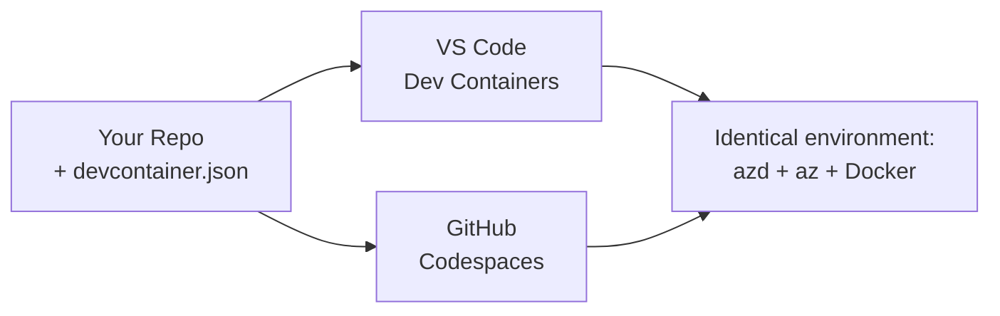

# Dev Containers & GitHub Codespaces cho azd

**Điều hướng Chương:**
- **📚 Trang Khóa Học**: [AZD Cho Người Mới Bắt Đầu](../../README.md)
- **📖 Chương Hiện Tại**: Chương 1 - Nền Tảng & Khởi Đầu Nhanh
- **⬅️ Trước**: [Mang Ứng Dụng Của Bạn](bring-your-own-app.md)
- **🚀 Chương Tiếp Theo**: [Chương 2: Phát Triển Ưu Tiên AI](../chapter-02-ai-development/README.md)

> Mục tiêu đánh giá lệnh và cấu hình: `azd 1.37.2` (Tháng 11 năm 2026). Việc xây dựng container và triển khai Azure không được thực hiện trong phần đánh giá này.

## Giới thiệu

Cài đặt azd, runtime ngôn ngữ phù hợp, Docker, và Azure CLI trên mỗi máy là một công việc vất vả — và đó là lý do số một khiến một hướng dẫn "hoạt động trên máy tôi" lại không thành công với người khác. Một **dev container** giải quyết vấn đề này bằng cách mô tả toàn bộ công cụ của bạn trong một tệp. Bất kỳ ai mở dự án trong VS Code hoặc GitHub Codespaces sẽ có cùng một môi trường chính xác, với azd đã được cài sẵn. Bài học này sẽ hướng dẫn bạn cách thêm một dev container.

## Mục tiêu học tập

Sau bài học này, bạn sẽ:
- Hiểu dev container là gì và tại sao nó giúp ích với azd
- Thêm một `.devcontainer/devcontainer.json` tối thiểu vào một dự án
- Bao gồm azd, Azure CLI, và Docker qua các *tính năng* của Dev Container
- Mở dự án trong GitHub Codespaces hoặc VS Code

## Kết quả học tập

Sau khi hoàn thành bài học, bạn có thể:
- Viết một `devcontainer.json` cho dự án azd
- Thêm azd và công cụ Azure mà không cần cài đặt thủ công
- Chạy `azd up` từ bên trong container hoặc Codespace

---

## Dev Container là gì?

Dev container là một môi trường phát triển dựa trên Docker được định nghĩa qua một tệp `.devcontainer/devcontainer.json` trong kho lưu trữ của bạn. Khi mở dự án:

- **VS Code** (với tiện ích mở rộng Dev Containers) sẽ xây dựng container và gắn kết với nó.
- **GitHub Codespaces** xây dựng cùng một container trên đám mây và cung cấp cho bạn một trình chỉnh sửa trên trình duyệt.

Dù theo cách nào, mỗi cộng tác viên đều nhận được công cụ giống hệt nhau — không cần phải xử lý "bạn có cài azd không?".



---

## Bước 1: Tạo tệp devcontainer

Tạo `.devcontainer/devcontainer.json` ở thư mục gốc của dự án:

```json
{
  "name": "azd-project",
  "image": "mcr.microsoft.com/devcontainers/base:bookworm",
  "features": {
    "ghcr.io/devcontainers/features/azure-cli:1": {},
    "ghcr.io/azure/azure-dev/azd:0": { "version": "1.37.2" },
    "ghcr.io/devcontainers/features/docker-in-docker:2": {},
    "ghcr.io/devcontainers/features/node:1": {}
  },
  "customizations": {
    "vscode": {
      "extensions": [
        "ms-azuretools.azure-dev",
        "ms-azuretools.vscode-bicep"
      ]
    }
  },
  "forwardPorts": [3000],
  "postCreateCommand": "azd version"
}
```

Mỗi phần có chức năng:

| Khóa | Mục đích |
|-----|-----------|
| `image` | Hệ điều hành nền tảng cho container |
| `features` | Các trình cài đặt dựng sẵn — ở đây: Azure CLI, **azd**, Docker, và Node.js |
| `customizations.vscode.extensions` | Tự động cài đặt các phần mở rộng azd và Bicep cho VS Code |
| `forwardPorts` | Mở cổng ứng dụng của bạn đến trình duyệt |
| `postCreateCommand` | Chạy một lần sau khi xây dựng container (ở đây, một kiểm tra tính hợp lý) |

> Phiên bản tính năng (`azd:0`) và phiên bản CLI được cài đặt khác nhau. Đặt tùy chọn `version` của tính năng là `"1.37.2"` để khóa phiên bản CLI; không dùng phiên bản CLI như thẻ tính năng.

---

## Bước 2: Khớp tính năng với ngôn ngữ ứng dụng của bạn

Thay thế tính năng `node` cho bất kỳ ngôn ngữ nào ứng dụng bạn sử dụng:

```jsonc
// Python project
"ghcr.io/devcontainers/features/python:1": {},

// .NET project
"ghcr.io/devcontainers/features/dotnet:2": {},

// Java project
"ghcr.io/devcontainers/features/java:1": {},

// Go project
"ghcr.io/devcontainers/features/go:1": {}
```

Giữ `docker-in-docker` khi xây dựng ảnh tại chỗ. Xây dựng ACR từ xa đã cấu hình (`docker.remoteBuild: true`) là lựa chọn thay thế; chỉ loại máy chủ không luôn yêu cầu Docker cục bộ.

---

## Bước 3: Mở nó lên

**Trong VS Code:**
1. Cài đặt tiện ích mở rộng **Dev Containers**.
2. Mở thư mục dự án.
3. Bấm **Mở lại trong Container** khi được hỏi (hoặc chạy *Dev Containers: Reopen in Container*).

**Trong GitHub Codespaces:**
1. Đẩy repo lên GitHub.
2. Bấm **Code → Codespaces → Tạo codespace trên main**.
3. Đợi container được xây dựng — azd đã sẵn sàng trong terminal.

---

## Bước 4: Triển khai từ bên trong Container

Container đã cài sẵn azd, vì vậy quy trình thông thường sẽ hoạt động:

```bash
azd auth login --use-device-code   # device code is handy inside Codespaces
azd up
```

> **Tại sao `--use-device-code`?** Trong container hoặc Codespace từ xa không có trình duyệt cục bộ để chuyển hướng, nên đăng nhập bằng code thiết bị là cách đáng tin cậy. Bạn sẽ dán mã vào tab trình duyệt để hoàn tất đăng nhập.

---

## Những lỗi phổ biến

| Lỗi | Cách sửa |
|-------|---------|
| `azd up` không thể xây hình ảnh | Thêm tính năng `docker-in-docker` |
| Đăng nhập trình duyệt bị treo trong Codespaces | Dùng `azd auth login --use-device-code` |
| Công cụ khác nhau giữa các đồng đội | Khóa CLI thông qua tùy chọn `version` của tính năng azd và khóa runtime ngôn ngữ |
| Không truy cập được ứng dụng trong trình duyệt | Thêm cổng vào `forwardPorts` |

---

## Tóm tắt

- Một dev container làm cho chuỗi công cụ azd của bạn có thể tái tạo cho mọi người.
- Thêm azd, Azure CLI, và Docker qua các *tính năng* của Dev Container.
- Khớp tính năng ngôn ngữ với ứng dụng và giữ `docker-in-docker` cho các máy chủ container.
- Sử dụng đăng nhập code thiết bị khi chạy trong Codespaces.

---

## 🔗 Điều hướng

| Hướng | Tài nguyên |
|-------|----------|
| **Trước** | [Mang Ứng Dụng Của Bạn](bring-your-own-app.md) |
| **Trang Chương** | [Chương 1: Nền Tảng & Khởi Đầu Nhanh](README.md) |
| **Chương Tiếp Theo** | [Chương 2: Phát Triển Ưu Tiên AI](../chapter-02-ai-development/README.md) |

## 📖 Tài nguyên liên quan

- [Cài đặt & Thiết lập](installation.md)
- [Bảng tổng hợp lệnh](../../resources/cheat-sheet.md)
- [Đặc tả chính thức Dev Containers](https://containers.dev/)
- [Tính năng Dev Container của azd](https://github.com/Azure/azure-dev/tree/main/ext/devcontainer)

---

<!-- CO-OP TRANSLATOR DISCLAIMER START -->
**Tuyên bố miễn trừ trách nhiệm**:
Tài liệu này đã được dịch bằng dịch vụ dịch thuật AI [Co-op Translator](https://github.com/Azure/co-op-translator). Mặc dù chúng tôi cố gắng đảm bảo độ chính xác, xin lưu ý rằng bản dịch tự động có thể chứa lỗi hoặc sai sót. Tài liệu gốc bằng ngôn ngữ gốc nên được coi là nguồn tin chính thức. Đối với thông tin quan trọng, nên sử dụng dịch vụ dịch thuật chuyên nghiệp bởi con người. Chúng tôi không chịu trách nhiệm về bất kỳ hiểu lầm hoặc giải thích sai nào phát sinh từ việc sử dụng bản dịch này.
<!-- CO-OP TRANSLATOR DISCLAIMER END -->