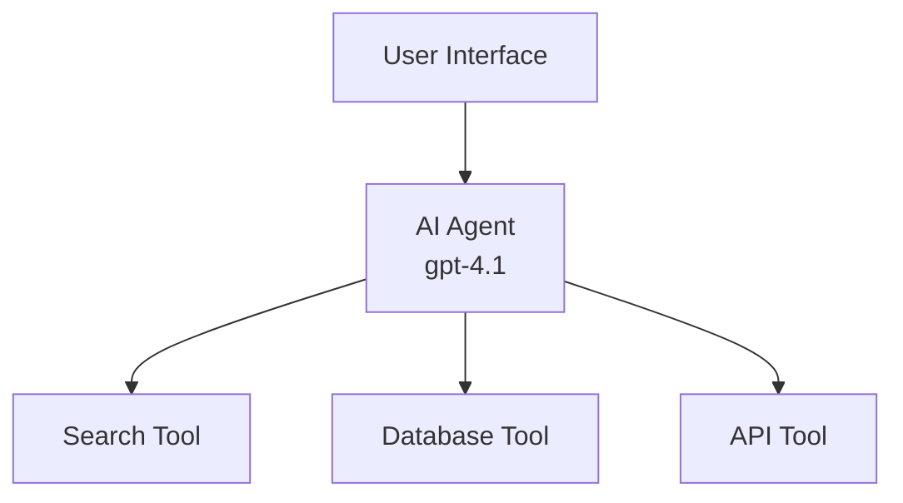
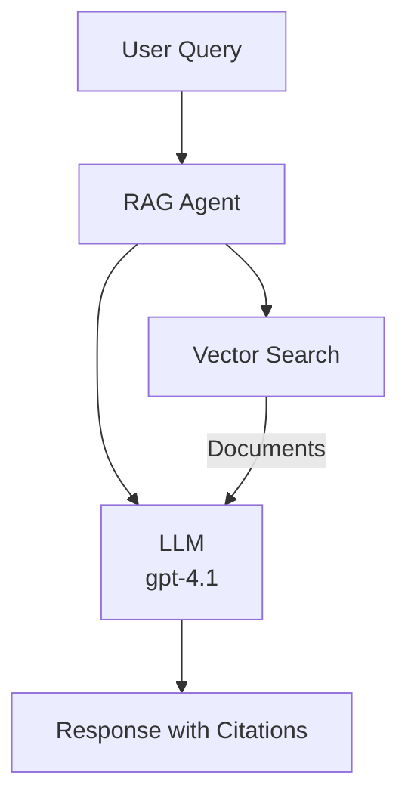
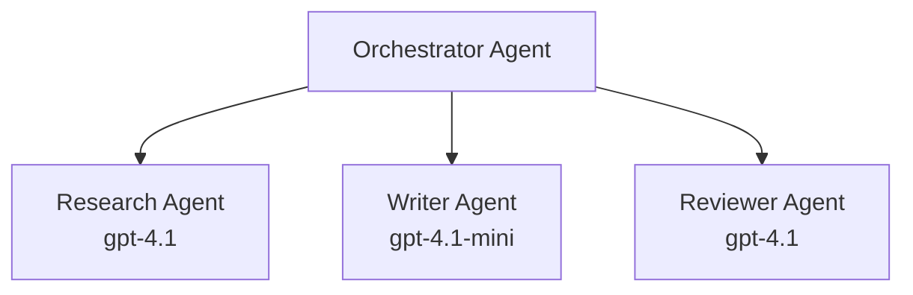

# Tác nhân AI với Azure Developer CLI

**Điều hướng chương:**
- **📚 Trang chủ khóa học**: [AZD Cho Người Mới](../../README.md)
- **📖 Chương hiện tại**: Chương 2 - Phát triển AI-Đầu tiên
- **⬅️ Trước**: [Tích hợp Microsoft Foundry](microsoft-foundry-integration.md)
- **➡️ Tiếp theo**: [Triển khai Mô hình AI](ai-model-deployment.md)
- **🚀 Nâng cao**: [Giải pháp Đa tác nhân](../../examples/retail-scenario.md)

---

## Giới thiệu

Các tác nhân AI là các chương trình tự động có khả năng nhận biết môi trường, ra quyết định và thực hiện các hành động để đạt được mục tiêu cụ thể. Khác với các chatbot đơn giản chỉ đáp lại lệnh, tác nhân có thể:

- **Sử dụng công cụ** - Gọi API, tìm kiếm cơ sở dữ liệu, thực thi mã
- **Lập kế hoạch và suy luận** - Phân nhỏ nhiệm vụ phức tạp thành các bước
- **Học từ ngữ cảnh** - Duy trì bộ nhớ và thích nghi hành vi
- **Hợp tác** - Làm việc cùng các tác nhân khác (hệ thống đa tác nhân)

Hướng dẫn này sẽ chỉ bạn cách triển khai các tác nhân AI lên Azure bằng Azure Developer CLI (azd).

Việc sử dụng ngữ cảnh hội thoại không phải là đào tạo mô hình: bộ nhớ lâu dài, kiểm soát truy cập và lưu giữ phải do ứng dụng triển khai/cấu hình.

> **Đánh giá phát hành (2026-11-04):** Các ví dụ CLI đã được kiểm tra theo tài liệu/nguồn `azd` `1.37.2`, `azure.ai.agents` `1.0.0-beta.23`, và `azure.ai.evaluations` `1.0.0-beta.2`, không phải là triển khai Azure trực tiếp. Sử dụng `azd >= 1.37.0` cho quy trình kết hợp. Xem [thay đổi và sửa lỗi gần đây](../chapter-08-production/production-ai-practices.md#recent-release-changes-and-fixes) trước khi nâng cấp các dự án cũ.

## Mục tiêu học tập

Sau khi hoàn thành hướng dẫn này, bạn sẽ:
- Hiểu tác nhân AI là gì và khác biệt với chatbot ra sao
- Triển khai mẫu tác nhân AI có sẵn bằng AZD
- Cấu hình tác nhân Foundry cho tác nhân tùy chỉnh
- Thực hiện các mẫu tác nhân cơ bản (sử dụng công cụ, RAG, đa tác nhân)
- Giám sát và gỡ lỗi tác nhân đã triển khai

## Kết quả học tập

Sau khi hoàn thành, bạn sẽ có thể:
- Triển khai ứng dụng tác nhân AI lên Azure chỉ với một lệnh
- Cấu hình công cụ và khả năng của tác nhân
- Triển khai tạo nội dung tăng cường truy xuất (RAG) với các tác nhân
- Thiết kế kiến trúc đa tác nhân cho các quy trình phức tạp
- Khắc phục các sự cố phổ biến khi triển khai tác nhân

---

## 🤖 Điều gì làm cho tác nhân khác biệt với chatbot?

| Tính năng | Chatbot | Tác nhân AI |
|---------|---------|----------|
| **Hành vi** | Đáp lại các lời nhắc | Thực hiện hành động tự động |
| **Công cụ** | Có thể dùng công cụ hoặc truy xuất | Thường dùng công cụ trong vòng lặp có mục đích |
| **Bộ nhớ** | Phụ thuộc ứng dụng | Bộ nhớ lâu dài chỉ khi được triển khai rõ ràng |
| **Lập kế hoạch** | Phản hồi một lần | Suy luận đa bước |
| **Hợp tác** | Thực thể đơn | Có thể làm việc cùng các tác nhân khác |

### So sánh đơn giản

- **Chatbot** = Một người hỗ trợ trả lời câu hỏi tại quầy thông tin
- **Tác nhân AI** = Một trợ lý cá nhân có thể gọi điện, đặt lịch hẹn, và hoàn thành công việc cho bạn

---

## 🚀 Bắt đầu nhanh: Triển khai tác nhân đầu tiên của bạn

Chọn một tùy chọn trong **thư mục làm việc trống mới**. Lệnh `.` khởi tạo tại đó; nếu không có đích cụ thể, AZD hiện tại có thể tạo thư mục con tên mẫu và không thay đổi thư mục shell của bạn. Giữ các mẫu/môi trường riêng biệt trong các thư mục khác nhau.

Các khoảng thời gian/chi phí dưới đây mang tính minh họa, không phải báo giá chính xác. Kiểm tra yêu cầu, giá, hạn mức mô hình và dịch vụ tùy chọn của mỗi mẫu trước khi triển khai.

### Tùy chọn 1: Mẫu Foundry Agents (Khuyến nghị)

```bash
# Initialize the AI agents template
azd init --template get-started-with-ai-agents .

# Deploy to Azure
azd up
```

**Những gì được triển khai:** Hạ tầng hiện tại của mẫu và các tùy chọn chọn lọc quyết định mô hình, công cụ, lưu trữ và tài nguyên giám sát. Xem xét README và `infra/` trước khi cấp phép; không phải mẫu tác nhân nào cũng bao gồm Search hoặc giao diện web.

**Thời gian:** ~15-20 phút
**Chi phí:** ~$100-150/tháng (phát triển)

### Tùy chọn 2: Tác nhân Viết sáng tạo với Prompty

```bash
# Initialize the Prompty-based agent template
azd init --template https://github.com/Azure-Samples/contoso-creative-writer .

# Deploy to Azure
azd up
```

**Những gì được triển khai:** Mẫu viết đa tác nhân FastAPI/Prompty sử dụng Azure OpenAI, Bing Grounding, và Azure AI Search. Kho lưu trữ `agent-openai-python-prompty` cũ chuyển hướng về đây; nó không phải là mẫu tác nhân thời tiết tối giản Azure Functions. Theo README hiện tại cho lưu trữ, hạn mức mô hình, và yêu cầu Bing Grounding.

**Thời gian:** ~10-15 phút
**Chi phí:** ~$50-100/tháng (phát triển)

### Tùy chọn 3: Tác nhân Chat RAG

```bash
# Initialize RAG chat template
azd init --template azure-search-openai-demo .

# Deploy to Azure
azd up
```

**Những gì được triển khai:**
- ✅ Mô hình Microsoft Foundry
- ✅ Azure AI Search với dữ liệu mẫu
- ✅ Quy trình xử lý tài liệu
- ✅ Giao diện chat có trích dẫn

**Thời gian:** ~15-25 phút
**Chi phí:** ~$80-150/tháng (phát triển)

### Tùy chọn 4: AZD AI Agent Init (Xem trước mẫu dự án)

Sử dụng `azd ai agent init` tương tác, hoặc áp dụng dự án tác nhân `azure.yaml` hiện tại với `--template`/`-t`. Tùy chọn `--manifest`/`-m` cũ là bí danh lỗi thời, không phải trình chuyển đổi cho manifest cũ.

```bash
# Install the AI agents extension
azd extension install azure.ai.agents

# Optional: verify the installed preview version
azd extension show azure.ai.agents

# Initialize from a current agent project template (supply your template path)
azd ai agent init --template ./templates/support-agent/azure.yaml

# Deploy to Azure
azd up

# Test the deployed agent (shows latency + time-to-first-byte)
azd ai agent invoke
```

**Khi nào dùng `azd ai agent init` so với `azd init --template`:**

| Cách tiếp cận | Phù hợp với | Cách hoạt động |
|----------|----------|------|
| `azd init --template` | Bắt đầu từ ứng dụng mẫu đang hoạt động | Sao chép toàn bộ kho mẫu với mã + hạ tầng |
| `azd ai agent init --template` | Áp dụng dự án tác nhân Foundry hiện có | Sử dụng tài liệu dự án `azure.yaml` và định nghĩa của nó |

> **Mẹo:** Dùng `azd init --template` khi học (các tùy chọn 1-3 phía trên). Dùng `azd ai agent init` cho quy trình tác nhân Foundry. Để thêm định nghĩa tác nhân trực tiếp vào dự án hiện có, xem [hướng dẫn khởi tạo và di cư](../chapter-08-production/production-ai-practices.md#initializing-agent-projects-with-azd-ai-agent-init).

Sau `azd up`, dùng `azd ai agent invoke` để thử nghiệm, tiện ích mở rộng `azure.ai.evaluations` riêng biệt (`azd ai eval init`, `generate`, và `run start`) để đo chất lượng, và `azd ai agent optimize` để cải thiện nó qua cấu hình đánh giá mới. Tác nhân beta.22 thay thế quy trình đánh giá cũ và thay đổi định dạng `--config` của tối ưu hóa. Xem [di cư đánh giá](../chapter-08-production/production-ai-practices.md#evaluation-migration-and-quality-checks) và [di cư tối ưu hóa](../chapter-08-production/production-ai-practices.md#optimization-configuration-migration) trước khi sử dụng lại ví dụ cũ.

---

## 🏗️ Mẫu Kiến trúc Tác nhân

### Mẫu 1: Tác nhân đơn với công cụ

Mẫu tác nhân đơn giản nhất - một tác nhân có thể sử dụng nhiều công cụ.



**Phù hợp cho:**
- Bot hỗ trợ khách hàng
- Trợ lý nghiên cứu
- Tác nhân phân tích dữ liệu

**Mẫu ứng dụng liên quan:** `azure-search-openai-demo` minh họa RAG, không phải vòng lặp tác nhân dùng công cụ tùy ý chung chung.

### Mẫu 2: Tác nhân RAG (Tạo nội dung tăng cường truy xuất)

Một tác nhân truy xuất tài liệu liên quan trước khi tạo phản hồi.



**Phù hợp cho:**
- Cơ sở tri thức doanh nghiệp
- Hệ thống hỏi đáp tài liệu
- Nghiên cứu pháp lý và tuân thủ

**Mẫu AZD:** `azure-search-openai-demo`

### Mẫu 3: Hệ thống đa tác nhân

Nhiều tác nhân chuyên môn hợp tác trên các nhiệm vụ phức tạp.



**Phù hợp cho:**
- Tạo nội dung phức tạp
- Quy trình nhiều bước
- Nhiệm vụ cần nhiều chuyên môn khác nhau

**Tìm hiểu thêm:** [Mẫu Phối hợp Đa tác nhân](../chapter-06-pre-deployment/coordination-patterns.md)

---

## ⚙️ Cấu hình Công cụ Tác nhân

Tác nhân trở nên mạnh mẽ khi có thể sử dụng công cụ. Dưới đây là cách cấu hình các công cụ phổ biến:

### Cấu hình công cụ trong Foundry Agents

Đoạn mã **Agent Service SDK cổ điển** này hướng tới `azure-ai-projects==1.0.0` và `azure-ai-agents==1.1.0` với `azure-identity`. Nó không phải phiên bản API responses của tác nhân phiên bản mới hơn dùng trong một số mẫu Foundry hiện tại, cũng không phải tiện ích mở rộng AZD `azure.ai.agents` (gói khác). Không trộn lẫn các thế hệ API này. Đặt `PROJECT_ENDPOINT` đến đầu cuối dự án cổ điển Foundry và `MODEL_DEPLOYMENT_NAME` đến triển khai mô hình hỗ trợ hiện có; xác thực với `az login` cục bộ và cấp phép dự án cần thiết.

```python
# agent_config.py
import os
from azure.ai.projects import AIProjectClient
from azure.ai.agents.models import FunctionTool
from azure.identity import DefaultAzureCredential

def search_knowledge_base(query: str) -> str:
    """Search the demonstration knowledge base.

    :param query: Search text.
    :return: Matching demonstration information.
    """
    # Local fixture only, not a production search implementation.
    return "Demo policy: returns are accepted within 30 days."

project_client = AIProjectClient(
    endpoint=os.environ["PROJECT_ENDPOINT"],
    credential=DefaultAzureCredential(),
)
search_tool = FunctionTool(functions={search_knowledge_base})
project_client.agents.enable_auto_function_calls(search_tool)
agent = project_client.agents.create_agent(
    model=os.environ["MODEL_DEPLOYMENT_NAME"],
    name="Support Agent",
    instructions="Use search_knowledge_base for policy questions. Label results as demo data.",
    tools=search_tool.definitions,
)
```

Đăng ký một lược đồ chức năng không thực thi Python trên dịch vụ. Trong SDK này, `enable_auto_function_calls` cùng `agents.runs.create_and_process(...)` chạy các hàm gọi lại đã đăng ký trong tiến trình client của bạn. Xem [ví dụ SDK phát hành](https://github.com/Azure/azure-sdk-for-python/blob/azure-ai-agents_1.1.0/sdk/ai/azure-ai-agents/samples/agents_tools/sample_agents_auto_function_call.py). Đóng client và xóa tác nhân/luồng minh họa khi xong.

### Cấu hình môi trường

Các tên dưới đây là **đầu vào mẫu tùy chỉnh minh họa**, không phải công tắc AZD tích hợp. Trước tiên dẫn mỗi giá trị qua `infra/main.parameters.json`, hạ tầng, và mã ứng dụng. Chỉ `azd env set` không thay đổi công cụ hoặc hướng dẫn của tác nhân.

```bash
# Set up agent-specific environment variables
azd env set AZURE_OPENAI_MODEL "gpt-4.1"
azd env set AGENT_INSTRUCTIONS "You are a helpful assistant..."
azd env set ENABLE_CODE_INTERPRETER "true"
azd env set ENABLE_FILE_SEARCH "true"

# Apply wired infrastructure and application changes
azd up
```

---

## 📊 Giám sát Tác nhân

### Tích hợp Application Insights

Nếu mẫu bạn chọn cấp phép Application Insights và cấu hình công cụ đo:

```bash
# Open monitoring dashboard
azd monitor --overview

# Open the Application Insights logs view (not a streaming log tail)
azd monitor --logs

# View live metrics
azd monitor --live
```

### Các chỉ số chính cần theo dõi

| Chỉ số | Mô tả | Mục tiêu |
|--------|-------------|--------|
| Độ trễ phản hồi | Thời gian tạo phản hồi | < 5 giây |
| Sử dụng token | Token mỗi yêu cầu | Giám sát chi phí |
| Tỉ lệ thành công gọi công cụ | % thực thi công cụ thành công | > 95% |
| Tỷ lệ lỗi | Yêu cầu tác nhân thất bại | < 1% |
| Độ hài lòng người dùng | Điểm phản hồi | > 4.0/5.0 |

### Ghi nhật ký tùy chỉnh cho Tác nhân

```python
import os
from azure.monitor.opentelemetry import configure_azure_monitor
from opentelemetry import trace

# Configure Azure Monitor with OpenTelemetry
configure_azure_monitor(
    connection_string=os.environ["APPLICATIONINSIGHTS_CONNECTION_STRING"]
)

tracer = trace.get_tracer(__name__)

def log_agent_interaction(user_query, agent_response, tools_used, latency_ms):
    with tracer.start_as_current_span("agent_interaction") as span:
        span.set_attributes({
            "query_length": len(user_query),  # Do not log raw prompts or personal data
            "response_length": len(agent_response),
            "tools_used": tools_used,
            "latency_ms": latency_ms
        })
```

> **Lưu ý:** Cài gói bắt buộc: `pip install azure-monitor-opentelemetry`. Nó mang theo các phụ thuộc OpenTelemetry; không cần namespace nhập để cài gói tên `opentelemetry`.

---

## 💰 Cân nhắc Chi phí

### Ước tính Chi phí Hàng tháng theo Mẫu

Đây là phạm vi kế hoạch minh họa, không phải báo giá hoặc giới hạn chi tiêu. Vùng, token mô hình, các SKU Search/tính toán, phiên công cụ, lưu trữ, và lưu lượng có thể vượt quá. Kiểm tra hướng dẫn chi phí và giá Azure của mẫu trước `azd up`.

| Mẫu | Môi trường phát triển | Sản xuất |
|---------|-----------------|------------|
| Tác nhân đơn | $50-100 | $200-500 |
| Tác nhân RAG | $80-150 | $300-800 |
| Đa tác nhân (2-3 tác nhân) | $150-300 | $500-1,500 |
| Đa tác nhân Doanh nghiệp | $300-500 | $1,500-5,000+ |

### Mẹo Tối ưu Chi phí

1. **Dùng gpt-4.1-mini cho nhiệm vụ đơn giản** (chỉ nếu mẫu của bạn sử dụng đầu vào này)
   ```bash
   azd env set AZURE_OPENAI_MODEL "gpt-4.1-mini"
   ```

2. **Triển khai bộ nhớ đệm có phạm vi cho các truy vấn lặp lại an toàn.** Bao gồm ủy quyền khách thuê/người dùng, triển khai mô hình, hướng dẫn, và phiên bản truy xuất trong khóa bộ nhớ cache; đặt thời hạn hết hạn. Không chia sẻ phản hồi hội thoại riêng tư qua bộ nhớ đệm truy vấn chung. Đối tượng tác nhân SDK không có phương thức `agent.run()` chung.

3. **Đặt giới hạn token cho mỗi lượt chạy**
   ```python
   # Set max_completion_tokens when running the agent, not during creation
   run = project_client.agents.runs.create_and_process(
       thread_id=thread.id,
       agent_id=agent.id,
       max_completion_tokens=1000  # Budget across the run; may finish as incomplete
   )
   ```

4. **Mở rộng Container Apps đủ điều kiện về 0 khi không sử dụng**
   ```bash
   # Custom-template input: must map to template.scale.minReplicas
   azd env set MIN_REPLICAS "0"
   ```
   Áp dụng thay đổi hạ tầng với `azd provision` hoặc `azd up`. Mở rộng về 0 cần một kích hoạt phù hợp và không dừng Search, lưu trữ, hoặc tính phí mô hình/công cụ.

---

## 🔧 Khắc phục sự cố Tác nhân

### Vấn đề và giải pháp phổ biến

<details>
<summary><strong>❌ Tác nhân không phản hồi lệnh gọi công cụ</strong></summary>

```bash
# Inspect the application deployment (not the agent's registered tools)
azd show

# Verify OpenAI deployment
az cognitiveservices account deployment list \
  --name $AZURE_OPENAI_NAME \
  --resource-group $RG_NAME

# Check agent logs
azd monitor --logs
```

**Nguyên nhân phổ biến:**
- Chữ ký hàm công cụ không khớp
- Thiếu quyền cần thiết
- Đầu cuối API không truy cập được
</details>

<details>
<summary><strong>❌ Độ trễ phản hồi tác nhân cao</strong></summary>

```bash
# Check Application Insights for bottlenecks
azd monitor --live

# Consider using a faster model
azd env set AZURE_OPENAI_MODEL "gpt-4.1-mini"
azd up
```

**Mẹo tối ưu:**
- Dùng phản hồi luồng (streaming)
- Triển khai bộ nhớ đệm phản hồi
- Giảm kích thước cửa sổ ngữ cảnh
</details>

<details>
<summary><strong>❌ Tác nhân trả về thông tin sai hoặc ảo tưởng</strong></summary>

```python
# Improve with better system prompts
instructions = """
You are a helpful assistant. IMPORTANT:
- Only answer based on provided context
- If you don't know, say "I don't know"
- Always cite your sources
- Never make up information
"""

# Use these instructions in the agent definition.
# For classic file search, first upload/index documents in a vector store,
# then use FileSearchTool(vector_store_ids=[...]) and pass both its
# .definitions and .resources when creating the agent.
```
Hướng dẫn và truy xuất giảm rủi ro; không đảm bảo câu trả lời đúng. Đánh giá câu hỏi có nền tảng và ngoài phạm vi so với câu trả lời đã biết.
</details>

<details>
<summary><strong>❌ Lỗi vượt quá giới hạn token</strong></summary>

```python
# Implement context window management
def truncate_context(messages, max_tokens=8000, model="gpt-4.1"):
    """Approximate content-only budget for objects with .content strings."""
    import tiktoken
    encoding = tiktoken.encoding_for_model(model)
    total_tokens = 0
    truncated = []
    
    for msg in reversed(messages):
        msg_tokens = len(encoding.encode(msg.content))
        if total_tokens + msg_tokens > max_tokens:
            break
        truncated.insert(0, msg)
        total_tokens += msg_tokens
    
    return truncated
```
Trợ giúp này loại trừ lược đồ vai trò/công cụ, token hình ảnh, và chi phí giao thức. Dành chỗ cho những thứ đó và hoàn thành; không chia cặp gọi công cụ/kết quả hoặc bỏ hướng dẫn hệ thống cần thiết. Cài đặt `tiktoken` riêng. Nó không phải trình xác thực cửa sổ ngữ cảnh chung.
</details>

---

## 🎓 Bài tập Thực hành

### Bài tập 1: Triển khai Tác nhân Cơ bản (20 phút)

**Mục tiêu:** Triển khai tác nhân AI đầu tiên của bạn bằng AZD

```bash
# Step 1: Initialize template
azd init --template get-started-with-ai-agents .

# Step 2: Login to Azure
azd auth login
# If you work across tenants, add --tenant-id <tenant-id>

# Step 3: Deploy
azd up

# Step 4: Test the agent
# Expected output after deployment:
#   Deployment Complete!
#   Endpoint: https://<app-name>.<region>.azurecontainerapps.io
# Open the URL shown in the output and try asking a question

# Step 5: View monitoring
azd monitor --overview

# Step 6: Clean up
azd down --force --purge
```

**Tiêu chí thành công:**
- [ ] Tác nhân trả lời câu hỏi
- [ ] Có thể truy cập bảng điều khiển giám sát qua `azd monitor`
- [ ] Dọn dẹp tài nguyên thành công

### Bài tập 2: Thêm Công cụ Tùy chỉnh (30 phút)

**Mục tiêu:** Mở rộng tác nhân với công cụ tùy chỉnh

**Điểm khởi đầu:** Dùng client SDK cổ điển từ [Cấu hình Công cụ](#tool-configuration-in-foundry-agents), không dùng mẫu tùy ý với thế hệ SDK khác.

1. Thêm bộ kiểm thử xác định này vào `agent_config.py`:
   ```python
   def get_weather(location: str) -> str:
       """Return demonstration weather, not live conditions.

       :param location: City name.
       :return: A clearly labelled fixture.
       """
       print(f"TOOL_CALLED: {location}")
       return f"Demo weather in {location}: Sunny, 72°F (fixture, not live)"
   ```
2. Thay thế đoạn đăng ký và tạo công cụ tìm kiếm bằng:
   ```python
   weather_tool = FunctionTool(functions={get_weather})
   project_client.agents.enable_auto_function_calls(weather_tool)
   agent = project_client.agents.create_agent(
       model=os.environ["MODEL_DEPLOYMENT_NAME"],
       name="Weather Agent",
       instructions="Call get_weather for weather questions; explain that it returns demo data.",
       tools=weather_tool.definitions,
   )
   thread = project_client.agents.threads.create()
   try:
       project_client.agents.messages.create(
           thread_id=thread.id, role="user", content="Use get_weather for Seattle."
       )
       run = project_client.agents.runs.create_and_process(
           thread_id=thread.id, agent_id=agent.id
       )
       if run.status != "completed":
           raise RuntimeError(f"Run status: {run.status}; error: {run.last_error}")
       for message in project_client.agents.messages.list(thread_id=thread.id):
           for text in message.text_messages:
               print(text.text.value)
   finally:
       project_client.agents.threads.delete(thread.id)
       project_client.agents.delete_agent(agent.id)
       project_client.close()
   ```
3. Chạy cục bộ (lệnh này gọi dự án Azure hiện có và phát sinh phí mô hình):
   ```bash
   python agent_config.py
   # Expected: TOOL_CALLED: Seattle, then a completed answer labelled demo data.
   ```

**Tiêu chí thành công:**
- [ ] Đại lý nhận biết các truy vấn liên quan thời tiết
- [ ] Công cụ được gọi đúng cách
- [ ] Phản hồi bao gồm thông tin thời tiết

### Bài tập 3: Xây dựng Đại lý RAG (45 phút)

**Mục tiêu:** Tạo một đại lý trả lời câu hỏi dựa trên tài liệu của bạn

```bash
# Step 1: Deploy RAG template
azd init --template azure-search-openai-demo .
azd up

# Step 2: Upload your documents
# For the sample's local ingestion path, place supported files in data/.
# Run from the sample root after following its Python environment setup:
./scripts/prepdocs.sh
# Windows PowerShell equivalent: .\\scripts\\prepdocs.ps1

# Step 3: Test with domain-specific questions
# Open the web app URL from the azd up output
# Ask questions about your uploaded documents
# Responses should include citation references like [doc.pdf]
```

**Tiêu chí thành công:**
- [ ] Đại lý trả lời dựa trên tài liệu đã tải lên
- [ ] Phản hồi bao gồm trích dẫn
- [ ] Các câu hỏi ngoài phạm vi được xử lý mà không có khẳng định không được hỗ trợ (không đảm bảo cho mọi câu hỏi trong tương lai)

Nếu `USE_CLOUD_INGESTION=true`, hãy sử dụng quy trình nạp/tải lên đám mây mẫu thay thế; bao bọc cục bộ có chủ ý bỏ qua nạp dữ liệu. Sau khi thử nghiệm, chạy `azd down` trong môi trường RAG và xem xét các tài nguyên sẽ bị xóa.

---

## 📚 Bước tiếp theo

Bây giờ bạn đã hiểu về các đại lý AI, hãy khám phá các chủ đề nâng cao sau:

| Chủ đề | Mô tả | Liên kết |
|-------|-------------|------|
| **Hệ Thống Đa Đại Lý** | Xây dựng các hệ thống với nhiều đại lý hợp tác | [Ví dụ Đa Đại Lý Bán Lẻ](../../examples/retail-scenario.md) |
| **Mẫu Phối Hợp** | Tìm hiểu các mẫu điều phối và giao tiếp | [Mẫu Phối Hợp](../chapter-06-pre-deployment/coordination-patterns.md) |
| **Triển Khai Ở Môi Trường Thực** | Triển khai đại lý sẵn sàng cho doanh nghiệp | [Thực Hành AI Trong Sản Xuất](../chapter-08-production/production-ai-practices.md) |
| **Đánh Giá Đại Lý** | Kiểm thử và đánh giá hiệu suất đại lý | [Khắc Phục Sự Cố AI](../chapter-07-troubleshooting/ai-troubleshooting.md) |
| **Phòng Thí Nghiệm AI** | Thực hành: Chuẩn bị giải pháp AI cho AZD | [Phòng Thí Nghiệm AI](ai-workshop-lab.md) |

---

## 📖 Tài nguyên bổ sung

### Tài liệu chính thức
- [Dịch vụ Đại lý Microsoft Foundry](https://learn.microsoft.com/azure/ai-services/agents/)
- [Khởi đầu nhanh Dịch vụ Đại lý Microsoft Foundry](https://learn.microsoft.com/azure/ai-services/agents/quickstart)
- [Khung Đại lý Semantic Kernel](https://learn.microsoft.com/semantic-kernel/)

### Mẫu AZD cho Đại lý
- [Bắt đầu với Đại lý AI](https://github.com/Azure-Samples/get-started-with-ai-agents)
- [Đại lý Viết Sáng Tạo với Prompty](https://github.com/Azure-Samples/contoso-creative-writer)
- [Trình diễn Azure Search OpenAI](https://github.com/Azure-Samples/azure-search-openai-demo)

### Tài nguyên cộng đồng
- [Awesome AZD - Mẫu Đại lý](https://azure.github.io/awesome-azd/?tags=ai-agents)
- [Discord Azure AI](https://discord.gg/microsoft-azure)
- [Discord Microsoft Foundry](https://discord.gg/nTYy5BXMWG)

### Kỹ năng Đại lý cho Trình soạn thảo của bạn
- [**Kỹ năng Đại lý Microsoft Azure**](https://skills.sh/microsoft/github-copilot-for-azure) - Cài đặt kỹ năng đại lý AI có thể tái sử dụng cho phát triển Azure trong GitHub Copilot, Cursor hoặc bất kỳ đại lý được hỗ trợ nào. Bao gồm kỹ năng cho [Azure AI](https://skills.sh/microsoft/github-copilot-for-azure/azure-ai), [Microsoft Foundry](https://skills.sh/microsoft/github-copilot-for-azure/microsoft-foundry), [triển khai](https://skills.sh/microsoft/github-copilot-for-azure/azure-deploy), và [chẩn đoán](https://skills.sh/microsoft/github-copilot-for-azure/azure-diagnostics):
  ```bash
  npx skills add microsoft/github-copilot-for-azure
  ```

---

**Điều hướng**
- **Bài học trước**: [Tích hợp Microsoft Foundry](microsoft-foundry-integration.md)
- **Bài học tiếp theo**: [Triển khai Mô hình AI](ai-model-deployment.md)

---

<!-- CO-OP TRANSLATOR DISCLAIMER START -->
**Tuyên bố miễn trừ trách nhiệm**:
Tài liệu này đã được dịch bằng dịch vụ dịch thuật AI [Co-op Translator](https://github.com/Azure/co-op-translator). Mặc dù chúng tôi cố gắng đảm bảo độ chính xác, xin lưu ý rằng bản dịch tự động có thể chứa lỗi hoặc sai sót. Tài liệu gốc bằng ngôn ngữ gốc nên được coi là nguồn tin chính thức. Đối với thông tin quan trọng, nên sử dụng dịch vụ dịch thuật chuyên nghiệp bởi con người. Chúng tôi không chịu trách nhiệm về bất kỳ hiểu lầm hoặc giải thích sai nào phát sinh từ việc sử dụng bản dịch này.
<!-- CO-OP TRANSLATOR DISCLAIMER END -->