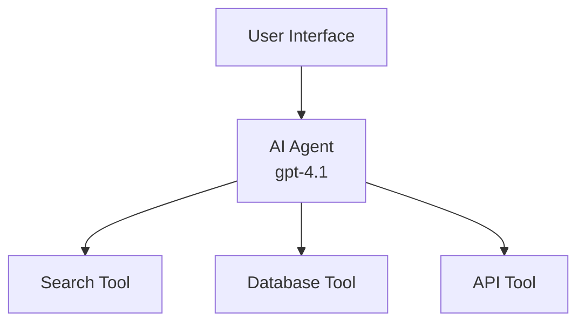
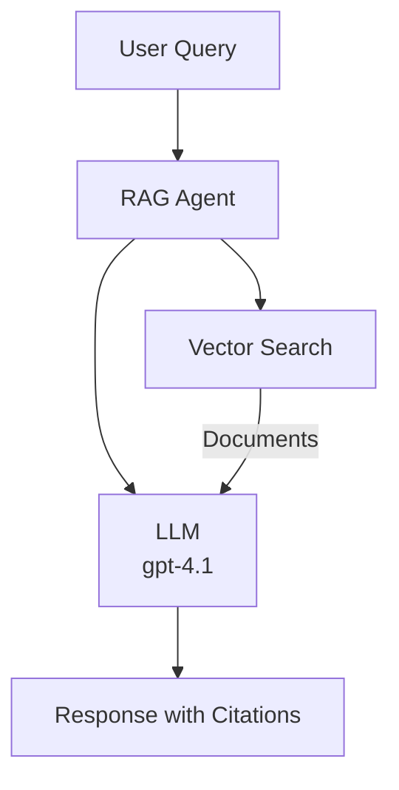
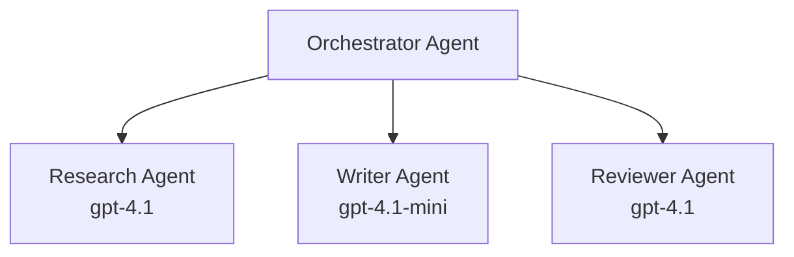

# Tác nhân AI với Azure Developer CLI

**Điều hướng Chương:**
- **📚 Trang Chủ Khóa Học**: [AZD Cho Người Mới Bắt Đầu](../../README.md)
- **📖 Chương Hiện Tại**: Chương 2 - Phát Triển Ưu Tiên AI
- **⬅️ Trước**: [Tích Hợp Microsoft Foundry](microsoft-foundry-integration.md)
- **➡️ Tiếp Theo**: [Triển Khai Mô Hình AI](ai-model-deployment.md)
- **🚀 Nâng Cao**: [Giải Pháp Đa Tác Nhân](../../examples/retail-scenario.md)

---

## Giới thiệu

Tác nhân AI là các chương trình tự động có khả năng cảm nhận môi trường, đưa ra quyết định và thực hiện hành động để đạt được mục tiêu cụ thể. Khác với chatbot đơn giản chỉ phản hồi các câu hỏi, các tác nhân có thể:

- **Sử dụng công cụ** - Gọi API, tìm kiếm cơ sở dữ liệu, thực thi mã
- **Lập kế hoạch và suy luận** - Chia nhỏ các nhiệm vụ phức tạp thành các bước
- **Học từ ngữ cảnh** - Duy trì bộ nhớ và điều chỉnh hành vi
- **Hợp tác** - Làm việc cùng các tác nhân khác (hệ thống đa tác nhân)

Hướng dẫn này sẽ chỉ cho bạn cách triển khai tác nhân AI trên Azure bằng Azure Developer CLI (azd).

Việc sử dụng ngữ cảnh hội thoại không phải là đào tạo mô hình: bộ nhớ bền vững, kiểm soát truy cập và lưu giữ phải được ứng dụng thực hiện/cấu hình.

> **Cập nhật Foundry GA (2026-11-09):** Cài đặt gói `microsoft.foundry` 1.0 đã phát hành rộng rãi với `azd >= 1.37.0`. Các đánh giá được cài đặt riêng; các tính năng xem trước tùy chọn và đoạn SDK cổ điển bên dưới không được quảng bá trong bản GA bởi thông báo gói. Hướng dẫn này dựa trên [thông báo GA](https://devblogs.microsoft.com/azure-sdk/microsoft-foundry-azure-developer-cli-ga/) và tài liệu, không phải triển khai Azure trực tiếp.

## Mục tiêu học tập

Sau khi hoàn thành hướng dẫn này, bạn sẽ:
- Hiểu tác nhân AI là gì và khác biệt với chatbot ra sao
- Triển khai mẫu tác nhân AI có sẵn sử dụng AZD
- Cấu hình Foundry Agents cho tác nhân tùy chỉnh
- Triển khai các mẫu cơ bản của tác nhân (sử dụng công cụ, RAG, đa tác nhân)
- Giám sát và gỡ lỗi các tác nhân đã triển khai

## Kết quả học tập

Sau khi hoàn thành, bạn có thể:
- Triển khai ứng dụng tác nhân AI lên Azure chỉ với một lệnh
- Cấu hình công cụ và khả năng của tác nhân
- Triển khai tạo nội dung tăng cường truy xuất (RAG) với tác nhân
- Thiết kế kiến trúc đa tác nhân cho quy trình phức tạp
- Khắc phục các sự cố triển khai tác nhân phổ biến

---

## 🤖 Tác nhân khác chatbot như thế nào?

| Đặc điểm | Chatbot | Tác nhân AI |
|---------|---------|----------|
| **Hành vi** | Phản hồi theo câu hỏi | Thực hiện hành động tự chủ |
| **Công cụ** | Có thể sử dụng truy xuất hoặc công cụ | Thường sử dụng công cụ trong vòng lặp hướng mục tiêu |
| **Bộ nhớ** | Tùy thuộc ứng dụng | Có bộ nhớ bền vững nếu được triển khai rõ ràng |
| **Lập kế hoạch** | Phản hồi một lần | Suy luận nhiều bước |
| **Hợp tác** | Thực thể đơn lẻ | Có thể làm việc với các tác nhân khác |

### Tương tự đơn giản

- **Chatbot** = Người trợ giúp trả lời câu hỏi tại bàn thông tin
- **Tác nhân AI** = Trợ lý cá nhân có thể gọi điện, đặt lịch hẹn, và hoàn thành công việc cho bạn

---

## 🚀 Bắt đầu nhanh: Triển khai Tác nhân đầu tiên của bạn

Chọn một trong các tùy chọn trong **thư mục làm việc mới hoàn toàn trống**. Lệnh `.` khởi tạo tại đó; nếu không chỉ định đích rõ ràng, AZD hiện tại có thể tạo thư mục con theo tên mẫu và không thay đổi thư mục shell của bạn. Giữ mẫu/môi trường khác nhau trong các thư mục riêng biệt.

Thời gian/chi phí dưới đây chỉ mang tính minh họa, không phải báo giá xác thực. Kiểm tra yêu cầu hiện tại, giá, hạn ngạch mô hình và dịch vụ tùy chọn của từng mẫu trước khi triển khai.

### Tùy chọn 1: Mẫu Foundry Agents (Khuyến nghị)

```bash
# Initialize the AI agents template
azd init --template get-started-with-ai-agents .

# Deploy to Azure
azd up
```

**Được triển khai:** Cơ sở hạ tầng hiện tại và các tùy chọn được chọn của mẫu sẽ quyết định mô hình, công cụ, nhà lưu trữ và tài nguyên giám sát. Xem xét README và `infra/` trước khi cấp phát; không phải mọi mẫu tác nhân đều có Search hoặc giao diện web.

**Thời gian:** ~15-20 phút
**Chi phí:** ~100-150 USD/tháng (phát triển)

### Tùy chọn 2: Tác nhân Viết Sáng tạo với Prompty

```bash
# Initialize the Prompty-based agent template
azd init --template https://github.com/Azure-Samples/contoso-creative-writer .

# Deploy to Azure
azd up
```

**Được triển khai:** Mẫu viết đa tác nhân FastAPI/Prompty sử dụng Azure OpenAI, Bing Grounding, và Azure AI Search. Kho lưu trữ trước đây `agent-openai-python-prompty` chuyển hướng đến đây; nó không phải mẫu tác nhân thời tiết Azure Functions tối giản. Tham khảo README hiện tại cho hosting, hạn ngạch mô hình và yêu cầu Bing Grounding.

**Thời gian:** ~10-15 phút
**Chi phí:** ~50-100 USD/tháng (phát triển)

### Tùy chọn 3: Tác nhân Đàm thoại RAG

```bash
# Initialize RAG chat template
azd init --template azure-search-openai-demo .

# Deploy to Azure
azd up
```

**Được triển khai:**
- ✅ Mô hình Microsoft Foundry
- ✅ Azure AI Search với dữ liệu mẫu
- ✅ Chuỗi xử lý tài liệu
- ✅ Giao diện chat kèm trích dẫn

**Thời gian:** ~15-25 phút
**Chi phí:** ~80-150 USD/tháng (phát triển)

### Tùy chọn 4: Tác nhân Được host với Gói Foundry GA

Sử dụng [hướng dẫn đầy đủ cho tác nhân được host](microsoft-foundry-integration.md#hosted-agent-walkthrough-ga) cho mẫu API Phản hồi Python Agent Framework cơ bản. Con đường triển khai này cần Python 3.13+, uv hiện tại, quyền Foundry, và hạn ngạch mô hình vùng. Xác thực các lệnh gọi SDK local riêng khi dùng thông tin đăng nhập Azure CLI.

```bash
azd auth login
azd ext install microsoft.foundry
```

Trong thư mục trống, khởi tạo mẫu:

```text
azd ai agent init --template https://github.com/microsoft-foundry/foundry-samples/blob/main/samples/python/hosted-agents/agent-framework/responses/01-basic/azure.yaml --deploy-mode code --src .
```

Chọn dự án mới hoặc hiện có, xem `azure.yaml`, và chạy `azd provision`. Dùng `azd ai agent run` mở Agent Inspector và, từ terminal khác trong thư mục đó, `azd ai agent invoke --local "Explain how this agent is hosted."`. Sau khi kiểm tra local, sử dụng `azd deploy` và `azd ai agent invoke "Explain how this agent is hosted."` để so sánh phản hồi triển khai. Foundry xây dựng mã nguồn tải lên từ xa; không cần xây dựng container local.

**Khi nào dùng `azd ai agent init` hoặc `azd init --template`:**

| Phương pháp | Phù hợp với | Cách thức hoạt động |
|----------|----------|------|
| `azd init --template` | Bắt đầu từ mẫu ứng dụng hoạt động | Sao chép toàn bộ repo mẫu với code + hạ tầng |
| `azd ai agent init --template` | Tiếp nhận dự án tác nhân Foundry hiện có | Dùng tài liệu dự án `azure.yaml` và định nghĩa của nó |

> **Mẹo:** Các tùy chọn 1-3 bắt đầu từ mẫu ứng dụng đầy đủ; tùy chọn 4 hướng dẫn quy trình làm việc tác nhân được host GA. Không có lệnh khởi tạo nào tự động di chuyển manifest tác nhân cũ. Để thêm định nghĩa tác nhân trực tiếp vào dự án hiện tại, xem [hướng dẫn khởi tạo và di chuyển](../chapter-08-production/production-ai-practices.md#initializing-agent-projects-with-azd-ai-agent-init).

Cài đặt `azure.ai.evaluations` riêng để tạo và xem dữ liệu đánh giá/điểm chuẩn, cấu hình đánh giá và chạy nó bằng `azd ai eval`. Tối ưu có thể tái sử dụng đánh giá tương thích; xem xét các ứng viên trước khi triển khai rõ ràng. Tham khảo [quy trình đánh giá](../chapter-08-production/production-ai-practices.md#evaluation-migration-and-quality-checks) và [di chuyển tối ưu hóa](../chapter-08-production/production-ai-practices.md#optimization-configuration-migration) trước khi tái sử dụng ví dụ cũ. Để dọn dẹp, tài nguyên của dự án Foundry tái sử dụng vẫn còn sau `azd down`; nhóm tài nguyên dự án mới được tạo sẽ bị xóa. Xem hướng dẫn [dọn dẹp quy trình](microsoft-foundry-integration.md#7-clean-up-deliberately).

---

## 🏗️ Mẫu Kiến trúc Tác nhân

### Mẫu 1: Tác nhân Đơn với Công cụ

Mẫu tác nhân đơn giản nhất - một tác nhân có thể sử dụng nhiều công cụ.



**Phù hợp với:**
- Bot hỗ trợ khách hàng
- Trợ lý nghiên cứu
- Tác nhân phân tích dữ liệu

**Ví dụ ứng dụng liên quan:** `azure-search-openai-demo` minh họa RAG, không phải vòng lặp tác nhân dùng công cụ tùy ý chung.

### Mẫu 2: Tác nhân RAG (Tạo nội dung tăng cường truy xuất)

Một tác nhân truy xuất tài liệu liên quan trước khi tạo phản hồi.



**Phù hợp với:**
- Cơ sở tri thức doanh nghiệp
- Hệ thống hỏi đáp tài liệu
- Nghiên cứu tuân thủ và pháp lý

**Mẫu AZD:** `azure-search-openai-demo`

### Mẫu 3: Hệ thống đa Tác nhân

Nhiều tác nhân chuyên môn cùng hợp tác thực hiện nhiệm vụ phức tạp.



**Phù hợp với:**
- Tạo nội dung phức tạp
- Quy trình nhiều bước
- Nhiệm vụ cần chuyên môn khác nhau

**Tìm hiểu thêm:** [Mẫu Điều phối Đa Tác nhân](../chapter-06-pre-deployment/coordination-patterns.md)

---

## ⚙️ Cấu Hình Công Cụ cho Tác nhân

Tác nhân trở nên mạnh mẽ khi có thể sử dụng công cụ. Dưới đây là cách cấu hình các công cụ phổ biến:

### Cấu hình Công cụ trong Foundry Agents

Đoạn **SDK Dịch vụ Agent cổ điển** này nhắm tới `azure-ai-projects==1.0.0` và `azure-ai-agents==1.1.0` với `azure-identity`. Đây không phải phiên bản API versioned-agent/Responses mới hơn được sử dụng bởi một số mẫu Foundry hiện tại, cũng không phải phần mở rộng `azure.ai.agents` AZD (một gói khác). Không trộn lẫn các thế hệ API này. Đặt `PROJECT_ENDPOINT` thành điểm cuối dự án Foundry cổ điển và `MODEL_DEPLOYMENT_NAME` thành một triển khai mô hình được hỗ trợ hiện có; xác thực với `az login` cục bộ và cấp các quyền dự án cần thiết.

```python
# agent_config.py
import os
from azure.ai.projects import AIProjectClient
from azure.ai.agents.models import FunctionTool
from azure.identity import DefaultAzureCredential

def search_knowledge_base(query: str) -> str:
    """Search the demonstration knowledge base.

    :param query: Search text.
    :return: Matching demonstration information.
    """
    # Local fixture only, not a production search implementation.
    return "Demo policy: returns are accepted within 30 days."

project_client = AIProjectClient(
    endpoint=os.environ["PROJECT_ENDPOINT"],
    credential=DefaultAzureCredential(),
)
search_tool = FunctionTool(functions={search_knowledge_base})
project_client.agents.enable_auto_function_calls(search_tool)
agent = project_client.agents.create_agent(
    model=os.environ["MODEL_DEPLOYMENT_NAME"],
    name="Support Agent",
    instructions="Use search_knowledge_base for policy questions. Label results as demo data.",
    tools=search_tool.definitions,
)
```

Đăng ký một sơ đồ hàm không chạy Python trên dịch vụ. Trong SDK này, `enable_auto_function_calls` cộng với `agents.runs.create_and_process(...)` chạy các callback đã đăng ký trong tiến trình client của bạn. Xem [ví dụ SDK được phát hành](https://github.com/Azure/azure-sdk-for-python/blob/azure-ai-agents_1.1.0/sdk/ai/azure-ai-agents/samples/agents_tools/sample_agents_auto_function_call.py). Đóng client và xóa các agents/threads minh họa khi hoàn thành.

### Cấu hình môi trường

Các tên dưới đây là **đầu vào mẫu tùy chỉnh minh họa**, không phải công tắc AZD tích hợp. Trước tiên, truyền mỗi giá trị qua `infra/main.parameters.json`, hạ tầng và mã ứng dụng. Một mình `azd env set` không thay đổi công cụ hoặc hướng dẫn của agent.

```bash
# Set up agent-specific environment variables
azd env set AZURE_OPENAI_MODEL "gpt-4.1"
azd env set AGENT_INSTRUCTIONS "You are a helpful assistant..."
azd env set ENABLE_CODE_INTERPRETER "true"
azd env set ENABLE_FILE_SEARCH "true"

# Apply wired infrastructure and application changes
azd up
```

---

## 📊 Giám sát Agents

### Tích hợp Application Insights

Nếu mẫu bạn chọn cấp phát Application Insights và cấu hình instrumentation:

```bash
# Open monitoring dashboard
azd monitor --overview

# Open the Application Insights logs view (not a streaming log tail)
azd monitor --logs

# View live metrics
azd monitor --live
```

### Các chỉ số chính để theo dõi

| Chỉ số | Mô tả | Mục tiêu |
|--------|-------------|--------|
| Độ trễ phản hồi | Thời gian tạo phản hồi | < 5 giây |
| Sử dụng Token | Token trên mỗi yêu cầu | Giám sát chi phí |
| Tỷ lệ thành công gọi công cụ | % thực thi công cụ thành công | > 95% |
| Tỷ lệ lỗi | Yêu cầu agent thất bại | < 1% |
| Hài lòng người dùng | Điểm phản hồi | > 4.0/5.0 |

### Ghi log tùy chỉnh cho Agents

```python
import os
from azure.monitor.opentelemetry import configure_azure_monitor
from opentelemetry import trace

# Configure Azure Monitor with OpenTelemetry
configure_azure_monitor(
    connection_string=os.environ["APPLICATIONINSIGHTS_CONNECTION_STRING"]
)

tracer = trace.get_tracer(__name__)

def log_agent_interaction(user_query, agent_response, tools_used, latency_ms):
    with tracer.start_as_current_span("agent_interaction") as span:
        span.set_attributes({
            "query_length": len(user_query),  # Do not log raw prompts or personal data
            "response_length": len(agent_response),
            "tools_used": tools_used,
            "latency_ms": latency_ms
        })
```

> **Lưu ý:** Cài đặt gói cần thiết: `pip install azure-monitor-opentelemetry`. Nó mang theo các phụ thuộc OpenTelemetry; không bắt buộc phải nhập namespace để cài gói có tên `opentelemetry`.

---

## 💰 Cân nhắc chi phí

### Ước tính chi phí hàng tháng theo mẫu

Đây là các phạm vi lập kế hoạch minh họa, không phải báo giá hay giới hạn chi tiêu. Vùng, token mô hình, SKU Search/tính toán, phiên công cụ, lưu trữ và lưu lượng có thể vượt quá. Kiểm tra hướng dẫn chi phí mẫu và giá Azure trước khi `azd up`.

| Mẫu | Môi trường Dev | Sản xuất |
|---------|-----------------|------------|
| Agent đơn | $50-100 | $200-500 |
| Agent RAG | $80-150 | $300-800 |
| Multi-Agent (2-3 agents) | $150-300 | $500-1,500 |
| Multi-Agent doanh nghiệp | $300-500 | $1,500-5,000+ |

### Mẹo tối ưu hóa chi phí

1. **Dùng gpt-4.1-mini cho các tác vụ đơn giản** (chỉ nếu mẫu của bạn tiêu thụ đầu vào này)
   ```bash
   azd env set AZURE_OPENAI_MODEL "gpt-4.1-mini"
   ```

2. **Thực hiện caching có phạm vi cho các truy vấn lặp lại an toàn.** Bao gồm ủy quyền tenant/người dùng, triển khai mô hình, hướng dẫn, và phiên bản truy xuất trong khóa cache; đặt thời hạn hết hạn. Không chia sẻ phản hồi cuộc trò chuyện riêng tư qua bộ nhớ cache chỉ truy vấn toàn tiến trình. Đối tượng agent SDK không có phương thức `agent.run()` chung.

3. **Đặt giới hạn token cho mỗi lần chạy**
   ```python
   # Set max_completion_tokens when running the agent, not during creation
   run = project_client.agents.runs.create_and_process(
       thread_id=thread.id,
       agent_id=agent.id,
       max_completion_tokens=1000  # Budget across the run; may finish as incomplete
   )
   ```

4. **Tự động mở rộng Container Apps đủ điều kiện về 0 khi không sử dụng**
   ```bash
   # Custom-template input: must map to template.scale.minReplicas
   azd env set MIN_REPLICAS "0"
   ```
   Áp dụng thay đổi hạ tầng với `azd provision` hoặc `azd up`. Mở rộng về 0 cần trigger phù hợp và không dừng Search, lưu trữ, hoặc tính phí mô hình/công cụ.

---

## 🔧 Xử lý sự cố Agents

### Các vấn đề phổ biến và giải pháp

<details>
<summary><strong>❌ Agent không phản hồi gọi công cụ</strong></summary>

```bash
# Inspect the application deployment (not the agent's registered tools)
azd show

# Verify OpenAI deployment
az cognitiveservices account deployment list \
  --name $AZURE_OPENAI_NAME \
  --resource-group $RG_NAME

# Check agent logs
azd monitor --logs
```

**Nguyên nhân phổ biến:**
- Không khớp chữ ký hàm công cụ
- Thiếu quyền cần thiết
- Điểm cuối API không truy cập được
</details>

<details>
<summary><strong>❌ Độ trễ cao trong phản hồi agent</strong></summary>

```bash
# Check Application Insights for bottlenecks
azd monitor --live

# Consider using a faster model
azd env set AZURE_OPENAI_MODEL "gpt-4.1-mini"
azd up
```

**Mẹo tối ưu:**
- Dùng phản hồi streaming
- Thực hiện cache phản hồi
- Giảm kích thước cửa sổ ngữ cảnh
</details>

<details>
<summary><strong>❌ Agent trả về thông tin sai hoặc ảo tưởng</strong></summary>

```python
# Improve with better system prompts
instructions = """
You are a helpful assistant. IMPORTANT:
- Only answer based on provided context
- If you don't know, say "I don't know"
- Always cite your sources
- Never make up information
"""

# Use these instructions in the agent definition.
# For classic file search, first upload/index documents in a vector store,
# then use FileSearchTool(vector_store_ids=[...]) and pass both its
# .definitions and .resources when creating the agent.
```
Hướng dẫn và truy xuất giảm rủi ro; không đảm bảo câu trả lời đúng sự thật. Đánh giá các câu hỏi dựa trên tài liệu tham khảo với các câu trả lời đã biết.
</details>

<details>
<summary><strong>❌ Lỗi vượt quá giới hạn token</strong></summary>

```python
# Implement context window management
def truncate_context(messages, max_tokens=8000, model="gpt-4.1"):
    """Approximate content-only budget for objects with .content strings."""
    import tiktoken
    encoding = tiktoken.encoding_for_model(model)
    total_tokens = 0
    truncated = []
    
    for msg in reversed(messages):
        msg_tokens = len(encoding.encode(msg.content))
        if total_tokens + msg_tokens > max_tokens:
            break
        truncated.insert(0, msg)
        total_tokens += msg_tokens
    
    return truncated
```
Công cụ này loại trừ sơ đồ vai trò/công cụ, hướng dẫn hệ thống, token hình ảnh và overhead giao thức. Dự phòng không gian cho những phần đó và phần hoàn thành; không tách cặp gọi công cụ/kết quả hoặc loại bỏ hướng dẫn hệ thống bắt buộc. Cài riêng `tiktoken`. Nó không phải trình kiểm tra chung cửa sổ ngữ cảnh.
</details>

---

## 🎓 Bài tập thực hành

### Bài tập 1: Triển khai Agent cơ bản (20 phút)

**Mục tiêu:** Triển khai agent AI đầu tiên của bạn bằng AZD

```bash
# Step 1: Initialize template
azd init --template get-started-with-ai-agents .

# Step 2: Login to Azure
azd auth login
# If you work across tenants, add --tenant-id <tenant-id>

# Step 3: Deploy
azd up

# Step 4: Test the agent
# Expected output after deployment:
#   Deployment Complete!
#   Endpoint: https://<app-name>.<region>.azurecontainerapps.io
# Open the URL shown in the output and try asking a question

# Step 5: View monitoring
azd monitor --overview

# Step 6: Review the listed resources and confirm cleanup
azd down
```

**Tiêu chí thành công:**
- [ ] Đại lý trả lời câu hỏi
- [ ] Có thể truy cập bảng điều khiển giám sát qua `azd monitor`
- [ ] Tài nguyên được dọn dẹp thành công

### Bài tập 2: Thêm Công Cụ Tùy Chỉnh (30 phút)

**Mục tiêu:** Mở rộng đại lý với một công cụ tùy chỉnh

**Điểm bắt đầu:** Sử dụng client SDK cổ điển từ [Cấu hình công cụ](#tool-configuration-in-foundry-agents), không phải mẫu tùy ý với phiên bản SDK khác.

1. Thêm đoạn fixture xác định này vào `agent_config.py`:
   ```python
   def get_weather(location: str) -> str:
       """Return demonstration weather, not live conditions.

       :param location: City name.
       :return: A clearly labelled fixture.
       """
       print(f"TOOL_CALLED: {location}")
       return f"Demo weather in {location}: Sunny, 72°F (fixture, not live)"
   ```
2. Thay thế khối đăng ký và tạo công cụ tìm kiếm bằng:
   ```python
   weather_tool = FunctionTool(functions={get_weather})
   project_client.agents.enable_auto_function_calls(weather_tool)
   agent = project_client.agents.create_agent(
       model=os.environ["MODEL_DEPLOYMENT_NAME"],
       name="Weather Agent",
       instructions="Call get_weather for weather questions; explain that it returns demo data.",
       tools=weather_tool.definitions,
   )
   thread = project_client.agents.threads.create()
   try:
       project_client.agents.messages.create(
           thread_id=thread.id, role="user", content="Use get_weather for Seattle."
       )
       run = project_client.agents.runs.create_and_process(
           thread_id=thread.id, agent_id=agent.id
       )
       if run.status != "completed":
           raise RuntimeError(f"Run status: {run.status}; error: {run.last_error}")
       for message in project_client.agents.messages.list(thread_id=thread.id):
           for text in message.text_messages:
               print(text.text.value)
   finally:
       project_client.agents.threads.delete(thread.id)
       project_client.agents.delete_agent(agent.id)
       project_client.close()
   ```
3. Chạy cục bộ (điều này gọi dự án Azure hiện có và phát sinh chi phí mô hình):
   ```bash
   python agent_config.py
   # Expected: TOOL_CALLED: Seattle, then a completed answer labelled demo data.
   ```

**Tiêu chí thành công:**
- [ ] Đại lý nhận biết các truy vấn liên quan đến thời tiết
- [ ] Công cụ được gọi đúng cách
- [ ] Phản hồi bao gồm thông tin thời tiết

### Bài tập 3: Xây dựng Đại lý RAG (45 phút)

**Mục tiêu:** Tạo đại lý trả lời câu hỏi từ tài liệu của bạn

```bash
# Step 1: Deploy RAG template
azd init --template azure-search-openai-demo .
azd up

# Step 2: Upload your documents
# For the sample's local ingestion path, place supported files in data/.
# Run from the sample root after following its Python environment setup:
./scripts/prepdocs.sh
# Windows PowerShell equivalent: .\\scripts\\prepdocs.ps1

# Step 3: Test with domain-specific questions
# Open the web app URL from the azd up output
# Ask questions about your uploaded documents
# Responses should include citation references like [doc.pdf]
```

**Tiêu chí thành công:**
- [ ] Đại lý trả lời từ các tài liệu đã tải lên
- [ ] Phản hồi bao gồm trích dẫn
- [ ] Các câu hỏi vượt ngoài phạm vi được xử lý mà không có tuyên bố không được hỗ trợ (không đảm bảo cho mọi câu hỏi trong tương lai)

Nếu `USE_CLOUD_INGESTION=true`, hãy dùng quy trình hấp thụ/tải lên trên đám mây của mẫu thay vào đó; lớp bao cục bộ cố ý bỏ qua hấp thụ. Sau khi thử, chạy `azd down` trong môi trường RAG và xem lại các tài nguyên sẽ bị xóa.

---

## 📚 Các bước tiếp theo

Bây giờ bạn đã hiểu các đại lý AI, hãy khám phá các chủ đề nâng cao này:

| Chủ đề | Mô tả | Liên kết |
|-------|-------------|------|
| **Hệ thống Đa Đại lý** | Xây dựng hệ thống với nhiều đại lý cộng tác | [Ví dụ Đa Đại lý Bán lẻ](../../examples/retail-scenario.md) |
| **Mẫu Phối hợp** | Tìm hiểu mẫu điều phối và giao tiếp | [Mẫu Phối hợp](../chapter-06-pre-deployment/coordination-patterns.md) |
| **Triển khai Sản xuất** | Triển khai đại lý sẵn sàng doanh nghiệp | [Thực hành AI Sản xuất](../chapter-08-production/production-ai-practices.md) |
| **Đánh giá Đại lý** | Kiểm tra và đánh giá hiệu suất đại lý | [Khắc phục sự cố AI](../chapter-07-troubleshooting/ai-troubleshooting.md) |
| **Phòng Thí nghiệm AI** | Thực hành: Chuẩn bị giải pháp AI cho AZD | [Phòng Thí nghiệm AI](ai-workshop-lab.md) |

---

## 📖 Tài nguyên thêm

### Tài liệu chính thức
- [Microsoft Foundry Agent Service](https://learn.microsoft.com/azure/ai-services/agents/)
- [Khởi động nhanh Microsoft Foundry Agent Service](https://learn.microsoft.com/azure/ai-services/agents/quickstart)
- [Semantic Kernel Agent Framework](https://learn.microsoft.com/semantic-kernel/)

### Mẫu AZD cho Đại lý
- [Bắt đầu với Đại lý AI](https://github.com/Azure-Samples/get-started-with-ai-agents)
- [Đại lý Viết sáng tạo với Prompty](https://github.com/Azure-Samples/contoso-creative-writer)
- [Demo Azure Search OpenAI](https://github.com/Azure-Samples/azure-search-openai-demo)

### Tài nguyên Cộng đồng
- [Awesome AZD - Mẫu Đại lý](https://azure.github.io/awesome-azd/?tags=ai-agents)
- [Azure AI Discord](https://discord.gg/microsoft-azure)
- [Microsoft Foundry Discord](https://discord.gg/nTYy5BXMWG)

### Kỹ năng Đại lý cho Trình soạn thảo của bạn
- [**Kỹ năng Đại lý Microsoft Azure**](https://skills.sh/microsoft/github-copilot-for-azure) - Cài đặt kỹ năng đại lý AI có thể tái sử dụng cho phát triển Azure trong GitHub Copilot, Cursor hoặc bất kỳ đại lý được hỗ trợ nào. Bao gồm kỹ năng cho [Azure AI](https://skills.sh/microsoft/github-copilot-for-azure/azure-ai), [Microsoft Foundry](https://skills.sh/microsoft/github-copilot-for-azure/microsoft-foundry), [triển khai](https://skills.sh/microsoft/github-copilot-for-azure/azure-deploy) và [chẩn đoán](https://skills.sh/microsoft/github-copilot-for-azure/azure-diagnostics):
  ```bash
  npx skills add microsoft/github-copilot-for-azure
  ```

---

**Điều hướng**
- **Bài học trước**: [Tích hợp Microsoft Foundry](microsoft-foundry-integration.md)
- **Bài học tiếp theo**: [Triển khai Mô hình AI](ai-model-deployment.md)

---

<!-- CO-OP TRANSLATOR DISCLAIMER START -->
**Tuyên bố miễn trừ trách nhiệm**:
Tài liệu này đã được dịch bằng dịch vụ dịch thuật AI [Co-op Translator](https://github.com/Azure/co-op-translator). Mặc dù chúng tôi cố gắng đảm bảo độ chính xác, xin lưu ý rằng bản dịch tự động có thể chứa lỗi hoặc sai sót. Tài liệu gốc bằng ngôn ngữ gốc nên được coi là nguồn tin chính thức. Đối với thông tin quan trọng, nên sử dụng dịch vụ dịch thuật chuyên nghiệp bởi con người. Chúng tôi không chịu trách nhiệm về bất kỳ hiểu lầm hoặc giải thích sai nào phát sinh từ việc sử dụng bản dịch này.
<!-- CO-OP TRANSLATOR DISCLAIMER END -->