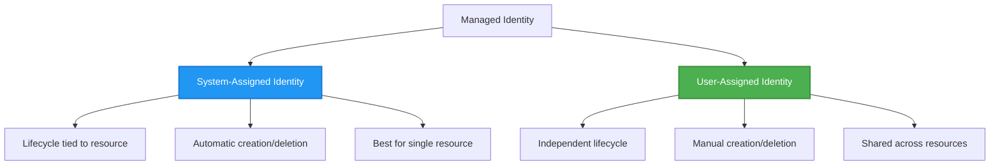

# Mẫu Xác Thực và Managed Identity

⏱️ **Thời gian ước tính**: 45-60 phút đọc; dành thêm thời gian để tích hợp bài tập | 💰 **Tác động chi phí**: Identity/RBAC miễn phí; tính phí tài nguyên tính toán, lưu trữ và Key Vault đã triển khai | ⭐ **Độ phức tạp**: Trung cấp

> Đã xem xét theo `azd 1.37.2` (tháng 11 năm 2026). Bài học này chứa **các phần minh họa tích hợp, không phải mẫu `secure-app` tải xuống hoàn chỉnh**. Tạo các tệp tham chiếu, cung cấp cơ sở hạ tầng phù hợp và thay thế các chỗ giữ chỗ trước khi triển khai. Không có tài nguyên Azure nào được cung cấp trong quá trình đánh giá.

**📚 Lộ trình học:**
- ← Trước: [Quản lý Cấu hình](configuration.md) - Quản lý biến môi trường và bí mật
- 🎯 **Bạn đang ở đây**: Xác thực & Bảo mật (Managed Identity, Key Vault, mẫu bảo mật)
- → Tiếp theo: [Hạ tầng như Mã](../chapter-04-infrastructure/README.md) - Cung cấp và triển khai tài nguyên
- 🏠 [Trang Khóa học](../../README.md)

---

## Những gì bạn sẽ học

Khi hoàn thành bài học này, bạn sẽ:
- Hiểu các mẫu xác thực Azure (khóa, chuỗi kết nối, managed identity)
- Triển khai **Managed Identity** để xác thực không mật khẩu
- Bảo mật bí mật với tích hợp **Azure Key Vault**
- Cấu hình **kiểm soát truy cập dựa trên vai trò (RBAC)** cho triển khai AZD
- Áp dụng các thực tiễn bảo mật tốt nhất trong Container Apps và dịch vụ Azure
- Di chuyển từ xác thực dựa trên khóa sang xác thực dựa trên danh tính

## Tại sao Managed Identity quan trọng

### Vấn đề: Xác thực truyền thống

**Trước Managed Identity:**
```javascript
// ❌ SECURITY RISK: Hardcoded secrets in code
const connectionString = "Server=mydb.database.windows.net;User=admin;Password=P@ssw0rd123";
const storageKey = "xK7mN9pQ2wR5tY8uI0oP3aS6dF1gH4jK...";
const cosmosKey = "C2x7B9n4M1p8Q5w3E6r0T2y5U8i1O4p7...";
```

**Các vấn đề:**
- 🔴 **Bí mật bị lộ** trong mã, tệp cấu hình, biến môi trường
- 🔴 **Việc thay đổi thông tin xác thực** đòi hỏi thay đổi mã và triển khai lại
- 🔴 **Khó kiểm toán** - ai truy cập gì, khi nào?
- 🔴 **Lộn xộn** - bí mật phân tán khắp nhiều hệ thống
- 🔴 **Rủi ro tuân thủ** - không đạt kiểm tra bảo mật

### Giải pháp: Managed Identity

**Sau Managed Identity:**
```javascript
// ✅ SECURE: No secrets in code
const credential = new DefaultAzureCredential();
const client = new BlobServiceClient(
  "https://mystorageaccount.blob.core.windows.net",
  credential  // Azure automatically handles authentication
);
```

**Lợi ích:**
- ✅ **Không bí mật** trong mã hoặc cấu hình
- ✅ **Tự động xoay vòng** - Azure đảm nhận
- ✅ **Theo dõi kiểm toán đầy đủ** trong nhật ký Microsoft Entra ID
- ✅ **Bảo mật tập trung** - quản lý trong Azure Portal
- ✅ **Sẵn sàng tuân thủ** - đáp ứng tiêu chuẩn bảo mật

**Tương tự**: Xác thực truyền thống giống như mang nhiều chìa khóa vật lý cho các cửa khác nhau. Managed Identity giống như có một thẻ an ninh tự động cấp quyền truy cập dựa trên bạn là ai—không có chìa khóa để mất, sao chép hoặc xoay vòng.

---

## Tổng quan Kiến trúc

### Luồng Xác thực với Managed Identity

```mermaid
sequenceDiagram
    participant App as Your Application<br/>(Container App)
    participant MI as Managed Identity<br/>(Microsoft Entra ID)
    participant KV as Key Vault
    participant Storage as Azure Storage
    participant DB as Azure SQL
    
    App->>MI: Request access token<br/>(automatic)
    MI->>MI: Verify identity<br/>(no password needed)
    MI-->>App: Return token for requested audience<br/>(lifetime varies)
    
    App->>KV: Get secret<br/>(using token)
    KV->>KV: Check RBAC permissions
    KV-->>App: Return secret value
    
    App->>Storage: Upload blob<br/>(using token)
    Storage->>Storage: Check RBAC permissions
    Storage-->>App: Success
    
    App->>DB: Query data<br/>(using token)
    DB->>DB: Check SQL permissions
    DB-->>App: Return results
    
    Note over App,DB: Request a separate token for each service audience;<br/>SDK credentials handle caching and renewal
```

### Các loại Managed Identity



| Tính năng | Gán theo hệ thống | Gán theo người dùng |
|---------|----------------|---------------|
| **Vòng đời** | Gắn với tài nguyên | Độc lập |
| **Tạo** | Tự động với tài nguyên | Tạo thủ công |
| **Xóa** | Xóa cùng tài nguyên | Vẫn tồn tại sau khi xóa tài nguyên |
| **Chia sẻ** | Một tài nguyên duy nhất | Nhiều tài nguyên |
| **Trường hợp sử dụng** | Tình huống đơn giản | Tình huống phức tạp đa tài nguyên |
| **Chọn mẫu** | Được xác định trong hạ tầng | Được xác định trong hạ tầng |

---

## Yêu cầu chuẩn bị

### Công cụ cần thiết

Bạn nên đã cài đặt từ các bài học trước:

```bash
# Verify Azure Developer CLI
azd version
# ✅ Expected: azd version 1.0.0 or higher

# Verify Azure CLI
az --version
# ✅ Expected: azure-cli 2.50.0 or higher
```

### Yêu cầu Azure

- Đăng ký Azure đang hoạt động
- Quyền để:
  - Tạo managed identities
  - Gán vai trò RBAC
  - Tạo tài nguyên Key Vault
  - Triển khai Container Apps

### Kiến thức chuẩn bị

Bạn cần hoàn thành:
- [Hướng dẫn cài đặt](../chapter-01-foundation/installation.md) - Cài đặt AZD
- [AZD Cơ bản](../chapter-01-foundation/azd-basics.md) - Khái niệm cốt lõi
- [Quản lý Cấu hình](configuration.md) - Biến môi trường

---

## Bài 1: Hiểu các mẫu Xác thực

### Mẫu 1: Chuỗi kết nối (Cũ - Tránh dùng)

**Cách hoạt động:**
```bash
# Connection string contains credentials
STORAGE_CONNECTION_STRING="DefaultEndpointsProtocol=https;AccountName=myaccount;AccountKey=xK7mN9pQ2wR5..."
COSMOS_CONNECTION_STRING="AccountEndpoint=https://myaccount.documents.azure.com:443/;AccountKey=C2x7..."
SQL_CONNECTION_STRING="Server=myserver.database.windows.net;User=admin;Password=P@ssw0rd..."
```

**Vấn đề:**
- ❌ Bí mật hiện rõ trong biến môi trường
- ❌ Ghi lại trong hệ thống triển khai
- ❌ Khó để xoay vòng
- ❌ Không có theo dõi truy cập

**Khi nào dùng:** Khi dịch vụ cần xác thực dựa trên khóa. Ưu tiên dùng identity nếu hỗ trợ; nếu không, lưu trữ khóa an toàn và xoay vòng chúng, bao gồm cả trong sản xuất.

---

### Mẫu 2: Tham chiếu Key Vault (Tốt hơn)

**Cách hoạt động:**
**Các đoạn Bicep một phần:** các trường vault cần thiết, danh tính Container App, và mục nhập `configuration.secrets` của nó bị bỏ qua. `secretRef` đặt tên cho bí mật Container App; nó **không phải là** URI Key Vault. Để dùng Key Vault, định nghĩa bí mật tên đó với `keyVaultUrl` và `identity` được phép.

```bicep
// Store secret in Key Vault
resource keyVault 'Microsoft.KeyVault/vaults@2023-02-01' = {
  name: 'mykv'
  properties: {
    enableRbacAuthorization: true
  }
}

// Reference in Container App
env: [
  {
    name: 'STORAGE_KEY'
    secretRef: 'storage-key'  // References Key Vault
  }
]
```

**Lợi ích:**
- ✅ Các bí mật được lưu an toàn trong Key Vault
- ✅ Quản lý bí mật tập trung
- ✅ Xoay vòng không cần thay đổi mã

**Hạn chế:**
- ⚠️ Vẫn dùng khóa/mật khẩu
- ⚠️ Cần quản lý quyền truy cập Key Vault

**Khi nào dùng:** Bước chuyển tiếp từ chuỗi kết nối sang managed identity.

---

### Mẫu 3: Managed Identity (Thực hành tốt nhất)

**Cách hoạt động:**
**Bicep một phần:** hợp nhất khối identity vào một Container App hoàn chỉnh và cung cấp `storageAccount` và định nghĩa vai trò. Phân công vai trò còn cần `name` có thể dự đoán được.

```bicep
// Enable managed identity
resource containerApp 'Microsoft.App/containerApps@2023-05-01' = {
  name: 'myapp'
  identity: {
    type: 'SystemAssigned'  // Automatically creates identity
  }
}

// Grant permissions
resource roleAssignment 'Microsoft.Authorization/roleAssignments@2022-04-01' = {
  name: guid(storageAccount.id, containerApp.id, storageBlobDataContributorRole)
  scope: storageAccount
  properties: {
    roleDefinitionId: storageBlobDataContributorRole
    principalId: containerApp.identity.principalId
    principalType: 'ServicePrincipal'
  }
}
```

**Mã ứng dụng:**
```javascript
// No secrets needed!
const { DefaultAzureCredential } = require('@azure/identity');
const { BlobServiceClient } = require('@azure/storage-blob');

const credential = new DefaultAzureCredential();
const blobServiceClient = new BlobServiceClient(
  'https://mystorageaccount.blob.core.windows.net',
  credential
);
```

**Lợi ích:**
- ✅ Không bí mật trong mã/cấu hình
- ✅ Tự động xoay vòng thông tin xác thực
- ✅ Theo dõi kiểm toán đầy đủ
- ✅ Phân quyền dựa trên RBAC
- ✅ Chuẩn bị tuân thủ

**Khi nào dùng:** Ưu tiên cho ứng dụng lưu trữ trên Azure truy cập dịch vụ hỗ trợ xác thực Microsoft Entra.

---

### Mẫu 4: Service Principals (CI/CD & Tự động hóa)

Managed identity là tiêu chuẩn vàng *cho tài nguyên chạy trong Azure*. Nhưng còn những thứ chạy **bên ngoài** Azure—như pipeline CI/CD trên agent build, hoặc script trên laptop bạn không thể dùng đăng nhập tương tác? Đây là lúc **service principal** xuất hiện: một danh tính phi con người với thông tin xác thực riêng để quy trình tự động có thể đăng nhập.

**Cách hoạt động:**

Tạo service principal giới hạn trong một nhóm tài nguyên (quyền tối thiểu):

```bash
az ad sp create-for-rbac \
  --name "myapp-cicd" \
  --role contributor \
  --scopes "/subscriptions/<sub-id>/resourceGroups/<rg-name>"
```

Lệnh này in ra client ID, client secret, và tenant ID. azd có thể đăng nhập không tương tác với chúng:

```bash
azd auth login \
  --client-id "<appId>" \
  --client-secret "<password>" \
  --tenant-id "<tenant>"
```

**Ưu tiên thông tin xác thực liên kết (OIDC) thay vì bí mật.** Thay vì client secret tồn tại lâu dài, cấu hình thông tin xác thực liên kết để pipeline đổi token ngắn hạn—không có bí mật rò rỉ hay phải xoay vòng:

```bash
azd auth login \
  --client-id "<appId>" \
  --federated-credential-provider "github" \
  --tenant-id "<tenant>"
```

> `azd pipeline config` tự động thiết lập cho bạn. Xem hướng dẫn CI/CD tại [Chương 8](../chapter-08-production/production-ai-practices.md).

**Lợi ích:**
- ✅ Hoạt động ngoài Azure (agent build, on-prem, đám mây khác)
- ✅ Có thể giới hạn trong một nhóm tài nguyên với một vai trò
- ✅ Phiên bản liên kết (OIDC) không dùng bí mật lưu trữ

**Những điểm phải cân nhắc:**
- ⚠️ Phiên bản bí mật cần lưu trữ và xoay vòng cẩn thận
- ⚠️ Bí mật bị lộ cho phép mọi quyền của SP—giữ phạm vi nhỏ gọn

**Khi nào dùng:** Pipeline CI/CD và tự động hóa không dùng được managed identity. Luôn ưu tiên phiên bản **liên kết/OIDC** thay vì client secret, và ưu tiên managed identity nếu workload chạy trong Azure.

**Lưu trữ thông tin xác thực an toàn:**
- Không bao giờ commit bí mật—dùng kho bí mật pipeline (bí mật GitHub Actions, nhóm biến Azure DevOps / Key Vault).
- Giới hạn SP vào vai trò nhỏ nhất và nhóm tài nguyên cần thiết.
- Đặt ngày hết hạn và xoay vòng, hoặc loại bỏ bí mật hoàn toàn với OIDC.

---

## Bài 2: Triển khai Managed Identity với AZD

### Triển khai từng bước

Các đoạn sau đây cho thấy cách tích hợp managed identity vào dự án Container App. Chúng **không phải là bản sao và chạy trực tiếp**: module Storage, cơ sở hạ tầng môi trường quản lý/registry đầy đủ, Dockerfile và tệp tham số không đầy đủ ở đây. Bắt đầu từ mẫu Container Apps hoạt động và kết hợp các mẫu này, giữ cấu hình registry và thẻ dịch vụ.

### Cấu trúc dự án

```
secure-app/
├── azure.yaml                 # AZD configuration
├── infra/
│   ├── main.bicep            # Main infrastructure
│   ├── core/
│   │   ├── identity.bicep    # Managed identity setup
│   │   ├── keyvault.bicep    # Key Vault configuration
│   │   └── storage.bicep     # Storage with RBAC
│   └── app/
│       └── container-app.bicep
└── src/
    ├── app.js                # Application code
    ├── package.json
    └── Dockerfile
```

### 1. Cấu hình AZD (azure.yaml)

```yaml
name: secure-app
metadata:
  template: secure-app@1.0.0

services:
  api:
    project: ./src
    language: js
    host: containerapp

# Managed identity must be enabled in the infrastructure, not by this YAML.
```

### 2. Hạ tầng: Bật Managed Identity

**Tệp: `infra/main.bicep`**

```bicep
targetScope = 'subscription'

param environmentName string
param location string = 'eastus'
param containerAppsEnvironmentId string
param containerImage string

var tags = { 'azd-env-name': environmentName }

// Resource group
resource rg 'Microsoft.Resources/resourceGroups@2021-04-01' = {
  name: 'rg-${environmentName}'
  location: location
  tags: tags
}

// Storage Account
module storage './core/storage.bicep' = {
  name: 'storage'
  scope: rg
  params: {
    name: 'st${uniqueString(rg.id)}'
    location: location
    tags: tags
  }
}

// Key Vault
module keyVault './core/keyvault.bicep' = {
  name: 'keyvault'
  scope: rg
  params: {
    name: 'kv-${uniqueString(rg.id)}'
    location: location
    tags: tags
  }
}

// Container App with Managed Identity
module containerApp './app/container-app.bicep' = {
  name: 'container-app'
  scope: rg
  params: {
    name: 'ca-${environmentName}'
    location: location
    tags: tags
    storageAccountName: storage.outputs.name
    keyVaultName: keyVault.outputs.name
    containerAppsEnvironmentId: containerAppsEnvironmentId
    containerImage: containerImage
  }
}

// Grant Container App access to Storage
module storageRoleAssignment './core/role-assignment.bicep' = {
  name: 'storage-role'
  scope: rg
  params: {
    principalId: containerApp.outputs.identityPrincipalId
    roleDefinitionId: 'ba92f5b4-2d11-453d-a403-e96b0029c9fe'  // Storage Blob Data Contributor
    targetResourceType: 'storage'
    targetResourceName: storage.outputs.name
  }
}

// Grant Container App access to Key Vault
module kvRoleAssignment './core/role-assignment.bicep' = {
  name: 'kv-role'
  scope: rg
  params: {
    principalId: containerApp.outputs.identityPrincipalId
    roleDefinitionId: '4633458b-17de-408a-b874-0445c86b69e6'  // Key Vault Secrets User
    targetResourceType: 'keyvault'
    targetResourceName: keyVault.outputs.name
  }
}

// Outputs
output AZURE_STORAGE_ACCOUNT_NAME string = storage.outputs.name
output AZURE_KEY_VAULT_NAME string = keyVault.outputs.name
output APP_URL string = containerApp.outputs.url
```

### 3. Container App với Danh tính Gán theo hệ thống

**Tệp: `infra/app/container-app.bicep`**

```bicep
param name string
param location string
param tags object = {}
param storageAccountName string
param keyVaultName string
param containerAppsEnvironmentId string
param containerImage string

resource containerApp 'Microsoft.App/containerApps@2023-05-01' = {
  name: name
  location: location
  tags: union(tags, { 'azd-service-name': 'api' })
  identity: {
    type: 'SystemAssigned'  // 🔑 Enable managed identity
  }
  properties: {
    managedEnvironmentId: containerAppsEnvironmentId
    configuration: {
      ingress: {
        external: true
        targetPort: 3000
      }
    }
    template: {
      containers: [
        {
          name: 'api'
          image: containerImage // Must exist; configure registry credentials for private images
          resources: {
            cpu: json('0.5')
            memory: '1Gi'
          }
          env: [
            {
              name: 'AZURE_STORAGE_ACCOUNT_NAME'
              value: storageAccountName
            }
            {
              name: 'AZURE_KEY_VAULT_NAME'
              value: keyVaultName
            }
            // 🔑 No secrets - managed identity handles authentication!
          ]
        }
      ]
    }
  }
}

// Output the identity for RBAC assignments
output identityPrincipalId string = containerApp.identity.principalId
output id string = containerApp.id
output url string = 'https://${containerApp.properties.configuration.ingress.fqdn}'
```

### 4. Module Phân quyền vai trò RBAC

**Tệp: `infra/core/role-assignment.bicep`**

```bicep
param principalId string
param roleDefinitionId string  // Azure built-in role ID
@allowed(['storage', 'keyvault'])
param targetResourceType string
param targetResourceName string

// Typed existing resources give Bicep a valid resource scope, not a string ID.
resource storageTarget 'Microsoft.Storage/storageAccounts@2023-01-01' existing = {
  name: targetResourceName
}
resource vaultTarget 'Microsoft.KeyVault/vaults@2023-02-01' existing = {
  name: targetResourceName
}

resource storageAssignment 'Microsoft.Authorization/roleAssignments@2022-04-01' = if (targetResourceType == 'storage') {
  name: guid(storageTarget.id, principalId, roleDefinitionId)
  scope: storageTarget
  properties: {
    roleDefinitionId: subscriptionResourceId('Microsoft.Authorization/roleDefinitions', roleDefinitionId)
    principalId: principalId
    principalType: 'ServicePrincipal'
  }
}

resource vaultAssignment 'Microsoft.Authorization/roleAssignments@2022-04-01' = if (targetResourceType == 'keyvault') {
  name: guid(vaultTarget.id, principalId, roleDefinitionId)
  scope: vaultTarget
  properties: {
    roleDefinitionId: subscriptionResourceId('Microsoft.Authorization/roleDefinitions', roleDefinitionId)
    principalId: principalId
    principalType: 'ServicePrincipal'
  }
}

// This module assigns at the target resource scope, not the whole resource group.
```

### 5. Mã ứng dụng với Managed Identity

**Tệp: `src/app.js`**

```javascript
const express = require('express');
const { DefaultAzureCredential } = require('@azure/identity');
const { BlobServiceClient } = require('@azure/storage-blob');
const { SecretClient } = require('@azure/keyvault-secrets');

const app = express();
const PORT = process.env.PORT || 3000;

// 🔑 Initialize credential (works automatically with managed identity)
const credential = new DefaultAzureCredential();

// Azure Storage setup
const storageAccountName = process.env.AZURE_STORAGE_ACCOUNT_NAME;
const blobServiceClient = new BlobServiceClient(
  `https://${storageAccountName}.blob.core.windows.net`,
  credential  // No keys needed!
);

// Key Vault setup
const keyVaultName = process.env.AZURE_KEY_VAULT_NAME;
const secretClient = new SecretClient(
  `https://${keyVaultName}.vault.azure.net`,
  credential  // No keys needed!
);

// Health check
app.get('/health', (req, res) => {
  res.json({ status: 'healthy', authentication: 'managed-identity' });
});

// Upload file to blob storage
app.post('/upload', async (req, res) => {
  try {
    const containerClient = blobServiceClient.getContainerClient('uploads');
    await containerClient.createIfNotExists();
    
    const blobName = `file-${Date.now()}.txt`;
    const blockBlobClient = containerClient.getBlockBlobClient(blobName);
    
    const content = 'Hello from managed identity!';
    await blockBlobClient.upload(content, Buffer.byteLength(content));
    
    res.json({
      success: true,
      blobName: blobName,
      message: 'File uploaded using managed identity!'
    });
  } catch (error) {
    console.error('Upload error:', error);
    res.status(500).json({ error: error.message });
  }
});

// Get secret from Key Vault
app.get('/secret/:name', async (req, res) => {
  try {
    const secretName = req.params.name;
    const secret = await secretClient.getSecret(secretName);
    
    res.json({
      name: secretName,
      retrieved: secret.value !== undefined, // Never return the secret value to callers
      message: 'Secret retrieved using managed identity!'
    });
  } catch (error) {
    console.error('Secret error:', error);
    res.status(500).json({ error: error.message });
  }
});

// List blob containers (demonstrates read access)
app.get('/containers', async (req, res) => {
  try {
    const containers = [];
    for await (const container of blobServiceClient.listContainers()) {
      containers.push(container.name);
    }
    
    res.json({
      containers: containers,
      count: containers.length,
      message: 'Containers listed using managed identity!'
    });
  } catch (error) {
    console.error('List error:', error);
    res.status(500).json({ error: error.message });
  }
});

app.listen(PORT, () => {
  console.log(`Secure API listening on port ${PORT}`);
  console.log('Authentication: Managed Identity (passwordless)');
});
```

**Tệp: `src/package.json`**

```json
{
  "name": "secure-app",
  "version": "1.0.0",
  "dependencies": {
    "express": "^4.18.2",
    "@azure/identity": "^4.0.0",
    "@azure/storage-blob": "^12.17.0",
    "@azure/keyvault-secrets": "^4.7.0"
  },
  "scripts": {
    "start": "node app.js"
  }
}
```

### 6. Triển khai và kiểm thử

Chỉ chạy các lệnh này **sau khi** hoàn thành hạ tầng còn thiếu, Dockerfile và `main.parameters.json` phù hợp trong dự án của bạn. Xác thực azd với `azd auth login`; đăng nhập riêng bằng `az login` cho các kiểm tra Azure CLI sau này. Các endpoint hiển thị là minh họa và cần kiểm soát truy cập phù hợp trước khi công khai.

```bash
# Initialize AZD environment
azd init

# Deploy infrastructure and application
azd up

# Get the app URL
APP_URL=$(azd env get-value APP_URL)

# Test health check
curl $APP_URL/health
```

**✅ Kết quả mong đợi:**
```json
{
  "status": "healthy",
  "authentication": "managed-identity"
}
```

**Kiểm thử tải blob:**
```bash
curl -X POST $APP_URL/upload
```

**✅ Kết quả mong đợi:**
```json
{
  "success": true,
  "blobName": "file-1700404800000.txt",
  "message": "File uploaded using managed identity!"
}
```

**Kiểm thử danh sách container:**
```bash
curl $APP_URL/containers
```

**✅ Kết quả mong đợi:**
```json
{
  "containers": ["uploads"],
  "count": 1,
  "message": "Containers listed using managed identity!"
}
```

---

## Các Vai trò Azure RBAC phổ biến

### Mã vai trò tích hợp sẵn cho Managed Identity

| Dịch vụ | Tên vai trò | Role ID | Quyền |
|---------|-----------|---------|-------------|
| **Storage** | Storage Blob Data Reader | `2a2b9908-6ea1-4ae2-8e65-a410df84e7d1` | Đọc blob và container |
| **Storage** | Storage Blob Data Contributor | `ba92f5b4-2d11-453d-a403-e96b0029c9fe` | Đọc, ghi, xóa blob |
| **Storage** | Storage Queue Data Contributor | `974c5e8b-45b9-4653-ba55-5f855dd0fb88` | Đọc, ghi, xóa hàng đợi/tin nhắn |
| **Key Vault** | Key Vault Secrets User | `4633458b-17de-408a-b874-0445c86b69e6` | Đọc bí mật |
| **Key Vault** | Key Vault Secrets Officer | `b86a8fe4-44ce-4948-aee5-eccb2c155cd7` | Đọc, ghi, xóa bí mật |
| **Cosmos DB** | Cosmos DB Built-in Data Reader | `00000000-0000-0000-0000-000000000001` | Đọc dữ liệu Cosmos DB |
| **Cosmos DB** | Cosmos DB Built-in Data Contributor | `00000000-0000-0000-0000-000000000002` | Đọc, ghi dữ liệu Cosmos DB |
| **SQL Database** | SQL DB Contributor | `9b7fa17d-e63e-47b0-bb0a-15c516ac86ec` | Quản lý tài nguyên cơ sở dữ liệu; không cấp quyền truy cập dữ liệu SQL |
| **Service Bus** | Azure Service Bus Data Owner | `090c5cfd-751d-490a-894a-3ce6f1109419` | Gửi, nhận, quản lý tin nhắn |

### Cách tìm Role ID

Hai mã cho Cosmos DB NoSQL ở trên là **định nghĩa vai trò dữ liệu Cosmos gốc**, không phải Role ID của Azure RBAC đăng ký thuê bao. Gán chúng với `az cosmosdb sql role assignment create` (hoặc `Microsoft.DocumentDB/databaseAccounts/sqlRoleAssignments`), không phải `az role assignment create`. Truy cập dữ liệu SQL cần người dùng database Entra và quyền SQL.

```bash
# List all built-in roles
az role definition list --query "[].{Name:roleName, ID:name}" --output table

# Search for specific role
az role definition list --query "[?contains(roleName, 'Storage Blob')].{Name:roleName, ID:name}" --output table

# Get role details
az role definition list --name "Storage Blob Data Contributor"
```

---

## Bài tập thực hành

**Yêu cầu tích hợp cho cả ba bài tập:** một mẫu Container App hoạt động trong dự án của bạn, tài nguyên Bicep phù hợp, đăng nhập Azure CLI/azd, và quyền gán các vai trò cần thiết. Đây là các bản sửa đổi có hướng dẫn, không phải bản khởi đầu độc lập; thay tên tài nguyên mẫu bằng tên của bạn đã triển khai.

### Bài tập 1: Bật Managed Identity cho ứng dụng hiện có ⭐⭐ (Trung bình)

**Mục tiêu**: Thêm managed identity cho Container App đã triển khai

**Tình huống**: Bạn có Container App đang sử dụng chuỗi kết nối. Chuyển sang managed identity.

**Điểm bắt đầu**: Container App với cấu hình sau:

```bicep
// ❌ Current: Using connection string
env: [
  {
    name: 'STORAGE_CONNECTION_STRING'
    secretRef: 'storage-connection'
  }
]
```

**Các bước**:

1. **Bật managed identity trong Bicep:**

```bicep
resource containerApp 'Microsoft.App/containerApps@2023-05-01' = {
  name: 'myapp'
  identity: {
    type: 'SystemAssigned'  // Add this
  }
  // ... rest of configuration
}
```

2. **Cấp quyền truy cập Storage:**

```bicep
// Get storage account reference
resource storageAccount 'Microsoft.Storage/storageAccounts@2023-01-01' existing = {
  name: storageAccountName
}

// Assign role
resource roleAssignment 'Microsoft.Authorization/roleAssignments@2022-04-01' = {
  name: guid(containerApp.id, 'ba92f5b4-2d11-453d-a403-e96b0029c9fe', storageAccount.id)
  scope: storageAccount
  properties: {
    roleDefinitionId: subscriptionResourceId('Microsoft.Authorization/roleDefinitions', 'ba92f5b4-2d11-453d-a403-e96b0029c9fe')
    principalId: containerApp.identity.principalId
    principalType: 'ServicePrincipal'
  }
}
```

3. **Cập nhật mã ứng dụng:**

**Trước (chuỗi kết nối):**
```javascript
const { BlobServiceClient } = require('@azure/storage-blob');

const blobServiceClient = BlobServiceClient.fromConnectionString(
  process.env.STORAGE_CONNECTION_STRING
);
```

**Sau (managed identity):**
```javascript
const { DefaultAzureCredential } = require('@azure/identity');
const { BlobServiceClient } = require('@azure/storage-blob');

const credential = new DefaultAzureCredential();
const blobServiceClient = new BlobServiceClient(
  `https://${process.env.STORAGE_ACCOUNT_NAME}.blob.core.windows.net`,
  credential
);
```

4. **Cập nhật biến môi trường:**

```bicep
env: [
  {
    name: 'STORAGE_ACCOUNT_NAME'
    value: storageAccountName  // Just the name, no secrets!
  }
  // Remove STORAGE_CONNECTION_STRING
]
```

5. **Triển khai và kiểm thử:**

```bash
# Redeploy
azd up

# Test that it still works
APP_URL=$(azd show --output json | jq -er '.services.api.ingressUrl')
curl --fail -X POST "$APP_URL/upload"
```

**✅ Tiêu chí thành công:**
- ✅ Ứng dụng triển khai không lỗi
- ✅ Các thao tác Storage hoạt động (tải lên, liệt kê, tải về)
- ✅ Không có chuỗi kết nối trong biến môi trường
- ✅ Danh tính hiển thị trong Portal Azure dưới tab "Identity"

**Xác minh:**

```bash
# Check managed identity is enabled
az containerapp show \
  --name myapp \
  --resource-group rg-myapp \
  --query "identity.type"
# ✅ Expected: "SystemAssigned"

# Check role assignment
az role assignment list \
  --assignee $(az containerapp show --name myapp --resource-group rg-myapp --query "identity.principalId" -o tsv) \
  --scope /subscriptions/{sub-id}/resourceGroups/rg-myapp/providers/Microsoft.Storage/storageAccounts/mystorageaccount
# ✅ Expected: Shows "Storage Blob Data Contributor" role
```

**Thời gian**: 20-30 phút

---

### Bài tập 2: Truy cập đa dịch vụ với User-Assigned Identity ⭐⭐⭐ (Nâng cao)

**Mục tiêu**: Tạo một user-assigned identity dùng chung cho nhiều Container Apps

**Tình huống**: Bạn có 3 microservices đều cần truy cập cùng một tài khoản Storage và Key Vault.

**Các bước**:

1. **Tạo user-assigned identity:**

**Tệp: `infra/core/identity.bicep`**

```bicep
param name string
param location string
param tags object = {}

resource userAssignedIdentity 'Microsoft.ManagedIdentity/userAssignedIdentities@2023-01-31' = {
  name: name
  location: location
  tags: tags
}

output id string = userAssignedIdentity.id
output principalId string = userAssignedIdentity.properties.principalId
output clientId string = userAssignedIdentity.properties.clientId
```

2. **Gán vai trò cho user-assigned identity:**

```bicep
// In main.bicep
module userIdentity './core/identity.bicep' = {
  name: 'user-identity'
  scope: rg
  params: {
    name: 'id-${environmentName}'
    location: location
    tags: tags
  }
}

// Grant Storage access
resource storageRoleAssignment 'Microsoft.Authorization/roleAssignments@2022-04-01' = {
  name: guid(storageAccount.id, environmentName, 'storage-contributor')
  scope: storageAccount
  properties: {
    roleDefinitionId: subscriptionResourceId('Microsoft.Authorization/roleDefinitions', 'ba92f5b4-2d11-453d-a403-e96b0029c9fe')
    principalId: userIdentity.outputs.principalId
    principalType: 'ServicePrincipal'
  }
}

// Grant Key Vault access
resource kvRoleAssignment 'Microsoft.Authorization/roleAssignments@2022-04-01' = {
  name: guid(keyVault.id, environmentName, 'kv-secrets-user')
  scope: keyVault
  properties: {
    roleDefinitionId: subscriptionResourceId('Microsoft.Authorization/roleDefinitions', '4633458b-17de-408a-b874-0445c86b69e6')
    principalId: userIdentity.outputs.principalId
    principalType: 'ServicePrincipal'
  }
}
```

3. **Gán danh tính cho nhiều Container Apps:**

```bicep
resource apiGateway 'Microsoft.App/containerApps@2023-05-01' = {
  name: 'api-gateway'
  identity: {
    type: 'UserAssigned'
    userAssignedIdentities: {
      '${userIdentity.outputs.id}': {}
    }
  }
  // ... rest of config
}

resource productService 'Microsoft.App/containerApps@2023-05-01' = {
  name: 'product-service'
  identity: {
    type: 'UserAssigned'
    userAssignedIdentities: {
      '${userIdentity.outputs.id}': {}
    }
  }
  // ... rest of config
}

resource orderService 'Microsoft.App/containerApps@2023-05-01' = {
  name: 'order-service'
  identity: {
    type: 'UserAssigned'
    userAssignedIdentities: {
      '${userIdentity.outputs.id}': {}
    }
  }
  // ... rest of config
}
```

4. **Mã ứng dụng (tất cả dịch vụ sử dụng cùng một mẫu):**

```javascript
const { ManagedIdentityCredential } = require('@azure/identity');
const { BlobServiceClient } = require('@azure/storage-blob');

// For user-assigned identity, specify the client ID
const credential = new ManagedIdentityCredential(
  process.env.AZURE_CLIENT_ID  // User-assigned identity client ID
);

// Alternative (choose ONE credential declaration):
// const { DefaultAzureCredential } = require('@azure/identity');
// const credential = new DefaultAzureCredential({
//   managedIdentityClientId: process.env.AZURE_CLIENT_ID
// });

const blobServiceClient = new BlobServiceClient(
  `https://${process.env.STORAGE_ACCOUNT_NAME}.blob.core.windows.net`,
  credential
);
```

Đặt runtime `AZURE_CLIENT_ID` của mỗi Container App thành `userIdentity.outputs.clientId` và `STORAGE_ACCOUNT_NAME` thành tên lưu trữ của bạn trong Bicep. Việc chỉ gán danh tính hoặc chạy `azd env set` không cấu hình các giá trị runtime này.

5. **Triển khai và kiểm tra:**

```bash
azd up

# Test all services can access storage
# Replace with the actual ingress URLs reported for your three services
curl --fail -X POST "$API_GATEWAY_URL/upload"
curl --fail -X POST "$PRODUCT_SERVICE_URL/upload"
curl --fail -X POST "$ORDER_SERVICE_URL/upload"
```

**✅ Tiêu chí thành công:**
- ✅ Một danh tính chia sẻ cho 3 dịch vụ
- ✅ Tất cả dịch vụ có thể truy cập Storage và Key Vault
- ✅ Danh tính được giữ lại nếu bạn xóa một dịch vụ
- ✅ Quản lý quyền tập trung

**Lợi ích của User-Assigned Identity:**
- Một danh tính duy nhất để quản lý
- Quyền nhất quán giữa các dịch vụ
- Tồn tại khi xóa dịch vụ
- Thích hợp cho kiến trúc phức tạp

**Thời gian**: 30-40 phút

---

### Bài tập 3: Triển khai Xoay vòng Bí mật Key Vault ⭐⭐⭐ (Nâng cao)

**Mục tiêu**: Lưu trữ khóa API của bên thứ ba trong Key Vault và truy cập chúng bằng managed identity

**Kịch bản**: Ứng dụng của bạn cần gọi API bên ngoài (OpenAI, Stripe, SendGrid) yêu cầu khóa API.

**Các bước**:

1. **Tạo Key Vault với RBAC:**

**Tệp: `infra/core/keyvault.bicep`**

```bicep
param name string
param location string
param tags object = {}

resource keyVault 'Microsoft.KeyVault/vaults@2023-02-01' = {
  name: name
  location: location
  tags: tags
  properties: {
    enableRbacAuthorization: true  // Use RBAC instead of access policies
    sku: {
      family: 'A'
      name: 'standard'
    }
    tenantId: subscription().tenantId
    enableSoftDelete: true
    softDeleteRetentionInDays: 90
  }
}

// Allow Container App to read secrets
output id string = keyVault.id
output name string = keyVault.name
output uri string = keyVault.properties.vaultUri
```

2. **Lưu bí mật vào Key Vault:**

```bash
# Get Key Vault name
KV_NAME=$(azd env get-value AZURE_KEY_VAULT_NAME)

# Store third-party API keys
az keyvault secret set \
  --vault-name $KV_NAME \
  --name "OpenAI-ApiKey" \
  --value "sk-proj-xxxxxxxxxxxxx"

az keyvault secret set \
  --vault-name $KV_NAME \
  --name "Stripe-ApiKey" \
  --value "sk_live_xxxxxxxxxxxxx"

az keyvault secret set \
  --vault-name $KV_NAME \
  --name "SendGrid-ApiKey" \
  --value "SG.xxxxxxxxxxxxx"
```

3. **Mã ứng dụng lấy bí mật:**

**Tệp: `src/config.js`**

```javascript
const { DefaultAzureCredential } = require('@azure/identity');
const { SecretClient } = require('@azure/keyvault-secrets');

class Config {
  constructor() {
    this.credential = new DefaultAzureCredential();
    this.secretClient = new SecretClient(
      `https://${process.env.AZURE_KEY_VAULT_NAME}.vault.azure.net`,
      this.credential
    );
    this.cache = {};
  }

  async getSecret(secretName) {
    // Check cache first
    if (this.cache[secretName]) {
      return this.cache[secretName];
    }

    try {
      const secret = await this.secretClient.getSecret(secretName);
      this.cache[secretName] = secret.value;
      console.log(`✅ Retrieved secret: ${secretName}`);
      return secret.value;
    } catch (error) {
      console.error(`❌ Failed to get secret ${secretName}:`, error.message);
      throw error;
    }
  }

  async getOpenAIKey() {
    return this.getSecret('OpenAI-ApiKey');
  }

  async getStripeKey() {
    return this.getSecret('Stripe-ApiKey');
  }

  async getSendGridKey() {
    return this.getSecret('SendGrid-ApiKey');
  }
}

module.exports = new Config();
```

4. **Sử dụng bí mật trong ứng dụng:**

**Tệp: `src/app.js`**

Đoạn **thay thế ứng dụng** này yêu cầu `npm install openai`, một khóa bên thứ ba thật, một mô hình có thể truy cập và hạ tầng từ dự án làm việc của bạn. Nó gọi thẳng OpenAI, không phải triển khai Azure OpenAI. Các khóa giữ chỗ dưới đây không ủy quyền yêu cầu.

```javascript
const express = require('express');
const config = require('./config');
const { OpenAI } = require('openai');

const app = express();

// Initialize OpenAI with key from Key Vault
let openaiClient;

async function initializeServices() {
  const openaiKey = await config.getOpenAIKey();
  openaiClient = new OpenAI({ apiKey: openaiKey });
  console.log('✅ Services initialized with secrets from Key Vault');
}

app.post('/chat', async (req, res) => {
  try {
    const completion = await openaiClient.chat.completions.create({
      model: 'gpt-4.1',
      messages: [{ role: 'user', content: 'Hello!' }]
    });
    
    res.json({
      response: completion.choices[0].message.content,
      authentication: 'Key from Key Vault via Managed Identity'
    });
  } catch (error) {
    res.status(500).json({ error: error.message });
  }
});

// Start listening only after initialization succeeds.
initializeServices().then(() => {
  app.listen(3000, () => console.log('Key Vault demo running'));
}).catch(error => {
  console.error('Initialization failed:', error.message);
  process.exitCode = 1;
});
```

5. **Triển khai và kiểm tra:**

```bash
azd up

# Test that API keys work
curl -X POST https://myapp.azurecontainerapps.io/chat \
  -H "Content-Type: application/json" \
  -d '{"message":"Hello AI"}'
```

**✅ Tiêu chí thành công:**
- ✅ Không có khóa API trong mã hoặc biến môi trường
- ✅ Ứng dụng lấy khóa từ Key Vault
- ✅ API bên thứ ba hoạt động đúng
- ✅ Có thể xoay khóa mà không cần thay đổi mã

**Xoay bí mật:**

```bash
# Update secret in Key Vault
az keyvault secret set \
  --vault-name $KV_NAME \
  --name "OpenAI-ApiKey" \
  --value "sk-proj-NEW_KEY_HERE"

# Find the active revision name, then restart it to clear the in-process cache
az containerapp revision list --name myapp --resource-group rg-myapp --output table
az containerapp revision restart \
  --name myapp \
  --resource-group rg-myapp \
  --revision "<active-revision-name>"
```

**Thời gian**: 25-35 phút

---

## Kiểm tra kiến thức

### 1. Mẫu xác thực ✓

Kiểm tra sự hiểu biết của bạn:

- [ ] **Câu hỏi 1**: Ba mẫu xác thực chính là gì? 
  - **Đáp án**: Chuỗi kết nối (cũ), Tham chiếu Key Vault (chuyển tiếp), Managed Identity (tốt nhất)

- [ ] **Câu hỏi 2**: Tại sao managed identity tốt hơn chuỗi kết nối?
  - **Đáp án**: Không có bí mật trong mã, xoay tự động, theo dõi kiểm toán đầy đủ, quyền RBAC

- [ ] **Câu hỏi 3**: Khi nào bạn dùng user-assigned identity thay vì system-assigned?
  - **Đáp án**: Khi chia sẻ danh tính trên nhiều tài nguyên hoặc khi vòng đời danh tính độc lập với vòng đời tài nguyên

**Kiểm tra thực hành:**
```bash
# Check what type of identity your app uses
az containerapp show \
  --name myapp \
  --resource-group rg-myapp \
  --query "identity.type"

# List all role assignments for the identity
az role assignment list \
  --assignee $(az containerapp show --name myapp --resource-group rg-myapp --query "identity.principalId" -o tsv)
```

---

### 2. RBAC và Quyền hạn ✓

Kiểm tra sự hiểu biết của bạn:

- [ ] **Câu hỏi 1**: ID vai trò cho "Storage Blob Data Contributor" là gì?
  - **Đáp án**: `ba92f5b4-2d11-453d-a403-e96b0029c9fe`

- [ ] **Câu hỏi 2**: "Key Vault Secrets User" cung cấp quyền gì?
  - **Đáp án**: Quyền truy cập đọc bí mật (không thể tạo, cập nhật hoặc xóa)

- [ ] **Câu hỏi 3**: Cách cấp quyền truy cập Azure SQL cho Container App?
  - **Đáp án**: Cấu hình xác thực Microsoft Entra, tạo danh tính như người dùng cơ sở dữ liệu, cấp quyền SQL cần thiết. "SQL DB Contributor" chỉ quản lý tài nguyên Azure; không cho phép truy vấn.

**Kiểm tra thực hành:**
```bash
# Find specific role
az role definition list --name "Storage Blob Data Contributor"

# Check what roles are assigned to your identity
PRINCIPAL_ID=$(az containerapp show --name myapp --resource-group rg-myapp --query "identity.principalId" -o tsv)
az role assignment list --assignee $PRINCIPAL_ID --output table
```

---

### 3. Tích hợp Key Vault ✓

Kiểm tra sự hiểu biết của bạn:

- [ ] **Câu hỏi 1**: Làm sao bật RBAC cho Key Vault thay vì chính sách truy cập?
  - **Đáp án**: Đặt `enableRbacAuthorization: true` trong Bicep

- [ ] **Câu hỏi 2**: Thư viện Azure SDK nào xử lý xác thực managed identity?
  - **Đáp án**: `@azure/identity` với lớp `DefaultAzureCredential`

- [ ] **Câu hỏi 3**: Bí mật Key Vault được lưu trong cache bao lâu?
  - **Đáp án**: Tùy ứng dụng; bạn phải triển khai chiến lược cache riêng

**Kiểm tra thực hành:**
```bash
# Test Key Vault access
az keyvault secret show \
  --vault-name $KV_NAME \
  --name "OpenAI-ApiKey" \
  --query "{name:name,enabled:attributes.enabled}"

# Check RBAC is enabled
az keyvault show \
  --name $KV_NAME \
  --query "properties.enableRbacAuthorization"
# ✅ Expected: true
```

---

## Thực hành bảo mật tốt nhất

### ✅ NÊN LÀM:

1. **Luôn dùng managed identity trong sản xuất**
   ```bicep
   identity: {
     type: 'SystemAssigned'
   }
   ```

2. **Dùng vai trò RBAC ít quyền nhất cần thiết**
   - Dùng vai trò "Reader" khi có thể
   - Tránh dùng "Owner" hoặc "Contributor" nếu không cần thiết

3. **Lưu khóa bên thứ ba trong Key Vault**
   ```javascript
   const apiKey = await secretClient.getSecret('ThirdPartyApiKey');
   ```

4. **Bật ghi nhật ký kiểm toán** (đoạn tài nguyên một phần; gộp với khai báo vault và workspace của bạn)
   ```bicep
   resource vaultDiagnostics 'Microsoft.Insights/diagnosticSettings@2021-05-01-preview' = {
     name: 'vault-audit'
     scope: keyVault
     properties: {
       workspaceId: logAnalytics.id
       logs: [{ category: 'AuditEvent', enabled: true }]
     }
   }
   ```

5. **Dùng các danh tính khác nhau cho dev/staging/prod**
   ```bash
   azd env new dev
   azd env new staging
   azd env new prod
   ```

6. **Thường xuyên xoay vòng bí mật**
   - Đặt ngày hết hạn cho bí mật Key Vault
   - Tự động xoay với Azure Functions

### ❌ KHÔNG NÊN LÀM:

1. **Không bao giờ mã hóa cứng bí mật**
   ```javascript
   // ❌ BAD
   const apiKey = "sk-proj-xxxxxxxxxxxxx";
   ```

2. **Không dùng chuỗi kết nối trong sản xuất**
   ```javascript
   // ❌ BAD
   BlobServiceClient.fromConnectionString(process.env.STORAGE_CONNECTION_STRING)
   ```

3. **Không cấp quyền quá mức**
   ```bicep
   // ❌ BAD - too much access
   roleDefinitionId: subscriptionResourceId('Microsoft.Authorization/roleDefinitions', '8e3af657-a8ff-443c-a75c-2fe8c4bcb635')
   
   // ✅ GOOD - least privilege
   roleDefinitionId: subscriptionResourceId('Microsoft.Authorization/roleDefinitions', '2a2b9908-6ea1-4ae2-8e65-a410df84e7d1')
   ```

4. **Không ghi nhật ký bí mật**
   ```javascript
   // ❌ BAD
   console.log('API Key:', apiKey);
   
   // ✅ GOOD
   console.log('API Key retrieved successfully');
   ```

5. **Không chia sẻ danh tính sản xuất giữa các môi trường**
   ```bicep
   // ❌ BAD - same identity for dev and prod
   // ✅ GOOD - separate identities per environment
   ```

---

## Hướng dẫn khắc phục sự cố

### Vấn đề: "Unauthorized" khi truy cập Azure Storage

**Triệu chứng:**
```
Error: Unauthorized (403)
AuthorizationPermissionMismatch: This request is not authorized to perform this operation
```

**Chẩn đoán:**

```bash
# Check if managed identity is enabled
az containerapp show \
  --name myapp \
  --resource-group rg-myapp \
  --query "identity.type"
# ✅ Expected: "SystemAssigned" or "UserAssigned"

# Check role assignments
PRINCIPAL_ID=$(az containerapp show --name myapp --resource-group rg-myapp --query "identity.principalId" -o tsv)
az role assignment list --assignee $PRINCIPAL_ID

# Expected: Should see "Storage Blob Data Contributor" or similar role
```

**Giải pháp:**

1. **Cấp vai trò RBAC đúng:**
```bash
STORAGE_ID=$(az storage account show --name mystorageaccount --resource-group rg-myapp --query "id" -o tsv)
az role assignment create \
  --assignee $PRINCIPAL_ID \
  --role "Storage Blob Data Contributor" \
  --scope $STORAGE_ID
```

2. **Chờ truyền vai trò (có thể mất 5-10 phút):**
```bash
# Check role assignment status
az role assignment list --assignee $PRINCIPAL_ID --scope $STORAGE_ID
```

3. **Kiểm tra mã ứng dụng dùng thông tin xác thực đúng:**
```javascript
// Make sure you're using DefaultAzureCredential
const credential = new DefaultAzureCredential();
```

---

### Vấn đề: Từ chối truy cập Key Vault

**Triệu chứng:**
```
Error: Forbidden (403)
The user, group or application does not have secrets get permission
```

**Chẩn đoán:**

```bash
# Check Key Vault RBAC is enabled
az keyvault show \
  --name $KV_NAME \
  --query "properties.enableRbacAuthorization"
# ✅ Expected: true

# Check role assignments
az role assignment list \
  --assignee $PRINCIPAL_ID \
  --scope /subscriptions/{sub-id}/resourceGroups/rg-myapp/providers/Microsoft.KeyVault/vaults/$KV_NAME
```

**Giải pháp:**

1. **Bật RBAC trên Key Vault:**
```bash
az keyvault update \
  --name $KV_NAME \
  --enable-rbac-authorization true
```

2. **Cấp vai trò Key Vault Secrets User:**
```bash
KV_ID=$(az keyvault show --name $KV_NAME --query "id" -o tsv)
az role assignment create \
  --assignee $PRINCIPAL_ID \
  --role "Key Vault Secrets User" \
  --scope $KV_ID
```

---

### Vấn đề: DefaultAzureCredential lỗi khi chạy cục bộ

**Triệu chứng:**
```
Error: DefaultAzureCredential failed to retrieve a token
CredentialUnavailableError: No credential available
```

**Chẩn đoán:**

```bash
# Check if you're logged in
az account show

# Check Azure CLI authentication
az ad signed-in-user show
```

**Giải pháp:**

1. **Đăng nhập Azure CLI:**
```bash
az login
```

2. **Chọn subscription Azure:**
```bash
az account set --subscription "Your Subscription Name"
```

3. **Dùng biến môi trường cho phát triển cục bộ:**
```bash
export AZURE_TENANT_ID="your-tenant-id"
export AZURE_CLIENT_ID="your-client-id"
export AZURE_CLIENT_SECRET="your-client-secret"
```

4. **Hoặc dùng thông tin xác thực khác cục bộ:**
```javascript
const { DefaultAzureCredential, AzureCliCredential } = require('@azure/identity');

// Use AzureCliCredential for local dev
const credential = process.env.NODE_ENV === 'production' 
  ? new DefaultAzureCredential()
  : new AzureCliCredential();
```

---

### Vấn đề: Vai trò cấp phát chậm lan tỏa

**Triệu chứng:**
- Vai trò đã cấp thành công
- Vẫn nhận lỗi 403
- Truy cập không ổn định (có lúc được, lúc không)

**Giải thích:**
Thay đổi RBAC Azure có thể mất 5-10 phút để lan tỏa toàn cầu.

**Giải pháp:**

```bash
# Wait and retry
echo "Waiting for RBAC propagation..."
sleep 300  # Wait 5 minutes

# Test access
curl --fail -X POST "$APP_URL/upload"

# If still failing, restart the app
az containerapp revision restart \
  --name myapp \
  --resource-group rg-myapp \
  --revision "<active-revision-name>"
```

---

## Cân nhắc chi phí

### Chi phí Managed Identity

| Tài nguyên | Chi phí |
|----------|------|
| **Managed Identity** | 🆓 **MIỄN PHÍ** - Không tính phí |
| **Gán vai trò RBAC** | 🆓 **MIỄN PHÍ** - Không tính phí |
| **Yêu cầu Token Microsoft Entra ID** | 🆓 **MIỄN PHÍ** - Bao gồm |
| **Hoạt động Key Vault** | $0.03 cho 10,000 hoạt động |
| **Lưu trữ bí mật Key Vault** | Kiểm tra giá hiện tại; không tính phí lưu trữ bí mật hàng tháng dựa trên số lượng bí mật |

**Managed identity giúp tiết kiệm bằng cách:**
- ✅ Loại bỏ các hoạt động Key Vault cho xác thực dịch vụ với dịch vụ
- ✅ Giảm sự cố bảo mật (không rò rỉ thông tin đăng nhập)
- ✅ Giảm chi phí vận hành (không cần xoay thủ công)

Số lượt ứng dụng gọi không bằng số hoạt động Key Vault: mẫu xoay và bộ nhớ đệm quyết định chi phí đọc bí mật. Identity không loại bỏ phí tính toán/lưu trữ. Kiểm tra [giá Key Vault](https://azure.microsoft.com/pricing/details/key-vault/) và Công cụ tính giá Azure cho khu vực của bạn thay vì suy luận tiết kiệm hàng tháng dựa trên số yêu cầu thôi.

---

## Tìm hiểu thêm

### Tài liệu chính thức
- [Azure Managed Identity](https://learn.microsoft.com/entra/identity/managed-identities-azure-resources/overview)
- [Azure RBAC](https://learn.microsoft.com/azure/role-based-access-control/overview)
- [Azure Key Vault](https://learn.microsoft.com/azure/key-vault/general/overview)
- [DefaultAzureCredential](https://learn.microsoft.com/dotnet/api/azure.identity.defaultazurecredential)

### Tài liệu SDK
- [@azure/identity (Node.js)](https://www.npmjs.com/package/@azure/identity)
- [Azure.Identity (C#)](https://www.nuget.org/packages/Azure.Identity/)
- [azure-identity (Python)](https://pypi.org/project/azure-identity/)

### Các bước tiếp theo trong khóa học này
- ← Trước: [Quản lý cấu hình](configuration.md)
- → Tiếp: [Hạ tầng như mã](../chapter-04-infrastructure/README.md)
- 🏠 [Trang chủ khóa học](../../README.md)

### Ví dụ liên quan
- [Ví dụ Trò chuyện Microsoft Foundry Models](../../../../examples/azure-openai-chat) - Dùng managed identity cho Microsoft Foundry Models
- [Ví dụ Microservices](../../../../examples/microservices) - Mẫu xác thực đa dịch vụ

---

## Tóm tắt

**Bạn đã học được:**
- ✅ Ba mẫu xác thực (chuỗi kết nối, Key Vault, managed identity)
- ✅ Cách bật và cấu hình managed identity trong AZD
- ✅ Gán vai trò RBAC cho dịch vụ Azure
- ✅ Tích hợp Key Vault cho bí mật bên thứ ba
- ✅ Danh tính user-assigned so với system-assigned
- ✅ Thực hành bảo mật tốt nhất và khắc phục sự cố

**Điểm chính:**
1. **Luôn dùng managed identity trong sản xuất** - Không bí mật, xoay tự động
2. **Dùng vai trò RBAC ít quyền nhất** - Chỉ cấp quyền cần thiết
3. **Lưu khóa bên thứ ba trong Key Vault** - Quản lý bí mật tập trung
4. **Phân tách danh tính theo môi trường** - tách biệt dev, staging, prod
5. **Bật ghi nhật ký kiểm toán** - Theo dõi ai truy cập gì

**Bước tiếp theo:**
1. Hoàn thành các bài tập thực hành ở trên
2. Di chuyển ứng dụng hiện tại từ chuỗi kết nối sang managed identity
3. Xem lại luồng triển khai dành cho người mới: [Dự án đầu tiên](../chapter-01-foundation/first-project.md)

---

<!-- CO-OP TRANSLATOR DISCLAIMER START -->
**Tuyên bố miễn trừ trách nhiệm**:
Tài liệu này đã được dịch bằng dịch vụ dịch thuật AI [Co-op Translator](https://github.com/Azure/co-op-translator). Mặc dù chúng tôi cố gắng đảm bảo độ chính xác, xin lưu ý rằng bản dịch tự động có thể chứa lỗi hoặc sai sót. Tài liệu gốc bằng ngôn ngữ gốc nên được coi là nguồn tin chính thức. Đối với thông tin quan trọng, nên sử dụng dịch vụ dịch thuật chuyên nghiệp bởi con người. Chúng tôi không chịu trách nhiệm về bất kỳ hiểu lầm hoặc giải thích sai nào phát sinh từ việc sử dụng bản dịch này.
<!-- CO-OP TRANSLATOR DISCLAIMER END -->