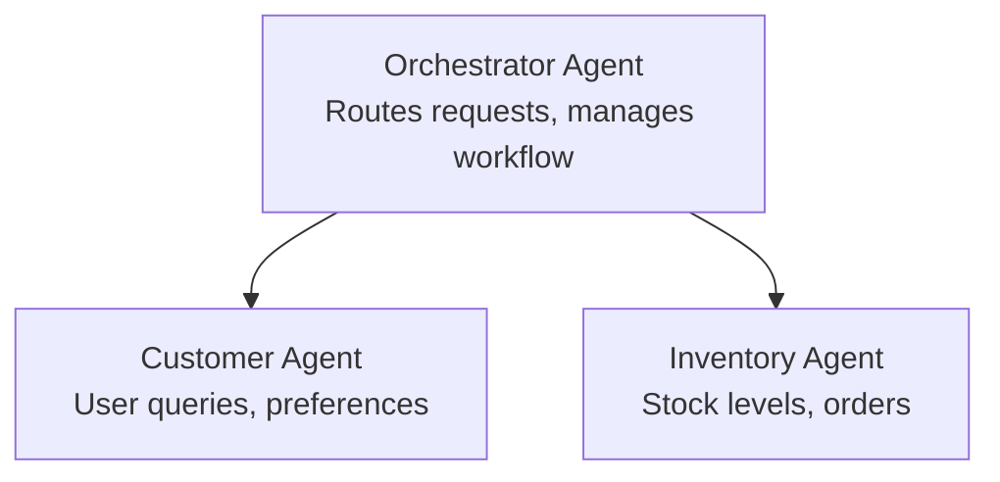

# Chương 5: Giải pháp AI đa tác nhân

**📚 Khóa học**: [AZD Cho Người Mới Bắt Đầu](../../README.md) | **⏱️ Thời gian**: 2-3 giờ | **⭐ Mức độ**: Nâng cao

---

## Tổng quan

Chương này bao gồm các mẫu kiến trúc đa tác nhân nâng cao, điều phối tác nhân, và triển khai AI sẵn sàng sản xuất cho các kịch bản phức tạp.

> Hướng dẫn lệnh đã được xem xét đối chiếu với tham chiếu `azd 1.37.2` đã phát hành. Việc triển khai trên đám mây không được thực hiện.

## Mục tiêu học tập

Sau khi hoàn thành chương này, bạn sẽ:
- Hiểu các mẫu kiến trúc đa tác nhân
- Triển khai hệ thống tác nhân AI phối hợp
- Thực hiện giao tiếp giữa các tác nhân
- Xây dựng các giải pháp đa tác nhân sẵn sàng cho sản xuất

---

## 📚 Các bài học

| # | Bài học | Mô tả | Thời gian |
|---|--------|-------------|------|
| 1 | [Cơ bản về đa tác nhân](multi-agent-basics.md) | Thực hành: triển khai ứng dụng đa tác nhân hoạt động với `azd up` | 45 phút |
| 2 | [Mẫu Điều phối](../chapter-06-pre-deployment/coordination-patterns.md) | Chiến lược điều phối tác nhân (tiếp tục trong Chương 6) | 30 phút |
| 3 | [Triển khai ARM Template](../../examples/retail-multiagent-arm-template/README.md) | Ví dụ triển khai một lần nhấp | 30 phút |

> **Bắt đầu với Bài học 1.** Đây là bài học duy nhất hoàn toàn thực hành và có thể triển khai trong chương này. Bài học 2 nằm trong Chương 6 (chia sẻ với kế hoạch tiền triển khai), và [Giải pháp đa tác nhân bán lẻ](../../examples/retail-scenario.md) là một bản thiết kế kiến trúc — tài liệu tham khảo thiết kế, không phải mẫu lệnh một cú nhấp.

---

## 🚀 Bắt đầu nhanh

```bash
# Option 1: Deploy the multi-agent template used in Lesson 1
azd init --template Azure-Samples/contoso-creative-writer .
azd up

# Option 2: Initialize a Foundry agent interactively (requires azure.ai.agents)
azd extension install azure.ai.agents
azd ai agent init
azd up
```

> **Phương pháp nào?** Dùng `azd init --template` để bắt đầu từ mẫu hoạt động. Dùng `azd ai agent init` tương tác, hoặc `azd ai agent init --template <path-to-azure.yaml>` để áp dụng dự án tác nhân hiện tại. Xem [tham chiếu AZD AI CLI](../chapter-08-production/production-ai-practices.md#azd-ai-cli-commands-and-extensions) để biết yêu cầu phiên bản và di chuyển đánh giá.

Chạy các lựa chọn này trong các thư mục trống riêng biệt. Tiện ích mở rộng tác nhân `1.0.0-beta.23` yêu cầu `azd >= 1.37.0`; luồng tương tác của nó không tạo ra pipeline Service Bus tùy chỉnh trong bài học điều phối.

---

## 🤖 Kiến trúc đa tác nhân



---

## 🎯 Giải pháp tiêu biểu: Đa tác nhân bán lẻ

Giải pháp [Multi-Agent Bán Lẻ](../../examples/retail-scenario.md) trình bày:

- **Đại lý Khách hàng**: Xử lý tương tác và sở thích của người dùng
- **Đại lý Hàng tồn kho**: Quản lý kho và xử lý đơn hàng
- **Điều phối viên**: Điều phối giữa các đại lý
- **Bộ nhớ dùng chung**: Quản lý ngữ cảnh giữa các đại lý

### Các Dịch vụ Được Sử dụng

| Dịch vụ | Mục đích |
|---------|---------|
| Mô hình Microsoft Foundry | Hiểu ngôn ngữ |
| Azure AI Search | Danh mục sản phẩm |
| Cosmos DB | Trạng thái và bộ nhớ đại lý |
| Container Apps | Lưu trữ đại lý |
| Application Insights | Giám sát |

---

## 🔗 Điều hướng

| Hướng | Chương |
|-----------|---------|
| **Trước** | [Chương 4: Hạ tầng](../chapter-04-infrastructure/README.md) |
| **Tiếp theo** | [Chương 6: Tiền Triển khai](../chapter-06-pre-deployment/README.md) |

---

## 📖 Tài nguyên Liên quan

- [Hướng dẫn Đại lý AI](../chapter-02-ai-development/agents.md)
- [Thực hành AI trong Sản xuất](../chapter-08-production/production-ai-practices.md)
- [Khắc phục sự cố AI](../chapter-07-troubleshooting/ai-troubleshooting.md)

---

<!-- CO-OP TRANSLATOR DISCLAIMER START -->
**Tuyên bố miễn trừ trách nhiệm**:
Tài liệu này đã được dịch bằng dịch vụ dịch thuật AI [Co-op Translator](https://github.com/Azure/co-op-translator). Mặc dù chúng tôi cố gắng đảm bảo độ chính xác, xin lưu ý rằng bản dịch tự động có thể chứa lỗi hoặc sai sót. Tài liệu gốc bằng ngôn ngữ gốc nên được coi là nguồn tin chính thức. Đối với thông tin quan trọng, nên sử dụng dịch vụ dịch thuật chuyên nghiệp bởi con người. Chúng tôi không chịu trách nhiệm về bất kỳ hiểu lầm hoặc giải thích sai nào phát sinh từ việc sử dụng bản dịch này.
<!-- CO-OP TRANSLATOR DISCLAIMER END -->