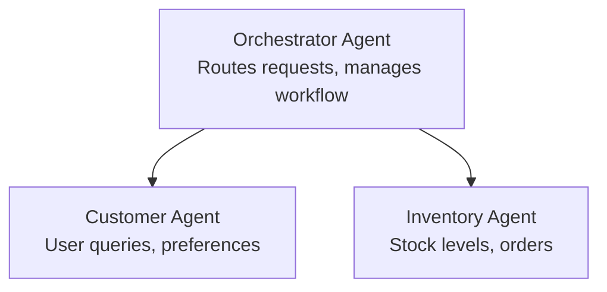

# Chương 5: Giải pháp AI đa tác nhân

**📚 Khóa học**: [AZD Cho Người Mới Bắt Đầu](../../README.md) | **⏱️ Thời lượng**: 2-3 giờ | **⭐ Độ phức tạp**: Nâng cao

---

## Tổng quan

Chương này bao gồm các mẫu kiến trúc đa tác nhân nâng cao, phối hợp tác nhân và triển khai AI sẵn sàng cho môi trường sản xuất trong các kịch bản phức tạp.

> Hướng dẫn lệnh được xem xét dựa trên tham chiếu `azd 1.37.2` đã phát hành. Việc triển khai đám mây chưa được thực hiện.

## Mục tiêu học tập

Hoàn thành chương này, bạn sẽ:
- Hiểu các mẫu kiến trúc đa tác nhân
- Triển khai hệ thống tác nhân AI phối hợp
- Thực hiện giao tiếp giữa các tác nhân
- Xây dựng giải pháp đa tác nhân sẵn sàng cho môi trường sản xuất

---

## 📚 Các bài học

| # | Bài học | Mô tả | Thời gian |
|---|--------|-------------|------|
| 1 | [Cơ bản đa tác nhân](multi-agent-basics.md) | Thực hành: triển khai ứng dụng đa tác nhân hoạt động với `azd up` | 45 phút |
| 2 | [Mẫu phối hợp](../chapter-06-pre-deployment/coordination-patterns.md) | Chiến lược điều phối tác nhân (tiếp tục trong Chương 6) | 30 phút |
| 3 | [Triển khai Mẫu ARM](../../examples/retail-multiagent-arm-template/README.md) | Ví dụ triển khai một cú nhấp chuột | 30 phút |

> **Bắt đầu với Bài học 1.** Đây là bài học duy nhất có thực hành đầy đủ và có thể triển khai trong chương này. Bài học 2 nằm trong Chương 6 (chia sẻ với kế hoạch tiền triển khai), và [Giải pháp đa tác nhân bán lẻ](../../examples/retail-scenario.md) là bản thiết kế kiến trúc — một tài liệu tham khảo thiết kế, không phải mẫu lệnh một cú nhấp.

---

## 🚀 Bắt đầu nhanh

```bash
# Option 1: Deploy the multi-agent template used in Lesson 1
azd init --template Azure-Samples/contoso-creative-writer .
azd up

# Option 2: Initialize a Foundry agent interactively with the GA bundle
azd ext install microsoft.foundry
azd ai agent init
azd up
```

> **Phương pháp nào?** Sử dụng `azd init --template` để bắt đầu từ một mẫu hoạt động. Dùng `azd ai agent init` tương tác, hoặc `azd ai agent init --template <path-to-azure.yaml>` để áp dụng dự án tác nhân hiện có. Xem [tham chiếu AZD AI CLI](../chapter-08-production/production-ai-practices.md#azd-ai-cli-commands-and-extensions) để biết yêu cầu phiên bản và di chuyển đánh giá.

Chạy các lựa chọn này trong các thư mục trống riêng biệt. Quy trình làm việc GA Foundry cần `azd >= 1.37.0`; quy trình tương tác không tạo ra pipeline Service Bus tùy chỉnh trong bài học phối hợp. Để kiểm thử cục bộ, triển khai mã và dọn dẹp dự án mới so với tái sử dụng, hãy làm theo [hướng dẫn agent được lưu trữ](../chapter-02-ai-development/microsoft-foundry-integration.md#hosted-agent-walkthrough-ga).

---

## 🤖 Kiến trúc đa tác nhân



---

## 🎯 Giải pháp tiêu biểu: đa tác nhân bán lẻ

Giải pháp [Đa tác nhân Bán lẻ](../../examples/retail-scenario.md) trình bày:

- **Tác nhân Khách hàng**: Xử lý tương tác và sở thích của người dùng
- **Tác nhân Tồn kho**: Quản lý kho hàng và xử lý đơn đặt hàng
- **Người Điều phối**: Phối hợp giữa các tác nhân
- **Bộ nhớ Chung**: Quản lý bối cảnh giữa các tác nhân

### Các dịch vụ sử dụng

| Dịch vụ | Mục đích |
|---------|---------|
| Microsoft Foundry Models | Hiểu ngôn ngữ |
| Azure AI Search | Danh mục sản phẩm |
| Cosmos DB | Trạng thái và bộ nhớ tác nhân |
| Container Apps | Lưu trữ tác nhân |
| Application Insights | Giám sát |

---

## 🔗 Điều hướng

| Hướng | Chương |
|-----------|---------|
| **Trước** | [Chương 4: Cơ sở hạ tầng](../chapter-04-infrastructure/README.md) |
| **Tiếp theo** | [Chương 6: Trước khi Triển khai](../chapter-06-pre-deployment/README.md) |

---

## 📖 Tài nguyên liên quan

- [Hướng dẫn Tác nhân AI](../chapter-02-ai-development/agents.md)
- [Thực hành AI trong Sản xuất](../chapter-08-production/production-ai-practices.md)
- [Xử lý sự cố AI](../chapter-07-troubleshooting/ai-troubleshooting.md)

---

<!-- CO-OP TRANSLATOR DISCLAIMER START -->
**Tuyên bố miễn trừ trách nhiệm**:
Tài liệu này đã được dịch bằng dịch vụ dịch thuật AI [Co-op Translator](https://github.com/Azure/co-op-translator). Mặc dù chúng tôi cố gắng đảm bảo độ chính xác, xin lưu ý rằng bản dịch tự động có thể chứa lỗi hoặc sai sót. Tài liệu gốc bằng ngôn ngữ gốc nên được coi là nguồn tin chính thức. Đối với thông tin quan trọng, nên sử dụng dịch vụ dịch thuật chuyên nghiệp bởi con người. Chúng tôi không chịu trách nhiệm về bất kỳ hiểu lầm hoặc giải thích sai nào phát sinh từ việc sử dụng bản dịch này.
<!-- CO-OP TRANSLATOR DISCLAIMER END -->