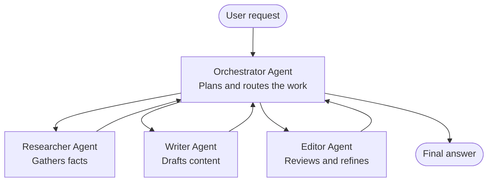

# Những Kiến Thức Cơ Bản về Hệ Thống Đa Tác Nhân - Triển Khai Hệ Thống AI Phối Hợp Đầu Tiên của Bạn

**Điều Hướng Chương:**
- **📚 Trang Chủ Khóa Học**: [AZD Cho Người Mới Bắt Đầu](../../README.md)
- **📖 Chương Hiện Tại**: Chương 5 - Giải Pháp AI Đa Tác Nhân
- **⬅️ Trước**: [Chương 4: Hạ Tầng](../chapter-04-infrastructure/README.md)
- **➡️ Tiếp**: [Mô Hình Phối Hợp](../chapter-06-pre-deployment/coordination-patterns.md)

> Hướng dẫn lệnh được kiểm tra so với tài liệu tham khảo `azd 1.37.2` đã công bố. Việc triển khai trên đám mây chưa được thực hiện.

## Giới Thiệu

Trong các chương trước, bạn đã triển khai một ứng dụng đơn lẻ—và trong Chương 2 bạn đã triển khai một tác nhân AI đơn lẻ. Bài học này sẽ đưa bạn bước tiếp theo: triển khai một **hệ thống đa tác nhân**, trong đó nhiều tác nhân chuyên biệt phối hợp giải quyết một vấn đề mà một tác nhân đơn lẻ không thể làm tốt một mình.

Tin vui cho người mới bắt đầu: **bạn không cần lệnh mới.** Giải pháp đa tác nhân vẫn là một dự án azd. Bạn sẽ `azd init`, `azd up`, kiểm tra, và `azd down`—chính xác quy trình làm việc mà bạn đã biết. Thay đổi chỉ là *hình dạng* của ứng dụng bên trong.

## Mục Tiêu Học Tập

Sau bài học này, bạn sẽ:
- Hiểu ý nghĩa "đa tác nhân" là gì và khi nào nên dùng nó dù có phức tạp hơn
- Nhận biết các vai trò phổ biến trong hệ thống đa tác nhân (điều phối viên + chuyên gia)
- Triển khai một mẫu đa tác nhân thực tế hoạt động với `azd up`
- Hiểu các tài nguyên Azure hỗ trợ ứng dụng đa tác nhân
- Biết cách kiểm tra, tùy chỉnh và dọn dẹp giải pháp an toàn

## Kết Quả Học Tập

Sau khi hoàn thành bài học, bạn sẽ có khả năng:
- Giải thích sự khác biệt giữa tác nhân đơn lẻ và hệ thống đa tác nhân
- Lựa chọn giữa tác nhân đơn với công cụ và thiết kế đa tác nhân thực thụ
- Triển khai và thử nghiệm mẫu đa tác nhân từ đầu đến cuối với azd
- Xác định vị trí chạy của từng tác nhân và cách chúng giao tiếp
- Dọn sạch tất cả tài nguyên để tránh chi phí tiếp tục phát sinh

---

## Hệ Thống Đa Tác Nhân Là Gì?

Một tác nhân AI đơn lẻ là một mô hình với tập hướng dẫn và (tuỳ chọn) một số công cụ. Nó hoạt động tốt cho các nhiệm vụ tập trung. Nhưng khi một nhiệm vụ mở rộng—nghiên cứu, rồi viết, rồi hiệu đính, rồi kiểm tra sự thật—nhồi nhét mọi thứ vào một lời nhắc khiến tác nhân chậm hơn, kém ổn định và khó gỡ lỗi hơn.

Một **hệ thống đa tác nhân** chia công việc thành các chuyên gia mỗi người làm tốt một việc, phối hợp bởi một điều phối viên:



### Hai vai trò bạn luôn thấy

| Vai Trò | Công Việc | Ví Dụ |
|------|-----|---------|
| **Điều phối viên** | Quyết định *chuyện gì tiếp theo* và điều phối công việc giữa các tác nhân | "Trước nghiên cứu, rồi viết, rồi hiệu đính" |
| **Chuyên gia** | Làm tốt một công việc tập trung và trả lại kết quả | Một "nhà nghiên cứu" chỉ thu thập dữ liệu |

### Liệu bạn có thực sự cần nhiều tác nhân?

Bắt đầu đơn giản. Chỉ sử dụng đa tác nhân **khi nào** những điều sau đây đúng:

- ✅ Nhiệm vụ có **các giai đoạn riêng biệt** cần hướng dẫn khác nhau (nghiên cứu, viết, hiệu đính)
- ✅ Bạn muốn các chuyên gia chạy **đồng thời** để tiết kiệm thời gian
- ✅ Các bước khác nhau cần **công cụ hoặc nguồn dữ liệu khác nhau**
- ✅ Bạn cần mỗi bước **có thể kiểm tra và gỡ lỗi độc lập**

Nếu nhiệm vụ của bạn là hỏi đáp đơn hoặc gọi công cụ đơn giản, **tác nhân đơn với công cụ** (Chương 2) đơn giản hơn, rẻ hơn và dễ vận hành hơn.

> **Mẹo cho người mới:** "Nhiều tác nhân" không hẳn "tốt hơn." Mỗi tác nhân thêm độ trễ, chi phí và một phần cần giám sát mới. Chỉ thêm tác nhân khi vấn đề rõ ràng chia thành phần.

---

## Hai Cách Xây Dựng Đa Tác Nhân trên Azure

| Cách Tiếp Cận | Là Gì | Phù Hợp Với |
|----------|-----------|----------|
| **Tác nhân đơn + công cụ** | Một tác nhân Foundry gọi hàm/công cụ | Quy trình đơn giản, bắt đầu dễ dàng |
| **Nhiều tác nhân phối hợp** | Nhiều tác nhân với một điều phối viên | Các giai đoạn riêng biệt, công việc song song, chuyên môn hóa |

Bài học này tập trung vào cách thứ hai dùng **mẫu có sẵn**, để bạn xem hệ thống đa tác nhân thật sự hoạt động trước khi tự xây dựng.

---

## Thực Hành: Triển Khai Ứng Dụng Đa Tác Nhân Hoạt Động

Chúng ta sẽ triển khai **Contoso Creative Writer**, một mẫu chính thức của Azure điều phối các tác nhân nghiên cứu, sản phẩm, viết và hiệu đính để tạo ra một bài báo. Trước khi bắt đầu, hãy kiểm tra [yêu cầu và chi phí của mẫu này](https://github.com/Azure-Samples/contoso-creative-writer#azure-account-requirements): nó cần hạn mức mô hình, Azure AI Search, quyền truy cập Bing Grounding, Python, Docker và các hook tương thích Bash. Mô hình và vùng có sẵn phụ thuộc đăng ký của bạn; việc triển khai không được đảm bảo chỉ vì chọn vùng cụ thể.

### Bước 1: Khởi tạo mẫu

```bash
# Create a working folder
mkdir creative-writer && cd creative-writer

# Initialize from the official multi-agent template
azd init --template Azure-Samples/contoso-creative-writer .
```

> Khi nào cũng có thể duyệt thêm các mẫu đa tác nhân khác trong [bộ sưu tập AZD AI tuyệt vời](https://azure.github.io/awesome-azd/?tags=ai). Các lựa chọn thân thiện với người mới khác bao gồm `get-started-with-ai-agents` và `azure-ai-travel-agents`.

### Bước 2: Xác thực

```bash
# Required for azd workflows
azd auth login

# Also required by this sample's Azure CLI hooks
az login
```

### Bước 3: Kiểm tra môi trường

```bash
# init normally creates/selects an environment; confirm it before proceeding
azd env list
# Only if you need an additional environment:
# azd env new dev
```

### Bước 4: Xem trước, rồi triển khai

```bash
# See what will be created before spending anything (recommended)
azd provision --preview

# Provision infrastructure and deploy all agents in one step
azd up
```

`azd up` sẽ hỏi các cài đặt đăng ký và vùng thiếu, rồi cấp phát tài nguyên và triển khai ứng dụng. Xem trước không giữ hạn mức hoặc đảm bảo thành công; các hook mẫu có thể chạy trong xem trước cấp phát, nên hãy kiểm tra trước. Để kéo dài thời gian azd đợi cho mỗi **triển khai dịch vụ** (không phải cấp phát mô hình):

```bash
azd deploy --timeout 1800
```

Giới hạn thời gian ngừng azd đợi; nó không huỷ triển khai trên Azure. Kiểm tra trạng thái tài nguyên trước khi thử lại.

> **Lưu ý về chi phí và dung lượng:** Ứng dụng đa tác nhân triển khai mô hình AI sử dụng hạn mức và phát sinh chi phí. Nếu `azd up` báo lỗi hạn mức mô hình, hãy xem [Khắc phục sự cố AI](../chapter-07-troubleshooting/ai-troubleshooting.md) để xử lý vùng và hạn mức, cùng Chương 6 [Kế hoạch Dung lượng](../chapter-06-pre-deployment/capacity-planning.md).

---

## Hiểu Về Những Gì Bạn Đã Triển Khai

Một ứng dụng đa tác nhân điển hình như thế này cấp phát một tập hợp tài nguyên Azure tương ứng trực tiếp với các trách nhiệm trong sơ đồ trên:

| Tài Nguyên | Lý Do Có Mặt |
|----------|----------------|
| **Microsoft Foundry / Mô hình** | Lưu trữ các mô hình ngôn ngữ mà mỗi tác nhân dùng |
| **Azure AI Search** | Cung cấp dữ liệu nền để tác nhân nghiên cứu tìm kiếm |
| **Container Apps** (hoặc App Service) | Lưu trữ mã điều phối viên và các tác nhân |
| **Cosmos DB** (trong một số mẫu) | Lưu trữ trạng thái/chia sẻ bộ nhớ giữa các tác nhân |
| **Application Insights** | Theo dõi các yêu cầu *giữa* các tác nhân để bạn gỡ lỗi dòng chảy |

### Cách các tác nhân giao tiếp với nhau

Trong hầu hết các mẫu đa tác nhân azd, **điều phối viên chạy trong mã ứng dụng của bạn** (ví dụ, sử dụng khung như Semantic Kernel hoặc Microsoft Agent Framework). Điều phối viên gọi từng tác nhân chuyên gia lần lượt, truyền kết quả, và tập hợp câu trả lời cuối cùng. Các tác nhân chia sẻ ngữ cảnh qua:

- **Cuộc gọi hàm/công cụ** — điều phối viên gọi chuyên gia và nhận kết quả
- **Bộ nhớ chia sẻ** — cơ sở dữ liệu (thường là Cosmos DB) giữ trạng thái mà hai tác nhân có thể đọc
- **Tin nhắn/sự kiện** — để kết nối lỏng hơn, các tác nhân giao tiếp qua hàng đợi hoặc Service Bus

> **Tại sao điều này quan trọng cho gỡ lỗi:** vì mỗi bước riêng biệt, Application Insights cho bạn biết *tác nhân nào* chậm hoặc lỗi. Đây là lý do chính để phân chia công việc giữa các tác nhân ngay từ đầu.

---

## Kiểm tra Triển Khai

Xác nhận hệ thống hoạt động thực sự trước khi tiếp tục:

```bash
# Show the deployed endpoints
azd show

# Open the app's monitoring dashboard
azd monitor

# Open Application Insights Logs (not a terminal log stream)
azd monitor --logs
```

Sau đó mở URL ứng dụng từ `azd show` và yêu cầu một bài báo ngắn. Dùng chế độ gỡ lỗi của mẫu để xem quy trình tác nhân. Tìm kiếm giao dịch trong Application Insights chỉ hiển thị các bước riêng lẻ nếu mẫu đã tích hợp và kết nối; azd không tự động thêm span tác nhân.

**Tiêu chí thành công:**
- ✅ `azd show` liệt kê một điểm cuối có thể truy cập
- ✅ Một yêu cầu tạo ra kết quả rõ ràng đã qua nhiều giai đoạn
- ✅ Chế độ gỡ lỗi hiển thị nhiều bước tác nhân; nếu bật theo dõi, xác nhận dữ liệu tương ứng sau khi được xử lý

---

## Tùy chỉnh: Thêm hoặc Điều Chỉnh Tác Nhân

Vì mỗi tác nhân chỉ là tập hướng dẫn cộng với công cụ, việc tùy chỉnh rất dễ tiếp cận:

1. **Tìm định nghĩa tác nhân** trong mẫu (thường là tập các tệp `prompts/`, `agents/`, hoặc `*.prompty`).
2. **Điều chỉnh hướng dẫn của một tác nhân** — ví dụ, bảo tác nhân biên tập áp dụng tông hoặc số lượng từ cụ thể.
3. **Chỉ triển khai lại mã** (hạ tầng không đổi):

   ```bash
   azd deploy
   ```

Để phát triển thêm với dự án tác nhân Foundry *của riêng bạn*, dùng gói GA với AZD 1.37.0+ trong thư mục trống riêng biệt:

```bash
azd ext install microsoft.foundry
azd ai agent init
azd up
azd ai agent invoke      # test, with response timing
```

Xem hướng dẫn [GA hosted-agent](../chapter-02-ai-development/microsoft-foundry-integration.md#hosted-agent-walkthrough-ga) để thử nghiệm Agent Inspector cục bộ, triển khai mã từ xa và dọn dẹp quyền sở hữu. Tham khảo [Tham chiếu AZD AI CLI](../chapter-08-production/production-ai-practices.md#azd-ai-cli-commands-and-extensions) cũng đề cập tới đánh giá riêng rẽ, tối ưu và xoá tác nhân.

---

## Dọn Dẹp

Ứng dụng đa tác nhân chạy nhiều dịch vụ tính phí. Hãy dọn sạch mọi thứ khi bạn xong:

```bash
# Review the resources and confirm deletion interactively
azd down
```

Việc xoá là thao tác phá hủy. Với phòng thí nghiệm dùng một lần, `azd down --force --purge` bỏ qua xác nhận xoá mềm và dọn dẹp; dọn sạch là không thể đảo ngược và có thể bị chặn bởi bảo vệ xoá. Xoá mềm liên quan đến phục hồi/tái sử dụng tên, không phải bằng chứng về chi phí tiếp tục. Kiểm tra tài nguyên còn giữ lại và hóa đơn sau khi dọn dẹp.

Nếu bạn cũng đã khởi tạo tác nhân hosted liên kết với dự án Foundry có sẵn, `azd down` sẽ giữ lại tác nhân và các tài nguyên khác của dự án đó. Chỉ xoá các tài nguyên không mong muốn mà bạn sở hữu riêng. Với dự án Foundry mới được tạo bởi môi trường AZD, `azd down` xoá nhóm tài nguyên và tất cả mọi thứ bên trong.

---

## Một Lưu Ý Về Hệ Thống Đa Tác Nhân Trong Sản Xuất

Giải pháp [Retail Multi-Agent Solution](../../examples/retail-scenario.md) trong kho này là một **bản thiết kế kiến trúc**, không phải là mẫu lệnh một cú click—nó ghi lại cách một hệ thống bán lẻ sản xuất *sẽ* được xây dựng (và rõ ràng rằng việc xây dựng đầy đủ là một nỗ lực lớn). Hãy sử dụng nó làm tài liệu tham khảo thiết kế *sau khi* bạn đã triển khai một mẫu hoạt động ở đây. Đối với các vấn đề sản xuất (tính chịu lỗi, chi phí, giám sát, quản trị), tiếp tục theo dõi [Chương 8: Thực hành AI trong sản xuất](../chapter-08-production/production-ai-practices.md).

---

## Tóm tắt

- Hệ thống đa tác tử phân chia công việc qua các chuyên gia được điều phối bởi một bộ điều hành.
- Chỉ sử dụng khi nhiệm vụ có các giai đoạn riêng biệt, song song, hoặc các công cụ khác nhau cho mỗi bước—nếu không thì nên dùng một tác tử duy nhất.
- Quy trình azd không thay đổi: `azd init` → `azd up` → kiểm thử → `azd down`.
- Một mẫu thực sự như `contoso-creative-writer` cho phép bạn thấy và tùy chỉnh được một ứng dụng đa tác tử hoạt động ngay hôm nay.
- Theo dõi Application Insights trên các tác tử là một trong những lợi ích thiết thực lớn nhất của thiết kế đa tác tử.

---

## 🔗 Điều hướng

| Hướng đi | Bài học |
|-----------|--------|
| **Trước** | [Chương 4: Hạ tầng](../chapter-04-infrastructure/README.md) |
| **Tiếp theo** | [Mẫu điều phối](../chapter-06-pre-deployment/coordination-patterns.md) |

## 📖 Tài nguyên liên quan

- [Hướng dẫn AI Agents](../chapter-02-ai-development/agents.md)
- [Mẫu điều phối](../chapter-06-pre-deployment/coordination-patterns.md)
- [Thực hành AI trong sản xuất](../chapter-08-production/production-ai-practices.md)
- [Khắc phục sự cố AI](../chapter-07-troubleshooting/ai-troubleshooting.md)

---

<!-- CO-OP TRANSLATOR DISCLAIMER START -->
**Tuyên bố miễn trừ trách nhiệm**:
Tài liệu này đã được dịch bằng dịch vụ dịch thuật AI [Co-op Translator](https://github.com/Azure/co-op-translator). Mặc dù chúng tôi cố gắng đảm bảo độ chính xác, xin lưu ý rằng bản dịch tự động có thể chứa lỗi hoặc sai sót. Tài liệu gốc bằng ngôn ngữ gốc nên được coi là nguồn tin chính thức. Đối với thông tin quan trọng, nên sử dụng dịch vụ dịch thuật chuyên nghiệp bởi con người. Chúng tôi không chịu trách nhiệm về bất kỳ hiểu lầm hoặc giải thích sai nào phát sinh từ việc sử dụng bản dịch này.
<!-- CO-OP TRANSLATOR DISCLAIMER END -->