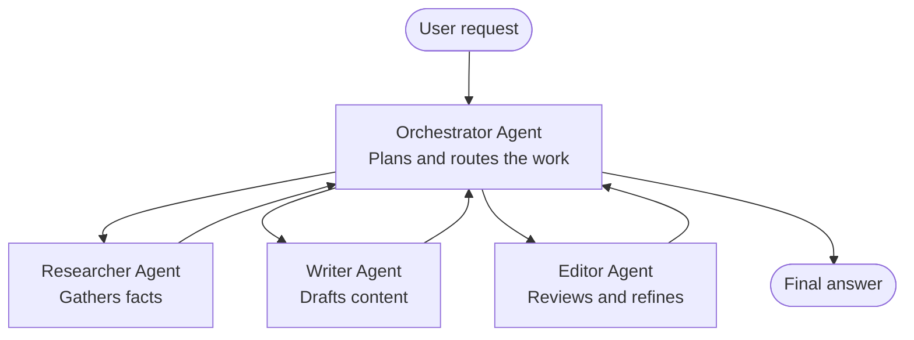

# Kiến Thức Cơ Bản về Hệ Thống Đa Tác Nhân - Triển Khai Hệ Thống AI Phối Hợp Đầu Tiên của Bạn

**Điều Hướng Chương:**
- **📚 Trang Khóa Học**: [AZD Cho Người Mới Bắt Đầu](../../README.md)
- **📖 Chương Hiện Tại**: Chương 5 - Giải Pháp AI Đa Tác Nhân
- **⬅️ Trước**: [Chương 4: Hạ Tầng](../chapter-04-infrastructure/README.md)
- **➡️ Tiếp**: [Mẫu Phối Hợp](../chapter-06-pre-deployment/coordination-patterns.md)

> Hướng dẫn lệnh được rà soát dựa trên tham chiếu `azd 1.37.2` đã phát hành. Triển khai trên đám mây chưa được thực hiện.

## Giới thiệu

Trong các chương trước, bạn đã triển khai một ứng dụng đơn—và trong Chương 2 bạn đã triển khai một tác nhân AI đơn lẻ. Bài học này đi bước tiếp theo: triển khai một **hệ thống đa tác nhân**, nơi nhiều tác nhân chuyên môn cùng phối hợp giải quyết một vấn đề mà một tác nhân đơn không thể xử lý tốt một mình.

Tin vui cho người mới: **bạn không cần lệnh mới nào.** Một giải pháp đa tác nhân vẫn là một dự án azd. Bạn sẽ `azd init`, `azd up`, kiểm thử, và `azd down`—chính là quy trình bạn đã biết. Điều thay đổi là *hình dạng* của ứng dụng bên trong.

## Mục Tiêu Học Tập

Đến cuối bài học này, bạn sẽ:
- Hiểu "đa tác nhân" nghĩa là gì và khi nào nó xứng đáng với độ phức tạp thêm
- Nhận biết các vai trò phổ biến trong hệ thống đa tác nhân (điều phối viên + chuyên gia)
- Triển khai mẫu đa tác nhân thực tế, hoạt động dùng `azd up`
- Hiểu các tài nguyên Azure hỗ trợ một ứng dụng đa tác nhân
- Biết cách xác minh, tùy chỉnh, và gỡ bỏ giải pháp một cách an toàn

## Kết Quả Học Tập

Sau khi hoàn thành bài học, bạn sẽ có thể:
- Giải thích sự khác biệt giữa một tác nhân đơn và một hệ thống đa tác nhân
- Chọn giữa một tác nhân đơn với công cụ và một thiết kế đa tác nhân thực thụ
- Triển khai và kiểm thử mẫu đa tác nhân đầu cuối bằng azd
- Xác định nơi mỗi tác nhân chạy và cách chúng giao tiếp
- Dọn dẹp mọi tài nguyên để tránh phát sinh phí liên tục

---

## Hệ Thống Đa Tác Nhân Là Gì?

Một tác nhân AI đơn là một mô hình với tập lệnh và (tùy chọn) một số công cụ. Điều đó hoạt động tốt với các nhiệm vụ tập trung. Nhưng khi nhiệm vụ lớn lên—nghiên cứu, rồi viết, rồi biên tập, rồi kiểm tra sự thật—nhồi nhét mọi thứ vào một lời nhắc làm tác nhân chậm hơn, kém tin cậy hơn, và khó gỡ lỗi hơn.

Một **hệ thống đa tác nhân** chia công việc thành những chuyên gia mỗi người làm tốt một việc, được điều phối bởi một điều phối viên:



### Hai vai trò bạn luôn thấy

| Vai trò | Công việc | Ví dụ |
|------|-----|---------|
| **Điều phối viên** | Quyết định *việc tiếp theo* và phân phối công việc giữa các tác nhân | "Đầu tiên nghiên cứu, rồi viết, rồi chỉnh sửa" |
| **Chuyên gia** | Làm một công việc chuyên sâu và trả kết quả | Một "nhà nghiên cứu" chỉ tìm kiếm thông tin |

### Liệu bạn có thật sự cần nhiều tác nhân?

Bắt đầu đơn giản. Hãy dùng đa tác nhân **chỉ khi** một trong các điều sau đúng:

- ✅ Nhiệm vụ có **các giai đoạn riêng biệt** hưởng lợi từ chỉ dẫn khác nhau (nghiên cứu vs. viết vs. xem xét)
- ✅ Bạn muốn các chuyên gia chạy **cùng lúc** để tiết kiệm thời gian
- ✅ Các bước khác nhau cần **công cụ hoặc nguồn dữ liệu khác nhau**
- ✅ Bạn cần mỗi bước **có thể kiểm thử và gỡ lỗi độc lập**

Nếu nhiệm vụ của bạn là một câu hỏi-trả lời đơn hoặc gọi công cụ đơn giản, một **tác nhân đơn với công cụ** (Chương 2) đơn giản hơn, rẻ hơn và dễ vận hành hơn.

> **Mẹo cho người mới:** "Nhiều tác nhân hơn" không phải là "tốt hơn." Mỗi tác nhân thêm độ trễ, chi phí, và một món cần giám sát mới. Chỉ thêm tác nhân khi vấn đề rõ ràng chia thành các phần.

---

## Hai Cách Xây Hệ Thống Đa Tác Nhân trên Azure

| Phương pháp | Là gì | Phù hợp với |
|----------|-----------|----------|
| **Tác nhân đơn + công cụ** | Một tác nhân Foundry gọi hàm/công cụ | Quy trình đơn giản, mới bắt đầu |
| **Nhiều tác nhân phối hợp** | Vài tác nhân với một điều phối viên | Các giai đoạn riêng biệt, làm việc song song, chuyên môn hóa |

Bài học này tập trung vào phương pháp thứ hai sử dụng **mẫu sẵn có**, để bạn có thể thấy một hệ thống đa tác nhân thực chạy trước khi tự xây.

---

## Thực Hành: Triển Khai Ứng Dụng Đa Tác Nhân Hoạt Động

Chúng ta sẽ triển khai **Contoso Creative Writer**, một mẫu Azure chính thức điều phối các tác nhân nghiên cứu, sản phẩm, viết, và biên tập để tạo ra bài báo. Trước khi tiến hành, kiểm tra [yêu cầu và chi phí mẫu](https://github.com/Azure-Samples/contoso-creative-writer#azure-account-requirements): nó cần hạn mức mô hình, Azure AI Search, quyền truy cập Bing Grounding, Python, Docker và các hook tương thích Bash. Sự khả dụng mô hình và khu vực tùy thuộc gói đăng ký của bạn; lựa chọn khu vực không đảm bảo triển khai thành công.

### Bước 1: Khởi tạo mẫu

```bash
# Create a working folder
mkdir creative-writer && cd creative-writer

# Initialize from the official multi-agent template
azd init --template Azure-Samples/contoso-creative-writer .
```

> Xem thêm các mẫu đa tác nhân bất cứ lúc nào trong [Bộ sưu tập AZD AI tuyệt vời](https://azure.github.io/awesome-azd/?tags=ai). Các tùy chọn thân thiện với người mới khác bao gồm `get-started-with-ai-agents` và `azure-ai-travel-agents`.

### Bước 2: Xác thực

```bash
# Required for azd workflows
azd auth login

# Also required by this sample's Azure CLI hooks
az login
```

### Bước 3: Kiểm tra môi trường

```bash
# init normally creates/selects an environment; confirm it before proceeding
azd env list
# Only if you need an additional environment:
# azd env new dev
```

### Bước 4: Xem trước, rồi triển khai

```bash
# See what will be created before spending anything (recommended)
azd provision --preview

# Provision infrastructure and deploy all agents in one step
azd up
```

`azd up` sẽ hỏi các cài đặt đăng ký và khu vực còn thiếu, rồi cấp phát tài nguyên và triển khai ứng dụng. Xem trước không giữ quota hay đảm bảo thành công; hook mẫu vẫn có thể chạy trong khi xem trước cấp phát, nên kiểm tra chúng trước. Để kéo dài thời gian chờ azd cho mỗi **triển khai dịch vụ** (không phải cấp phát mô hình):

```bash
azd deploy --timeout 1800
```

Một thời gian chờ sẽ dừng azd chờ đợi; nó không hủy triển khai trong Azure. Kiểm tra trạng thái tài nguyên trước khi thử lại.

> **Lưu ý về chi phí và dung lượng:** Ứng dụng đa tác nhân triển khai mô hình AI tiêu thụ quota và phát sinh chi phí. Nếu `azd up` gặp lỗi về quota mô hình, xem phần [Khắc phục sự cố AI](../chapter-07-troubleshooting/ai-troubleshooting.md) để sửa khu vực và quota, và Chương 6 [Lập kế hoạch dung lượng](../chapter-06-pre-deployment/capacity-planning.md).

---

## Hiểu Những Gì Bạn Đã Triển Khai

Một ứng dụng đa tác nhân điển hình như thế này cấp phát một bộ tài nguyên Azure tương ứng trực tiếp với các trách nhiệm trong sơ đồ trên:

| Tài nguyên | Tại sao nó ở đó |
|----------|----------------|
| **Microsoft Foundry / Mô hình** | Lưu trữ các mô hình ngôn ngữ mà từng tác nhân sử dụng |
| **Azure AI Search** | Cung cấp dữ liệu có căn cứ cho tác nhân nghiên cứu tìm kiếm |
| **Container Apps** (hoặc App Service) | Lưu trữ mã điều phối viên và tác nhân |
| **Cosmos DB** (trong một số mẫu) | Lưu giữ trạng thái/bộ nhớ dùng chung được truyền giữa các tác nhân |
| **Application Insights** | Theo dõi các yêu cầu *giữa* các tác nhân để bạn có thể gỡ lỗi luồng |

### Cách các tác nhân giao tiếp với nhau

Trong hầu hết các mẫu azd đa tác nhân, **điều phối viên chạy trong mã ứng dụng của bạn** (ví dụ, sử dụng framework như Semantic Kernel hoặc Microsoft Agent Framework). Điều phối viên gọi từng tác nhân chuyên gia theo lượt, chuyển tiếp kết quả, và ghép câu trả lời cuối cùng. Các tác nhân chia sẻ ngữ cảnh qua:

- **Gọi hàm/công cụ** — điều phối viên gọi tác nhân chuyên gia và nhận kết quả trở lại
- **Bộ nhớ dùng chung** — một cơ sở dữ liệu (thường là Cosmos DB) chứa trạng thái mà cả hai tác nhân đọc được
- **Tin nhắn/sự kiện** — để kết nối lỏng lẻo hơn, các tác nhân giao tiếp qua hàng đợi hoặc Service Bus

> **Tại sao điều này quan trọng với việc gỡ lỗi:** vì mỗi bước riêng biệt, Application Insights cho bạn biết *tác nhân nào* chậm hoặc lỗi. Đây là lý do chính để chia công việc ra giữa các tác nhân ngay từ đầu.

---

## Xác Minh Việc Triển Khai

Xác nhận hệ thống thực sự chạy trước khi tiếp tục:

```bash
# Show the deployed endpoints
azd show

# Open the app's monitoring dashboard
azd monitor

# Open Application Insights Logs (not a terminal log stream)
azd monitor --logs
```

Rồi mở URL ứng dụng từ `azd show` và yêu cầu một bài báo ngắn. Dùng chế độ xem gỡ lỗi của mẫu để kiểm tra quy trình tác nhân. Tìm giao dịch Application Insights chỉ hiển thị các bước nếu mẫu đã cài đặt công cụ theo dõi và liên kết chúng; azd không tự động thêm các khoảng tác nhân.

**Tiêu chí thành công:**
- ✅ `azd show` liệt kê một điểm cuối có thể truy cập
- ✅ Một yêu cầu tạo ra kết quả đi qua rõ ràng nhiều giai đoạn
- ✅ Chế độ xem gỡ lỗi hiển thị nhiều bước tác nhân; nếu bật theo dõi, xác minh dữ liệu tương ứng sau khi thu thập

---

## Tùy Chỉnh: Thêm hoặc Điều Chỉnh Tác Nhân

Vì mỗi tác nhân chỉ là lệnh cộng công cụ, việc tùy chỉnh rất dễ tiếp cận:

1. **Tìm định nghĩa tác nhân** trong mẫu (thường là một bộ tệp `prompts/`, `agents/`, hoặc `*.prompty`).
2. **Điều chỉnh lệnh của tác nhân** — ví dụ, bảo tác nhân biên tập tuân thủ một tông giọng hoặc số từ cụ thể.
3. **Chỉ triển khai lại mã** (hạ tầng không thay đổi):

   ```bash
   azd deploy
   ```

Để đi sâu hơn với dự án tác nhân Foundry *của bạn*, dùng mở rộng tác nhân để khởi tạo tương tác:

```bash
azd extension install azure.ai.agents
azd ai agent init
azd up
azd ai agent invoke      # test, with response timing
```

Xem [Chương 2: Các tác nhân](../chapter-02-ai-development/agents.md) và [tham chiếu AZD AI CLI](../chapter-08-production/production-ai-practices.md#azd-ai-cli-commands-and-extensions) cho vòng đời đầy đủ: tác nhân `invoke`, quy trình mở rộng đánh giá riêng `azd ai eval`, tác nhân `optimize`, và tác nhân `delete`.

---

## Dọn Dẹp

Ứng dụng đa tác nhân chạy nhiều dịch vụ có thu phí. Xóa sạch khi xong:

```bash
# Review the resources and confirm deletion interactively
azd down
```

Việc xóa là thủ tục phá hủy. Với phòng lab một lần, `azd down --force --purge` bỏ qua xóa và các xác nhận thanh lọc soft-delete được hỗ trợ; việc thanh lọc là không thể phục hồi nơi được phép và có thể bị chặn bởi bảo vệ thanh lọc. Xóa mềm liên quan đến khôi phục/tái sử dụng tên, không phải bằng chứng về việc phí tiếp tục. Kiểm tra tài nguyên còn giữ và hóa đơn sau khi dọn dẹp.

---

## Lời Nhắn Về Hệ Thống Đa Tác Nhân Trong Môi Trường Sản Xuất

Giải pháp [Retail Multi-Agent](../../examples/retail-scenario.md) trong kho này là một **bản thiết kế kiến trúc**, không phải là một mẫu lệnh đơn—nó ghi lại cách một hệ thống bán lẻ sản xuất *sẽ* được xây dựng (và rõ ràng rằng một bản xây dựng đầy đủ là một nỗ lực đáng kể). Hãy sử dụng nó làm tài liệu tham khảo thiết kế *sau khi* bạn đã triển khai một mẫu hoạt động tại đây. Đối với các vấn đề về sản xuất (độ bền, chi phí, giám sát, quản trị), tiếp tục xem [Chương 8: Thực hành AI trong sản xuất](../chapter-08-production/production-ai-practices.md).

---

## Tóm tắt

- Một hệ thống đa tác nhân chia công việc giữa các chuyên gia được điều phối bởi một bộ điều phối.
- Chỉ sử dụng khi nhiệm vụ có các giai đoạn riêng biệt, song song, hoặc sử dụng công cụ khác nhau cho mỗi bước—nếu không thì ưu tiên một tác nhân duy nhất.
- Quy trình azd không thay đổi: `azd init` → `azd up` → test → `azd down`.
- Một mẫu thực tế như `contoso-creative-writer` cho phép bạn xem và tùy chỉnh một ứng dụng đa tác nhân hoạt động ngay hôm nay.
- Theo dõi Application Insights xuyên suốt các tác nhân là một trong những lợi ích thực tế lớn nhất của thiết kế đa tác nhân.

---

## 🔗 Điều Hướng

| Hướng | Bài học |
|-----------|--------|
| **Trước** | [Chương 4: Hạ tầng](../chapter-04-infrastructure/README.md) |
| **Tiếp theo** | [Mô hình Phối hợp](../chapter-06-pre-deployment/coordination-patterns.md) |

## 📖 Tài Nguyên Liên Quan

- [Hướng dẫn Đại lý AI](../chapter-02-ai-development/agents.md)
- [Mô hình Phối hợp](../chapter-06-pre-deployment/coordination-patterns.md)
- [Thực hành AI trong Sản xuất](../chapter-08-production/production-ai-practices.md)
- [Khắc phục sự cố AI](../chapter-07-troubleshooting/ai-troubleshooting.md)

---

<!-- CO-OP TRANSLATOR DISCLAIMER START -->
**Tuyên bố miễn trừ trách nhiệm**:
Tài liệu này đã được dịch bằng dịch vụ dịch thuật AI [Co-op Translator](https://github.com/Azure/co-op-translator). Mặc dù chúng tôi cố gắng đảm bảo độ chính xác, xin lưu ý rằng bản dịch tự động có thể chứa lỗi hoặc sai sót. Tài liệu gốc bằng ngôn ngữ gốc nên được coi là nguồn tin chính thức. Đối với thông tin quan trọng, nên sử dụng dịch vụ dịch thuật chuyên nghiệp bởi con người. Chúng tôi không chịu trách nhiệm về bất kỳ hiểu lầm hoặc giải thích sai nào phát sinh từ việc sử dụng bản dịch này.
<!-- CO-OP TRANSLATOR DISCLAIMER END -->