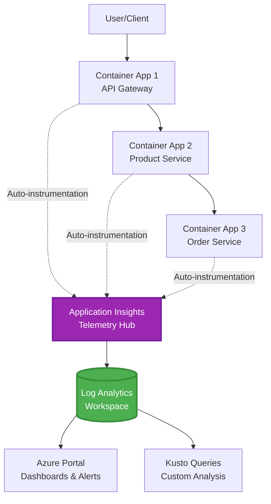
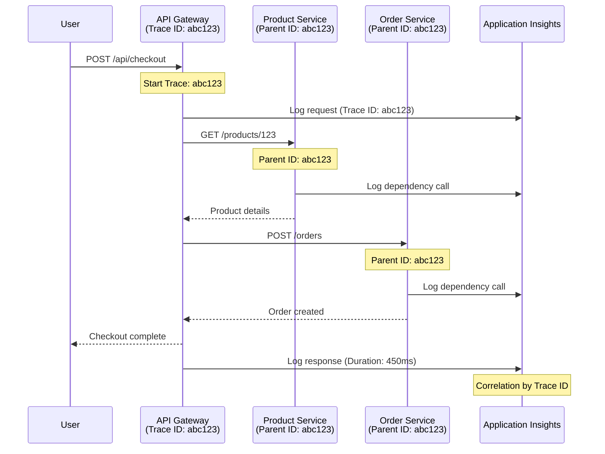

# Tích Hợp Application Insights với AZD

⏱️ **Thời Gian Ước Tính**: 40-50 phút | 💰 **Tác Động Chi Phí**: ~5-15 USD/tháng | ⭐ **Độ Phức Tạp**: Trung cấp

**📚 Lộ Trình Học Tập:**
- ← Trước: [Kiểm Tra Trước Khi Triển Khai](preflight-checks.md) - Xác thực trước triển khai
- 🎯 **Bạn Đang Ở Đây**: Tích Hợp Application Insights (Giám sát, thu thập dữ liệu, gỡ lỗi)
- → Tiếp Theo: [Hướng Dẫn Triển Khai](../chapter-04-infrastructure/deployment-guide.md) - Triển khai lên Azure
- 🏠 [Trang Chủ Khóa Học](../../README.md)

---

## Những Điều Bạn Sẽ Học

Sau khi hoàn thành bài học này, bạn sẽ:
- Khai báo **Application Insights** trong hạ tầng AZD và cấu hình SDK instrumentation
- Cấu hình **phân tích truy vết phân tán** cho microservices
- Triển khai **thu thập dữ liệu tùy chỉnh** (đo lường, sự kiện, phụ thuộc)
- Thiết lập **đo lường trực tiếp** để giám sát theo thời gian thực
- Tạo **cảnh báo và bảng điều khiển** từ các triển khai AZD
- Gỡ lỗi sự cố sản xuất với **truy vấn telemetry**
- Tối ưu **chi phí và chiến lược lấy mẫu**
- Giám sát **ứng dụng AI/LLM** (token, độ trễ, chi phí)

## Tại Sao Application Insights với AZD Quan Trọng

### Thách Thức: Quan Sát Sản Xuất

**Không có Application Insights:**
```
❌ No visibility into production behavior
❌ Manual log aggregation across services
❌ Reactive debugging (wait for customer complaints)
❌ No performance metrics
❌ Cannot trace requests across services
❌ Unknown failure rates and bottlenecks
```

**Có Application Insights + AZD:**
```
✅ Automatic telemetry collection
✅ Centralized logs from all services
✅ Proactive issue detection
✅ End-to-end request tracing
✅ Performance metrics and insights
✅ Real-time dashboards
✅ AZD provisions the monitoring declared in your templates
```

**Ẩn dụ**: Application Insights giống như một "hộp đen" ghi dữ liệu chuyến bay + bảng điều khiển buồng lái cho ứng dụng của bạn. Bạn nhìn thấy mọi thứ đang diễn ra theo thời gian thực và có thể phát lại sự cố bất kỳ lúc nào.

---

## Tổng Quan Kiến Trúc

### Application Insights trong Kiến Trúc AZD



### Những Gì Được Giám Sát Tự Động

Tự động instrumentation được hỗ trợ sẽ ghi lại các yêu cầu/phụ thuộc cho các thư viện được instrumentation. Sự kiện và đo lường tùy chỉnh cần có mã ứng dụng; kiểm tra tính khả dụng phải được cấu hình riêng. Nó không thu thập tất cả các hàng dưới đây chỉ vì tài nguyên tồn tại.

| Loại Telemetry | Ghi Lại Gì | Trường Hợp Sử Dụng |
|----------------|------------------|----------|
| **Yêu cầu** | Yêu cầu HTTP, mã trạng thái, thời lượng | Giám sát hiệu suất API |
| **Phụ thuộc** | Cuộc gọi ngoài (DB, API, lưu trữ) | Xác định điểm nghẽn |
| **Ngoại lệ** | Lỗi không xử lý có stack trace | Gỡ lỗi sự cố |
| **Sự kiện tùy chỉnh** | Sự kiện kinh doanh (đăng ký, mua hàng) | Phân tích và kênh |
| **Đo lường** | Đồng hồ hiệu suất, đo lường tùy chỉnh | Kế hoạch năng lực |
| **Dấu vết** | Tin nhắn nhật ký với mức độ nghiêm trọng | Gỡ lỗi và kiểm tra |
| **Tính khả dụng** | Kiểm tra thời gian hoạt động và thời gian phản hồi | Giám sát SLA |

---

## Điều Kiện Tiên Quyết

### Công Cụ Cần Thiết

```bash
# Verify Azure Developer CLI
azd version
# Command reference baseline: azd 1.37.2

# Verify Azure CLI
az --version
# ✅ Expected: azure-cli 2.50.0 or higher
```

### Yêu Cầu Azure

- Có Azure subscription đang hoạt động
- Quyền tạo:
  - Tài nguyên Application Insights
  - Workspace Log Analytics
  - Container Apps
  - Nhóm tài nguyên

### Kiến Thức Tiên Quyết

Bạn nên đã hoàn thành:
- [AZD Basics](../chapter-01-foundation/azd-basics.md) - Các khái niệm cơ bản của AZD
- [Configuration](../chapter-03-configuration/configuration.md) - Cấu hình môi trường
- [First Project](../chapter-01-foundation/first-project.md) - Triển khai cơ bản

---

## Bài Học 1: Application Insights Tự Động với AZD

### AZD Cung Cấp Application Insights Như Thế Nào

AZD chỉ cấp phát Application Insights **khi hạ tầng của dự án khai báo**. `azure.yaml` đơn thuần không tạo giám sát hoặc instrumentation mã ứng dụng.

> **Phạm vi ví dụ:** Bài học này chứa đoạn tích hợp, không phải dự án `monitored-app` hoàn chỉnh trong kho lưu trữ này. Cung cấp một mẫu chính và ánh xạ tham số, môi trường Container Apps, cấu hình registry/image và danh tính, Dockerfile, và thẻ dịch vụ trước khi triển khai. Các bài học sau trình bày đoạn mở rộng / thay thế, không phải các file có thể dán nguyên mà không thay đổi. Bắt đầu với [ví dụ microservices](../../../../examples/microservices) nếu cần mẫu chạy cơ bản.

### Cấu Trúc Dự Án

```
monitored-app/
├── azure.yaml                     # AZD configuration
├── infra/
│   ├── main.bicep                # Main infrastructure
│   ├── core/
│   │   └── monitoring.bicep      # Application Insights + Log Analytics
│   └── app/
│       └── api.bicep             # Container App with monitoring
└── src/
    ├── app.py                    # Application with telemetry
    ├── requirements.txt
    └── Dockerfile
```

---

### Bước 1: Cấu Hình AZD (azure.yaml)

**File: `azure.yaml`**

```yaml
name: monitored-app
metadata:
  template: monitored-app@1.0.0

services:
  api:
    project: ./src
    language: python
    host: containerapp

# Monitoring must be declared in infra/ and enabled in application code.
```

Đây là khai báo dịch vụ có thể triển khai. Các cấu hình Bicep và SDK sau cung cấp giám sát; azd không thêm chúng một cách ngầm định.

---

### Bước 2: Hạ Tầng Giám Sát (Bicep)

**File: `infra/core/monitoring.bicep`**

```bicep
param logAnalyticsName string
param applicationInsightsName string
param location string = resourceGroup().location
param tags object = {}

// Log Analytics Workspace (required for Application Insights)
resource logAnalytics 'Microsoft.OperationalInsights/workspaces@2022-10-01' = {
  name: logAnalyticsName
  location: location
  tags: tags
  properties: {
    sku: {
      name: 'PerGB2018'  // Pay-as-you-go pricing
    }
    retentionInDays: 30  // Keep logs for 30 days
    features: {
      enableLogAccessUsingOnlyResourcePermissions: true
    }
  }
}

// Application Insights
resource applicationInsights 'Microsoft.Insights/components@2020-02-02' = {
  name: applicationInsightsName
  location: location
  tags: tags
  kind: 'web'
  properties: {
    Application_Type: 'web'
    WorkspaceResourceId: logAnalytics.id
    IngestionMode: 'LogAnalytics'
    publicNetworkAccessForIngestion: 'Enabled'
    publicNetworkAccessForQuery: 'Enabled'
  }
}

// Outputs for Container Apps
output logAnalyticsWorkspaceId string = logAnalytics.id
output logAnalyticsWorkspaceName string = logAnalytics.name
output applicationInsightsConnectionString string = applicationInsights.properties.ConnectionString
output applicationInsightsInstrumentationKey string = applicationInsights.properties.InstrumentationKey
output applicationInsightsName string = applicationInsights.name
output applicationInsightsId string = applicationInsights.id
```

---

### Bước 3: Kết Nối Container App với Application Insights

**File: `infra/app/api.bicep`**

```bicep
param name string
param location string
param tags object = {}
param containerAppsEnvironmentId string
param containerImage string
param applicationInsightsConnectionString string

resource containerApp 'Microsoft.App/containerApps@2023-05-01' = {
  name: name
  location: location
  tags: tags
  properties: {
    managedEnvironmentId: containerAppsEnvironmentId
    configuration: {
      ingress: {
        external: true
        targetPort: 8000
      }
      secrets: [
        {
          name: 'appinsights-connection-string'
          value: applicationInsightsConnectionString
        }
      ]
    }
    template: {
      containers: [
        {
          name: 'api'
          image: containerImage // Supply an accessible image and registry authentication
          resources: {
            cpu: json('0.5')
            memory: '1Gi'
          }
          env: [
            {
              name: 'APPLICATIONINSIGHTS_CONNECTION_STRING'
              secretRef: 'appinsights-connection-string'
            }
            {
              name: 'APPLICATIONINSIGHTS_ENABLED'
              value: 'true'
            }
          ]
        }
      ]
    }
  }
}

output uri string = 'https://${containerApp.properties.configuration.ingress.fqdn}'
```

---

### Bước 4: Mã Ứng Dụng với Telemetry

**File: `src/app.py`**

```python
from flask import Flask, request, jsonify
from azure.monitor.opentelemetry import configure_azure_monitor
import logging
import os

app = Flask(__name__)

# Get Application Insights connection string
connection_string = os.environ.get('APPLICATIONINSIGHTS_CONNECTION_STRING')

if connection_string:
    # Azure Monitor OpenTelemetry instruments supported libraries, including Flask.
    configure_azure_monitor(
        connection_string=connection_string,
        logger_name=__name__,
        enable_live_metrics=True
    )
    logger = logging.getLogger(__name__)
    logger.setLevel(logging.INFO)
    
    print("✅ Application Insights enabled")
else:
    logger = logging.getLogger(__name__)
    logger.setLevel(logging.INFO)
    print("⚠️ Application Insights not configured")

@app.route('/health')
def health():
    logger.info('Health check endpoint called')
    return jsonify({'status': 'healthy', 'monitoring': 'enabled' if connection_string else 'disabled'})

@app.route('/api/products')
def get_products():
    logger.info('Fetching products')
    
    # In-memory fixture: this is not a database dependency call.
    products = [
        {'id': 1, 'name': 'Laptop', 'price': 999.99},
        {'id': 2, 'name': 'Mouse', 'price': 29.99},
        {'id': 3, 'name': 'Keyboard', 'price': 79.99}
    ]
    
    logger.info(f'Returned {len(products)} products')
    return jsonify(products)

@app.route('/api/error-test')
def error_test():
    """Test error tracking"""
    logger.error('Testing error tracking')
    try:
        raise ValueError('This is a test exception')
    except Exception as e:
        logger.exception('Exception occurred in error-test endpoint')
        return jsonify({'error': str(e)}), 500

@app.route('/api/slow')
def slow_endpoint():
    """Test performance tracking"""
    import time
    logger.info('Slow endpoint called')
    time.sleep(3)  # Simulate slow operation
    logger.warning('Endpoint took 3 seconds to respond')
    return jsonify({'message': 'Slow operation completed'})

if __name__ == '__main__':
    app.run(host='0.0.0.0', port=8000)
```

**File: `src/requirements.txt`**

```txt
Flask
azure-monitor-opentelemetry
gunicorn
requests
openai
```

Giải quyết các phụ thuộc này trong dự án của bạn, kiểm thử cùng nhau và khóa các phiên bản kết quả. Dự án mới nên sử dụng Azure Monitor OpenTelemetry, không dùng các exporter OpenCensus Python đã ngừng hoạt động.

---

### Bước 5: Triển Khai và Xác Minh

```bash
# Deploy only after completing and wiring the infrastructure fragments above
azd up

# Get app URL
APP_URL=$(azd env get-value API_URL) # Requires this output in main.bicep

# Generate telemetry
curl $APP_URL/health
curl $APP_URL/api/products
curl $APP_URL/api/error-test
curl $APP_URL/api/slow
```

**✅ Kết quả mong đợi:**
```json
{
  "status": "healthy",
  "monitoring": "enabled"
}
```

---

### Bước 6: Xem Telemetry trong Azure Portal

```bash
# Get Application Insights details
azd env get-values | grep APPLICATIONINSIGHTS

# Open in Azure Portal
az monitor app-insights component show \
  --app $(azd env get-values | grep APPLICATIONINSIGHTS_NAME | cut -d '=' -f2 | tr -d '"') \
  --resource-group $(azd env get-values | grep AZURE_RESOURCE_GROUP | cut -d '=' -f2 | tr -d '"') \
  --query "appId" -o tsv
```

**Đi tới Azure Portal → Application Insights → Tìm Kiếm Giao Dịch**

Bạn sẽ thấy:
- ✅ Yêu cầu HTTP với mã trạng thái
- ✅ Thời gian yêu cầu (3+ giây cho `/api/slow`)
- ✅ Chi tiết ngoại lệ từ `/api/error-test`
- ✅ Tin nhắn nhật ký tùy chỉnh

---

## Bài Học 2: Telemetry và Sự Kiện Tùy Chỉnh

### Theo Dõi Sự Kiện Kinh Doanh

Hãy thêm telemetry tùy chỉnh cho các sự kiện quan trọng kinh doanh.

**File: `src/telemetry.py`**

```python
from contextlib import contextmanager
from azure.monitor.opentelemetry import configure_azure_monitor
from opentelemetry import metrics, trace
from opentelemetry.trace import SpanKind
import logging
import os

class TelemetryClient:
    """Custom telemetry client for Application Insights"""
    
    def __init__(self, connection_string=None):
        self.connection_string = connection_string or os.environ.get('APPLICATIONINSIGHTS_CONNECTION_STRING')
        
        # Configure once per process. If app.py already calls this, keep only
        # one configure_azure_monitor call and use logger_name='telemetry'.
        if self.connection_string:
            configure_azure_monitor(
                connection_string=self.connection_string,
                logger_name=__name__,
                enable_live_metrics=True
            )
        self.logger = logging.getLogger(__name__)
        self.logger.setLevel(logging.INFO)
        self.tracer = trace.get_tracer(__name__)
        self.meter = metrics.get_meter(__name__)
        self.instruments = {}
    
    def track_event(self, event_name: str, properties: dict = None):
        """Track custom business event"""
        properties = properties or {}
        self.logger.info(
            f"CustomEvent: {event_name}",
            extra={
                # OTel log attributes become customDimensions in App Insights.
                    'event_name': event_name,
                    **properties
            }
        )
    
    def track_metric(self, metric_name: str, value: float, properties: dict = None):
        """Track custom metric"""
        properties = properties or {}
        if metric_name not in self.instruments:
            self.instruments[metric_name] = self.meter.create_histogram(metric_name)
        self.instruments[metric_name].record(value, attributes=properties)
    
    @contextmanager
    def track_dependency(self, name: str):
        """Time the real operation inside a client span; exceptions mark failure."""
        with self.tracer.start_as_current_span(name, kind=SpanKind.CLIENT) as span:
            yield span

# Global telemetry client
telemetry = TelemetryClient()
```

### Cập Nhật Ứng Dụng với Sự Kiện Tùy Chỉnh

**File: `src/app.py` (nâng cao)**

Thêm các route này vào ứng dụng Flask hiện có; giữ các route sức khỏe/kiểm thử trước đó. Khối rút gọn dưới đây cho thấy một app riêng để rõ ràng. Khởi tạo telemetry bây giờ nằm trong `telemetry.py` — không khởi tạo exporter hai lần.

```python
from flask import Flask, request, jsonify
from telemetry import telemetry
import time
import random
import os

app = Flask(__name__)

@app.route('/api/purchase', methods=['POST'])
def purchase():
    """Track purchase event with custom telemetry"""
    data = request.get_json(silent=True) or {}
    product_id = data.get('product_id')
    quantity = data.get('quantity', 1)
    price = data.get('price', 0)
    if not isinstance(quantity, int) or quantity < 1 or \
       not isinstance(price, (int, float)) or price < 0:
        return jsonify({'error': 'quantity and price must be non-negative numbers; quantity >= 1'}), 400
    
    # Track business event
    telemetry.track_event('Purchase', {
        'product_id': product_id,
        'quantity': quantity,
        'total_amount': price * quantity,
        'user_id': request.headers.get('X-User-Id', 'anonymous')
    })
    
    # Track revenue metric
    telemetry.track_metric('Revenue', price * quantity, {
        'product_id': product_id,
        'currency': 'USD'
    })
    
    return jsonify({
        'order_id': f'ORD-{random.randint(1000, 9999)}',
        'status': 'confirmed',
        'total': price * quantity
    })

@app.route('/api/search')
def search():
    """Track search queries"""
    query = request.args.get('q', '')
    
    start_time = time.time()
    
    # Simulate search (would be real database query)
    results = [{'id': 1, 'name': f'Result for {query}'}]
    
    duration = (time.time() - start_time) * 1000  # Convert to ms
    
    # Track search event
    telemetry.track_event('Search', {
        'query': query,
        'results_count': len(results),
        'duration_ms': duration
    })
    
    # Track search performance metric
    telemetry.track_metric('SearchDuration', duration, {
        'query_length': len(query)
    })
    
    return jsonify({'results': results, 'count': len(results)})

@app.route('/api/external-call')
def external_call():
    """Track external API dependency"""
    import requests
    
    try:
        # Set an actual test endpoint; api.example.com is not a working API.
        with telemetry.track_dependency('ExternalAPI'):
            response = requests.get(os.environ['EXTERNAL_API_URL'], timeout=5)
            response.raise_for_status()
            result = response.json()
    except Exception as e:
        return jsonify({'error': 'External dependency failed'}), 502
    
    return jsonify(result)

if __name__ == '__main__':
    app.run(host='0.0.0.0', port=8000)
```

### Kiểm Tra Telemetry Tùy Chỉnh

```bash
# Track purchase event
curl -X POST $APP_URL/api/purchase \
  -H "Content-Type: application/json" \
  -H "X-User-Id: user123" \
  -d '{"product_id": 1, "quantity": 2, "price": 29.99}'

# Track search event
curl "$APP_URL/api/search?q=laptop"

# Track external dependency
curl $APP_URL/api/external-call
```

**Xem trong Azure Portal:**

Tới Application Insights → Logs, sau đó chạy:

```kusto
// View purchase events
traces
| where customDimensions.event_name == "Purchase"
| project 
    timestamp,
    product_id = tostring(customDimensions.product_id),
    total_amount = todouble(customDimensions.total_amount),
    user_id = tostring(customDimensions.user_id)
| order by timestamp desc

// Revenue recorded in Purchase events (not a billing ledger)
traces
| where customDimensions.event_name == "Purchase"
| summarize TotalRevenue = sum(todouble(customDimensions.total_amount)) by bin(timestamp, 1h)
| render timechart

// View search performance
traces
| where customDimensions.event_name == "Search"
| summarize 
    AvgDuration = avg(todouble(customDimensions.duration_ms)),
    SearchCount = count()
  by bin(timestamp, 5m)
| render timechart
```

---

## Bài Học 3: Phân Tích Truy Vết Phân Tán cho Microservices

### Bật Truy Vết Liên Dịch Vụ

Với instrumentation tương thích và truyền thông tin trace-context W3C, Application Insights liên kết các yêu cầu giữa các dịch vụ. Chia sẻ chuỗi kết nối chỉ không tạo ra span cha-con. Đoạn kiến trúc dưới đây tham khảo các module bạn phải thực hiện.

**File: `infra/main.bicep`**

```bicep
targetScope = 'subscription'

param environmentName string
param location string = 'eastus'

var tags = { 'azd-env-name': environmentName }

resource rg 'Microsoft.Resources/resourceGroups@2021-04-01' = {
  name: 'rg-${environmentName}'
  location: location
  tags: tags
}

// Monitoring (shared by all services)
module monitoring './core/monitoring.bicep' = {
  name: 'monitoring'
  scope: rg
  params: {
    logAnalyticsName: 'log-${environmentName}'
    applicationInsightsName: 'appi-${environmentName}'
    location: location
    tags: tags
  }
}

// API Gateway
module apiGateway './app/api-gateway.bicep' = {
  name: 'api-gateway'
  scope: rg
  params: {
    name: 'ca-gateway-${environmentName}'
    location: location
    tags: union(tags, { 'azd-service-name': 'gateway' })
    applicationInsightsConnectionString: monitoring.outputs.applicationInsightsConnectionString
  }
}

// Product Service
module productService './app/product-service.bicep' = {
  name: 'product-service'
  scope: rg
  params: {
    name: 'ca-products-${environmentName}'
    location: location
    tags: union(tags, { 'azd-service-name': 'products' })
    applicationInsightsConnectionString: monitoring.outputs.applicationInsightsConnectionString
  }
}

// Order Service
module orderService './app/order-service.bicep' = {
  name: 'order-service'
  scope: rg
  params: {
    name: 'ca-orders-${environmentName}'
    location: location
    tags: union(tags, { 'azd-service-name': 'orders' })
    applicationInsightsConnectionString: monitoring.outputs.applicationInsightsConnectionString
  }
}

output APPLICATIONINSIGHTS_CONNECTION_STRING string = monitoring.outputs.applicationInsightsConnectionString
output GATEWAY_URL string = apiGateway.outputs.uri
```

### Xem Giao Dịch End-to-End



**Truy vấn trace end-to-end:**

```kusto
// Find complete request flow
let traceId = "abc123...";  // Copy operation_Id from a request in Application Insights
dependencies
| union requests
| where operation_Id == traceId
| project 
    timestamp,
    type = itemType,
    name,
    duration,
    success,
    cloud_RoleName
| order by timestamp asc
```

---

## Bài Học 4: Live Metrics và Giám Sát Thời Gian Thực

### Bật Dòng Live Metrics

Live Metrics cung cấp telemetry gần thời gian thực khi được SDK hỗ trợ và bật. Nó không phải SLA về độ trễ. Cấu hình OpenTelemetry Python ở trên chọn tham gia với `enable_live_metrics=True`.

**Truy cập Live Metrics:**

```bash
# Get Application Insights resource
APPI_NAME=$(azd env get-values | grep APPLICATIONINSIGHTS_NAME | cut -d '=' -f2 | tr -d '"')

# Get resource group
RG_NAME=$(azd env get-values | grep AZURE_RESOURCE_GROUP | cut -d '=' -f2 | tr -d '"')

echo "Navigate to: Azure Portal → Resource Groups → $RG_NAME → $APPI_NAME → Live Metrics"
```

**Những gì bạn thấy theo thời gian thực:**
- ✅ Tỷ lệ yêu cầu đến (yêu cầu/giây)
- ✅ Cuộc gọi phụ thuộc đi ra ngoài
- ✅ Số lượng ngoại lệ
- ✅ Sử dụng CPU và bộ nhớ
- ✅ Số server hoạt động
- ✅ Mẫu telemetry

### Tạo Tải Để Kiểm Tra

```bash
# Generate load to see live metrics
for i in {1..100}; do
  curl --silent --max-time 10 "$APP_URL/api/products"
  curl --silent --max-time 10 "$APP_URL/api/search?q=test$i"
done

# Watch live metrics in Azure Portal
# You should see request rate spike
```

---

## Bài Tập Thực Hành

### Bài Tập 1: Thiết Lập Cảnh Báo ⭐⭐ (Trung Bình)

**Mục Tiêu**: Tạo cảnh báo cho tỷ lệ lỗi cao và phản hồi chậm.

**Các Bước:**

1. **Tạo cảnh báo tỷ lệ lỗi:**

```bash
# Get Application Insights resource ID
APPI_ID=$(az monitor app-insights component show \
  --app $APPI_NAME \
  --resource-group $RG_NAME \
  --query "id" -o tsv)

# Create metric alert for failed requests
az monitor metrics alert create \
  --name "High-Error-Rate" \
  --resource-group $RG_NAME \
  --scopes $APPI_ID \
  --condition "count requests/failed > 10" \
  --window-size 5m \
  --evaluation-frequency 1m \
  --description "Alert when failed request count exceeds 10 per 5 minutes"
```

2. **Tạo cảnh báo cho phản hồi chậm:**

```bash
az monitor metrics alert create \
  --name "Slow-Responses" \
  --resource-group $RG_NAME \
  --scopes $APPI_ID \
  --condition "avg requests/duration > 3000" \
  --window-size 5m \
  --evaluation-frequency 1m \
  --description "Alert when average response time exceeds 3 seconds"
```

3. **Tạo cảnh báo qua Bicep (ưu tiên cho AZD):**

**File: `infra/core/alerts.bicep`**

```bicep
param applicationInsightsId string
param actionGroupId string = ''
param location string = resourceGroup().location

// High error rate alert
resource errorRateAlert 'Microsoft.Insights/metricAlerts@2018-03-01' = {
  name: 'high-error-rate'
  location: 'global'
  properties: {
    description: 'Alert when error rate exceeds threshold'
    severity: 2
    enabled: true
    scopes: [
      applicationInsightsId
    ]
    evaluationFrequency: 'PT1M'
    windowSize: 'PT5M'
    criteria: {
      'odata.type': 'Microsoft.Azure.Monitor.SingleResourceMultipleMetricCriteria'
      allOf: [
        {
          name: 'Error rate'
          metricName: 'requests/failed'
          operator: 'GreaterThan'
          threshold: 10
          timeAggregation: 'Count'
        }
      ]
    }
    actions: actionGroupId != '' ? [
      {
        actionGroupId: actionGroupId
      }
    ] : []
  }
}

// Slow response alert
resource slowResponseAlert 'Microsoft.Insights/metricAlerts@2018-03-01' = {
  name: 'slow-responses'
  location: 'global'
  properties: {
    description: 'Alert when response time is too high'
    severity: 3
    enabled: true
    scopes: [
      applicationInsightsId
    ]
    evaluationFrequency: 'PT1M'
    windowSize: 'PT5M'
    criteria: {
      'odata.type': 'Microsoft.Azure.Monitor.SingleResourceMultipleMetricCriteria'
      allOf: [
        {
          name: 'Response duration'
          metricName: 'requests/duration'
          operator: 'GreaterThan'
          threshold: 3000
          timeAggregation: 'Average'
        }
      ]
    }
  }
}

output errorAlertId string = errorRateAlert.id
output slowResponseAlertId string = slowResponseAlert.id
```

4. **Kiểm tra cảnh báo:**

```bash
# Generate errors
for i in {1..20}; do
  curl $APP_URL/api/error-test
done

# Generate slow responses
for i in {1..10}; do
  curl $APP_URL/api/slow
done

# Check rule configuration (not fired/resolved alert-instance history)
az monitor metrics alert list \
  --resource-group $RG_NAME \
  --query "[].{Name:name, Enabled:enabled}" \
  --output table
```

**✅ Tiêu chí thành công:**
- ✅ Cảnh báo được tạo thành công
- ✅ Cảnh báo kích hoạt khi vượt ngưỡng
- ✅ Có thể xem lịch sử cảnh báo trong Azure Portal
- ✅ Tích hợp với triển khai AZD

**Thời Gian**: 20-25 phút

---

### Bài Tập 2: Tạo Bảng Điều Khiển Tùy Chỉnh ⭐⭐ (Trung Bình)

**Mục Tiêu**: Xây dựng bảng điều khiển hiển thị các chỉ số quan trọng của ứng dụng.

**Các Bước:**

1. **Tạo bảng điều khiển qua Azure Portal:**

Vào: Azure Portal → Dashboards → New Dashboard

2. **Thêm các ô cho chỉ số chính:**

- Số lượng yêu cầu (24 giờ qua)
- Thời gian phản hồi trung bình
- Tỷ lệ lỗi
- 5 thao tác chậm nhất
- Phân bố địa lý người dùng

3. **Tạo bảng điều khiển qua Bicep:**

**File: `infra/core/dashboard.bicep`**

```bicep
param dashboardName string
param applicationInsightsId string
param location string = resourceGroup().location

resource dashboard 'Microsoft.Portal/dashboards@2020-09-01-preview' = {
  name: dashboardName
  location: location
  properties: {
    lenses: [
      {
        order: 0
        parts: [
          // Request count
          {
            position: {
              x: 0
              y: 0
              rowSpan: 4
              colSpan: 6
            }
            metadata: {
              type: 'Extension/Microsoft_OperationsManagementSuite_Workspace/PartType/LogsDashboardPart'
              inputs: [
                {
                  name: 'resourceId'
                  value: applicationInsightsId
                }
                {
                  name: 'query'
                  value: '''
                    requests
                    | summarize RequestCount = count() by bin(timestamp, 1h)
                    | render timechart
                  '''
                }
              ]
            }
          }
          // Error rate
          {
            position: {
              x: 6
              y: 0
              rowSpan: 4
              colSpan: 6
            }
            metadata: {
              type: 'Extension/Microsoft_OperationsManagementSuite_Workspace/PartType/LogsDashboardPart'
              inputs: [
                {
                  name: 'resourceId'
                  value: applicationInsightsId
                }
                {
                  name: 'query'
                  value: '''
                    requests
                    | summarize 
                        Total = count(),
                        Failed = countif(success == false)
                    | extend ErrorRate = (Failed * 100.0) / Total
                    | project ErrorRate
                  '''
                }
              ]
            }
          }
        ]
      }
    ]
  }
}

output dashboardId string = dashboard.id
```

4. **Triển khai bảng điều khiển:**

```bicep
// Add to a subscription-scoped main.bicep with rg and monitoring declared
module dashboard './core/dashboard.bicep' = {
  name: 'dashboard'
  scope: rg
  params: {
    dashboardName: 'dashboard-${environmentName}'
    applicationInsightsId: monitoring.outputs.applicationInsightsId
    location: location
  }
}
```

```bash
# Deploy
azd up
```

**✅ Tiêu chí thành công:**
- ✅ Bảng điều khiển hiển thị các chỉ số chính
- ✅ Có thể ghim lên trang chủ Azure Portal
- ✅ Cập nhật theo thời gian thực
- ✅ Có thể triển khai qua AZD

**Thời Gian**: 25-30 phút

---

### Bài Tập 3: Giám Sát Ứng Dụng AI/LLM ⭐⭐⭐ (Nâng Cao)

**Mục Tiêu**: Theo dõi việc sử dụng Microsoft Foundry Models (tokens, chi phí, độ trễ).

**Các Bước:**

1. **Tạo wrapper giám sát AI:**

**File: `src/ai_telemetry.py`**

```python
from telemetry import telemetry
from openai import AzureOpenAI
import time

class MonitoredAzureOpenAI:
    """Microsoft Foundry Models client with automatic telemetry"""
    
    def __init__(self, api_key, endpoint, input_usd_per_million,
                 output_usd_per_million, api_version="2024-10-21"):
        self.client = AzureOpenAI(
            api_key=api_key,
            api_version=api_version,
            azure_endpoint=endpoint
        )
        self.input_rate = input_usd_per_million
        self.output_rate = output_usd_per_million
    
    def chat_completion(self, model: str, messages: list, **kwargs):
        """Track chat completion with telemetry"""
        start_time = time.time()
        
        try:
            # Call Microsoft Foundry Models
            response = self.client.chat.completions.create(
                model=model,
                messages=messages,
                **kwargs
            )
            
            duration = (time.time() - start_time) * 1000  # ms
            
            # Extract usage
            usage = response.usage
            prompt_tokens = usage.prompt_tokens
            completion_tokens = usage.completion_tokens
            total_tokens = usage.total_tokens
            
            # Approximation: supply actual deployment/region/contract rates.
            # Cached input, batch, provisioned and other charges need separate accounting.
            prompt_cost = (prompt_tokens / 1_000_000) * self.input_rate
            completion_cost = (completion_tokens / 1_000_000) * self.output_rate
            total_cost = prompt_cost + completion_cost
            
            # Track custom event
            telemetry.track_event('OpenAI_Request', {
                'model': model,
                'prompt_tokens': prompt_tokens,
                'completion_tokens': completion_tokens,
                'total_tokens': total_tokens,
                'duration_ms': duration,
                'cost_usd': total_cost,
                'success': True
            })
            
            # Track metrics
            telemetry.track_metric('OpenAI_Tokens', total_tokens, {
                'model': model,
                'type': 'total'
            })
            
            telemetry.track_metric('OpenAI_Cost', total_cost, {
                'model': model,
                'currency': 'USD'
            })
            
            telemetry.track_metric('OpenAI_Duration', duration, {
                'model': model
            })
            
            return response
            
        except Exception as e:
            duration = (time.time() - start_time) * 1000
            
            telemetry.track_event('OpenAI_Request', {
                'model': model,
                'duration_ms': duration,
                'success': False,
                'error': str(e)
            })
            
            raise
```

2. **Sử dụng client đã giám sát:**

```python
from flask import Flask, request, jsonify
from ai_telemetry import MonitoredAzureOpenAI
import os

app = Flask(__name__)

# Initialize monitored OpenAI client
openai_client = MonitoredAzureOpenAI(
    api_key=os.environ['AZURE_OPENAI_API_KEY'],
    endpoint=os.environ['AZURE_OPENAI_ENDPOINT'],
    input_usd_per_million=float(os.environ['INPUT_USD_PER_MILLION']),
    output_usd_per_million=float(os.environ['OUTPUT_USD_PER_MILLION'])
)

@app.route('/api/chat', methods=['POST'])
def chat():
    data = request.json
    user_message = data.get('message')
    
    # Call with automatic monitoring
    response = openai_client.chat_completion(
        model=os.environ['AZURE_OPENAI_DEPLOYMENT'], # Deployment name, not catalog ID
        messages=[
            {'role': 'user', 'content': user_message}
        ]
    )
    
    return jsonify({
        'response': response.choices[0].message.content,
        'tokens': response.usage.total_tokens
    })
```

3. **Truy vấn chỉ số AI:**

```kusto
// Total AI spend over time
traces
| where customDimensions.event_name == "OpenAI_Request"
| where tobool(customDimensions.success) == true
| summarize TotalCost = sum(todouble(customDimensions.cost_usd)) by bin(timestamp, 1h)
| render timechart

// Token usage by model
traces
| where customDimensions.event_name == "OpenAI_Request"
| summarize 
    TotalTokens = sum(toint(customDimensions.total_tokens)),
    RequestCount = count()
  by Model = tostring(customDimensions.model)

// Average latency
traces
| where customDimensions.event_name == "OpenAI_Request"
| summarize AvgDuration = avg(todouble(customDimensions.duration_ms))
| project AvgDurationSeconds = AvgDuration / 1000

// Cost per request
traces
| where customDimensions.event_name == "OpenAI_Request"
| extend Cost = todouble(customDimensions.cost_usd)
| summarize 
    TotalCost = sum(Cost),
    RequestCount = count(),
    AvgCostPerRequest = avg(Cost)
```

**✅ Tiêu chí thành công:**
- ✅ Mọi cuộc gọi OpenAI được theo dõi tự động
- ✅ Sử dụng token và chi phí hiển thị
- ✅ Độ trễ được giám sát
- ✅ Có thể thiết lập cảnh báo ngân sách

**Thời Gian**: 35-45 phút

---

## Tối Ưu Chi Phí

### Chiến Lược Lấy Mẫu

Kiểm soát chi phí bằng cách lấy mẫu telemetry:

```python
import os

# Configure before the one configure_azure_monitor() call in your process.
os.environ["OTEL_TRACES_SAMPLER"] = "microsoft.fixed_percentage"
os.environ["OTEL_TRACES_SAMPLER_ARG"] = "0.1" # 10% trace sampling
```

Lấy mẫu trace không giảm 90% mỗi loại telemetry. Metrics và log phát ra độc lập cần kiểm soát riêng về khối lượng. Chọn tỷ lệ dựa trên nhu cầu khả năng quan sát, không phải cấm hoàn toàn trong sản xuất.

Thiết lập lấy mẫu SDK rõ ràng; thuộc tính `SamplingPercentage` của component không thay thế cho cấu hình sampler OpenTelemetry Python.

### Giữ Dữ Liệu

```bicep
resource logAnalytics 'Microsoft.OperationalInsights/workspaces@2022-10-01' = {
  name: logAnalyticsName
  properties: {
    retentionInDays: 30  // Minimum (cheapest)
    // Options: 30, 31, 60, 90, 120, 180, 270, 365, 550, 730
  }
}
```

### Ước Tính Chi Phí Hàng Tháng

| Dung Lượng Dữ Liệu | Giữ Lại | Chi Phí Hàng Tháng |
|-------------|-----------|--------------|
| 1 GB/tháng | 30 ngày | ~2-5 USD |
| 5 GB/tháng | 30 ngày | ~10-15 USD |
| 10 GB/tháng | 90 ngày | ~25-40 USD |
| 50 GB/tháng | 90 ngày | ~100-150 USD |

Các con số này chỉ mang tính minh họa, không phải báo giá. Kiểm tra giá cả nhập liệu, giữ dữ liệu, cảnh báo, và thử nghiệm trong khu vực và thỏa thuận của bạn; hạn mức miễn phí được chia sẻ và phạm vi theo giá Azure Monitor, không phải SKU miễn phí đảm bảo cho mỗi tài nguyên Application Insights.

---

## Kiểm Tra Kiến Thức

### 1. Tích Hợp Cơ Bản ✓

Kiểm tra kiến thức của bạn:

- [ ] **Câu Hỏi 1**: AZD cấp phát Application Insights như thế nào?
  - **Đáp án**: Nó triển khai tài nguyên giám sát được khai báo rõ ràng trong mẫu Bicep/Terraform của dự án.

- [ ] **Câu Hỏi 2**: Biến môi trường nào bật Application Insights?
  - **Đáp án**: `APPLICATIONINSIGHTS_CONNECTION_STRING`

- [ ] **Câu Hỏi 3**: Ba loại telemetry chính là gì?
  - **Đáp án**: Yêu cầu (HTTP calls), Phụ thuộc (cuộc gọi ngoài), Ngoại lệ (lỗi)

**Xác Minh Thực Tế:**
```bash
# Check if Application Insights is configured
azd env get-values | grep APPLICATIONINSIGHTS

# Verify telemetry is flowing
az monitor app-insights metrics show \
  --app $APPI_NAME \
  --resource-group $RG_NAME \
  --metric "requests/count"
```

---

### 2. Telemetry Tùy Chỉnh ✓

Kiểm tra kiến thức của bạn:

- [ ] **Câu Hỏi 1**: Làm thế nào để theo dõi sự kiện kinh doanh tùy chỉnh?
  - **Đáp án**: Wrapper bài học này ghi log OTel có cấu trúc với các thuộc tính `event_name`, có thể truy vấn trong `traces`; không tự động `customEvents`.

- [ ] **Câu Hỏi 2**: Sự khác biệt giữa sự kiện và đo lường là gì?
  - **Đáp án**: Sự kiện là các xảy ra riêng biệt, đo lường là các phép đo số.

- [ ] **Câu Hỏi 3**: Làm sao để liên kết telemetry giữa các dịch vụ?
  - **Đáp án**: Application Insights tự động dùng `operation_Id` để liên kết

**Xác Minh Thực Tế:**
```kusto
// Verify custom events
traces
| where customDimensions.event_name != ""
| summarize count() by tostring(customDimensions.event_name)
```

---

### 3. Giám Sát Sản Xuất ✓

Kiểm tra kiến thức của bạn:

- [ ] **Câu Hỏi 1**: Sampling là gì và tại sao dùng?
  - **Đáp án**: Sampling giảm khối lượng dữ liệu (và chi phí) bằng cách chỉ thu thập một phần trăm telemetry.

- [ ] **Câu Hỏi 2**: Làm sao để thiết lập cảnh báo?
  - **Đáp án**: Dùng cảnh báo chỉ số trong Bicep hoặc Azure Portal dựa trên các chỉ số Application Insights.

- [ ] **Câu Hỏi 3**: Sự khác biệt giữa Log Analytics và Application Insights là gì?
  - **Đáp án**: Application Insights lưu trữ dữ liệu trong workspace Log Analytics; Application Insights cung cấp các góc nhìn riêng cho ứng dụng.

**Xác Minh Thực Tế:**
```bash
# Check the sampler configured for the running application, not only the ARM component.
az containerapp show --name "$APP_NAME" --resource-group "$RG_NAME" \
  --query "properties.template.containers[].env[?starts_with(name, 'OTEL_TRACES_SAMPLER')]"
```

---

## Thực Hành Tốt Nhất

### ✅ NÊN:

1. **Sử dụng correlation IDs**
   ```python
   logger.info('Processing order', extra={
           'order_id': order_id,
           'user_id': user_id
   })
   ```

2. **Thiết lập cảnh báo cho các chỉ số quan trọng**
   ```bicep
   // Error rate, slow responses, availability
   ```

3. **Sử dụng ghi log có cấu trúc**
   ```python
   # ✅ GOOD: Structured
   logger.info('User signup', extra={'user_id': 'pseudonymous-id'})
   
   # ❌ BAD: Unstructured
   logger.info(f'User 123 signed up')
   ```

4. **Giám sát phụ thuộc**
   ```python
   # Automatically track database calls, HTTP requests, etc.
   ```

5. **Sử dụng Live Metrics trong quá trình triển khai**

### ❌ KHÔNG NÊN:

1. **Đừng ghi lại dữ liệu nhạy cảm**
   ```python
   # ❌ BAD
   logger.info(f'Login: {username}:{password}')
   
   # ✅ GOOD
   logger.info('Login attempt', extra={'result': 'failed'})
   ```

2. **Đừng chọn phương pháp lấy mẫu mà không đo lường khối lượng và nhu cầu chẩn đoán**
   ```python
   # ❌ Expensive
   # 100% traces may be appropriate for a small workload or investigation.
   
   # ✅ Cost-effective
   # A lower trace rate reduces visibility; validate coverage before enabling.
   ```

3. **Đừng bỏ qua hàng đợi thư chết**

4. **Đừng quên đặt giới hạn giữ dữ liệu**

---

## Khắc phục sự cố

### Vấn đề: Không có dữ liệu telemetry hiển thị

**Chẩn đoán:**
```bash
# Check connection string is set
azd env get-values | grep APPLICATIONINSIGHTS

# Check application logs via Azure Monitor
azd monitor --logs

# Or use Azure CLI for Container Apps:
az containerapp logs show --name $APP_NAME --resource-group $RG_NAME --tail 50
```

**Giải pháp:**
```bash
# Verify connection string in Container App
az containerapp show \
  --name $APP_NAME \
  --resource-group $RG_NAME \
  --query "properties.template.containers[0].env" \
  | grep -i applicationinsights
```

---

### Vấn đề: Chi phí cao

**Chẩn đoán:**
```bash
# Query ingestion volume in the linked Log Analytics workspace.
# WORKSPACE_ID is the workspace customer ID (GUID), not its ARM resource ID.
az monitor log-analytics query --workspace "$WORKSPACE_ID" \
  --analytics-query "Usage | where TimeGenerated > ago(30d) | where IsBillable == true | summarize IngestedMB=sum(Quantity) by DataType"
```

**Giải pháp:**
- Giảm tỷ lệ lấy mẫu
- Giảm thời gian giữ dữ liệu
- Loại bỏ ghi log chi tiết quá mức

---

## Tìm hiểu thêm

### Tài liệu chính thức
- [Tổng quan Application Insights](https://learn.microsoft.com/azure/azure-monitor/app/app-insights-overview)
- [Cài đặt Azure Monitor OpenTelemetry](https://learn.microsoft.com/azure/azure-monitor/app/opentelemetry-enable?tabs=python)
- [Ngôn ngữ truy vấn Kusto](https://learn.microsoft.com/azure/data-explorer/kusto/query/)
- [Giám sát AZD](https://learn.microsoft.com/azure/developer/azure-developer-cli/monitor-your-app)

### Các bước tiếp theo trong khóa học này
- ← Trước: [Kiểm tra trước khi khởi động](preflight-checks.md)
- → Tiếp: [Hướng dẫn triển khai](../chapter-04-infrastructure/deployment-guide.md)
- 🏠 [Trang chủ khóa học](../../README.md)

### Ví dụ liên quan
- [Ví dụ mô hình Foundry Microsoft](../../../../examples/azure-openai-chat) - Telemetry AI
- [Ví dụ microservices](../../../../examples/microservices) - Tracing phân tán

---

## Tóm tắt

**Bạn đã học được:**
- ✅ Tự động cung cấp Application Insights với AZD
- ✅ Telemetry tùy chỉnh (sự kiện, số liệu, phụ thuộc)
- ✅ Tracing phân tán qua các microservices
- ✅ Số liệu trực tiếp và giám sát thời gian thực
- ✅ Cảnh báo và bảng điều khiển
- ✅ Giám sát ứng dụng AI/LLM
- ✅ Chiến lược tối ưu chi phí

**Điểm chính cần nhớ:**
1. **Khai báo giám sát rõ ràng** - AZD triển khai mẫu của bạn; SDK instrumentation gửi telemetry
2. **Sử dụng ghi log có cấu trúc** - Giúp truy vấn dễ dàng hơn
3. **Theo dõi sự kiện kinh doanh** - Không chỉ số kỹ thuật
4. **Giám sát chi phí AI** - Theo dõi token và chi tiêu
5. **Thiết lập cảnh báo** - Chủ động thay vì phản ứng
6. **Tối ưu hóa chi phí** - Sử dụng lấy mẫu và giới hạn giữ dữ liệu

**Bước tiếp theo:**
1. Hoàn thành các bài tập thực hành
2. Thêm Application Insights vào các dự án AZD của bạn
3. Tạo bảng điều khiển tùy chỉnh cho nhóm của bạn
4. Học [Hướng dẫn triển khai](../chapter-04-infrastructure/deployment-guide.md)

---

<!-- CO-OP TRANSLATOR DISCLAIMER START -->
**Tuyên bố miễn trừ trách nhiệm**:
Tài liệu này đã được dịch bằng dịch vụ dịch thuật AI [Co-op Translator](https://github.com/Azure/co-op-translator). Mặc dù chúng tôi cố gắng đảm bảo độ chính xác, xin lưu ý rằng bản dịch tự động có thể chứa lỗi hoặc sai sót. Tài liệu gốc bằng ngôn ngữ gốc nên được coi là nguồn tin chính thức. Đối với thông tin quan trọng, nên sử dụng dịch vụ dịch thuật chuyên nghiệp bởi con người. Chúng tôi không chịu trách nhiệm về bất kỳ hiểu lầm hoặc giải thích sai nào phát sinh từ việc sử dụng bản dịch này.
<!-- CO-OP TRANSLATOR DISCLAIMER END -->