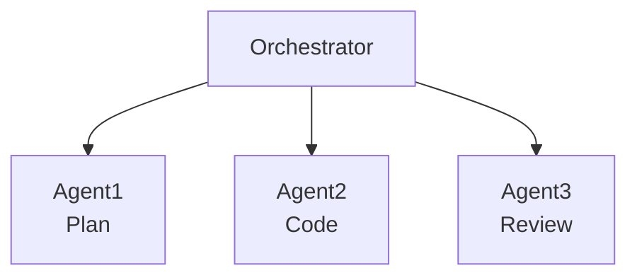
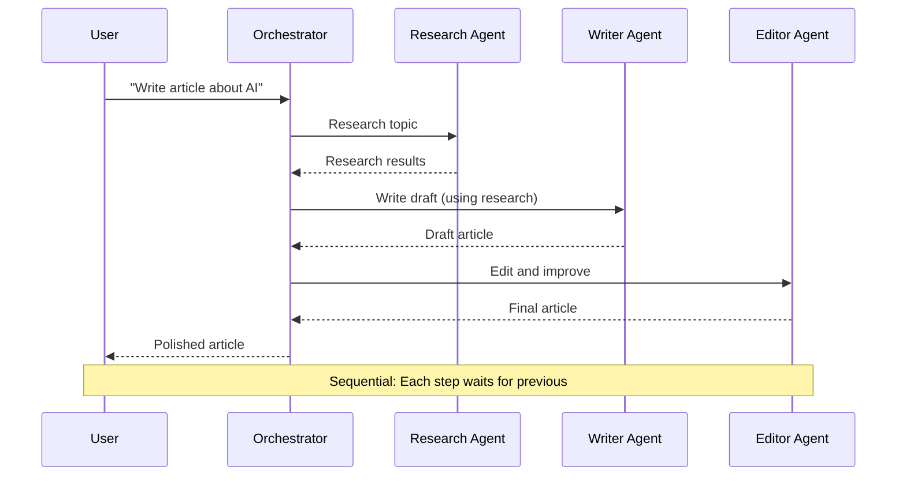
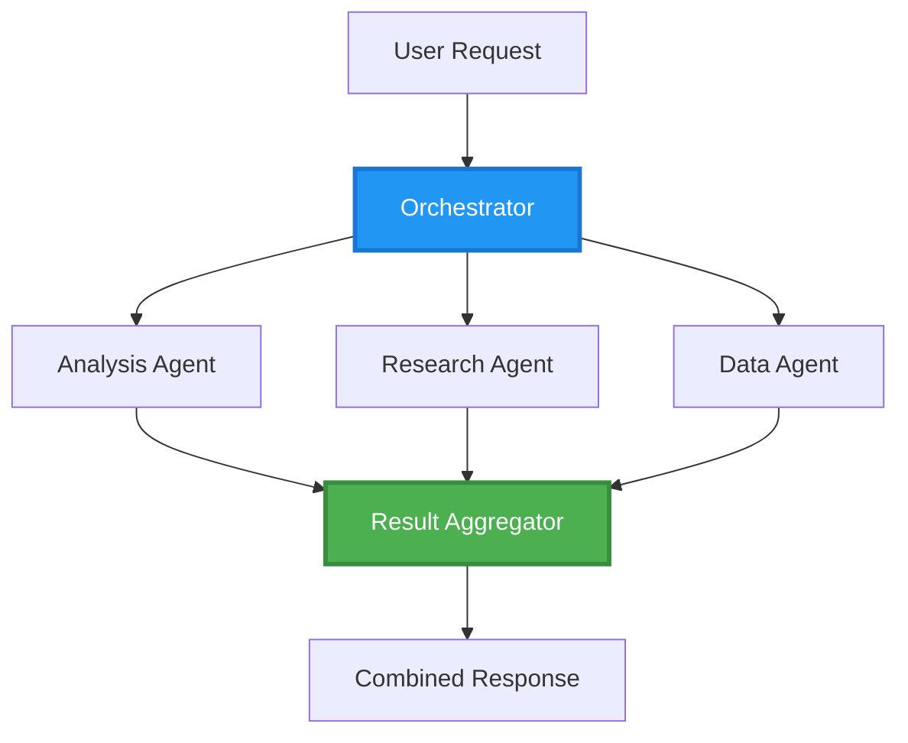
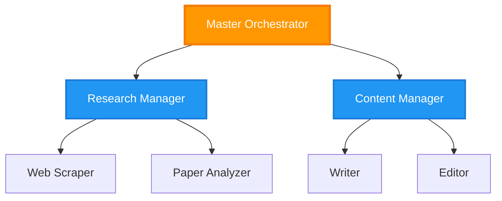
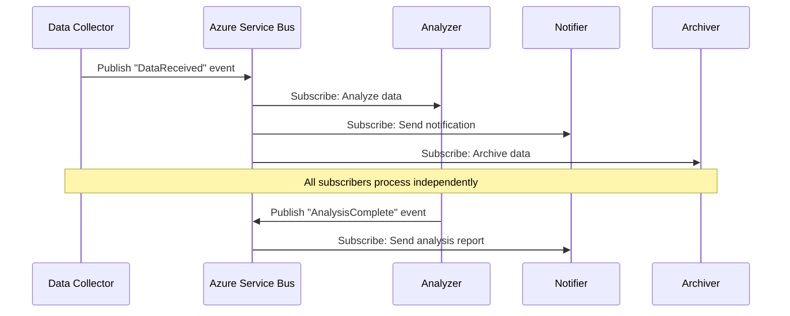
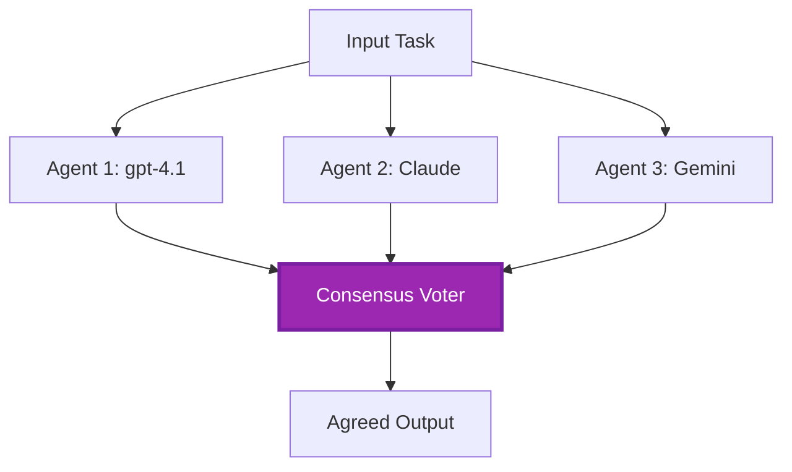
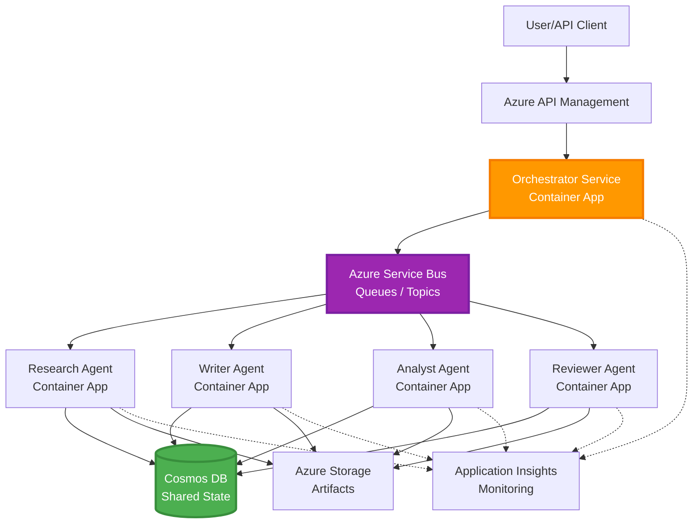

# Mẫu Điều phối Đa Tác nhân

⏱️ **Thời gian ước tính**: 60-75 phút đọc; vài giờ để triển khai | 💰 **Chi phí ước tính**: phụ thuộc vào khối lượng công việc | ⭐ **Độ phức tạp**: Nâng cao

**📚 Lộ trình học:**
- ← Trước: [Lập kế hoạch năng lực](capacity-planning.md) - Chiến lược định kích thước tài nguyên và mở rộng
- 🎯 **Bạn đang ở đây**: Mẫu Điều phối Đa Tác nhân (Điều phối, giao tiếp, quản lý trạng thái)
- → Tiếp theo: [Chọn SKU](sku-selection.md) - Lựa chọn dịch vụ Azure phù hợp
- 🏠 [Trang chính Khóa học](../../README.md)

---

## Bạn sẽ học được gì

Khi hoàn thành bài học này, bạn sẽ:
- Hiểu các mẫu **kiến trúc đa tác nhân** và khi nào nên sử dụng chúng
- Triển khai các **mẫu điều phối** (tập trung, phân quyền, phân cấp)
- Thiết kế các chiến lược **giao tiếp tác nhân** (đồng bộ, không đồng bộ, điều khiển sự kiện)
- Quản lý **trạng thái chia sẻ** giữa các tác nhân phân tán
- Triển khai **hệ thống đa tác nhân** trên Azure với AZD
- Áp dụng các **mẫu phối hợp** cho các tình huống AI thực tế
- Giám sát và gỡ lỗi hệ thống tác nhân phân tán

## Tại sao Điều phối Đa Tác nhân Quan trọng

### Quá trình tiến hóa: Từ Tác nhân Đơn sang Đa Tác nhân

**Tác nhân Đơn (Đơn giản):**
```
User → Agent → Response
```
- ✅ Dễ hiểu và triển khai
- ✅ Nhanh cho các tác vụ đơn giản
- ❌ Bị giới hạn bởi khả năng của mô hình đơn lẻ
- ❌ Không thể thực thi song song các tác vụ phức tạp
- ❌ Không có sự chuyên môn hóa

**Hệ thống Đa Tác nhân (Nâng cao):**

- ✅ Tác nhân chuyên môn cho các nhiệm vụ cụ thể
- ✅ Thực thi song song để tăng tốc
- ✅ Mô-đun và dễ bảo trì
- ✅ Tốt hơn cho các quy trình làm việc phức tạp
- ⚠️ Yêu cầu logic điều phối

**Tương tự**: Tác nhân đơn giống như một người làm tất cả các công việc. Đa tác nhân giống như một đội, mỗi thành viên có kỹ năng chuyên biệt (nghiên cứu, lập trình, đánh giá, viết) làm việc cùng nhau.

---

## Các Mẫu Điều phối Cốt lõi

### Mẫu 1: Điều phối Tuần tự (Chuỗi Trách nhiệm)

**Khi nào dùng**: Các tác vụ phải hoàn thành theo thứ tự cụ thể, mỗi tác nhân dựa trên kết quả trước đó.



**Lợi ích:**
- ✅ Luồng dữ liệu rõ ràng
- ✅ Dễ gỡ lỗi
- ✅ Thứ tự thực thi dự đoán được

**Hạn chế:**
- ❌ Chậm hơn (không song song)
- ❌ Một lỗi làm tắc cả chuỗi
- ❌ Không xử lý được các tác vụ phụ thuộc lẫn nhau

**Ví dụ sử dụng:**
- Chuỗi tạo nội dung (nghiên cứu → viết → chỉnh sửa → xuất bản)
- Tạo mã (lập kế hoạch → triển khai → kiểm thử → triển khai)
- Tạo báo cáo (thu thập dữ liệu → phân tích → trực quan hóa → tóm tắt)

---

### Mẫu 2: Điều phối Song song (Phân tán/Thu thập)

**Khi nào dùng**: Các tác vụ độc lập chạy đồng thời, kết quả được tổng hợp ở cuối.



**Lợi ích:**
- ✅ Nhanh (thực thi song song)
- ✅ Chịu lỗi tốt (kết quả một phần chấp nhận được)
- ✅ Mở rộng ngang

**Hạn chế:**
- ⚠️ Kết quả có thể đến không đúng thứ tự
- ⚠️ Cần logic tổng hợp
- ⚠️ Quản lý trạng thái phức tạp

**Ví dụ sử dụng:**
- Thu thập dữ liệu đa nguồn (API + cơ sở dữ liệu + thu thập web)
- Phân tích cạnh tranh (nhiều mô hình tạo giải pháp, chọn tốt nhất)
- Dịch vụ dịch thuật (dịch ra nhiều ngôn ngữ cùng lúc)

---

### Mẫu 3: Điều phối Phân cấp (Quản lý–Nhân viên)

**Khi nào dùng**: Các quy trình làm việc phức tạp với các tác vụ con, cần phân công.



**Lợi ích:**
- ✅ Xử lý quy trình làm việc phức tạp
- ✅ Mô-đun và dễ bảo trì
- ✅ Ranh giới trách nhiệm rõ ràng

**Hạn chế:**
- ⚠️ Kiến trúc phức tạp hơn
- ⚠️ Độ trễ cao hơn (nhiều lớp điều phối)
- ⚠️ Yêu cầu điều phối tinh vi

**Ví dụ sử dụng:**
- Xử lý tài liệu doanh nghiệp (phân loại → chuyển tiếp → xử lý → lưu trữ)
- Chuỗi dữ liệu đa giai đoạn (nhập → làm sạch → biến đổi → phân tích → báo cáo)
- Quy trình tự động hóa phức tạp (lập kế hoạch → phân bổ nguồn lực → thực thi → giám sát)

---

### Mẫu 4: Điều phối Dựa trên Sự kiện (Xuất bản-Đăng ký)

**Khi nào dùng**: Tác nhân cần phản ứng với sự kiện, mong muốn kết nối lỏng.



**Lợi ích:**
- ✅ Kết nối lỏng lẻo giữa các tác nhân
- ✅ Dễ thêm tác nhân mới (chỉ cần đăng ký)
- ✅ Xử lý không đồng bộ
- ✅ Chịu lỗi tốt (tin nhắn được lưu trữ)

**Hạn chế:**
- ⚠️ Tính nhất quán cuối cùng
- ⚠️ Khó gỡ lỗi
- ⚠️ Thách thức trong sắp xếp thứ tự tin nhắn

**Ví dụ sử dụng:**
- Hệ thống giám sát thời gian thực (cảnh báo, bảng điều khiển, nhật ký)
- Thông báo đa kênh (email, SMS, thông báo đẩy, Slack)
- Chuỗi xử lý dữ liệu (nhiều người tiêu thụ cùng dữ liệu)

---

### Mẫu 5: Điều phối Dựa trên Đồng thuận (Bỏ phiếu/Đoàn thể)

**Khi nào dùng**: Cần sự đồng ý từ nhiều tác nhân trước khi tiến hành.



**Lợi ích:**
- ✅ Độ chính xác cao hơn (nhiều ý kiến)
- ✅ Chịu lỗi tốt (chấp nhận lỗi thiểu số)
- ✅ Đảm bảo chất lượng tích hợp

**Hạn chế:**
- ❌ Tốn kém (nhiều lần gọi mô hình)
- ❌ Chậm hơn (phải đợi tất cả tác nhân)
- ⚠️ Cần giải quyết xung đột

**Ví dụ sử dụng:**
- Kiểm duyệt nội dung (nhiều mô hình đánh giá nội dung)
- Đánh giá mã (nhiều trình phân tích/kiểm tra)
- Chẩn đoán y khoa (nhiều mô hình AI, xác nhận chuyên gia)

---

## Tổng Quan Kiến Trúc

### Hệ Thống Đa Tác nhân Toàn Diện trên Azure



**Các Thành Phần Chính:**

| Thành phần | Mục đích | Dịch vụ Azure |
|-----------|---------|---------------|
| **Cổng API** | Điểm vào, giới hạn tốc độ, xác thực | Quản lý API |
| **Bộ Điều phối** | Điều phối quy trình làm việc của tác nhân | Container Apps |
| **Hàng Đợi Tin Nhắn** | Giao tiếp không đồng bộ | Service Bus / Event Hubs |
| **Tác nhân** | Công nhân AI chuyên biệt | Container Apps / Functions |
| **Kho Trữ Trạng thái** | Trạng thái chia sẻ, theo dõi nhiệm vụ | Cosmos DB |
| **Lưu trữ Tài liệu** | Tài liệu, kết quả, nhật ký | Blob Storage |
| **Giám sát** | Theo dõi phân tán, nhật ký | Application Insights |

Hàng đợi/chủ đề Service Bus và Event Hubs là hai dịch vụ khác nhau với mô hình giao nhận/tiêu thụ khác nhau; Event Hubs không thể thay thế trực tiếp cho mã công nhân Service Bus phía dưới. Song song, tin nhắn lưu trữ và bỏ phiếu mô hình tự nó không đảm bảo chịu lỗi hoặc độ chính xác cao hơn.

---

## Yêu Cầu Tiên Quyết

### Công Cụ Cần Thiết

```bash
# Verify Azure Developer CLI
azd version
# Command reference baseline: azd 1.37.2

# Verify Azure CLI
az --version
# ✅ Expected: azure-cli 2.50.0 or higher

# Verify Docker (for local testing)
docker --version
# ✅ Expected: Docker version 20.10 or higher
```

### Yêu Cầu Azure

- Có đăng ký Azure đang hoạt động
- Quyền tạo:
  - Container Apps
  - Namespace Service Bus
  - Tài khoản Cosmos DB
  - Tài khoản lưu trữ
  - Application Insights

### Kiến Thức Yêu Cầu

Bạn nên đã hoàn thành:
- [Quản lý Cấu hình](../chapter-03-configuration/configuration.md)
- [Xác thực & Bảo mật](../chapter-03-configuration/authsecurity.md)
- [Ví dụ Microservices](../../../../examples/microservices)

---

## Hướng Dẫn Triển Khai

> **Phân mảnh thiết kế, không phải phòng thí nghiệm có thể triển khai:** Cây dự án và nhãn `File:` bên dưới mô tả các tệp để tạo trong dự án của bạn; kho lưu trữ này không chứa ứng dụng `multi-agent-system` hoàn chỉnh. Các phần thiếu bao gồm mẫu chính/tham số, môi trường/registry Container Apps, Dockerfile và khóa phụ thuộc, thiết lập cơ sở dữ liệu/container Cosmos, triển khai mô hình, cấu hình định danh/ vai trò, quy tắc mở rộng và công nhân/hàng đợi song song. Đừng mong `azd init` tự tạo các tệp này hoặc `azd up` triển khai các đoạn mã không thay đổi. Để có điểm bắt đầu có thể thực thi, hoàn thành [Kiến thức cơ bản về Đa Tác nhân](../chapter-05-multi-agent/multi-agent-basics.md).

**Giả định thời gian chạy:** Python 3.10+, `azure-servicebus`, `azure-cosmos`, `openai`, Flask và (cho giám sát) `azure-monitor-opentelemetry`; đặt `shared` vào đường dẫn nhập Python trong từng ảnh dịch vụ. Container Cosmos `agent-state/tasks` phải đã tồn tại với khóa phân vùng `/id`. Kết nối dựa trên khóa đơn giản các phân mảnh này, không phải hướng dẫn sản xuất: ưu tiên danh tính được quản lý với vai trò Service Bus/Cosmos/OpenAI ở mức dữ liệu được ủy quyền. Không tiết lộ khóa trong đầu ra hoặc nhật ký.

Giao nhận Service Bus là **ít nhất một lần**. Duy trì tính idempotent cho từng nhiệm vụ **và bước**, sử dụng đồng bộ tối ưu (ETags) cho trạng thái đọc/sửa/ghi, và gia hạn khóa tin nhắn trong quá trình xử lý lâu. Bộ quản lý trạng thái đơn giản dưới đây chỉ tuần tự và không thực thi các đảm bảo sản xuất này.

### Cấu Trúc Dự Án

```
multi-agent-system/
├── azure.yaml                    # AZD configuration
├── infra/
│   ├── main.bicep               # Main infrastructure
│   ├── core/
│   │   ├── servicebus.bicep     # Message queue
│   │   ├── cosmos.bicep         # State store
│   │   ├── storage.bicep        # Artifact storage
│   │   └── monitoring.bicep     # Application Insights
│   └── app/
│       ├── orchestrator.bicep   # Orchestrator service
│       └── agent.bicep          # Agent template
└── src/
    ├── orchestrator/            # Orchestration logic
    │   ├── app.py
    │   ├── workflows.py
    │   └── Dockerfile
    ├── agents/
    │   ├── research/            # Research agent
    │   ├── writer/              # Writer agent
    │   ├── analyst/             # Analyst agent
    │   └── reviewer/            # Reviewer agent
    └── shared/
        ├── state_manager.py     # Shared state logic
        └── message_handler.py   # Message handling
```

---

## Bài học 1: Mẫu Điều phối Tuần tự

### Triển khai: Chuỗi Tạo Nội dung

Hãy thiết kế một chuỗi tuần tự: Nghiên cứu → Viết → Chỉnh sửa. Xuất bản nằm ngoài ví dụ này.

### 1. Cấu hình AZD

**Tệp: `azure.yaml`**

```yaml
name: content-pipeline
metadata:
  template: multi-agent-sequential@1.0.0

services:
  orchestrator:
    project: ./src/orchestrator
    language: python
    host: containerapp
  
  research-agent:
    project: ./src/agents/research
    language: python
    host: containerapp
  
  writer-agent:
    project: ./src/agents/writer
    language: python
    host: containerapp
  
  editor-agent:
    project: ./src/agents/editor
    language: python
    host: containerapp
```

### 2. Hạ tầng: Service Bus cho Điều phối

**Tệp: `infra/core/servicebus.bicep`**

```bicep
param name string
param location string
param tags object = {}

resource serviceBusNamespace 'Microsoft.ServiceBus/namespaces@2022-10-01-preview' = {
  name: name
  location: location
  tags: tags
  sku: {
    name: 'Standard'
    tier: 'Standard'
  }
  properties: {
    minimumTlsVersion: '1.2'
  }
}

// Queue for orchestrator → research agent
resource researchQueue 'Microsoft.ServiceBus/namespaces/queues@2022-10-01-preview' = {
  parent: serviceBusNamespace
  name: 'research-tasks'
  properties: {
    maxDeliveryCount: 3
    lockDuration: 'PT5M'
    deadLetteringOnMessageExpiration: true
  }
}

// Queue for research agent → writer agent
resource writerQueue 'Microsoft.ServiceBus/namespaces/queues@2022-10-01-preview' = {
  parent: serviceBusNamespace
  name: 'writer-tasks'
  properties: {
    maxDeliveryCount: 3
    lockDuration: 'PT5M'
  }
}

// Queue for writer agent → editor agent
resource editorQueue 'Microsoft.ServiceBus/namespaces/queues@2022-10-01-preview' = {
  parent: serviceBusNamespace
  name: 'editor-tasks'
  properties: {
    maxDeliveryCount: 3
    lockDuration: 'PT5M'
  }
}

output namespace string = serviceBusNamespace.name
// Do not output RootManageSharedAccessKey. Resolve scoped credentials
// securely or use managed identity in the application and scale rules.
```

### 3. Bộ Quản lý Trạng thái Chia sẻ

**Tệp: `src/shared/state_manager.py`**

```python
from azure.cosmos import CosmosClient, PartitionKey
from datetime import datetime, timezone
import os

class StateManager:
    """Manages shared state across agents using Cosmos DB"""
    
    def __init__(self):
        endpoint = os.environ['COSMOS_ENDPOINT']
        key = os.environ['COSMOS_KEY']
        
        self.client = CosmosClient(endpoint, key)
        self.database = self.client.get_database_client('agent-state')
        self.container = self.database.get_container_client('tasks')
    
    def create_task(self, task_id: str, task_type: str, input_data: dict):
        """Create a new task"""
        task = {
            'id': task_id,
            'type': task_type,
            'status': 'pending',
            'input': input_data,
            'created_at': datetime.now(timezone.utc).isoformat(),
            'steps': []
        }
        self.container.create_item(task)
        return task
    
    def update_task_step(self, task_id: str, step_name: str, result: dict):
        """Update task with completed step"""
        task = self.container.read_item(task_id, partition_key=task_id)
        
        task['steps'].append({
            'name': step_name,
            'completed_at': datetime.now(timezone.utc).isoformat(),
            'result': result
        })
        
        self.container.replace_item(task_id, task)
        return task
    
    def complete_task(self, task_id: str, final_result: dict):
        """Mark task as complete"""
        task = self.container.read_item(task_id, partition_key=task_id)
        task['status'] = 'completed'
        task['result'] = final_result
        task['completed_at'] = datetime.now(timezone.utc).isoformat()
        self.container.replace_item(task_id, task)
        return task
    
    def get_task(self, task_id: str):
        """Retrieve task state"""
        return self.container.read_item(task_id, partition_key=task_id)
```

### 4. Dịch vụ Điều phối

**Tệp: `src/orchestrator/app.py`**

```python
from flask import Flask, request, jsonify
from azure.servicebus import ServiceBusClient, ServiceBusMessage
import json
import uuid
import os
from shared.state_manager import StateManager

app = Flask(__name__)
state_manager = StateManager()

# Service Bus connection
servicebus_connection_str = os.environ['SERVICEBUS_CONNECTION_STRING']
servicebus_client = ServiceBusClient.from_connection_string(servicebus_connection_str)

@app.route('/health', methods=['GET'])
def health():
    return jsonify({'status': 'healthy', 'service': 'orchestrator'})

@app.route('/create-content', methods=['POST'])
def create_content():
    """
    Sequential workflow: Research → Write → Edit (returns a draft; no publishing)
    """
    data = request.get_json(silent=True) or {}
    topic = data.get('topic')
    
    if not topic:
        return jsonify({'error': 'Topic required'}), 400
    
    # Create task in state store
    task_id = str(uuid.uuid4())
    task = state_manager.create_task(
        task_id=task_id,
        task_type='content_creation',
        input_data={'topic': topic}
    )
    
    # Send message to research agent (first step)
    sender = servicebus_client.get_queue_sender('research-tasks')
    message = ServiceBusMessage(
        body=json.dumps({
            'task_id': task_id,
            'topic': topic,
            'next_queue': 'writer-tasks'  # Where to send results
        }),
        content_type='application/json'
    )
    
    with sender:
        sender.send_messages(message)
    
    return jsonify({
        'task_id': task_id,
        'status': 'started',
        'workflow': 'sequential',
        'steps': ['research', 'write', 'edit'],
        'message': 'Content creation pipeline initiated'
    }), 202

@app.route('/task/<task_id>', methods=['GET'])
def get_task_status(task_id):
    """Check task status"""
    try:
        task = state_manager.get_task(task_id)
        return jsonify(task)
    except Exception as e:
        return jsonify({'error': str(e)}), 404

if __name__ == '__main__':
    app.run(host='0.0.0.0', port=8080)
```

### 5. Tác nhân Nghiên cứu

**Tệp: `src/agents/research/app.py`**

```python
from azure.servicebus import ServiceBusClient, ServiceBusMessage
from openai import AzureOpenAI
import json
import os
import time
from shared.state_manager import StateManager

# Initialize clients
state_manager = StateManager()
servicebus_client = ServiceBusClient.from_connection_string(
    os.environ['SERVICEBUS_CONNECTION_STRING']
)

openai_client = AzureOpenAI(
    api_key=os.environ['AZURE_OPENAI_API_KEY'],
    api_version="2024-10-21",
    azure_endpoint=os.environ['AZURE_OPENAI_ENDPOINT']
)

def process_research_task(message_data):
    """Process research request and pass to writer"""
    task_id = message_data['task_id']
    topic = message_data['topic']
    next_queue = message_data['next_queue']
    
    print(f"🔬 Researching: {topic}")
    
    # Call Microsoft Foundry Models for research
    response = openai_client.chat.completions.create(
        model=os.environ['AZURE_OPENAI_DEPLOYMENT'],
        messages=[
            {"role": "system", "content": "You are a research assistant. Provide comprehensive research on the given topic."},
            {"role": "user", "content": f"Research this topic thoroughly: {topic}"}
        ],
        max_tokens=1500
    )
    
    research_results = response.choices[0].message.content
    
    # Update state
    state_manager.update_task_step(
        task_id=task_id,
        step_name='research',
        result={'research': research_results}
    )
    
    # Send to next agent (writer)
    sender = servicebus_client.get_queue_sender(next_queue)
    message = ServiceBusMessage(
        body=json.dumps({
            'task_id': task_id,
            'topic': topic,
            'research': research_results,
            'next_queue': 'editor-tasks'
        }),
        content_type='application/json'
    )
    
    with sender:
        sender.send_messages(message)
    
    print(f"✅ Research complete for task {task_id}")

def main():
    """Listen to research queue"""
    receiver = servicebus_client.get_queue_receiver('research-tasks')
    
    print("🔬 Research Agent started, listening for tasks...")
    
    with receiver:
        while True:
            messages = receiver.receive_messages(max_wait_time=5)
            for message in messages:
                try:
                    message_data = json.loads(str(message))
                    process_research_task(message_data)
                    receiver.complete_message(message)
                except Exception as e:
                    print(f"❌ Error processing message: {e}")
                    receiver.abandon_message(message)

if __name__ == '__main__':
    main()
```

### 6. Tác nhân Viết

**Tệp: `src/agents/writer/app.py`**

```python
from azure.servicebus import ServiceBusClient, ServiceBusMessage
from openai import AzureOpenAI
import json
import os
from shared.state_manager import StateManager

state_manager = StateManager()
servicebus_client = ServiceBusClient.from_connection_string(
    os.environ['SERVICEBUS_CONNECTION_STRING']
)

openai_client = AzureOpenAI(
    api_key=os.environ['AZURE_OPENAI_API_KEY'],
    api_version="2024-10-21",
    azure_endpoint=os.environ['AZURE_OPENAI_ENDPOINT']
)

def process_writing_task(message_data):
    """Write article based on research"""
    task_id = message_data['task_id']
    topic = message_data['topic']
    research = message_data['research']
    next_queue = message_data['next_queue']
    
    print(f"✍️ Writing article: {topic}")
    
    # Call Microsoft Foundry Models to write article
    response = openai_client.chat.completions.create(
        model=os.environ['AZURE_OPENAI_DEPLOYMENT'],
        messages=[
            {"role": "system", "content": "You are a professional writer. Write engaging, well-structured articles."},
            {"role": "user", "content": f"Based on this research:\n\n{research}\n\nWrite a comprehensive article about: {topic}"}
        ],
        max_tokens=2000
    )
    
    article_draft = response.choices[0].message.content
    
    # Update state
    state_manager.update_task_step(
        task_id=task_id,
        step_name='writing',
        result={'draft': article_draft}
    )
    
    # Send to editor
    sender = servicebus_client.get_queue_sender(next_queue)
    message = ServiceBusMessage(
        body=json.dumps({
            'task_id': task_id,
            'topic': topic,
            'draft': article_draft
        }),
        content_type='application/json'
    )
    
    with sender:
        sender.send_messages(message)
    
    print(f"✅ Article draft complete for task {task_id}")

def main():
    """Listen to writer queue"""
    receiver = servicebus_client.get_queue_receiver('writer-tasks')
    
    print("✍️ Writer Agent started, listening for tasks...")
    
    with receiver:
        while True:
            messages = receiver.receive_messages(max_wait_time=5)
            for message in messages:
                try:
                    message_data = json.loads(str(message))
                    process_writing_task(message_data)
                    receiver.complete_message(message)
                except Exception as e:
                    print(f"❌ Error: {e}")
                    receiver.abandon_message(message)

if __name__ == '__main__':
    main()
```

### 7. Tác nhân Chỉnh sửa

**Tệp: `src/agents/editor/app.py`**

```python
from azure.servicebus import ServiceBusClient
from openai import AzureOpenAI
import json
import os
from shared.state_manager import StateManager

state_manager = StateManager()
servicebus_client = ServiceBusClient.from_connection_string(
    os.environ['SERVICEBUS_CONNECTION_STRING']
)

openai_client = AzureOpenAI(
    api_key=os.environ['AZURE_OPENAI_API_KEY'],
    api_version="2024-10-21",
    azure_endpoint=os.environ['AZURE_OPENAI_ENDPOINT']
)

def process_editing_task(message_data):
    """Edit and finalize article"""
    task_id = message_data['task_id']
    topic = message_data['topic']
    draft = message_data['draft']
    
    print(f"📝 Editing article: {topic}")
    
    # Call Microsoft Foundry Models to edit
    response = openai_client.chat.completions.create(
        model=os.environ['AZURE_OPENAI_DEPLOYMENT'],
        messages=[
            {"role": "system", "content": "You are an expert editor. Improve grammar, clarity, and structure."},
            {"role": "user", "content": f"Edit and improve this article:\n\n{draft}"}
        ],
        max_tokens=2000
    )
    
    final_article = response.choices[0].message.content
    
    # Mark task as complete
    state_manager.complete_task(
        task_id=task_id,
        final_result={
            'topic': topic,
            'final_article': final_article,
            'word_count': len(final_article.split())
        }
    )
    
    print(f"✅ Article finalized for task {task_id}")

def main():
    """Listen to editor queue"""
    receiver = servicebus_client.get_queue_receiver('editor-tasks')
    
    print("📝 Editor Agent started, listening for tasks...")
    
    with receiver:
        while True:
            messages = receiver.receive_messages(max_wait_time=5)
            for message in messages:
                try:
                    message_data = json.loads(str(message))
                    process_editing_task(message_data)
                    receiver.complete_message(message)
                except Exception as e:
                    print(f"❌ Error: {e}")
                    receiver.abandon_message(message)

if __name__ == '__main__':
    main()
```

### 8. Triển khai và Kiểm tra

Các lệnh này áp dụng **chỉ sau khi bạn đã thực hiện các tệp dự án còn thiếu**. Khởi tạo tác nhân Foundry tương tác là quy trình riêng; nó không tạo ra thiết kế Service Bus này.

```bash
# In your completed custom project
azd up

# Alternative in a SEPARATE empty folder (GA bundle workflow requires azd >= 1.37.0)
azd ext install microsoft.foundry
azd ai agent init
azd up
```

> Xem [Lệnh AZD AI CLI](../chapter-08-production/production-ai-practices.md#azd-ai-cli-commands-and-extensions) cho tất cả các cờ và tùy chọn `azd ai`.

```bash
# Get orchestrator URL
ORCHESTRATOR_URL=$(azd env get-values | grep ORCHESTRATOR_URL | cut -d '=' -f2 | tr -d '"')

# Create content
curl -X POST $ORCHESTRATOR_URL/create-content \
  -H "Content-Type: application/json" \
  -d '{"topic": "The Future of AI in Healthcare"}'
```

**✅ Kết quả mong đợi:**
```json
{
  "task_id": "a1b2c3d4-e5f6-7890-abcd-ef1234567890",
  "status": "started",
  "workflow": "sequential",
  "steps": ["research", "write", "edit"],
  "message": "Content creation pipeline initiated"
}
```

**Kiểm tra tiến trình nhiệm vụ:**
```bash
TASK_ID="a1b2c3d4-e5f6-7890-abcd-ef1234567890"
curl $ORCHESTRATOR_URL/task/$TASK_ID
```

**✅ Kết quả mong đợi (hoàn thành):**
```json
{
  "id": "a1b2c3d4-e5f6-7890-abcd-ef1234567890",
  "type": "content_creation",
  "status": "completed",
  "steps": [
    {
      "name": "research",
      "completed_at": "2025-11-19T10:30:00Z",
      "result": {"research": "..."}
    },
    {
      "name": "writing",
      "completed_at": "2025-11-19T10:32:00Z",
      "result": {"draft": "..."}
    }
  ],
  "result": {
    "topic": "The Future of AI in Healthcare",
    "final_article": "...",
    "word_count": 1500
  }
}
```

---

## Bài học 2: Mẫu Điều phối Song song

### Triển khai: Bộ Tổng hợp Nghiên cứu Đa Nguồn

Hãy xây dựng một hệ thống song song thu thập thông tin từ nhiều nguồn đồng thời.

### Bộ Điều phối Song song

**Tệp: `src/orchestrator/parallel_workflow.py`**

```python
from flask import Flask, request, jsonify
from azure.servicebus import ServiceBusClient, ServiceBusMessage
import json
import uuid
import os
from shared.state_manager import StateManager

app = Flask(__name__)
state_manager = StateManager()

servicebus_client = ServiceBusClient.from_connection_string(
    os.environ['SERVICEBUS_CONNECTION_STRING']
)

@app.route('/research-parallel', methods=['POST'])
def research_parallel():
    """
    Parallel workflow: Multiple agents work simultaneously
    """
    data = request.json
    query = data.get('query')
    
    task_id = str(uuid.uuid4())
    task = state_manager.create_task(
        task_id=task_id,
        task_type='parallel_research',
        input_data={
            'query': query,
            'agents': ['web', 'academic', 'news', 'social']
        }
    )
    
    # Fan-out: publish sequentially; workers may process concurrently.
    agents = [
        ('web-research-queue', 'web'),
        ('academic-research-queue', 'academic'),
        ('news-research-queue', 'news'),
        ('social-research-queue', 'social')
    ]
    
    for queue_name, agent_type in agents:
        sender = servicebus_client.get_queue_sender(queue_name)
        message = ServiceBusMessage(
            body=json.dumps({
                'task_id': task_id,
                'query': query,
                'agent_type': agent_type,
                'result_queue': 'aggregation-queue'
            }),
            content_type='application/json'
        )
        
        with sender:
            sender.send_messages(message)
    
    return jsonify({
        'task_id': task_id,
        'status': 'started',
        'workflow': 'parallel',
        'agents_dispatched': 4,
        'message': 'Parallel research initiated'
    }), 202

if __name__ == '__main__':
    app.run(host='0.0.0.0', port=8080)
```

### Logic Tổng hợp

**Tệp: `src/agents/aggregator/app.py`**

```python
from azure.servicebus import ServiceBusClient
import json
import os
from collections import defaultdict
from shared.state_manager import StateManager

state_manager = StateManager()
servicebus_client = ServiceBusClient.from_connection_string(
    os.environ['SERVICEBUS_CONNECTION_STRING']
)

# Single-process demo only: not durable or shared across replicas.
# Production: use durable unique (task_id, agent_type) result records.
task_results = defaultdict(dict)
expected_agents = 4  # web, academic, news, social

def process_result(message_data):
    """Aggregate results from parallel agents"""
    task_id = message_data['task_id']
    agent_type = message_data['agent_type']
    result = message_data['result']
    
    # Store result
    task_results[task_id][agent_type] = {
        'agent': agent_type,
        'data': result
    }
    
    print(f"📊 Received result from {agent_type} agent ({len(task_results[task_id])}/{expected_agents})")
    
    # Check if all agents completed (fan-in)
    if len(task_results[task_id]) == expected_agents:
        print(f"✅ All agents completed for task {task_id}. Aggregating...")
        
        # Combine results
        aggregated = {
            'query': message_data['query'],
            'sources': list(task_results[task_id].values()),
            'summary': generate_summary(list(task_results[task_id].values()))
        }
        
        # Mark complete
        state_manager.complete_task(task_id, aggregated)
        
        # Clean up
        del task_results[task_id]
        
        print(f"✅ Aggregation complete for task {task_id}")

def generate_summary(results):
    """Generate summary from all sources"""
    summaries = [r['data'].get('summary', '') for r in results]
    return '\n\n'.join(summaries)

def main():
    """Listen to aggregation queue"""
    receiver = servicebus_client.get_queue_receiver('aggregation-queue')
    
    print("📊 Aggregator started, listening for results...")
    
    with receiver:
        while True:
            messages = receiver.receive_messages(max_wait_time=5)
            for message in messages:
                try:
                    message_data = json.loads(str(message))
                    process_result(message_data)
                    receiver.complete_message(message)
                except Exception as e:
                    print(f"❌ Error: {e}")
                    receiver.abandon_message(message)

if __name__ == '__main__':
    main()
```

**Lợi ích của Mẫu Song song:**
- ⚡ **Tiềm năng giảm độ trễ** (giới hạn bởi tác nhân chậm nhất cộng thời gian điều phối)
- 🔄 **Hỗ trợ kết quả một phần** với thời hạn rõ và chính sách thất bại (chưa thực hiện trong bộ tổng hợp cơ bản)
- 📈 **Có thể mở rộng** (dễ dàng thêm tác nhân)

---

## Bài tập Thực hành

### Bài tập 1: Thêm Xử lý Timeout ⭐⭐ (Trung bình)

**Mục tiêu**: Triển khai logic timeout để bộ tổng hợp không chờ mãi các tác nhân chậm.

**Điểm bắt đầu:** Chạy mô phỏng hạn chót cục bộ này trước khi tích hợp vào công nhân hàng đợi. Một timeout chỉ kiểm tra khi có tin nhắn khác đến sẽ không kích hoạt nếu tác nhân mất tích không gửi gì.

**Các bước**:

1. **Thêm theo dõi timeout vào bộ tổng hợp:**

```python
import asyncio

async def simulated_agent(name, delay):
    await asyncio.sleep(delay)
    return {'agent': name, 'result': 'done'}

async def main():
    tasks = [asyncio.create_task(simulated_agent(name, delay))
             for name, delay in [('web', 0.1), ('academic', 0.2),
                                 ('news', 0.3), ('social', 3)]]
    done, pending = await asyncio.wait(tasks, timeout=1)
    results = [task.result() for task in done]
    for task in pending:
        task.cancel()
    await asyncio.gather(*pending, return_exceptions=True)
    print({'completed_agents': len(results), 'timed_out': bool(pending)})
    assert len(results) == 3 and pending

asyncio.run(main())
```

2. **Kết quả mong đợi:**

```text
{'completed_agents': 3, 'timed_out': True}
```

3. **Tích hợp hệ thống hàng đợi (nhiệm vụ thiết kế):** Lưu hạn chót phân phối và tác nhân dự kiến khi tạo nhiệm vụ, chạy quét định kỳ hạn chót độc lập với kết quả đến, hoàn tất kết quả một phần nguyên tử, và bỏ qua tin nhắn muộn/trùng lặp cho nhiệm vụ đã hoàn tất. Timeout cục bộ không hủy công nhân từ xa.

Chỉ áp dụng cho dự án bạn đã triển khai:

```bash
azd deploy aggregator

# Submit task
curl -X POST $ORCHESTRATOR_URL/research-parallel \
  -H "Content-Type: application/json" \
  -d '{"query": "AI safety research"}'

# Check results after 30 seconds
curl $ORCHESTRATOR_URL/task/$TASK_ID
```

**✅ Tiêu chí thành công:**
- ✅ Kiểm tra cục bộ trả về sau hạn chót một giây ngay cả khi có tác nhân chưa hoàn thành
- ✅ Phản hồi chỉ ra kết quả một phần (`"timed_out": true`)
- ✅ Kết quả có sẵn được trả về (3 trên 4 tác nhân)

**Thời gian**: 20-25 phút

---

### Bài tập 2: Triển khai Logic Thử lại ⭐⭐⭐ (Nâng cao)

**Mục tiêu**: Tự động thử lại nhiệm vụ tác nhân thất bại trước khi bỏ cuộc.

**Các bước**:

1. **Dùng số lần giao nhận của Service Bus thay vì đếm thử lại tùy chỉnh:**

```python
import json
import time
# Integration fragment: use a live peek-lock ServiceBusReceiver.
# Set queue maxDeliveryCount to 4 for one attempt + up to three retries.
```

2. **Thêm bộ xử lý thử lại cho các tác nhân:**

```python
def process_with_retry(message, receiver, process_func):
    """Process message with automatic retry on failure"""
    try:
        message_data = json.loads(str(message))
        
        # Process the message
        process_func(message_data)
        
        # Success - complete
        receiver.complete_message(message)
        
    except Exception as e:
        if message.delivery_count < 4:
            # Bounded exponential delay: 5s, 10s, 20s.
            # Renew the lock if processing + waiting can exceed its duration.
            time.sleep(5 * 2 ** (message.delivery_count - 1))
            receiver.abandon_message(message)
        else:
            # Max retries exceeded - move to dead letter queue
            print(f"❌ Max attempts exceeded for message {message.message_id}")
            receiver.dead_letter_message(
                message,
                reason="MaxRetriesExceeded",
                error_description=str(e)
            )
```

3. **Giám sát hàng đợi thư chết:**

```python
def monitor_dead_letters():
    """Check dead letter queue for failed messages"""
    receiver = servicebus_client.get_queue_receiver(
        'research-tasks',
        sub_queue='deadletter'
    )
    
    with receiver:
        messages = receiver.receive_messages(max_wait_time=5)
        for message in messages:
            print(f"☠️ Dead letter: {message.message_id}")
            print(f"Reason: {message.dead_letter_reason}")
            print(f"Description: {message.dead_letter_error_description}")
```

**✅ Tiêu chí thành công:**
- ✅ Các nhiệm vụ thất bại được thử lại tự động (tối đa 3 lần)
- ✅ Backoff theo cấp số nhân giữa các lần thử (5s, 10s, 20s), cùng gia hạn khóa tin nhắn khi cần
- ✅ Sau tối đa thử, tin nhắn được chuyển đến hàng đợi thư chết
- ✅ Tin nhắn thư chết có thể kiểm tra; phát lại cần quy trình phục hồi idempotent riêng

**Thời gian**: 30-40 phút

---

### Bài tập 3: Triển khai Bộ ngắt Mạch ⭐⭐⭐ (Nâng cao)

**Mục tiêu**: Ngăn chặn lỗi lan truyền bằng cách ngừng yêu cầu tới tác nhân đang lỗi.

**Các bước**:

1. **Tạo lớp bộ ngắt mạch:**

```python
from enum import Enum
from datetime import datetime, timedelta, timezone

class CircuitState(Enum):
    CLOSED = "closed"      # Normal operation
    OPEN = "open"          # Failing, reject requests
    HALF_OPEN = "half_open"  # Testing if recovered

class CircuitBreaker:
    def __init__(self, failure_threshold=5, timeout_seconds=60):
        self.failure_threshold = failure_threshold
        self.timeout_seconds = timeout_seconds
        self.failure_count = 0
        self.last_failure_time = None
        self.state = CircuitState.CLOSED
    
    def call(self, func):
        """Execute function with circuit breaker protection"""
        if self.state == CircuitState.OPEN:
            # Check if timeout expired
            if datetime.now(timezone.utc) - self.last_failure_time > timedelta(seconds=self.timeout_seconds):
                self.state = CircuitState.HALF_OPEN
                print("🔄 Circuit breaker: HALF_OPEN (testing)")
            else:
                raise Exception(f"Circuit breaker OPEN for agent. Try again in {self.timeout_seconds}s")
        
        try:
            result = func()
            
            # Success
            self.failure_count = 0 # Count consecutive failures only
            if self.state == CircuitState.HALF_OPEN:
                self.state = CircuitState.CLOSED
                self.failure_count = 0
                print("✅ Circuit breaker: CLOSED (recovered)")
            
            return result
            
        except Exception as e:
            self.failure_count += 1
            self.last_failure_time = datetime.now(timezone.utc)
            
            if self.failure_count >= self.failure_threshold:
                self.state = CircuitState.OPEN
                print(f"🔴 Circuit breaker: OPEN (too many failures)")
            
            raise
```

2. **Áp dụng cho các cuộc gọi tác nhân:**

```python
# In orchestrator
agent_circuits = {
    'web': CircuitBreaker(failure_threshold=5, timeout_seconds=60),
    'academic': CircuitBreaker(failure_threshold=5, timeout_seconds=60),
    'news': CircuitBreaker(failure_threshold=5, timeout_seconds=60),
    'social': CircuitBreaker(failure_threshold=5, timeout_seconds=60)
}

def send_to_agent(agent_type, message_data):
    """Send with circuit breaker protection"""
    circuit = agent_circuits[agent_type]
    
    try:
        circuit.call(lambda: send_message(agent_type, message_data))
    except Exception as e:
        print(f"⚠️ Skipping {agent_type} agent: {e}")
        # Continue with other agents
```

Mạch này bảo vệ **hoạt động gửi**, không bảo vệ việc hoàn thành bởi công nhân từ xa: việc đưa một tin nhắn vào hàng đợi thành công không nói lên liệu một tác nhân có còn hoạt động hay không. `send_message` là hàm gửi của ứng dụng bạn. Đối với các mạch thực thi, hãy cung cấp các lỗi/timeout nhiệm vụ quan sát được vào một bộ điều phối bền vững. Lớp trong bộ nhớ này là một minh họa đơn luồng, không phải là một bộ ngắt mạch phân tán.

3. **Kiểm tra bộ ngắt mạch tại chỗ:**

```python
# Run after the class definition; no Azure changes required.
circuit = CircuitBreaker(failure_threshold=5, timeout_seconds=0)
def fail():
    raise RuntimeError("simulated failure")
for _ in range(5):
    try:
        circuit.call(fail)
    except RuntimeError:
        pass
assert circuit.state == CircuitState.OPEN
assert circuit.call(lambda: "recovered") == "recovered"
assert circuit.state == CircuitState.CLOSED
print("Circuit breaker recovery verified")
```

**✅ Tiêu chí thành công:**
- ✅ Sau 5 lỗi, mạch mở (từ chối yêu cầu)
- ✅ Sau 60 giây, mạch chuyển sang bán mở (kiểm tra phục hồi)
- ✅ Các tác nhân khác tiếp tục làm việc bình thường
- ✅ Mạch tự động đóng khi tác nhân phục hồi

**Thời gian**: 40-50 phút

---

## Giám sát và Gỡ lỗi

### Theo dõi phân tán với Application Insights

**Tệp: `src/shared/tracing.py`**

```python
from azure.monitor.opentelemetry import configure_azure_monitor
from opentelemetry import trace
from opentelemetry.trace import SpanKind
import logging
import os

connection_string = os.environ.get('APPLICATIONINSIGHTS_CONNECTION_STRING')

# Configure once per process. Message send/receive trace-context propagation
# and agent attributes on exceptions need explicit instrumentation.
if connection_string:
    configure_azure_monitor(connection_string=connection_string, logger_name=__name__)
tracer = trace.get_tracer(__name__)

# Configure logging
logger = logging.getLogger(__name__)
logger.setLevel(logging.INFO)

def trace_agent_call(agent_name, task_id, operation_name, operation):
    """Trace agent operations"""
    with tracer.start_as_current_span(f'agent.{agent_name}.{operation_name}', kind=SpanKind.CLIENT) as span:
        span.set_attribute('agent', agent_name)
        span.set_attribute('task_id', task_id)
        span.set_attribute('operation', operation_name)
        
        try:
            result = operation()
            span.set_attribute('status', 'success')
            logger.info('Agent operation completed', extra={
                'agent': agent_name, 'task_id': task_id, 'operation': operation_name
            })
            return result
        except Exception as e:
            span.set_attribute('status', 'error')
            logger.exception('Agent operation failed', extra={
                'agent': agent_name, 'task_id': task_id, 'operation': operation_name
            })
            raise
```

### Truy vấn Application Insights

**Theo dõi luồng công việc đa tác nhân:**

```kusto
// Trace complete workflow for a task
traces
| where customDimensions.task_id == "a1b2c3d4-..."
| project timestamp, message, customDimensions.agent, customDimensions.operation
| order by timestamp asc
```

**So sánh hiệu suất tác nhân:**

```kusto
// Compare agent execution times
dependencies
| where name contains "agent"
| summarize 
    avg_duration = avg(duration),
    p95_duration = percentile(duration, 95),
    count = count()
  by agent = tostring(customDimensions.agent)
| order by avg_duration desc
```

**Phân tích lỗi:**

```kusto
// Find which agents fail most
exceptions
| where customDimensions.agent != ""
| summarize 
    failure_count = count(),
    unique_errors = dcount(outerMessage)
  by agent = tostring(customDimensions.agent)
| order by failure_count desc
```

---

## Phân tích Chi phí

### Chi phí Hệ thống Đa tác nhân (Ước tính hàng tháng)

Các con số minh họa chỉ dùng để lập kế hoạch, không phải báo giá: tổng dưới đây là **từ $240 đến $565/tháng**. Xác minh các tỷ lệ khu vực hiện tại, giờ hoạt động/thời gian nhàn rỗi của bản sao, hỗn hợp token đầu vào/đầu ra, lưu trữ và theo dõi. Serverless không có mức tối thiểu băng thông được cấp nhưng vẫn tính phí cho yêu cầu và lưu trữ.

| Thành phần | Cấu hình | Chi phí |
|-----------|--------------|------|
| **Orchestrator** | 1 Container App (1 vCPU, 2GB) | $30-50 |
| **4 Tác nhân** | 4 Container Apps (0.5 vCPU, 1GB mỗi cái) | $60-120 |
| **Service Bus** | Mức tiêu chuẩn, 10 triệu tin nhắn | $10-20 |
| **Cosmos DB** | Serverless, 5GB lưu trữ, 1 triệu RUs | $25-50 |
| **Blob Storage** | 10GB lưu trữ, 100K thao tác | $5-10 |
| **Application Insights** | 5GB dữ liệu thu thập | $10-15 |
| **Microsoft Foundry Models** | gpt-4.1, 10 triệu token | $100-300 |
| **Tổng cộng** | | **$240-565/tháng** |

### Chiến lược Tối ưu Chi phí

1. **Sử dụng serverless khi có thể:**
   ```bicep
   // Cosmos DB serverless (no minimum cost)
   properties: {
     databaseAccountOfferType: 'Standard'
     capabilities: [{ name: 'EnableServerless' }]
   }
   ```

2. **Phóng to các tác nhân xuống zero khi nhàn rỗi:**
   ```bicep
   scale: {
     minReplicas: 0  // Requires a Service Bus/KEDA scale rule to wake workers
     maxReplicas: 10
   }
   ```

3. **Sử dụng ghép nhóm cho Service Bus:**
   ```python
   # Send messages in batches (cheaper)
   sender.send_messages([message1, message2, message3])
   ```

4. **Lưu kết quả sử dụng thường xuyên vào bộ nhớ đệm:**
   ```python
   # Use Azure Cache for Redis
   if cache.exists(query_hash):
       return cache.get(query_hash)
   ```

---

## Thực tiễn Tốt nhất

### ✅ NÊN LÀM:

1. **Sử dụng các thao tác không gây tác động lặp lại (idempotent)**
   ```python
   # Pseudocode: implement a durable, atomic per-step deduplication claim.
   def process_task(task_id):
       raise NotImplementedError("Claim (task_id, step) atomically, execute, persist outcome")
   ```

2. **Triển khai ghi log toàn diện**
   ```python
   logger.info(f"Agent: {agent_name}, Task: {task_id}, Action: {action}")
   ```

3. **Sử dụng ID tương quan**
   ```python
   # Pass task_id through entire workflow
   message_data = {
       'task_id': task_id,  # Correlation ID
       'timestamp': datetime.utcnow().isoformat()
   }
   ```

4. **Đặt thời gian sống cho tin nhắn (TTL)**
   ```bicep
   properties: {
     defaultMessageTimeToLive: 'PT1H'  // 1 hour max
   }
   ```

5. **Theo dõi hàng đợi thư chết**
   ```python
   # Regular monitoring of failed messages
   monitor_dead_letters()
   ```

### ❌ KHÔNG NÊN:

1. **Không tạo các phụ thuộc vòng tròn**
   ```python
   # ❌ BAD: Agent A → Agent B → Agent A (infinite loop)
   # ✅ GOOD: Define clear directed acyclic graph (DAG)
   ```

2. **Không chặn các luồng của tác nhân**
   ```python
   # ❌ BAD: Synchronous wait
   while not task_complete:
       time.sleep(1)
   
   # ✅ GOOD: Use message queue callbacks
   ```

3. **Không bỏ qua các lỗi một phần**
   ```python
   # ❌ BAD: Fail entire workflow if one agent fails
   # ✅ GOOD: Return partial results with error indicators
   ```

4. **Không sử dụng thử lại vô hạn**
   ```python
   # ❌ BAD: retry forever
   # ✅ GOOD: max_retries = 3, then dead letter
   ```

---

## Hướng dẫn Khắc phục sự cố

### Vấn đề: Tin nhắn bị kẹt trong hàng đợi

**Triệu chứng:**
- Tin nhắn tích tụ trong hàng đợi
- Các tác nhân không xử lý
- Trạng thái nhiệm vụ kẹt ở "đang chờ"

**Chẩn đoán:**
```bash
# Check queue depth
az servicebus queue show \
  --resource-group "$RG_NAME" \
  --namespace-name mybus \
  --name research-tasks \
  --query "countDetails"

# Check agent logs using Azure CLI
az containerapp logs show --name research-agent --resource-group $RG_NAME --tail 50
```

**Giải pháp:**

1. **Tăng số bản sao tác nhân:**
   ```bash
   az containerapp update \
     --resource-group "$RG_NAME" \
     --name research-agent \
     --min-replicas 3 \
     --max-replicas 10
   ```

2. **Kiểm tra hàng đợi thư chết:**
   ```bash
   az servicebus queue show \
     --resource-group "$RG_NAME" \
     --namespace-name mybus \
     --name research-tasks \
     --query "countDetails.deadLetterMessageCount"
   ```

---

### Vấn đề: Nhiệm vụ timeout/không bao giờ hoàn thành

**Triệu chứng:**
- Trạng thái nhiệm vụ giữ nguyên "đang xử lý"
- Một số tác nhân hoàn thành, số khác không
- Không có thông báo lỗi

**Chẩn đoán:**
```bash
# Check task state
curl $ORCHESTRATOR_URL/task/$TASK_ID

# Check Application Insights
# Run query: traces | where customDimensions.task_id == "..."
```

**Giải pháp:**

1. **Triển khai timeout trong bộ tổng hợp (Bài tập 1)**

2. **Kiểm tra lỗi tác nhân bằng Azure Monitor:**
   ```bash
   # View logs via azd monitor
   azd monitor --logs
   
   # Or use Azure CLI to check specific container app logs
   az containerapp logs show --name <agent-name> --resource-group $RG_NAME --follow | grep "ERROR\|FAIL"
   ```

3. **Xác nhận tất cả các tác nhân đang chạy:**
   ```bash
   az containerapp list \
     --resource-group rg-agents \
     --query "[].{name:name, status:properties.runningStatus}"
   ```

---

## Tìm hiểu thêm

### Tài liệu Chính thức
- [Azure Service Bus](https://learn.microsoft.com/azure/service-bus-messaging/service-bus-messaging-overview)
- [Cosmos DB](https://learn.microsoft.com/azure/cosmos-db/introduction)
- [Container Apps DAPR](https://learn.microsoft.com/azure/container-apps/dapr-overview)
- [Mẫu Điều phối Tác nhân AI](https://learn.microsoft.com/azure/architecture/ai-ml/guide/ai-agent-design-patterns)

### Các bước tiếp theo trong Khóa học này
- ← Trước: [Lập kế hoạch Công suất](capacity-planning.md)
- → Tiếp: [Chọn SKU](sku-selection.md)
- 🏠 [Trang Chủ Khóa học](../../README.md)

### Ví dụ liên quan
- [Ví dụ Microservices](../../../../examples/microservices) - Mẫu giao tiếp dịch vụ
- [Ví dụ Microsoft Foundry Models](../../../../examples/azure-openai-chat) - Tích hợp AI

---

## Tóm tắt

**Bạn đã học được:**
- ✅ Năm mẫu điều phối (tuần tự, song song, phân cấp, sự kiện, đồng thuận)
- ✅ Kiến trúc đa tác nhân trên Azure (Service Bus, Cosmos DB, Container Apps)
- ✅ Quản lý trạng thái trên các tác nhân phân tán
- ✅ Xử lý timeout, thử lại, và bộ ngắt mạch
- ✅ Giám sát và gỡ lỗi hệ thống phân tán
- ✅ Chiến lược tối ưu chi phí

**Điểm chính cần ghi nhớ:**
1. **Chọn mẫu phù hợp** - Tuần tự cho luồng công việc có trật tự, song song cho tốc độ, sự kiện cho tính linh hoạt
2. **Quản lý trạng thái cẩn thận** - Dùng Cosmos DB hoặc tương tự cho trạng thái dùng chung
3. **Xử lý lỗi một cách nhẹ nhàng** - Timeout, thử lại, bộ ngắt mạch, hàng đợi thư chết
4. **Giám sát mọi thứ** - Theo dõi phân tán rất cần thiết cho gỡ lỗi
5. **Tối ưu hóa chi phí** - Phóng to xuống zero, dùng serverless, triển khai bộ nhớ đệm

**Bước tiếp theo:**
1. Hoàn thành các bài tập thực hành
2. Xây dựng hệ thống đa tác nhân cho trường hợp sử dụng của bạn
3. Nghiên cứu [Chọn SKU](sku-selection.md) để tối ưu hiệu năng và chi phí

---

<!-- CO-OP TRANSLATOR DISCLAIMER START -->
**Tuyên bố miễn trừ trách nhiệm**:
Tài liệu này đã được dịch bằng dịch vụ dịch thuật AI [Co-op Translator](https://github.com/Azure/co-op-translator). Mặc dù chúng tôi cố gắng đảm bảo độ chính xác, xin lưu ý rằng bản dịch tự động có thể chứa lỗi hoặc sai sót. Tài liệu gốc bằng ngôn ngữ gốc nên được coi là nguồn tin chính thức. Đối với thông tin quan trọng, nên sử dụng dịch vụ dịch thuật chuyên nghiệp bởi con người. Chúng tôi không chịu trách nhiệm về bất kỳ hiểu lầm hoặc giải thích sai nào phát sinh từ việc sử dụng bản dịch này.
<!-- CO-OP TRANSLATOR DISCLAIMER END -->