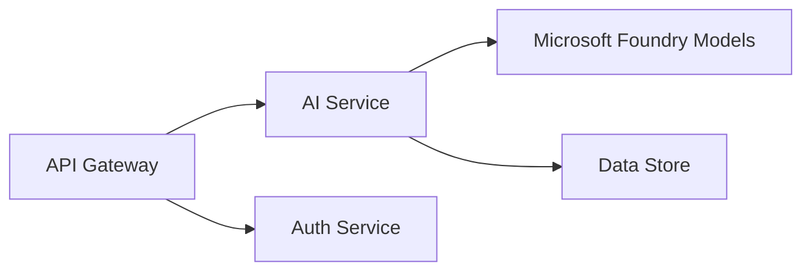
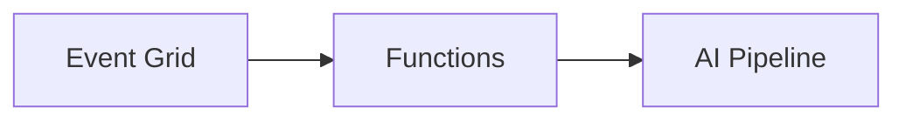

# Chương 8: Các Mẫu Sản Xuất & Doanh Nghiệp

**📚 Khóa học**: [AZD Cho Người Mới Bắt Đầu](../../README.md) | **⏱️ Thời lượng**: 2-3 giờ | **⭐ Độ phức tạp**: Nâng cao

---

## Tổng quan

Chương này bao gồm các mẫu triển khai sẵn sàng cho doanh nghiệp, tăng cường bảo mật, giám sát và tối ưu chi phí cho các khối lượng công việc AI trong môi trường sản xuất.

Đây là tài liệu tham khảo kiến trúc, không phải mẫu triển khai sản xuất hoàn chỉnh. Các ví dụ bỏ qua các chi tiết tích hợp cần được cung cấp và kiểm thử trong ứng dụng của bạn; việc đọc danh sách kiểm tra không chứng nhận khả năng sẵn sàng sản xuất.

> **Đánh giá phát hành (2026-11-04):** Hướng dẫn AI CLI đã được kiểm tra đối chiếu với tài liệu/nguồn mã của `azd 1.37.2`, các agent `1.0.0-beta.23`, và các đánh giá `1.0.0-beta.2`. Xem [thay đổi và sửa lỗi phát hành](production-ai-practices.md#recent-release-changes-and-fixes) để biết yêu cầu tương thích và chi tiết di chuyển; đây không phải là xác thực triển khai trực tiếp.

## Mục tiêu học tập

Khi hoàn thành chương này, bạn sẽ:
- Triển khai ứng dụng bền vững đa vùng
- Áp dụng các mẫu bảo mật doanh nghiệp
- Cấu hình giám sát toàn diện
- Tối ưu chi phí quy mô lớn
- Thiết lập đường ống CI/CD với AZD

---

## 📚 Các bài học

| # | Bài học | Mô tả | Thời gian |
|---|--------|-------------|------|
| 1 | [Thực tiễn AI trong sản xuất](production-ai-practices.md) | Các mẫu triển khai doanh nghiệp | 90 phút |

---

## 🚀 Danh sách kiểm tra sản xuất

- [ ] Triển khai đa vùng cho độ bền
- [ ] Định danh quản lý cho xác thực (không dùng khóa)
- [ ] Application Insights cho giám sát
- [ ] Cấu hình ngân sách chi phí và cảnh báo
- [ ] Bật quét bảo mật
- [ ] Tích hợp đường ống CI/CD
- [ ] Kế hoạch phục hồi thảm họa

---

## 🏗️ Mẫu kiến trúc

### Mẫu 1: AI Microservices



### Mẫu 2: AI Dựa trên Sự kiện



---

## 🔐 Thực hành bảo mật tốt nhất

```bicep
// Illustrative properties from different resources, NOT a standalone Bicep file.
// Attach identity to the application host:
identity: {
  type: 'SystemAssigned'
}

// AI account properties (also require private endpoints, DNS and app connectivity):
properties: {
  publicNetworkAccess: 'Disabled'
  networkAcls: {
    defaultAction: 'Deny'
  }
}
```

---

## 💰 Tối ưu chi phí

| Chiến lược | Ràng buộc chính |
|----------|---------|
| Quy mô về 0 (Container Apps) | Yêu cầu trigger phù hợp; các dịch vụ khác vẫn phát sinh chi phí |
| Sử dụng cấp tiêu thụ cho phát triển | So sánh giá dịch vụ đã chọn và khối lượng công việc |
| Điều chỉnh quy mô theo lịch trình | Quy mô qua hạ tầng/tự động hóa được hỗ trợ |
| Đặt chỗ/dung lượng dự phòng | Chỉ khi được hỗ trợ; cam kết có thể làm tăng chi phí không sử dụng |

Sử dụng [mẫu tài nguyên ngân sách hoàn chỉnh](production-ai-practices.md#2-cost-monitoring-and-budgets) với ngày bắt đầu hợp lệ, phạm vi thanh toán, người nhận, và quyền hạn. Ngân sách gửi cảnh báo; nó không giới hạn chi tiêu. Tiết kiệm phụ thuộc vào mức sử dụng đo đạc và không có tỉ lệ đảm bảo.

---

## 📊 Thiết lập giám sát

```bash
# Open the Application Insights logs view (requires configured monitoring)
azd monitor --logs

# Check Application Insights
azd monitor --overview

# View metrics
az monitor metrics list --resource <resource-id>
```

---

## 🔗 Điều hướng

| Hướng | Chương |
|-----------|---------|
| **Trước đó** | [Chương 7: Khắc phục sự cố](../chapter-07-troubleshooting/README.md) |
| **Hoàn thành khóa học** | [Trang chủ khóa học](../../README.md) |

---

## 📖 Tài nguyên liên quan

- [Hướng dẫn AI Agents](../chapter-02-ai-development/agents.md)
- [Application Insights](../chapter-06-pre-deployment/application-insights.md)
- [Giải pháp đa agent](../chapter-05-multi-agent/README.md)
- [Ví dụ Microservices](../../examples/microservices/README.md)

---

<!-- CO-OP TRANSLATOR DISCLAIMER START -->
**Tuyên bố miễn trừ trách nhiệm**:
Tài liệu này đã được dịch bằng dịch vụ dịch thuật AI [Co-op Translator](https://github.com/Azure/co-op-translator). Mặc dù chúng tôi cố gắng đảm bảo độ chính xác, xin lưu ý rằng bản dịch tự động có thể chứa lỗi hoặc sai sót. Tài liệu gốc bằng ngôn ngữ gốc nên được coi là nguồn tin chính thức. Đối với thông tin quan trọng, nên sử dụng dịch vụ dịch thuật chuyên nghiệp bởi con người. Chúng tôi không chịu trách nhiệm về bất kỳ hiểu lầm hoặc giải thích sai nào phát sinh từ việc sử dụng bản dịch này.
<!-- CO-OP TRANSLATOR DISCLAIMER END -->