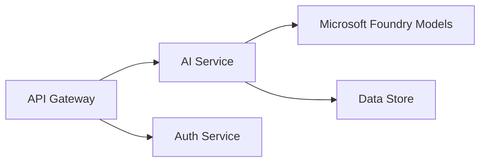
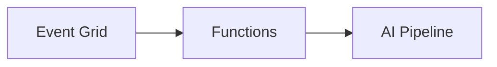

# Chương 8: Mẫu Sản Xuất & Doanh Nghiệp

**📚 Khóa học**: [AZD For Beginners](../../README.md) | **⏱️ Thời lượng**: 2-3 giờ | **⭐ Độ phức tạp**: Nâng cao

---

## Tổng quan

Chương này đề cập đến các mẫu triển khai sẵn sàng cho doanh nghiệp, tăng cường bảo mật, giám sát và tối ưu chi phí cho khối lượng công việc AI trong môi trường sản xuất.

Đây là tài liệu tham khảo kiến trúc, không phải mẫu triển khai sản xuất hoàn chỉnh có thể dùng ngay. Các ví dụ bỏ qua các chi tiết tích hợp phải được cung cấp và kiểm thử trong ứng dụng của bạn; việc đọc checklist không chứng nhận sự sẵn sàng cho sản xuất.

> **Cập nhật Foundry GA (2026-11-09):** Sử dụng `azd >= 1.37.0` và gói `microsoft.foundry` 1.0 đã phát hành cho workflow Foundry; các đánh giá được cài riêng. Xem [phạm vi phát hành và di cư](production-ai-practices.md#recent-release-changes-and-fixes) và [ví dụ pipeline có xác thực](production-ai-practices.md#cicd-pipeline-configuration). Đây là rà soát tài liệu, không phải xác nhận triển khai trực tiếp hay trạng thái GA cho các tính năng xem trước tùy chọn.

## Mục tiêu học tập

Sau khi hoàn thành chương này, bạn sẽ:
- Triển khai các ứng dụng đa khu vực để tăng độ bền vững
- Thực hiện các mẫu bảo mật doanh nghiệp
- Cấu hình giám sát toàn diện
- Tối ưu hóa chi phí quy mô lớn
- Thiết lập pipeline CI/CD với AZD

---

## 📚 Các bài học

| # | Bài học | Mô tả | Thời gian |
|---|--------|-------------|------|
| 1 | [Thực hành AI trong sản xuất](production-ai-practices.md) | Mẫu triển khai doanh nghiệp | 90 phút |

---

## 🚀 Checklist sản xuất

- [ ] Triển khai đa khu vực để tăng độ bền
- [ ] Nhận diện quản lý cho xác thực (không dùng khóa)
- [ ] Application Insights để giám sát
- [ ] Cấu hình ngân sách và cảnh báo chi phí
- [ ] Kích hoạt quét bảo mật
- [ ] Tích hợp pipeline CI/CD
- [ ] Kế hoạch khôi phục thảm họa

---

## 🏗️ Mẫu kiến trúc

### Mẫu 1: AI Microservices



### Mẫu 2: AI theo sự kiện



---

## 🔐 Thực hành bảo mật tốt nhất

```bicep
// Illustrative properties from different resources, NOT a standalone Bicep file.
// Attach identity to the application host:
identity: {
  type: 'SystemAssigned'
}

// AI account properties (also require private endpoints, DNS and app connectivity):
properties: {
  publicNetworkAccess: 'Disabled'
  networkAcls: {
    defaultAction: 'Deny'
  }
}
```

---

## 💰 Tối ưu chi phí

| Chiến lược | Ràng buộc chính |
|----------|---------|
| Phóng to đến zero (Container Apps) | Đòi hỏi trình kích hoạt phù hợp; dịch vụ khác vẫn phát sinh chi phí |
| Sử dụng tầng tiêu thụ cho phát triển | So sánh giá dịch vụ đã chọn và khối lượng công việc |
| Tăng giảm theo lịch trình | Phóng to qua hạ tầng/tự động hóa được hỗ trợ |
| Đặt chỗ/dung lượng cấp phát | Chỉ khi được hỗ trợ; cam kết có thể tăng chi phí không sử dụng |

Sử dụng [mẫu tài nguyên ngân sách hoàn chỉnh](production-ai-practices.md#2-cost-monitoring-and-budgets) với ngày bắt đầu hợp lệ, phạm vi thanh toán, người nhận và quyền hạn. Ngân sách gửi cảnh báo; không giới hạn chi tiêu. Tiết kiệm dựa trên mức sử dụng đo được và không đảm bảo tỷ lệ phần trăm nào.

---

## 📊 Cài đặt giám sát

```bash
# Open the Application Insights logs view (requires configured monitoring)
azd monitor --logs

# Check Application Insights
azd monitor --overview

# View metrics
az monitor metrics list --resource <resource-id>
```

---

## 🔗 Điều hướng

| Hướng đi | Chương |
|-----------|---------|
| **Trước** | [Chương 7: Khắc phục sự cố](../chapter-07-troubleshooting/README.md) |
| **Hoàn thành Khóa học** | [Trang chính Khóa học](../../README.md) |

---

## 📖 Tài nguyên liên quan

- [Hướng dẫn AI Agents](../chapter-02-ai-development/agents.md)
- [Application Insights](../chapter-06-pre-deployment/application-insights.md)
- [Giải pháp đa tác nhân](../chapter-05-multi-agent/README.md)
- [Ví dụ Microservices](../../examples/microservices/README.md)

---

<!-- CO-OP TRANSLATOR DISCLAIMER START -->
**Tuyên bố miễn trừ trách nhiệm**:
Tài liệu này đã được dịch bằng dịch vụ dịch thuật AI [Co-op Translator](https://github.com/Azure/co-op-translator). Mặc dù chúng tôi cố gắng đảm bảo độ chính xác, xin lưu ý rằng bản dịch tự động có thể chứa lỗi hoặc sai sót. Tài liệu gốc bằng ngôn ngữ gốc nên được coi là nguồn tin chính thức. Đối với thông tin quan trọng, nên sử dụng dịch vụ dịch thuật chuyên nghiệp bởi con người. Chúng tôi không chịu trách nhiệm về bất kỳ hiểu lầm hoặc giải thích sai nào phát sinh từ việc sử dụng bản dịch này.
<!-- CO-OP TRANSLATOR DISCLAIMER END -->