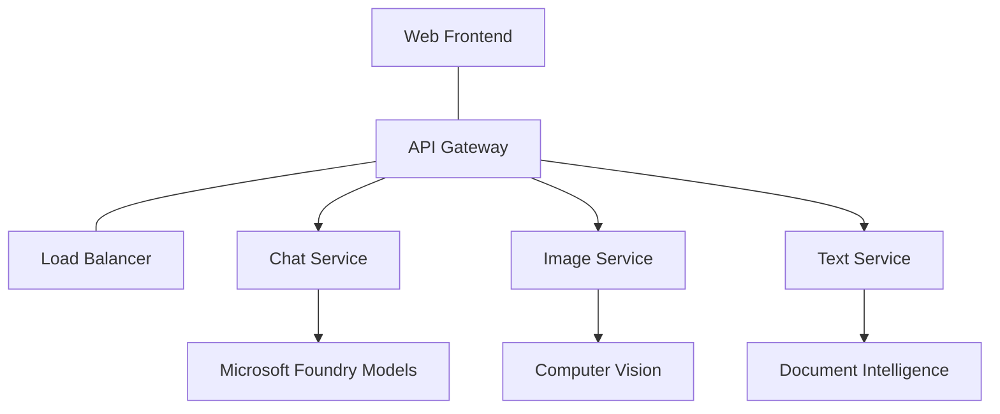

# Thực hành tốt nhất cho Khối lượng công việc AI trong Sản xuất với AZD

**Điều hướng chương:**
- **📚 Trang khóa học**: [AZD For Beginners](../../README.md)
- **📖 Chương hiện tại**: Chương 8 - Mẫu sản xuất & Doanh nghiệp
- **⬅️ Chương trước**: [Chương 7: Xử lý sự cố](../chapter-07-troubleshooting/debugging.md)
- **⬅️ Liên quan**: [AI Workshop Lab](../chapter-02-ai-development/ai-workshop-lab.md)
- **🎯 Hoàn thành khóa học**: [AZD For Beginners](../../README.md)

## Tổng quan

Hướng dẫn này giải thích các mẫu thiết kế AI trong sản xuất sử dụng Azure Developer CLI (AZD). Đây là tài liệu tham khảo thiết kế, không phải ứng dụng có thể triển khai hoặc chứng nhận sản xuất.

**Ranh giới ví dụ:** Trừ khi mô tả rõ là hoàn chỉnh, các đoạn Bicep giả định có các tham số và tài nguyên được tham chiếu từ mẫu chứa. Chúng không bao gồm hình ảnh/plan máy chủ, danh tính, phân quyền, DNS, đầu ra, và các tích hợp cần thiết khác. Các đường dẫn dịch vụ YAML và script hook/kiểm thử là các tệp minh họa để bạn tạo trong **ứng dụng riêng của bạn**; chúng không được cung cấp trong khóa học này. Sử dụng mẫu AZD hoạt động làm cơ sở, biên dịch cơ sở hạ tầng hoàn chỉnh và kiểm thử trong môi trường cách ly trước khi triển khai sản xuất.

## Những thách thức chính được giải quyết

Các mối quan tâm phổ biến trong sản xuất bao gồm triển khai đa dịch vụ, quản lý danh tính và bí mật, mở rộng quy mô, kiểm soát chi phí, và giám sát. Không có tuyên bố về mức độ phổ biến được đo lường tại đây.

## Mẫu kiến trúc cho AI trong sản xuất

### Mẫu 1: Kiến trúc AI Microservices

**Khi sử dụng**: Ứng dụng AI phức tạp với nhiều tính năng



**Triển khai AZD**:

```yaml
# azure.yaml
name: enterprise-ai-platform
services:
  web:
    project: ./web
    host: staticwebapp
  api-gateway:
    project: ./api-gateway
    host: containerapp
  chat-service:
    project: ./services/chat
    host: containerapp
  vision-service:
    project: ./services/vision
    host: containerapp
  text-service:
    project: ./services/text
    host: containerapp
```

### Mẫu 2: Xử lý AI theo sự kiện

**Khi sử dụng**: Xử lý theo lô, phân tích tài liệu, quy trình bất đồng bộ

```bicep
// Event Hub for AI processing pipeline
resource eventHub 'Microsoft.EventHub/namespaces@2024-01-01' = {
  name: eventHubNamespaceName
  location: location
  sku: {
    name: 'Standard'
    tier: 'Standard'
    capacity: 1
  }
}

// Service Bus for reliable message processing
resource serviceBus 'Microsoft.ServiceBus/namespaces@2024-01-01' = {
  name: serviceBusNamespaceName
  location: location
  sku: {
    name: 'Premium'
    tier: 'Premium'
    capacity: 1
  }
}

// Function App for processing
resource functionApp 'Microsoft.Web/sites@2023-01-01' = {
  name: functionAppName
  location: location
  kind: 'functionapp,linux'
  properties: {
    siteConfig: {
      appSettings: [
        {
          name: 'FUNCTIONS_EXTENSION_VERSION'
          value: '~4'
        }
        {
          name: 'AZURE_OPENAI_ENDPOINT'
          value: '@Microsoft.KeyVault(VaultName=${keyVault.name};SecretName=openai-endpoint)'
        }
      ]
    }
  }
}
```

Điều này tạo các đoạn namespace, không phải hubs, queues, subscriptions hoặc trigger Function. Một Function có thể chạy còn cần kế hoạch hosting, cấu hình runtime/storage, danh tính đính kèm, RBAC và truy cập mạng. Tham chiếu Key Vault cần có quyền đọc bí mật; chỉ một URL endpoint không phải là thông tin xác thực.

## Suy nghĩ về sức khỏe của tác nhân AI

Khi một ứng dụng web truyền thống hỏng, các triệu chứng rất quen thuộc: trang không tải, API trả lỗi, hoặc triển khai thất bại. Ứng dụng AI cũng có thể hỏng theo những cách đó—nhưng còn có thể hành xử sai lệch một cách tinh vi hơn mà không gây lỗi rõ ràng.

Phần này giúp bạn xây dựng mô hình suy nghĩ để giám sát khối lượng công việc AI nhằm biết nơi cần kiểm tra khi mọi thứ có dấu hiệu không ổn.

### Sức khỏe tác nhân khác với sức khỏe ứng dụng truyền thống thế nào

Ứng dụng truyền thống cũng có thể có lỗi chính xác tinh tế. Một tác nhân AI thêm chất lượng phản hồi không xác định vào các mối quan tâm về tính khả dụng và chính xác. Hãy nghĩ về sức khỏe tác nhân theo hai lớp:

| Lớp | Cái cần theo dõi | Nơi cần xem |
|-------|--------------|---------------|
| **Sức khỏe hạ tầng** | Dịch vụ có đang chạy không? Tài nguyên có được cấp phát? Các endpoint có thể kết nối không? | `azd monitor`, trạng thái tài nguyên Azure Portal, log container/app |
| **Sức khỏe hành vi** | Tác nhân có phản hồi chính xác không? Phản hồi có kịp thời không? Mô hình có được gọi đúng không? | Traces Application Insights, chỉ số độ trễ gọi mô hình, log chất lượng phản hồi |

Sức khỏe hạ tầng thì quen thuộc—giống như với bất kỳ ứng dụng azd nào. Sức khỏe hành vi là lớp mới mà khối lượng công việc AI giới thiệu.

### Nơi cần quan sát khi ứng dụng AI không hoạt động như mong đợi

Nếu ứng dụng AI của bạn không cho kết quả như kỳ vọng, đây là checklist khái niệm:

1. **Bắt đầu từ những điều cơ bản.** Ứng dụng có đang chạy không? Nó có thể kết nối tới các phụ thuộc không? Kiểm tra `azd monitor` và trạng thái tài nguyên như với bất kỳ ứng dụng nào.
2. **Kiểm tra kết nối mô hình.** Ứng dụng của bạn có gọi thành công mô hình AI không? Các cuộc gọi mô hình bị lỗi hoặc timeout là nguyên nhân phổ biến nhất gây ra sự cố ứng dụng AI và sẽ xuất hiện trong log ứng dụng.
3. **Kiểm tra đầu vào và định hướng an toàn.** Câu trả lời sai có thể do truy xuất, hướng dẫn, giới hạn mô hình hoặc thực thi công cụ. Sử dụng dữ liệu chẩn đoán được kiểm soát truy cập và đã ẩn thông tin riêng biệt; không bật ghi log prompt/phản hồi tùy tiện trong môi trường sản xuất.
4. **Xem xét độ trễ phản hồi.** Các cuộc gọi mô hình AI thường chậm hơn các cuộc gọi API thông thường. Nếu ứng dụng cảm thấy chậm, hãy kiểm tra xem thời gian phản hồi mô hình có tăng không—điều này có thể cho thấy giới hạn throttling, hạn mức năng lực, hoặc tắc nghẽn cấp vùng.
5. **Quan sát dấu hiệu chi phí.** Tăng đột ngột trong sử dụng token hoặc cuộc gọi API có thể chỉ ra vòng lặp, prompt cấu hình sai, hoặc thử lại quá nhiều.

Bạn không cần thành thạo công cụ quan sát ngay lập tức. Điều cần nhớ là ứng dụng AI có lớp hành vi bổ sung cần giám sát, và tính năng giám sát tích hợp của azd (`azd monitor`) cung cấp điểm bắt đầu để điều tra hai lớp đó.

---

## Thực hành bảo mật tốt nhất

### 1. Mô hình bảo mật Không tin cậy

**Chiến lược triển khai**:
- Không có giao tiếp dịch vụ tới dịch vụ nếu không xác thực
- Tất cả các cuộc gọi API sử dụng danh tính được quản lý
- Cô lập mạng với các endpoint riêng tư
- Kiểm soát truy cập với quyền ít nhất cần thiết

```bicep
// Managed Identity for each service
resource chatServiceIdentity 'Microsoft.ManagedIdentity/userAssignedIdentities@2023-01-31' = {
  name: 'chat-service-identity'
  location: location
}

// Role assignments with minimal permissions
resource openAIUserRole 'Microsoft.Authorization/roleAssignments@2022-04-01' = {
  scope: openAIAccount
  name: guid(openAIAccount.id, chatServiceIdentity.id, '5e0bd9bd-7b93-4f28-af87-19fc36ad61bd')
  properties: {
    roleDefinitionId: subscriptionResourceId('Microsoft.Authorization/roleDefinitions', '5e0bd9bd-7b93-4f28-af87-19fc36ad61bd')
    principalId: chatServiceIdentity.properties.principalId
    principalType: 'ServicePrincipal'
  }
}
```

### 2. Quản lý bí mật an toàn

**Mẫu tích hợp Key Vault**:

```bicep
// Key Vault with proper access policies
resource keyVault 'Microsoft.KeyVault/vaults@2023-02-01' = {
  name: keyVaultName
  location: location
  properties: {
    tenantId: tenant().tenantId
    sku: {
      family: 'A'
      name: 'standard' // Premium is needed for HSM-backed keys, not ordinary secrets
    }
    enableRbacAuthorization: true  // Use RBAC instead of access policies
    enablePurgeProtection: true    // Prevent accidental deletion
    enableSoftDelete: true
    softDeleteRetentionInDays: 90
  }
}

// Optional legacy key-auth alternative; omit when using Entra ID.
resource openAIKeySecret 'Microsoft.KeyVault/vaults/secrets@2023-02-01' = {
  parent: keyVault
  name: 'openai-api-key'
  properties: {
    value: openAIAccount.listKeys().key1
    attributes: {
      enabled: true
    }
  }
}
```

Gán danh tính runtime `Key Vault Secrets User` tại phạm vi phù hợp và đính kèm vào host; `enableRbacAuthorization` một mình không cấp quyền truy cập. Ưu tiên xác thực danh tính được quản lý OpenAI với `disableLocalAuth: true`. Bí mật khóa tùy chọn chỉ có ý nghĩa với tài khoản được bật khóa một cách chủ ý, và chủ thể cấp quyền cũng cần có quyền ghi bí mật.

### 3. Bảo mật mạng

**Cấu hình Endpoint riêng tư**:

```bicep
// Virtual Network for AI services
resource virtualNetwork 'Microsoft.Network/virtualNetworks@2023-04-01' = {
  name: vnetName
  location: location
  properties: {
    addressSpace: {
      addressPrefixes: ['10.0.0.0/16']
    }
    subnets: [
      {
        name: 'ai-services-subnet'
        properties: {
          addressPrefix: '10.0.1.0/24'
          privateEndpointNetworkPolicies: 'Disabled'
        }
      }
      {
        name: 'app-services-subnet'
        properties: {
          addressPrefix: '10.0.2.0/24'
          delegations: [
            {
              name: 'Microsoft.Web/serverFarms'
              properties: {
                serviceName: 'Microsoft.Web/serverFarms'
              }
            }
          ]
        }
      }
    ]
  }
}

// Private endpoints for all AI services
resource openAIPrivateEndpoint 'Microsoft.Network/privateEndpoints@2023-04-01' = {
  name: '${openAIAccountName}-pe'
  location: location
  properties: {
    subnet: {
      id: virtualNetwork.properties.subnets[0].id
    }
    privateLinkServiceConnections: [
      {
        name: 'openai-connection'
        properties: {
          privateLinkServiceId: openAIAccount.id
          groupIds: ['account']
        }
      }
    ]
  }
}
```

Các endpoint riêng tư cũng yêu cầu nhóm vùng DNS riêng/VNet links và tích hợp VNet ứng dụng. Chúng không tự động chặn truy cập công cộng: cần tắt truy cập mạng công cộng của tài khoản AI một cách rõ ràng sau khi xác thực kết nối riêng và truy cập triển khai.

## Hiệu năng và Mở rộng

### 1. Chiến lược tự động mở rộng

**Tự động mở rộng Container Apps**:

```bicep
resource containerApp 'Microsoft.App/containerApps@2023-05-01' = {
  name: containerAppName
  location: location
  properties: {
    configuration: {
      ingress: {
        external: true
        targetPort: 8000
        transport: 'http'
      }
    }
    template: {
      scale: {
        minReplicas: 2  // Always have 2 instances minimum
        maxReplicas: 50 // Scale up to 50 for high load
        rules: [
          {
            name: 'http-scaling'
            http: {
              metadata: {
                concurrentRequests: '20'  // Scale when >20 concurrent requests
              }
            }
          }
          {
            name: 'cpu-scaling'
            custom: {
              type: 'cpu'
              metadata: {
                type: 'Utilization'
                value: '70'  // Scale when CPU >70%
              }
            }
          }
        ]
      }
    }
  }
}
```

### 2. Chiến lược bộ nhớ đệm

**Redis Cache cho phản hồi AI**:

```bicep
// Legacy Azure Cache for Redis example (not recommended for new deployments)
resource redisCache 'Microsoft.Cache/redis@2023-04-01' = {
  name: redisCacheName
  location: location
  properties: {
    sku: {
      name: 'Premium'
      family: 'P'
      capacity: 1
    }
    enableNonSslPort: false
    minimumTlsVersion: '1.2'
    redisConfiguration: {
      'maxmemory-policy': 'allkeys-lru'
    }
    // Sharding distributes data; replication/failover provides availability.
    shardCount: 2
  }
}

// Cache configuration in application
var cacheConnectionString = '${redisCache.properties.hostName}:6380,password=${redisCache.listKeys().primaryKey},ssl=True,abortConnect=False'
```

Azure Cache cho Redis Basic/Standard/Premium đang trên [đường hướng nghỉ hưu](https://learn.microsoft.com/azure/azure-cache-for-redis/retirement-faq). Sử dụng Azure Managed Redis cho thiết kế mới và cấu hình SKU, danh tính, TLS được tài liệu hóa, thay vì sao chép tài nguyên cũ này vào hệ thống sản xuất mới. Dòng chuỗi kết nối là placeholder không chức năng, không phải thông tin xác thực. Phân vùng khóa cache theo ủy quyền, mô hình/hướng dẫn, và phiên bản truy xuất, kèm hết hạn; cache chỉ truy vấn chia sẻ có thể lộ dữ liệu người dùng khác.

### 3. Cân bằng tải và quản lý lưu lượng

**Application Gateway với WAF**:

```bicep
// Application Gateway with Web Application Firewall
resource applicationGateway 'Microsoft.Network/applicationGateways@2023-04-01' = {
  name: appGatewayName
  location: location
  properties: {
    sku: {
      name: 'WAF_v2'
      tier: 'WAF_v2'
      capacity: 2
    }
    webApplicationFirewallConfiguration: {
      enabled: true
      firewallMode: 'Prevention'
      ruleSetType: 'OWASP'
      ruleSetVersion: '3.2'
    }
    // Backend pools for AI services
    backendAddressPools: [
      {
        name: 'ai-services-pool'
        properties: {
          backendAddresses: [
            {
              fqdn: '${containerApp.properties.configuration.ingress.fqdn}'
            }
          ]
        }
      }
    ]
  }
}
```

Đây là tài nguyên gateway một phần: triển khai thực cũng cần subnet/IP gateway, IP và cổng frontend, trình nghe/chứng chỉ TLS, cấu hình HTTP backend/cảnh báo, quy tắc định tuyến và ưu tiên, và chính sách WAF đã được xem xét. Hostname/SNI và xác thực TLS phải khớp backend Container App.

## 💰 Tối ưu chi phí

### 1. Phân bổ tài nguyên phù hợp

**Cấu hình theo môi trường cụ thể**:

Những tên này là **đầu vào mẫu tùy chỉnh minh họa**, không phải cài đặt AZD tự động. Ánh xạ từng cái vào `infra/main.parameters.json`/Bicep và cấu hình host trước. Ví dụ, mẫu RAG sử dụng `AZURE_SEARCH_SERVICE_SKU` và `AZURE_OPENAI_CHATGPT_DEPLOYMENT_CAPACITY`, không phải tên chung dưới đây. Cấp phát bộ nhớ Container Apps với đơn vị được hỗ trợ như `1Gi` trong tài nguyên thực tế. Áp dụng thay đổi hạ tầng với `azd up` hoặc `azd provision`; `azd deploy` một mình không áp dụng thay đổi Bicep.

```bash
# Development environment
azd env new development
azd env set AZURE_OPENAI_SKU "S0"
azd env set AZURE_OPENAI_CAPACITY 10
azd env set AZURE_SEARCH_SKU "basic"
azd env set CONTAINER_CPU 0.5
azd env set CONTAINER_MEMORY 1.0

# Production environment  
azd env new production
azd env set AZURE_OPENAI_SKU "S0"
azd env set AZURE_OPENAI_CAPACITY 100
azd env set AZURE_SEARCH_SKU "standard"
azd env set CONTAINER_CPU 2.0
azd env set CONTAINER_MEMORY 4.0
```

### 2. Giám sát chi phí và ngân sách

```bicep
// Supply the first day of the current UTC month, e.g. 2026-11-01T00:00:00Z.
param budgetStartDate string

// Cost management and budgets
resource budget 'Microsoft.Consumption/budgets@2024-08-01' = {
  name: 'ai-workload-budget'
  properties: {
    timePeriod: {
      startDate: budgetStartDate
    }
    timeGrain: 'Monthly'
    amount: 2000  // In the billing currency, not necessarily USD
    category: 'Cost'
    notifications: {
      warning: {
        enabled: true
        operator: 'GreaterThan'
        threshold: 80
        contactEmails: [
          'finance@company.com'
          'engineering@company.com'
        ]
        contactRoles: [
          'Owner'
          'Contributor'
        ]
      }
      critical: {
        enabled: true
        operator: 'GreaterThan'
        threshold: 95
        contactEmails: [
          'cto@company.com'
        ]
      }
    }
  }
}
```

Thay thế người nhận mẫu và kiểm tra phạm vi/quyền. Cảnh báo ngân sách sử dụng dữ liệu thanh toán trễ và không giới hạn chi tiêu.

### 3. Tối ưu sử dụng token

**Quản lý chi phí OpenAI**:

Đây chỉ là heuristics dựa trên ký tự cho bản xem trước UI, **không phải** trình xác thực giới hạn token mô hình. Code sản xuất phải sử dụng bộ chia token phù hợp với mô hình triển khai và tính đến hướng dẫn hệ thống, schema công cụ, lịch sử, và ngân sách đầu ra. Từ chối tin nhắn người dùng quá lớn thay vì cắt ngầm.

```typescript
// Application-level token optimization
class TokenOptimizer {
  private readonly maxTokens = 4000;
  private readonly reserveTokens = 500;
  
  optimizePrompt(userInput: string, context: string): string {
    const availableTokens = this.maxTokens - this.reserveTokens;
    if (this.estimateTokens(userInput) + 8 >= availableTokens) {
      throw new Error("User input exceeds the illustrative prompt budget");
    }
    const estimatedTokens = this.estimateTokens(userInput + context) + 8;
    
    if (estimatedTokens > availableTokens) {
      // Truncate context, not user input
      context = this.truncateContext(context, Math.max(0, availableTokens - this.estimateTokens(userInput) - 8));
    }
    
    return `${context}\n\nUser: ${userInput}`;
  }
  
  private estimateTokens(text: string): number {
    // Rough estimation: 1 token ≈ 4 characters
    return Math.ceil(text.length / 4);
  }

  private truncateContext(text: string, estimatedBudget: number): string {
    return text.slice(0, Math.max(0, estimatedBudget) * 4);
  }
}
```

## Giám sát và Quan sát

### 1. Application Insights Toàn diện

```bicep
// Application Insights with advanced features
resource applicationInsights 'Microsoft.Insights/components@2020-02-02' = {
  name: applicationInsightsName
  location: location
  kind: 'web'
  properties: {
    Application_Type: 'web'
    WorkspaceResourceId: logAnalyticsWorkspace.id
    SamplingPercentage: 100  // Ingestion setting; review cost and SDK sampling separately
    DisableIpMasking: false  // Retain IP masking
  }
}

// Custom metrics for AI operations
resource aiMetricAlerts 'Microsoft.Insights/metricAlerts@2018-03-01' = {
  name: 'ai-high-error-rate'
  location: 'global'
  properties: {
    description: 'Alert when failed request count exceeds 10 in five minutes'
    severity: 2
    enabled: true
    scopes: [
      applicationInsights.id
    ]
    evaluationFrequency: 'PT1M'
    windowSize: 'PT5M'
    criteria: {
      'odata.type': 'Microsoft.Azure.Monitor.SingleResourceMultipleMetricCriteria'
      allOf: [
        {
          name: 'high-error-rate'
          metricName: 'requests/failed'
          operator: 'GreaterThan'
          threshold: 10
          timeAggregation: 'Count'
        }
      ]
    }
  }
}
```

### 2. Giám sát riêng cho AI

**Bảng điều khiển tùy chỉnh cho chỉ số AI**:

```json
{
  "dashboard": {
    "name": "AI Application Monitoring",
    "tiles": [
      {
        "name": "OpenAI Request Volume",
        "query": "dependencies | where target contains 'openai' | summarize count() by bin(timestamp, 5m)"
      },
      {
        "name": "AI Response Latency",
        "query": "dependencies | where target contains 'openai' | summarize avg(duration) by bin(timestamp, 5m)"
      },
      {
        "name": "Token Usage",
        "query": "customMetrics | where name == 'openai_tokens_used' | summarize sum(value) by bin(timestamp, 1h)"
      },
      {
        "name": "Cost per Hour",
        "query": "customMetrics | where name == 'openai_cost' | summarize sum(value) by bin(timestamp, 1h)"
      }
    ]
  }
}
```

JSON này là bản phác thảo do ứng dụng định nghĩa, không phải schema dashboard Azure portal có thể nhập. Các truy vấn token/chi phí yêu cầu ứng dụng của bạn phát ra chính xác các chỉ số tùy chỉnh đó; chúng không được tạo bởi AZD. Điều chỉnh bộ lọc phụ thuộc theo tên endpoint/span mô hình thực tế của bạn.

### 3. Kiểm tra sức khỏe và giám sát thời gian hoạt động

```bicep
// Application Insights availability tests
resource availabilityTest 'Microsoft.Insights/webtests@2022-06-15' = {
  name: 'ai-app-availability-test'
  location: location
  tags: {
    'hidden-link:${applicationInsights.id}': 'Resource'
  }
  properties: {
    SyntheticMonitorId: 'ai-app-availability-test'
    Name: 'AI Application Availability Test'
    Description: 'Tests AI application endpoints'
    Enabled: true
    Frequency: 300  // 5 minutes
    Timeout: 120    // 2 minutes
    Kind: 'standard'
    Locations: [
      {
        Id: 'us-east-2-azr'
      }
      {
        Id: 'us-west-2-azr'
      }
    ]
    Request: {
      RequestUrl: 'https://${webApp.properties.defaultHostName}/health'
      HttpVerb: 'GET'
      FollowRedirects: true
      ParseDependentRequests: false
    }
    ValidationRules: {
      ExpectedHttpStatusCode: 200
      SSLCheck: true
      SSLCertRemainingLifetimeCheck: 7
    }
  }
}
```

## Khôi phục thảm họa và Độ khả dụng cao

Kiểm thử trước đó giả định đã có App Service `webApp` và tài nguyên Application Insights. Các bài test khả dụng tiêu chuẩn có tính phí và cần endpoint có thể truy cập; app chỉ riêng tư cần thiết kế giám sát riêng tư phù hợp. Kiểm thử ping URL đã lỗi thời; dùng [các bài test khả dụng tiêu chuẩn](https://learn.microsoft.com/azure/azure-monitor/app/availability).

### 1. Triển khai đa vùng

```yaml
# azure.yaml - Multi-region configuration
name: ai-app-multiregion
services:
  api-primary:
    project: ./api
    host: containerapp
    env:
      AZURE_REGION: eastus
  api-secondary:
    project: ./api
    host: containerapp
    env:
      AZURE_REGION: westus2
```

```bicep
// Separate App Service topology, not the Container Apps declarations above
resource trafficManager 'Microsoft.Network/trafficManagerProfiles@2022-04-01' = {
  name: trafficManagerProfileName
  location: 'global'
  properties: {
    profileStatus: 'Enabled'
    trafficRoutingMethod: 'Priority'
    dnsConfig: {
      relativeName: trafficManagerProfileName
      ttl: 30
    }
    monitorConfig: {
      protocol: 'HTTPS'
      port: 443
      path: '/health'
      intervalInSeconds: 30
      toleratedNumberOfFailures: 3
      timeoutInSeconds: 10
    }
    endpoints: [
      {
        name: 'primary-endpoint'
        type: 'Microsoft.Network/trafficManagerProfiles/azureEndpoints'
        properties: {
          targetResourceId: primaryAppService.id
          endpointStatus: 'Enabled'
          priority: 1
        }
      }
      {
        name: 'secondary-endpoint'
        type: 'Microsoft.Network/trafficManagerProfiles/azureEndpoints'
        properties: {
          targetResourceId: secondaryAppService.id
          endpointStatus: 'Enabled'
          priority: 2
        }
      }
    ]
  }
}
```

Biến môi trường không chọn vị trí tài nguyên. IaC phải cấp phát host vùng riêng biệt và liên kết mỗi dịch vụ với thẻ `resourceName` hoặc `azd-service-name`. Ví dụ Traffic Manager là **topology App Service riêng biệt** (`primaryAppService`/`secondaryAppService`), không phải định tuyến cho khai báo Container Apps. Container Apps cần endpoint bên ngoài/cửa trước được cấu hình phù hợp, định tuyến TLS/tên miền tùy chỉnh, và các probe kiểm tra sức khỏe.

### 2. Sao lưu và phục hồi dữ liệu

```bicep
// Backup configuration for critical data
resource backupVault 'Microsoft.DataProtection/backupVaults@2023-05-01' = {
  name: backupVaultName
  location: location
  identity: {
    type: 'SystemAssigned'
  }
  properties: {
    storageSettings: [
      {
        datastoreType: 'VaultStore'
        type: 'LocallyRedundant'
      }
    ]
  }
}

```

Vault một mình không sao lưu gì. Cấu hình **chính sách và instance sao lưu được hỗ trợ theo khối lượng công việc**, quyền nguồn, lưu giữ, và kiểm thử khôi phục bằng [bảng hỗ trợ Azure Backup](https://learn.microsoft.com/azure/backup/backup-support-matrix). Không có chính sách Azure Backup chung cho triển khai mô hình Azure OpenAI được lưu trữ. Giữ định nghĩa triển khai hạ tầng/mô hình trong kiểm soát nguồn; bảo vệ tài liệu tải lên, dữ liệu ứng dụng, và artifacts tinh chỉnh bằng tính năng sao lưu/xuất được hỗ trợ của mỗi dịch vụ nền tảng. Định nghĩa và kiểm thử RPO/RTO rõ ràng.

## Tích hợp DevOps và CI/CD

### 1. Workflow GitHub Actions

```yaml
# .github/workflows/deploy-ai-app.yml
name: Deploy AI Application

on:
  push:
    branches: [main]
  pull_request:
    branches: [main]

jobs:
  test:
    runs-on: ubuntu-latest
    steps:
      - uses: actions/checkout@v4
      
      - name: Setup Python
        uses: actions/setup-python@v4
        with:
          python-version: '3.11'
          
      - name: Install dependencies
        run: |
          pip install -r requirements.txt
          pip install pytest
          
      - name: Run tests
        run: pytest tests/
        
      - name: AI Safety Tests
        run: |
          python scripts/test_ai_safety.py
          python scripts/validate_prompts.py

```

Đây là **phần chỉ kiểm thử** của workflow và giả định bạn đã tạo `requirements.txt`, `tests/`, và hai script an toàn. Thêm các job cấp phép OIDC xác thực/triển khai từ [Cấu hình Pipeline CI/CD](#cicd-pipeline-configuration), với `needs: test`, kích hoạt push/manual đáng tin cậy, và môi trường GitHub được bảo vệ. Không triển khai mã pull-request không tin cậy với thông tin xác thực đám mây. Runner mới không có môi trường AZD địa phương được chọn; cung cấp tham số môi trường/đăng ký/vị trí và dùng `azd auth login`, không chỉ `azure/login`.

### 2. Xác thực hạ tầng

```bash
# scripts/validate_infrastructure.sh
#!/bin/bash
set -euo pipefail

echo "Validating AI infrastructure deployment..."

# Requires Azure CLI login and the resource group selected explicitly.
: "${AZURE_RESOURCE_GROUP:?Set AZURE_RESOURCE_GROUP}"
: "${AZURE_OPENAI_NAME:?Set AZURE_OPENAI_NAME}"
: "${AZURE_OPENAI_CHAT_DEPLOYMENT:?Set the actual deployment name}"

# A successful empty list is not proof that resources exist.
types=("Microsoft.CognitiveServices/accounts" "Microsoft.Search/searchServices"
       "Microsoft.Storage/storageAccounts" "Microsoft.KeyVault/vaults")
for resource_type in "${types[@]}"; do
    count=$(az resource list --resource-group "$AZURE_RESOURCE_GROUP" \
        --resource-type "$resource_type" --query "length(@)" -o tsv)
    if [[ "$count" -lt 1 ]]; then
        echo "ERROR: No $resource_type found in $AZURE_RESOURCE_GROUP"
        exit 1
    fi
done

# Validate OpenAI model deployments
echo "Validating OpenAI model deployments..."
state=$(az cognitiveservices account deployment show \
  --name "$AZURE_OPENAI_NAME" --resource-group "$AZURE_RESOURCE_GROUP" \
  --deployment-name "$AZURE_OPENAI_CHAT_DEPLOYMENT" \
  --query "properties.provisioningState" -o tsv)
if [[ "$state" != "Succeeded" ]]; then
    echo "ERROR: Required model deployment is not provisioned successfully"
    exit 1
fi

echo "Infrastructure validation completed successfully!"
```

Mong đợi: trả về 0 và thông báo hoàn thành chỉ khi tất cả loại dữ liệu mong đợi tồn tại và triển khai mô hình được đặt tên được cấp phát. Điều này kiểm tra trạng thái kho/triển khai, **không phải** sức khỏe tài nguyên, topology chính xác, RBAC, khả năng truy cập mạng, hoặc hành vi mô hình. Điều chỉnh loại mong đợi theo kiến trúc của bạn, rồi thực hiện kiểm thử sẵn sàng ứng dụng riêng được xác thực.

## Checklist sẵn sàng sản xuất

### Bảo mật ✅
- [ ] Tất cả dịch vụ sử dụng danh tính được quản lý
- [ ] Bí mật lưu trong Key Vault
- [ ] Cấu hình endpoints riêng tư
- [ ] Triển khai nhóm bảo mật mạng
- [ ] RBAC với quyền tối thiểu
- [ ] Bật WAF trên các endpoint công cộng

### Hiệu năng ✅
- [ ] Cấu hình tự động mở rộng
- [ ] Triển khai bộ nhớ đệm
- [ ] Thiết lập cân bằng tải
- [ ] CDN cho nội dung tĩnh
- [ ] Pooling kết nối cơ sở dữ liệu
- [ ] Tối ưu sử dụng token

### Giám sát ✅
- [ ] Cấu hình Application Insights
- [ ] Định nghĩa chỉ số tùy chỉnh
- [ ] Thiết lập quy tắc cảnh báo
- [ ] Tạo bảng điều khiển
- [ ] Triển khai kiểm tra sức khỏe
- [ ] Chính sách lưu giữ log

### Độ tin cậy ✅
- [ ] Triển khai đa vùng
- [ ] Kế hoạch sao lưu và phục hồi
- [ ] Triển khai bộ ngắt mạch
- [ ] Cấu hình chính sách thử lại
- [ ] Giảm tải mềm mại
- [ ] Endpoint kiểm tra sức khỏe

### Quản lý chi phí ✅
- [ ] Cấu hình cảnh báo ngân sách
- [ ] Phân bổ tài nguyên phù hợp
- [ ] Áp dụng chiết khấu dev/test
- [ ] Mua instances đặt trước
- [ ] Bảng điều khiển giám sát chi phí
- [ ] Xem xét chi phí định kỳ

### Tuân thủ ✅
- [ ] Đáp ứng yêu cầu cư trú dữ liệu
- [ ] Bật ghi log kiểm toán
- [ ] Áp dụng chính sách tuân thủ
- [ ] Triển khai chuẩn bảo mật
- [ ] Đánh giá an ninh định kỳ
- [ ] Kế hoạch ứng phó sự cố

## Chuẩn đoán hiệu năng

### Mục tiêu minh họa sản xuất

Đây là các SLO ví dụ để thương lượng và thử tải, không phải chuẩn đoán hay đảm bảo đo được. Độ trễ phản hồi phụ thuộc vào mô hình/độ dài đầu ra; chi tiêu token hàng tháng phụ thuộc vào lưu lượng và giá cả, không chỉ số lượng token.

| Chỉ số | Mục tiêu | Giám sát |
|--------|--------|------------|
| **Thời gian phản hồi** | < 2 giây | Application Insights |
| **Khả dụng** | 99,9% | Giám sát thời gian hoạt động |
| **Tỷ lệ lỗi** | < 0,1% | Log ứng dụng |
| **Chi tiêu mô hình** | < 500 USD/tháng (ngân sách ví dụ) | Quản lý chi phí |
| **Người dùng đồng thời** | 1000+ | Kiểm thử tải |
| **Thời gian khôi phục** | < 1 giờ | Kiểm tra khôi phục thảm họa |

### Kiểm tra tải

Dưới đây là phác thảo giao diện cho một kịch bản kiểm tra tải **bạn phải triển khai**; kho lưu trữ này không cung cấp `scripts/load_test.py`. Định nghĩa các tải trọng yêu cầu, xác thực, khối lượng công việc đại diện, các khẳng định độ trễ/tỷ lệ lỗi phần trăm, và giới hạn chi tiêu trong công cụ kiểm tra tải bạn chọn trước khi chạy:

```bash
# Load testing script for AI applications
python scripts/load_test.py \
  --endpoint https://your-ai-app.azurewebsites.net \
  --concurrent-users 100 \
  --duration 300 \
  --ramp-up 60
```

## 🤝 Thực hành tốt nhất của cộng đồng

Dựa trên phản hồi của cộng đồng Microsoft Foundry Discord:

### Các khuyến nghị hàng đầu từ cộng đồng:

1. **Bắt đầu nhỏ, mở rộng dần**: Bắt đầu với các SKU cơ bản và mở rộng dựa trên sử dụng thực tế
2. **Giám sát mọi thứ**: Thiết lập giám sát toàn diện ngay từ ngày đầu
3. **Tự động hóa bảo mật**: Sử dụng hạ tầng dưới dạng mã để đảm bảo bảo mật nhất quán
4. **Kiểm tra kỹ lưỡng**: Bao gồm kiểm tra AI cụ thể trong pipeline của bạn
5. **Lập kế hoạch chi phí**: Giám sát việc sử dụng token và thiết lập cảnh báo ngân sách sớm

### Những sai lầm thường gặp cần tránh:

- ❌ Mã hóa cứng khóa API trong mã
- ❌ Không thiết lập giám sát phù hợp
- ❌ Bỏ qua tối ưu hóa chi phí
- ❌ Không kiểm tra các tình huống thất bại
- ❌ Triển khai mà không kiểm tra sức khỏe

## Các lệnh và tiện ích mở rộng AZD AI CLI

AZD bao gồm một bộ lệnh và tiện ích mở rộng AI dành riêng đang phát triển giúp tối ưu hóa các luồng công việc AI sản xuất. Các công cụ này kết nối sự phát triển cục bộ và triển khai sản xuất cho các tải công việc AI.

> **Đánh giá phát hành (2026-11-04):** Hướng dẫn CLI dưới đây đã được kiểm tra với các phiên bản đã phát hành của `azd` **1.37.2**, `azure.ai.agents` **1.0.0-beta.23**, và `azure.ai.evaluations` **1.0.0-beta.2**. Agents beta.23 yêu cầu `azd >= 1.37.0`; evaluations beta.2 yêu cầu `azd >= 1.33.0`. Sử dụng ít nhất 1.37.0 cho quy trình làm việc kết hợp. Đây là đánh giá tài liệu/nguồn, không phải xác thực triển khai trực tiếp trên Azure.

### Tiện ích mở rộng AZD cho AI

AZD sử dụng hệ thống tiện ích mở rộng để thêm các khả năng AI cụ thể. Cài đặt và quản lý tiện ích mở rộng bằng:

```bash
# List all available extensions (including AI)
azd extension list

# Inspect installed extension details
azd version
azd extension show azure.ai.agents

# Install the Foundry agents extension
azd extension install azure.ai.agents

# Install the separate Foundry evaluations extension
azd extension install azure.ai.evaluations

# Install the fine-tuning extension
azd extension install azure.ai.finetune

# Install the custom models extension
azd extension install azure.ai.models

# Upgrade all installed extensions
azd extension upgrade --all
```

**Các tiện ích mở rộng AI có sẵn:**

| Tiện ích mở rộng | Mục đích | Trạng thái |
|-----------|---------|--------|
| `azure.ai.agents` | Quản lý dịch vụ Foundry Agent | Xem trước |
| `azure.ai.evaluations` | Bộ dữ liệu đánh giá, người đánh giá, nhóm đánh giá và các lần chạy | Xem trước |
| `azure.ai.skills` | Kỹ năng agent có thể tái sử dụng | Xem trước |
| `azure.ai.connections` | Kết nối Foundry (nguồn dữ liệu, công cụ) | Xem trước |
| `azure.ai.finetune` | Tinh chỉnh mô hình Foundry | Xem trước |
| `azure.ai.models` | Mô hình tùy chỉnh Foundry | Xem trước |
| `azure.coding-agent` | Cấu hình agent viết mã | Có sẵn |

> Chạy `azd extension list --installed` và `azd extension show azure.ai.evaluations` để kiểm tra các phiên bản đã cài đặt. Nâng cấp CLI lõi trước bằng cách sử dụng [hướng dẫn cài đặt/cập nhật](https://learn.microsoft.com/azure/developer/azure-developer-cli/install-azd) (đối với cài đặt Windows winget: `winget upgrade Microsoft.Azd`), sau đó chạy `azd extension upgrade --all`. Không có lệnh lõi `azd upgrade`. Xem xét các thay đổi phá vỡ trước khi nâng cấp tự động hóa trong sản xuất; đừng cho rằng việc nâng cấp tiện ích mở rộng giữ nguyên định dạng lệnh hoặc cấu hình cũ.

### Thay đổi và sửa lỗi phát hành gần đây

| Phát hành | Thay đổi cho khóa học này |
|---------|------------------------------|
| `azd 1.37.0` | Thêm API triển khai xem trước ổn định và sửa lỗi ghi đè các thiết lập `azure.yaml` không liên quan khi chỉnh sửa tiện ích mở rộng. |
| `azd 1.37.1` | Sửa lỗi truyền Ctrl+C qua các tiện ích mở rộng và phân biệt hủy/bỏ thời gian chờ với lỗi chung. |
| `azd 1.37.2` | Cải thiện xác thực cung cấp: cảnh báo quan trọng mặc định là **Không**, thất bại mà không cần xác nhận trong các lần chạy không giám sát, và hủy bỏ bỏ qua các hook sau cung cấp. Đồng thời sửa lỗi giá trị môi trường chưa được giải quyết trong danh sách chối từ Deployment Stacks khi tính năng alpha đó được bật. |
| Agents `beta.22` | Di chuyển đánh giá sang `azd ai eval`, thay đổi tối ưu hóa sang API GA v1, yêu cầu `toolboxes` số nhiều, và tách quản lý harness, giọng nói, và đăng ký xem trước chạy dài. Sửa lỗi chọn mô hình theo môi trường và xác thực toolbox. |
| Agents `beta.23` | Hiển thị `init --harness`; sửa lỗi đầu ra câu trả lời A2A 0.3, đường dẫn/module prompt-agent không hợp lệ qua các lớp hạ tầng, chẩn đoán hết thời gian kích hoạt, và cảnh báo RBAC nhà phát triển còn giữ lại. |
| Evaluations `beta.2` | Yêu cầu cấu hình đánh giá kiểu camelCase, thêm soạn đoạn hội thoại tĩnh/mô phỏng và nguồn tệp cục bộ rõ ràng, và sửa lỗi xử lý định danh/phiên bản bộ dữ liệu, đếm cổng chất lượng, và chẩn đoán lần chạy thất bại. |

Thời gian kích hoạt agent kết thúc không chứng tỏ triển khai thất bại: kiểm tra phiên bản thử và trạng thái của nó trước khi thử lại. Cảnh báo RBAC nhà phát triển có thể tồn tại ngay cả khi cung cấp thành công; giải quyết quyền truy cập thiếu trước khi gọi với tư cách nhà phát triển đó.

Nguồn: [phát hành AZD](https://github.com/Azure/azure-dev/releases), [phát hành agents beta.23](https://github.com/Azure/azure-dev/releases/tag/azd-ext-azure-ai-agents_1.0.0-beta.23), [di cư agents beta.22](https://github.com/Azure/azure-dev/releases/tag/azd-ext-azure-ai-agents_1.0.0-beta.22), và [phát hành evaluations beta.2](https://github.com/Azure/azure-dev/releases/tag/azd-ext-azure-ai-evaluations_1.0.0-beta.2).

**`skills` và `connections` là những tiện ích mở rộng mới hơn là gì?**

Hai tiện ích mở rộng xem trước xuất hiện cùng với công cụ agent và đáng để hiểu ngay cả khi bạn là người mới:

- **`azure.ai.skills`** — Một **kỹ năng** là một khả năng có thể tái sử dụng (một công cụ hoặc hành vi đóng gói) bạn có thể gắn vào một hoặc nhiều agent thay vì phải triển khai lại mỗi lần. Hãy coi nó như một khối xây dựng chia sẻ: định nghĩa một kỹ năng "tìm kiếm tài liệu" hoặc "tra cứu đơn hàng" một lần, rồi tái sử dụng nó qua các agent. Điều này giữ cho hệ thống đa agent (Chương 5) nhất quán và tránh sao chép-dán.
- **`azure.ai.connections`** — Một **kết nối** là một liên kết được quản lý từ dự án Foundry của bạn tới nguồn tài nguyên bên ngoài mà các agent cần—một nguồn dữ liệu (như Azure AI Search), một đầu nối công cụ, hoặc dịch vụ khác. Kết nối tập trung *nơi* và *cách* agent truy cập dữ liệu, vì vậy thông tin xác thực và các đầu nối nằm ở một nơi được quản lý thay vì rải rác qua mã.

Bạn không cần những thứ này để triển khai agent đầu tiên—hãy dùng `azure.ai.agents` trong quá trình học. Hãy dùng `skills` khi bạn thấy mình đang sao chép cùng một công cụ qua nhiều agent, và `connections` khi nhiều agent dùng chung nguồn dữ liệu.

### Khởi tạo dự án agent với `azd ai agent init`

Lệnh `azd ai agent init` tạo khung một dự án agent Microsoft Foundry. Sử dụng mẫu dự án `azure.yaml` hiện tại, không dùng lệnh tạo ngầm định manifest agent cũ:

```bash
# Initialize a new agent project from a local project template
azd ai agent init --template ./templates/support-agent/azure.yaml

# Initialize and target a specific Foundry project
azd ai agent init --template ./templates/support-agent/azure.yaml --project-id <foundry-project-id>

# Adopt the template into a different directory
azd ai agent init --template ./templates/support-agent/azure.yaml --src ./agents/my-agent
```

**Các cờ chính:**

| Cờ | Mô tả |
|------|-------------|
| `-t, --template` | Đường dẫn hoặc URI GitHub được hỗ trợ tới tài liệu dự án `azure.yaml` |
| `-p, --project-id` | ID Dự án Microsoft Foundry hiện có cho môi trường azd của bạn |
| `-s, --src` | Thư mục nguồn cho agent tạo ra, hoặc thư mục đích khi nhận dự án |
| `--kind` | Khởi tạo một agent `hosted`, `prompt`, hoặc xem trước `prompt-voice` |
| `--harness` | Công cụ thực thi tùy chọn cho `--kind prompt`; yêu cầu đăng ký xem trước của nó |
| `-e, --environment` | Môi trường azd để sử dụng |

`--manifest`/`-m` là bí danh đã lỗi thời cho `--template`/`-t`; đổi tên cờ không chuyển manifest cũ thành tài liệu dự án hiện tại. `--host containerapp` không phải cờ agent-init hiện tại. Với ứng dụng Container Apps thông thường, dùng `azd init --template` với mẫu khai báo `host: containerapp`.

Với dự án hiện có chỉ có đúng một dịch vụ `azure.ai.project`, `azd ai agent add support-agent --file ./agents/support-agent.yaml` thêm hoặc cập nhật định nghĩa agent trực tiếp mà không cung cấp hoặc triển khai. Các lệnh runtime từ chối các định nghĩa `agent.yaml`/AgentManifest ẩn cũ và các định nghĩa dịch vụ `config:` lồng nhau; di chuyển chúng sang dịch vụ `azure.ai.agent` hiện tại. Khi init in ra bước tiếp theo `cd`, hãy chạy nó trước `azd up`: lệnh init không thay đổi thư mục shell của bạn.

**Mẹo sản xuất**: Dùng `--project-id` để kết nối trực tiếp tới dự án Foundry hiện có, giữ mã agent và tài nguyên đám mây của bạn được liên kết ngay từ đầu.

#### Các tính năng xem trước tùy chọn

Quản lý harness, giọng nói, và gọi chạy dài được tắt riêng biệt theo mặc định. Chỉ bật chuyển đổi cho tính năng bạn cần trong **môi trường tiến trình shell/CI**, không dùng `azd env set`:

| Tính năng | Biến môi trường tiến trình |
|---------|------------------------------|
| Quản lý harness (`init --kind prompt --harness ...`) | `AZD_ALPHA_ENABLE_AGENTS_MANAGED_HARNESS=true` |
| Giọng nói (`init --kind prompt-voice`) | `AZD_ALPHA_ENABLE_AGENTS_VOICE=true` |
| Gọi chạy dài | `AZD_ALPHA_ENABLE_AGENTS_LONG_RUNNING=true` |

Ví dụ, dùng `export AZD_ALPHA_ENABLE_AGENTS_MANAGED_HARNESS=true` trong Bash hoặc `$env:AZD_ALPHA_ENABLE_AGENTS_MANAGED_HARNESS = "true"` trong PowerShell trước khi chạy lệnh tương ứng. Một chuyển đổi không bật các chuyển đổi khác. Xem [README agents phát hành](https://github.com/Azure/azure-dev/blob/azd-ext-azure-ai-agents_1.0.0-beta.23/cli/azd/extensions/azure.ai.agents/README.md) cho tất cả các chuyển đổi xem trước và hạn chế.

### Quản lý vòng đời Agent

Dùng `azure.ai.agents` để thử nghiệm, kiểm tra, tối ưu, và ngừng hoạt động agent, và tiện ích mở rộng riêng `azure.ai.evaluations` để đo chất lượng:

```bash
# Invoke a deployed agent and view server response timing
# (total latency and time to first byte)
azd ai agent invoke

# Show the live endpoint configuration before changing it
azd ai agent endpoint show

# Download the deployed source of a code-based hosted agent
# (with SHA-256 verification)
azd ai agent code download

# Delete a hosted agent and all of its versions
# (--force terminates active sessions)
azd ai agent delete --force
```

**Tổng quan vòng đời:**

| Giai đoạn | Lệnh | Sử dụng sản xuất |
|-------|---------|----------------|
| Thử nghiệm | `azd ai agent invoke` | Xác thực phản hồi và đo độ trễ trước khi phát hành |
| Kiểm tra | `azd ai agent endpoint show` | Xem xét xác thực/cấu hình endpoint; phát hiện thay đổi phá vỡ sớm |
| Đo lường | `azd ai eval init`, `generate`, `run start` | Định nghĩa, triển khai, và thực thi các đánh giá có thể lặp lại |
| Cải tiến | `azd ai agent optimize --eval <evaluation-name> --optimize-model <optimizer-deployment>` | Tái sử dụng đánh giá tương thích để tối ưu hóa agent |
| Khôi phục | `azd ai agent code download` | Lấy lại nguồn triển khai chính xác để kiểm tra/lùi lại |
| Ngừng hoạt động | `azd ai agent delete --force` | Gỡ bỏ agent và các phiên bản sạch sẽ |

> Đây là các lệnh xem trước và có thể thay đổi giữa các phiên bản tiện ích mở rộng. Chạy `azd ai agent --help` để xem các lệnh con chính xác có trong phiên bản đã cài.

`endpoint show` hỗ trợ các agent hosted, prompt, và voice, nhưng cập nhật endpoint chỉ dành cho hosted; agent workflow không được hỗ trợ. Tải mã xuống và ví dụ ngừng hosted agent không phải thao tác chung cho mọi loại agent.

#### Di cư đánh giá và kiểm tra chất lượng

Bắt đầu với agents **1.0.0-beta.22 (2026-10-23)**, các lệnh `azd ai agent eval` cũ cung cấp hướng dẫn di cư thay vì quy trình đánh giá trước đây. Đừng sao chép ví dụ `eval generate --dataset ...` cũ: đánh giá hiện ở dưới **`azd ai eval`**.

Trong dự án agent đã khởi tạo, xác thực với `azd auth login`, xác nhận môi trường/dự án Foundry đã chọn, và cài đặt `azure.ai.evaluations`. Cần triển khai mô hình judge để chấm điểm dựa trên mô hình; tạo và mô phỏng hội thoại có thể cần lựa chọn mô hình riêng và phát sinh thêm phí.

```bash
# Scaffold evals/ and wire an azure.ai.eval service into azure.yaml
azd ai eval init

# Optionally synthesize a rubric and dataset from the agent
azd ai eval generate

# Review generated files, then register datasets, evaluators, and eval groups
azd up

# Start an evaluation and wait for its results
azd ai eval run start --wait

# Inspect runs and available test-case output
azd ai eval run list
azd ai eval run show <run-id>
azd ai eval run output list <run-id>
```

Theo dõi các lựa chọn tương tác và các bước tiếp theo được in ra thay vì giả định tài nguyên tạo ra đã được đăng ký. Cấu hình đánh giá thường nằm trong `evals/azure.eval.yaml`, được tham chiếu bởi dịch vụ `azure.ai.eval` trong `azure.yaml`. Các khóa là **camelCase** (`evaluationLevel`, `maxSamples`, `initializationParameters`, `dataMapping`); khóa cấu hình snake_case cũ bị từ chối. Đường dẫn trong cấu hình tham chiếu giải quyết theo tương đối với tệp đó, không phải thư mục gốc kho lưu trữ.

Với đánh giá hội thoại, chọn **static** để chấm điểm bản ghi đã hoàn thành mà không kích hoạt agent, hoặc **simulation** để tạo hội thoại từ các kịch bản mẫu. Mô phỏng cần mục tiêu agent, mô hình simulator, và lựa chọn mô hình judge riêng biệt. Với lệnh chạy không giám sát, cung cấp các tham số được liệt kê bởi `azd ai eval init --help` và `azd ai eval generate --help`; đừng cho rằng mô hình tạo cũng chính là judge hoặc simulator.

Với CI, cấu hình chính sách chất lượng rõ ràng bằng `azd ai eval run start --help` (`--fail-on`) và xử lý mã thoát host khác 0 như thất bại. Một lần chạy hoàn thành không tự động là vượt qua chất lượng. Xem xét các hàng lỗi/lỗi và chẩn đoán; thiếu hoặc số lượng kết quả không nhất quán không phải bằng chứng thành công. Các bộ dữ liệu đã đăng ký giữ danh tính/phiên bản dịch vụ; `--max-samples` không thể tạo tập con từ bộ dữ liệu đã đăng ký. Công bố bộ dữ liệu nhỏ hơn có chủ ý, hoặc dùng nguồn tệp cục bộ được hỗ trợ.

```bash
# Example CI policy: at least 90% of all test cases must pass
azd ai eval run start --wait --fail-on "pass-rate=0.9"
```

Cổng tỷ lệ vượt qua sử dụng số test case đã qua chia cho tổng số test case; các hàng thất bại, lỗi, bỏ qua và không vượt qua được tính vào. Đừng kết hợp cổng với `--no-wait`, lệnh đó trả về trước khi có phán quyết.

#### Di cư cấu hình tối ưu hóa

Tối ưu giờ sử dụng API GA v1. Để tái sử dụng một đánh giá **cấp lượt, có dữ liệu bộ** tương thích từ quy trình mới:

```bash
# Replace placeholders with the evaluation name and optimizer model deployment
azd ai agent optimize --eval-config ./evals/azure.eval.yaml --eval <evaluation-name> --optimize-model <optimizer-deployment>
```

`--eval` chọn một đánh giá; `--eval-config` chọn tệp cấu hình của nó (bao gồm các định nghĩa dựa trên tệp). `--config` thay vào đó nhận một **yêu cầu API tối ưu hóa độc lập** dưới dạng YAML hoặc JSON. Không truyền `eval.yaml` agent cũ hoặc `azure.eval.yaml` mới cho `--config`, và không kết hợp `--config` với `--eval`/`--eval-config`. Đánh giá dựa trên hội thoại, trace hoặc mô phỏng không thể thay thế bằng phím tắt tối ưu hóa dựa trên tập dữ liệu; hãy sử dụng định dạng yêu cầu tối ưu hóa được hỗ trợ cho những tình huống đó. Xem xét các lựa chọn trước khi áp dụng hoặc triển khai chúng.

Xem [tham chiếu đánh giá cho bản phát hành đã được xem xét](https://github.com/Azure/azure-dev/blob/azd-ext-azure-ai-evaluations_1.0.0-beta.2/cli/azd/extensions/azure.ai.evaluations/README.md) và [nguồn lệnh tối ưu hóa cho bản phát hành đã được xem xét](https://github.com/Azure/azure-dev/blob/azd-ext-azure-ai-agents_1.0.0-beta.23/cli/azd/extensions/azure.ai.agents/internal/cmd/optimize.go) để biết các tùy chọn chính xác.

#### Xem trước Triển khai Agent Hosted chỉ đọc

Đối với một môi trường đã liên kết Foundry với dịch vụ `azure.ai.agent` thống nhất của `kind: hosted`, so sánh cấu hình được hỗ trợ trước khi triển khai:

```bash
azd deploy <service-name> --preview --no-prompt
```

Xem trước này không triển khai agent. Đây không phải là sự khác biệt hoàn chỉnh về cơ sở hạ tầng/bảo mật: agent prompt/voice/workflow, bố cục cấu hình kế thừa và một số cài đặt hosted nằm ngoài phạm vi của nó. Kết quả `unknown` không phải là sự chấp thuận để triển khai. Không có lệnh `azd ai agent deploy` hay agent `--dry-run` độc lập; hãy sử dụng quy trình triển khai cốt lõi.

### Giao thức Ngữ cảnh Mô hình (MCP) với `azd mcp`

AZD bao gồm hỗ trợ máy chủ MCP tích hợp sẵn (Alpha), cho phép các agent AI và công cụ tương tác với các tài nguyên Azure của bạn qua một giao thức chuẩn hóa:

```bash
# Start the MCP server for your project
azd mcp start

# Review current Copilot consent rules for tool execution
azd copilot consent list
```

Máy chủ MCP công khai ngữ cảnh dự án azd của bạn—môi trường, dịch vụ và tài nguyên Azure—cho các công cụ phát triển được hỗ trợ bởi AI. Điều này cho phép:

- **Triển khai hỗ trợ AI**: Cho phép các agent mã hóa truy vấn trạng thái dự án và kích hoạt triển khai
- **Khám phá tài nguyên**: Công cụ AI có thể phát hiện các tài nguyên Azure mà dự án sử dụng
- **Quản lý môi trường**: Các agent có thể chuyển đổi giữa môi trường phát triển/thử nghiệm/sản xuất

### Tạo Cơ sở Hạ tầng với `azd infra generate`

Đối với khối lượng công việc AI sản xuất, bạn có thể tạo và tùy chỉnh Infrastructure as Code thay vì dựa vào cung cấp tự động:

```bash
# Generate supported infrastructure for this project type
azd infra generate
```

Hỗ trợ phụ thuộc vào dự án/host và các nhà cung cấp đã cài đặt; đây không phải là lệnh kỹ thuật ngược chung cho các tài nguyên Azure tùy ý hoặc một lời hứa tạo cả Bicep và Terraform. Chạy `azd infra generate --help` và kiểm tra định dạng được tạo. Ở những nơi được hỗ trợ, ghi IaC ra đĩa cho phép bạn:
- Xem xét và kiểm toán cơ sở hạ tầng trước khi triển khai
- Thêm chính sách bảo mật tùy chỉnh (quy tắc mạng, điểm cuối riêng tư)
- Tích hợp với quy trình xem xét IaC hiện có
- Kiểm soát phiên bản các thay đổi cơ sở hạ tầng riêng biệt với mã ứng dụng

### Hooks Chu kỳ Sản xuất

AZD hooks cho phép bạn chèn logic tùy chỉnh ở mọi giai đoạn của chu kỳ triển khai—quan trọng cho các quy trình AI sản xuất:

```yaml
# azure.yaml - Production hooks example
name: ai-production-app
hooks:
  preprovision:
    shell: sh
    run: scripts/validate-quotas.sh    # Check AI model quota before provisioning
  postprovision:
    shell: sh
    run: scripts/verify-networking.sh  # Verify IaC-provisioned private connectivity
  predeploy:
    shell: sh
    run: scripts/run-ai-safety-tests.sh  # Run prompt safety checks
  postdeploy:
    shell: sh
    run: scripts/smoke-test.sh           # Verify agent responses post-deploy
services:
  agent-api:
    project: ./src/agent
    host: containerapp
    hooks:
      predeploy:
        shell: sh
        run: scripts/validate-model-access.sh  # Per-service hook
```

```bash
# Run a specific hook manually during development
azd hooks run predeploy
```

**Các hook sản xuất được khuyên dùng cho khối lượng công việc AI:**

| Hook | Trường hợp sử dụng |
|------|----------|
| `preprovision` | Xác thực hạn ngạch đăng ký cho dung lượng mô hình AI |
| `postprovision` | Kiểm tra kết nối riêng tư và các đầu ra tài nguyên cần thiết |
| `predeploy` | Chạy các bài kiểm tra an toàn AI, xác thực mẫu prompt |
| `postdeploy` | Kiểm tra phản hồi agent sơ bộ, xác thực kết nối mô hình |

### Cấu hình Pipeline CI/CD

Sử dụng `azd pipeline config` để kết nối dự án của bạn với GitHub Actions hoặc Azure Pipelines với xác thực Azure an toàn:

```bash
# Configure CI/CD pipeline (interactive)
azd pipeline config

# Configure with a specific provider
azd pipeline config --provider github
```

Lệnh này:
- Tạo hoặc cấu hình danh tính pipeline; xem lại phạm vi vai trò/quyền của nó thay vì giả định quyền ít nhất
- Cấu hình chứng chỉ liên kết (không lưu trữ bí mật)
- Tạo hoặc cập nhật tệp định nghĩa pipeline của bạn
- Thiết lập các biến môi trường cần thiết trong hệ thống CI/CD của bạn

#### Hướng dẫn từng bước: pipeline GitHub Actions đầu tiên của bạn

Dưới đây là hướng dẫn đầy đủ từ một dự án azd hoạt động đến triển khai tự động trên mỗi lần đẩy code.

**1. Đảm bảo dự án của bạn đã lên GitHub**

```bash
git init
git add .
git commit -m "Initial azd project"
gh repo create my-ai-app --private --source=. --push
```

**2. Chạy cấu hình pipeline**

```bash
azd pipeline config --provider github
```

azd sẽ tương tác:
- Hỏi bạn chọn đăng ký Azure và môi trường mục tiêu nào
- Tạo một **đăng ký ứng dụng + service principal** Entra cho pipeline
- Thiết lập **chứng chỉ liên kết (OIDC)**—để GitHub xác thực với Azure bằng token ngắn hạn và **không lưu trữ bí mật**
- Đẩy các **biến** cần thiết vào repo GitHub của bạn (`AZURE_CLIENT_ID`, `AZURE_TENANT_ID`, `AZURE_SUBSCRIPTION_ID`, `AZURE_ENV_NAME`, `AZURE_LOCATION`)

**3. Hiểu quy trình làm việc được tạo**

Đối với mẫu được hỗ trợ, cấu hình/xem xét `.github/workflows/azure-dev.yml`. Các phần chính trông như thế này (mẫu phải cung cấp chuỗi công cụ app và tham số môi trường):

```yaml
# .github/workflows/azure-dev.yml
on:
  push:
    branches: [ main ]
  workflow_dispatch:        # lets you run it manually too

permissions:
  id-token: write           # required for OIDC federated login
  contents: read

jobs:
  build:
    runs-on: ubuntu-latest
    env:
      AZURE_CLIENT_ID: ${{ vars.AZURE_CLIENT_ID }}
      AZURE_TENANT_ID: ${{ vars.AZURE_TENANT_ID }}
      AZURE_SUBSCRIPTION_ID: ${{ vars.AZURE_SUBSCRIPTION_ID }}
      AZURE_ENV_NAME: ${{ vars.AZURE_ENV_NAME }}
      AZURE_LOCATION: ${{ vars.AZURE_LOCATION }}
    steps:
      - uses: actions/checkout@v4
      - name: Install azd
        uses: Azure/setup-azd@v2
      - name: Log in with OIDC
        run: azd auth login --client-id "$AZURE_CLIENT_ID" --federated-credential-provider "github" --tenant-id "$AZURE_TENANT_ID"
      - name: Provision infrastructure
        run: azd provision --no-prompt
      - name: Deploy application
        run: azd deploy --no-prompt
```

**4. Xác minh nó hoạt động**

```bash
# Push a change to trigger the pipeline
git commit -am "Trigger pipeline" --allow-empty
git push
```

Mở tab **Actions** trong repo GitHub của bạn và theo dõi quy trình chạy `azd provision` và `azd deploy` tự động.

> **Tại sao chứng chỉ liên kết quan trọng:** các pipeline cũ lưu bí mật client trong GitHub. Chứng chỉ liên kết OIDC loại bỏ hoàn toàn bí mật đó—GitHub yêu cầu token ngắn hạn thời gian chạy, an toàn hơn và không cần xoay vòng hay rò rỉ. Đây là mặc định `azd pipeline config` thiết lập.

> **Bí mật vs. biến:** các định danh không nhạy cảm (`AZURE_CLIENT_ID`, v.v.) đặt trong **biến** repo. Nếu app của bạn thật sự cần bí mật ở thời điểm build, thêm nó như **secret** GitHub và tham chiếu bằng `${{ secrets.NAME }}`—nhưng ưu tiên Key Vault + managed identity ở thời gian chạy (xem [Chương 3](../chapter-03-configuration/authsecurity.md)).

**Quy trình sản xuất với cấu hình pipeline:**

```bash
# 1. Set up production environment
azd env new production
azd env set AZURE_OPENAI_CAPACITY 100

# 2. Configure the pipeline
azd pipeline config --provider github

# 3. Review the generated trigger, provisioning/deployment steps, and approvals
```

#### Hướng dẫn từng bước: Azure DevOps Pipelines

Ưu tiên Azure DevOps hơn GitHub Actions? azd hỗ trợ trực tiếp với nhà cung cấp `azdo`. Quy trình gần giống nhau—azd tạo tệp pipeline, tạo kết nối dịch vụ và nối xác thực.

**1. Đảm bảo bạn có dự án Azure DevOps**

Bạn cần một tổ chức và dự án tại `https://dev.azure.com/<your-org>`. Tạo Personal Access Token (PAT) với phạm vi **Build (Đọc & thực thi)**, **Code (Đọc & ghi)**, và **Service Connections (Đọc, truy vấn & quản lý)**—azd sẽ hỏi bạn.

**2. Cấu hình pipeline**

```bash
azd pipeline config --provider azdo
```

azd sẽ:
- Hỏi tổ chức và dự án Azure DevOps của bạn
- Tạo (hoặc dùng lại) **kết nối dịch vụ** đến Azure bằng service principal
- Cấu hình **workload identity federation (OIDC)** để không lưu bí mật client
- Cấu hình định nghĩa pipeline (thường là `.azdo/pipelines/azure-dev.yml`) từ mẫu pipeline dự án

**3. Xem lại pipeline được tạo**

Sử dụng pipeline được tạo của dự án, bao gồm **kết nối dịch vụ Azure và các bước xác thực AZD**. Hướng dẫn chính thức [Azure Pipelines setup guide](https://learn.microsoft.com/azure/developer/azure-developer-cli/pipeline-azure-pipelines) hiển thị đoạn cài đặt bên dưới; đây chỉ là **cài đặt**, không phải quy trình triển khai chạy có xác thực:

```yaml
# .azdo/pipelines/azure-dev.yml (installer fragment only)
trigger:
  - main

pool:
  vmImage: ubuntu-latest

steps:
  - task: setup-azd@0
    displayName: Install azd
```

Cài đặt tiện ích mở rộng AZD Azure DevOps nếu task đó không có trong tổ chức của bạn. Không sao chép các bước shell `azd provision`/`azd deploy` thô mà không xác thực: có một kết nối dịch vụ được cấu hình không tự động đăng nhập mọi tiến trình vào AZD. Tuân theo đăng nhập OIDC và bối cảnh tác vụ được ủy quyền theo mẫu tạo, và cung cấp môi trường/đăng ký/vị trí đã chọn.

**4. Biến lấy từ đâu**

azd lưu các giá trị môi trường (`AZURE_ENV_NAME`, `AZURE_LOCATION`, `AZURE_SUBSCRIPTION_ID`) dưới dạng **nhóm biến** trong Azure DevOps để pipeline có thể đọc. Bạn có thể xem và chỉnh sửa tại **Pipelines → Library**.

> **Lợi ích OIDC tương tự GitHub:** nhà cung cấp `azdo` cũng cấu hình workload identity federation theo mặc định, nên không có bí mật client lưu trong kết nối dịch vụ—Azure DevOps trao đổi token ngắn hạn thời gian chạy. Chỉ truyền `--auth-type client-credentials` nếu tổ chức bạn chưa thể dùng OIDC.

**5. Chạy pipeline**

```bash
git commit -am "Add Azure DevOps pipeline" --allow-empty
git push
```

Mở **Pipelines** trong Azure DevOps để theo dõi `azd provision` và `azd deploy` chạy.

### Thêm Thành phần với `azd add`

Thêm các dịch vụ Azure vào dự án hiện tại từng bước:

```bash
# Add a new service component interactively
azd add
```

Điều này đặc biệt hữu ích để mở rộng các ứng dụng AI sản xuất—for ví dụ, thêm dịch vụ tìm kiếm vector, điểm cuối agent mới, hoặc thành phần giám sát vào triển khai hiện có.

## Tài nguyên Bổ sung

- **Azure Well-Architected Framework**: [Hướng dẫn khối lượng công việc AI](https://learn.microsoft.com/azure/well-architected/ai/)
- **Tài liệu Microsoft Foundry**: [Tài liệu chính thức](https://learn.microsoft.com/azure/ai-studio/)
- **Mẫu Cộng đồng**: [Azure Samples](https://github.com/Azure-Samples)
- **Cộng đồng Discord**: [kênh #Azure](https://discord.gg/microsoft-azure)
- **Kỹ năng Agent cho Azure**: [microsoft/github-copilot-for-azure trên skills.sh](https://skills.sh/microsoft/github-copilot-for-azure) - Kỹ năng agent tái sử dụng cho AI Azure, Foundry, triển khai, tối ưu chi phí và chẩn đoán. Cài đặt trong trình soạn thảo của bạn:
  ```bash
  npx skills add microsoft/github-copilot-for-azure
  ```

---

**Điều hướng Chương:**
- **📚 Trang Chủ Khóa học**: [AZD Cho Người Mới](../../README.md)
- **📖 Chương Hiện tại**: Chương 8 - Mẫu Sản xuất & Doanh nghiệp
- **⬅️ Chương Trước**: [Chương 7: Xử lý sự cố](../chapter-07-troubleshooting/debugging.md)
- **⬅️ Liên quan**: [Phòng Thí Nghiệm AI](../chapter-02-ai-development/ai-workshop-lab.md)
- **🎯 Khóa học Hoàn thành**: [AZD Cho Người Mới](../../README.md)

**Hãy nhớ**: Khối lượng công việc AI sản xuất cần lập kế hoạch cẩn thận, giám sát và tối ưu liên tục. Bắt đầu với các mẫu này và điều chỉnh theo yêu cầu cụ thể của bạn.

---

<!-- CO-OP TRANSLATOR DISCLAIMER START -->
**Tuyên bố miễn trừ trách nhiệm**:
Tài liệu này đã được dịch bằng dịch vụ dịch thuật AI [Co-op Translator](https://github.com/Azure/co-op-translator). Mặc dù chúng tôi cố gắng đảm bảo độ chính xác, xin lưu ý rằng bản dịch tự động có thể chứa lỗi hoặc sai sót. Tài liệu gốc bằng ngôn ngữ gốc nên được coi là nguồn tin chính thức. Đối với thông tin quan trọng, nên sử dụng dịch vụ dịch thuật chuyên nghiệp bởi con người. Chúng tôi không chịu trách nhiệm về bất kỳ hiểu lầm hoặc giải thích sai nào phát sinh từ việc sử dụng bản dịch này.
<!-- CO-OP TRANSLATOR DISCLAIMER END -->