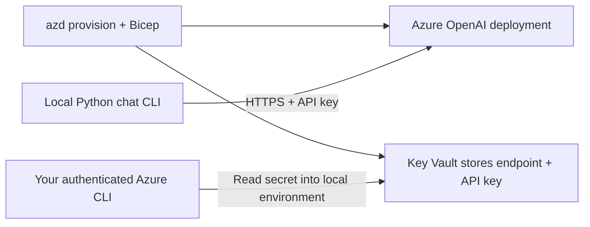

# Azure OpenAI Chat — CLI địa phương và Hạ tầng AZD

**Cấp độ:** Trung cấp · **Thời gian:** 35–60 phút bao gồm cả cài đặt

Mẫu này cung cấp một **tài nguyên Azure OpenAI và Key Vault**, sau đó chạy một
CLI trò chuyện Python tương tác **trên máy của bạn**. Nó không lưu trữ ứng dụng web
hoặc Container App. Mô hình mặc định là `gpt-4.1`, phiên bản `2025-04-14`, với
công suất triển khai `GlobalStandard` là 20. Kiểm tra khả năng sẵn có và hạn mức hiện tại trong
khu vực bạn chọn trước khi cung cấp; ngày vòng đời mô hình có thể thay đổi.

## Mục tiêu học tập

- Cung cấp hạ tầng mô hình bằng Bicep và azd.
- Lấy khóa API từ Key Vault mà không cần đưa nó vào đầu ra triển khai.
- Gửi yêu cầu Chat Completions và duy trì lịch sử hội thoại.
- Giải thích số lượng token và các giới hạn của ước tính chi phí.



Mẫu này không có tích hợp runtime managed-identity, chuyển đổi dự phòng đa khu vực, giới hạn tỉ lệ tùy chỉnh,
chế độ phát trực tiếp, hoặc tính toán được lưu trữ. SDK OpenAI thực hiện tối đa hai lần thử lại cho các lỗi có thể thử lại;
CLI báo cáo các lỗi còn lại.

## Yêu cầu trước

- Phiên bản ổn định hiện tại của [azd](https://learn.microsoft.com/azure/developer/azure-developer-cli/install-azd)
  (phiên bản phát hành tại thời điểm xem xét: 1.37.2).
- [Azure CLI](https://learn.microsoft.com/cli/azure/install-azure-cli).
- Python **3.10+** (khuyến nghị 3.11) và một môi trường ảo.
- Một đăng ký Azure với quyền tạo các dịch vụ Cognitive Services và Key Vault
  tài nguyên, triển khai mô hình và đọc các bí mật trong vault.
- Khả năng sẵn có theo vùng và hạn mức `GlobalStandard` cho `gpt-4.1`. Yêu cầu truy cập
  phụ thuộc vào đăng ký và tính năng; không có thời gian phê duyệt được đảm bảo.

```bash
azd version
az version
python --version
azd auth login
az login
```

Đây là các phiên xác thực riêng biệt. Chọn cùng một subscription trong cả hai
công cụ trước khi chạy các lệnh bên dưới.

## Bắt đầu nhanh (Bash)

Chạy từ thư mục gốc của kho lưu trữ:

```bash
cd examples/azure-openai-chat
azd env new myopenai
azd provision
```

Chọn một khu vực được hỗ trợ. Việc cung cấp tài nguyên tạo một nhóm tài nguyên, tài khoản OpenAI,
triển khai mô hình, Key Vault, và các bí mật `openai-endpoint`/`openai-api-key`.
Không có **dịch vụ nào để triển khai** trong `azure.yaml`.

Tải các đầu ra không phải bí mật và lấy bí mật vào shell hiện tại của bạn:

```bash
export AZURE_OPENAI_ENDPOINT="$(azd env get-value AZURE_OPENAI_ENDPOINT)"
export AZURE_OPENAI_MODEL="$(azd env get-value AZURE_OPENAI_MODEL)"
KV_NAME="$(azd env get-value AZURE_KEY_VAULT_NAME)"
export AZURE_OPENAI_API_KEY="$(az keyvault secret show \
  --vault-name "$KV_NAME" --name openai-api-key --query value --output tsv)"

python -m venv .venv
source .venv/bin/activate
python -m pip install -r src/requirements.txt
python src/chat.py
```

Trong PowerShell, kích hoạt với `.\.venv\Scripts\Activate.ps1` và gán biến môi trường
với `$env:AZURE_OPENAI_ENDPOINT = azd env get-value AZURE_OPENAI_ENDPOINT`
(và tương tự cho mô hình). Lấy khóa API sử dụng
`$env:AZURE_OPENAI_API_KEY = az keyvault secret show --vault-name $KV_NAME --name openai-api-key --query value -o tsv`.
Đặt `$KV_NAME = azd env get-value AZURE_KEY_VAULT_NAME` trước.

Không in ra, cam kết, hoặc dán khóa API vào các báo cáo sự cố. CLI đọc các biến môi trường của tiến trình;
nó **không** lấy các bí mật từ Key Vault hoặc tải các tệp `.env`.
`config.py` xác thực điểm cuối, giới hạn token, và nhiệt độ khi khởi động.

Kết quả mong đợi (nội dung và sử dụng có thể khác nhau):

```text
Azure OpenAI Chat Application
Model: gpt-4.1
...
You: Say hello in one sentence.
Assistant: Hello! How can I help you today?
[Tokens: ... | Cost: $...]
```

Các lệnh: `stats` hiển thị tổng, `clear` xóa lịch sử hội thoại, và
`quit`/`exit` kết thúc phiên. Không có lệnh `--stream`, `--show-tokens`, `tokens`,
hoặc `cost`.

## Xác minh việc triển khai

Sau khi tải các biến shell ở trên:

```bash
curl --fail-with-body \
  "${AZURE_OPENAI_ENDPOINT%/}/openai/deployments/${AZURE_OPENAI_MODEL}/chat/completions?api-version=2024-10-21" \
  -H "Content-Type: application/json" \
  -H "api-key: $AZURE_OPENAI_API_KEY" \
  -d '{"messages":[{"role":"user","content":"Say hello!"}],"max_tokens":50}'

az keyvault secret list --vault-name "$KV_NAME" --query "[].name" -o table
```

Thành công: API trả về HTTP 200 với `choices[0].message.content` và `usage`;
kho lưu trữ liệt kê `openai-api-key` và `openai-endpoint`. Một triển khai ARM thành công
một mình không xác minh được sự suy luận.

## Tệp và cấu hình

```text
azure.yaml                         # Infrastructure-only AZD project
infra/main.bicep                   # Subscription deployment
infra/main.parameters.json         # Environment, location, principal ID
infra/resources/openai.bicep       # Account + model
infra/resources/keyvault.bicep     # Vault + deploying user's secret access policy
infra/resources/secrets.bicep      # Writes secrets, no key output
src/chat.py                        # Interactive CLI
src/config.py                      # Environment validation
src/requirements.txt               # Python packages
```

Để thay đổi mô hình/phiên bản/công suất đã cấp, chỉnh sửa mặc định trong
`infra/main.bicep` và chạy `azd provision`. Việc đặt `AZURE_OPENAI_MODEL` trong
shell của bạn chỉ chọn **tên triển khai hiện có**; nó không triển khai mô hình khác.

| Biến thời gian chạy | Mặc định / nguồn |
|---|---|
| `AZURE_OPENAI_ENDPOINT` | Bắt buộc; đầu ra không bí mật azd |
| `AZURE_OPENAI_API_KEY` | Bắt buộc; lấy từ Key Vault |
| `AZURE_OPENAI_MODEL` | `gpt-4.1`; tên triển khai Azure |
| `AZURE_OPENAI_MAX_TOKENS` | 800 (phạm vi xác thực 1–4096) |
| `AZURE_OPENAI_TEMPERATURE` | 0.7 (phạm vi 0–2) |
| `AZURE_OPENAI_INPUT_PRICE_PER_1K` | 0.002 USD; tỷ lệ đầu vào chưa cache minh họa |
| `AZURE_OPENAI_OUTPUT_PRICE_PER_1K` | 0.008 USD; tỷ lệ đầu ra minh họa |

## Chi phí và giới hạn bảo mật

Hiển thị chi phí là một **ước tính**, không phải hóa đơn Azure. Nó nhân lượng token API
sử dụng với các tỷ lệ đã cấu hình và không tính đến giảm giá đầu vào đã được cache,
khác biệt vùng/kích thước SKU, thuế, thay đổi giá hoặc các cuộc gọi thất bại/thử lại.
Ghi đè **cả hai tỷ lệ** khi sử dụng mô hình hoặc SKU khác và xác minh
[bảng giá Azure OpenAI hiện tại](https://azure.microsoft.com/pricing/details/cognitive-services/openai-service/).

Ví dụ minh họa, 100 yêu cầu sử dụng 500 token đầu vào chưa được lưu bộ nhớ đệm và 200 token đầu ra mỗi yêu cầu
với mức phí mặc định là `100 × (500/1000 × .002 + 200/1000 × .008) = $0.26`.
Các hoạt động Key Vault/lưu trữ chịu phí riêng. Không có phí cố định 50$/tháng
cho CLI cục bộ này và không có máy chủ xử lý trong mẫu.

Vault sử dụng chính sách truy cập cho chủ thể triển khai; đây không phải là ví dụ ứng dụng RBAC hoặc
quản lý danh tính. Các điểm cuối công khai và xác thực bằng khóa API
được sử dụng cho mục đích giảng dạy. Hạn chế quyền và thêm các kiểm soát danh tính/mạng phù hợp
trước khi điều chỉnh cho môi trường sản xuất.

## Các bài tập thực hành

### 1. Xác minh ngữ cảnh và đặt lại nó

**Bắt đầu:** chạy CLI. **Mục tiêu:** quan sát lịch sử.
Nói “Nhớ từ cedar,” sau đó hỏi “Từ nào tôi đã yêu cầu bạn nhớ?”
Chạy `stats`; hai lượt thành công nên tính là hai tin nhắn đã trao đổi.
Chạy `clear` và `stats`; các tin nhắn đã trao đổi sẽ là không (tổng token vẫn giữ nguyên).
Cách diễn đạt chính xác của mô hình không mang tính xác định.

### 2. Thay đổi giới hạn phản hồi

**Bắt đầu:** thoát CLI, giữ nguyên shell.
Chạy `export AZURE_OPENAI_MAX_TOKENS=100`, khởi động lại `python src/chat.py`, và hỏi
một lời giải thích ngắn gọn về azd. Kiểm tra rằng biểu ngữ hiển thị 100.
Phục hồi với `unset AZURE_OPENAI_MAX_TOKENS`. Giới hạn phản hồi nhỏ hơn không
làm giảm số token lịch sử đã gửi.

### Các vấn đề phổ biến

- **Thiếu biến môi trường:** việc cung cấp không xuất giá trị shell;
  lặp lại các bước xuất. Một terminal mới cần các biến này lại.
- **403 đọc Key Vault:** xác minh đăng ký/đăng nhập Azure CLI và chủ thể
  trong chính sách truy cập kho. Việc thay đổi chính sách có thể mất thời gian để truyền đi.
- **404 suy luận:** kiểm tra tên triển khai, điểm cuối và trạng thái triển khai.
- **429 suy luận:** chờ giới hạn tần suất đặt lại; xác minh hạn ngạch mô hình theo khu vực.
  CLI loại bỏ các lượt thất bại khỏi lịch sử nên việc thử lại sẽ không gây trùng lặp.
- **Độ dài ngữ cảnh:** mẫu không cắt bớt các cuộc trò chuyện dài; sử dụng `clear`.
- **Mô hình không khả dụng/ngưng sử dụng:** tham khảo tình trạng sẵn có của mô hình hiện tại và cập nhật
  mô hình/phiên bản/SKU cùng nhau; phiên bản API và phiên bản mô hình là các thiết lập khác nhau.

## Dọn dẹp và các bước tiếp theo

```bash
azd down
unset AZURE_OPENAI_API_KEY
```

Giữ lại xóa mềm của Key Vault là bảy ngày; việc xoá hoàn toàn đòi hỏi quyền riêng biệt.
Không có bộ kiểm thử cam kết; không chạy lệnh `pytest tests/` không tồn tại.
Thêm kiểm thử API mô phỏng trước khi mở rộng mã.

[Ví dụ Container](../../../../examples/container-app) · [Kiến trúc bán lẻ mẫu](../retail-scenario.md) ·
[Trang khóa học](../../README.md) · [Báo cáo sự cố](https://github.com/microsoft/AZD-for-beginners/issues)

---

<!-- CO-OP TRANSLATOR DISCLAIMER START -->
**Tuyên bố miễn trừ trách nhiệm**:
Tài liệu này đã được dịch bằng dịch vụ dịch thuật AI [Co-op Translator](https://github.com/Azure/co-op-translator). Mặc dù chúng tôi cố gắng đảm bảo độ chính xác, xin lưu ý rằng bản dịch tự động có thể chứa lỗi hoặc sai sót. Tài liệu gốc bằng ngôn ngữ gốc nên được coi là nguồn tin chính thức. Đối với thông tin quan trọng, nên sử dụng dịch vụ dịch thuật chuyên nghiệp bởi con người. Chúng tôi không chịu trách nhiệm về bất kỳ hiểu lầm hoặc giải thích sai nào phát sinh từ việc sử dụng bản dịch này.
<!-- CO-OP TRANSLATOR DISCLAIMER END -->