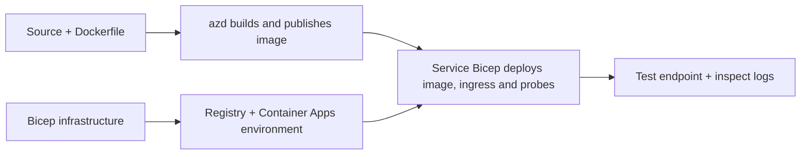

# Ví dụ Triển khai Ứng dụng Container với AZD

Thư mục này chứa hai mẫu học với mã nguồn, Dockerfiles,
hạ tầng Bicep và `azure.yaml`. Không cái nào được chuẩn bị cho sản xuất.

## Chọn một ví dụ

| Mẫu | Những gì đã triển khai | Yêu cầu trước |
|---|---|---|
| [Simple Flask API](../../../../examples/container-app/simple-flask-api) | API CRUD Python đơn giản, các mục trong bộ nhớ, probes trạng thái, scale HTTP | Kiến thức cơ bản về CLI và HTTP |
| [Two-service microservices](../../../../examples/container-app/microservices) | Gateway Node.js, dịch vụ sản phẩm Python chỉ đọc nội bộ, thu thập đo lường và scaling | Hoàn thành mẫu đơn dịch vụ trước |

Dự phòng 30–60 phút bao gồm cài đặt và kiểm tra. Thời gian cấp phát Azure thay đổi.

## Yêu cầu trước

- [Azure Developer CLI](https://learn.microsoft.com/azure/developer/azure-developer-cli/install-azd)
- [Azure CLI](https://learn.microsoft.com/cli/azure/install-azure-cli) cho các lệnh kiểm tra
- Docker với daemon đang chạy để xây dựng các ảnh container này
- Một đăng ký Azure có quyền tạo tài nguyên và đủ hạn mức khu vực
- Bash cho các ví dụ shell, hoặc các lệnh PowerShell tương đương

```bash
azd version
az version
docker info
azd auth login
az login
```

Hai công cụ có phiên đăng nhập riêng biệt. Sử dụng azd ổn định hiện tại; phiên bản
phát hành hiện tại vào thời điểm đánh giá là 1.37.2. Các yêu cầu phiên bản tối thiểu cũ hơn không phải là
đảm bảo tương thích.

## Bắt đầu nhanh

Từ thư mục gốc của kho lưu trữ:

```bash
cd examples/container-app/simple-flask-api
azd env new flask-demo
azd up
API_URL=$(azd env get-value API_ENDPOINT)
curl --fail-with-body "${API_URL}/health"
```

Mong đợi: HTTP 200 với `"status": "healthy"`. Làm theo README mẫu để tạo,
đọc, cập nhật và xóa một mục, cũng như kiểm tra nhật ký.



Việc cung cấp ban đầu sử dụng ảnh hello-world công khai trên cổng 80. Các tệp
tham số Bicep cụ thể cho dịch vụ cho phép `azd deploy` thay thế nó bằng ảnh ứng dụng đã xây dựng
và cổng/probes ứng dụng chính xác (8000 cho Flask/sản phẩm, 8080 cho gateway).
Giữ các tệp này với các thiết lập `azure.yaml` `module` của chúng.

## Cấu hình: điều gì thay đổi điều gì

`azure.yaml` chọn thư mục nguồn, ngôn ngữ, máy chủ và các mô-đun triển khai.
CPU/bộ nhớ container, ingress, probes, số bản sao và quy tắc mở rộng được định nghĩa
trong **Bicep**, không phải các thuộc tính dịch vụ `resources`, `scale` hay `regions` tùy ý.

`azd env set SOME_VALUE ...` lưu trữ một giá trị cục bộ. Nó chỉ thay đổi một
tài nguyên đã triển khai khi một tham số, ánh xạ môi trường hoặc hook rõ ràng tiêu thụ giá trị đó.
Các ví dụ này không tiêu thụ `MAX_REPLICAS`, `SCALE_TO_ZERO_TIMEOUT`,
`CONTAINER_APP_REPLICA_TYPE` hay các thiết lập canary tùy chỉnh từ các giá trị môi trường azd.
Chỉnh sửa Bicep liên quan và chạy `azd up` để cung cấp lại và triển khai.

Không đặt mã nguồn ứng dụng dưới `infra/`. `project` phải trỏ đến thư mục
chứa Dockerfile và bản kê khai phụ thuộc.

## Giám sát và chi phí

- `azd monitor --logs` mở cửa sổ cổng thông tin; nó không phải là luồng nhật ký terminal.
  Sử dụng `az containerapp logs show --follow` với tên tài nguyên thực tế.
- API đơn giản ghi nhật ký stdout được thu thập qua Container Apps/Log Analytics.
  Tài nguyên Application Insights được cung cấp không được tự động cài đặt công cụ.
- Gateway microservices sử dụng SDK Application Insights Node.js; dịch vụ Python
  xuất các lược đồ nhật ký ứng dụng. Việc truy vết đầy đủ yêu cầu/phụ thuộc của Python
  chưa được cấu hình.
- Tính năng scale-to-zero có thể giảm chi phí điện toán, nhưng chi phí đăng ký và thu thập/lưu trữ
  nhật ký vẫn có thể phát sinh. Các thiết lập mặc định microservices giữ các bản sao đang chạy.
  Ước tính khu vực và mức sử dụng của bạn trong
  [bộ tính toán giá Azure](https://azure.microsoft.com/pricing/calculator/).

## Mẫu nâng cao — các triển khai không bao gồm

Đây là các hướng thiết kế, không phải dự án cục bộ bổ sung hay đoạn mã sao chép để chạy nhanh:

- **Dữ liệu bền vững và xác thực:** thay thế bộ nhớ trong RAM và thêm
  xác thực/ủy quyền Microsoft Entra ID trước khi triển khai sản xuất.
- **Blue-green/canary:** sử dụng chế độ nhiều phiên bản Container Apps, nhãn phiên bản,
  trọng số lưu lượng, xác minh sức khỏe và quy trình phục hồi.
  Không có cấu hình `deploymentStrategy: canary` azd trong các ví dụ này.
  Xem [quản lý phiên bản](https://learn.microsoft.com/azure/container-apps/revisions).
- **Đa khu vực:** tạo môi trường và ứng dụng riêng biệt trong Bicep và thiết kế
  định tuyến toàn cầu và độ nhất quán dữ liệu. Danh sách dịch vụ `regions` không phải là cơ chế triển khai azd.

- **Worker hàng đợi:** thêm mã nguồn worker, phụ thuộc, nguồn hàng đợi, danh tính quản lý
  với vai trò mặt dữ liệu, và quy tắc mở rộng được xác thực. Không sao chép
  một đường `src/worker` trống rồi mong đợi có một dự án chạy được.
- **Dapr:** cung cấp các thành phần, cấu hình sidecar, cài đặt SDK tương ứng,
  và triển khai xử lý lỗi trạng thái/pub-sub.
- **Bí mật:** sử dụng danh tính được quản lý và gán vai trò khi có thể. Chỉ đơn giản tạo
  một Key Vault không cấp quyền truy cập hay tải bí mật cho ứng dụng.

## Dọn dẹp

Từ thư mục mẫu:

```bash
azd down
```

Xem lại các lời nhắc xóa và xác nhận nhóm tài nguyên dành riêng đã được gỡ bỏ.
Không sử dụng các ví dụ này làm cơ sở sản xuất mà không có thiết kế và kiểm thử bổ sung.

[Mục lục ví dụ](../README.md) · [Trang khóa học](../../README.md) ·
[Tài liệu Container Apps](https://learn.microsoft.com/azure/container-apps/) ·
[Báo cáo lỗi](https://github.com/microsoft/AZD-for-beginners/issues)

---

<!-- CO-OP TRANSLATOR DISCLAIMER START -->
**Tuyên bố miễn trừ trách nhiệm**:
Tài liệu này đã được dịch bằng dịch vụ dịch thuật AI [Co-op Translator](https://github.com/Azure/co-op-translator). Mặc dù chúng tôi cố gắng đảm bảo độ chính xác, xin lưu ý rằng bản dịch tự động có thể chứa lỗi hoặc sai sót. Tài liệu gốc bằng ngôn ngữ gốc nên được coi là nguồn tin chính thức. Đối với thông tin quan trọng, nên sử dụng dịch vụ dịch thuật chuyên nghiệp bởi con người. Chúng tôi không chịu trách nhiệm về bất kỳ hiểu lầm hoặc giải thích sai nào phát sinh từ việc sử dụng bản dịch này.
<!-- CO-OP TRANSLATOR DISCLAIMER END -->