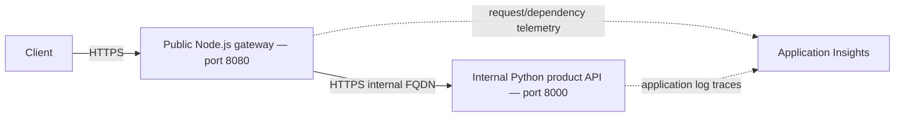

# Microservices Hai Dịch Vụ — Azure Container Apps

**Cấp độ:** Trung cấp · **Thời gian:** 45–60 phút bao gồm thiết lập

Mẫu học này triển khai **Node.js API Gateway** và **Dịch vụ Sản phẩm Python chỉ đọc**. Bao gồm mã nguồn, Dockerfiles, Bicep và cấu hình azd.

Đây không phải là hệ thống đã được củng cố cho sản xuất.

## Những gì bạn sẽ học

- Triển khai hai dịch vụ độc lập.
- Sử dụng FQDN backend nội bộ qua HTTPS.
- Xác nhận các phản hồi thành công, không tìm thấy và dịch vụ không khả dụng.
- Hiểu về phép đo và giới hạn mở rộng độc lập.



Danh mục sản phẩm chứa năm sản phẩm cố định trong bộ nhớ. Không có **bộ xử lý POST,
PUT, hoặc DELETE**, cơ sở dữ liệu, Service Bus, dịch vụ đơn hàng/người dùng/thông báo,
mã C# hoặc Go. Đó là các ý tưởng phát triển trong tương lai, không phải tính năng được bao gồm.
Cổng không xác thực người dùng; luồng vào nội bộ không thay thế
cho việc ủy quyền ứng dụng.

## Yêu cầu trước

Hoàn thành [API Flask đơn](../../../../../examples/container-app/simple-flask-api) trước.
Cài đặt azd ổn định hiện tại (phiên bản phát hành tại thời điểm đánh giá: 1.37.2), Azure CLI,
và Docker với daemon đang chạy. Bạn cần một đăng ký Azure, quyền tạo tài nguyên,
và hạn ngạch khu vực Container Apps.

```bash
azd version
az version
docker info
azd auth login
az login
```

Sử dụng cùng một đăng ký trong cả hai công cụ CLI. Các lệnh dưới đây dùng Bash.

## Triển khai và xác minh

Từ thư mục gốc kho lưu trữ:

```bash
cd examples/container-app/microservices
azd env new microservices-demo
azd up
GATEWAY_URL=$(azd env get-value API_GATEWAY_URL)
RG_NAME=$(azd env get-value AZURE_RESOURCE_GROUP)
GATEWAY_NAME=$(azd env get-value API_GATEWAY_NAME)
PRODUCT_NAME=$(azd env get-value PRODUCT_SERVICE_NAME)

curl --fail-with-body "${GATEWAY_URL}/health"
curl --fail-with-body "${GATEWAY_URL}/api/products"
curl --fail-with-body "${GATEWAY_URL}/api/products/1"
curl -i "${GATEWAY_URL}/api/products/999"
```

**Thành công:** health 200; list 200 với **năm** sản phẩm; sản phẩm 1 là Laptop
với giá 999.99 và tồn kho 50; sản phẩm không tồn tại trả về 404.
Mô tả được bao gồm trong phản hồi; dấu thời gian khác nhau.

Việc cung cấp ban đầu sử dụng hình ảnh hello-world công khai trên cổng 80 để không cố gắng
kéo các hình ảnh không tồn tại từ đăng ký rỗng. Các mô-đun Bicep dịch vụ cụ thể
và tập tin tham số thay thế chúng bằng hình ảnh đã xây dựng và cổng/đảm bảo ứng dụng trong
`azd deploy`. Các tham số chính giữ nguyên tên hình ảnh đã xuất bản cho việc cung cấp sau này.

## Dịch vụ và mạng

| Dịch vụ | Điểm cuối được phơi bày | Tài nguyên mặc định |
|---|---|---|
| Gateway | GET `/`, `/health`, `/api/products`, `/api/products/:id` | 1 vCPU, 2 GiB, 2–20 bản sao |
| Product | GET `/`, `/health`, `/products`, `/products/<id>` | 0.5 vCPU, 1 GiB, 1–10 bản sao |

Luồng vào sản phẩm có `external: false` và `allowInsecure: false`. Bicep tiêm
`PRODUCT_SERVICE_URL=https://<actual-internal-fqdn>` vào gateway. HTTP sẽ
chuyển hướng; HTTPS khớp với luồng vào đã cấu hình. Tên DNS ngắn phải khớp với
**tên Container App thực tế**, không phải khóa dịch vụ logic `product-service`.
Không cố gắng gọi URL nội bộ trực tiếp từ máy tính xách tay của bạn.

Gateway có thời gian chờ năm giây cho các cuộc gọi sản phẩm. ID sản phẩm thiếu
được chuyển tiếp như 404; lỗi vận chuyển/lỗi backend khác trả về 503. Gateway
`/health` chỉ kiểm tra gateway, không kiểm tra tính khả dụng backend.

## Tập tin và cấu hình

```text
azure.yaml
infra/main.bicep
infra/main.parameters.json
infra/abbreviations.json
infra/core/container-apps-environment.bicep
infra/core/monitor.bicep
infra/app/api-gateway.bicep
infra/app/api-gateway.parameters.json
infra/app/product-service.bicep
infra/app/product-service.parameters.json
src/api-gateway/{app.js,package.json,Dockerfile}
src/product-service/{main.py,requirements.txt,Dockerfile}
```

Tăng giảm quy mô, CPU/bộ nhớ, cổng và kiểm tra được đặt trong `infra/app/*.bicep`. Thay đổi các
tập tin đó và chạy `azd up` để áp dụng hạ tầng và triển khai lại. Không có
tham số biến môi trường `GATEWAY_MAX_REPLICAS` trong mẫu này.

Đối với các thay đổi chỉ mã:

```bash
azd deploy product-service
azd deploy api-gateway
```

Hình ảnh Node sử dụng Node 22; hình ảnh Python sử dụng Python 3.11. Cả hai đều liên kết với
`0.0.0.0`. Luồng vào/kiểm tra sử dụng cổng 8080 (gateway) và 8000 (product), tương ứng.

## Phát triển cục bộ với Docker

Chạy từ thư mục ví dụ này. Sử dụng mạng do người dùng định nghĩa, **không phải `localhost`
từ một container để kết nối với container khác**:

```bash
docker network create azd-microservices-demo
docker build -t local-product ./src/product-service
docker build -t local-gateway ./src/api-gateway
docker run -d --name azd-product --network azd-microservices-demo local-product
docker run -d --name azd-gateway --network azd-microservices-demo \
  -p 8080:8080 -e PRODUCT_SERVICE_URL=http://azd-product:8000 local-gateway
curl --fail-with-body http://localhost:8080/api/products
```

Mong đợi: năm sản phẩm. HTTP chỉ được dùng cho mạng Docker cục bộ này.

```bash
docker stop azd-product azd-gateway
docker rm azd-product azd-gateway
docker network rm azd-microservices-demo
```

## Giám sát

```bash
az containerapp logs show --name "$GATEWAY_NAME" --resource-group "$RG_NAME" --follow
# In a separate terminal:
az containerapp logs show --name "$PRODUCT_NAME" --resource-group "$RG_NAME" --tail 100
```

`azd monitor --logs` mở một trang cổng; nó không phát trực tiếp nhật ký terminal.
SDK Node thu thập yêu cầu/phụ thuộc gateway. SDK `AzureLogHandler` Python
xuất **theo dõi nhật ký**, không phải yêu cầu Flask tự động, phụ thuộc SQL, hoặc theo dõi phân phối đầy đủ.
OpenCensus là SDK cũ; ưu tiên Azure Monitor OpenTelemetry
khi mở rộng mẫu này.

Trong Application Insights Logs, tạo yêu cầu và kiểm tra:

```kusto
requests
| where timestamp > ago(1h)
| where name contains "products"
| summarize RequestCount=count(), AvgDuration=avg(duration) by bin(timestamp, 5m)
```

Đối với các thông điệp ứng dụng Python:

```kusto
traces
| where timestamp > ago(1h)
| where message contains "products"
| project timestamp, message, severityLevel
```

Cho phép trễ thu thập và lấy mẫu; không mong đợi số lượng yêu cầu chính xác hoặc
độ trễ được đảm bảo. Không có cảnh báo tùy chỉnh hoặc bảng điều khiển nào được cấu hình.

## Bài tập thực hành

### Bài tập 1: Sửa đổi danh mục

**Điểm xuất phát:** `src/product-service/main.py`.
**Mục tiêu:** xác minh triển khai dịch vụ độc lập.
Thay đổi số lượng Laptop trong kho từ 50 xuống 49 trong danh sách cố định `products`, chạy
`azd deploy product-service`, sau đó yêu cầu `${GATEWAY_URL}/api/products/1`.

**Tiêu chí thành công / giải pháp:** HTTP 200 với `"stock":49`. Khôi phục về 50 và triển khai lại.
**Vấn đề phổ biến:** chỉnh sửa gateway thay vì dịch vụ sở hữu danh mục.
Điều này thay đổi dữ liệu nguồn, không phải cơ sở dữ liệu tồn kho có tính bền vững.

### Bài tập 2: Xác minh cấu hình bản sao

**Điểm xuất phát:** `infra/app/product-service.bicep`.
**Mục tiêu:** quan sát thay đổi hạ tầng mà không đoán mò về autoscaling.
Thay đổi `minReplicas: 1` thành `minReplicas: 2`, chạy `azd up`, sau đó:

```bash
az containerapp show --name "$PRODUCT_NAME" --resource-group "$RG_NAME" \
  --query properties.template.scale -o json
```

**Tiêu chí thành công:** cấu hình tối thiểu là 2 và tối đa vẫn giữ 10.
Khôi phục tối thiểu 1 và chạy `azd up`.
**Vấn đề phổ biến:** `azd deploy` một mình không áp dụng thay đổi cho hạ tầng chia sẻ không liên quan.
Không đặt `maxReplicas` thành zero như mô phỏng lỗi.
Điều này xác minh cấu hình, không phải bài kiểm tra tải hoặc số lượng bản sao tức thời được đảm bảo.

### Bài tập 3: Thử kiểm tra xử lý dịch vụ không khả dụng cục bộ

**Điểm xuất phát:** cả hai container Docker cục bộ bên trên đang chạy.
**Mục tiêu:** phân biệt lỗi backend với sản phẩm không tồn tại.
Dừng chỉ container sản phẩm:

```bash
docker stop azd-product
curl -i http://localhost:8080/api/products
docker start azd-product
curl --fail-with-body http://localhost:8080/api/products
```

**Tiêu chí thành công:** trong khi dừng, gateway trả về 503 với
`"error":"Product service unavailable"`; sau khi khởi động lại, danh sách trả về 200.
Thử lại sau một độ trễ khởi động ngắn nếu cần.
**Vấn đề phổ biến:** dừng gateway thử nghiệm lỗi khác (không phản hồi HTTP).

## Chi phí và khoảng cách sản xuất

Các bản sao tối thiểu mặc định giữ cho máy tính chạy. Registry và giám sát cũng phát sinh
chi phí. Không có tổng cố định đã xác thực $50/tháng: ước tính CPU/bộ nhớ khu vực,
giờ bản sao, yêu cầu, registry và lưu trữ nhật ký trong
[bộ tính giá Azure](https://azure.microsoft.com/pricing/calculator/).
Xóa tài nguyên học tập kịp thời.

Công việc sản xuất bao gồm xác thực/ủy quyền, danh tính được quản lý theo phạm vi,
dữ liệu bền vững, xác thực đầu vào/phản hồi, công cụ đo khả năng quan sát được hỗ trợ,
kiểm tra tải/lỗi, CI/CD, cảnh báo, và quy trình khôi phục. Thêm dịch vụ đặt hàng,
hàng đợi hoặc cơ sở dữ liệu là một nhiệm vụ thực hiện riêng biệt, không phải bài tập hoàn chỉnh
hoặc tính năng đã có sẵn ở đây.

## Xử lý sự cố và dọn dẹp

- **Không tìm thấy ảnh trong lần cung cấp đầu tiên:** bootstrap nên sử dụng ảnh công khai;
  kiểm tra các tham số ảnh chính mặc định và ánh xạ mô-đun triển khai.
- **503 sản phẩm:** kiểm tra nhật ký sản phẩm, phiên bản ảnh, và URL HTTPS nội bộ được tiêm.
- **404 đường dẫn không mong đợi:** API sản phẩm chỉ đọc; xác thực tuyến đường, không phải trình xử lý CRUD không tồn tại.
- **Không có dữ liệu điều khiển:** kiểm tra chuỗi kết nối thời gian chạy mà không làm lộ chúng và
  cho phép trễ thu thập. Bảng yêu cầu Python không được bảng ghi nhật ký của nó điền.

Từ thư mục mẫu này:

```bash
azd down
```

Xem lại các lời nhắc xóa và xác minh nhóm tài nguyên chuyên dụng đã được xóa.

[Trước: Flask API](../../../../../examples/container-app/simple-flask-api) · [Tiếp: Ứng dụng cơ sở dữ liệu](../../../../../examples/database-app) ·
[Phát triển AI](../../../docs/chapter-02-ai-development/README.md) ·
[Trang khóa học](../../../README.md) · [Báo cáo sự cố](https://github.com/microsoft/AZD-for-beginners/issues)

---

<!-- CO-OP TRANSLATOR DISCLAIMER START -->
**Tuyên bố miễn trừ trách nhiệm**:
Tài liệu này đã được dịch bằng dịch vụ dịch thuật AI [Co-op Translator](https://github.com/Azure/co-op-translator). Mặc dù chúng tôi cố gắng đảm bảo độ chính xác, xin lưu ý rằng bản dịch tự động có thể chứa lỗi hoặc sai sót. Tài liệu gốc bằng ngôn ngữ gốc nên được coi là nguồn tin chính thức. Đối với thông tin quan trọng, nên sử dụng dịch vụ dịch thuật chuyên nghiệp bởi con người. Chúng tôi không chịu trách nhiệm về bất kỳ hiểu lầm hoặc giải thích sai nào phát sinh từ việc sử dụng bản dịch này.
<!-- CO-OP TRANSLATOR DISCLAIMER END -->